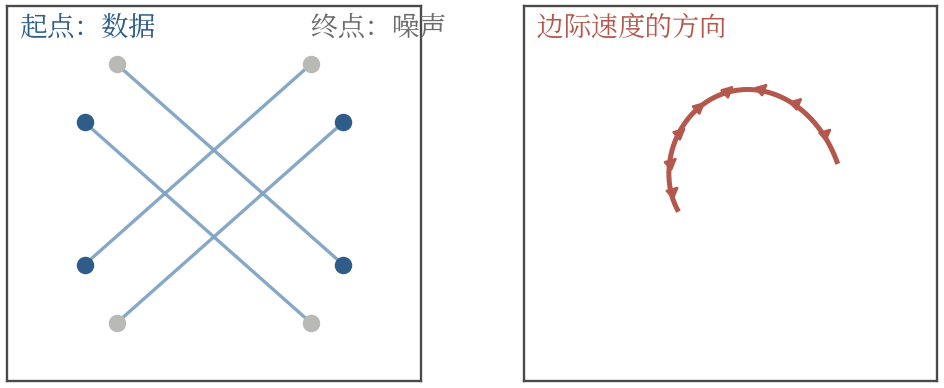
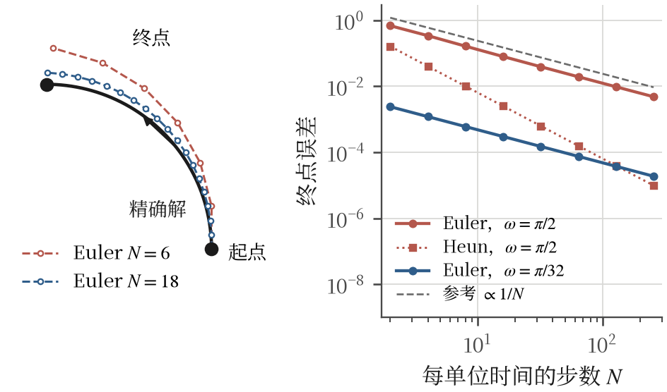

# 从一条路径说起

生成模型要做的事只有一件：把一个容易采样的分布，变成数据的分布。噪声分布好采样，数据分布不好采样，所以问题就变成找一条从噪声到数据的路。

这一章把这条路写成数学，并把后面要用到的记号一次定下来。如果你已经熟悉扩散模型，可以只看最后两节的约定。

## 一个具体的图像

想象二维平面上有两团点。一团是标准高斯，散在原点周围；另一团是数据，集中在一条弯曲的细线上。任务是：从高斯里取一个点，把它挪到那条线上，而且落点要符合数据的分布。

一个直接的想法是画一条曲线，从每个噪声点连到它对应的数据点。可是“对应”这件事本身不清楚：一个噪声点应该连到哪个数据点？不同的连法会得到不同的曲线，也会得到不同的映射。

生成模型的分歧，很大程度上就来自这里：怎么定义这个对应关系，以及怎么把定义出来的关系学出来。

还有一层麻烦：自然图像落在像素空间里一个维数低得多的子集上。$512\times512$ 的 RGB 图有 78 万个数，但“像照片的”图只占其中极小一片。噪声点和数据点之间不可能建立一对一的对应——一个噪声点落到某个数据点，那其他数据点就没有噪声点可来。所以这里要找的不是点对点的映射，而是分布到分布的映射：映射完之后，落点的**整体**分布要和数据一致，单看某一个点落在哪并不重要。这条要求听上去比点对点宽松，代价是“正确”不再是逐点可比对的，只能靠分布层面的统计量来检验。

## 把路径写成函数

设噪声是 $x_1$，数据是 $x_0$。把中间状态记作 $x_t$，$t$ 从 1 走到 0 表示从噪声走到数据。一种常见的构造是线性插值

$$x_t = (1-t)\,x_0 + t\,x_1.$$

固定一对 $(x_0, x_1)$，这是一条直线。把所有配对放在一起看，就得到一族线段；它们整体覆盖了从数据到噪声的过渡。

对 $t$ 求导，得到这条路径上的速度

$$v_t = \frac{dx_t}{dt} = x_1 - x_0.$$

这个速度是常数，方向从数据指向噪声。采样时反过来走，沿着 $-v_t$ 从噪声回到数据。

更一般地，插值系数不必是 $1-t$ 与 $t$。写成

$$x_t = \alpha_t\,x_0 + \sigma_t\,x_1,\qquad \alpha_0 = 1,\ \sigma_0 = 0,\ \alpha_1 = 0,\ \sigma_1 = 1,$$

只要 $\alpha_t$ 从 1 降到 0、$\sigma_t$ 从 0 升到 1，就得到一条从数据过渡到噪声的连续曲线。$\alpha_t$、$\sigma_t$ 是标量，对 $t$ 求导时可以直接提出去：

$$v_t = \dot\alpha_t\,x_0 + \dot\sigma_t\,x_1.$$

线性插值对应 $\alpha_t = 1-t$、$\sigma_t = t$，于是 $\dot\alpha_t = -1$、$\dot\sigma_t = 1$，正好回到 $x_1 - x_0$。换一组系数，速度就换一个样子。取 $\alpha_t = \sqrt{1-t}$、$\sigma_t = \sqrt{t}$（这是方差保持日程的一种写法，第 3 章会再遇到），得到

$$v_t = -\frac{x_0}{2\sqrt{1-t}} + \frac{x_1}{2\sqrt{t}}.$$

这个速度在两端都会发散：$t\to0$ 时第一项无界，$t\to1$ 时第二项无界。原因是 $\sqrt{t}$ 在 0 附近的变化率无穷大，路径一离开端点就窜得很快。发散不是数学上的小毛病，它直接决定了采样器必须在两端留一点余量，不能把 $t$ 一直推到 0 或 1。

一维上取 $x_0 = 0.4$、$x_1 = -1.2$，两种日程在 $t=0.75$ 处的差别可以直接算出来。直线路径给 $x_t = 0.4 - 1.6\times0.75 = -0.8$，速度 $-1.6$；$\sqrt{\cdot}$ 日程给 $x_t = 0.4\times0.5 - 1.2\times0.866 = -0.839$，速度 $-0.4 - 0.693 = -1.09$。位置差 0.04，速度差 0.5，路径的“形状”已经不一样了。路径怎么选，会影响网络要拟合的目标、采样器的步长、以及端点附近的数值行为。

直线路径还有一个方便之处：如果 $x_0$ 已知，速度可以只用 $x_t$ 和 $x_0$ 写出来。由 $x_t = (1-t)x_0 + tx_1$ 解出 $x_1 = \big(x_t - (1-t)x_0\big)/t$，代回 $v_t = x_1 - x_0$，

$$v_t = \frac{x_t - x_0}{t}.$$

这个式子说明，直线路径上的条件速度只依赖两个量：当前位置，和这条路径的起点。训练时只要采得到 $(x_0,x_1)$，右边就能算。$t$ 接近 0 时分子分母同时趋于零，直接做除法会损失精度，所以实现里通常仍然用 $x_1 - x_0$ 这种不除法的写法；但把它整理成上面这个形式，能看清速度里到底含着什么信息。

如果每条路径都这么简单，问题就解决了：从 $x_1$ 出发，一步减去 $x_1 - x_0$ 就到了。麻烦在于，采样时并不知道 $x_0$。

## 网络要学的是什么

网络能看到的只有 $x_t$ 和 $t$。所以能学的只能是“在这一点、这个时刻，速度应该是多少”，也就是一个定义在全空间上的向量场 $v(x,t)$。

问题回到对应关系上。同一个 $x_t$ 可能来自不同的配对：把 $x_0 = a$ 与 $x_1 = b$ 连起来，和把 $x_0 = a'$ 与 $x_1 = b'$ 连起来，两条线段可能在中途相交。在交点处，两个条件速度不一样，而网络只能输出一个值。

最自然的选择是取平均

$$v(x,t) = E\big[v_t \mid x_t = x\big].$$

这个量叫边际速度。它是唯一一个“只依赖 $x$ 和 $t$”的速度场，也是采样时真正要积分的对象。



图 1.1 画的就是这件事。左边是四条条件路径，中间有一个交叉点；右边是平均之后的场。注意平均之后的轨迹不再是直线，它被“掰弯”了。弯曲的程度取决于配对方式，这一点在第 5 章会展开。

### 三种速度

后面的推导会同时用到三个速度，先把它们分开命名，混起来是最常见的错误来源。

**条件路径** $x_t(x_0,x_1)$：固定一对端点后得到的曲线，形状由插值系数 $\alpha_t,\sigma_t$ 决定。

**条件速度** $v_t(x_0,x_1) = \partial_t x_t(x_0,x_1)$：沿这条曲线的切线，等于 $\dot\alpha_t x_0 + \dot\sigma_t x_1$。它依赖 $x_0$ 和 $x_1$，采样时两个都拿不到。

**边际速度** $v(x,t) = E[v_t \mid x_t = x]$：把条件速度按“哪些端点能产生这个 $x_t$”加权平均，只剩 $(x,t)$ 两个自变量。

三者的关系可以概括成两句。条件速度逐条决定每条曲线的形状；边际速度决定概率质量整体走的路线。后一句需要一点证明才能放心：以 $v(x,t)$ 为右端积分 ODE，从 $p_1$ 出发，$t$ 时刻的分布恰好是 $p_t$，走到 0 得到 $p_0$。第 2 章会用瞬时变量替换给出这个结论（连续性方程），第 3 章会从另一个角度再证一遍。直觉上它应该成立：每条条件路径都把一对真实的端点连了起来，把所有路径按各自的权重叠起来，$t$ 时刻的点云自然就是 $p_t$。

“条件”这两个字容易读错。它在这里的意思是“把 $x_0$ 与 $x_1$ 当作已知”，$v_t$ 是由这对端点唯一确定的函数，不是随机变量的条件期望。边际速度才是随机变量 $v_t$ 在已知 $x_t$ 下的条件期望。把两层意思混起来，就会得出“$v_t$ 依赖未知量，所以学不了”这样的结论；正确的说法是：条件速度对网络不可测，边际速度可测，而拿条件速度当回归目标与拿边际速度当回归目标在期望意义下等价，这一点第 3 章会证。

条件路径是直线，边际轨迹一般不是。原因就在“平均”上。边际速度是加权平均，权重 $q(x_0\mid x_t)$ 随 $x_t$ 变化：靠近某个数据点的位置，权重集中到那个数据点；处在两个数据点中间的位置，权重分成两半。平均的方向随位置变化，积分出来的曲线就弯。极端情况下，两条条件路径正好对撞，交点处两个条件速度大小相等方向相反，平均之后接近零，轨迹会在这里几乎停住。采样时看到某几步几乎不动，多半就是撞上了这种地方。

直线日程下，这个平均有闭式。记 $m(x,t) = E[x_0 \mid x_t = x]$，由 $x = (1-t)m + t\,E[x_1\mid x_t]$ 解出 $E[x_1\mid x_t] = \big(x - (1-t)m\big)/t$，于是

$$v(x,t) = E[x_1\mid x_t] - E[x_0\mid x_t] = \frac{x - m(x,t)}{t}.$$

这个式子把边际速度的全部数据依赖压缩进了一个量：给定 $x_t$ 时 $x_0$ 的条件期望。$t$ 接近 1 时 $x_t$ 里几乎没有 $x_0$ 的信息，$m$ 退化成数据的均值 $\bar x_0$，速度约等于 $x - \bar x_0$，方向几乎只由当前位置决定；$t$ 接近 0 时 $m$ 已经非常接近 $x$，分子是一个小量，速度对 $m$ 的误差很敏感。第 4 章会把 $m$ 与噪声预测、分数对齐，那里这张关系式会被反复用到。

拿一维标准高斯数据验一下这个式子，能看出弯曲到底从哪来。设 $p_0 = \mathcal{N}(0,1)$、$p_1 = \mathcal{N}(0,1)$，后验是高斯，$E[x_0\mid x_t = x] = \frac{(1-t)}{(1-t)^2+t^2}\,x$，代进去化简得

$$v(x,t) = c(t)\,x,\qquad c(t) = \frac{2t-1}{(1-t)^2+t^2}.$$

$c(0) = -1$、$c(0.5) = 0$、$c(1) = 1$。速度永远是 $x$ 的倍数，所以轨迹是过原点的直线：高斯数据加线性插值，边际轨迹恰好不弯。但它在 $t=0.5$ 处速度为零，整条轨迹的速度大小先减后增，中间还停一下。这说明“轨迹直”和“速度不变”是两件事：轨迹是直线时 Euler 不必精确，误差取决于 $\dot v$，而沿这条轨迹 $\dot v = \dot c\,x + c^2x$，在 $t=0.5$ 附近并不小。也说明弯曲来自数据的非高斯结构——两个高斯混起来，$m(x,t)$ 就不再是 $x$ 的线性函数，轨迹才开始拐弯。

## 图像与视频是同一种写法

这一册的公式对图像和视频都成立。图像时 $x_t$ 的形状是 $C\times H\times W$，视频时是 $T\times C\times H\times W$，$T$ 是帧数。速度场、条件速度、平均速度的形状都与 $x_t$ 相同。

形状相同这件事值得说得具体一点，因为后面所有关于显存和步数的估计都从这里出发。加一个 batch 维 $B$ 之后，常见张量的形状如下（字节数按 fp16、每元素 2 字节估算，不含梯度）：

| 对象 | 形状 | 元素个数 | 显存 |
| --- | --- | --- | --- |
| 单张 512×512 的 RGB 图像 | $3\times512\times512$ | 786 432 | 1.5 MB |
| 8 张一批的像素张量 | $8\times3\times512\times512$ | 6.3 M | 12 MB |
| 上述图像的 latent（8 倍下采样、16 通道） | $16\times64\times64$ | 65 536 | 128 KB |
| 16 帧 480×832 视频的 latent | $16\times16\times60\times104$ | 1.6 M | 3.2 MB |

速度场的形状与 $x_t$ 逐元素相同，所以网络的输出头必须回到 $C$ 个通道：卷积网络用一个 $3\times3$ 卷积把宽度映射回 $C$，Transformer 用一个线性层把每个 token 的宽度映射回 patch 里的元素数。这个同形关系带来一个方便：参数量与图像尺寸基本解耦。卷积核的参数只取决于通道数与核大小，$H$、$W$ 变大只是计算量按比例增加；Transformer 的 patch 投影会把 patch 内的元素数写进权重，token 数则随分辨率增长，注意力开销按 token 数的平方涨，高分辨率下必须改窗口注意力或线性注意力。$t$ 本身是一个标量，按 batch 取就是形状 $B$ 的一维张量，经过正弦编码与几层 MLP 变成 $t_{	ext{emb}}$，再通过 AdaGN 或 cross-attention 注入；它不占 $x_t$ 的形状。文本、类别这类条件也不在 $x_t$ 里，形状是 $B\times L\times d_c$，靠注意力进入网络。

同样的表在训练时会长大。反向传播要存每一层的激活，Adam 还要为每个参数存两份 fp32 状态，实际占用通常是上表的好几倍。更麻烦的是求解器：要穿过 $N$ 步积分反传，中间状态得存 $N$ 份。以上面 3.2 MB 的视频 latent 为例，$N=50$、batch 8，光是把状态存下来就是 $3.2\times8\times50\approx1.3$ GB，这还不含每步内部的激活。第 2 章会把这个账算得更细。

后面不再区分图像和视频，只在需要时提醒一句。视频特有的问题——内存、时间一致性、长视频——集中放在第 11 章。

## 采样就是解方程

有了 $v(x,t)$，采样变成一个初值问题

$$\frac{dx}{dt} = v(x,t),\qquad x(1)\sim\mathcal{N}(0,I).$$

从 $t=1$ 积分到 $t=0$，得到的就是样本。

数值上，这可以用 Euler 方法

$$x_{t-\Delta t} = x_t - \Delta t\,v(x_t,t),$$

也可以用更高阶的求解器。步数取决于轨迹的弯曲程度：轨迹越直，能用的步长越大；轨迹弯，就得走小步。

把 Euler 写成带标号的循环形式，取 $N$ 步、$h = 1/N$、$t_k = 1 - kh$：

$$x_{k+1} = x_k - h\,v(x_k,t_k),\qquad k = 0,1,\dots,N-1.$$

$N$ 就是常说的 NFE（number of function evaluations）。Euler 每步调用一次网络，所以 NFE 与步数相等；换成高阶求解器后两者不再相等，比较不同模型的采样开销时要说清用的是哪一个口径，否则“4 步”和“4 次前向”会混成一件事。

### 误差从哪里来

Euler 丢掉的是什么，用一阶泰勒展开看最清楚。把精确解在 $t$ 附近展开，

$$x(t-h) = x(t) - h\,v(x_t,t) + \frac{h^2}{2}\,\frac{d}{dt}v(x_t,t) + O(h^3),$$

其中导数是对 $t$ 的全导数

$$\frac{d}{dt}v(x_t,t) = \partial_t v + (v\cdot\nabla)v .$$

Euler 只保留到一阶，剩下的第一项就是单步误差 $\frac{h^2}{2}\|\dot v\|$。$N$ 步累加起来，误差大致是 $\frac{h}{2}\max\|\dot v\| = \frac{1}{2N}\max\|\dot v\|$，一阶收敛。

关键在那个全导数：它衡量速度沿轨迹变化得多快，也就是轨迹弯得多厉害。轨迹是一条直线时，速度沿轨迹不变，$\dot v\equiv0$，Euler **一步**就精确，与 $N$ 无关。轨迹弯得厉害时，$\dot v$ 大，同样的 $N$ 给出的误差就大。后面要讲的整流流、MeanFlow，做的事情都是把 $\dot v$ 压小。



图 1.2 用的速度场是 $v(x,y) = \omega(-y,x)$，它让点沿圆周运动，$\omega$ 就是曲率。从 $(1,0)$ 出发，精确解是 $(\cos\omega t,\ \sin\omega t)$。$\omega=\pi/2$ 时，Euler 在 $N=4,8,16,32$ 步下的终点误差依次是 $0.34$、$0.16$、$0.080$、$0.039$，每加倍步数误差减半。理论估计也对得上：圆上 $\dot v = \omega^2(-x)$，模长恒为 $\omega^2$，$\frac{1}{2N}\omega^2$ 在 $N=8$ 时给 $0.154$，实测 $0.165$，差距来自高阶项。

换成 Heun（中点法），同一步数下误差是 $4.0\times10^{-2}$、$1.0\times10^{-2}$、$2.5\times10^{-3}$、$6.3\times10^{-4}$，每加倍降四倍。代价是每步两次前向：

$$k_1 = v(x_k,t_k),\quad x' = x_k - \frac{h}{2}k_1,\quad x_{k+1} = x_k - h\,v\!\left(x', t_k - \frac{h}{2}\right).$$

把 $\omega$ 换成 $\pi/32$（曲率小 16 倍），$N=4$ 的误差只有 $1.2\times10^{-3}$，按 $\omega^2$ 缩放正好是对的量级。这张对照说明一件事：步数不能脱离轨迹形状单独讨论，一个在直线场上 4 步够用的采样器，在弯曲场上可能要 50 步。

### 阶数与 NFE

| 求解器 | 每步 NFE | 全局误差阶 | 50 步的 NFE |
| --- | --- | --- | --- |
| Euler | 1 | 1 | 50 |
| Heun / 中点 | 2 | 2 | 100 |
| RK4 | 4 | 4 | 200 |
| 一步模型 | 1 | 不分阶 | 1 |

误差阶是渐近说法，前提是 $\dot v$ 有界。VP 日程那种在端点发散的速度场不满足这个前提，阶数在端点附近不成立，实现上要把积分区间截到 $[\delta, 1-\delta]$，$\delta$ 取 $10^{-3}$ 量级。

### 实现上的几处细节

求解器看上去只是几行循环，实际实现里有几处会悄悄毁掉样本。

端点要截断。$t=0$ 与 $t=1$ 处速度可能无界（VP 日程那种 $\sqrt{t}$ 的系数就是例子），网络在端点的输出也最不可靠。常见做法是把积分区间取成 $[\delta, 1-\delta]$，$\delta$ 在 $10^{-3}$ 到 $10^{-2}$ 之间；剩下的那一小段用一步线性外推补上，或者干脆接受这一点偏差。

步长不必均匀。误差 $\frac{h^2}{2}\|\dot v\|$ 里的曲率随位置变化，曲率大的区段要用小步。EDM 一类做法按噪声强度 $\sigma$ 排网格，在 $\sigma$ 变化剧烈的地方放密一点；直观上就是“在对数尺度上均匀”，因为噪声强度跨了好几个数量级。

累积精度要留神。半精度下每一步的舍入误差在 $10^{-3}$ 量级，几十步累积起来能吃掉几个百分点，所以状态用 fp32 累积、网络前向用 fp16 是常见的折中。

状态要占用显存。$N$ 步积分只是采样，不需要反传时每步只需要当前状态，占用是常数；一旦要训练（第 2 章的似然），$N$ 份中间状态就得同时活着，这一项的账在第 2 章会算。

还有一个容易犯的错是方向。本章的 $t$ 从 1（噪声）减到 0（数据），扩散文献里的 $t$ 常常从 0（干净）增到 $T$（噪声）。两种写法都自洽，混用就会出现“样本全是噪声”或者“第一步就糊成一团”的现象。调试时先打印前几步的 $\|x_k\|$，它应该缓慢变化；如果第一步就掉到 0 附近，多半是符号反了。

## 什么样的路径算好

前面把路径写成了函数，也用例子看到了不同路径的差别。真正设计方法时，评价一条路径的好坏有三个方面，后面每一章都在其中某一项上做取舍。

**端点要准。** $t=1$ 时分布必须是好采样的（通常是标准高斯），$t=0$ 时必须是数据分布，中间不能有质量泄漏到别处。端点错了，后面的努力都白费。

**轨迹要直。** 弯曲意味着采样步数多。用同一套符号衡量：沿轨迹的全导数 $\dot v = \partial_t v + (v\cdot\nabla)v$ 越小，Euler 的误差越小。一步生成要求这个量小到 $N=1$ 也能接受，这比“少几步”严格得多。

**条件速度要好学。** 网络回归的目标是条件速度，目标本身的方差决定回归的难度。数据与噪声都取单位方差时，直线日程的速度是 $x_1-x_0$，方差恒为 2，与 $t$ 无关；$\sqrt{\cdot}$ 日程在 $t=0.5$ 处两个系数都是 $1/\sqrt2$，方差降到 1，代价是两端发散。中间小、两端大，学习难度在时间上分布得很不均匀。这两个数就是后面“换日程”这类讨论的出发点：换日程本质上是在重分配速度的方差，把它从难学的区段挪到好学的区段。

三个要求互相拉扯。把轨迹压直往往要改配对（第 5 章），改配对又会让条件速度的方差变大；把条件速度弄得好学往往要加噪声（第 6 章），加噪声又让轨迹变弯。一步生成的三条路线，各自选了一个不同的妥协点。

还有一条隐含要求：网络只在它见过的区域可靠。训练时喂进去的 $(x_t,t)$ 都落在 $p_t$ 的支撑附近，采样时 ODE 一旦把轨迹带到 $p_t$ 覆盖不到的角落——步长过大、初值偏离、条件给得奇怪——那里的速度就是外推结果，误差不可控，也不会自己纠正回来。这是步数不能无限压缩的另一个原因：大步长让轨迹偏离支撑，误差不再按 $1/N$ 缓慢下降，而是在某一步之后突然放大。一步模型要让 $p_1$ 的任意样本都落在被训练过的区域里，对训练分布的覆盖提出额外要求，第 7 章会把这件事和多值性一起讲。

这一册后半部分的主题就落在这里：一步生成要么让“从噪声到数据”接近一条直线，要么干脆绕开积分。误差分析里的 $\dot v$ 是后面几章反复出现的那个量，第 5 章改配对让它变小，第 10 章把平均速度当成新变量，让“一步”在平均意义下成立。

## 与扩散的关系

扩散模型的采样也可以写成这个样子。它的更新是

$$x_{t-\Delta t} = \frac{1}{\sqrt{\alpha_t}}\left(x_t - \frac{\beta_t}{\sqrt{1-\bar\alpha_t}}\epsilon_\theta(x_t,t)\right),$$

整理之后同样是一条 ODE，右端是一个由噪声预测换算出来的向量场。换算关系是

$$v(x,t) = -\frac{\beta_t}{2\sqrt{1-\bar\alpha_t}}\,\epsilon_\theta(x,t) - \frac12\beta_t\,\nabla\log p_t(x),$$

其中 $\nabla\log p_t$ 是分数，可以由 $\epsilon_\theta$ 直接算出来。第 4 章会把这条换算写清楚。

这里有两处容易混。一是时间的走向：上面更新式里的 $t$ 是加噪方向的离散步数，$t$ 增大表示噪声变多，而本章的 $t$ 从 1 减到 0 才是采样。二是 $\alpha_t$、$\beta_t$、$\bar\alpha_t$ 是离散日程给出的数列，换到连续时间要变成 $\frac{d}{dt}\log$ 形式的导数，$\beta_t$ 与连续时间里的扩散系数 $g(t)^2$ 差一个系数。这些常数不影响结论，但会让公式长得不一样，对不上号时先检查这两处。

所以，扩散模型并不是另一类东西，它只是“速度场”的一种参数化：用噪声预测间接地定义场。一旦这样看，后面所有的流模型都能和扩散对齐着读。

两种写法的差别在采样器上更明显。流模型的 ODE 是确定性的：同一个噪声点永远得到同一个样本。扩散的逆向过程可以带随机项，每次从同一个噪声点出发会落到不同位置，随机项的大小由一个系数控制；系数调到零，逆向 SDE 就退化成上面那条 ODE，边缘分布不变。第 6 章会把这个系数做成一个显式的旋钮，说明为什么边缘不变、以及它换来了什么。

## 记号约定

这一册统一用下面的记号。

$t\in[0,1]$，$t=0$ 是数据，$t=1$ 是噪声，采样时反向积分。

$x_0$ 表示数据样本，$x_1$ 表示噪声样本，$x_t$ 表示中间状态。

$\alpha_t$ 与 $\sigma_t$ 是插值系数，满足 $x_t = \alpha_t x_0 + \sigma_t x_1$，$\alpha_0 = 1, \sigma_0 = 0$，$\alpha_1 = 0, \sigma_1 = 1$。

$v(x,t)$ 是瞬时速度场，$u(z,r,t)$ 是平均速度场，后者在第 10 章出现。

$\epsilon_\theta$ 是噪声预测网络，$\nabla\log p_t$ 是分数，$p_t$ 是 $x_t$ 的分布。

后面几章还会用到一批符号，其中有些要到对应章节才正式定义，先集中列在这里，读到陌生符号时回来查。

| 符号 | 含义 | 首次出现 |
| --- | --- | --- |
| $x_t(x_0,x_1)$ | 条件路径，固定一对端点的曲线 | 第 1 章 |
| $v_t(x_0,x_1)$ | 条件速度，条件路径的切线 | 第 1 章 |
| $q(x_0\mid x_t)$ | 后验权重，反推端点用 | 第 1 章 |
| $J = \partial f/\partial x$ | 速度场对输入的雅可比 | 第 2 章 |
| $\mathrm{tr}(J)$，$\nabla\cdot v$ | 迹与散度，同一个量 | 第 2 章 |
| $\phi_t$ | 流映射，把 $x_0$ 送到 $x_t$ | 第 2 章 |
| $s_\theta(x,t)$ | 学出来的分数，$\approx\nabla\log p_t$ | 第 4 章 |
| $t_{\text{emb}}$ | 时间嵌入后的条件向量 | 第 1 章 |
| $\Delta t$，$N$，NFE | 步长、步数、网络调用次数 | 第 1 章 |
| $d$ | 单样本的维数（像素数乘通道数） | 第 2 章 |
| $u(z,r,t)$ | 从 $r$ 平均到 $t$ 的平均速度 | 第 10 章 |
| $r$ | 平均速度的起始时刻 | 第 10 章 |

$d$ 这个量在这一册里反复出现，值得单独说一句：它是“一个样本有多少个数”，不是一个 batch 的元素数。512×512 的 RGB 图像 $d = 786\,432$；同尺寸的 latent 只有 $d = 65\,536$。第 2 章讲散度、第 7 章讲多值性、第 9 章讲分布匹配，代价都按 $d$ 伸缩，差了 12 倍会直接改变可行性判断。

还有两个小约定。字母 $\epsilon$ 在这一册里有两种用法：跟下标时 $\epsilon_\theta$ 是噪声预测网络，单独出现时指标准高斯随机向量（第 2 章的迹估计就用它）。看公式时先分清楚是网络还是随机变量，再往下读。上标带括号的 $x^{(k)}$ 专指离散堆叠里的第 $k$ 层状态，不带括号的 $x_t$ 指连续时间上的状态，两者不要混。

## 这一册的路线

第 2 章讲连续归一化流。那里没有任何随机性，只有一条 ODE 和一个密度演化的公式，是理解速度场最干净的起点，也是唯一能精确算似然的流模型。

第 3 章讲流匹配。它把“学速度场”变成一个回归问题，并证明回归条件速度与回归边际速度等价。

第 4 章把速度与分数对齐，说明扩散与流模型是同一族模型的两种写法。

第 5 章讲整流流。它处理轨迹弯曲的问题，办法是重配对。

第 6 章讲随机插值，把前面几种做法放进同一个框架，并给出一个调节随机性的旋钮。

第 7 章开始转向一步生成：先说明困难在哪，再分别讲一致性模型、分布匹配蒸馏、MeanFlow 三条路线；第 11 章把这些方法放到视频上，讨论内存与时间一致性带来的新约束。

第 12 章讲工程与评测，包括训练稳定性、少步模型的公平比较，以及这一册留下的问题。

章与章之间的依赖大致如下。左边一条线是“理解速度场”，右边一条线是“把步数压下来”。

```text
第 1 章  路径、条件速度、边际速度
  ├─ 第 2 章  连续流：密度怎么演化（似然）
  │    └─ 第 6 章  随机插值：ODE 与 SDE 同边缘
  ├─ 第 3 章  流匹配：速度怎么学
  │    ├─ 第 4 章  速度与分数：与扩散对齐
  │    ├─ 第 5 章  整流流：重配对让轨迹变直
  │    └─ 第 10 章 平均速度与 MeanFlow
  └─ 第 7 章  一步生成难在哪
       ├─ 第 8 章  一致性模型与蒸馏
       ├─ 第 9 章  分布匹配与对抗蒸馏
       └─ 第 11 章 视频上的一步生成
第 12 章  工程与评测
```

第 2 章的连续性方程在第 3、6 章各用一次，第 4 章的换算表在第 5、6、10 章直接引用。第 7 章列出的多值性，第 8 到第 10 章各自给了一种绕法，读那三章时把它们对着第 7 章的问题看，路线之间的差别会清楚得多。
