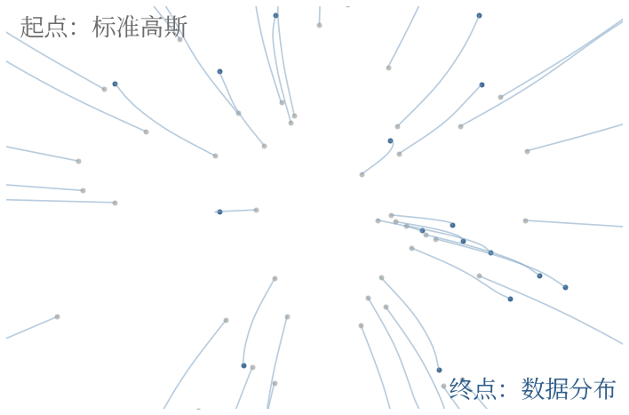
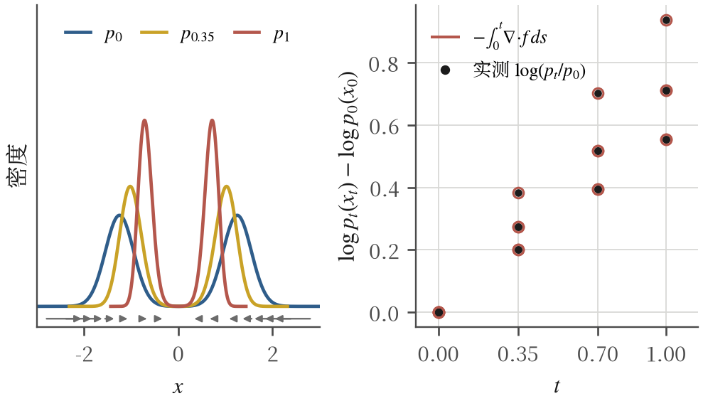
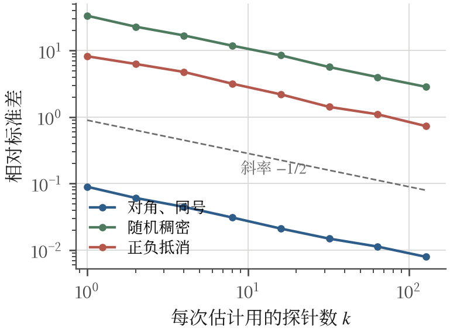

# 连续归一化流

归一化流是最早的一类“用变换描述分布”的模型。它要求变换可逆，因此可以精确计算似然。连续版本把离散的堆叠换成一条常微分方程，是理解速度场最干净的起点。

这一章从离散变换讲起，推一遍瞬时变量替换公式，再看它为什么在图像上不实用。

## 离散的可逆变换

堆叠 $K$ 个可逆变换

$$x^{(k)} = f_k\big(x^{(k-1)}\big),\qquad k=1,\dots,K.$$

由变量替换公式，密度的变化是

$$\log p_K\big(x^{(K)}\big) = \log p_0\big(x^{(0)}\big) - \sum_{k=1}^K \log\left|\det\frac{\partial f_k}{\partial x^{(k-1)}}\right|.$$

这条式子值得从一维推起，因为每一步用的都是同一件事。一维时 $y = f(x)$ 把区间拉伸或压缩，概率质量不能凭空多出来，$p_X(x)\,|dx| = p_Y(y)\,|dy|$，于是

$$p_Y(y) = \frac{p_X\big(f^{-1}(y)\big)}{\big|f'(f^{-1}(y))\big|}.$$

高维把 $|f'|$ 换成 $|\det \partial f/\partial x|$：行列式就是局部体积的放大率，一个边长为 $\delta$ 的小方块映过去变成体积 $\delta^d|\det J|$ 的平行体，密度反比于体积。取对数，除法变减法：

$$\log p_Y(y) = \log p_X(x) - \log|\det J(x)| .$$

串起 $K$ 层，就是把 $K$ 个这样的等式相加。中间层出现两次，一次在左、一次在右，抵消掉，剩下首尾与每一层的对数行列式之和。

注意每个因子都在**自己的输入**上求值：第 $k$ 层用 $\partial f_k/\partial x^{(k-1)}$ 在 $x^{(k-1)}$ 处取值。这一点在连续极限里会变得关键——那些点连成一条曲线，求和变成一个沿曲线的积分。

把复合写成 $f = f_K\circ\cdots\circ f_1$，链式法则给出

$$\frac{\partial f}{\partial x} = \frac{\partial f_K}{\partial x^{(K-1)}}\cdots\frac{\partial f_2}{\partial x^{(1)}}\cdot\frac{\partial f_1}{\partial x^{(0)}} .$$

这是 $K$ 个 $d\times d$ 矩阵的连乘，每个都在不同的点上取值。行列式对乘积可拆，$\det(AB)=\det A\det B$，所以

$$\left|\det\frac{\partial f}{\partial x}\right| = \prod_{k=1}^K\left|\det\frac{\partial f_k}{\partial x^{(k-1)}}\right|,$$

取对数，乘积变求和，就是开头那条式子。离散流的“似然”就是这 $K$ 个行列式的连乘，全部工程量都在怎么让它算得动。

要让这个式子可用，每个 $f_k$ 的雅可比行列式必须好算。coupling layer 与自回归变换都是为此设计的：它们把雅可比做成三角矩阵，行列式等于对角线之积。

看 coupling layer 的具体形状。把输入切成两半 $x=(x_1,x_2)$，改造只作用在后一半：

$$y_1 = x_1,\qquad y_2 = x_2\odot s(x_1) + t(x_1),$$

其中 $s$、$t$ 是任意复杂的函数（可以是卷积网络），$\odot$ 是逐元素乘。雅可比是分块三角的：

$$\frac{\partial y}{\partial x} = \begin{pmatrix} I & 0\\[2pt] \dfrac{\partial y_2}{\partial x_1} & \mathrm{diag}\big(s(x_1)\big)\end{pmatrix}.$$

三角矩阵的行列式等于对角线之积，与左下那个稠密块无关，所以

$$\log\left|\det\frac{\partial y}{\partial x}\right| = \sum_{i}\log\big|s_i(x_1)\big|,$$

代价 $O(d)$，一次求和。逆变换也写得出：$x_1 = y_1$、$x_2 = \big(y_2 - t(y_1)\big)/s(y_1)$，不用求逆矩阵。

这种层有个结构上的限制：一半坐标原封不动。若始终按同样的切分堆叠，前一半永远改不了，表达力受限。实现上用固定的翻转或置换在层间交替，保证每个坐标都有机会被改到；这也决定了层数不能太少，否则每个坐标只被改过一两次。耦合层、自回归、残差式变换都是这个思路的不同实现，区别在于“哪些坐标当条件”与“变换长什么样”。

不三角的代价值得算一遍。一般的 $d\times d$ 矩阵求行列式是 $O(d^3)$。取一张 64×64×16 的 latent，$d = 65\,536$，$d^3 \approx 2.8\times10^{14}$；按每秒 $10^{13}$ 次乘加估计，一次行列式要几十秒，一层、一个样本。像素空间 $d = 786\,432$ 时 $d^3 \approx 4.9\times10^{17}$，同样的速度要十几个小时。三角化把这个量降到 $O(d)$，差值有十个数量级。归一化流的全部结构设计都围绕这一条：雅可比必须是三角的，或者至少是行列式好算的。

一维上做个小算例，把“行列式控制密度形状”这句话落到实处。取 $f_1(x)=2x$、$f_2(y)=y+1$，复合是 $z = 2x+1$。两层的对数行列式分别是 $\log2$ 与 $\log1=0$，合计 $\log2$：

$$p_Z(z) = \frac{1}{2}\,p_X\!\left(\frac{z-1}{2}\right).$$

原来的密度被横向压窄一半、纵向抬高两倍，再平移一格。若两层换成 $2x$ 与 $0.5y$，行列式之积为 1，密度形状完全不变——一层的拉伸被另一层的压缩抵消。可逆性保证信息不丢，密度的形状由每层的行列式决定。

采样时反向走：从 $p_K$ 抽一个点，依次求逆，得到 $x^{(0)}$。所以这类模型既能采样，也能算似然。反向走的时候同样要连乘雅可比，只是每层取逆，$\det(\partial f_k^{-1}/\partial y) = 1/\det(\partial f_k/\partial x)$，对数求和之后整体取负。

## 从离散到连续

把步长取小，每一步变成 $x + \epsilon f(x,t)$。$K\to\infty$ 时，求和变成积分，变换变成一条 ODE 的解

$$\frac{dx}{dt} = f_\theta(x,t).$$

这一步的细节值得写全，因为它是整章的地基。取 $\epsilon = 1/K$、$t_k = k\epsilon$，离散步是

$$x^{(k)} = x^{(k-1)} + \epsilon\, f\big(x^{(k-1)}, t_{k-1}\big),\qquad x^{(0)} = x_0 .$$

把 $K$ 步加起来，中间的状态两两抵消：

$$x^{(K)} - x_0 = \sum_{k=0}^{K-1}\epsilon\, f\big(x^{(k)}, t_k\big).$$

右边是一个黎曼和：格子宽度 $\epsilon$，采样点在格子左端 $t_k$，被积函数是 $f$ 在离散轨迹上的取值。$K\to\infty$ 时 $\epsilon\to0$，和式趋于

$$\int_0^1 f\big(x(t),t\big)\,dt ,$$

其中 $x(t)$ 是离散轨迹的极限。极限存在有个前提：每一步的位移必须趋于零。若 $\epsilon$ 固定而层数增加，轨迹会被同一条折线反复绕，或者干脆不存在极限。

于是 $x(1) - x(0) = \int_0^1 f(x(t),t)dt$。在任意短区间 $[t,t+h]$ 上重复同一套论证，

$$x(t+h) - x(t) = \int_t^{t+h} f(x(s),s)\,ds = h\,f(x(t),t) + o(h),$$

两边除以 $h$，令 $h\to0$，得 $dx/dt = f(x,t)$。从 $x+\epsilon f$ 到 $dx/dt = f$ 的全部内容就是这一句：位移除以步长，取极限。

严格化需要 $f$ 关于 $x$ 满足 Lipschitz 条件（Picard–Lindelöf 定理），这样解存在且唯一。神经网络给出的场不一定满足，实际训练出来的场通常足够光滑，绝大多数情况下没事；极端情况下的爆破解是训练不稳定的一个来源。

这里有一处容易混。前面写的 Euler 采样器也是 $x+\epsilon f$ 的形式，两者不是一回事。采样时 $\epsilon$ 是**数值步长**，模型已经定好，只是在求近似解；连续流的定义里 $\epsilon\to0$ 描述的是**模型本身**——每层变换的幅度趋零、层数趋无穷，极限对象是一条 ODE。前者在问“用什么方法解”，后者在问“模型是什么”。训练目标定义在极限上，采样时才用有限步去逼近它。混淆这两层会导致一个错误推论：以为把采样步数加到无穷大，普通离散流就变成了连续流——不会，模型的分辨率由参数量决定，与步数无关。

可逆性由 ODE 的解对初值的唯一性保证。逆映射不需要另存一个网络，把符号翻过来就行：令 $s = 1-t$、$y(s) = x(1-s)$，则

$$\frac{dy}{ds} = -\frac{dx}{dt}\bigg|_{t=1-s} = -f\big(y, 1-s\big),$$

解一条同类型的 ODE 就回到起点。离散模型要为每层单独实现 $f_k^{-1}$，连续模型白拿。

把解写成映射 $\phi_t:\mathbb R^d\to\mathbb R^d$，$x_t = \phi_t(x_0)$，它满足 $\phi_0 = \mathrm{id}$ 与 $\phi_{t+s} = \phi_t\circ\phi_s$，并且每个 $\phi_t$ 都是微分同胚：可逆、光滑、逆也光滑。这个性质很硬，也叫“保拓扑”。微分同胚保维数，所以当数据支撑在 $d$ 维空间的低维子流形上时（自然图像就是这种情况），任何 $\phi_1$ 都无法把整个 $\mathbb R^d$ 映到那个子流形上，密度会退化成奇异分布，似然失去意义。要绕开这一点，只能先把数据“撑满”整个空间，比如给像素加一点连续的噪声。这个代价后面还会提到。

还有一句关于表达力的话。连续流可以看成无穷多个“无穷小”的 coupling 层：每层几乎不做事，合起来却能做很多。离散模型要提高容量就得加层，参数量随之线性增长；连续流的容量放在速度场本身（网络的宽度与深度），求解器用的是多少步只是数值细节，与容量无关。这让同一套参数能用 $N=10$ 采样，也能用 $N=200$ 采样，两种结果的差距是逼近误差，不是模型本身的差别。

## 瞬时变量替换

把离散的求和取极限。一步变换的雅可比是 $I + \epsilon J$，其中 $J = \partial f/\partial x$。对矩阵取行列式，用特征值展开

$$\det(I+\epsilon J) = \prod_i(1+\epsilon\lambda_i) = 1 + \epsilon\sum_i\lambda_i + O(\epsilon^2) = 1 + \epsilon\,\mathrm{tr}(J) + O(\epsilon^2).$$

所以

$$\log|\det(I+\epsilon J)| = \epsilon\,\mathrm{tr}(J) + O(\epsilon^2).$$

这几步各有一处容易滑过去的地方。

行列式等于特征值之积，这是第一条等号。把 $\prod_i(1+\epsilon\lambda_i)$ 展开，一阶项是 $\sum_i\lambda_i$，也就是迹；二阶项是 $\epsilon^2\sum_{i<j}\lambda_i\lambda_j$，用迹写出来是 $\frac{\epsilon^2}{2}\big[(\mathrm{tr}J)^2 - \mathrm{tr}(J^2)\big]$，一共 $\binom d2$ 项，$d$ 大时这一项并不小。

第二条等号用了 $\log(1+z) = z - z^2/2 + z^3/3 - \cdots$。保留两项：

$$\log|\det(I+\epsilon J)| = \sum_i\log|1+\epsilon\lambda_i| = \epsilon\sum_i\lambda_i - \frac{\epsilon^2}{2}\sum_i\lambda_i^2 + O\Big(\epsilon^3\sum_i|\lambda_i|^3\Big).$$

用迹写就是 $\epsilon\,\mathrm{tr}J - \frac{\epsilon^2}{2}\mathrm{tr}(J^2) + \cdots$。同名结果可以直接从 $\log\det = \mathrm{tr}\log$ 得到：$\mathrm{tr}\log(I+\epsilon J) = \epsilon\mathrm{tr}J - \frac{\epsilon^2}{2}\mathrm{tr}(J^2) + \cdots$，两种算法给同一个级数，后者省掉了“$J$ 可对角化”这个隐含条件。

展开要求 $|\epsilon\lambda_i| < 1$，也就是 $\epsilon\|J\|_2 < 1$。取极限时 $\epsilon\to0$ 而 $\|J\|$ 固定，这个条件总能满足。反过来，$K$ 有限、$\|J\|$ 又随 $d$ 增长时，$\epsilon\|J\|$ 可能不小，级数截断就是实际误差的来源。

把 $K$ 步加起来，$\epsilon = 1/K$，取极限得到

$$\frac{d}{dt}\log p_t(x_t) = -\mathrm{tr}\!\left(\frac{\partial f_\theta}{\partial x}(x_t,t)\right).$$

这一步的极限值得看清，因为它决定了误差的量级。把上面的级数代进 $K$ 层求和：

$$\log p_1(x_1) - \log p_0(x_0) = -\sum_{k=0}^{K-1}\left[\epsilon\,\mathrm{tr}J_k - \frac{\epsilon^2}{2}\mathrm{tr}(J_k^2) + \cdots\right].$$

第一项 $\epsilon\sum_k\mathrm{tr}J_k$ 是黎曼和，极限是 $\int_0^1\mathrm{tr}J\,dt$。第二项有 $K = 1/\epsilon$ 项，每项 $\epsilon^2$ 量级，合计 $\epsilon$ 量级，随 $\epsilon\to0$ 消失。更高阶同样消失。所以

$$\log\frac{p_1(x_1)}{p_0(x_0)} = -\int_0^1\mathrm{tr}\Big(\frac{\partial f}{\partial x}(x_t,t)\Big)\,dt .$$

这就是瞬时变量替换公式。它说：对数密度的变化率等于速度场散度的负值。散度为正，流在发散，密度下降；散度为负，流在汇聚，密度上升。

$$\mathrm{tr}\Big(\frac{\partial f}{\partial x}\Big) = \sum_i\frac{\partial f_i}{\partial x_i} = \nabla\cdot f .$$

每一项衡量“第 $i$ 个坐标方向的速度对该坐标的敏感度”。为正，说明附近的点在这一方向上被推开，局部体积变大；为负，说明被挤压。整体平移、旋转、剪切都是保体积的运动，散度为零，密度不变；尺度缩放与汇聚则改变体积，散度非零。

上面那条公式给的是沿轨迹的变化率。把全导数拆成偏导加对流项，

$$\frac{d}{dt}\log p_t(x_t) = \partial_t\log p_t + v\cdot\nabla\log p_t ,$$

令它等于 $-\nabla\cdot v$，两边乘 $p_t$：

$$\partial_t p_t = -p_t\,v\cdot\nabla\log p_t - p_t\,\nabla\cdot v = -v\cdot\nabla p_t - p_t\,\nabla\cdot v = -\nabla\cdot\big(p_t\,v\big).$$

中间一步用了 $p\nabla\log p = \nabla p$。最后这个式子叫连续性方程，概率质量像不可压缩流体一样守恒：某个位置的密度上升，只能因为邻近区域有质量流进来。它有三种用法：说明边际速度确实能把 $p_1$ 搬到 $p_0$（第 3 章）；说明 ODE 与 SDE 给出同一族边缘分布（第 6 章）；说明为什么采样可以用别的求解器而不改变“解”的分布（这一章）。

一维算例能把公式验证到底。取 $f(x) = -x$，解是 $x_t = x_0e^{-t}$，$J = -1$，公式给

$$\log p_t(x_t) = \log p_0(x_0) + t .$$

设 $p_0 = \mathcal N(0,1)$，直接算：$x_t\sim\mathcal N(0,e^{-2t})$，密度在 $x_t$ 处的对数

$$-\frac{x_t^2}{2}e^{2t} - t - \frac12\log2\pi = -\frac{x_0^2}{2} + t - \frac12\log2\pi ,$$

与 $\log p_0(x_0)+t$ 一致。代入数值：$x_0 = 1$、$t = \ln2$，则 $x_t = 0.5$，而

$$\frac{p_t(0.5)}{p_0(1)} = \frac{\frac{2}{\sqrt{2\pi}}e^{-0.5}}{\frac{1}{\sqrt{2\pi}}e^{-0.5}} = 2 ,$$

密度正好翻一倍，与 $+t = \ln 2$ 对得上。写成固定 $x$ 的形式更直观：$p_t(x) = p_0\big(xe^{t}\big)\,e^{t}$，把原密度拿到更远的地方取值、再整体抬高——汇聚把质量挤到原点附近。



非线性场里，这条公式同样成立，只是密度要靠数值算。图 2.2 用的场是 $f(x) = -x + 0.5\sin x$，它在一维上处处汇聚（$f' = -1+0.5\cos x$ 恒为负），但速率随位置变化：原点附近收缩慢，两侧收缩快。左边画出三个时刻的密度，两个峰被推近、压窄、变高；右边取五条轨迹，把“密度沿轨迹的实测增长”与“散度的积分”画在一起。



两张图叠在一起基本重合，相对偏差在 $10^{-4}$ 以下。以起点 $x_0=-2$ 的那条轨迹为例，$t=1$ 时密度涨了 $e^{0.94}\approx2.6$ 倍，与积分的 $0.94$ 对得上。这个结果说明公式不只是形式上的恒等式：给定速度场，密度的演化被完全决定，不需要再去解一个偏微分方程。


二维的线性场能把体积这一层看得更直接。取 $f(x) = Ax$，$A = \mathrm{diag}(1,-2)$，解是 $x_t = (x_{0,1}e^{t},\ x_{0,2}e^{-2t})$，$\mathrm{tr}J = 1 - 2 = -1$。一个单位正方形在 $t=1$ 时被映成边长 $e$ 与 $e^{-2}$ 的矩形，面积 $e^{-1}\approx0.37$，密度相应乘上 $e$。公式给的也是 $+t$：$\log p_t(x_t) = \log p_0(x_0) + t$，与直接算高斯密度的结果一致。把 $A$ 换成旋转矩阵，$\mathrm{tr}A = 0$，正方形转了一圈面积不变，密度沿轨迹一点没变。一个方向拉伸、另一个方向压缩，只要吐得干净，整体密度就不受影响——这个“只算对角元之和”的简化正是迹的好处。

实现里有两层近似，容易混。一层是“层数”$K$：它决定了模型本身，不同的 $K$ 给出不同的分布与不同的似然；一层是求解器步数 $N$：它只影响数值精度，$N$ 加大只会让结果更接近同一条 ODE 的解。分辨二者有个简单办法：固定 $K$、把 $N$ 加到很大，若损失不再变化，剩下的误差就来自 $K$；再固定 $N$、把 $K$ 加倍，损失应按 $1/K$ 线性下降。训练时 $K$ 常取几十到几百，那个 $O(1/K)$ 的偏差会直接进损失，报似然时得把它写清楚，否则不同实现之间根本不可比。

## 似然与采样

有了上面的公式，似然可以直接算

$$\log p_1(x_1) = \log p_0(x_0) - \int_0^1 \mathrm{tr}\!\left(\frac{\partial f_\theta}{\partial x}(x_t,t)\right)dt.$$

采样则相反：从 $p_1$ 抽一个点，沿 ODE 积分到 $t=0$。

两个方向不对称，这一点值得先记住。采样只用速度场，不需要雅可比；算似然要用雅可比，因为要知道“这段流把体积压缩了多少”。代价的差别就来自这里：采样与流匹配的训练一样便宜，似然贵得多。

把一个数据点的似然写全。模型把数据 $x$ 沿正向送到 $x_1$，终点落在标准高斯下，于是

$$\log p_0(x) = \log p_1(x_1) + \int_0^1\mathrm{tr}\big(\partial_x f(x_t,t)\big)dt,\qquad \log p_1(x_1) = -\frac{\|x_1\|^2}{2} - \frac{d}{2}\log 2\pi .$$

符号与前面那条一致：$\log p_1 = \log p_0 - \int\mathrm{tr}$，移项时符号翻过来。积分号前的加号容易被抄错，检查办法是看一个纯膨胀的场（$\mathrm{tr}J>0$）：它把一小块体积放大，同样的质量摊到更大的区域，于是数据处的密度必须比噪声处高，$\log p_0$ 要加上一个正数。一维取 $f(x)=x$ 最省事：$x_1 = ex_0$，$p_0(x) = e\,p_1(ex)$，$\log p_0 = \log p_1 + 1$，而 $\int_0^1\mathrm{tr}J\,dt = 1$，两边正好对上。

写成循环是这样的：

```text
输入：数据点 x，速度场 f_θ，步数 N
x ← x,  acc ← 0
for k = 0 .. N-1:
    t ← k / N
    acc ← acc + (1/N) · tr(∂f/∂x)(x, t)      # 精确：d 次 JVP；近似：k 个 Hutchinson 探针
    x ← x + (1/N) · f(x, t)                  # 正向：数据 → 噪声
log p₀(x) ← -½‖x‖² - (d/2)·log(2π) + acc
bits/dim  ← -log p₀(x) / (d · log 2)
```

常用的评价指标是 bits/dim：把负对数似然换成以 2 为底、再除以维数，得到“每维多少比特”。它有一个平凡的基准可以手算。设 $x_1$ 是一个标准高斯样本，$\|x_1\|^2$ 的典型值是 $d$，于是

$$-\frac{\log p_1(x_1)}{d} \approx \frac{1}{2\ln2} + \frac{\ln 2\pi}{2\ln2} \approx 2.05\ \text{bit}.$$

任何“把数据原样搬到标准高斯”的映射都拿这个分。举个能精确算的例子：$f(x,t) = \cos(2\pi t)\,x$，则 $x_t = x_0\exp\!\big(\sin(2\pi t)/2\pi\big)$，$t=1$ 时回到 $x_0$；散度是 $\cos(2\pi t)$，在一个周期上积分为零。所以 $p_1 = p_0$、且 $\log p_0 = \log p_1 + 0$，两条式子自洽。这个模型什么都没做，得分正好是 2.05。真实模型要低于这个数才说明学到了结构；像素上的似然通常落在几 bit/dim 的量级，具体高低很受量化与去量化方式影响，横向比较时先看这两处是否一致。

### 采样这一侧

采样只需要 $N$ 次前向，不需要雅可比，也不需要伴随。它与流匹配的采样完全同价，因为两者都在解一条同类的 ODE。

这里还有一处重要的不对称：ODE 的解唯一，所以换求解器、换步数只改变**逼近误差**，不改变“解”本身。两步 Euler 得到的样本分布与一千步 RK4 的不同，差的是误差，而不是模型。这意味着可以按预算随意调采样器：单张预览用十几步，出图用几十步，评估用几百步，都不需要重训。似然训练模型没有这种奢侈——它的损失里含着一个积分，改步数就等于改目标函数。

后面几章几乎不再提似然，原因在这里：采样端根本不关心模型是怎么训的，只关心“速度场对不对、轨迹直不直”。

## 算散度的三种办法

整章的瓶颈都压在 $\mathrm{tr}(\partial f/\partial x)$ 上。它是 $d$ 个偏导之和，$d$ 是像素数时不可能逐个算。三种做法，代价与精度各不相同。

### 精确：$d$ 次雅可比向量积

迹的定义就是对角线之和。取标准基 $e_i$，

$$\mathrm{tr}J = \sum_{i=1}^d e_i^\top J e_i .$$

每一项 $Je_i$ 是一次雅可比向量积（JVP），前向模式自动微分一次算一列，所以精确的迹要 $d$ 次 JVP，每步的代价是单次前向的 $d$ 倍。反过来用反向模式，$d$ 次 VJP 得到 $J^\top$ 的行，也能凑出迹，代价一样。

把数代进去。64×64×16 的 latent，$d = 65\,536$；$N = 50$ 步；一个样本就要 $3.3\times10^6$ 次前向等价。而扩散或流匹配训练一个样本，一次前向加一次反向，约等于 3 次前向。两者相差六个数量级。这个差距不是靠工程优化能填的，它决定了精确似然训练在有像素级维数的问题上不可能成为主线。

图 2.2 的验证用的就是精确做法，但只有一维，$d=1$，代价可以忽略。玩具问题上精确法很好用：结果是确定的，没有方差，梯度干净。

### 近似：Hutchinson 估计

用随机向量把迹变成期望：

$$\mathrm{tr}(J)\approx E_\epsilon[\epsilon^\top J\epsilon],\qquad \epsilon\sim\mathcal{N}(0,I).$$

期望等于迹，因为 $E[\epsilon_i\epsilon_j] = \delta_{ij}$，于是 $E[\epsilon^\top J\epsilon] = \sum_{ij}J_{ij}\delta_{ij} = \mathrm{tr}J$。代价从 $d$ 次 JVP 降到一次：先算 $J\epsilon$（一次 JVP），再与 $\epsilon$ 做内积。

方差也能算出来。展开 $(\epsilon^\top J\epsilon)^2$ 会用到四阶矩 $E[\epsilon_i\epsilon_j\epsilon_k\epsilon_l] = \delta_{ij}\delta_{kl} + \delta_{ik}\delta_{jl} + \delta_{il}\delta_{jk}$，代进去整理得

$$\mathrm{Var}\big(\epsilon^\top J\epsilon\big) = \|J\|_F^2 + \mathrm{tr}(J^2) = 2\|S\|_F^2,\qquad S = \tfrac12\big(J + J^\top\big),$$

最后一步用了“反对称部分的 Frobenius 范数与迹的平方相等、符号相反”。用 $k$ 个独立探针平均，方差除以 $k$，相对标准差是

$$\frac{\mathrm{std}}{\big|\mathrm{tr}J\big|} = \sqrt{\frac{2}{k}}\cdot\frac{\|S\|_F}{\big|\mathrm{tr}J\big|} .$$

第二个因子是关键。若 $J$ 的特征值同号、大小相近，$\|S\|_F\approx|\mathrm{tr}J|/\sqrt d$，因子只有 $1/\sqrt d$，单探针就够准；若正负特征值大量抵消，迹只是大数相减的余项，而 Frobenius 范数照样是 $O(d)$ 量级，因子可以远大于 1。



图 2.3 是三种人为构造的 $256\times256$ 矩阵在同样探针数下的表现。对角线同号的矩阵，$k=1$ 时相对误差约 9%；正负抵消的矩阵约 800%；随机稠密的矩阵在 3000% 以上——它的迹是 $O(\sqrt d)$ 的随机涨落，而 Frobenius 范数是 $O(d)$，两者根本不是一个量级。探针数加到 128，三者分别降到 0.8%、73%、290%，都按 $1/\sqrt k$ 走，差距却保持不变。

这张图的读法要小心。相对误差那么大的估计，在**训练**里依然有用：优化只需要无偏的梯度，噪声由 batch、学习率与动量吸收；单探针的连续流在文献里是常见配置。但用它报 bits/dim 就不行，评估时要么用几十上百个探针，要么就直接精确算。

### 结构化近似

第三条路是利用网络结构。逐点非线性加线性层的组合里，雅可比的形状是受限的。以一个卷积层为例：$z = K * x$（$K$ 是核），雅可比是块 Toeplitz，它的对角元恰好是该位置对应的核中心权重 $K_0$（多通道时是 $C\times C$ 的中心块）。若后面接逐点非线性 $\sigma$，$J = \mathrm{diag}(\sigma'(z))\cdot \partial z/\partial x$，

$$\mathrm{tr}J \approx \sum_i \sigma'(z_i)\cdot K_0 ,$$

几乎免费，误差来自把中心权重当成整个算子的对角、以及忽略了层与层之间的传播。这类近似单独用不够准，但可以当**控制变量**：先用它算一个便宜的低频估计，再让 Hutchinson 只补高频残差。残差比原量的方差小，同样的探针数能拿到更稳的估计。代价是实现复杂，且要针对网络结构逐个算子推导，换架构就得重做。

### 误差沿轨迹怎么累积

似然里的迹是一个积分，所以估计噪声会在 $N$ 步上平均。若每步的估计独立，均值的标准差按 $1/\sqrt{N}$ 下降：$N=50$ 时单探针的噪声已经被压掉约 7 倍。长轨迹在这一点上反而友好。

有偏的部分不会被平均掉。结构化近似把“中心权重”当成整个算子的对角，这个偏差在每一小段上都是同一个方向，累加之后照样是同一个方向。判断一个近似能不能用，就看它的误差是零均值的噪声还是有符号的偏差。

探针的用法有两种。每一步重新采一批新的 $\epsilon$，单步估计独立、累加后方差最小，代价是每步多一次随机数生成；整条轨迹共用同一批 $\epsilon$，省一次采样、随机性更小，但误差沿轨迹是相关的，平均效果变差。二者只差常数因子，可以根据实测选。

实现上有三个细节。迹是一个标量，可以把它当成网络的额外输出，用一个自定义的反向函数把 JVP 包起来，前向多算一遍、反向多算一遍；批处理时每个样本各自一个探针，等价于并行地做 $B$ 次 JVP，不额外占批量。估计值可能为负（随机向量与雅可比的方向不对上），而真实散度在汇聚处本来就可以为负，所以不能把它裁成非负，裁了就是有偏。训练初期散度的量级往往很大，把迹项乘一个小系数、或先只训速度场再开启似然，热身会稳得多。

## 伴随法：梯度怎么绕过求解器

似然训练的第二道坎是反传。要算 $\partial L/\partial\theta$，得对积分过程求导。最直接的做法是把求解器的每一步当成网络的一层，反传时用链式法则穿过去；问题是每一步的中间激活都要存着，$N=50$ 就是 50 份前向激活，显存直接翻几十倍。

伴随法（adjoint method）绕开了这个问题。它来自最优控制里的做法：把 ODE 当作约束，引入拉格朗日乘子，得到的方程组是一个新的 ODE，反着积分一遍就能收集梯度。

先看离散版本，它就是反向传播本身。$x_{k+1} = x_k + h f(x_k,\theta)$，记 $a_k = \partial L/\partial x_k$（行向量），链式法则给

$$a_k = a_{k+1}\big(I + h J_k\big),\qquad a_K = \frac{\partial L}{\partial x_K},\qquad \frac{\partial L}{\partial\theta} = \sum_{k=0}^{K-1} h\, a_{k+1}\,\frac{\partial f}{\partial\theta}(x_k) .$$

$a_k$ 的递推里没有 $\theta$，只有 $J_k$。这意味着：只要能从终点倒着走回起点，沿途随时算 $J_k$，就不必把 $N$ 份激活全留着。把递推改写成差分商，$(a_k - a_{k+1})/h = a_{k+1}J_k$，取 $h\to0$ 得到连续形式

$$\frac{da}{dt} = -J^\top a,\qquad a(1) = \nabla_{x_1}L,\qquad \frac{dL}{d\theta} = -\int_1^0 a(t)^\top\frac{\partial f}{\partial\theta}(x_t,t)\,dt .$$

求解流程是：正向积一遍得到 $x_1$（不存中间状态），从 $x_1$ 出发反着积一遍增广系统，状态是 $(x_t, a_t)$，同时做两件事——按 $-f$ 回到起点，按 $-J^\top a$ 传播伴随；沿途把 $a^\top\partial_\theta f$ 累加进 $\theta$ 的梯度。每个时刻只持有当前的 $(x_t,a_t)$，内存与步数无关。

| 做法 | 显存 | 时间 | 备注 |
| --- | --- | --- | --- |
| 存下全部状态 | $N$ 份激活 | $1\times$ | 实现最简，$N$ 大时放不下 |
| 伴随法 | 常数 | $\approx2\times$ | 需要重新积分 |
| 分段 checkpoint | $N/m$ 份 | $\approx1.3\times$ | 每 $m$ 步存一个点，段内重算 |

伴随法省了内存，代价是三处。重积分拿到的 $x_t$ 与原轨迹不完全一致，数值漂移会让梯度带一点偏差；每步要多算一次 $J^\top a$，相当于每步都做一次反向；实现上还要小心，求解器的自适应步长本身依赖状态，若前后两次积分选的步长不同，梯度就不可复现。实际系统通常用分段 checkpoint 折中：显存可控，梯度的偏差小，实现也简单。

伴随法的实现对不对，可以用有限差分验。取 $d=8$、$N=5$ 的小网络，把某个参数扰动 $10^{-6}$，比较数值差分与伴随法的梯度，相对误差应在 $10^{-5}$ 量级；若差了正负号或差了几个数量级，先去查积分方向与 $a$ 的终点条件。这个检查花不了几分钟，却能省掉几天。

## 为什么不能直接用它做图像

上面的公式很漂亮，实际有几道障碍。

第一个是散度。精确计算 $\mathrm{tr}(\partial f/\partial x)$ 需要对每个输入维度做一次反向传播，代价是 $d$ 倍；$d$ 是像素数时完全不可行。可以用 Hutchinson 估计

$$\mathrm{tr}(J)\approx E_\epsilon[\epsilon^\top J\epsilon],\qquad \epsilon\sim\mathcal{N}(0,I),$$

代价降到常数倍，但方差大，要多个样本才稳。

第二个是训练。要穿过 ODE 求解器反传，要么把中间状态全部存下来，显存爆炸；要么用伴随法重新积分一遍，时间翻倍。而且数值误差会污染梯度。

第三个障碍更基础：训练过程本身要在环里解 ODE。扩散与流匹配的一次迭代是“采一批 $(x_0,t)$、跑一次前向、算损失、反传”，网络只被调用一次；连续流不然，损失里的 $x_1$ 要先解 $N$ 步才拿得到，随后还要算散度、还要反传。即使把散度换成单探针的近似，一次迭代的开销也在 $N$ 次前向的量级。想清楚这一点，就明白为什么连续流的训练吞吐和扩散不在一个量级上——不是实现偷懒，是目标函数里天然带了一个求解器。

第四个障碍是拓扑。前面说过，$\phi_1$ 是微分同胚，保维数。自然图像分布在像素空间的低维子流形附近，其“密度”在 $\mathbb R^d$ 上并不存在（相对于 Lebesgue 测度是奇异的），似然无处定义。要救回来只能加噪：给每个像素加一点连续的抖动（去量化），把支撑撑满整个空间。抖动一加，模型学到的是“数据加噪声”的分布，似然可以算了，但 bits/dim 里混进了抖动的选择，指标的可比性又弱了一层。

第五个障碍偏经验：似然不直接对应生成质量。似然要求密度在每个像素上都对，模型因此会把容量分给高频的、肉眼看不见的细节；人眼在意的是结构与纹理的一致性，这两件事的排序不一样。在压缩率相近的两个模型里，样本质量的差别可以很大，反之亦然。把似然当作唯一的训练信号，代价是得到一批“概率很对、看着不对”的样本。

把这几条放在一起，可以得到一个粗略的规模分界。$d$ 在几十到几百之间（表格数据、低维物理状态）时，精确迹完全可行，连续流是这类问题上很有竞争力的一类密度模型；$d$ 到上万（小图或很紧的 latent），精确迹先崩，Hutchinson 勉强撑住，训练速度降为原来的几分之一；$d$ 到 $10^5$ 以上（像素），连“在环里跑求解器”都撑不住，只能放弃似然。分界点是量级估计，跟网络大小、硬件、$N$ 都有关，但不会移动几个数量级。

结果是，连续归一化流在理论上完整，在图像上不实用。但它给出了完整的语言：速度场、积分、密度演化。后面所有流模型都建立在这套语言上，只是换掉了“精确似然”这个要求。

## 与扩散的关系

扩散模型的概率流 ODE 也是一个连续归一化流

$$f(x,t) = f_{\text{drift}}(x,t) - \frac12 g(t)^2\nabla\log p_t(x).$$

区别在于它不由最大似然训练，而由噪声预测（等价于分数匹配）训练。这个区别很关键：扩散放弃了精确似然，换来了可扩展的训练。

两条路的目标函数长得完全不同，但要的东西是同一个：一个速度场，使得它的流把噪声搬到数据。连续性方程对两者都成立，所以“边缘分布按 ODE 演化”这件事不需要重新证一遍。真正不同的是怎么把场学出来——最大似然要求场在**每个**数据点上都把体积变化算准，这个要求太强；分数匹配只要求场在**样本附近**的平均行为对，弱得多，也便宜得多。

这不等于似然在扩散里没用。评估阶段常做的事是：把训练好的扩散模型写成概率流 ODE，用一次积分加一次迹的估计算出 bits/dim，作为与流模型可比的指标。这时只在评测里跑一次，成本可以接受；训练里不做，是因为它太贵。

拓扑那道障碍在扩散里自动消失。前向加噪把数据搅成全维支撑的分布，$t>0$ 时 $p_t$ 处处有密度、处处有分数，不需要额外的去量化；连续流没有加噪，只能靠外挂的抖动补上这一课。同一个问题的两种解法：一种在数据侧修，一种在过程里修。

流匹配会走第三条路：既不算似然，也不需要分数，直接回归一个速度场。下一章讲它。

把三件事分开记：连续流提供了语言（速度场加连续性方程），扩散提供了第一种训练方式（分数匹配），流匹配提供了第二种（条件速度回归）。后面的章节都在这个三分法里展开，同一个 ODE、不同的学法。
