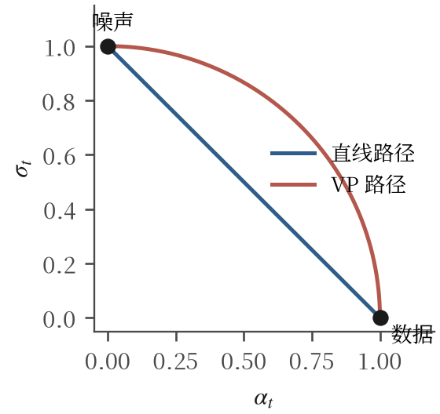

# 流匹配

连续归一化流要算似然，代价太高。流匹配放弃似然，只要求一件事：学一个速度场，使它的积分把先验搬到数据。

这个要求听起来很弱，却足以定义生成模型，而且训练目标简单到只需要回归。

## 概率路径

先构造一条路径。取数据 $x_0\sim p_{\text{data}}$，噪声 $x_1\sim\mathcal{N}(0,I)$，定义

$$x_t = \alpha_t x_0 + \sigma_t x_1,\qquad t\in[0,1],$$

其中 $\alpha_0=1,\sigma_0=0,\alpha_1=0,\sigma_1=1$，$\alpha_t$ 单调下降，$\sigma_t$ 单调上升。

固定一对 $(x_0,x_1)$，路径是直线或曲线。对 $t$ 求导，得到这条路径上的速度

$$v_t(x\mid x_0,x_1) = \dot\alpha_t x_0 + \dot\sigma_t x_1.$$

这叫条件速度场，因为它依赖于具体的那一对样本。

但采样需要一个覆盖整个分布的场。把所有经过同一点 $x$ 的条件速度平均起来

$$v(x,t) = E\big[v_t \mid x_t = x\big].$$

这叫边际速度场，也就是采样时 ODE 的右端。

## 训练目标为什么可以条件化

$v(x,t)$ 里的期望没法直接算，因为要知道 $x_t = x$ 的所有来源。流匹配换一个目标

$$L_{\text{CFM}} = E_{t,x_0,x_1}\big\|v_\theta(x_t,t) - (\dot\alpha_t x_0 + \dot\sigma_t x_1)\big\|^2.$$

它回归的是条件速度，不是边际速度。两者只差一个常数，证明如下。

把期望展开

$$E\|v_\theta - v_t\|^2 = E\|v_\theta\|^2 - 2E[v_\theta\cdot v_t] + E\|v_t\|^2.$$

中间那一项用全期望公式，先对 $x_t$ 条件化

$$E[v_\theta(x_t,t)\cdot v_t] = E_{x_t}\Big[v_\theta(x_t,t)\cdot E[v_t\mid x_t]\Big] = E_{x_t}\big[v_\theta(x_t,t)\cdot v(x_t,t)\big].$$

所以

$$L_{\text{CFM}} = E\|v_\theta - v\|^2 + \underbrace{E\big[\|v_t\|^2 - \|v\|^2\big]}_{\text{与 }\theta\text{ 无关}}.$$

第二项与参数无关，最小化 $L_{\text{CFM}}$ 等价于最小化网络与边际速度的差距。

这个证明只用了一次全期望公式，却是整个流匹配的核心。它说明：不知道边际场也没关系，只要条件场好采样，回归条件场就能学到边际场。

## 路径的选择

$(\alpha_t,\sigma_t)$ 怎么取，会影响轨迹形状与数值稳定性。

直线路径：$\alpha_t = 1-t$，$\sigma_t = t$。条件速度是常数 $x_1-x_0$，路径是直线。它简单，但边际轨迹仍然会弯，原因下一章讲。

VP 路径：$\alpha_t = \cos(\pi t/2)$，$\sigma_t = \sin(\pi t/2)$。它对应扩散模型的方差保持形式，端点处速度有界，数值上更稳。

两条路径的终点分布相同，区别在中间怎么走。选哪个取决于采样器的步数与精度：VP 路径在 $t$ 接近 0 时速度有界，适合少步采样；直线路径的条件速度最简单，适合训练。

## 采样

训练好之后，采样就是解 ODE

$$\frac{dx}{dt} = v_\theta(x,t),\qquad x(1)\sim\mathcal{N}(0,I),$$

从 $t=1$ 积分到 $0$。Euler 方法一步是

$$x_{t-\Delta t} = x_t - \Delta t\,v_\theta(x_t,t).$$

如果轨迹是直的，一步就够；实际轨迹是弯的，所以要多步。

## 一个容易误解的地方

直线路径这个名字容易让人以为采样轨迹也是直线。不是。直线描述的是条件路径，也就是给定一对 $(x_0,x_1)$ 之后它们之间的连线。边际场是所有条件路径的平均，平均值在交叉处指向别处，于是轨迹弯了。

这个区别是下一章的全部内容：既然边际轨迹弯，就设法让它变直；而变直的办法是改变配对。

## 训练细节

时间 $t$ 通常均匀采样，也可以按信噪比加权，让难度大的区间多出现几次。

损失用均方误差即可，不需要额外的系数。这一点与扩散不同：扩散的加权系数来自变分下界，流匹配的损失没有下界可推，权重是经验选择。

条件速度的尺度与路径有关。直线路径的条件速度是 $x_1-x_0$，量级与数据相当；VP 路径的条件速度在两端会变小。训练时若发现损失量级随 $t$ 变化很大，可以先检查是不是这个原因。

视频时，$x_0$ 与 $x_1$ 都是 $T	imes C	imes H	imes W$ 的张量，损失在整段上求平均。工程上常见的做法是把视频切成 patch 或 token，让 Transformer 处理；数学上没有任何变化。
