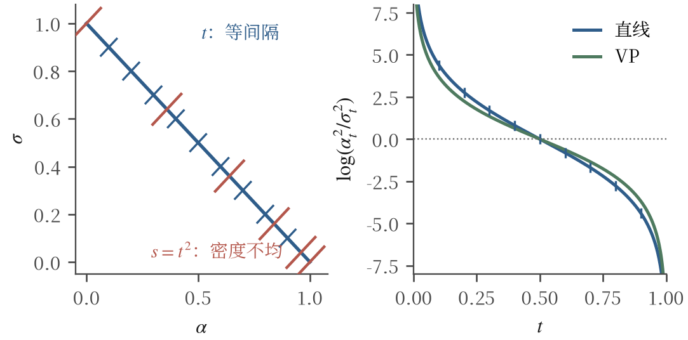
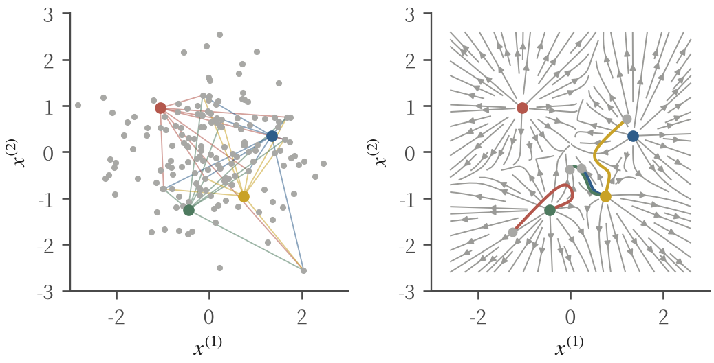

# 流匹配

连续归一化流要算似然，代价太高。流匹配放弃似然，只要求一件事：学一个速度场，使它的积分把先验搬到数据。

这个要求听起来很弱，却足以定义生成模型，而且训练目标简单到只需要回归。

似然的代价具体落在两处。一处是散度：每一步要算 $\nabla\cdot f$ 的迹，精确算需要 $d$ 次反向传播，$d$ 是数据维度；一张 $256\times 256\times 3$ 的图像展开就是 $2\times 10^5$ 维，即便用 Hutchinson 估计降成常数次，也多出一份方差。另一处是显存：伴随法反传要把整条积分轨迹留着，步数越多留得越多，一个 256 步的求解器就要存 256 份中间状态。

流匹配把这两笔都绕开。它不碰似然，不碰散度，训练时只做一件事：抽一对 $(x_0,x_1)$，取它们连线上的点 $x_t$，让网络在这个点上的输出逼近这条连线的切向量。整个训练过程不需要模拟轨迹，梯度也不需要穿过积分器，这种训练方式常被称作免仿真（simulation-free）。

代价是失去似然。拿到一个流模型，能采样，但不能直接算 $\log p(x)$；要算得再解一个 ODE，或者用别的估计办法。这不是流匹配的目标，它换的是训练成本与采样质量。

记号上有一处容易绊住人。这里沿用 $x_0$ 表示数据、$x_1$ 表示噪声，$t$ 从 0 走到 1 是从数据走到噪声，采样时反过来从 1 积到 0。扩散模型的推导常把 $t=0$ 留给干净图像、末端留给纯噪声，方向一致；但也有材料把 $t$ 写成从噪声到数据，读别人的公式前先确认这一点，否则 $\dot\alpha_t$ 的符号会整体反过来。

## 概率路径

先构造一条路径。取数据 $x_0\sim p_{\text{data}}$，噪声 $x_1\sim\mathcal{N}(0,I)$，定义

$$x_t = \alpha_t x_0 + \sigma_t x_1,\qquad t\in[0,1],$$

其中 $\alpha_0=1,\sigma_0=0,\alpha_1=0,\sigma_1=1$，$\alpha_t$ 单调下降，$\sigma_t$ 单调上升。

固定一对 $(x_0,x_1)$，路径是直线或曲线。对 $t$ 求导，得到这条路径上的速度

$$v_t(x\mid x_0,x_1) = \dot\alpha_t x_0 + \dot\sigma_t x_1.$$

这叫条件速度场，因为它依赖于具体的那一对样本。

但采样需要一个覆盖整个分布的场。把所有经过同一点 $x$ 的条件速度平均起来

$$v(x,t) = E\big[v_t \mid x_t = x\big].$$

这叫边际速度场，也就是采样时 ODE 的右端。

### 路径是一族分布

单条路径只是一对样本之间的连线，把 $x_0$ 按 $p_{\text{data}}$ 抽、$x_1$ 按标准正态抽，得到的就是一族分布 $p_t$：

$$p_t(x) = \int p_t(x\mid x_0)\,p_{\text{data}}(x_0)\,dx_0,\qquad p_t(x\mid x_0)=\mathcal{N}\big(x;\alpha_t x_0,\sigma_t^2 I\big).$$

这族分布连起来就是概率路径。它由两个端点约束：

$$p_0 = p_{\text{data}},\qquad p_1=\mathcal{N}(0,I).$$

右端的条件是为了能开始采样。生成从 $x_1$ 起步，若 $p_1$ 不是标准正态，就得另找一个“既能采样、又能被同一个 ODE 连到数据”的分布，白白多一层麻烦。左端的条件是为了生成的东西真属于数据分布：只要 $\sigma_0=0$，$p_0(x\mid x_0)=\delta(x-x_0)$，边缘自动等于 $p_{\text{data}}$，不需要额外约束。

中间怎么走，由 $(\alpha_t,\sigma_t)$ 决定，但这两个函数要满足几条正则性：在 $[0,1]$ 上连续可微，$(\alpha_t,\sigma_t)\neq(0,0)$，导数有界。作用是保证速度场存在且局部有界，ODE 的解存在唯一。若某处 $\alpha_t=\sigma_t=0$，$x_t$ 退化成确定的一点，条件速度还能写，边际速度却指向不明。

$\alpha_t$ 单调降、$\sigma_t$ 单调升也不是必需的，它只是让“信噪比随时间单调下降”成立，便于按 $t$ 给数据排难度。真正描述路径的坐标是信噪比

$$\lambda_t = \log\frac{\alpha_t^2}{\sigma_t^2},$$

$\lambda_t$ 大表示数据成分压过噪声，小表示接近纯噪声。两个端点处 $\lambda_t$ 分别趋于 $+\infty$ 与 $-\infty$：$t=0$ 时信号完全干净，$t=1$ 时信号完全被淹没。这解释了为什么不能直接用 $\lambda$ 当积分变量，也解释了为什么 $t$ 是更合适的自变量。

### 两个条件层次

条件速度可以条件在两样东西上。

条件在整对 $(x_0,x_1)$ 上，$x_t$ 的轨迹被完全钉死，速度就是前面那个 $\dot\alpha_t x_0+\dot\sigma_t x_1$，一个向量，不含随机性。

条件在单个 $x_0$ 上，$x_t$ 仍然随机，因为 $x_1$ 没定。这时得到的不是向量，而是一整个场。它对 $x$ 恰好是线性的，能直接算出来。给定 $x_0$ 且 $x_t=x$，$x_1$ 被唯一确定：

$$x_1 = \frac{x-\alpha_t x_0}{\sigma_t},$$

代进条件速度

$$u_t(x\mid x_0)=\dot\alpha_t x_0+\dot\sigma_t\cdot\frac{x-\alpha_t x_0}{\sigma_t}
=\frac{\dot\sigma_t}{\sigma_t}x+\left(\dot\alpha_t-\frac{\alpha_t\dot\sigma_t}{\sigma_t}\right)x_0.$$

这个场是线性的：所有点沿同一个方向走，幅度随 $x$ 线性变化，整体效果是把 $x_0$ 连同它周围的一团点推向噪声。扩散模型的概率流 ODE 用的就是它的边缘平均。两个层次再平均一次得到的是同一个东西：

$$v(x,t)=E\big[\dot\alpha_t x_0+\dot\sigma_t x_1\mid x_t=x\big]=E\big[u_t(x\mid x_0)\mid x_t=x\big].$$

左边对整对样本取条件，右边先固定 $x_0$ 得到一个场，再按 $x_0$ 的后验分布取平均，全期望公式保证两者相等。

差别在训练上。条件在 $x_0$ 上时，目标值 $u_t(x_t\mid x_0)$ 里含着 $x_1$（通过 $x_t$），要先对 $x_1$ 取期望才能当标签用，而期望没法算。条件在整对上时，标签是一个能直接写出的样本值：抽一对，做一次线性组合，就是答案。所以训练用整对条件，分析与证明用单点条件，两边各取所需。

### 端点附近的两支极限速度

$t\to 0$ 时 $\alpha_t\to 1$、$\sigma_t\to 0$，$x_t$ 几乎等于 $x_0$，边际速度趋于 $E[\dot\alpha_0 x_0+\dot\sigma_0 x_1\mid x_0]= \dot\alpha_0 x_0$（$x_1$ 与 $x_0$ 独立，均值为零）。直线路径下 $\dot\alpha_0=-1$，这一极限是 $-x_0$：在数据一侧，速度把每个点沿径向推向原点方向，这正是“往噪声走”的第一步。

$t\to 1$ 时 $\alpha_t\to 0$、$\sigma_t\to 1$，$x_t$ 几乎等于 $x_1$，同理 $v\to\dot\sigma_1 x_1$。直线路径下这一极限是 $x_1$，也就是从噪声点往外推，与采样方向相反（采样是从 1 往 0 走，所以看到的是往里收）。

两端的行为都只由日程的一阶导数决定，与数据分布的形状无关。数据分布只影响中间段：那一段里两个成分同时在场，速度是条件速度的加权平均，权重由“这个点更可能来自哪个数据点”决定。平均把不同方向的向量叠在一起，幅度变小、方向偏离，这就是轨迹弯曲的来源。

## 边际速度与连续性方程

边际速度的定义只说了它是条件速度的平均，没说清它为什么真能把 $p_t$ 搬到 $p_0$。这件事要靠连续性方程来证：边缘密度的时间导数等于“密度乘以速度”的散度，两者对上，就说明这个平均速度确实在搬运概率质量。

取任意光滑、紧支撑的测试函数 $\varphi$，看 $\varphi(x_t)$ 的期望如何随时间变化。由链式法则

$$\frac{d}{dt}E\big[\varphi(x_t)\big] = E\big[\nabla\varphi(x_t)\cdot v_t\big],$$

其中 $v_t=\dot\alpha_t x_0+\dot\sigma_t x_1$ 是这一对样本自己的速度。

同一个期望也可以写成对密度的积分 $E[\varphi(x_t)]=\int p_t(x)\varphi(x)\,dx$，把导数推进积分号（$p_t$ 的可微性由正则性条件保证）：

$$\frac{d}{dt}E\big[\varphi(x_t)\big] = \int \partial_t p_t(x)\,\varphi(x)\,dx.$$

第一条式子再用一次全期望，先对 $x_t$ 条件化。被积的函数是 $x_t$ 的函数，可以提出来：

$$E\big[\nabla\varphi(x_t)\cdot v_t\big]
= E_{x_t}\Big[\nabla\varphi(x_t)\cdot E[v_t\mid x_t]\Big]
= \int p_t(x)\,\nabla\varphi(x)\cdot v(x,t)\,dx.$$

对最后这个积分做分部积分。$\varphi$ 紧支撑，边界项为零，散度从 $\varphi$ 移到 $p_t v$ 上并换号：

$$\int p_t\,\nabla\varphi\cdot v\,dx = -\int \varphi\,\nabla\cdot(p_t v)\,dx.$$

两条路算的是同一个数，于是对任意 $\varphi$

$$\int \Big[\partial_t p_t+\nabla\cdot(p_t v)\Big]\varphi\,dx = 0.$$

$\varphi$ 可以任意取，括号里的量必须处处为零：

$$\partial_t p_t + \nabla\cdot(p_t v)=0.$$

这是连续性方程，也叫输运方程。它说的是：概率质量不生不灭，$p_t$ 的变化完全由 $v$ 的散度解释。路径上的密度序列与场 $v$ 是配套的：给定 $p_t$，满足方程的 $v$ 存在；给定 $v$，方程唯一确定了 $p_t$ 的演化。

推导只用了链式法则、全期望、分部积分，没有解 ODE，也没对 $p_t$ 的形状做任何假设。这就是流匹配能绕开似然的根源：连续性方程是逐点、局部的约束，而似然要对整条轨迹积分。

顺带得到一个结论：$v$ 不唯一。若 $w$ 满足 $\nabla\cdot(p_t w)=0$，则 $v+w$ 满足同一个方程，任何无散度的场都能加进去而不改变边缘分布。在 $L^2(p_t)$ 的意义下取范数最小的那个解，得到的场在所有满足方程的场里位移最短，它恰好对应一个最优传输问题——把噪声搬到数据所需的总动能最小。流匹配回归出来的是条件速度的平均，一般不是这个最小范数解，只有配对本身已经最优时两者才重合。这一点在讨论重配对时还会用到。

## 训练目标为什么可以条件化

$v(x,t)$ 里的期望没法直接算，因为要知道 $x_t = x$ 的所有来源。流匹配换一个目标

$$L_{\text{CFM}} = E_{t,x_0,x_1}\big\|v_\theta(x_t,t) - (\dot\alpha_t x_0 + \dot\sigma_t x_1)\big\|^2.$$

它回归的是条件速度，不是边际速度。两者只差一个常数，证明如下。

把期望展开

$$E\|v_\theta - v_t\|^2 = E\|v_\theta\|^2 - 2E[v_\theta\cdot v_t] + E\|v_t\|^2.$$

中间那一项用全期望公式，先对 $x_t$ 条件化

$$E[v_\theta(x_t,t)\cdot v_t] = E_{x_t}\Big[v_\theta(x_t,t)\cdot E[v_t\mid x_t]\Big] = E_{x_t}\big[v_\theta(x_t,t)\cdot v(x_t,t)\big].$$

所以

$$L_{\text{CFM}} = E\|v_\theta - v\|^2 + \underbrace{E\big[\|v_t\|^2 - \|v\|^2\big]}_{\text{与 }\theta\text{ 无关}}.$$

第二项与参数无关，最小化 $L_{\text{CFM}}$ 等价于最小化网络与边际速度的差距。

这个证明只用了一次全期望公式，却是整个流匹配的核心。它说明：不知道边际场也没关系，只要条件场好采样，回归条件场就能学到边际场。

### 常数项是什么

上面那个“与 $\theta$ 无关”的量可以认出名字。把 $v$ 换成它的定义 $E[v_t\mid x_t]$，逐分量做方差分解 $E[Y^2]-E[Y]^2=\mathrm{Var}(Y)$：

$$E\big[\|v_t\|^2\big]-E\big[\|E[v_t\mid x_t]\|^2\big]
= E\Big[E\big[\|v_t\|^2\mid x_t\big]-\|E[v_t\mid x_t]\|^2\Big]
= E\big[\mathrm{Var}(v_t\mid x_t)\big].$$

逐分量的交叉项 $E[v_{t,i}v_{t,j}]$ 在两边自动抵消，所以“逐分量成立即可”这句话在这里是严格的，不需要假设各分量独立。

于是

$$L_{\text{CFM}}^* = L_{\text{FM}}^* + E\big[\mathrm{Var}(v_t\mid x_t)\big],$$

其中 $L_{\text{FM}}^*$ 是把 $v_\theta$ 换成真边际场 $v$ 时的损失，理想情况下为零；网络容量有限时它是“可约”的那部分，而条件方差是“不可约”的那部分。

这个分解有三层用处。

第一层是理解。条件速度回归多出来的那部分损失不是浪费，它恰好是条件速度里不能被 $x_t$ 解释的波动。给定 $x_t=x$，若有好几个 $x_0$ 都可能（数据分布多峰、模态之间又有噪声重叠时就会这样），它们的条件速度方向不同，网络只能取平均，平均之后的残差就是这个方差。

第二层是诊断。训练损失若停在某个量级不再下降，先别急着加容量，要想一想是不是已经贴到不可约的那部分上去了。这个常数一般算不出来，但可以比较训练损失与“把网络输出换成零”时的损失比值——比值接近 1 说明学到的信息很少，明显小于 1 但不再改善则可能是贴住了常数。

第三层是区分。这个方差只出现在损失里，不影响采样：采样用的是 $v_\theta\approx v$，它是条件速度的期望，不含那份波动。一步生成的情况不同，那里网络要直接输出 $E[x_0\mid x_1]$，同样的多值性会变成输出里的模糊，换参数化也去不掉。

拿一个能手算的例子看这些数字。数据是一维两点 $\{-1,+1\}$ 各占一半，噪声 $x_1\sim\mathcal{N}(0,1)$，走直线路径。此时 $x_1=(x_t-(1-t)x_0)/t$，代进条件速度

$$v_t=x_1-x_0=\frac{x_t-x_0}{t},$$

所以条件方差有闭式 $\mathrm{Var}(v_t\mid x_t)=\mathrm{Var}(x_0\mid x_t)/t^2$，而后验是两点的加权，$E[x_0\mid x_t]=\tanh(\alpha_t x_t/\sigma_t^2)$，方差是 $1-\tanh^2$。剩下的只要求一个一维积分。

| $t$ | $\mathrm{Var}(x_0\mid x_t)$ | 常数项 $E[\mathrm{Var}]/t^2$ | 总损失 |
| --- | --- | --- | --- |
| 0.25 | 0.004 | 0.07 | 2.00 |
| 0.5 | 0.450 | 1.80 | 2.00 |
| 0.75 | 0.899 | 1.60 | 2.00 |

总损失那一列恒为 2，因为 $E[(x_1-x_0)^2]=E[x_1^2]+E[x_0^2]=1+1$，与 $t$ 无关。中间两列说明：$t=0.5$ 时九成的损失是不可约的，$t=0.25$ 时几乎全部可学。两峰在这个尺度上分得开，$x_t$ 就几乎确定了 $x_0$；一旦噪声把两峰混在一起，条件速度就只能取平均，残差跟着变大。损失停在 1.8 附近完全正常，把它当成“没学好”是误判。

### 权重不改变学什么

证明里没有用到 $t$ 的分布，每个固定的 $t$ 都成立。所以只要权重为正，

$$L = \int_0^1 w(t)\,E\big[\|v_\theta(x_t,t)-(\dot\alpha_t x_0+\dot\sigma_t x_1)\|^2\big]\,dt$$

的极小值点与 $w\equiv 1$ 时相同。权重不改变学什么，只改变优化时哪个 $t$ 上用了更多力气，以及损失曲线的数值刻度。

这条性质有两个后果。好的一面是：想让某段 $t$ 学得更好，改权重是合法的做法，不会引入偏差。麻烦的一面是：不同日程、不同权重下的损失数值不能直接比大小，看到“这套设定损失更低”时先确认两边是不是同一个刻度。

还有一个常见误会：这个目标里没有停止梯度。标签 $\dot\alpha_t x_0+\dot\sigma_t x_1$ 全部由采样得来，与 $\theta$ 无关，所以一次反向就够。一致性模型、MeanFlow 那类目标里有网络自己的输出参与标签，才需要小心处理梯度。

## 路径的选择

$(\alpha_t,\sigma_t)$ 怎么取，会影响轨迹形状与数值稳定性。

直线路径：$\alpha_t = 1-t$，$\sigma_t = t$。条件速度是常数 $x_1-x_0$，路径是直线。它简单，但边际轨迹仍然会弯，原因下一节讲。

VP 路径：$\alpha_t = \cos(\pi t/2)$，$\sigma_t = \sin(\pi t/2)$。它对应扩散模型的方差保持形式，$\alpha_t^2+\sigma_t^2=1$ 让 $x_t$ 的分量级在整条路径上保持不变，数值上更稳。


两条路径的终点分布相同，区别在中间怎么走。选哪个取决于采样器的步数与精度：VP 路径的 $x_t$ 尺度在整段上稳定，数值上更稳；直线路径的条件速度最简单，适合训练。



### 三种日程的对照

把 $\theta=\pi t/2$ 提出来写，三种日程的条件速度可以排在一张表里。

| 日程 | $\alpha_t$ | $\sigma_t$ | 条件速度 $v_t(x\mid x_0,x_1)$ |
| --- | --- | --- | --- |
| 直线 | $1-t$ | $t$ | $x_1-x_0$ |
| VP | $\cos\theta$ | $\sin\theta$ | $\frac{\pi}{2}\left(-\sin\theta\,x_0+\cos\theta\,x_1\right)$ |
| 正弦刻度的直线 | $1-\sin^2\theta$ | $\sin^2\theta$ | $\frac{\pi}{2}\sin(\pi t)\,(x_1-x_0)$ |

第三行值得单独看一眼。$\alpha_t = 1-\sin^2\theta=\cos^2\theta$，$\sigma_t=\sin^2\theta$，两者相加恒等于 1，所以它的条件路径与直线路径是同一批线段，只是 $t$ 走得不均匀：$t$ 从 0 到 1，实际的行程 $s=\sin^2(\pi t/2)$ 先在中间段快、两端慢。速度也跟着差一个因子 $\frac{\pi}{2}\sin(\pi t)$：在 $t=0$ 与 $t=1$ 处为零，在 $t=1/2$ 处取最大值 $\pi/2$。

这个例子说明日程与路径不是一回事。路径是 $(\alpha_t,\sigma_t)$ 画出来的那条曲线，日程是曲线上的时间标签。同一条线段可以配无数套标签，配法变了，中间每一刻的分布、速度、损失都变，端点映射不变。

### 时间重参数化

把上一段的观察写成一般结论。取一个单调递增、$\phi(0)=0$、$\phi(1)=1$ 的重参数化函数 $\phi$，令新日程满足 $\tilde\alpha_{\phi(t)}=\alpha_t$、$\tilde\sigma_{\phi(t)}=\sigma_t$，也就是同一条曲线换一套刻度，那么 $p_t=\tilde p_{\phi(t)}$。

沿轨迹看：原轨迹 $\tilde x(s)$ 满足 $d\tilde x/ds=\tilde v(\tilde x,s)$。令 $x(t)=\tilde x(\phi(t))$，由链式法则

$$\frac{dx}{dt}=\phi'(t)\,\frac{d\tilde x}{ds}\bigg|_{s=\phi(t)}=\phi'(t)\,\tilde v\big(x,\phi(t)\big).$$

条件速度上也一样：对 $x_t=\alpha_t x_0+\sigma_t x_1$ 求导，得到 $\phi'(t)$ 乘以 $\tilde s$ 刻度下的条件速度。平均是线性的，所以边际速度也按同一个因子缩放：

$$v(x,t)=\phi'(t)\,\tilde v\big(x,\phi(t)\big).$$

两个端点映射由 $\phi(0)=0,\phi(1)=1$ 保证相同：积分 $\int_0^1\phi'(t)\tilde v\,dt$ 换元后就是 $\int_0^1\tilde v\,ds$。换个刻度不改变生成模型，只改变求解时的数值表现。

三条实用的推论。

损失跟着缩放。目标值乘了 $\phi'(t)$，损失乘 $\phi'(t)^2$。所以在 $t$ 上均匀积分与在 $s$ 上均匀积分给的是两个不同的加权问题，而前面已经证明权重不改变极小值点。换句话说，“换个日程”与“给原日程加个与时间有关的权重”在数学上是同一件事的两种说法。这解释了为什么工程上争论哪种日程训练更好时，两边往往各自调了权重，比较其实并不在同一个刻度上。

步长分布跟着变。Euler 一步的位移是 $\Delta t\,\phi'(t)\tilde v$。若 $\phi'$ 在某一端趋于零（正弦刻度在两端都是零），那几端的若干步几乎不动，等效于把步数浪费掉。用固定步长的求解器时，这类日程要么加密端点附近的网格，要么直接换回均匀刻度。

$\phi'$ 有界是好事。若 $\phi'$ 在某处很大，那一段的单步位移会很大，Euler 的局部误差是 $O(\Delta t^2)$ 乘上速度的变化率，暴力放大。所以日程好不好，看的是 $\phi'$ 是否在一个不宽的范围内。

### 损失的数值量级

条件速度的平方均值可以手算。取数据每个坐标的方差为 $v_d$，则 $E\|x_0\|^2=d\,v_d$，$E\|x_1\|^2=d$，两者独立，于是

$$E\|v_t\|^2_{\text{直线}}=E\|x_1-x_0\|^2=d\,(v_d+1),$$

$$E\|v_t\|^2_{\text{VP}}=\frac{\pi^2}{4}\left(\sin^2\theta\,v_d+\cos^2\theta\right)d.$$

两式的比值在 $t=0$ 附近是 $\frac{\pi^2}{4}/(1+v_d)$，在 $t=1$ 附近是 $\frac{\pi^2}{4}$，$\pi^2/4\approx 2.47$。取 $v_d\approx 0.3$（归一化图像的典型量级，属于估计），VP 的损失大约是直线路径的两倍。

这说明两件事。一是同一套超参下，VP 的损失曲线整体被抬高，看曲线时不要跨日程比较。二是梯度量级也跟着变，自适应优化器能吸收大部分差异，但学习率与梯度裁剪的阈值仍然需要在新日程上重新看一下。

### 信噪比的几个数

同一个 $t$ 上，两种日程的信噪比差得不多，但变化速度不同。

| $t$ | 0.1 | 0.25 | 0.5 | 0.75 | 0.9 |
| --- | --- | --- | --- | --- | --- |
| 直线 $\lambda_t$ | 4.39 | 2.20 | 0 | $-2.20$ | $-4.39$ |
| VP $\lambda_t$ | 3.69 | 1.76 | 0 | $-1.76$ | $-3.69$ |

两边在 $t=0.5$ 处都恰好为零，因为两种日程都满足 $\alpha_{1/2}=\sigma_{1/2}$。差别在四端：直线路径的信噪比在同样的 $t$ 变化下跑得更远，VP 跑得近一些。换成“信噪比均匀”的刻度看，这等于说直线的 $\lambda$ 在中间段变化得慢、在两端变化得快，而 VP 的分布更均匀。这就是图 3.2 右图两条曲线形状不同的原因，也是为什么给 VP 配均匀的 $t$ 采样时，两端“欠采样”的问题比直线路径轻。

### 选哪个

三个考虑按经验的重要性排序（属于经验判断，不是定理）。

训练简单优先选直线。条件速度是 $x_1-x_0$，不用求三角函数，标签的数值范围与数据同量级，$\dot\alpha_t,\dot\sigma_t$ 是常数，这些让实现最不容易出错。

少步采样优先选中间段更“平滑”的日程。步数少时误差主要来自轨迹弯曲，而弯曲集中在数据与噪声两个成分都还显著的中间段。VP 在中间段的速度变化更缓，同样的步数下误差更小；正弦刻度则相反，它把时间堆在中间，两端反而更粗。

真正的少步需要换方法。把步数压到个位数，靠调日程解决不了，得让轨迹本身变直（重配对），或者训练一个直接跳步的模型。日程只是这之前的常规旋钮。

## 采样

训练好之后，采样就是解 ODE

$$\frac{dx}{dt} = v_\theta(x,t),\qquad x(1)\sim\mathcal{N}(0,I),$$

从 $t=1$ 积分到 $0$。Euler 方法一步是

$$x_{t-\Delta t} = x_t - \Delta t\,v_\theta(x_t,t).$$

如果轨迹是直的，一步就够；实际轨迹是弯的，所以要多步。

### Euler 的误差来自哪里

把精确解在 $t$ 处展开一步。记 $x(t)$ 是精确轨迹，$a(x,t)=\partial_t v+(v\cdot\nabla)v$ 是速度沿轨迹的全导数（$\partial_t v$ 加对流项），则

$$x(t-\Delta t)=x(t)-\Delta t\,v(x,t)+\frac{\Delta t^2}{2}a(x,t)+O(\Delta t^3).$$

Euler 只取到一阶，丢掉的正是 $\frac{\Delta t^2}{2}a$ 这一项。$a$ 就是“曲率”的精确含义：它度量速度沿轨迹变化得多快，与 $v$ 本身的大小无关。一条笔直但很快的轨迹，$a=0$，一步就无误差；一条不快但拐弯的轨迹，$a$ 大，误差就大。

单步误差 $O(\Delta t^2)$ 累积 $1/\Delta t$ 步之后变成 $O(\Delta t)$，所以 Euler 是一阶方法。要把误差压到 $\varepsilon$，步数大约需要 $O(1/\varepsilon)$；若同时想控制 $a$ 的影响，步长应按 $\Delta t\lesssim\sqrt{2\varepsilon/\|a\|}$ 取（量级估计，忽略了 $a$ 在轨迹上的变化）。

### 高阶求解器

二阶的 Heun 方法每步算两次场：先用 Euler 走一步到预测点，再用预测点的速度与原点的速度取平均。

```text
k1 = v(x, t)
xp = x - dt * k1            # 预测点
k2 = v(xp, t - dt)
x  = x - dt * (k1 + k2) / 2
```

它的单步误差是 $O(\Delta t^3)$，代价是每步两次函数求值（NFE）。中点法（midpoint）同样二阶：先走半步取中点速度，再用中点速度走整步。

| 方法 | 每步 NFE | 单步误差 | 总误差 | 备注 |
| --- | --- | --- | --- | --- |
| Euler | 1 | $O(\Delta t^2)$ | $O(\Delta t)$ | 最省，弯曲大时偏差明显 |
| Heun | 2 | $O(\Delta t^3)$ | $O(\Delta t^2)$ | 折中，最常用 |
| 中点 | 2 | $O(\Delta t^3)$ | $O(\Delta t^2)$ | 中点速度更稳 |
| RK4 | 4 | $O(\Delta t^5)$ | $O(\Delta t^4)$ | 高精度，NFE 不划算 |

上表的阶数是常微分方程数值解的通用结论，与 $v_\theta$ 的具体形式无关，只要 $v_\theta$ 足够光滑。实际用到图像生成上，NFE 往往比阶数更值钱：同一个 NFE 预算下，多走几步低阶通常比少走几步高阶更划算，因为网络的误差（学习误差）在少步时占主导，高阶方法把离散误差压下去，剩下的还是网络自己的偏差。

### 采样网格不必均匀

给定总步数，网格怎么排会影响误差。曲率大的区间应该密一些，曲率小的区间可以稀。判断曲率大的区间有个便宜的近似：看 $\|v_\theta(x_t,t)\|$ 随 $t$ 的变化，或者采样前先用少量步数粗跑一遍，看轨迹在哪些 $t$ 上拐得厉害。

对直线路径，弯曲集中在中间段（数据与噪声两个成分都还有分量的区间），两端反而很直：$t$ 靠近 0 时 $x_t\approx x_0$，边际速度趋于 $-x_t$，方向基本固定；$t$ 靠近 1 时 $v\approx x_t$，也基本固定。所以均匀网格略亏，中间偏密一点更划算。这只是量级上的改善，比不上换求解器或换方法。

### 一个一维算例

还是两点数据 $\{-1,+1\}$、直线路径，从 $x_1=1$ 出发，把这条一维 ODE 从 $t=1$ 积到 $0$。

| 步数 | 1 | 2 | 4 | 8 |
| --- | --- | --- | --- | --- |
| 落点 $x_0$ | 0.00 | 0.76 | 1.00 | 1.00 |

一步就出错，而且错得很有代表性。$t=1$ 处 $v=(x-E[x_0\mid x])/t=1$，一步走完 $\Delta t=1$，落在 $x=0$。而 $x=0$ 恰好是这个 ODE 的不动点：由对称性 $E[x_0\mid 0]=0$，任何 $t$ 上都有 $v(0,t)=0$，落到那里的样本再也出不来。生成结果是 $0$，正好落在两峰之间，是数据分布最不该出现的位置。

这条轨迹的测度为零，不影响边缘分布——$p_0$ 仍然是两个点。但它提醒一件事：ODE 把分布搬对，不等于把每个点搬对。步数太少时，落进不动点或落在交叉区的样本会变多，采样结果看起来“糊成一团”，而边缘分布的边缘统计量可能还过得去。

两步就离开了不动点（第一步迈得不够，落到 $0.5$，那里的场不为零），四步之后已经到 $1.00$。这个玩具的轨迹几乎笔直，四步就够；真实数据里弯曲来自多个模态的交叉，需要的步数远不止这些。

## 一个容易误解的地方

直线路径这个名字容易让人以为采样轨迹也是直线。不是。直线描述的是条件路径，也就是给定一对 $(x_0,x_1)$ 之后它们之间的连线。边际场是所有条件路径的平均，平均值在交叉处指向别处，于是轨迹弯了。



这个区别是重配对那一部分内容的全部出发点：既然边际轨迹弯，就设法让它变直；而变直的办法是改变配对。

弯曲可以定量看。取二维平面上的四个点：数据 $A=(1,0)$、$B=(0,1)$，噪声 $a=(-1,0)$、$b=(0,-1)$。两条直线段 $a\to A$ 与 $b\to B$ 相交于原点，方向分别是 $(2,0)$ 与 $(0,2)$。在 $t=1/2$ 时两条段的端点恰好也是原点，若这两对样本的后验概率相等，边际速度就是

$$v=\frac12(2,0)+\frac12(0,2)=(1,1).$$

方向是指向 45° 的对角线，既不是 $(2,0)$ 也不是 $(0,2)$；模长 $\sqrt2$ 也小于两条段各自的 2。这就是“平均”二字的具体含义：方向被拉向中间，幅度被压小。轨迹一旦沿着 $(1,1)$ 走出去，下一步的权重变了，方向又变，于是整条轨迹成了曲线。四条、八条、上万条连线在每处交叉点都做一次这种平均，累积起来就是图 3.3 右图那种弯。

两件事需要分清。

弯不等于错。ODE 的精确解确实把 $p_1$ 搬到 $p_0$，连续性方程只约束边缘分布，不约束单个样本走哪条路。弯曲只影响数值求解：步数固定时误差大，轨迹交叠的区域还容易让不同起点最后落到同一个数据点（这是“平均”的另一个后果，后面讨论一步生成时会再遇到）。

弯曲也不来自日程。换日程会把弯曲挪到别的 $t$ 上，或者改变它的大小，但改不掉它的来源——平均。来源是配对：同一个噪声点被允许走向多个数据点。要让轨迹变直，得让配对变确定，这是之后的内容。

## 训练细节

时间 $t$ 通常均匀采样，也可以按信噪比加权，让难度大的区间多出现几次。

损失用均方误差即可，不需要额外的系数。这一点与扩散不同：扩散的加权系数来自变分下界，流匹配的损失没有下界可推，权重是经验选择。

条件速度的尺度与路径有关。直线路径的条件速度是 $x_1-x_0$，量级与数据相当；VP 路径的条件速度随 $t$ 单调增大（数据每维方差小于 1 的常见设定下），数据端最小、噪声端最大，因为噪声的尺度是 1，而数据的尺度通常更小。训练时若发现损失量级随 $t$ 变化很大，先检查是不是这个原因。

### $t$ 怎么抽

均匀采样是最省事的默认，但它在信噪比上很不均匀。直线路径下

$$\lambda_t=2\log\frac{1-t}{t},\qquad \frac{d\lambda_t}{dt}=-\frac{2}{t(1-t)},$$

$\left|d\lambda/dt\right|$ 在 $t=1/2$ 取最小值 8，在两端发散。均匀抽 $t$ 意味着在 $\lambda$ 轴上的密度正比于 $t(1-t)/2$：中间密、两端稀。而端点的样本恰恰是“目标几乎等于 $-x_0$ 或 $x_1$”的那些，网络很容易把它们学到位，中间段才是决定生成质量的地方。所以均匀采样实际上把算力分给了简单区间，浪费不算大但也不小。

常见的两种改法。

按 $\log$ 信噪比均匀抽。先抽 $\lambda$ 在某个区间上均匀，再反解 $t$。这样每个数量级的信噪比拿到同样多的样本。反解需要日程可逆，直线路径下 $\lambda=2\log\frac{1-t}{t}$ 给出 $t=1/(1+e^{\lambda/2})$，是 logit 形式。

logit 正态。抽 $u\sim\mathcal{N}(0,s^2)$，令 $t=\mathrm{sigmoid}(u)$。$s=1$ 时样本集中在 $t=0.5$ 附近，两端仍然覆盖但变稀。这是目前图像模型里很常见的做法，超参只有一个 $s$，好调。

两种改法都属于“给损失乘一个与 $t$ 有关的权重”，前面证明过这不改变极小值点，只改变优化时各段分到的力气。

### 逐样本抽 $t$

一个容易写错的地方：$t$ 要按样本抽，不要整个 batch 用同一个 $t$。若一个 batch 只有一个 $t$，那么这一步的梯度只来自某个切片，方差变大；更糟的是 $t$ 与数据的相关性会被带进梯度，比如 batch 里恰好都是小 $t$，模型就只学了“复制输入”。

逐样本抽的代价是每个样本的 $x_t$ 都不同，没法共享中间量。多数实现里这不算问题，因为线性组合本来就很便宜。

### 损失实现上的几处细节

均值的范围。损失在 batch、通道、空间三个方向上取平均，而不是求和。这样分辨率或时长变了，损失量级不变，学习率不用重调。若同一批里混着不同分辨率的样本，按元素数求和会让高分辨率样本主导梯度。

数值上不需要任何除法。速度参数化只用到 $\alpha_t,\sigma_t$ 的乘法，不出现 $1/\alpha_t$ 或 $1/\sigma_t$。这一点很重要：第 4 章的换算公式里有除以 $\alpha_t$、$\sigma_t$ 的地方，那些式子在端点会溢出，而训练用的这个目标不会。所以即便损失是用 $\epsilon$ 参数化的网络算的，也建议在训练里用速度参数化去算标签，避免端点处的数值问题。

端点附近的样本。$t$ 抽到 $10^{-4}$ 时，$x_t$ 与 $x_0$ 的差别只有 $\sigma_t$ 的量级，标签几乎就是 $-\dot\alpha_0 x_0$。这类样本提供的信息很少，却会让损失曲线看起来“很平”。可以对 $t$ 加一个很小的截断，或者在这类样本上加一个小权重，两者都不改变极小值点。

不需要目标网络、不需要 EMA 才能训练。EMA 仍然常用，它平滑的是参数而不是目标，作用与扩散里一样：降低采样时的抖动。

### 与扩散训练的对照

把两个目标并排放，差别集中在两点。

标签来源。扩散的标签是加入的噪声本身，$\epsilon$ 是从采样里直接拿到的；流匹配的标签是速度，由 $x_0$ 与 $x_1$ 线性组合而来，也直接拿得到。两者都不需要模拟，都不需要停止梯度。

权重。扩散的权重有来历：从变分下界推出来，简单到 $\lambda_t$ 的某个函数，实践中还常被简化成 1。流匹配没有下界，权重是纯经验，这也意味着“哪个权重更好”这类结论只在具体的模型与数据上成立，很难迁移。

还有一处不那么显眼：扩散的训练目标里，$x_t$ 的分布在 $t=T$ 附近几乎与数据无关，网络在那段只需输出“零”；流匹配的 $t=1$ 端点，标签是 $x_1$ 本身，网络在那段只需输出“输入”。两者都把最省力的部分放在了端点，这也是为什么端点的样本可以少给。

## 视频上的张量

视频时，$x_0$ 与 $x_1$ 都是 $T\times C\times H\times W$ 的张量，损失在整段上求平均。工程上常见的做法是把视频切成 patch 或 token，让 Transformer 处理；数学上没有任何变化。

有两点容易混。一是视频的时间轴与 ODE 的 $t$ 是两回事：前者是数据的一个维度（帧序号），后者是那条概率路径的参数。看到 $x_t$ 时先确认下标指的是哪个。二是损失求平均的范围包含帧这一维，所以同一批里混着不同时长的视频时，长短视频对梯度的贡献按元素数算是不等的，需要额外的归一化。

张量形状上，常见的一条链路是：像素 $B\times T\times C\times H\times W$，经时空变分自编码器压到潜空间，得到

$$B\times T'\times C'\times H'\times W',$$

其中 $T'=T/p_T$、$H'=H/p$、$W'=W/p$。以 16 帧、$512\times512$ 的输入、空间压缩 8 倍、时间压缩 2 倍、潜通道 16 为例，潜张量是 $8\times 16\times 64\times 64$。再切成 patch（时间 1 帧、空间 $2\times2$），token 数是

$$8\times 32\times 32 = 8192,$$

量级在一万以内（估计，具体取决于压缩比与 patch 大小）。这个数字决定了注意力的成本：全注意力的计算量按 token 数的平方增长，8192 个 token 已经需要分块或稀疏注意力。

速度场与 $x_t$ 严格同形，网络输出的形状必须与输入一致，标签 $\dot\alpha_t x_0+\dot\sigma_t x_1$ 也是同形。这一点在视频上比在图像上更容易出错，因为时间维常常被网络改成“帧数减一”或“帧数不变但通道翻倍”的形式，最后需要一次 reshape 才能对齐。

显存方面，训练时的开销大约是“每层激活 × 层数”再乘上 batch。以刚才那个潜张量、宽度千余、二三十层的模型为例，每个 token 每层保留一个千维向量，$8192\times1152\times30\approx2.8\times10^{8}$ 个数，fp32 下约 1.1 GB；每层实际保留的不止一个张量，乘上 4 到 8 倍，单个视频的激活落在几 GB 到十几 GB（粗估）。开梯度检查点能把它压到几十分之一，代价是反传时重算一遍前向。

采样时的账不一样：没有梯度，峰值是单步的激活，而不是所有步加起来；20 步的 Euler 采样只要每步用完就丢，峰值与一步相当。但要把整条轨迹留作可视化或做伴随法反传，那才会按步数累加，这才是视频采样显存吃紧的地方。

### 时长翻倍意味着什么

同一套压缩比下，把 16 帧换成 32 帧，潜张量的时间维从 8 变成 16，token 数从 8192 变成 16384。代价不是线性翻倍：

激活显存与 token 数成正比，翻一倍；注意力矩阵与 token 数的平方成正比，翻四倍。前者还可以靠梯度检查点换时间，后者没有便宜的替代，只能改注意力本身（分块、稀疏、把时间维单独做一维注意力）。

这也是为什么视频模型常用两种折中。分块重叠：把长视频切成互相重叠的短块，各自过模型，再在重叠处做混合；代价是接缝附近的时间一致性要靠混合权重掩盖，动作跨越块边界时会露馅。时空分离注意力：空间维做全注意力，时间维只做相邻帧的注意力，计算量从平方降到线性，代价是远距离帧之间没有直接交互，快速运动的样本容易抖。

两种折中都不改数学，只改网络怎么算这个场。流匹配的目标、采样器、日程，一行都不用动——这也是把 $x_t$ 与速度场看成“同形的张量”的好处：模型结构怎么变，外层的训练与采样逻辑都不变。
