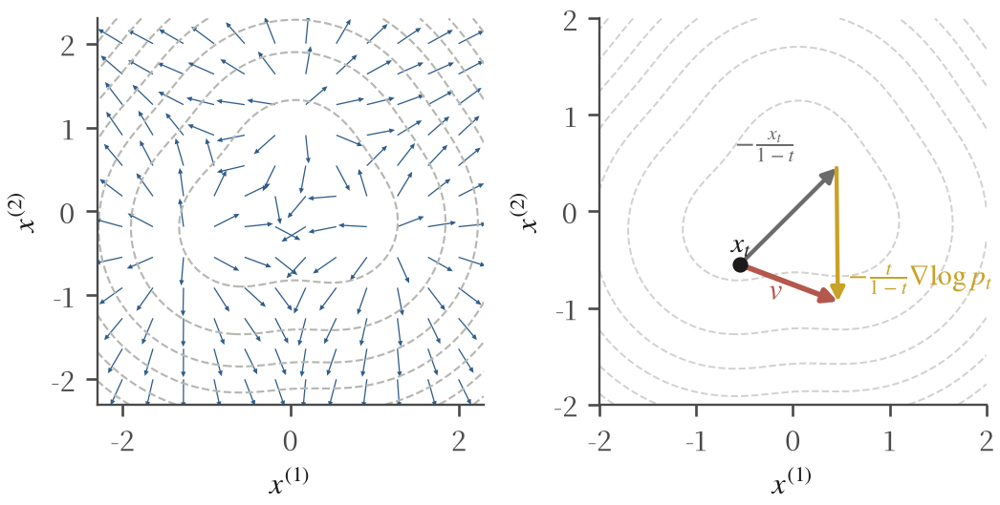

# 速度与分数

扩散模型学的是噪声，流模型学的是速度。这两件事在数学上是同一个场的两种写法。把换算关系写清楚，读论文时就不会被不同的记号绊住。

同一个场有四种常见的写法：预测噪声 $\epsilon_\theta$、预测分数 $\nabla\log p_t$、预测干净样本 $\hat x_0$、预测速度 $v_\theta$。四种写法描述的东西完全一样，网络参数化不同，损失的权重不同，采样器读接口的方式也不同。论文里换一种写法，往往是为了让某个量在数值上更好算，而不是发现了新东西。

这一章把四种写法之间的换算推一遍，每一步都写出来，再给出两张可以直接用的表。后面看任何一篇新论文，先找出它在预测什么，剩下的都能查表。

## 从条件期望出发

考虑高斯路径 $x_t = \alpha_t x_0 + \sigma_t x_1$，$x_1\sim\mathcal{N}(0,I)$。给定 $x_t$，$x_0$ 的后验是高斯，它的均值可以用条件期望写出来。

由 $x_t = \alpha_t x_0 + \sigma_t x_1$ 两边取条件期望

$$x_t = \alpha_t E[x_0\mid x_t] + \sigma_t E[x_1\mid x_t].$$

另一方面，分数与条件期望的关系来自高斯后验的求导

$$\nabla\log p_t(x_t) = -\frac{E[x_1\mid x_t]}{\sigma_t}.$$

这个式子在一维高斯上可以直接验证：$p_t$ 是高斯的混合，对 $x$ 求导得到的就是“偏离均值除以方差”，而单位方差下偏离量正是 $E[x_1\mid x_t]$。

把两式联立，消掉 $E[x_1\mid x_t]$

$$E[x_1\mid x_t] = -\sigma_t\nabla\log p_t(x_t),$$

$$E[x_0\mid x_t] = \frac{x_t + \sigma_t^2\nabla\log p_t(x_t)}{\alpha_t}.$$

### “后验是高斯”这句话的准确范围

上面那句“给定 $x_t$，$x_0$ 的后验是高斯”，严格说只在一部分情形下成立，值得把它说准，否则在别的数据分布上会推错。

给定 $x_0$ 时，$x_t\mid x_0$ 是高斯 $\mathcal{N}(\alpha_t x_0,\sigma_t^2 I)$。这一条对任何 $p_{\text{data}}$ 都成立，因为噪声是加进去的。

反过来，给定 $x_t$ 时 $x_0$ 的后验是

$$p(x_0\mid x_t)\propto p_{\text{data}}(x_0)\exp\left(-\frac{\|x_t-\alpha_t x_0\|^2}{2\sigma_t^2}\right).$$

只有当 $p_{\text{data}}$ 本身是高斯（或者单点）时，右边才是高斯的形状。数据是图像时它显然不是，后验一般是个多峰的、没有闭式的东西。

好在后面的公式一个都不需要后验是高斯，它们只需要后验的均值 $E[x_0\mid x_t]$。这个量有专门的名字，叫去噪器（denoiser）或者 Tweedie 估计，它的公式

$$E[x_0\mid x_t]=\frac{x_t+\sigma_t^2\nabla\log p_t(x_t)}{\alpha_t}$$

对任意 $p_{\text{data}}$ 都成立。这也是为什么整套换算在真实数据上照样能用。

### 分数为什么等于条件分数的平均

上面那个 $\nabla\log p_t=-\sigma_t^{-1}E[x_1\mid x_t]$ 是从哪来的？它其实是一个更一般的恒等式的特例，把那个恒等式证出来，这一条就是把它代进高斯情形的结果：

$$\nabla\log p_t(x)=E\big[\nabla\log p_t(x\mid x_0)\big|x_t=x\big].$$

证明只要三行。把边缘密度写成积分

$$p_t(x)=\int p_t(x\mid x_0)\,p_{\text{data}}(x_0)\,dx_0,$$

两边对 $x$ 求梯度（梯度只作用在条件密度上），再两边除以 $p_t(x)$：

$$\frac{\nabla p_t(x)}{p_t(x)}=\int \frac{p_t(x\mid x_0)}{p_t(x)}\,\nabla\log p_t(x\mid x_0)\,p_{\text{data}}(x_0)\,dx_0.$$

左边是 $\nabla\log p_t(x)$；右边的权重 $p_t(x\mid x_0)p_{\text{data}}(x_0)/p_t(x)$ 恰好是后验 $p(x_0\mid x_t=x)$，所以右边就是条件分数的后验期望。

再代进条件分布的信息：$p_t(x\mid x_0)=\mathcal{N}(\alpha_t x_0,\sigma_t^2 I)$，高斯对 $x$ 求梯度是“均值减 $x$ 除以方差”，

$$\nabla\log p_t(x\mid x_0)=-\frac{x-\alpha_t x_0}{\sigma_t^2}.$$

取后验期望，$x$ 是常数提出去：

$$\nabla\log p_t(x)=-\frac{x-\alpha_t E[x_0\mid x_t=x]}{\sigma_t^2}.$$

这一步就是 Tweedie 公式的另一种写法。与前面的 $E[x_0\mid x_t]$ 表达式对照，两者完全一致。

把它和 $x_1$ 的条件期望联系起来：由 $x_t=\alpha_t x_0+\sigma_t x_1$ 取条件期望再移项，$E[x_1\mid x_t]=(x_t-\alpha_t E[x_0\mid x_t])/\sigma_t$，代进上式

$$\nabla\log p_t(x_t)=-\frac{1}{\sigma_t}\cdot\frac{x_t-\alpha_t E[x_0\mid x_t]}{\sigma_t}=-\frac{E[x_1\mid x_t]}{\sigma_t}.$$

这个推导只用了一次“对积分号里求导”、一次后验的定义，没有对 $p_{\text{data}}$ 做任何假设。它比“高斯后验求导”这种说法稳妥，也顺便解释了为什么 $\sigma_t$ 出现在分母上：它是一个标准差，不是方差。

### 一维两个数验证

取 $p_{\text{data}}$ 为单点 $x_0=a$，$t$ 固定，$\sigma_t=\sigma$、$\alpha_t=\alpha$。此时 $p_t=\mathcal{N}(\alpha a,\sigma^2)$，分数是

$$\nabla\log p_t(x)=-\frac{x-\alpha a}{\sigma^2}.$$

右边按公式算：$E[x_1\mid x_t=x]=(x-\alpha a)/\sigma$，所以 $-\sigma^{-1}E[x_1\mid x_t]=-(x-\alpha a)/\sigma^2$，两边对上。

再取 $a=1$、$\alpha=0.6$、$\sigma=0.8$、$x=0$。分数是 $-(0-0.6)/0.64=0.9375$，$E[x_1\mid x_t=0]=(0-0.6)/0.8=-0.75$，除以 $-\sigma$ 得 $0.9375$。两个数一样。

### 高斯数据上的完整算例

数据分布取一维高斯 $p_{\text{data}}=\mathcal{N}(m,s^2)$ 时，四个量全部有闭式，可以拿它当尺子验算任何一张换算表。此时 $p_t$ 也是高斯：

$$p_t=\mathcal{N}\Big(\alpha_t m,\ \alpha_t^2s^2+\sigma_t^2\Big),\qquad \nabla\log p_t(x)=-\frac{x-\alpha_t m}{\alpha_t^2s^2+\sigma_t^2}.$$

后验均值由 Tweedie 公式直接得到：

$$E[x_0\mid x_t=x]=\frac{\alpha_t s^2x+\sigma_t^2m}{\alpha_t^2s^2+\sigma_t^2}.$$

它是 $x$ 的一次函数，斜率是 $\alpha_t s^2/(\alpha_t^2s^2+\sigma_t^2)$。数据方差远大于当前噪声时斜率接近 $1/\alpha_t$，几乎照抄输入；噪声占优时斜率趋于零，估计被拉回均值 $m$。两个极限都对得上直觉：输入里若没剩下信息，就只能输出先验均值。

这个例子说明了“后验是高斯”这句话的适用范围：$p_{\text{data}}$ 是高斯时后验确实是高斯，所有期望都能写成闭式；图像上不是高斯，但公式里只出现均值，所以仍然可用。

拿 $m=0$、$s=1$、直线路径、$t=0.5$、$x=1$ 代一遍。此时 $p_t=\mathcal{N}(0,0.5)$，分数是 $-2$，$\hat x_0=1$，$\epsilon=1$，速度是 $-(1+0.5\cdot(-2))/0.5=0$。速度在这个点上为零不是算错，是因为数据与噪声同为正态且方差相等，$t=0.5$ 时缩放项与梯度修正恰好抵消。源分布与目标分布重合的情况下，确实没有什么可推的。

## 速度的两种写法

速度场是条件速度的期望

$$v(x,t) = \dot\alpha_t E[x_0\mid x_t] + \dot\sigma_t E[x_1\mid x_t].$$

把上面两个期望代进去

$$v = \dot\alpha_t\frac{x_t + \sigma_t^2\nabla\log p_t}{\alpha_t} - \dot\sigma_t\sigma_t\nabla\log p_t.$$

整理成两项

$$v(x,t) = \frac{\dot\alpha_t}{\alpha_t}x_t - \left(\dot\sigma_t\sigma_t - \frac{\dot\alpha_t\sigma_t^2}{\alpha_t}\right)\nabla\log p_t(x_t).$$

这就是速度与分数的换算公式。它说明：只要知道其中一个，就能算出另一个，两者描述同一个场。



### 把代数走完

上面那个“整理成两项”跳了三步，每一步都值得写出来，因为符号错一次后面全错。

第一步，把第一项拆开：

$$\dot\alpha_t\frac{x_t + \sigma_t^2\nabla\log p_t}{\alpha_t}=\frac{\dot\alpha_t}{\alpha_t}x_t+\frac{\dot\alpha_t\sigma_t^2}{\alpha_t}\nabla\log p_t.$$

第二步，把两个含 $\nabla\log p_t$ 的项合并。第二项原来的系数是 $-\dot\sigma_t\sigma_t$，新加进来的是 $+\dot\alpha_t\sigma_t^2/\alpha_t$：

$$v=\frac{\dot\alpha_t}{\alpha_t}x_t+\left(\frac{\dot\alpha_t\sigma_t^2}{\alpha_t}-\dot\sigma_t\sigma_t\right)\nabla\log p_t.$$

第三步，把括号里的公因子 $\sigma_t^2$ 提出来：

$$\frac{\dot\alpha_t\sigma_t^2}{\alpha_t}-\dot\sigma_t\sigma_t=\sigma_t^2\left(\frac{\dot\alpha_t}{\alpha_t}-\frac{\dot\sigma_t}{\sigma_t}\right).$$

写成这种形式有好处：括号里的两个比值分别是 $\log\alpha_t$ 与 $\log\sigma_t$ 的导数，它们的差正好是半个对数信噪比的导数。

### 用对数信噪比写

记 $a_t=\dot\alpha_t/\alpha_t$、$s_t=\dot\sigma_t/\sigma_t$，则

$$a_t-s_t=\frac12\frac{d}{dt}\log\alpha_t^2-\frac12\frac{d}{dt}\log\sigma_t^2=\frac12\dot\lambda_t,\qquad \lambda_t=\log\frac{\alpha_t^2}{\sigma_t^2}.$$

于是两项公式缩成一个很短的式子：

$$v(x,t)=a_t x_t+\frac{\sigma_t^2\dot\lambda_t}{2}\,\nabla\log p_t(x_t).$$

读法很清楚：速度是“按 $a_t$ 缩放当前位置”加“沿密度梯度走一步，步长由 $\sigma_t^2\dot\lambda_t/2$ 定”。$\dot\lambda_t$ 是信噪比下降的速率，它为零时（信噪比不变）第二项消失，轨迹就只剩缩放，这时没有任何信息能把两个不同的 $x_0$ 区分开。

再提一个公因子 $a_t$：

$$v(x,t)=a_t\Big(x_t+c_t\nabla\log p_t(x_t)\Big),\qquad c_t=\frac{\sigma_t^2\dot\lambda_t}{2a_t}=\sigma_t^2\left(1-\frac{\alpha_t\dot\sigma_t}{\sigma_t\dot\alpha_t}\right).$$

$c_t$ 的量纲是 $x^2$，它决定梯度项相对缩放项有多重。下面会看到，$c_t$ 的取值几乎就把不同的路径区分开了。

### 两项各是什么

第一项 $a_t x_t$ 是“只有缩放、没有修正”时唯一能做的事。若把它单独当 ODE，$dx/dt=a_t x$ 的解是

$$x(t)=x(t_0)\exp\int_{t_0}^t a_s\,ds=x(t_0)\frac{\alpha_t}{\alpha_{t_0}},$$

也就是沿着从原点出发的射线按 $\alpha_t$ 伸缩。时间可逆时，这条射线回到 $t=0$ 就落在 $\alpha_0 x/\alpha_{t_0}$ 上——离数据还差得远，因为它只用到了“该缩多少”，没用到“该往哪个方向修正”。

第二项沿密度梯度，作用是把点推向高密度区。它的大小由 $c_t$ 与局部梯度共同决定：在数据端 $t$ 小，$\sigma_t$ 小，$c_t$ 也小，修正弱；在噪声端修正强，因为这时离数据最远，最需要被拉回来。

拿本章前面那组数看一眼（$p_{\text{data}}=\mathcal{N}(0,0.25)$、$t=0.5$、$x_t=0.3$、直线路径）：缩放项是 $a_tx_t=-0.3/0.5=-0.6$，梯度项是 $-\frac{t}{1-t}\nabla\log p_t=0.96$，两项相加 $0.36$，正是表里那个 $v$。两项量级相当、方向相反，合成之后的大小由它们的差决定。

这种“两项对抗”是中间段的常态，也解释了为什么中间段的轨迹最容易受噪声影响：净变化是两个大数之差，任意一项的误差都会被放大成相对较大的偏差。数据端 $c_t$ 小，梯度项不起作用，只剩一个确定的缩放；噪声端梯度项占优，但那时离数据还远，误差还有步数去纠正。

两项的平衡点决定轨迹的形状。$c_t$ 小，轨迹接近射线，弯曲小但落点粗糙；$c_t$ 大，轨迹更多地被密度形状牵引，落点准但路径弯。这不是二选一，日程已经把这个平衡定死了，能调的只有网络学得准不准。

## 三种常见路径下的化简

直线路径 $\alpha_t = 1-t$，$\sigma_t = t$：$\dot\alpha_t = -1$，$\dot\sigma_t = 1$，代入得

$$v = -\frac{x_t}{1-t} - \frac{t}{1-t}\nabla\log p_t = -\frac{x_t+t\nabla\log p_t}{1-t}.$$

VP 路径 $\alpha_t = \cos(\pi t/2)$，$\sigma_t = \sin(\pi t/2)$：$\dot\alpha_t = -(\pi/2)\sin$，$\dot\sigma_t = (\pi/2)\cos$，代入后两项都带同一个系数 $\pi/2$，可以提出来

$$v = -\frac{\pi}{2}\tan\frac{\pi t}{2}\left(x_t+\nabla\log p_t\right).$$

形式不同，含义一样：速度是“沿当前位置的缩放”加上“沿密度梯度的修正”。

### 直线路径的每一步

$\dot\alpha_t=-1$、$\dot\sigma_t=1$、$\alpha_t=1-t$、$\sigma_t=t$，先算两个系数：

$$a_t=\frac{\dot\alpha_t}{\alpha_t}=-\frac{1}{1-t},\qquad c_t=\sigma_t^2\left(1-\frac{\alpha_t\dot\sigma_t}{\sigma_t\dot\alpha_t}\right)=t^2\left(1-\frac{(1-t)\cdot1}{t\cdot(-1)}\right)=t^2\left(1+\frac{1-t}{t}\right)=t.$$

所以 $v=-(x_t+t\nabla\log p_t)/(1-t)$，与上面一致。$c_t=t$ 是一个好记的结论：直线路径的梯度权重就是时间本身，$t=0$ 时为零，$t=1$ 时为一。数据端不需要修正，噪声端修正最重。

代进去还能看出 $\sigma_t^2\dot\lambda_t/2=-t/(1-t)$：$\dot\lambda_t=-2/(t(1-t))$，乘 $t^2$ 再除以 2 就是它。

### VP 路径的每一步

$\alpha_t=\cos\theta$、$\sigma_t=\sin\theta$、$\theta=\pi t/2$，$\dot\alpha_t=-\frac{\pi}{2}\sin\theta$、$\dot\sigma_t=\frac{\pi}{2}\cos\theta$。

先算 $a_t$ 与 $c_t$：

$$a_t=\frac{\dot\alpha_t}{\alpha_t}=-\frac{\pi}{2}\tan\theta,\qquad \frac{\alpha_t\dot\sigma_t}{\sigma_t\dot\alpha_t}=\frac{\cos\theta\cdot\frac{\pi}{2}\cos\theta}{\sin\theta\cdot\left(-\frac{\pi}{2}\sin\theta\right)}=-\cot^2\theta,$$

$$c_t=\sin^2\theta\left(1+\cot^2\theta\right)=\sin^2\theta\cdot\frac{1}{\sin^2\theta}=1.$$

$c_t$ 恒等于 1，比直线路径的 $c_t=t$ 更“均匀”：整条路径上缩放项与梯度项的相对权重不变。这解释了为什么 VP 的边际轨迹在两端都还算老实——没有哪一端让梯度项完全失效。

### 正弦刻度的直线路径

第三种日程是 $\alpha_t=\cos^2\theta$、$\sigma_t=\sin^2\theta$，也就是把直线路径换成 $\sin^2$ 刻度（前面 $\alpha_t+\sigma_t=1$，所以它还是那条线段）。此时

$$\dot\alpha_t=-\pi\sin\theta\cos\theta,\qquad \dot\sigma_t=\pi\sin\theta\cos\theta,$$

先算两个系数：

$$a_t=\frac{\dot\alpha_t}{\alpha_t}=-\pi\frac{\sin\theta}{\cos\theta}=-\pi\tan\theta,$$

$$\frac{\alpha_t\dot\sigma_t}{\sigma_t\dot\alpha_t}=\frac{\cos^2\theta\cdot\pi\sin\theta\cos\theta}{\sin^2\theta\cdot(-\pi\sin\theta\cos\theta)}=-\cot^2\theta,$$

$$c_t=\sigma_t^2\left(1+\cot^2\theta\right)=\sin^4\theta\cdot\frac{1}{\sin^2\theta}=\sin^2\theta=\sigma_t.$$

结论是 $c_t=\sigma_t$：梯度权重正好等于当前的噪声尺度。这一条与第三章的“条件速度是 $\frac{\pi}{2}\sin(\pi t)(x_1-x_0)$”是同一件事的两种写法，可以拿来验算：把 $v=a_t(x+\sigma_t\nabla\log p)$ 在一维两点数据上算一遍，数值与直接算 $\frac{\pi}{2}\sin(\pi t)(x_1-x_0)$ 的期望一致。

### 三条路径的对照

把三条路径的系数并排放，结构一目了然。

| 日程 | $a_t=\dot\alpha_t/\alpha_t$ | $c_t$ | $v$ 的紧凑写法 |
| --- | --- | --- | --- |
| 直线 | $-\frac{1}{1-t}$ | $t$ | $-\frac{x_t+t\nabla\log p_t}{1-t}$ |
| VP | $-\frac{\pi}{2}\tan\frac{\pi t}{2}$ | $1$ | $-\frac{\pi}{2}\tan\frac{\pi t}{2}\left(x_t+\nabla\log p_t\right)$ |
| 正弦刻度 | $-\pi\tan\frac{\pi t}{2}$ | $\sigma_t$ | $-\pi\tan\frac{\pi t}{2}\left(x_t+\sigma_t\nabla\log p_t\right)$ |

三条路径的 $a_t$ 都在 $t\to1$ 时发散，因为 $\alpha_t\to0$，第一项里 $x_t/\alpha_t$ 的结构要求系数变大来抵消。这不是真发散：$t=1$ 时 $x_t+\sigma_t^2\nabla\log p_t=\alpha_t E[x_0\mid x_t]$ 也趋于零，两个无穷相互抵消，真正的速度是有界的。实现时不要照抄这些紧凑写法直接除，会在端点炸掉；训练用第三章那个只含乘法的目标，只在需要换算时才碰这些公式，并且对 $t$ 留一点余量。

## 与噪声预测的换算

扩散模型的网络输出是 $\epsilon_\theta$。在高斯路径下，噪声与分数的关系是

$$\nabla\log p_t(x_t) = -\frac{\epsilon_\theta(x_t,t)}{\sigma_t}.$$

代进速度公式

$$v = \frac{\dot\alpha_t}{\alpha_t}x_t + \left(\dot\sigma_t - \frac{\dot\alpha_t\sigma_t}{\alpha_t}\right)\epsilon_\theta.$$

以直线路径为例，$\sigma_t = t$，$\alpha_t = 1-t$，得到

$$v = -\frac{x_t}{1-t} + \frac{1}{1-t}\epsilon_\theta = \frac{\epsilon_\theta - x_t}{1-t}.$$

这与前面“条件速度等于 $x_1 - x_0$”的结论一致：把 $x_0$ 用 $x_t$ 与 $\epsilon$ 表示，再相减，得到的就是这个式子。

### 系数怎么来的

上面第二个式子里的括号 $(\dot\sigma_t-\dot\alpha_t\sigma_t/\alpha_t)$ 值得看一眼，它是把 $\nabla\log p_t=-\epsilon_\theta/\sigma_t$ 代入 $v=a_tx+\frac{\sigma_t^2\dot\lambda_t}{2}\nabla\log p_t$ 之后自然出来的：

$$\frac{\sigma_t^2\dot\lambda_t}{2}\cdot\left(-\frac{\epsilon_\theta}{\sigma_t}\right)=-\frac{\sigma_t\dot\lambda_t}{2}\epsilon_\theta=\left(\dot\sigma_t-\frac{\dot\alpha_t\sigma_t}{\alpha_t}\right)\epsilon_\theta,$$

最后一步用了 $\dot\lambda_t/2=\dot\sigma_t/\sigma_t-\dot\alpha_t/\alpha_t$，两边同乘 $\sigma_t$ 再取负号即可。两种写法等价，账要能对上。

直线路径下 $\dot\alpha_t=-1$、$\dot\sigma_t=1$、$\alpha_t=1-t$、$\sigma_t=t$，括号是

$$1-\frac{(-1)\cdot t}{1-t}=1+\frac{t}{1-t}=\frac{1}{1-t},$$

所以 $v=-x_t/(1-t)+\epsilon_\theta/(1-t)$。这个式子在 $t\to0$ 时趋于 $\epsilon_\theta-x_t$，而数据端 $\epsilon_\theta$ 很小、$x_t\approx x_0$，速度约为 $-x_0$，与第三章端点极限的结论一致。

### 端点处的消去

直线路径下 $v=(\epsilon_\theta-x_t)/(1-t)$，字母上是两个量相减再除以一个小数。$t\to1$ 时 $\epsilon_\theta\to x_t$（噪声端的“噪声预测”就是输入自己），分子趋于零，分母也趋于零，实际速度有界。

数值上这是个隐患。假设计算用 float32，$x_t$ 与 $\epsilon_\theta$ 都在 1 的量级，相减的相对误差约 $10^{-7}$，除以 $1-t$ 之后被放大成 $10^{-7}/(1-t)$。$t=0.99$ 时是 $10^{-5}$，还看不出来；$t=0.999$ 时是 $10^{-4}$；$t=0.99999$ 时到了 $10^{-2}$。所以换算只在 $t$ 离端点有距离时才可靠，训练与采样通常也不会真的走到 $t=1$，截断在 $1-10^{-3}$ 附近就够。

反方向也有问题。从 $\epsilon_\theta$ 换算到 $\hat x_0$：

$$\hat x_0=\frac{x_t-\sigma_t\epsilon_\theta}{\alpha_t},$$

分母是 $\alpha_t$，在 $t\to1$ 处趋于零，而分子 $x_t-\sigma_t\epsilon_\theta$ 是 $t\to1$ 时的 $0\cdot$有限量，两者一起趋于零，比值是一个有限的后验均值。但 $\epsilon_\theta$ 的误差在分子里不被抵消：网络在噪声端的一点偏差，除以 $\alpha_t$ 之后被放大 $1/\alpha_t$ 倍。这就是为什么“用 $\hat x_0$ 参数化在噪声端不稳”这个说法成立——不是公式错，是分母小。

速度参数化在这一点上有优势：$v$ 本身就是网络输出，训练和采样只需要它，不需要经过任何除法。只有做跨参数化的换算（比如把一个 $\epsilon$ 网络接进流模型的采样器）时才碰这些公式，那时候注意 $t$ 的截断就行。

## 一张对照表

先把“已知一个量，怎么得到分数”整理出来。这张表里的 $\sigma_t$、$\alpha_t$、$\dot\alpha_t$、$\dot\sigma_t$ 都按同一个日程取，$\lambda_t$ 是对数信噪比。

| 已知量 | 换算到分数 |
| --- | --- |
| 噪声 $\epsilon_\theta$ | $\nabla\log p_t = -\epsilon_\theta/\sigma_t$ |
| 速度 $v_\theta$ | $\nabla\log p_t = \left(v_\theta - \frac{\dot\alpha_t}{\alpha_t}x_t\right)\Big/\frac{\sigma_t^2\dot\lambda_t}{2}$ |
| 分数 $\nabla\log p_t$ | $\epsilon_\theta = -\sigma_t\nabla\log p_t$ |
| 干净样本 $\hat x_0$ | $\nabla\log p_t = (\alpha_t\hat x_0 - x_t)/\sigma_t^2$ |

表里的第一行最常用：拿到一个噪声预测网络，就拿到了分数；第二行说明拿到一个流模型也就拿到了分数。两者的采样器可以互换，只要把场换算过去。

第二行的写法与前面出现的另一种写法是同一个东西，两种都对：

$$\frac{\sigma_t^2\dot\lambda_t}{2}=\frac{\dot\alpha_t\sigma_t^2}{\alpha_t}-\dot\sigma_t\sigma_t .$$

用哪个看方便。用 $\lambda_t$ 的写法短一些，但它要求日程的 $\lambda_t$ 有闭式；用 $\alpha,\sigma$ 的写法笨一些，但任何日程都能直接算。

### 直线路径上的完整表

把路径固定成直线，四个量两两之间的换算式都能写得很干净。这张表可以直接抄进代码。

| 已知 $\to$ 求 | $x_0$ | $\epsilon$ | $v$ | $\nabla\log p$ |
| --- | --- | --- | --- | --- |
| 已知 $x_0$ | — | $\dfrac{x_t-(1-t)x_0}{t}$ | $\dfrac{x_t-x_0}{t}$ | $\dfrac{(1-t)x_0-x_t}{t^2}$ |
| 已知 $\epsilon$ | $\dfrac{x_t-t\epsilon}{1-t}$ | — | $\dfrac{\epsilon-x_t}{1-t}$ | $-\dfrac{\epsilon}{t}$ |
| 已知 $v$ | $x_t-t\,v$ | $x_t+(1-t)v$ | — | $-\dfrac{x_t+(1-t)v}{t^2}$ |
| 已知 $\nabla\log p$ | $\dfrac{x_t+t^2\nabla\log p}{1-t}$ | $-t\nabla\log p$ | $-\dfrac{x_t+t\nabla\log p}{1-t}$ | — |

四个格子的对角线是空的，其余每个格子都是一个仿射变换：目标量等于 $x_t$ 的倍数加上已知量的倍数，系数只依赖 $t$。这种“全是仿射”的结构是高斯路径带来的，也是这些换算式好用的原因。

验算两格，确认系数没抄错。已知 $v$ 求 $x_0$：由 $v=(x_t-x_0)/t$ 直接解出 $x_0=x_t-tv$；已知 $\epsilon$ 求 $x_0$：由 $\epsilon=(x_t-(1-t)x_0)/t$ 解出 $x_0=(x_t-t\epsilon)/(1-t)$。两式都只用一次移项，与表里一致。

### 同一批数值，两条路径

取 $p_{\text{data}}=\mathcal{N}(0,0.25)$，$t=0.5$，$x_t=0.3$，两种日程下四个量各是多少：

| 量 | 直线路径 | VP 路径 |
| --- | --- | --- |
| $p_t$ 的方差 | 0.3125 | 0.6250 |
| $\hat x_0$ | 0.120 | 0.085 |
| $\epsilon$ | 0.480 | 0.339 |
| $v$ | 0.360 | 0.283 |
| $\nabla\log p_t$ | $-0.960$ | $-0.480$ |

同一个 $x_t$ 上，两种日程给出的数值差得不少：$\epsilon$ 从 0.48 变到 0.34，$\nabla\log p_t$ 直接减半。所以这四个数不能跳日程搬运，说“某个点上的速度是 0.3”必须同时说清日程与 $t$。

两列内部都自洽。直线列用 $v=(x_t-\hat x_0)/t=(0.3-0.12)/0.5=0.36$；VP 列用 $v=-\frac{\pi}{2}\tan\frac{\pi}{4}(0.3-0.48)=0.283$。两个结果都回到 $v$ 的定义，说明表里的系数没有抄错。这也是查错的办法：任取一列，用两三种算法算同一个量，结果必须一样。

### 四个量各自的端点行为

四个量在两端差别很大，这张表解释了为什么不同的模型选不同的参数化。

| 量 | $t\to0$（数据端） | $t\to1$（噪声端） | 常见用途 |
| --- | --- | --- | --- |
| $x_0$ | 收敛到数据本身 | 需要除以 $\alpha_t$，放大误差 | 编辑类模型，输出直接约束取值范围 |
| $\epsilon$ | 需要除以 $\sigma_t$，放大误差 | 收敛到输入 $x_t$ | 扩散模型默认，与 DDIM 一类采样器对接 |
| $v$ | 有界，趋于 $-x_t$ | 有界，趋于 $x_t$ | 流模型、蒸馏、少步采样 |
| $\nabla\log p$ | 除以 $\sigma_t^2$，最不稳 | 除以 $\sigma_t$，尚可 | 理论分析、引导、SDE 采样 |

速度在两端都有界，这是它作为训练目标最实在的好处：不会因为 $t$ 抽到极端值就让某一批样本的损失爆炸。$\hat x_0$ 在噪声端不稳、$\epsilon$ 在数据端不稳，都是因为分母小；这不是换个记号就能消除的，是这两个量本身的定义带来的。

### 网络输入用 $t$ 还是 $\lambda$

多数实现把 $t$ 直接送进网络（做正弦位置编码），也有把对数信噪比 $\lambda_t$ 当输入。后者有两个好处：跨日程可比，换日程时网络看到的输入分布大致不变；与难度对齐，$\lambda$ 均匀采样直接对应“每个数量级的信噪比拿到同样多算力”。

麻烦在两端：$\lambda_t$ 在 $t=0,1$ 处是 $\pm\infty$，必须裁到一个有限区间（比如 $[-10,10]$），裁完之后两个端点的所有样本共用同一个嵌入，相当于给端点加了很强的正则。另一个麻烦是尺度，$\lambda$ 的取值范围与 $t$ 差很多，时间嵌入的频率、学习率都要重调。

用 $t$ 省事，用 $\lambda$ 在换日程的对比实验里更稳定，两种做法都常见。选完之后别混：同一份代码里一半送 $t$ 一半送 $\lambda$，是最难查的一类错误。

## 从头算一遍

前面每一步都推过了，缺一个从数据到四个量、再到互相验算的完整算例。拿一维两点数据来做，每一步都能手算。

数据 $x_0=\pm1$ 各占一半，直线路径，取 $t=0.3$、$x_t=0.5$。此时 $\alpha_t=0.7$、$\sigma_t=0.3$、$\sigma_t^2=0.09$，两个模态的位置是 $\pm\alpha_t=\pm0.7$。

先算后验权重。两个高斯在同一处的比值只差指数：

$$w_+\propto\exp\left(-\frac{(0.5-0.7)^2}{2\times0.09}\right)=e^{-0.222}=0.801,\qquad w_-\propto\exp\left(-\frac{(0.5+0.7)^2}{2\times0.09}\right)=e^{-8}=3.4\times10^{-4}.$$

归一化之后 $w_+\approx0.9996$、$w_-\approx0.0004$，后验几乎全部压在 $+1$ 上，所以

$$E[x_0\mid x_t=0.5]=0.9992 .$$

顺着这张表往下算其余三个量：

$$E[x_1\mid x_t]=\frac{x_t-\alpha_tE[x_0]}{\sigma_t}=\frac{0.5-0.7\times0.9992}{0.3}=-0.6647,$$

$$\nabla\log p_t=-\frac{E[x_1\mid x_t]}{\sigma_t}=2.2157,\qquad v=\frac{x_t-E[x_0]}{t}=\frac{0.5-0.9992}{0.3}=-1.6639 .$$

四个数都出来了。现在反过来用别的式子验：

用 Tweedie 从分数回到后验均值，$(x_t+\sigma_t^2\nabla\log p_t)/\alpha_t=(0.5+0.09\times2.2157)/0.7=0.9992$，对上。

用 $v$ 的紧凑写法，$-(x_t+t\nabla\log p_t)/(1-t)=-(0.5+0.3\times2.2157)/0.7=-1.6639$，对上。

用表里“已知 $\epsilon$ 求 $x_0$”，$(x_t-t\epsilon)/(1-t)=(0.5+0.3\times0.6647)/0.7=0.9992$，对上。

三处验算各自走了不同的路，回到同一个数，说明表里的系数没有抄错。

这个例子里速度是负的（指向 $-x$ 一侧），而后验均值落在 $+1$ 一侧——看着矛盾，其实不是：速度是 $\dot\alpha x_0+\dot\sigma x_1$ 的期望，直线路径下等于 $(x_t-E[x_0])/t$，它度量的是“从当前位置到后验均值”的位移被压缩在剩下的 $t$ 时间里完成，方向与位移方向一致，只是量级被 $1/t$ 放大。$t=0.3$ 时压缩比是 3.3 倍。

顺带看一眼数值大小：$|\epsilon|=0.66$、$|v|=1.66$，两者都远离端点处的“复制输入”极限（那里应该是 $|\epsilon|\approx|x_t|=0.5$、$|v|\approx|x_t|$）。中间段的速度可以比输入本身大好几倍，这也是为什么采样时的步长要跟着日程调，不能拿数据端的直觉去设定。

## 这个换算的用处

第一，读论文时对齐记号。同一个方法，一篇论文写成噪声回归，另一篇写成速度回归，看起来不同，换算之后往往是同一个损失。

第二，复用组件。扩散模型的采样器、引导、蒸馏方法，只要能拿到速度场，就可以直接用在流模型上。反过来也一样。

第三，看清一步生成的困难。一步生成的模糊来自“条件均值”，而这个均值在两种参数化下是同一个东西，换记号解决不了问题。

### 对齐记号时能算出什么

对齐不只是“看起来一样”。把两个损失写成同一个量，能算出它们差的是哪个权重。

以直线路径为例。$\epsilon$ 参数化的目标是

$$L_\epsilon=E\|\epsilon_\theta(x_t,t)-\epsilon\|^2,$$

$v$ 参数化的目标是 $L_v=E\|v_\theta(x_t,t)-(\epsilon-x_0)\|^2$。若两个网络表达的场相同，即 $v_\theta=(\epsilon_\theta-x_t)/(1-t)$，把它代进 $L_v$：

$$L_v=E\left\|\frac{\epsilon_\theta-x_t}{1-t}-(\epsilon-x_0)\right\|^2=\frac{1}{(1-t)^2}E\|\epsilon_\theta-\epsilon\|^2=\frac{L_\epsilon}{(1-t)^2},$$

通分之后分子是 $\epsilon_\theta-x_t-(1-t)(\epsilon-x_0)$。用 $x_t=(1-t)x_0+t\epsilon$ 把 $x_t$ 换掉，分子变成 $\epsilon_\theta-(1-t)x_0-t\epsilon-(1-t)\epsilon+(1-t)x_0$，两个 $(1-t)x_0$ 项恰好抵消，剩下 $\epsilon_\theta-(t+1-t)\epsilon=\epsilon_\theta-\epsilon$。分母是 $1-t$，权重就是这么来的。

这说明两种参数化下的损失只差一个逐点的权重 $1/(1-t)^2$：$v$ 参数化在噪声端把 $\epsilon$ 的误差放大，在数据端几乎不动。既然权重不改变极小值点（第三章证明过），两种目标学的是同一个场；差别全在优化上——同样的学习率，$v$ 参数化在噪声端更“重”，$\epsilon$ 参数化在数据端更“重”。

### DDIM 的一步就是 Euler 的一步

复用组件最具体的例子是采样器。扩散模型的 DDIM（$\eta=0$ 那一支）常被当成一种“新”的采样方式，其实它就是概率流 ODE 的一步 Euler，只是写在另一种参数化下。

DDIM 的更新式是

$$x_{t-\Delta t}=\alpha_{t-\Delta t}\,\hat x_0+\sigma_{t-\Delta t}\,\hat\epsilon,$$

其中 $\hat x_0$ 与 $\hat\epsilon$ 是当前 $x_t$ 给出的两个估计。把 $\hat x_0=(x_t-\sigma_t\hat\epsilon)/\alpha_t$ 代进去：

$$x_{t-\Delta t}=\frac{\alpha_{t-\Delta t}}{\alpha_t}x_t+\left(\sigma_{t-\Delta t}-\sigma_t\frac{\alpha_{t-\Delta t}}{\alpha_t}\right)\hat\epsilon.$$

现在看概率流 ODE 的 Euler 步 $x_{t-\Delta t}=x_t-\Delta t\,v$，把 $v$ 的表式展开：

$$x_{t-\Delta t}=\left(1-\Delta t\frac{\dot\alpha_t}{\alpha_t}\right)x_t-\Delta t\left(\dot\sigma_t-\frac{\dot\alpha_t\sigma_t}{\alpha_t}\right)\hat\epsilon.$$

两式对照，只需确认系数在 $\Delta t$ 的一阶上相同。由 $\alpha_{t-\Delta t}\approx\alpha_t-\Delta t\dot\alpha_t$ 得

$$\frac{\alpha_{t-\Delta t}}{\alpha_t}\approx1-\Delta t\frac{\dot\alpha_t}{\alpha_t},$$

第一项对上。第二项同样展开：

$$\sigma_{t-\Delta t}-\sigma_t\frac{\alpha_{t-\Delta t}}{\alpha_t}\approx\sigma_t-\Delta t\dot\sigma_t-\sigma_t\left(1-\Delta t\frac{\dot\alpha_t}{\alpha_t}\right)=-\Delta t\left(\dot\sigma_t-\frac{\dot\alpha_t\sigma_t}{\alpha_t}\right),$$

也对上。所以 DDIM 的一步与 Euler 的一步在一阶精度上相同，两者的差别只在于步长怎么取、以及 DDIM 允许 $\eta>0$ 引入随机性。

这条等价关系有两个实用后果。一是把一个 $\epsilon$ 网络接到流模型的采样器上，不需要“改造成流模型”，只要按表把 $\epsilon$ 换成 $v$，剩下的就是普通的 ODE 求解；二是不必为两种模型各写一套采样代码，统一到速度场之后，DDIM、Heun、中点都只是同一个求解器库里的不同选项。

```python
def sample(eps_net, x, ts, alpha, sigma, dalpha, dsigma):
    # eps 网络先按表换成速度场，之后的求解器与扩散模型共用
    for t, t_next in zip(ts[:-1], ts[1:]):
        eps = eps_net(x, t)
        a = dalpha(t) / alpha(t)
        b = dsigma(t) - dalpha(t) * sigma(t) / alpha(t)
        v = a * x + b * eps
        x = x - (t - t_next) * v        # Euler，换 Heun 只需多算一次 v
    return x
```

### 绕一圈应该回到原处

四个量两两之间的换算构成一张闭合的图，任何一条环路走回来都必须回到出发点。这条性质可以用来验算实现，也能帮人记住公式。

最常用的两条环路是

$$\epsilon\;\longrightarrow\;\hat x_0\;\longrightarrow\;\epsilon,\qquad \epsilon\;\longrightarrow\;v\;\longrightarrow\;\epsilon.$$

第一条：$\hat x_0=(x_t-\sigma_t\epsilon)/\alpha_t$，再算 $\hat\epsilon=(x_t-\alpha_t\hat x_0)/\sigma_t$，代进去得

$$\frac{x_t-\alpha_t(x_t-\sigma_t\epsilon)/\alpha_t}{\sigma_t}=\frac{x_t-x_t+\sigma_t\epsilon}{\sigma_t}=\epsilon,$$

回到原处。第二条：$v=(\epsilon-x_t)/(1-t)$ 再反解，同样回到 $\epsilon$。

数值上这件事不那么平凡。$t$ 接近端点时，两条环路里的除法都在放大误差，走一圈回来可能与出发点差出几个百分点（量级估计，取决于 $t$ 与浮点精度）。所以这个自检要在中间段做，端点的误差说明不了实现对错。

### 引导可以直接搬过去

分类器无关引导在分数上是线性组合：

$$\nabla\log p_t^{\omega}(x_t)=\ (1+\omega)\nabla\log p_t(x_t\mid c)-\omega\nabla\log p_t(x_t),$$

$\omega$ 是引导强度，$c$ 是条件。想在流模型上实现同一个引导，把分数用速度表示代进去就行。由 $v=a_t x+\frac{\sigma_t^2\dot\lambda_t}{2}\nabla\log p$，可以把 $\nabla\log p$ 解成 $v$ 的仿射函数：

$$\nabla\log p_t=\frac{2}{\sigma_t^2\dot\lambda_t}\left(v-a_tx_t\right).$$

代进引导式，两边同乘同一个常数、再把 $a_tx_t$ 那部分加回去，常数项 $(1+\omega)-\omega=1$ 恰好消掉，剩下

$$v^{\omega}=(1+\omega)\,v(x_t\mid c)-\omega\,v(x_t).$$

也就是说，引导在速度上与在分数上是完全相同的形式，连系数都不用改。这条性质很实用：任何在扩散模型上验证过的引导技巧，只要目标网络输出的是速度，公式可以照抄。它成立的原因是换算在 $\nabla\log p$ 与 $v$ 之间是仿射的，而引导是仿射组合，两者可交换。

负向提示只是把上式里的无条件项换成“用负向文本算出来的条件项”：

$$v^{\omega}=(1+\omega)\,v(x_t\mid c_{\text{pos}})-\omega\,v(x_t\mid c_{\text{neg}}).$$

它与标准引导只差 $\omega$ 的定义，实现完全一样。

强度调大之后，采样结果会过饱和：颜色被推离均值，像素值跑出 $[0,1]$。常见的补救是每步之后做一次再缩放，先算当前 $x_t$ 在各通道上的标准差，再按该 $t$ 上的理论标准差把它拉回去。理论标准差要按日程算——直线路径下是 $\alpha_t^2v_d+\sigma_t^2$，VP 下 $\alpha_t^2+\sigma_t^2=1$，两者数值不同，跳日程抄常数会错。这一步与参数化无关，分数与速度都能用。

### 一步生成时换记号没用

一步生成要把 $x_1$ 直接映到 $x_0$，网络能学到的最优输出是条件均值 $E[x_0\mid x_1]$。这个量在四种参数化下都指向同一个东西：

$$E[\epsilon\mid x_1]=x_1,\qquad E[v\mid x_1]=x_1-E[x_0\mid x_1],\qquad E[\nabla\log p_1]=-x_1 .$$

第一式与第三式是确定的（$t=1$ 时 $\alpha_1=0$，$x_1$ 就是纯噪声，条件期望等于它自己），所以它们在噪声端学起来“太容易”；第二式是 $x_1$ 减去那个多值的均值，多值性原封不动地保留在里面。

这解释了为什么一步生成的模型几乎都选 $x_0$ 或者 $v$ 参数化，而不选 $\epsilon$：不是因为 $\epsilon$ 错，是因为 $\epsilon$ 在 $t=1$ 处的目标太简单，学不出任何区分信息。换参数化能改变网络需要拟合的对象，改变不了歧义本身——歧义来自 $p(x_0\mid x_1)$ 的宽度，它在哪个坐标系下都存在。

### 四元组在一维两点的账

用第三章那个一维两点数据（$x_0=\pm1$ 各半、直线路径）把上一段说清。$t=1$ 时 $x_1$ 与 $x_0$ 独立，所以

$$E[x_0\mid x_1]=0,\qquad \mathrm{Var}(x_0\mid x_1)=1,\qquad E[\epsilon\mid x_1]=x_1,\qquad E[v\mid x_1]=x_1 .$$

三个参数化在一阶处的目标分别是 $0$、$x_1$、$x_1$。前一个要输出的值与输入无关，误差的期望是 $E|x_0|=1$；后两个只要复制输入，几乎不用学。

这就是“换记号解决不了歧义”的具体样子：$\epsilon$ 与 $v$ 的目标在 $t=1$ 处太简单，网络不需要区分两个模态就能把损失压到零，判别的工作全留给了后面的步；$x_0$ 参数化把判别压进了一步，代价是那个落在两峰中间的 $0$。

真正改变这件事的是让一步网络承担更多判别（用分布匹配一类的损失），以及让路径本身更直。参数化只决定损失在哪些 $t$ 上更重，决定不了 $p(x_0\mid x_1)$ 有多宽。这也是为什么一步生成的方法五花八门，但都要回到“条件分布不是单点”这个事实上来。

### 用来查错

换算还有一个不起眼但很实用的用途：把一个实现与另一个实现对拍。手里有两个网络，一个输出 $\epsilon$、一个输出 $v$，把同一批 $x_t$ 喂进去，按表换算之后两边应该一致。若不一致，错的地方通常就三类：$\sigma_t$ 与 $\sigma_t^2$ 弄混（分数的定义里是方差，噪声的定义里是标准差）；$t$ 的方向反了（$t$ 从数据走到噪声还是反过来，$\dot\alpha_t$ 的符号会整体反）;VP 日程里漏了 $\pi/2$（$\dot\alpha_t$ 的链式求导少乘一次）。这三类错都会让采样在少步时表现正常、多步时慢慢偏，很不容易靠肉眼看图发现。

## 为什么理论里偏爱分数

分数在理论推导里出现得比速度多，因为它和几个常用的量直接相连。

KL 散度与分数的关系最直接。对两个同支撑的分布 $q$、$p$，$\mathrm{KL}(q\|p)=\int q\log\frac{q}{p}$ 对 $q$ 的变分导数，在“扰动 $q$ 的样本位置”这个意义下，就是 $\nabla\log q-\nabla\log p$。所以“让 $q$ 靠近 $p$”在分数上是逐点的差，不需要积分。各种蒸馏方法（用一个分布去匹配另一个分布）最后都落到“匹配两个分数场”，原因就在这里。

SDE 采样器直接吃分数。反向 SDE 的漂移里含 $\nabla\log p_t$，换成速度之后系数会变，形式不变；要把扩散模型的一整套 SDE 求解器（Euler–Maruyama、predictor-corrector）接到流模型上，必须先换成分数。这也是为什么“流模型的采样只能走 ODE”这个印象并不对：只要愿意按表换一次，随机采样器同样可用。

去噪与分数是同一件事的两面。给定 $x_t$ 预测 $x_0$ 的最优解是后验均值，Tweedie 公式说后验均值由分数决定，所以“训练一个去噪器”与“学一个分数场”在最优解上等价。三者——扩散的噪声回归、score matching 的分数回归、流匹配的速度回归——在最优解处描述同一个场，差别只在于参数化、损失权重与数值行为。这张换算表就是三条线之间的字典。

## 几处容易混的记号

### $\epsilon$ 与 $x_1$ 是同一个东西

噪声在两处各有各的叫法：路径方程里写成 $x_1$，扩散文献里写成 $\epsilon$。两者指同一个标准正态样本，$x_t=\alpha_tx_0+\sigma_tx_1$ 与 $x_t=\sqrt{\bar\alpha_t}\,x_0+\sqrt{1-\bar\alpha_t}\,\epsilon$ 是同一个式子，只要令 $\alpha_t=\sqrt{\bar\alpha_t}$、$\sigma_t=\sqrt{1-\bar\alpha_t}$。

这里有一个常见的抄错点：$\bar\alpha_t$ 是 $\alpha_t$ 的平方，不是 $\alpha_t$ 本身。把 $\bar\alpha_t$ 直接当成这里的 $\alpha_t$ 代进换算式，$\dot\alpha_t$ 会差一个 $2\alpha_t$ 的因子，整套系数跟着偏，而且偏得很隐蔽——采样还能出图，只是少步时糊、多步时慢慢偏色。

### $\sigma$ 既是标准差又是别的量

$\sigma_t$ 在 $x_t=\alpha_tx_0+\sigma_tx_1$ 里是标准差，所以分数里出现的是 $\sigma_t^2$（方差），噪声里出现的是 $\sigma_t$（标准差）。同一篇论文里还可能用 $\sigma_t$ 表示 SDE 的扩散系数，那是另一个量，量纲也不同。

判断办法看它站在哪：与 $\epsilon$ 相乘的是标准差，与 $\nabla\log p$ 相除的是方差。表里两个都出现过，写代码时最容易在这里手滑。

### $\beta$、$\bar\alpha$、$\alpha$ 的三层

离散扩散的日程是三层：每步加多少噪声 $\beta_i$，每步保留多少 $\alpha_i=1-\beta_i$，累计保留多少 $\bar\alpha_t=\prod_{i\le t}\alpha_i$。这里的 $\alpha_t$ 对应最后一层的开方 $\sqrt{\bar\alpha_t}$。三层里只有最后一层直接进 $x_t$ 的公式，前面两层是构造它的中间量。

看到 $\alpha$ 先确认是哪一层，再看有没有根号。这一条比看起来重要：同一个符号在两种约定下差一次开方，$\dot\alpha_t$ 的表达会完全不同。

### $t$ 的方向

还有一种情况是 $t$ 被定义成噪声水平，从 0（纯噪声）涨到 1（数据）。此时 $\alpha_t$ 是升的、$\sigma_t$ 是降的，$\dot\alpha_t$ 的符号与本章相反，所有换算式里的 $\dot\alpha_t$、$\dot\sigma_t$ 都要跟着翻。

查的办法很简单：算一下两个端点的 $x_t$，看哪一端是纯噪声。也可以看 $t\to0$ 时 $\alpha_t$ 趋于 1 还是 0——这一步花不了几秒钟，能省掉半天的调试。
