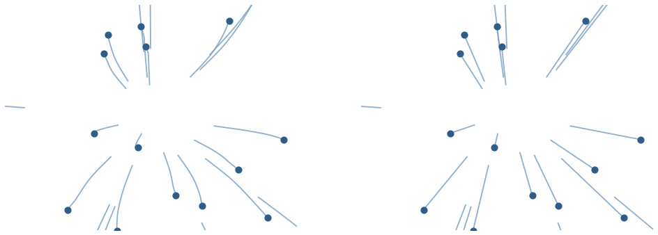

# 整流流与重配对

流匹配的路径在条件上是直的，边际轨迹却会弯。弯的轨迹意味着采样要多步。整流流处理的就是这件事：用重配对把轨迹拉直。

## 一维例子里的弯曲

数据只有两个点，$-1$ 和 $+1$，噪声是标准高斯。条件路径是：$-1$ 连到它配对的噪声，$+1$ 连到它配对的噪声。四条线段在中间交叉。

在交叉点上，来自不同配对的条件速度指向不同方向。取平均之后，边际速度指向水平方向，既不通向 $-1$，也不通 $+1$。结果就是轨迹在中间被掰弯。


弯曲程度取决于配对方式。如果 $x_0$ 与 $x_1$ 随机配对，交叉就多；如果配对是“距离最近的一对”，线段不交叉，轨迹自然直。

### 四个配对算一遍

先把噪声也离散成两个点，$-1$ 与 $+1$，再与数据独立配对。四种组合等概率，每种占四分之一。

| 配对 $(x_0,x_1)$ | 条件速度 $x_1-x_0$ | $t=\frac12$ 时的位置 | 概率 |
| --- | --- | --- | --- |
| $(-1,-1)$ | $0$ | $-1$ | $1/4$ |
| $(-1,+1)$ | $+2$ | $0$ | $1/4$ |
| $(+1,-1)$ | $-2$ | $0$ | $1/4$ |
| $(+1,+1)$ | $0$ | $+1$ | $1/4$ |

第三列是 $(1-t)x_0+tx_1$ 在 $t=1/2$ 处的取值。两条反对角线上的配对都经过 $x=0$：一条速度为 $+2$，另一条为 $-2$。另两条留在原地。

边际速度是“给定 $x_t$ 之后的条件期望”。在 $(t,x)=(1/2,0)$ 处，只有那两条经过的路径参与平均，权重相同，于是

$$v(0,\tfrac12)=\tfrac12(+2)+\tfrac12(-2)=0 .$$

速度为零意味着 ODE 走到这里原地不动。换成高斯噪声后，由左右对称性，$x=0$ 上每个时刻的边际速度都是零，整条 $x=0$ 是一条静止的线；离散的两原子里，这条线只剩 $t=1/2$ 这一个点。真实轨迹不会正好落在上面，但只要靠近，就会被这张“零速度的网”拖住，步长花在交叉区里。

权重不等时结论就不一样。设数据里 $-1$ 占 $3/4$、$+1$ 占 $1/4$，同样的两对路径在 $(1/2,0)$ 处给出

$$v(0,\tfrac12)=\tfrac34(+2)+\tfrac14(-2)=1 .$$

条件均值被多数类拉走，指向 $+1$。也就是说，在交叉点上，场给出的答案是“跟着多数走”，而不是“这里是两类样本的分界”。一步生成要在这里做出选择，而 $x$ 里没有这个信息，这个困难在第 7 章会被写成条件方差。

### 换成高斯噪声

噪声取标准高斯，数据仍是两个点。此时 $p_t$ 是两个等权高斯的混合：

$$p_t(x)=\tfrac12\,\mathcal N\big(x;\,1-t,\,t^2\big)+\tfrac12\,\mathcal N\big(x;\,-(1-t),\,t^2\big),$$

第一个分量来自 $x_0=+1$：给定 $x_0$，$x_t=(1-t)x_0+tx_1$ 的均值是 $(1-t)x_0$，标准差是 $t$。两个分量的后验权重是

$$w_\pm(x,t)=\frac{\exp\!\left(-\frac{(x\mp(1-t))^2}{2t^2}\right)}{\exp\!\left(-\frac{(x-(1-t))^2}{2t^2}\right)+\exp\!\left(-\frac{(x+(1-t))^2}{2t^2}\right)},$$

两个条件期望随之确定：

$$E[x_0\mid x_t=x]=w_+-w_-,\qquad E[x_1\mid x_t=x]=\frac{x-(1-t)\,E[x_0\mid x_t=x]}{t}.$$

第二个式子来自 $x_t=(1-t)x_0+tx_1$ 两边取条件期望再解出 $E[x_1\mid x_t]$。直线路径上 $\dot\alpha_t=-1$、$\dot\sigma_t=1$，边际速度就是 $v=-E[x_0\mid x_t]+E[x_1\mid x_t]$。

在 $t=1/2$ 的截面上代入数值：

| $x$ | $-1.0$ | $-0.5$ | $0$ | $0.5$ | $1.0$ |
| --- | --- | --- | --- | --- | --- |
| $v(x,\frac12)$ | $-0.07$ | $+0.52$ | $0$ | $-0.52$ | $+0.07$ |

读这张表：在 $x=\pm1$（数据所在处）速度接近零，粒子已经基本决定了归属，只需要微调；在 $x=\pm0.5$ 处速度最大，方向指向中间；到 $x=0$ 又归零。整条曲线像一个被切开的山脊，中间是分水岭，两侧各有一个下坡方向，而且左右两侧的下坡方向相反。

分水岭两侧方向相反这件事，在采样时的表现是“对撞”：从左边来的粒子和从右边来的粒子在中间相遇，速度相消，谁也不能快速通过。

### 轨迹被掰弯的样子

从 $x_1=1.2$ 出发，从 $t=1$ 积分到 $0$，取 1000 步，得到

| $t$ | $1.00$ | $0.80$ | $0.54$ | $0.20$ | $0.02$ |
| --- | --- | --- | --- | --- | --- |
| $x_t$ | $1.20$ | $0.99$ | $0.87$ | $0.95$ | $0.99$ |

轨迹先降到 $0.87$，再折回 $1.00$。中间那一段“往中间靠”就是弯曲，它不是画出来的，是条件均值在交叉区被两族路径拉扯的结果。折返段里速度方向变化快，Euler 的截断误差大，多步才跟得住。

这个例子里终点仍然落在 $1.00$：一维只有两个原子，$t\to0$ 时势场的吸引力足够强，把误差吃掉了。二维图像里没有这种兜底，弯掉的那部分表现为细节被抹平、纹理不对。

### 交叉的数量

随机配对下，两条线段是否相交？取一对“一个去 $-1$、一个去 $+1$”的噪声，它们的起点顺序与终点顺序一致时不相交，相反时相交。两个独立的连续样本，$x_1<x_1'$ 的概率是一半，所以跨类配对里有一半在中间交叉。

$N$ 个噪声点分成两半，跨类配对约 $N^2/4$ 对，其中一半相交，相交对数按 $N^2$ 增长。每一处相交都是速度场的一次方向冲突，交叉越多，边际场越弯。这就是“随机配对导致轨迹弯”的定量版本。

把配对换成“离得最近的原子”，一维里就是 $x_1>0$ 连 $+1$、$x_1<0$ 连 $-1$。跨类线段的起点顺序与终点顺序现在一致，全都不相交，轨迹是直线。这种配对在 1D 里是单调映射，也正好是最优传输映射。

## 1-Rectified Flow

训练目标与流匹配的直线路径完全一样

$$L = E_{x_0,x_1,t}\big\|v_\theta\big((1-t)x_0 + tx_1,\ t\big) - (x_1-x_0)\big\|^2.$$

采样从 $t=1$ 积分到 $0$。

这个目标可以从流匹配直接继承：直线路径的条件速度是 $x_1-x_0$，与 $t$ 无关，损失里也就没有 $t$ 的位置。平方损失逐点取最优，得到条件期望

$$v^*(x,t)=E[x_1-x_0\mid x_t=x],$$

它正是边际速度。网络容量够、数据够、优化到位时，$v_\theta$ 逼近这个条件均值，而不是某一条条件路径上的速度。这一句就是全部问题的根源：条件路径是直的，条件均值不是。

这个目标本身不保证轨迹直。它只保证沿着每条条件直线，网络给出的速度是对的。边际平均之后，轨迹可能弯。

第一轮训练出来的模型记作 $v^{(1)}$，对应的配对记作 $\pi^{(1)}$，它是“独立配对”：$x_0$ 与 $x_1$ 互不相干。每重配对一次，就得到 $\pi^{(2)}$ 与 $v^{(2)}$，依此类推。文献里把 $k$ 轮之后的模型叫 $k$-Rectified Flow，缩写 $k$-RF。$1$-RF 就是上面这个目标加独立配对，没有任何额外处理。

### 训练细节

**时间采样。** 均匀采样够用。如果细节糊，可以把 $t$ 的采样改成偏向中段的分布（logit-normal 一类），让最难拟合的中间时刻多出现几次。这里没有扩散模型那种从变分下界推出来的权重，权重是经验选择。

**配对。** 训练时不需要预先存配对表。每个 batch 独立抽 $x_0$ 与 $x_1$，按 $x_t=(1-t)x_0+tx_1$ 算中间点，损失在三者上算。$x_0$ 与 $x_1$ 的独立性就是“随机配对”这个假设的实现。

这里有一个不显眼的坑：如果代码先把一个 batch 的 $x_0$ 打乱顺序，再与 $x_1$ 按下标配对，那么配对仍然是随机的（置换是随机的）；但如果写成“同一个样本的 $x_0$ 与自己的 $x_1$”，或者用固定种子生成两侧，就会悄悄变成确定性配对，训练的就不再是 $1$-RF。后一种错误不会报错，损失曲线也正常，只是场学成了另一回事。

**损失量级。** 收敛后逐元素损失等于条件方差 $E\,\mathrm{Var}(x_1-x_0\mid x_t)$。$t\to1$ 时它接近数据的方差，$t\to0$ 时接近噪声的方差；数据归一化到单位方差时两头都在 1 附近，中间更大。如果观察到损失随 $t$ 剧烈起伏，先检查 $t$ 的采样是不是退化成了高度集中的分布，再看路径的两端是不是有奇异（$\alpha_t$ 或 $\sigma_t$ 趋于零处）。

**张量形状。** 图像时 $x_0,x_1,x_t$ 都是 $C\times H\times W$，速度场同形，损失对全部元素求平均。视频时加上时间维 $T$，形状与损失写法都不变。要注意采样时刻 $t$ 与视频帧的时间是两个不同的东西，代码里最好用不同名字，混淆过一次的人不少。

### 采样

$$\frac{dx}{dt}=v_\theta(x,t),\qquad x(1)\sim\mathcal N(0,I).$$

Euler 一步是 $x\leftarrow x-\Delta t\,v_\theta(x,t)$。把一步展开

$$x(t-\Delta t)=x(t)-\Delta t\,v+\frac{\Delta t^2}{2}\big(\partial_t v+(Dv)v\big)+O(\Delta t^3),$$

二阶项里的 $\partial_t v+(Dv)v$ 是沿轨迹的全导数 $\dot v$。轨迹是直线时它为零，一步就精确；轨迹越弯、速度变化越快，丢掉的项越大。这是“步数与曲率成正比”的具体来源，也是重配对能省步数的原因。

两个工程细节。其一，$t\to0$ 时速度里带 $1/(1-t)$ 的因子（把速度换算成噪声预测就会看到），最后一步容易放大误差，常见做法是把终点截在 $t=0.02$ 到 $0.05$，剩余位移很小，直接忽略。其二，比较成本要数 NFE：Euler $n$ 步是 $n$ 次前向，中点法（RK2）是 $2n$ 次，RK4 是 $4n$ 次。说“我只要四步”时，最好同时说清楚用的是什么求解器。

### 少步 Euler 会走到哪里

用上面的一维例子（数据在 $\pm1$，噪声标准高斯）手算几步 Euler，从 $x_1=1.2$ 出发，均匀网格：

| 步数 | $1$ | $2$ | $4$ | $8$ |
| --- | --- | --- | --- | --- |
| 终点 | $0.00$ | $0.83$ | $1.00$ | $1.00$ |

一步 Euler 的结果是：$t=1$ 时 $E[x_0\mid x_1=1.2]=0$（给定噪声，数据与它独立，后验就是先验），所以 $v(1.2,1)=1.2-0=1.2$，一步走 $\Delta t=1$，落在 $1.2-1.2=0$。正好落在两个原子的中点，也是那条零速度线上。这是最差的落点：既不是 $-1$ 也不是 $+1$，而且下一步会卡在那里。

两步：第一步走 $\Delta t=1/2$ 到 $x=0.6$；第二步在 $(t,x)=(1/2,0.6)$ 处速度为 $-0.47$（比表里 $x=0.5$ 处的 $-0.52$ 略小），符号已经和起点处相反，再走半步，落到 $0.83$。方向对了，位置还差一截。四步才能到 $1.00$。

这个例子里“需要的步数”与“轨迹的弯曲程度”是对应的：如果轨迹是直线，一步就落到 $1$；弯了一次（先下后上），就要四步才跟住。重配对做的事，就是把这四次前向压成一次。

顺便一个反例：从 $x_1=0.6$ 出发，两步 Euler 落在 $0.54$，四步才到 $1.00$。同一条 ODE，不同起点需要的步数不同，因为靠近分水岭的地方场变化更快。

## 重配对

重配对的做法是：用训练好的模型生成配对，再在配对上重训。

具体地，对每个噪声 $x_1$，用 $v^{(1)}$ 积分到 $t=0$，得到 $x_0 = \phi_1(x_1)$。这样就得到了一对“模型认为对应”的 $(x_0,x_1)$。用这些配对重新训练 $v^{(2)}$，它的条件速度是 $x_1 - x_0$。

为什么这样能变直？因为新的配对是确定性的：给定 $x_1$，$x_0$ 唯一。条件路径不再交叉，边际速度等于条件速度，轨迹是直线。



把循环写下来是三件事：

```text
v(1) ← 在独立配对上训练 1-RF
for k = 2, 3, ... :
    D ← ∅
    repeat N 次:
        x1 ~ N(0, I)                    # 抽噪声
        x0 ← ODE(v(k-1), x1)            # 从 t=1 积分到 0，固定步数
        D ← D ∪ {(x0, x1)}              # 一条新配对
    v(k) ← 在 D 上最小化 Σ ||v(x_t, t) - (x1 - x0)||²
```

生成配对用的步数可以与最终采样不同，通常取 50 到 100 步。配对里的误差会直接变成训练目标的一部分，太粗就等于给第二轮喂了噪声。配对数量看模型规模，量级在百万。存储上可以估一下：潜空间 $4\times64\times64$ 的样本，float16 存一份约 32 KB，$10^6$ 对约 32 GB。存不下时有两个办法：训练时在线生成，或者只存 $x_1$ 的随机种子，用同一份权重重放轨迹；后者的代价是每个 epoch 都要把配对数乘以步数的前向重跑一遍。

有件事要提前说清楚：重配对不改端点分布。$x_0$ 是模型自己生成的，$\phi(x_1)$ 的边缘分布就是模型学到的 $p_0$ 的近似，因为 ODE 保持边缘，$t=0$ 处 $X_0$ 的分布就是 $p_0$。第二轮的目标是“沿新配对的直线走”，采样出来的分布与第一轮相同。

### 配对改变的是中间的边缘

这句话可以写得更准确，也能解释“变直”到底改了什么。端点分布 $p_0,p_1$ 固定，中间时刻的边缘 $p_t$ 却依赖配对。两种极端：

独立配对时，$\alpha_tx_0$ 与 $\sigma_tx_1$ 互相独立，和的分布是两个缩放后分布的卷积

$$p_t=(\alpha_t)_\#p_0\;*\;(\sigma_t)_\#p_1 .$$

卷积会把质量铺开，所以中间时刻的边缘是模糊的：同一个 $x_t$ 后面拖着很多不同的 $x_0$。

确定性配对（$x_0=\phi(x_1)$）时，$x_t=(1-t)\phi(x_1)+tx_1$ 是 $x_1$ 的确定性函数，边缘是推前

$$p_t=\big((1-t)\phi+t\,\mathrm{id}\big)_\#p_1 .$$

推前不铺开，只搬运：密度集中在一族曲线（高维里是曲面）上，每个 $x_t$ 只对应一个 $x_0$。这就是图 5.2 右图里“轨迹不散开”的含义。

所以重配对做的事情是：把中间那份“模糊”换成一份“清楚但可能弯”的分布，再通过下一轮把弯也拉直。端点始终不动。一般的耦合介于两者之间，重叠的程度决定了条件方差，也就决定了第一条不等号后面剩下的余量。

中间边缘变了，有一个实际后果：任何“在中间时刻做点什么”的操作（比如在中途加噪、在中途做编辑、用中间特征做判别）都会在重配对前后表现不同，因为它读到的是不同的分布。而只在端点工作的操作（生成、判真假、算 FID）不受这个影响。

严格地说，重配对有一个单调性结论：它不会增加传输代价 $E[\|x_0-x_1\|^2]$，而且当轨迹完全直时达到下界。直觉是：重配对把每个 $x_1$ 映射到它当前的终点，这个映射是单调的，不会让整体距离变大。这个结论值得单独推一遍，下一节做这件事。

在一维的两个原子里，变直可以看得很具体。第一轮模型的终点映射是 $\phi(x_1)=\mathrm{sign}(x_1)$：噪声落在哪一边就去哪个原子。重配对后每个噪声都连到确定的一端，条件速度 $x_1-\mathrm{sign}(x_1)$ 只依赖 $x_1$，而映射单调，$x_1$ 与 $x_t$ 一一对应，于是“给定 $x_t$ 的条件期望”就等于那一条路径的速度，边际速度与条件速度重合，轨迹严格是直线。图 5.2 的右图是这件事的二维版本：噪声按区域分成几片，各自笔直地走到自己的终点。

高维里没有这么干净。确定性配对只保证“给定 $x_1$，$x_0$ 唯一”，两个不同的 $x_1$ 仍可能在半路相遇，条件期望还要做一次平均，只是平均的强度小了。所以实践中的轨迹是“更直”，不是“完全直”。

## 传输代价不增

配对 $\pi$ 的传输代价定义为平均平方位移

$$\mathrm{cost}(\pi)=E_{(x_0,x_1)\sim\pi}\|x_1-x_0\|^2 .$$

独立配对下交叉项为零，代价等于 $E\|x_1\|^2+E\|x_0\|^2$。一维两原子的例子里，噪声方差是 1，数据方差也是 1，代价是 2。

设 $v$ 是 $\pi$ 诱导的边际速度（直线插值），$\phi$ 是 ODE 从 $t=1$ 到 $0$ 的流映射，$\pi'$ 是重配对后的耦合，即把 $x_1$ 与 $\phi(x_1)$ 配成一对。结论是

$$\mathrm{cost}(\pi')\le\int_0^1 E\|v(x_t,t)\|^2\,dt\le\mathrm{cost}(\pi).$$

左边的不等号是核心：一轮重配对不会让代价变大。中间那一项是速度场的“动能”，它夹在两者之间，位置很关键。

### 证明

对每一条 ODE 轨迹 $X_t$，端点差等于速度对时间的积分，这是微积分基本定理：

$$x_1-\phi(x_1)=X_1-X_0=\int_0^1 v(X_t,t)\,dt .$$

两边取范数平方再取期望。右端是对 $t$ 的积分，把它看成区间上的凸组合，用 Jensen：

$$E\|x_1-\phi(x_1)\|^2=E\left\|\int_0^1 v(X_t,t)dt\right\|^2\le\int_0^1 E\|v(X_t,t)\|^2dt .$$

这一步只用到“平方是凸的”。右端可以换成 $E\|v(x_t,t)\|^2$，理由是 ODE 保持边缘：$X_t$ 的分布与插值 $(1-t)x_0+tx_1$ 的分布相同，所以沿轨迹取期望与沿 $p_t$ 取期望是一回事。

第二个不等号在插值那一侧。直线插值的条件速度恒为 $x_1-x_0$，用“方差分解”

$$E\|Z\|^2=\|EZ\|^2+E\|Z-EZ\|^2$$

取 $Z=x_1-x_0$、条件为 $x_t$，得到

$$E\|x_1-x_0\|^2=E\big\|E[x_1-x_0\mid x_t]\big\|^2+E\big\|(x_1-x_0)-E[x_1-x_0\mid x_t]\big\|^2\ge E\|v(x_t,t)\|^2 .$$

第二项是给定 $x_t$ 之后条件速度的方差，非负。左端与 $t$ 无关，两边对 $t$ 积分就得到 $\mathrm{cost}(\pi)\ge\int_0^1E\|v\|^2dt$。

两个不等号各有一句话。第一个说：先沿轨迹平均再平方，不超过平方的平均，差的部分正好是轨迹的弯曲。第二个说：瞬时速度的平方，不超过条件速度的均方，差的部分正好是“同一个 $x_t$ 对应多个 $x_0$”的那份不确定性。

用平方而不是别的距离，是为了与最优传输的 $W_2$ 对齐：$W_2$ 的平方就是最小平方代价，两边可以直接比较。它也是一个代理指标：代价降了不等于图好看，只说明路径短了、直了。真正决定质量的仍然是端点分布与条件方差，代价只能告诉你“采样好不好走”。

### 等号什么时候成立

第一个不等号取等，要求 $v(X_t,t)$ 沿每条轨迹是常向量，也就是轨迹是直线且速度不变。第二个取等，要求 $x_1-x_0$ 在给定 $x_t$ 后没有剩余方差，也就是配对是确定性的。

两件事同时成立，重配对才“没有可降的余量”。这给出一个可以监测的指标，把

$$S=\frac{\mathrm{cost}(\pi')}{\mathrm{cost}(\pi)}\in(0,1]$$

叫作直度。$S$ 接近 1，说明轨迹已经直；$S$ 明显小于 1，说明还有弯可拉。$S$ 可以在训练完之后直接量：抽一批噪声，跑 ODE，算位移的平方均值，除以独立配对的代价。它比“看几张图的步数够不够”可靠，也便宜。

### 定理不管的三件事

证明建立在两个理想化假设上，另有一件事是定理管不到的，实际使用时要记住。

一是 ODE 精确求解。$x_1-\phi(x_1)=\int_0^1v\,dt$ 这个等式只在精确轨迹上成立；用有限步 Euler 时，实际走到的终点是另一个点，位移的平方可能比定理说的更大，单调性也就不保证。极端情况下（步数很少、曲率很大），重配对后的代价可能反而上升。所以生成配对时步数不能省得很狠。

二是网络误差。定理里的 $v$ 是精确的边际速度，实际用的是 $v_\theta$；重配对把“$v_\theta$ 的终点”当成真值，定理保证的是“相对于 $v_\theta$ 这个场”的单调性，而不是相对于真实分布的单调性。场的偏差不会因为重配对而变小，只会被写进新配对。

三是维度。高维里“确定配对”不等于“轨迹不相交”，前面已经提过。二维图上看起来很直的轨迹，在千维空间里仍可能互相穿越，只是穿越的量对 $S$ 的影响小。

### 一个理想的数值实验

取九个高斯峰围成一圈作数据（峰间距大于峰宽），噪声取标准高斯，用精确的边际速度场代替网络，误差为零。独立配对的代价是 2.74；速度场的动能 $\int_0^1E\|v\|^2dt$ 是 1.04；跑一轮重配对后，代价降到 0.53。三个数满足 $0.53<1.04<2.74$，中间那个正是证明里出现的量，对应的直度是 $S\approx0.19$。

第二轮还能再降，降幅取决于第一轮的场离最优传输场有多远。一维两原子的例子里第一轮就到头了。单调映射就是最优传输映射，代价从 2 降到

$$2-2E|x_1|=2-2\sqrt{2/\pi}\approx 0.40,$$

这个数正好是 $W_2^2$，再配一次不变。一个离散的例子可以对照：四个原子配对时独立配对的代价是 $(0+4+4+0)/4=2$，而把相同点配在一起代价是 0，因为此时“传输”根本不需要移动。连续噪声不会这么退化，代价才是个有意义的数。

## 与最优传输的关系

直线插值加随机配对，不是最优传输。最优传输要求配对使总距离最小，随机配对做不到。

写下来就是 $W_2^2(p_0,p_1)=\min_{\pi}\mathrm{cost}(\pi)$。某一个具体耦合的代价总是不小于这个最小值，所以 $\mathrm{cost}(\pi)$ 是 $W_2^2$ 的一个上界。“重配对降低代价”就是把上界往下拉。

Benamou–Brenier 公式给同一件事另一个说法：

$$W_2^2(p_0,p_1)=\min_{v}\int_0^1 E\|v(x_t,t)\|^2\,dt,$$

最小值取在所有把 $p_0$ 搬到 $p_1$ 的速度场上，约束是连续性方程 $\partial_t p_t+\nabla\cdot(p_tv)=0$。证明里那个 $\int_0^1E\|v\|^2dt$ 正是这个目标函数在当前场处的取值。于是链条读作：一轮重配对把代价从“某个耦合的代价”压到“当前场的动能”，而动能不能低于 $W_2^2$。

这条链也点明了重配对的局限。它只在“由当前场的 ODE 端点映射给出的耦合”这个受限的族里换配对，换完再想降，就得改场本身。所以它是一个单调下降的过程，不保证有限轮到达 $W_2^2$，也不等于解了一次最优传输问题。它的优点是每一步都只需要训练和采样，不需要解线性规划或 Sinkhorn。

重配对在逼近最优传输：每次重配都在减少轨迹交叉，也就减少了传输代价。极限情况下，得到的映射是单调的，轨迹是直线，代价达到下界。

单调性在高维里要打折。1D 里“单调”是一个完整的概念，映射单调就等价于轨迹不相交；高维里没有全序，能保证的只是某种意义上的不交叉，所以高维重配对永远做不到“完全直”。

这个联系有一个实用的推论：如果数据分布和噪声分布都是高斯，最优传输映射是线性的，一步就够。这也解释了为什么在高斯混合这类简单分布上，重配对一两轮就能得到几乎笔直的轨迹。

高斯的情形可以算准。若 $p_0=\mathcal N(\mu,\Sigma)$、$p_1=\mathcal N(0,I)$，映射 $x_0=\mu+\Sigma^{1/2}x_1$ 是 OT 映射，代价是

$$E\|x_1-\mu-\Sigma^{1/2}x_1\|^2=\|\mu\|^2+\mathrm{tr}\,(I-\Sigma^{1/2})^2,$$

这里用到 $E[x_1x_1^\top]=I$。独立配对下的代价是 $\|\mu\|^2+\mathrm{tr}\,\Sigma+d$，两者相差 $2\,\mathrm{tr}\,\Sigma^{1/2}$。协方差越“扁”，差得越多，重配对能省下的量也越多；协方差接近单位阵时，两者几乎相同，重配对没有必要。

## 把重配对接在预训练模型上

上面几节都是从头训练。实际场景里更常见的是“手上已经有一个几十步的模型，想把它压到一步”。InstaFlow 这类工作做的是这件事，把重配对接到预训练的文生图扩散模型上，在潜空间里执行。

流程可以概括成四段。

**换空间。** 重配对在 VAE 的潜空间里做，不在像素空间。代价 $\|x_1-x_0\|^2$ 在像素空间里被高频细节主导，感知上无关紧要的纹理差异会占掉大部分损失，学到的场会优先去对齐这些差异。潜空间的度量与视觉质量的关系更紧一些。

**生成配对。** 用教师模型（多步采样）从一批噪声跑出图像，得到 $(x_0,x_1)$。这一步最贵：成本是“教师前向 × 步数 × 配对数”，配对数要到百万级。

**重配对训练。** 在配对上做 1-RF 式的速度回归，再做一到两轮 reflow。轮数少的原因在“代价与收益”一节：第二轮收益小，第三轮基本看不出差别。

**蒸馏到一步。** 拉直之后轨迹仍有残余弯曲，最后用蒸馏把这段压掉。蒸馏损失用 L2 加 LPIPS 类感知损失。纯 L2 蒸馏在平均掉残余的多值性时会发糊，感知损失把“糊”换成“纹理略乱”，后者人眼更能接受。这一步为什么必须用分布层面的损失，第 7 章和第 9 章各有一次说明。

文本条件有一个细节：无分类器引导会让速度场依赖引导强度，把引导强度当成输入的一部分蒸进学生模型，学生才能在不额外前向的情况下保住“听话”的程度。只蒸不带引导的场，一步模型的提示词响应会明显变弱。机制很直接：引导改的是场本身，场换了，学生没学过的那部分就没有依据。

公开报告的结果是：一步模型的质量与教师接近，代价是多轮训练加一个蒸馏阶段，多样性略有下降。这里的“接近”是分布指标与人工判断的折中，不是逐张对齐。一步生成本来不可能逐张对齐，这是第 7 章的主线。

先拉直再蒸馏，而不是拿教师直接蒸，理由可以从目标函数上看。直接蒸馏时，学生要把噪声一步送到图像，而教师的多步轨迹上同一个噪声附近的粒子会走向不同的终点，学生的平方损失最优解是这些终点的均值，结果就是一张四不像的图。拉直之后，端点映射成了确定性函数 $x_0=\phi(x_1)$，学生的目标从“一堆终点的均值”变成了“一个确定的点”，平方损失不再系统性地偏向模糊，剩下的误差只是网络拟合能力的问题。换句话说，重配对把“多值”这个问题先消化掉，蒸馏只负责拟合。

## 代价与收益

重配对需要多轮训练，每轮都要生成大量配对，成本不低。收益是采样步数下降：第一次训练后需要几十步，第二次之后常常十步以内，第三次接近一步。

| 轮次 | 配对来源 | 典型步数 | 主要风险 |
| --- | --- | --- | --- |
| $1$-RF | 独立采样 | 几十步 | 中间弯曲，步数下不来 |
| $2$-RF | 上一轮模型生成 | 十步以内 | 配对误差被当成真值 |
| $3$-RF | 同上 | 接近一步 | 收益递减，偏差累积 |

表里的步数是经验量级，随数据、分辨率、求解器变化，不是定理。

成本由三块构成：生成配对的推理、配对的存储或重放、以及重训本身的算力。前两块常常比第三块贵。收益也不只是步数：轨迹变直之后，同样的步数误差更小（截断误差正比于曲率），要同样的精度可以用更少的步，这两句话说的是同一件事。

代价里有两条容易被忽略。

**误差固化。** 第二轮的 $x_0$ 来自第一轮模型的输出。如果第一轮把某一类样本送错了地方，第二轮就把这个错误当成真值——训练目标里没有任何一项会把它拉回真实分布，只有“端点边缘不变”这个很弱的约束在拦着。这一点与自训练、伪标签那一类做法是同一个毛病。

**每步变贵。** 步数少了，单步网络往往要更大更宽，才能在一步里表达更复杂的映射。NFE 降十倍不等于墙钟时间降十倍，比较时要同时看 NFE、参数量和显存。

**什么时候不该做。** 有几种情形做了也没用。数据分布本身简单（少模态、近似高斯）时，第一轮就基本直，$S$ 已经接近 1；步数已经压到四步以内、且误差主要来自求解器而不是曲率时，拉直不解决问题，换高阶求解器更划算；第一轮模型本身偏差大时，重配对只会把偏差写进配对，应该先修模型；条件很多、单次生成很贵时，百万级配对的推理成本可能超过收益。判断方法很朴实：先量 $S$ 与“步数–误差”曲线，看误差是随步数平滑下降（曲率导致）还是卡在某个水平不降（模型或配对导致）。前者可以拉直，后者拉直没用。

实践中很少做三轮以上，因为收益递减，而且误差会累积。每一轮都用上一轮模型的输出当作真值，模型自己的偏差会被固化。

把重配对与蒸馏结合起来是一个常见做法：先用两轮重配对把轨迹拉直，再用蒸馏把剩下的几步压成一步。这样得到的模型可以一步出图，质量接近多步。分工是清楚的：重配对负责把路径修直（它是无监督的，只需要噪声），蒸馏负责把剩下的距离压掉（它需要一个教师，按分布去对齐）。

## 一个概念上的提醒

轨迹直不等于问题简单。直线轨迹只是说采样容易，训练目标仍然是回归一个复杂的场。而且“直”是对当前配对而言的，换一个模型、换一批数据，配对的确定性就变了，直度 $S$ 也会跟着变。

还有一层：直度是对“平均位移”说的，它不保证每条轨迹都不相交。两个粒子可以在中途擦肩而过，只要平均之后场的方向稳定，$S$ 就漂亮。真正决定一步生成能不能成的，是“给定 $x_t$，$x_0$ 还剩多少不确定性”，也就是上一节证明里那个被 Jensen 丢掉的方差项。它与直度是两件事，可以一个很好一个很差。

MeanFlow 换了一个角度：不去改轨迹，而是直接学整段位移的平均速度。这是第 10 章的内容。
