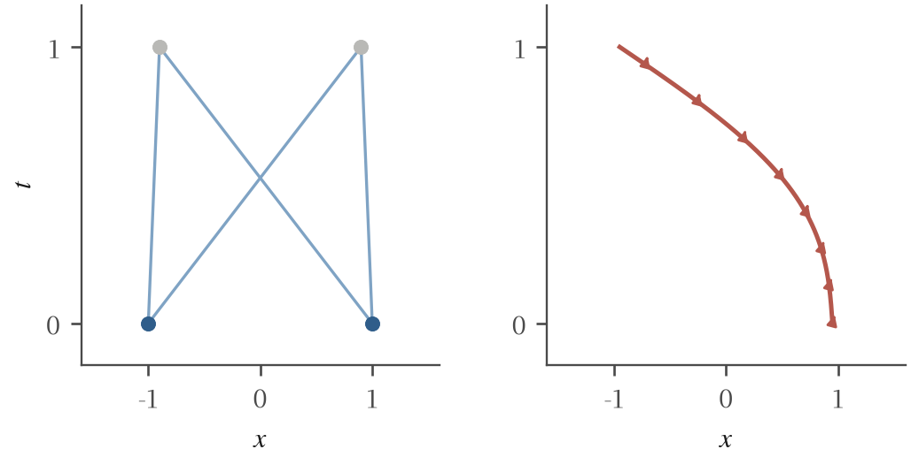

# 整流流与重配对

流匹配的路径在条件上是直的，边际轨迹却会弯。弯的轨迹意味着采样要多步。整流流处理的就是这件事：用重配对把轨迹拉直。

## 一维例子里的弯曲

数据只有两个点，$-1$ 和 $+1$，噪声是标准高斯。条件路径是：$-1$ 连到它配对的噪声，$+1$ 连到它配对的噪声。四条线段在中间交叉。

在交叉点上，来自不同配对的条件速度指向不同方向。取平均之后，边际速度指向水平方向，既不通向 $-1$，也不通 $+1$。结果就是轨迹在中间被掰弯。

弯曲程度取决于配对方式。如果 $x_0$ 与 $x_1$ 随机配对，交叉就多；如果配对是"距离最近的一对"，线段不交叉，轨迹自然直。

## 1-Rectified Flow

训练目标与流匹配的直线路径完全一样

$$L = E_{x_0,x_1,t}\big\|v_\theta\big((1-t)x_0 + tx_1,\ t\big) - (x_1-x_0)\big\|^2.$$

采样从 $t=1$ 积分到 $0$。

这个目标本身不保证轨迹直。它只保证沿着每条条件直线，网络给出的速度是对的。边际平均之后，轨迹可能弯。

## 重配对

重配对的做法是：用训练好的模型生成配对，再在配对上重训。

具体地，对每个噪声 $x_1$，用 $v^{(1)}$ 积分到 $t=0$，得到 $x_0 = \phi_1(x_1)$。这样就得到了一对"模型认为对应"的 $(x_0,x_1)$。用这些配对重新训练 $v^{(2)}$，它的条件速度是 $x_1 - x_0$。

为什么这样能变直？因为新的配对是确定性的：给定 $x_1$，$x_0$ 唯一。条件路径不再交叉，边际速度等于条件速度，轨迹是直线。

严格地说，重配对有一个单调性结论：它不会增加传输代价 $E[\|x_0-x_1\|^2]$，而且当轨迹完全直时达到下界。直觉是：重配对把每个 $x_1$ 映射到它当前的终点，这个映射是单调的，不会让整体距离变大。

## 代价与收益

重配对需要多轮训练，每轮都要生成大量配对，成本不低。收益是采样步数下降：第一次训练后需要几十步，第二次之后常常十步以内，第三次接近一步。

实践中很少做三轮以上，因为收益递减，而且误差会累积。每一轮都用上一轮模型的输出当作真值，模型自己的偏差会被固化。

把重配对与蒸馏结合起来是一个常见做法：先用两轮重配对把轨迹拉直，再用蒸馏把剩下的几步压成一步。这样得到的模型可以一步出图，质量接近多步。

## 与最优传输的关系

直线插值加随机配对，不是最优传输。最优传输要求配对使总距离最小，随机配对做不到。

重配对在逼近最优传输：每次重配都在减少轨迹交叉，也就减少了传输代价。极限情况下，得到的映射是单调的，轨迹是直线，代价达到下界。

这个联系有一个实用的推论：如果数据分布和噪声分布都是高斯，最优传输映射是线性的，一步就够。这也解释了为什么在高斯混合这类简单分布上，重配对一两轮就能得到几乎笔直的轨迹。

## 一个概念上的提醒

轨迹直不等于问题简单。直线轨迹只是说采样容易，训练目标仍然是回归一个复杂的场。而且"直"是对当前配对而言的，换一个模型、换一批数据，配对的确定性就变了。

MeanFlow 换了一个角度：不去改轨迹，而是直接学整段位移的平均速度。这是第 10 章的内容。
