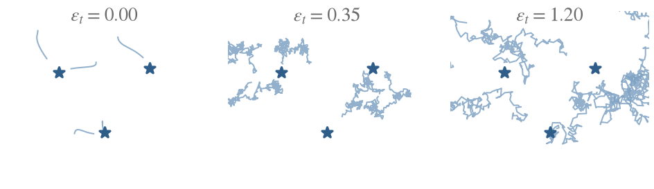

# 随机插值

流匹配、整流流、扩散，看起来是三套方法，其实都能放进同一个框架。这一章把框架写出来，并给出一个调节随机性的旋钮。

## 框架

取 $x_0\sim p_{\text{data}}$，$x_1\sim\mathcal{N}(0,I)$，定义

$$x_t = \alpha_t x_0 + \sigma_t x_1,\qquad t\in[0,1],$$

$\alpha_0=1,\sigma_0=0,\alpha_1=0,\sigma_1=1$。这个式子前面出现过两次，这里把它当作统一的对象。

速度场是条件速度的期望

$$v(x,t) = E\big[\dot\alpha_t x_0 + \dot\sigma_t x_1 \mid x_t = x\big].$$

不同的方法，区别只在三处：$(\alpha_t,\sigma_t)$ 怎么取、$x_0$ 与 $x_1$ 怎么配对、用什么损失去逼近 $v$。

## 速度与分数的互换

在第 4 章已经推过，这里给出结论

$$\nabla\log p_t(x_t) = -\frac{E[x_1\mid x_t]}{\sigma_t},\qquad v = \frac{\dot\alpha_t}{\alpha_t}x_t - \left(\dot\sigma_t\sigma_t - \frac{\dot\alpha_t\sigma_t^2}{\alpha_t}\right)\nabla\log p_t.$$

两个式子说明：速度与分数是同一个场的两种坐标。知道一个，另一个就算得出来。

## 一个旋钮：随机性

给定任意非负函数 $\epsilon_t$，下面的 SDE 与 ODE 有相同的边缘分布

$$\frac{dx}{dt} = v(x,t),$$

$$dx_t = \Big[v(x_t,t) + \frac{\epsilon_t}{2}\nabla\log p_t(x_t)\Big]dt + \sqrt{\epsilon_t}\,dw.$$

$\epsilon_t=0$ 时是确定性 ODE；$\epsilon_t$ 越大，轨迹抖动越厉害。但终点分布不变。

这个旋钮解释了很多现象。扩散模型的逆向 SDE 是 $\epsilon_t = g(t)^2$ 的特例；DDIM 是 $\epsilon_t = 0$ 的特例；少步采样器里常见的"加一点噪声再走"，本质上是在中间取一个不大的 $\epsilon_t$。

它也解释了随机性的作用：加噪声会让粒子偏离确定性轨迹，但也给了它纠正早期误差的机会。所以在步数很少时，适度加噪往往比纯 ODE 稳。

## 统一视角下的四类方法

| 方法 | $(\alpha_t,\sigma_t)$ | 配对 | 损失 |
| --- | --- | --- | --- |
| 扩散（VP） | $(\cos\frac{\pi t}{2},\ \sin\frac{\pi t}{2})$ | 独立 | 噪声回归 |
| 流匹配 | 直线或 VP | 独立 | 速度回归 |
| 整流流 | $(1-t,\ t)$ | 独立，重配后确定 | 速度回归 |
| MeanFlow | $(1-t,\ t)$ | 独立 | 平均速度恒等式 |

表里最关键的一列是配对。前三行的配对都是"随机抽一对"，第四行也是，但它学的量不同。配对决定了轨迹弯不弯，学的量决定了采样要几步。这两个自由度是正交的，可以分别改。

## 训练目标的等价性

在平方损失下，回归噪声、回归 $x_0$、回归速度、回归分数，四者的最优解是同一个函数的线性变换。因为条件期望是唯一的：给定 $x_t$，三个量互相算得出来。

这意味着，如果把一篇论文的损失换算到同一个参数化下，很多"新损失"其实与旧的一样。真正的差别往往在损失怎么加权、时间怎么采样、配对怎么选。

## 这个视角的用处

读到一个新方法时，先问三个问题：它用的什么路径？它怎么配对？它回归的是哪个量？

三个问题回答完，方法的新颖之处与它的实际效果，通常就能对上号。比如 MeanFlow 的路径与整流流一样、配对也一样，但它回归的不是瞬时速度，而是平均速度。差别只在这一处，效果却很大。

## 一个提醒

统一框架容易让人产生一种错觉，以为所有方法都差不多。实际上，同一框架下不同选择的难度差别很大：随机配对的回归问题很好训，平均速度的恒等式就难训得多，因为目标里出现了网络自己的导数。

框架的价值是让人看清"改哪一处"，不是让人以为"改哪一处都一样"。
