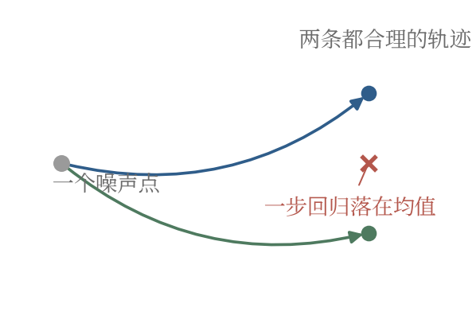

# 一步生成难在哪里

前面几章把采样写成了积分，步数取决于轨迹的弯曲程度。自然的想法是：能不能一步走到终点。这一章说明为什么这件事不容易，后面四章讲各条路线。

## 一个噪声点对应多少张图

给定一个噪声点 $x_1$，数据分布里可能有多个样本都能由它"合理地"生成。原因在于映射的多值性：从高维噪声到数据流形的映射不是单射，同一个噪声可以对应许多张图。

多步采样通过注入随机性来处理这种多值性：每一步都在若干可能之间做一次选择，最后落到其中一个。一步生成只有一次机会。

在平方损失下，一次机会的最优解是条件均值

$$\hat{x}_0(x_1) = E[x_0\mid x_1].$$

这个均值是多个可能结果的加权平均。如果那些结果差别很大，平均出来就是一张模糊的图。

这个解释与变分自编码器的模糊是同一个道理：高斯似然下的最优解是条件均值。区别在于，扩散模型用多步把这个均值逐步细化，而一步模型没有这个机会。

## 困难不在训练技巧

有人会想，是不是网络不够大、训练不够久。不是。即使网络完美地学到了条件均值，输出仍然是模糊的，因为模糊就是最优解。

要突破这个限制，只能引入别的东西：随机性、更强的条件、或者把多步的决策折进网络的输入。

## 三条路线

**把多步折进参数。** 训练一个学生网络，让它一次前向的输出接近教师多步采样的结果。一致性模型、分布匹配蒸馏都属于这一类。难点在于：如果只做回归，学生学到的还是条件均值，仍然模糊；所以要用分布匹配或对抗损失补细节。

**把多步折进输入。** 让网络的条件里包含"要走多远"，于是它可以在一次前向里输出整段位移的平均。MeanFlow 走的是这条路。

**把每一步做得更准。** 不减少步数，而是用高阶求解器在同样的步数下把误差压下去。DPM-Solver 属于这一类。它没有绕开多值性，只是让积分更精确。

三条路的代价不同。蒸馏要教师，平均速度要算雅可比向量积，高阶求解器要更多的单步计算。

## 一条判断标准

评价一个一步模型，除了看图像质量，还要看它是否真的只做了一次前向。

有些方法在推理时偷偷做了两次：一次生成、一次修正。这在工程上没问题，但比较时要说清楚。常见的做法是报告 NFE，也就是网络前向次数，而不是"步数"。一步模型应该是 NFE 等于 1（如果用了 CFG，要说明是否把两次前向算进去）。

## 这一章的位置

后面几章按路线展开：第 8 章讲一致性模型与蒸馏，第 9 章讲分布匹配与对抗蒸馏，第 10 章讲 MeanFlow；第 11 章把这些方法放到视频上，讨论内存与时间一致性带来的新约束；第 12 章讲之后的改进与工程问题。

读的时候可以一直问同一个问题：这个方法用什么换到了一步？是教师、判别器、还是额外的计算？
