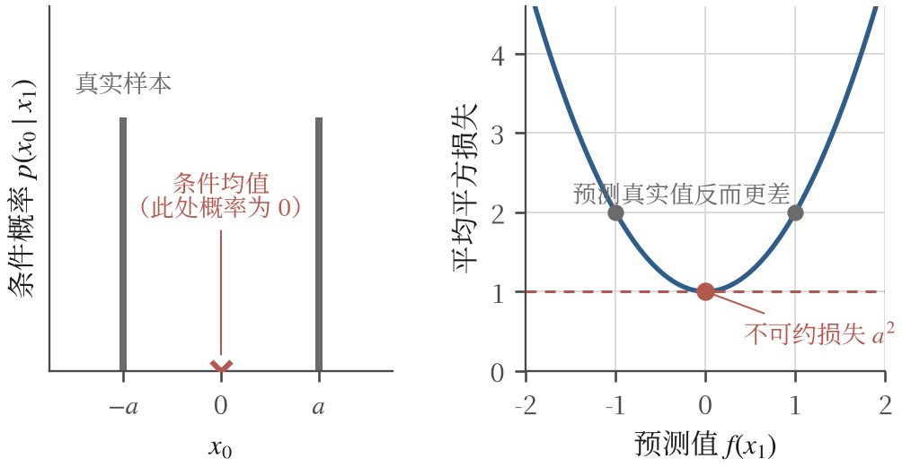
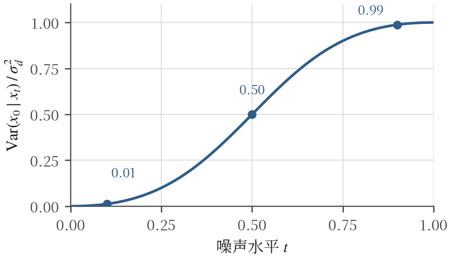

# 一步生成难在哪里

前面几章把采样写成了积分，步数取决于轨迹的弯曲程度。自然的想法是：能不能一步走到终点。这一章说明为什么这件事不容易，后面四章讲各条路线。

## 一个噪声点对应多少张图

给定一个噪声点 $x_1$，数据分布里可能有多个样本都能由它“合理地”生成。原因在于映射的多值性：从高维噪声到数据流形的映射不是单射，同一个噪声可以对应许多张图。

把这句话说得更准确一点。概率流 ODE 定义了从噪声端到数据端的映射 $\Phi_{1\to0}$：给定 $x_1$，沿 ODE 积分到 $t=0$ 得到的点是唯一确定的。所以多值性不是指 ODE 有多解，而是指这个映射作为函数极难逼近。

难在分界面。$x_1$ 空间被若干个吸引域切成碎片，同一碎片里的噪声点走向同一种图，跨过碎片边界就走到了另一种图。边界本身很薄：一个 $O(\epsilon)$ 的扰动就足以跨过去，而跨过去之后终点差的是两幅图之间的距离，是 $O(1)$ 的量。记映射的雅可比为 $J=\partial\Phi_{1\to0}/\partial x_1$，在边界附近它的谱范数是 $O(1/\epsilon)$ 量级，远离边界的地方则温和得多。

一步生成要用一个容量有限、足够平滑的函数去拟合这个映射。平滑函数在薄边界上做不到跳变，只能取两侧的折中。问题于是不在“拟合得好不好”，而在“被拟合的目标是什么”：在所有平滑近似里，平方损失挑出的是条件均值，而条件均值恰恰落在数据密度最低的地方。

多步采样通过注入随机性来处理这种多值性：每一步都在若干可能之间做一次选择，最后落到其中一个。一步生成只有一次机会。

在平方损失下，一次机会的最优解是条件均值

$$\hat{x}_0(x_1) = E[x_0\mid x_1].$$

这个均值是多个可能结果的加权平均。如果那些结果差别很大，平均出来就是一张模糊的图。

这个解释与变分自编码器的模糊是同一个道理：高斯似然下的最优解是条件均值。区别在于，扩散模型用多步把这个均值逐步细化，而一步模型没有这个机会。

## 条件均值是最优解，也是下限

把一步生成写成一个回归问题：网络看到 $x_1$，输出 $f(x_1)$，用平方损失和真实样本比。有人会问，能不能设计一个更聪明的损失，让最优解不再是均值。要回答这个，得先看清平方损失的最优解到底是什么。

把损失按 $x_1$ 分层：

$$L(f)=E_{x_1}\Big[E_{x_0\mid x_1}\|f(x_1)-x_0\|^2\Big].$$

内层对 $x_0$ 的期望展开，记 $\mu(x_1)=E[x_0\mid x_1]$：

$$\|f-x_0\|^2=\|f-\mu\|^2+2\,(f-\mu)\cdot(\mu-x_0)+\|\mu-x_0\|^2 .$$

最后一项与 $f$ 无关；中间一项在给定 $x_1$ 后对 $x_0$ 取期望为零，因为 $E[\mu-x_0\mid x_1]=0$。剩下

$$E\big[\|f(x_1)-x_0\|^2\,\big|\,x_1\big]=\|f(x_1)-\mu(x_1)\|^2+\mathrm{Var}(x_0\mid x_1).$$

第一项是预测与均值的距离，第二项是条件方差。对 $f(x_1)$ 逐点求导，$2(f-\mu)=0$，最优点就是 $f=\mu$。把两层期望合起来：

$$L(f)=E\|f(x_1)-\mu(x_1)\|^2+E\big[\mathrm{Var}(x_0\mid x_1)\big].$$

第二项不含 $f$，是这个问题的下界。任何用平方损失训练的一步模型，无论网络多大、训练多久，损失都不会低于它；要降到它以下，只能靠过拟合把训练样本记住，那已经不是想要的解。

一维例子能给出具体数字。$x_1=0$ 时 $x_0$ 以各一半概率取 $\pm a$，均值是 $0$，条件方差是 $a^2$，最小损失也是 $a^2$。取 $a=0.5$（像素归一到 $[-1,1]$ 时，这是中等强度的结构差异），最优一步模型的均方根误差就是 $0.5$，占值域长度（$2$）的四分之一。想让误差减半，唯一的路是把条件方差减半，也就是换一个信息更多的条件。

图 7.2 左边是这个例子：两个峰在 $\pm a$，条件均值落在中间概率为零的地方。右边是损失关于预测值的曲线，谷底在均值处，高度是 $a^2$；把预测拉到真实值 $\pm a$，损失反而升到 $2a^2$。曲线是抛物线，所以训练后期损失下降很慢，看起来像收敛到了平台，实际是逼近了下界。

换个损失会怎样？把平方换成绝对值，最优解从条件均值变成条件中位数。仍用两个峰的例子，但让概率不相等：$0.9$ 落在 $+a$，$0.1$ 落在 $-a$。平方损失的最优解是 $0.9a-0.1a=0.8a$，这个位置既不是任何一个真实样本，又偏向多数派；绝对值损失的最优解是 $+a$，就是主模式本身。

后者看上去好得多：输出干净、锐利，是一张真实的图。代价是另一支被彻底丢掉，而且丢得系统——无论噪声怎么变，模型都只给多数派，训练集里那个少数派从来没有被生成过。这就是换损失能买到锐度、但会把多值性压成单值的原因。想要既锐利又多样，输出必须依赖某个额外的量，让它知道“这一次该走哪一支”。这个额外的量就是后面几条路线各自引入的东西。

把 L2 换成感知损失能不能绕过去？感知损失比的是特征空间里的距离，最优解是特征空间的条件均值。它和像素空间的条件均值不是同一张图，通常更耐看一点，因为特征空间对纹理统计更敏感、对像素级错位更宽容。但它仍然是一个均值，仍然会把两个模式揉在一起，只是揉得更像样。它对高频不敏感这一点既是优点也是缺点：纹理可以很合理，结构却错着，看起来“质感对了、东西错了”。要真正摆脱均值，损失必须能区分“像真的”和“是平均的”，这是对抗损失的活。

把两件事分开看会更清楚：条件均值模型是一个估计器，它回答“给定噪声，最像的那张图是什么”；生成模型要回答“给定噪声，该抽哪张图”。前者是一个函数，后者是一个分布。一步回归天生只能给前者，只改损失、不改输出结构，绕不过这个区别。

多步采样凭什么能突破这个下界？每一步的输出也是条件均值，看上去同样在平均。差别在条件的粒度。第 $k$ 步用 $x_{t_k}$ 作条件，条件分布比 $t=1$ 时窄得多；输出的均值虽然仍不是真样本，但偏差小。走完一步后重新注入噪声，把剩下的不确定性重新打散，下一步再消掉一小块。整个过程是“很多次小平均”，而不是“一次大平均”。

用高斯情形可以把“窄多少”算出来。设 $x_0\sim N(0,\sigma_d^2)$，直线路径 $x_t=(1-t)x_0+t\epsilon$，$\epsilon\sim N(0,1)$。给定 $x_t$ 的后验仍是高斯，均值和方差分别为

$$\mu_t(x_t)=\frac{(1-t)\sigma_d^2}{(1-t)^2\sigma_d^2+t^2}\,x_t,\qquad V(t)=\frac{\sigma_d^2\,t^2}{(1-t)^2\sigma_d^2+t^2}.$$

$t=1$ 时 $V=\sigma_d^2$，数据方差全都还在；$t=0.5$ 时 $V=\sigma_d^2/2$；$t=0.1$ 时 $V\approx0.012\,\sigma_d^2$。一步生成必须在 $t=1$ 处一次消掉 $\sigma_d^2$ 的不确定性，多步则把它切成十几份，每份只要求网络消掉一份。单看某一步，平均的长度是一小段，模糊也就只到一小段的程度。

## 困难不在训练技巧

有人会想，是不是网络不够大、训练不够久。不是。即使网络完美地学到了条件均值，输出仍然是模糊的，因为模糊就是最优解。

容量不是瓶颈，这一点从上面的分解就能看出来。把 $f$ 写成 $\mu+e$ 代入，$L=E\|e\|^2+E[\mathrm{Var}]$。加大网络只能把 $E\|e\|^2$ 压到零，下界那一项一分不动。训练到后期，损失曲线在一个正值上变平，很容易被当成优化出了问题，其实是逼近了下界。

还有一个更细的困难：这些边界在训练里几乎不出现。训练样本是从联合分布里抽的，$x_1$ 与 $x_0$ 成对出现，落在分界面附近的样本数正比于那层薄壳的测度。网络在没有样本的地方只能靠光滑性先验插值，插出来的行为由先验决定而不由任务决定。分界面附近的错误因此是系统性的，不是随机的；加数据只能降低碰到它的概率，降不到零。

有人会把问题归到信息不足：一个噪声点怎么可能决定整张图？信息其实是够的。$x_1$ 是 $d$ 维的，ODE 又是确定性的，$x_1$ 唯一决定了终点，没有任何信息丢失。瓶颈落在函数类上：能表达这个映射的函数要有在薄边界上跳变的能力，而参数化网络给的是光滑函数。这和前面说的“被拟合的目标”是一件事的两面：光滑性决定了能拟合到什么，平方损失决定了在光滑近似里挑哪一个。

下界也不是常数，它随条件变化。上面那个高斯公式里的 $V(t)$ 画在图 7.3 中：$t$ 越大，条件方差越大，一步回归要消掉的不确定性越多。这能解释一个常见的现象——一步模型在低噪声端（纹理、细节）看着还行，在高噪声端（构图、整体结构）差得明显。结构是在 $t$ 接近 1 的地方定下来的，那里的条件方差最大。

真实数据比高斯更糟。高斯的条件分布是单峰的，均值虽然不等于样本，至少落在分布的中央；图像的条件分布是多峰的，一个噪声点可能同时通向“一只猫”和“一只狗”，均值落在两个模式之间的低密度区，那是一片既不像猫也不像狗的区域。视觉上的三种典型失败都由这里来：细节糊，是纹理尺度上多个分支被平均；结构重影，是同一区域叠着两种排布，边缘发灰；语义混叠，是一张脸里同时有正面和侧面的特征。第三种最容易被误判成能力不足，其实它是条件均值的正常输出。

要绕开这些限制，只能引入别的东西：随机性、更强的条件、或者把多步的决策折进网络的输入。

## 三条路线

**把多步折进参数。** 训练一个学生网络，让它一次前向的输出接近教师多步采样的结果。一致性模型、分布匹配蒸馏都属于这一类。难点在于：如果只做回归，学生学到的还是条件均值，仍然模糊；所以要用分布匹配或对抗损失补细节。

轨迹蒸馏的具体做法是用教师跑完整条轨迹，把 $(x_1,x_0^{\text{教师}})$ 存成对，学生做回归。前面已经算过，这种回归的目标是条件均值，学生学到的仍然是模糊的那一张，所以纯轨迹蒸馏只能压缩步数，不能提升单步的锐度。要补细节，得把损失从“点对点”换成“分布对分布”，或者引入判别器，这是第 9 章的内容。

代价在训练侧：需要预训练教师（离线生成数据或在线查询），需要额外的判别器或假 score 网络，训练量通常是教师训练量的数倍（量级估计）。收益在推理侧：一次前向，NFE 等于 1，连引导都能一并蒸进去，不必在推理时再算两遍。

**把多步折进输入。** 让网络的条件里包含“要走多远”，于是它可以在一次前向里输出整段位移的平均。MeanFlow 走的是这条路。

具体做法是把起点时刻 $r$ 也送进网络，输出从 $r$ 到 $t$ 的平均速度

$$u(x_t,r,t)=\frac{1}{t-r}\int_r^t v(x_\tau,\tau)\,d\tau .$$

一次前向给出整段位移，$x_0\approx x_t-t\,u(x_t,0,t)$。约束来自这个定义本身：对 $t$ 求导会得到把平均速度和瞬时速度联系起来的恒等式，训练时用雅可比向量积把它变成可算的损失。代价在训练侧，每次更新要算一个方向导数，开销约等于多跑一次前向；推理侧仍然只有一次。

**把每一步做得更准。** 不减少步数，而是用高阶求解器在同样的步数下把误差压下去。DPM-Solver 属于这一类。它没有绕开多值性，只是让积分更精确。

做法是把 ODE 写成指数积分形式，把线性部分解析地积掉，非线性部分用高阶多项式或 Adams 公式近似：曲率小的地方迈大步，曲率大的地方用高阶。误差阶可以推：一阶 Euler 的全局误差是 $O(h)$，$k$ 阶方法是 $O(h^k)$，$h=1/N$。要把误差压到 $\epsilon$，一阶需要 $N\propto1/\epsilon$，二阶只需 $N\propto1/\sqrt{\epsilon}$。取 $\epsilon=10^{-2}$，前者是百步量级，后者是十步量级，这就是“同样的精度、步数少一个数量级”的来源。

它没有把 NFE 压到 1。高阶方法要用到历史点，起步至少两三步；轨迹在低噪声端曲率大，步长不能无限放大，实际能到八到二十步。好处是不需要训练、不需要教师，换求解器就能用，也可以叠加在别的加速手段上。

三条路的代价不同。蒸馏要教师，平均速度要算雅可比向量积，高阶求解器要更多的单步计算。用一张表对照（NFE 指单样本的等效前向次数，不含 VAE 解码）：

| 路线 | 换来速度的代价 | 推理 NFE | 典型失效 |
| --- | --- | --- | --- |
| 轨迹蒸馏 | 预训练教师、离线数据 | 1 | 继承教师的模糊与分支选择 |
| 分布蒸馏 | 教师加判别器或假 score | 1 | 判别器不稳、模式丢失 |
| 平均速度 | 训练时的雅可比向量积 | 1–2 | 曲率大时平均值不准 |
| 高阶求解器 | 无需训练，单步更贵 | 8–20 | 曲率大时误差仍增长 |

三条路线并不互斥。蒸馏出来的学生可以再配二到四步高阶求解器精修，NFE 从四十降到四，质量接近教师；平均速度模型也可以套二阶更新，把剩下的误差再压一点。实际系统常常是组合的，所以看一个系统时要先问 NFE 多少、含不含精修，再问那一次前向里到底塞了什么。

把起点时刻 $r$ 送进网络不算多步。网络仍然只被调用一次，变的是函数的定义域：从 $x_1\mapsto x_0$ 变成 $(x_1,r)\mapsto \Delta x$。代价不在推理而在训练——定义域变大后，一个网络要同时学很多段长度不同的位移，它们之间的相互约束就是训练信号的来源。拿这一点去区分真一步与假一步：前者把信息放进输入，后者把循环留在外面。

三条路线可以看作在跟同一下界讨价还价。改损失换的是匹配对象（从点到分布），改输入换的是条件的信息量，改求解器换的是数值精度、根本不动下界。哪一条都不可能让条件方差消失；能做的是让它不再一次性堆在输出上。

## 一条判断标准

评价一个一步模型，除了看图像质量，还要看它是否真的只做了一次前向。

有些方法在推理时偷偷做了两次：一次生成、一次修正。这在工程上没问题，但比较时要说清楚。常见的做法是报告 NFE，也就是网络前向次数，而不是“步数”。一步模型应该是 NFE 等于 1（如果用了 CFG，要说明是否把两次前向算进去）。

还有一条更软的判断：固定种子与引导系数，把学生和教师的输出并排看。学生若在结构上跟随教师、只在纹理上变软，它是真的把轨迹压进去了；若连构图都换了另一套，它更像是在用噪声重新采样，而不是在压缩多步。

NFE 这个词在不同论文里口径不一，比之前要对齐三件事。

**引导算不算。** 分类器无关引导每步要跑条件和无条件两次前向，20 步采样就是 40 次；有的实现把条件与无条件的 batch 拼成一次调用，调用次数变成 20，但 FLOPs 没变。严格的做法是报等效 NFE（拼接算两次）或者直接报 FLOPs，只报调用次数会让加速比虚高。

**解码算不算。** 潜空间模型的 VAE 解码在高分辨率下可能占到端到端时间的三成到一半（量级估计），只报去噪网络的 NFE 会把这一块藏起来。报告里通常单列，比较时要么都含、要么都不含。

**选样算不算。** 有的系统一次生成 $N$ 个候选再挑一个，NFE 是 $N$，但质量提升被算进了“一步”的成绩里。用了 refiner 或放大器的流水线，也要把额外的前向算上。

对齐之后还要记住，NFE 不等于延迟。步数从 40 降到 1，实测加速往往远小于 40 倍：单次前向的计算密度更高，显存带宽成为瓶颈，kernel 启动的固定开销在调用次数很少时占比变大。经验上 5 到 10 倍的端到端加速更常见（估计值，随分辨率和实现差别很大）。拿 NFE 比是比方法的效率，拿延迟比才是比用户的体验，两个数都值得报。

延迟与吞吐还要分开看：延迟看单次调用，吞吐看单位时间能出多少张。一步模型单次便宜，但要把算力跑满就需要更大的 batch，大 batch 又抬高单张的显存；教师模型走四十次前向，单图显存小得多，可以用流式 batch 填满算力。所以“一步更快”在低并发场景最明显，在高并发服务里加速比会被摊薄。

还有两个容易漏的成本。一是拒绝采样：一步模型生成四张挑一张非常便宜，NFE 是四，但如果四张并行，延迟还是按一张算，这种系统报 NFE 等于 1 就会误导。二是训练侧：蒸馏学生要先把教师训出来，教师本身的 NFE 是四十，把训练与推理的成本合起来算，一笔账往往比表上的加速比难看得多。

## 这一章的位置

后面几章按路线展开：第 8 章讲一致性模型与蒸馏，第 9 章讲分布匹配与对抗蒸馏，第 10 章讲 MeanFlow；第 11 章把这些方法放到视频上，讨论内存与时间一致性带来的新约束；第 12 章讲之后的改进与工程问题。

把这几章对到上面那张表：第 8 章的约束加在轨迹上，同一条轨迹上的点必须给同一个终点；第 9 章把点对点的损失换成分布上的损失；第 10 章的约束来自积分恒等式。三条路线的训练信号不同，失效模式也不同，混在一起看容易以为它们是同一个东西的不同写法。

读的时候可以一直问同一个问题：这个方法用什么换到了一步？是教师、判别器、还是额外的计算？
