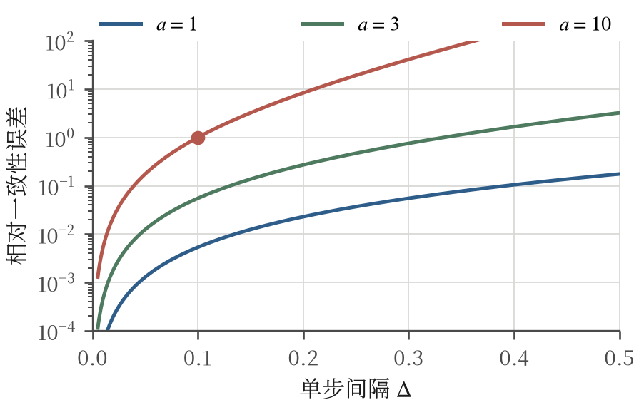
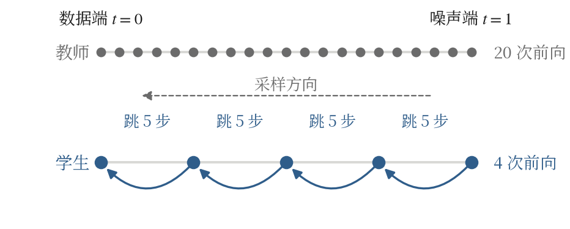

# 一致性模型与蒸馏

一致性模型是最早的一批“不求积分、直接给终点”的方法。它的想法很朴素：同一条轨迹上的不同点，应该映射到同一个终点。

## 定义

设 $f_\theta(x_t,t)$ 是网络对 $x_0$ 的预测。一致性要求是：沿着同一条 ODE 轨迹，任意两点给出的预测相同

$$f_\theta(x_t,t) = f_\theta(x_{t-\Delta},t-\Delta),$$

并且边界条件成立

$$f_\theta(x_0,0) = x_0.$$

把“轨迹”先写清楚。设边缘速度场为 $v(x,t)$，轨迹是 $\dot x_t=v(x_t,t)$ 的解，记从时刻 $t$ 走到 $0$ 的解映射为 $\Phi_{t\to0}$。上面的约束等于要求 $f_\theta$ 在每条轨迹上取常值：

$$f_\theta(\,\cdot\,,t)=f_\theta\big(\Phi_{t\to t-\Delta}(\,\cdot\,),t-\Delta\big).$$

满足它的函数很多，多到没有用。只要在每条轨迹上取同一个值，取什么都可以；约束只排掉“同一条轨迹上取不同值”的那些函数。边界条件补上另一半：轨迹终点处的值必须是终点本身。两半合起来，解是唯一的——

$$f^\ast(x_t,t)=\Phi_{t\to0}(x_t).$$

一个场只要在轨迹上不变、并且在 $t=0$ 处等于恒等映射，它就只能是端点映射本身。这是把一致性理解成自洽性的理由：约束不描述场长什么样，只描述它必须与自己的积分相容。训练做的事，就是用网络去逼近这个唯一的 $f^\ast$。

实际检查一致性只能靠抽查。没有解析的轨迹可用，只能让教师走几步得到一对点，再在这对上考察网络的输出。所以一致性既是一个定义，也是一个采样协议：训什么、测什么，都取决于拿哪些点去配对。这也意味着它是一个很局部的约束，全局一致性只能从局部一致里“长”出来。

采样时只需要一次前向：从噪声 $x_1$ 出发，$f_\theta(x_1,1)$ 就是样本。


边界条件通常通过参数化保证：不让网络直接输出 $x_0$，而让它输出一个位移，再把它从 $x_t$ 里减掉。写成

$$f_\theta(x_t,t) = x_t - t\,F_\theta(x_t,t),$$

$t=0$ 时位移为零，输出退化成 $x_t$，恒等成立，对任何输入都成立，不需要额外的惩罚项。系数取 $t$ 是有含义的：$t$ 是离数据端还剩多远，$t\,F$ 就是从 $t$ 走到 $0$ 的总位移，所以 $F$ 可以读成这一整段的平均速度。

系数不必刚好是 $t$。一般形式是

$$f_\theta(x_t,t)=c_{\text{skip}}(t)\,x_t+c_{\text{out}}(t)\,F_\theta(x_t,t),$$

只要 $c_{\text{skip}}(0)=1$、$c_{\text{out}}(0)=0$，边界就自动成立。剩下的自由度用来调输出的量级：噪声端输入方差很大，如果让网络直接回归数据量级的 $x_0$，每个 $t$ 上的目标尺度相差很多，训练容易饱和。常见的做法是取与信噪比匹配的 $c_{\text{out}}(t)\propto t/\sqrt{\sigma_d^2+t^2}$，让网络在各个 $t$ 上看到的目标方差大致相当。

这个参数化有个副作用：$t\to0$ 时 $c_{\text{skip}}\to1$、$c_{\text{out}}\to0$，输出主要由 $x_t$ 决定，$F_\theta$ 对损失的贡献随之趋零。低噪声端因此几乎不训练 $F$，而那一段恰恰决定发丝、文字这类高频细节。缓解办法是给损失乘 $1/c_{\text{out}}(t)^2$ 的权重，或者把 $t$ 的采样下限抬到一个小的正数（比如 $0.002$），别让目标尺度掉到零。

## 训练：一致性蒸馏

如果有一个预训练的扩散模型，可以用它的 ODE 步产生相邻点：从 $x_t$ 走一步得到 $\hat{x}_{t-\Delta}$，再让两个点的预测互相靠近

$$L = E\big\|f_\theta(x_t,t) - f_\theta(\hat{x}_{t-\Delta},t-\Delta)\big\|^2.$$

注意右边也要对参数求导吗？实践中不。停止梯度是常见做法，把右边当作目标，训练更稳。

停止梯度不是可选的技巧，它决定了这个目标是一个什么优化问题。两边都求导时，损失是 $\|a-b\|^2$，对 $a$ 的梯度是 $2(a-b)$，对 $b$ 的是 $-2(a-b)$；两个梯度反向，同一组参数要同时满足两个相反的要求，有效步长翻倍且含交互项。把右边钉成目标，问题退化成普通回归：网络在一个点上被拉向另一个点，而那个点由旧版本或当前版本（只停梯度）的网络给出。

写成完整的形式，记教师为 $v_\phi$，学生为 $f_\theta$，$\mathrm{sg}$ 为停止梯度：

$$L(\theta)=E_{x_1,t}\Big[\lambda(t)\,d\big(f_\theta(x_t,t),\ \mathrm{sg}\big[f_{\theta^-}(\hat x_{t-\Delta},t-\Delta)\big]\big)\Big],$$

$$\hat x_{t-\Delta}=x_t-\Delta\,v_\phi(x_t,t).$$

$\theta^-$ 是参数的旧副本（EMA）或就是 $\theta$ 本身，$d$ 可以是平方误差、绝对误差或 LPIPS，$\lambda(t)$ 是权重。教师那一步用 Euler 就够，它的任务只是提供一个靠近轨迹的点，精度不是重点。

采样 $t$ 时要避开一个退化：$t=0$ 处两边输入相同，损失恒为零，不提供任何信息。日程取 $N$ 个时刻时，能用的对只有 $N-1$ 个，最靠数据端的那一段贡献最小。这也是为什么低噪声端的约束往往偏弱，需要单独加密日程。

这个损失把两类东西混在了一起：教师轨迹的形状，与学生的平滑程度。前者是想要的信息，后者是约束本身带来的。取 $\Delta$ 很大时，后者占主导，学生在两点之间拉得越平，损失越小。

这就是一致性蒸馏。它把教师的多步行为压进学生的单次前向。

$\Delta$ 怎么取，决定了这个约束有多强。取小，$\hat x_{t-\Delta}$ 与 $x_t$ 几乎相同，网络只要局部平滑就能满足，学到的信息很少；取大，两点相距很远，约束变强，但 Euler 步的误差也变大，学生被拉向一个已经偏离轨迹的点。

这个权衡可以算。一维线性 ODE $\dot x=ax$ 的准确解是 $x_{t-\Delta}=x_t e^{-a\Delta}$，Euler 一步给的是 $x_t(1-a\Delta)$。两者的相对差是

$$\varepsilon(\Delta,a)=\big|(1-a\Delta)e^{a\Delta}-1\big|,$$

展开后主项是 $\tfrac12a^2\Delta^2$：对 $\Delta$ 是二阶的，这是好的一面；系数里带着 $a^2$，轨迹越陡，同样的 $\Delta$ 造成的误差越大。$a=1$、$\Delta=0.1$ 时约 $0.005$；$a=10$ 时同样的步长使 $a\Delta=1$，Euler 把 $x$ 直接打到零，误差是 $100\%$。图 8.2 画的就是这个函数。



一致性损失把这个离散化误差一并当成了要拟合的目标。学生学到的是“教师的 Euler 一步”而不是“教师的连续轨迹”，$\Delta$ 越大两者差得越远。这不是缺陷而是取舍：蒸馏的目标本来就是教师的数值实现，不是理想 ODE。

这也意味着教师必须以 ODE 的方式走。一致性是沿确定性轨迹的约束，如果教师用 SDE 采样，相邻两点不在同一条轨迹上，“两点应该映射到同一个终点”就不成立了——随机项会把点推离原轨迹，而那条新轨迹的终点确实可能不同。用 SDE 采样再扣一致性损失，等于在拟合一个自相矛盾的目标。要实现随机性，得放到输出端（多次采样）而不是中间步骤。

日程的另一种组织方式是维护 $N$ 个时刻 $t_1>t_2>\dots>t_N$，只用相邻时刻构成对。安排可以不均匀：噪声端步子大，那里轨迹陡、信息多；数据端步子小，那里细节多、容易糊。这和扩散训练里 $t$ 的采样分布是同一件事的两面。

一次更新在实现上大致是这样：

```text
输入：教师 v_phi，日程 t_1 > ... > t_N，学生 f_theta(x, t) = x - t * F_theta(x, t)

for 每次更新:
    x0  ~ 数据,  eps ~ N(0, I)
    i   ~ Uniform{1, ..., N-1}
    x_t = (1 - t_i) * x0 + t_i * eps
    x_n = x_t - (t_i - t_{i+1}) * v_phi(x_t, t_i)      # 教师一步
    y   = stop_grad( f_theta(x_n, t_{i+1}) )           # 目标，不回传
    loss = lambda(t_i) * || f_theta(x_t, t_i) - y ||^2
    更新 theta
```

每步的成本是教师一次前向加学生两次前向，约为纯扩散训练的三倍。批量里的每一对都是独立抽的，没有配对关系，所以 batch 能开得很大，摊下来差距会小一些。

几个细节值得写下来。目标是旧参数给的，所以常维护一份 EMA 副本 $\theta^-\leftarrow\mu\theta^-+(1-\mu)\theta$，$\mu$ 取接近 1 的值，让目标变化慢于学生，避免追逐。$\lambda(t)$ 通常取与信噪比相关的权重，与扩散训练的噪声预测权重同源；不做归一的话，噪声端的损失会压过数据端，低噪声端学得很差。平方误差在 $t$ 大时数值范围很大，混合精度下要先除 $\sigma(t)^2$ 再算，否则容易丢精度。

EMA 也有一面代价：它比学生慢，学生实际上在追一个移动的靶。训练早期 EMA 几乎等于学生本身，约束接近两边同时求导，$\Delta$ 大时会震荡；$\mu$ 太接近 1 又会让目标过时，学生在局部最优上停住。这个参数与 $\Delta$ 是耦合的，跨度越大，目标需要越“慢”才稳。

## 没有教师时

一致性训练不需要教师：用网络自己的预测构造目标。从 $x_t$ 预测 $x_0$，加噪回到 $x_{t-\Delta}$，再预测一次，要求两次一致。

写成公式：学生先给出 $\hat x_0=f_\theta(x_t,t)$，把它按 $t-\Delta$ 的噪声水平重新加噪，

$$\hat x_{t-\Delta}=(1-t+\Delta)\,\hat x_0+(t-\Delta)\,\epsilon,\qquad \epsilon\sim N(0,1),$$

再要求学生在这一点的输出与刚才的 $\hat x_0$ 一致。目标里的 $\hat x_0$ 是学生自己的输出，这就是它不需要教师的原因。把它换成真实样本，加噪那一步就是一个标准的扩散训练样本；自举训练等于把这个“换”省掉。

这条路线省掉了教师，但训练很不稳定。原因是约束是外加的：它要求网络在任意两点上输出一致，却没有告诉网络“一致到什么”。训练初期网络输出很乱，一致性损失会把错误固化下来。

两个失败模式值得分开看。

一种是塌到常值。如果 $f_\theta$ 对所有输入都输出同一个 $c$，一致性损失恒为零。边界参数化挡掉了最坏的那一支（$t=0$ 时必须输出 $x_0$），但 $t$ 离 $0$ 远的地方仍有空间：网络可以学会“高噪声端给一张平均图，低噪声端老实一点”，损失不大，画面很差。

另一种是误差放大。加噪那一步把 $\hat x_0$ 的误差按 $1-t+\Delta$ 缩放后送回网络：$t$ 大时系数小，误差被压掉；$t$ 小时系数接近 $1$，误差原样进入目标。低噪声端因此学得最差，而那里恰恰最需要精度。自举训出来的模型常在细节上出问题、构图却看着还行，原因就在这里。

早期的解决办法是 curriculum：先从相邻很近的时间步开始，再逐渐拉大间隔。这相当于先学局部一致，再学全局一致。

两种退火方式效果类似。一种让日程从密到疏：最开始 $\Delta$ 只有目标值的几分之一，网络只需在几乎相同的两点上给相同答案，约束几乎必然满足；训练若干千步后把 $\Delta$ 翻倍，再翻倍，直到目标间隔。另一种让 $t$ 的采样分布从低噪声端开始，逐步向高噪声端扩展。两者在做同一件事：先在一个容易满足的子问题上收敛，再把约束的范围往外推。

退火表要调，没有通用解。退得太快，网络在间隔变大那一步崩掉；退得太慢，大部分算力花在几乎平凡的约束上。经验上退火的总长度与学生最终要跨的步数成正比（量级估计），跨八步的学生要比跨两步的多花几倍时间。

还有一个理论上的麻烦：目标随参数移动，整个训练是不动点问题而不是最小化问题。网络在改变自己的目标，收敛性没有保证，损失曲线也不像监督学习那样单调下降，它会在中途抬起来，又落下去。

## 潜空间版本

把一致性模型搬到潜空间，并加大跳步间隔，就是潜一致性模型。它一次前向可以跨越二十步，采样步数降到四到八。

搬进潜空间有两个直接好处。一是算力：$256\times256\times3$ 的图约有 $2\times10^5$ 个数，下采样 8 倍、通道压到 4 之后只剩约 $4\times10^3$ 个，差了一个半数量级。二是一致性更容易满足：潜空间维度低、分布更接近高斯，网络不必在很薄的分界面上做跳变，同样的容量能表达更平滑的映射。

潜空间也带来新的上限。VAE 的重建误差变成画质的天花板，一致性再准也补不回编码解码丢掉的高频；$t=0$ 处的“数据”是 $z_0$ 而不是像素，边界条件管的是潜变量，与像素端的边界不是同一回事。

关键技巧是跳步一致性：不只要求相邻点一致，还要求跨大步一致。代价是训练更难，需要教师在中间提供锚点。所以潜一致性模型通常是蒸馏出来的，不是从零训练的。

跳步的写法是把间隔放大 $k$ 倍。记学生为 $f_\theta$、教师为 $v_\phi$：

$$L_{\text{SK}}(\theta)=E_{x_{t+k\Delta},t}\Big[\lambda(t)\,d\big(f_\theta(x_{t+k\Delta},t+k\Delta),\ \mathrm{sg}[f_{\theta^-}(\hat x_t,t)]\big)\Big],$$

$$\hat x_t=x_{t+k\Delta}-k\Delta\,v_\phi(x_{t+k\Delta},t+k\Delta).$$

左边是学生从 $t+k\Delta$ 出发的一次预测，右边是教师走 $k$ 步之后由旧学生给出的预测。$k=1$ 时退回普通的一致性蒸馏；$k$ 越大，一次前向跨的步数越多，约束越强。

采样的账很好算：教师走 $S$ 步、学生跳 $k$ 步，需要的次数是 $\lceil S/k\rceil$。$S=20$、$k=5$ 是 4 次；$S=20$、$k=4$ 是 5 次；$S=50$、$k=10$ 是 5 次。四到八步的说法对应的就是 $k$ 落在三到六之间。



有一处实现上容易写错：目标 $\hat x_t$ 必须由教师跨过 $k$ 步得到，不能递归地调 $k$ 次学生。递归写法看着自洽——每次调学生跨一步，串起来就跨了 $k$ 步——但误差会随调用次数累加，而且每步都要一次前向，跳步白做了。用教师一步跨过去，目标质量由教师保证，学生只需拟合这一段的平均位移。

跳步的另一个作用是把引导系数一并压进去。训练时对条件与无条件两条支路都跑教师，按 $\omega$ 合成目标，学生学到的是“带着引导的终点”。推理时不再需要无条件支路，NFE 从 $2\lceil S/k\rceil$ 降到 $\lceil S/k\rceil$。比较时要说明这一点，否则会把省掉引导的收益算成跳步的收益。

引导蒸进去有一个后果：学生在推理时不能再调 $\omega$。教师那边 $\omega$ 是一个可以自由扫的旋钮，蒸完之后变成常数，想要更强或更弱的引导只能重新训一个。高 $\omega$ 的教师输出本身已经过饱和、颜色发艳，学生把这些一并学下去，又无法通过降 $\omega$ 找回来。不少实现会同时蒸几个 $\omega$ 的版本，或者把 $\omega$ 当额外的条件输入，后者更灵活，代价是要更多数据覆盖这个维度。

学生一般从教师初始化，而不是随机初始化。两者都是预测 $x_0$ 的网络，输入输出形状一致，直接拷权重能省掉大量训练步；代价是学生继承了教师的归纳偏置，教师学歪的地方学生也改不了。

$k$ 不能无限大。跨度越长，学生一次要学的位移越大，接近“一步到终点”时它要学的就是完整映射，回到了多值性那个老问题；同时教师跨 $k$ 步的 Euler 误差按 $k$ 累积，目标本身也在变差。实践中 $k$ 取到四到六就接近收益上限。

## 采样

一步采样就是

$$x_0=f_\theta(x_1,1)=x_1-F_\theta(x_1,1),\qquad x_1\sim N(0,I).$$

这里没有“步长”这个概念，网络输出的直接是终点，不是一个增量。

因为约束对任意 $t$ 都成立，学生可以在中间时刻被调用，这给了它纯一步回归没有的灵活性。两步采样的写法是先预测终点，再把它加噪到一个中间时刻，再预测一次：

$$x_0^{(1)}=f_\theta(x_1,1),\qquad x_{t'}=(1-t')x_0^{(1)}+t'\epsilon',\qquad x_0^{(2)}=f_\theta(x_{t'},t').$$

$t'$ 取 $0.3$ 到 $0.5$ 这一段效果较好（经验值）。第二次调用能用上新噪声，等于在一步之后又做一次局部选择，细节会好一些。NFE 从 1 变成 2，报告时要说明，不能算作一步模型。

另有一类用法是从 $t<1$ 出发，比如 $t=0.95$。理由是噪声端条件方差最大、最难，稍稍避开能换一点质量，代价是初始分布与训练分布不完全一致。这种偏移在不同模型上差别很大，不宜当成通用技巧。

潜空间模型的 NFE 还要加一次解码：$\lceil S/k\rceil$ 次去噪前向加一次 VAE 解码。报数时常把解码单列，但端到端延迟里它是跑不掉的。

## 为什么它有效，又为什么不完美

有效的部分：一致性把“多步”这个循环换成了“一次函数求值”，推理成本直接降到一。学生的参数量与单次计算量与教师同一量级，所以加速全来自去掉循环：教师走二十步就被压进一次，理论上的上限是二十倍。

为什么加一条看上去只是自洽的约束，输出就不再是均值了？关键在于约束把 $t=0$ 的恒等映射沿着轨迹传到了每个 $t$。在 $t=0$ 处，$f(x_0,0)=x_0$ 是数据点本身，不模糊；一致性要求 $f(x_t,t)$ 与它相等，所以 $f(x_t,t)$ 必须等于“这条轨迹的终点”，而不是“所有可能终点的平均”。均值把所有分支揉在一起，它不是任何一条轨迹的终点，在一致性约束下要付代价。

换句话说，一致性把一个难直接表达的要求——“输出得是真实样本”——换成了容易检查的要求：“同一轨迹上答案相同”。后者只用网络自己的输出就能验证，不需要判别器。这是它比纯回归锐的原因，也是它比纯回归难训的原因：约束越强，可满足的函数越少，训练能走的路越窄。

不完美的部分有三个。

第一，学生学到的仍是教师轨迹的终点，如果教师本身模糊，学生也模糊。一致性不解决多值性问题，它只是把多步的结果压缩。

第二，训练依赖时间离散化的设计。间隔选得太大，一致性约束太强，网络学不动；间隔太小，学生只在局部一致，跳步时误差累积。这个权衡没有通用解，只能按模型调。

第三，一致性只约束同一条轨迹上的取值，对不同轨迹之间的相对位置没有任何约束。学生可以把整个空间折叠起来，只要折叠在每条轨迹内部自洽，损失就是零。也就是说，一致性损失不控制 $x_1$ 处的边缘分布：它保证“同一条轨迹上的点映射到同一个终点”，不保证“这些终点合起来恰好是数据分布”。

这个缺口在有教师时被掩盖了——终点由教师给定，边缘分布被教师间接锚住；没有教师时锚点不存在，这也是自举训练难收敛的深层原因。

即使学生完美复现了教师的轨迹终点，它复现的也是教师的数值轨迹，包括教师的离散化误差。教师 20 步 Euler 的偏差会原样传给学生，学生再快也不可能比教师更准。蒸馏的上限是教师，一致性只负责把那个上限搬到一步里。

具体的失效在各种尺度上都看得见：小字与细纹最先消失（低噪声端的平均）；多主体场景里人物数量时对时错（跨分界面的分支被固定成了一支）；人脸在极端姿态下出现双重轮廓（条件均值把两个朝向叠在一起）。这些与上一章说的三种失败同源，一致性模型只是把它们从“模糊”改成了“提前定下的模糊”。

还有一件容易被忽略的事：一步模型的多样性不是均匀的。不同种子仍然给出不同的图，因为 $x_1$ 不同；但如果两条轨迹在某个区域被折叠到一起，那一片的多样性就会少。检验方法是给同一个种子加一点小扰动：扩散模型在小扰动下给出连续变化的图，一致性模型在同一轨迹附近给出几乎相同的图（这正是约束的含义），所以它在“相邻种子”这个尺度上反而更单调。采样时用相邻的随机数序列会看到这一点，用跳开的种子则看不到。

## 与渐进蒸馏的关系

同一时期还有一条不走自洽约束的路：渐进蒸馏。它不要求一个网络同时满足所有时刻的一致性，而是把“步数减半”重复做几轮。

具体做法是：教师走两步，学生走一步拟合这两步的合成位移，于是得到一个步长翻倍的新扩散模型；再把它当教师，再做一轮，步长再翻倍。从千步量级降到四步需要八轮左右（量级估计，取决于起点与终点）。

两种做法很容易混，区别在约束的对象。渐进蒸馏每一轮的目标是一个固定的点（教师两步的结果），所以它是普通回归，训练稳定；代价是只能一步一步减半，轮数多，而且每轮都要重新训一个完整模型。一致性模型用一条约束包住所有间隔，一轮就能跨很多步，代价是目标随自己移动，训练不稳定。

这是一个常见的工程取舍：要稳定就多花轮数，要少轮数就引入自洽约束并承担调参负担。两者最后的推理形式一样，都是一次前向。

## 与 MeanFlow 的区别

两种方法都在做“一次前向给终点”，约束的来源完全不同，这个差别决定了两者训练时的难易与失效方式。

一致性约束的是函数的取值：$f(x_t,t)=f(x_{t-\Delta},t-\Delta)$，等式两边都是网络的输出。MeanFlow 约束的是一个场要满足的微分恒等式：平均速度 $u(x_t,r,t)=\frac{1}{t-r}\int_r^t v\,d\tau$ 对 $t$ 求导，得

$$u(x_t,r,t)+(t-r)\frac{d}{dt}u(x_t,r,t)=v(x_t,t).$$

左边是平均速度加上它沿轨迹的方向导数乘区间长度，右边是瞬时速度。训练时用雅可比向量积算那个方向导数，把恒等式变成残差损失。

三处具体差别。

**边界怎么来。** 一致性需要显式钉住 $t=0$，靠 $c_{\text{skip}},c_{\text{out}}$ 这类参数化。MeanFlow 的边界是区间长度趋于零的极限：$r\to t$ 时 $u\to v$，是恒等式的自然推论，不需要额外的参数化，代价是要让网络在 $r=t$ 附近也准。

**目标从哪来。** 一致性可以自举（自己造目标），所以能无教师训练，但要不稳定。MeanFlow 需要瞬时速度，而直线路径下 $v=x_1-x_0$ 能直接从数据对读出，所以它既不需要教师也不需要自举，训练是监督式的。

**离散与连续。** 一致性里的 $\Delta$ 是日程的一部分，$k$ 是整数跳数，调参是离散的（取四步还是五步）。MeanFlow 的 $r,t$ 连续采样，一次前向可以跨任意长度，采样的分配变成连续优化问题。

两者也有共同的短板：都不解决多值性。学生一次前向给出的是一个点，条件均值那一层模糊没有被消掉，只是被“一次前向能跨多远”这个问题替代掉了。

## 与后面几章的关系

一致性模型把“轨迹”当成约束对象。下一章的分布匹配换了一个对象：不看轨迹，看分布。再下一章的 MeanFlow 又换了一次：不看轨迹也不看分布，看平均速度要满足的恒等式。

三种对象对应三种训练信号，也对应三种失败模式。读的时候留意这一点，比记住方法名字有用。
