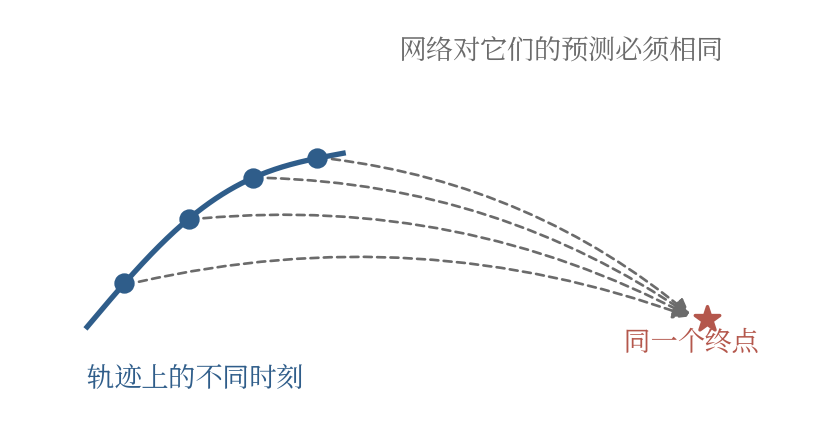

# 一致性模型与蒸馏

一致性模型是最早的一批"不求积分、直接给终点"的方法。它的想法很朴素：同一条轨迹上的不同点，应该映射到同一个终点。

## 定义

设 $f_\theta(x_t,t)$ 是网络对 $x_0$ 的预测。一致性要求是：沿着同一条 ODE 轨迹，任意两点给出的预测相同

$$f_\theta(x_t,t) = f_\theta(x_{t-\Delta},t-\Delta),$$

并且边界条件成立

$$f_\theta(x_0,0) = x_0.$$

采样时只需要一次前向：从噪声 $x_1$ 出发，$f_\theta(x_1,1)$ 就是样本。

边界条件通常通过参数化保证，比如让网络输出

$$f_\theta(x_t,t) = x_t - (1-t)\,F_\theta(x_t,t),$$

$t=0$ 时输出退化成 $x_t$，恒等成立。

## 训练：一致性蒸馏

如果有一个预训练的扩散模型，可以用它的 ODE 步产生相邻点：从 $x_t$ 走一步得到 $\hat{x}_{t-\Delta}$，再让两个点的预测互相靠近

$$L = E\big\|f_\theta(x_t,t) - f_\theta(\hat{x}_{t-\Delta},t-\Delta)\big\|^2.$$

注意右边也要对参数求导吗？实践中不。停止梯度是常见做法，把右边当作目标，训练更稳。

这就是一致性蒸馏。它把教师的多步行为压进学生的单次前向。

## 没有教师时

一致性训练不需要教师：用网络自己的预测构造目标。从 $x_t$ 预测 $x_0$，加噪回到 $x_{t-\Delta}$，再预测一次，要求两次一致。

这条路线省掉了教师，但训练很不稳定。原因是约束是外加的：它要求网络在任意两点上输出一致，却没有告诉网络"一致到什么"。训练初期网络输出很乱，一致性损失会把错误固化下来。

早期的解决办法是 curriculum：先从相邻很近的时间步开始，再逐渐拉大间隔。这相当于先学局部一致，再学全局一致。

## 潜空间版本

把一致性模型搬到潜空间，并加大跳步间隔，就是潜一致性模型。它一次前向可以跨越二十步，采样步数降到四到八。

关键技巧是跳步一致性：不只要求相邻点一致，还要求跨大步一致。代价是训练更难，需要教师在中间提供锚点。所以潜一致性模型通常是蒸馏出来的，不是从零训练的。

## 为什么它有效，又为什么不完美

有效的部分：一致性把"多步"这个循环换成了"一次函数求值"，推理成本直接降到一。

不完美的部分有两个。

第一，学生学到的仍是教师轨迹的终点，如果教师本身模糊，学生也模糊。一致性不解决多值性问题，它只是把多步的结果压缩。

第二，训练依赖时间离散化的设计。间隔选得太大，一致性约束太强，网络学不动；间隔太小，学生只在局部一致，跳步时误差累积。这个权衡没有通用解，只能按模型调。

## 与后面几章的关系

一致性模型把"轨迹"当成约束对象。下一章的分布匹配换了一个对象：不看轨迹，看分布。再下一章的 MeanFlow 又换了一次：不看轨迹也不看分布，看平均速度要满足的恒等式。

三种对象对应三种训练信号，也对应三种失败模式。读的时候留意这一点，比记住方法名字有用。
