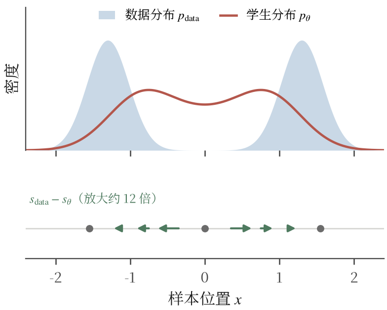

# 分布匹配与对抗蒸馏

只做回归的蒸馏有一个根本问题：学生学到的是教师输出的条件均值，多峰的细节被平均掉，结果偏模糊。这一章讲两类补救：分布匹配与对抗损失。

## 蒸馏损失的问题

设教师是多步采样器，学生要一次前向复现它的输出。最直接的损失是

$$L_{\text{distill}} = E_{x_1}\big\|G_\theta(x_1) - x_0^{\text{teacher}}(x_1)\big\|^2.$$

对每个 $x_1$，教师输出一个确定的 $x_0$。学生去拟合这个映射，本质上是回归。

问题在于教师本身也可能是随机的：同一个 $x_1$ 用不同的随机种子，会得到不同的 $x_0$。这些 $x_0$ 都合理，但回归只能取平均。

解决办法的思路是：不要拟合单个样本，去匹配分布。

### 平均是怎么来的

把教师的输出看成一个条件分布 $p_T(x_0\mid x_1)$。教师跑一次只给一个样本，跑很多次才能看出这个分布的形状。回归损失可以改写成对这个分布的积分

$$L(G) = E_{x_1}\int \big\|G(x_1)-x_0\big\|^2\,p_T(x_0\mid x_1)\,dx_0 .$$

对固定的 $x_1$，内层是关于 $G(x_1)$ 的二次函数，逐坐标求导令其为零

$$\frac{\partial}{\partial G}\int \|G-x_0\|^2 p_T\,dx_0 = 2\int (G-x_0)p_T\,dx_0 = 0
\;\Longrightarrow\; G^\star(x_1) = \int x_0\,p_T(x_0\mid x_1)\,dx_0 .$$

平方损失的最优解是条件均值，这不是近似，是精确结论。再把它代回去

$$E\big\|G-x_0\big\|^2 = \big\|G-E[x_0]\big\|^2 + E\big\|x_0-E[x_0]\big\|^2 ,$$

交叉项因为 $E[x_0-E[x_0]]=0$ 而消失。右边第二项是条件方差，与学生无关，它构成了损失的不可约下限。也就是说：**教师越随机，这个下限越高；而学生的输出永远停在下限对应的那个均值上，不会去猜某一个具体的样本。**

### 均值为什么就是模糊

一维的例子最省事。设某个 $x_1$ 下教师只可能输出两个值，各占一半：

$$x_0 \in \{0.2,\;0.8\},\qquad p=\tfrac12,\ \tfrac12 .$$

任何确定性学生都只能输出 $0.5$，损失是 $0.09$。而 $0.5$ 这个值，教师一次也不会生成。学生的输出不在教师输出的支撑集里——这是“平均”的准确含义。

图像上同一个现象换个样子。取一个 8 像素宽的水平通道，内容是一条竖直边缘，边缘可能落在第 3 像素处，也可能落在第 5 像素处：

```text
情况 A：  0.0  0.0  0.0  1.0  1.0  1.0  1.0  1.0
情况 B：  0.0  0.0  0.0  0.0  0.0  1.0  1.0  1.0
均值  ：  0.0  0.0  0.0  0.5  0.5  1.0  1.0  1.0
```

两种情况下边缘的梯度幅度都是 $1$，平均之后出现了一个跨两像素、幅度 $0.5$ 的斜坡。模糊不是加了噪声，而是对比度减半、边缘变宽、相位信息丢失。高频细节在平均里损失得最快，因为它们正好是“换个种子就会变”的那部分。

### 换办法能不能绕开

三个常见的抱佛脚都不行，原因各自不同。

多采几个教师的输出取平均：平均的期望还是那个均值，方差只是变小，不会把均值变成峰。对训练来说反而更糟，目标变确定了，学生更没有动力去猜细节。

把学生做大：最优解由损失形式决定，不由容量决定。容量足够大的学生依然输出均值，只是它能把这个均值拟合得更准。

换成 $L_1$：$L_1$ 的最优解是条件中位数，不是均值。单峰分布上它比均值锐一点（中位数不受尾部拉扯），但两峰各占一半时，中位数仍然落在两峰之间，救不了多峰。

换成感知损失（在预训练特征空间里算距离）：最优解是特征空间的条件均值。特征空间对“相位”不敏感，均值往往还是会对应一张看起来自然的图，所以感知损失确实比像素 $L_2$ 锐。但它的解依然是一个“代表点”，不是样本。这也解释了为什么加感知损失的一步模型常常看起来足够锐，却在多样性上明显不足。

真正换掉的是要求本身：从“输出一个点”改成“输出一个分布”。

### 随机性从哪来

有三处，中间那处最难办。

**教师的采样器带随机项。** 用随机微分方程求解器采样，或者教师内部还有别的随机源（丢弃、缓存刷新、不同的初始潜变量），同一个 $x_1$ 就会给出不同的 $x_0$。这一项可以通过改用确定性求解器消掉，一致性蒸馏里明确要求教师走 ODE 就是这个原因。

**学生看到的输入本身带噪。** 蒸馏时学生很少直接吃 $x_1$，而是吃 $x_t = \alpha_t x_0 + \sigma_t x_1$，也就是把干净样本加噪到某个中间时刻 $t$。当 $t$ 大，$x_t$ 里几乎没有原图的信息，从这个模糊的输入出发可以到达许多个合理的 $x_0$，$p(x_0\mid x_t)$ 是真多峰的。回归给学生的是这个多峰分布的均值，正好落在峰与峰之间。这一项换不掉，它来自问题本身。图 9.1 是一维两峰数据上的实测：$t=0.6$ 时样本对分成上下两支，回归曲线在 $x_t=0$ 处穿过 $0$，正好落在两支中间的空档里。

**条件太粗。** 同一句提示词下，训练数据里既有偏左的构图也有偏右的构图。条件 $c$ 没有区分它们，学生只能给一个折中。

![图 9.1　一维两峰数据上的条件均值。灰点是教师给出的样本对 $(x_t,x_0)$，蓝线是最优回归 $E[x_0\mid x_t]$。两条分支被压成一条穿过中间的曲线：在 $x_t=0$ 处，学生输出 $0$，而教师从不生成 $0$。](../images/09/fig09_regress.png)

前两项可以用“改损失”绕开，第三项只能靠更好的条件或更多的随机性设计。补救的共同思路是：不要再要求“这个输入对应哪个输出”，改要求“生成出来的东西整体像不像数据”。

## 分布匹配的基本想法

设学生的生成分布是 $p_\theta$，真实分布是 $p_{\text{data}}$。要最小化两者的 KL

$$L = \mathrm{KL}(p_\theta\|p_{\text{data}}).$$

直接算不了，但它的梯度可以写成

$$\nabla_\theta L = E_{x\sim p_\theta}\Big[(\partial_\theta x)^\top\big(s_\theta(x) - s_{\text{data}}(x)\big)\Big],$$

其中 $s_\theta=\nabla_x\log p_\theta$、$s_{\text{data}}=\nabla_x\log p_{\text{data}}$ 分别是两个分布的对数密度梯度（分数），$\partial_\theta x=\partial G_\theta(z)/\partial\theta$ 是样本对参数的雅可比。括号里是“两个分布的分数之差”。如果能有这两个分数，就能把样本往真实分布的方向推。

有些推导把它简写成两个分数相减，省掉了前面的雅可比。省掉之后式子看着整齐，但含义要说清：分数差是空间里的一个方向，参数梯度是这个方向投影到“参数能动到的位移”上。少了投影，读者会以为可以直接对分数做梯度下降，而分数是 $x$ 的函数，不是参数。

### 这个梯度是怎么推出来的

把 $x=G_\theta(z)$、$z\sim p_{\text{noise}}$ 写成推出关系 $p_\theta=(G_\theta)_\#p_{\text{noise}}$。参数走一小步 $\delta\theta$，每个样本点跟着走，位移场是

$$\delta x(x) = \frac{\partial G_\theta(z)}{\partial\theta}\,\delta\theta ,$$

在 $x$ 处的取值只依赖 $x$ 本身（同一条轨迹上的点位移相同）。概率质量守恒，密度的变化满足连续性方程

$$\delta p_\theta(x) = -\nabla_x\cdot\big(p_\theta(x)\,\delta x(x)\big).$$

代入 KL 的定义，用一次分部积分把散度挪到测试函数上（边界项在密度衰减时为零）

$$\begin{aligned}
\delta L &= \int \delta p_\theta\,(\log p_\theta-\log p_{\text{data}})\,dx \\
&= -\int \nabla\cdot(p_\theta\,\delta x)\,(\log p_\theta-\log p_{\text{data}})\,dx \\
&= \int p_\theta\,\delta x\cdot\nabla(\log p_\theta-\log p_{\text{data}})\,dx \\
&= E_{x\sim p_\theta}\big[\delta x\cdot(s_\theta-s_{\text{data}})\big].
\end{aligned}
$$

第二行里 $\int \delta p_\theta=0$，所以常数项不见了。把 $\delta x$ 的表达式提出来，就得到上面的梯度公式。

这个推导比“对 $\log p_\theta$ 求导”多走了一步，但换来两个清楚的认识。一是**梯度是一个内积**：分数差给出方向，雅可比给出可达方向，两者相乘才是参数梯度。二是**梯度可以只在学生自己的样本上算**：期望是对 $p_\theta$ 取的，不需要真实数据，只需要 $p_{\text{data}}$ 的分数。

### 停梯度的替代损失

上面的梯度不好直接用：$\partial_\theta x$ 是雅可比，逐个算太贵。但反向传播本来就免费提供它——只要损失是 $x$ 的可微函数 $L(x)$，$\nabla_\theta L=(\partial_\theta x)^\top\nabla_x L$。所以要做的只是构造一个 $L(x)$，让它的 $\nabla_x L$ 等于 $s_\theta-s_{\text{data}}$：

$$L_{\text{DMD}} = E_{z}\Big\|x - \mathrm{sg}\big(x - (s_\theta(x)-s_{\text{data}}(x))\big)\Big\|^2,\qquad x=G_\theta(z),$$

$\mathrm{sg}$ 表示停止梯度。目标里的 $x$ 和两个分数都不回传，只有第一项的 $x$ 回传。对 $x$ 求导，方括号里等于 $2(s_\theta-s_{\text{data}})$，乘上雅可比得到 $2(\partial_\theta x)^\top(s_\theta-s_{\text{data}})$，正是要下降的那个梯度。梯度下降让样本沿 $-(s_\theta-s_{\text{data}})=s_{\text{data}}-s_\theta$ 移动：往数据分数高的地方走，往自己分数高的地方退。

这个替代损失还有个直观读法：目标就是“把这个样本朝数据那边挪一小步”，挪的步长由两个分数之差给出。学生被要求输出挪过之后的点，于是它学会直接输出数据侧的样本，而不是自己分布的中心。

## 用两个模型估计分数

$p_{\text{data}}$ 的分数可以用一个预训练的扩散模型估计。$p_\theta$ 的分数可以用一个在线的“假分数模型”估计：把学生生成的样本当作数据，训练一个扩散模型去拟合它们。

为什么不能拿教师当 $p_\theta$ 的分数：教师的分数描述的是数据分布，学生在训练初期离数据很远，两个分数一比，差的是“学生与数据有多远”，这正是要的；但如果想用教师同时描述学生，就等于假设学生已经等于教师，梯度会退化为零。

假分数模型的工作方式与普通扩散训练没有区别。取学生的一个样本 $x=G_\theta(z)$，加噪到某个水平 $t$

$$x_t = \alpha_t x + \sigma_t\epsilon,\qquad \epsilon\sim\mathcal{N}(0,I),$$

回归噪声

$$L_{\text{fake}} = E\big\|\epsilon_\phi(x_t,t)-\epsilon\big\|^2 .$$

它学到的分数由 $\nabla\log p_t=-E[\epsilon\mid x_t]/\sigma_t$ 换过来。$t$ 的覆盖范围要宽：$t$ 大时它刻画学生分布的整体形状，$t$ 小时它刻画细节。实际实现里每个样本采一个 $t$，与训练扩散模型时一样。

于是训练变成三步循环：

1. 学生生成一批样本；
2. 用这批样本更新假分数模型；
3. 用两个分数之差更新学生。

这就是分布匹配蒸馏（DMD）的骨架。它同时维护三个网络：学生、教师、假分数模型。写出来是这样：

```text
输入：学生 G_θ，冻结的教师 T，假分数网络 ε_φ
每步：
  z ~ N(0,I),  x = G_θ(z)                      # 学生采样，1 次前向
  t ~ p(t),    x_t = α_t x + σ_t ε              # 加噪到教师的时间格
  L_fake = ||ε_φ(x_t,t) - ε||²                  # 追学生当前的分布
  φ ← φ - η_φ ∇_φ L_fake

  ε_fake = ε_φ(x_t,t)                           # 学生侧的分数
  ε_real = T(x_t,t)                             # 教师侧的分数（同一 t）
  d = (ε_real - ε_fake)/σ_t                     # 分数差 s_θ - s_data，形状同 x
  L_stu = ||x_t - sg(x_t - d)||² · w(t)         # 目标 = 样本朝数据侧挪一步
  θ ← θ - η_θ ∇_θ L_stu
```

三个网络各有自己的优化器，学习率不共用。每步的开销是三次前向（学生、假分数、教师）加两次反传，是普通流匹配训练的三倍上下。教师那一次前向只是一次去噪预测，不是多步采样，所以不会随采样步数增长——这一点让 DMD 的成本可控。

几个容易出问题的地方。

**两个分数必须在同一个时间格上比。** 教师的预测对应它自己训练时的噪声日程，假分数模型的 $t$ 必须落在这个日程上，$\sigma_t$ 也要用同一个定义。日程错位不会让损失变大，只会让梯度恒有偏差，症状是学生学出来的东西说不出哪里不对，但图像偏灰、细节发软。

**假分数模型的快慢决定训练的性格。** 它学得太快，学生一动它就贴上来，梯度接近零，训练停滞；它学得太慢，梯度指向的是几轮之前的学生，学生会来回摆。常见的做法是让学生每几步更新一次，或者给假分数模型用更小的学习率，比例在 $1{:}1$ 到 $1{:}5$ 这个量级。

**$\sigma_t$ 太小会让数值爆掉。** 分数差的量级是 $1/\sigma_t$，$t$ 接近零时这一项可以到几百上千。实际实现会按 $t$ 加权、归一化或者裁剪，这些技巧看起来琐碎，但换掉它们训练往往直接发散。

**过渡态会很难看。** 训练到中途，学生分布常常变成几个过尖的峰加一片空洞，或者整体色彩偏移。这是假分数模型滞后造成的过冲，继续训练会收敛，但如果此时看样本会误判方法失败。

### 学生是多步的时候

如果学生不是一次前向，而是固定的两步或四步，上面的公式不用改，变的是 $\partial_\theta x$ 要穿过学生自己的几步。

样本 $x$ 是沿着学生轨迹一步步走出来的，每一步都依赖 $\theta$；对 $\theta$ 求导要把每一步的雅可比连起来，反向传播天然做这件事，前提是整条轨迹的计算图还在显存里。代价随步数线性增长：一步学生的反传只过一遍生成器，四步学生要过四遍，显存也按这个比例涨。

有一个细节容易弄错：分数差是在加噪后的 $x_t$ 上算的，而 $x_t=\alpha_t x+\sigma_t\epsilon$ 对 $x$ 是线性的，所以 $\partial x_t/\partial\theta=\alpha_t\,\partial x/\partial\theta$。把损失写在 $x_t$ 上，梯度只差一个标量因子，不需要把 $x_t$ 当常数截断；截断了反而会把梯度的尺度弄错，单步或少步时表现为学习率“敏感”。

训练时的学生步数与推理时的步数可以不相等，但必须一致地算 NFE。用一个两步学生蒸馏、推理时又用两步，比一步学生多一倍前向，比较时要说清楚。

## 为什么它能恢复细节

回归损失把每个 $x_1$ 压到一个点，分布匹配把整个分布推向数据分布。前者关心“这个噪声应该生成什么”，后者关心“生成出来的整体像不像数据”。

后者对多峰更宽容：只要样本落在任意一个峰上，分布就接近；回归则要求落在均值上，反而离开了所有峰。

代价是训练复杂。三个网络交替更新，学习率要配合，否则会震荡。论文里通常要仔细调这几个比例。



图 9.2 把这件事画出来了。学生分布两峰靠得太近、中间还有一团多余的质量，它与数据分布的分数差在两峰之间最强，指向外侧；在数据峰附近，两个分布的分数都指向峰心，差接近于零。所以更新只发生在“错的地方”，对已经对的样本几乎不动手。

这种局部性带来一个好处：损失的大小自动随训练的进展下降。学生越接近数据，分数差越小，梯度越弱。回归损失没有这个性质，它的大小由条件方差决定，与学生学得多好无关——学得再好，那部分损失也消不掉。

取图 9.2 里的几组具体数值（一维，学生的三峰与数据的双峰都取成高斯混合，$\sigma_t$ 取 $0.28$）：

| $x$ | $s_{\text{data}}$ | $s_\theta$ | 差 | 乘 $\sigma_t$ 后 |
| --- | --- | --- | --- | --- |
| $0.0$ | $0.0$ | $0.0$ | $0.0$ | $0.0$ |
| $0.5$ | $10.2$ | $0.5$ | $9.7$ | $2.7$ |
| $0.9$ | $5.1$ | $-0.5$ | $5.6$ | $1.6$ |
| $1.3$ | $0.0$ | $-2.3$ | $2.3$ | $0.6$ |
| $1.7$ | $-5.1$ | $-4.2$ | $-0.9$ | $-0.3$ |

几件事从表里能看出来。谷底（$x=0.5$ 到 $0.9$）的分数差最大，修正集中在最需要修正的地方；往外到尾部，两个分数都是负的、大小接近，差降到不足 $1$，几乎不更新。分数本身的量级是 $1/\sigma_t$ 乘上“离峰多少个标准差”，到 $10$ 以上很平常，所以不能直接当位移用，实现里要乘 $\sigma_t$ 换算回数据尺度（表里最后一列），再乘学习率。

$x=0$ 处两个分数都是零，差为零。按理说谷底的样本应该被推出去，为什么这里不动？因为一维对称时谷底是学生分布的一个局部极大（学生在中间有自己的一团质量），它对自己的密度是驻点；真正被推的是偏离中心的那一圈。分布匹配的推力不是“每个样本都往峰上爬”，而是“让整体质量外扩”，顶点附近的局部驻点要等两边被推空之后才开始动。

$x=1.3$ 那个数据峰顶上，差仍然为正把它继续往外送，这一条看着违背直觉。原因是学生在那里的质量几乎为零，$s_\theta=-2.3$ 很强，KL 里的 $-E\log p_\theta$ 那一项要求学生的质量不要全挤在中间。这一项使得分布匹配不只是“填谷”，也包含“把挤在一起的质量摊开”。

用矩的语言说，回归只对齐一阶矩（条件均值），分布匹配对齐整个分布，也就是所有阶的矩。图像的高频统计、通道间的相关、边缘的锐度，都属于二阶以上的东西，回归看不到它们。

### 固定点

把 $L_{\text{DMD}}$ 的梯度写成期望形式，令它为零，要求

$$E_{x\sim p_\theta}\Big[(\partial_\theta x)^\top(s_\theta-s_{\text{data}})\Big]=0 .$$

如果 $s_\theta=s_{\text{data}}$ 处处成立，这个条件满足。反过来，如果参数能让样本分布贴合数据，两个分数只差一个与 $x$ 无关的常数，而归一化后这个常数消失，分布相同。所以 $p_\theta=p_{\text{data}}$ 是梯度为零的点，条件均值不是。

这是分布匹配与回归最本质的差别：回归的固定点是教师输出的均值，一个确定的点；分布匹配的固定点是数据分布本身，一整个分布。前者由损失的形式决定，后者由分数的定义决定。

不过“有固定点”不等于“能到”。$L_{\text{DMD}}$ 不是单个网络的损失，而是一个两方（学生与假分数模型）的博弈。假分数模型在追学生，学生又在躲假分数模型，两者的不动点要一起找。实践中的收敛是“追上了再往前走一步”的逐步逼近，不是一个凸问题下降到底。

## 对抗蒸馏

另一条补细节的路是把判别器加回来。学生生成图，判别器区分学生输出与教师输出（或真实图像），用对抗损失补高频。

对抗损失的作用与分布匹配类似：它不要求逐点对齐，只要求整体像。区别在于判别器提供的是局部纹理的信号，分布匹配提供的是整体分布的信号。

写成标准的对抗目标

$$\min_\theta\max_\phi\; E_{x\sim p_{\text{data}}}\big[\log D_\phi(x)\big] + E_{x\sim p_\theta}\big[\log(1-D_\phi(x))\big].$$

对固定的学生，内层最大化有闭式解

$$D^\star(x) = \frac{p_{\text{data}}(x)}{p_{\text{data}}(x)+p_\theta(x)} .$$

这个式子是整个对抗路线的钥匙。取对数几率

$$\mathrm{logit}\,D^\star(x) = \log p_{\text{data}}(x)-\log p_\theta(x),$$

再对 $x$ 求梯度

$$\nabla_x\,\mathrm{logit}\,D^\star(x) = s_{\text{data}}(x)-s_\theta(x).$$

**最优判别器的空间梯度，就是两个分布的分数差。** 判别器不需要显式地输出分数，它只需要能分真假，就隐含地把分数差学了出来。对抗训练在做的，和分布匹配在做的，是同一件事的两种估计方式：一个用两个显式的扩散模型去估分数，另一个用一个分类器去估对数密度比。前者的估计带扩散模型的时间条件，后者带判别器的感受野。

这个对照也解释了对抗损失为什么补的是高频。判别器的容量和感受野决定了它能看见什么：如果它的有效感受野只有几十像素，它就只能靠局部纹理、边缘锐度、相位一致性来判断真假，而这些正是平均抹掉的东西。反过来，判别器看不到全局布局，所以对抗损失单独用会丢掉构图——这正是需要与回归项搭配的原因。

### 三种搭配

工程上常见的组合是：蒸馏损失保证大结构，对抗损失保证纹理。SDXL-Turbo、SD-Turbo 一类模型用的就是这套组合。

具体来说，一项回归或分布匹配的损失负责“大致往哪走”，它给出稳定的、方向明确的梯度；一项对抗损失负责“表面像不像”，它给出尖锐但没有全局约束的梯度。两者的权重比通常在 $1{:}0.1$ 到 $1{:}1$ 的量级（不同工作差别很大，这里给的是量级估计）。

判别器的输入是真数据还是教师输出，决定了学生在学谁。用真数据：学生会顺带修掉教师的一些毛病，但也可能跑到教师分布之外；用教师输出：学生严格贴着教师，代价是把教师的缺陷一起继承。混合两者是常见折中。

对抗路线的两个老问题在这里都还在。判别器太强，学生只能找到它判错的那个窄缝，结果是模式坍塌——生成的图彼此很像；判别器太弱，梯度不含信息，纹理补不上来。加噪判别器是一种缓解：给真假两边都加同样强度的噪声，判别器就看不到高频的绝对精度，只看统计是否匹配，学生在高频上因此有更多自由度，坍塌的概率下降。

实现上有几个常被提到的零件。损失用铰链形式而不是对数形式，梯度在判别器已经很有把握的样本上为零，不会无限推；给判别器加梯度惩罚（对真样本的梯度范数做 $L_2$ 约束），限制它在真假边界处的陡度，否则判别器的梯度会把学生拽向单点；判别器放在潜空间而不是像素空间，省显存，但也丢掉了像素级的纹理信号，两边各有代价。

## 三条蒸馏路线的对比

| 路线 | 目标 | 要教师吗 | 主要问题 |
| --- | --- | --- | --- |
| 纯回归蒸馏 | 拟合教师输出 | 要 | 偏模糊 |
| 分布匹配 | 匹配分布 | 要 | 训练复杂，要假分数模型 |
| 对抗蒸馏 | 骗过判别器 | 要 | 训练不稳，可能模式坍塌 |

表里三行都需要教师。这是蒸馏路线的共同前提：先有一个好的多步模型，再把它压成一步。

再加一列成本与固定点，差别会更清楚：

| 路线 | 每步前向/反传 | 固定点 | 不稳的来源 |
| --- | --- | --- | --- |
| 纯回归 | $1/1$（教师输出可离线缓存时为 $0/1$） | 教师输出的条件均值 | 几乎没有，但目标本身有偏 |
| 分布匹配 | $3/2$（学生、假分数、教师） | $p_\theta=p_{\text{data}}$ | 假分数模型的滞后 |
| 对抗 | $2/2$（学生、判别器） | 博弈的纳什点 | 判别器的强弱平衡 |

回归路线的成本低得诱人：教师输出可以在离线阶段算好，训练时只剩学生自己的一次前向和一次反传，与普通训练没有区别。它的偏差是结构性的，加数据、加参数都改不了，只能换损失。

分布匹配的成本是回归的三倍上下，好处是不需要判别器，训练不会出现对抗那种来回震荡；代价是多了一个要同步的网络，同步不好就振荡。

对抗路线的成本居中，但它是三者里最难的：博弈没有单调下降的损失曲线，凭损失判断训练好坏会误判，只能看样本。

如果要选，先看瓶颈在哪。多步教师本身已经被评为“细节不足”，那么学生再贴教师也没用，得混入真数据或换教师；教师很好而学生糊，问题在损失，回归换分布匹配或对抗都有帮助；训练预算紧、只求快，回归加上足够的教师随机性（多个种子平均）也能用，糊一点但稳。

还有一个顺序上的惯例：先用回归把学生烤到能出图，再切到分布匹配或对抗。一开始学生的样本离数据很远，判别器只需看一眼就能分开，梯度没有分辨力；假分数模型也只会学到一团噪。用回归预热几轮，把这个距离拉小，后两项才开始起作用。

## 一个观察

蒸馏的有效性依赖于教师的质量。教师如果本身模糊，学生再好也补不回来。所以在比较不同蒸馏方法时，要确认它们用的是同一个教师，否则比的是教师而不是方法。

这一点在论文里常常被忽略：有的工作换了更强的底座模型，报告的一步质量提升就被误读成方法的贡献。判断一份结果是否可信，可以看四件事：教师是否相同、学生的一次前向是否真的一次（有的实现里还留着一步去噪，NFE 实际上是 2）、评测用的是真实数据的参考统计还是教师生成的参考统计、以及报告的分数是在多少个随机种子上平均的。第四条最容易被省略，而一步生成的学生方差偏大，单次评测的波动可以到几个点的量级。
