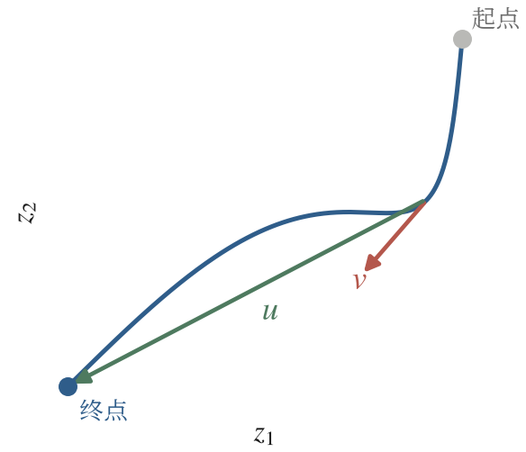
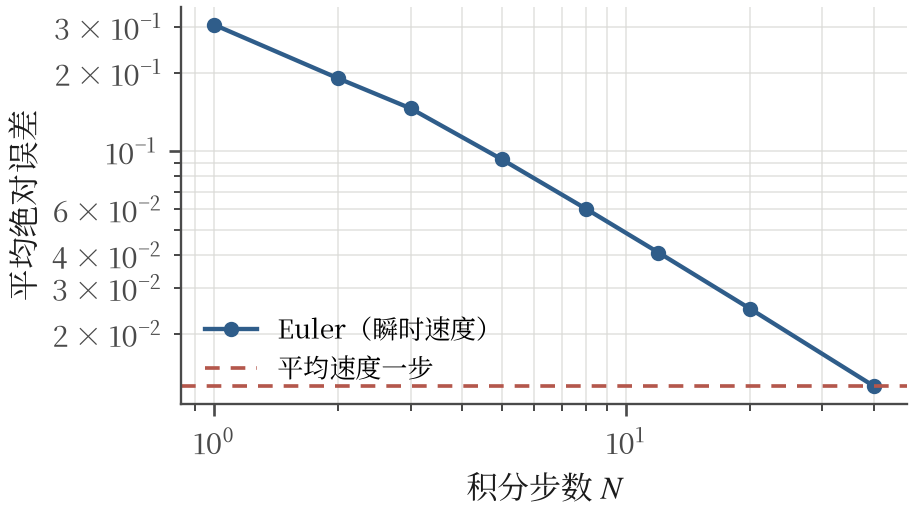

# MeanFlow：平均速度

前面两条路都要教师。这一章讲一条不需要教师的路：不问“下一步往哪走”，直接问“从时刻 $t$ 走到时刻 $r$，一共要走多远”。

学这个量，一步就能到终点。难点是它没有现成的标签，得从定义里推一个恒等式出来当目标。

一步采样真正需要的不是路上的每一步，而是两端的差。把从 $t$ 到 $r$ 的位移除以时长，得到一个“整段平均”的速度；能直接学到它，采样就是一次乘法。麻烦在于这个量没有标签：训练数据里只有噪声和图像，没有任何一条样本写着“这里的平均速度是多少”。所以这一章的主线是从定义里推出一个约束，再把约束做成回归目标。

## 平均速度的定义

设轨迹满足 $dz_\tau/d\tau = v(z_\tau,\tau)$。从 $t$ 走到 $r$（$r<t$）的总位移是 $\int_r^t v(z_\tau,\tau)\,d\tau$，除以时间间隔得到平均速度

$$u(z,r,t) = \frac{1}{t-r}\int_r^t v(z_\tau,\tau)\,d\tau.$$

注意 $u$ 是三个变量的函数：位置 $z$、起点时间 $r$、终点时间 $t$。这与瞬时速度不同，后者只依赖 $(z,t)$。

积分里的 $z_\tau$ 不是任意的点，它是从 $(z,t)$ 出发沿速度场往回的轨迹。速度场是确定的（训练完就是一个固定函数），给定起点和时间，轨迹唯一，所以这个积分有意义，$u$ 是良定义的。换一个起点 $(z',t')$，轨迹就不同，同一个 $(r,t)$ 下的 $u$ 也不同——这就是 $u$ 必须把 $z$ 和 $t$ 都当输入的原因。

两个极限值得记住。$r\to t$ 时，$(t-r)u=\int_r^t v\,d\tau\approx(t-r)\,v(z_t,t)$，两边除以 $t-r$ 得 $u\to v$；$r=0,t=1$ 时，$u$ 就是整段位移除以总时间，一步采样要用的正是它。

“平均”这个词容易误解。它不是速度在空间上的平均（那要对空间做积分），而是沿一条轨迹对时间做平均。同一个位置 $z$、同一个时刻 $t$，如果两条轨迹从别处路过这里又走向不同的地方，同一个 $(z,r,t)$ 仍然只有一个 $u$，因为轨迹由 $(z,t)$ 唯一确定，与从哪里来无关。这个“只看未来”的性质是后面一切推导的基础。

最快的检验是一个恒速的例子。若速度场处处等于常向量 $c$，则 $z_\tau=z+(\tau-t)c$，位移是 $(r-t)c$，除以 $r-t$ 得 $u=c$，与瞬时速度一样，也与 $r,t$ 无关。速度不变时，平均等于瞬时。这口例子说明 $u$ 的复杂形状完全来自速度场的变化：路径弯的地方，平均方向与切向不一致，图 10.1 画的就是这种情形。

量纲上 $u$ 与 $v$ 一致：数据单位除以时间单位。因为区间长度 $t-r\le1$，$u$ 的数值量级与 $v$ 相当，不会出现“平均速度比瞬时速度小一个数量级”的情况。这一点在训练里很实用：$r=t$ 处的正则项与流匹配的损失是同一个尺度，混合两者不需要重新调权重。



## 可加性

把区间 $[r,t]$ 从中间切成两段，积分可以拆开

$$(t-r)u(z,r,t) = (s-r)u(z_s,r,s) + (t-s)u(z_t,s,t).$$

这个式子说的是：走一大步的位移，等于走两小步的位移之和。

推导只是把积分拆开。轨迹上的三个位置 $z_r,z_s,z_t$ 是同一条曲线上三个时刻的点，$s\in(r,t)$，于是

$$\begin{aligned}
(t-r)u(z,r,t) &= \int_r^t v\,d\tau = \int_r^s v\,d\tau + \int_s^t v\,d\tau \\
&= (s-r)u(z_s,r,s) + (t-s)u(z_t,s,t).
\end{aligned}$$

两项里的位置参数分别是 $z_s$ 和 $z_t$：走前半段是从 $z_s$ 出发，走后半段是从 $z_t$ 出发。写成同一个 $z$ 就错了，误差在路径弯曲时正好是一阶量。

如果网络对 $u$ 的估计准确，这个关系会自动成立，不需要额外加约束。这一点与一致性模型不同：一致性要求网络在不同时间步输出一致，那是一个外加的约束；MeanFlow 的一致性来自积分的可加性，是内生的。

可加性还可以递归地用：把一大步切成 $N$ 段，总位移是各段位移之和，右边的每项可以用不同的 $u$ 来算。这就是少步采样能用同一张网络跑出不同步数的原因——它不依赖某个固定的时间表，只依赖“每段都能算平均速度”这一件事。

## 恒等式

上式两边对 $t$ 求导，固定 $r$。左边用乘积法则

$$\frac{d}{dt}\big[(t-r)u\big] = u + (t-r)\frac{du}{dt}.$$

右边用微积分基本定理，等于 $v(z_t,t)$。于是

$$u(z,r,t) = v(z,t) - (t-r)\frac{d}{dt}u(z,r,t).$$

这就是 MeanFlow 恒等式。它把平均速度、瞬时速度和平均速度的时间导数联系在一起，而三者里只有 $v$ 是已知的，来自流匹配的条件速度。

两步推导每一步用了什么都没藏着。左边求导时，$(t-r)$ 与 $u(z,r,t)$ 都依赖 $t$：前者是显式的时间差，后者通过位置 $z_t$ 和时间槽 $t$ 依赖 $t$。乘积法则给出的第二项 $(t-r)\frac{du}{dt}$ 里的 $\frac{d}{dt}$ 必须理解为沿轨迹的全导数，不是对第二个位置参数的偏导。右边是变上限积分，上限的导数是 $v(z_t,t)$，正是“沿轨迹的瞬时速度”。

换一个写法能看得更清楚。把可加性对中间时刻 $s$ 求导，而不是对 $t$ 求导：左边

$$\frac{d}{ds}\big[(s-r)u(z_s,r,s)\big] = u + (s-r)\Big(\partial_s u + \frac{dz_s}{ds}\cdot\nabla_z u\Big),$$

右边对上限求导得 $v(z_s,s)$，而 $dz_s/ds=v(z_s,s)$。两边相等，任取 $s=t$ 就回到上一条式子，任取 $s$ 就得到恒等式的一般形式

$$u(z,r,t) = v(z,t) - (t-r)\big(\partial_t u + v(z,t)\cdot\nabla_z u\big).$$

整理成“导数项等于什么”的样子更好用：

$$\partial_t u + v\cdot\nabla_z u = \frac{v-u}{t-r}.$$

右端当 $t\to r$ 时是 $0/0$，但分子也一阶地趋于零：把恒等式本身写成 $v-u=(t-r)(\partial_t u+v\cdot\nabla_z u)$，两边就是同一个式子。比值在端点有限，等于 $\partial_t u+v\cdot\nabla_z u$ 在 $t=r$ 处的取值，端点没有奇点。

两种写法数学上等价，数值上不等价。采样时经常用到很短的区间，除以 $(t-r)$ 会把分子里的舍入误差与网络噪声一起放大，用乘积形式更稳。

### 一个能手算的算例

取一维速度场 $v(z,t)=-z$。它有闭式解：从 $(z,t)$ 出发，$dz_\tau/d\tau=-z_\tau$ 给出 $z_r=ze^{\,t-r}$，位移是 $z(e^{\,t-r}-1)$，除以 $r-t$ 得

$$u(z,r,t) = z\,\frac{1-e^{\,t-r}}{t-r}.$$

取 $z=1$、$r=0$、$t=1$：$1-e=-1.718$，所以 $u=-1.718$。导数部分逐项算：

$$\partial_t u = z\,\frac{e^{s}(1-s)-1}{s^2}\Big|_{s=1} = 1\times\frac{-1}{1} = -1,\qquad \nabla_z u=\frac{1-e^{\,s}}{s}=-1.718,$$

再乘上 $v=-1$

$$\partial_t u + v\,\nabla_z u = -1 + (-1)(-1.718) = 0.718 .$$

代回恒等式：$u = v-(t-r)\times0.718 = -1-0.718 = -1.718$，与直接积分的值一致。

这个例子里两个导数项大小差不多、符号相反，一相加才得到正确结果。如果实现时漏掉 $\partial_t u$，或者把 $\nabla_z u$ 的符号弄反，结果会差出接近一倍，但损失仍然是个不太小的数，训练看起来“在学”。这类错误靠看损失曲线发现不了，只能靠小例子对。

## 时间导数怎么算

上式里的 $d/dt$ 是沿轨迹的全导数。展开

$$\frac{d}{dt}u(z_t,r,t) = \partial_t u + \frac{dz_t}{dt}\cdot\nabla_z u + \frac{dr}{dt}\partial_r u.$$

代入 $dz_t/dt = v$、$dr/dt = 0$

$$\frac{d}{dt}u = \partial_t u + v\cdot\nabla_z u.$$

这个式子是 $u$ 的雅可比矩阵与切向量 $(v,0,1)$ 的乘积，也就是一个雅可比向量积。它的计算成本与一次反向传播同阶，这是 MeanFlow 能训得动的原因。

### 把话说得再直白一点

$u(z,r,t)$ 有三个位置参数，其中 $r$ 固定不动，只有 $z$ 和 $t$ 在动。把 $(z,t)$ 看成两维，$u$ 对它们的雅可比是 $d\times(d+1)$ 的矩阵，前 $d$ 列是 $\nabla_z u$（$d\times d$），最后一列是 $\partial_t u$（$d\times1$）。恒等式要的是这个矩阵乘上切向量 $(v,1)$：

$$\big[\nabla_z u\;\big|\;\partial_t u\big]\begin{pmatrix}v\\1\end{pmatrix} = \nabla_z u\,v + \partial_t u .$$

这正是雅可比向量积（JVP）的定义：给定一个输入切向量，求输出沿这个方向的变化率。$r$ 不参与，因为它的切向分量是 $0$，所以 $\partial_r u$ 那一项在 $dr/dt=0$ 时自动消失。

为什么非用前向模式不可？雅可比是 $d\times(d+1)$，JVP 要的是它乘一个向量，输出维度是 $d$。前向模式一次就能算出整个 $Jv$，成本是一次前向传播的量级（通常是一到两倍，随网络结构变）；反向模式（VJP）一次只能得到 $w^\top J$，要凑出 $Jv$ 得跑 $d$ 次，图像上 $d$ 是几万到几十万，不可行。

实现上只需两行，以 JAX 为例：

```python
def du_dt(z, t, v, r):   # net(z,t,r) -> u，r 被当常数
    _, jvp = jax.jvp(lambda a, b: net(a, b, r), (z, t), (v, 1.0))
    return jvp                      # = ∇_z u · v + ∂_t u
```

`jax.jvp` 的第一个输出是原函数的值（这里用不到），第二个是 JVP。关键是第三个位置参数 $r$ 不在切线里，它当常数。

### 一个训练步花在哪

把成本拆开看：一次前向算 $u_\theta(z_t,r,t)$；一次 JVP 算目标里的导数项；一次反传算参数的梯度。因为目标被停住了梯度，JVP **不进反传图**，所以总成本大约是普通流匹配的两到三倍（量级估计，取决于 JVP 与前向的相对开销）。

这一条容易被误解成“MeanFlow 要对 JVP 做二阶导”。不需要。二阶导只在不停梯度时才会出现，而停梯度正是为了避免它。

JVP 的方差值得单独提一句。它是对网络的一个线性化量，网络越“弯”（二阶导越大），JVP 对输入扰动的敏感性越高。图像上这意味着相邻像素的细微差别会被放大成目标里的大波动。后续工作花在损失加权、输出归一化、梯度裁剪上的力气，大部分是为了压这个方差，而不是为了提升模型容量。

### 用有限差分代替行不行

既然 JVP 就是方向导数，自然想用两次前向的差去近似它：

$$\partial_t u+v\cdot\nabla_z u \approx \frac{u(z+hv,\,t+h)-u(z,t)}{h}.$$

两个问题。一是偏差：差分是 $O(h)$ 逼近，误差里带二阶导，而 $h$ 为了控制噪声又不能太小。二是噪声：前向计算本身有随机性（批量归一化、低精度累加、图内随机项），两次前向之差把这点噪声除以 $h$，$h=0.01$ 时噪声放大一百倍。两者夹在一起，$h$ 的可用窗口很窄，图像上往往只剩 $0.05$ 到 $0.1$ 这个量级，偏差已经不可忽视。

成本上也不划算：差分要两次前向，JVP 只要一次前向量的开销。所以差分适合写个小脚本验证实现对不对（用很小的输入、双精度算一遍），不适合拿来训练。

## 训练目标

把恒等式的右边当作回归目标

$$L = E\big\|u_\theta(z_t,r,t) - \mathrm{sg}(u_{\text{tgt}})\big\|^2,$$

其中

$$u_{\text{tgt}} = v_t - (t-r)\big(\partial_t u_\theta + v_t\cdot\nabla_z u_\theta\big),$$

$v_t = x_1 - x_0$ 是直线路径的条件速度，$\mathrm{sg}$ 表示停止梯度。

先看目标里为什么是“条件速度”而不是“边际速度”。训练时手里只有采样出来的一对 $(x_0,x_1)$，它们的连线是直线，这条直线上的条件瞬时速度恒为 $x_1-x_0$。而网络学的是边际平均速度，它看不到这一对具体是什么。用条件速度当 $v_t$，相当于把单个样本的速度当成了瞬时速度的无偏替代。这靠的是一个全期望：给定位置 $z_t$，$E[x_1-x_0\mid z_t]=v(z_t,t)$，而目标里的其余部分（导数项）只依赖 $z_t$、不依赖采样对，所以整个目标在给定 $z_t$ 下的期望等于真值。这个论证与流匹配里用条件速度代替边际速度是同一件事，没有新东西，但它解释了为什么目标有噪声：噪声来自单个样本与它自己的均值之间的差。

目标里为什么用 $u_\theta$ 自己的导数？因为真值 $u$ 的导数拿不到。如果 $u_\theta$ 已经满足恒等式，用它自己的导数算出的目标就等于它自己，损失为零。也就是说，零损失的点恰好是恒等式的解。

换个角度读：损失就是把恒等式的残差平方化

$$L = E\big\|\underbrace{u_\theta - v_t + (t-r)(\partial_t u_\theta + v_t\cdot\nabla_z u_\theta)}_{\text{残差 }r_\theta}\big\|^2 ,$$

所以训练不是“拟合一个标签”，而是“找一个函数，使它在训练分布上处处满足一个偏微分方程”。数值分析里这类做法叫残差最小化，它与拟合边界条件的监督学习有本质区别：没有标签可依，只能靠方程自己约束自己。好处是不需要教师，也不需要一个时间离散化方案；代价是残差里的导数项带来额外方差，而且残差为零只在训练分布覆盖到的地方有保证。

### 样本对必须是同源的

目标里的 $v_t$ 与 $z_t$ 必须来自同一个样本对：把 $x_0$ 与 $x_1$ 按直线插值得到 $z_t=\alpha_tx_0+\sigma_tx_1$，同时取 $v_t=x_1-x_0$。这两样东西是一个包裹，拆开就错。

常见的错法是把网络自己采样的中间点当成 $z_t$。那个点不属于任何一对 $(x_0,x_1)$，$v_t$ 就失去了定义；写成代码不会报错（形状一样），但目标里的 $v_t$ 变成了另一个样本的速度，方向与位置对不上，训练会以一种“损失能降但样本不成形”的方式失败。

这一条也解释了目标为什么带噪。训练时用的是**条件直线**上的点，而网络要学的 $u$ 是**边际轨迹**的平均速度，两者只在期望意义下对齐。这与流匹配里用条件速度代替边际速度是同一个口径，也就承担同样的方差。

### 停止梯度的两层理由

为什么要停止梯度？目标里含有 $u_\theta$ 的导数，不停止的话，反向传播要对雅可比向量积再求一次导，变成二阶优化，成本翻倍且不稳定。停止之后，目标被当作常数，梯度只从第一项流出。

这个理由还可以再拆一层。

**第一层是成本。** 不停梯度，反传要穿两次网络：一次穿预测那一支，一次穿目标里的 JVP，而 JVP 本身已经带着一阶导数。这一项在自动微分里对应二阶导（对雅可比再求雅可比），显存和计算都按前一阶的系数乘上去。图像模型上这通常是承受不起的，也更容易数值溢出。

**第二层是目标的身份。** 目标里的 $u_\theta$ 是网络自己当前的样子，如果梯度从它流回去，优化就变成“两边一起动”：预测往目标靠，目标也往预测靠。损失确实可以下降，但下降不再意味着残差变小。把它停住，目标就是一个固定的“靶子”，损失才是真正的残差平方，下降才能读成“更满足恒等式”。

停梯度也有代价，值得说清。停住之后，梯度只从预测那一支流出，它要求的是“$u_\theta$ 是当前目标在函数类里的最佳逼近”，而不是“残差为零”。当网络容量不够时，残差可以不归零而梯度已经很小：目标落到了网络能表达的范围之外，网络停在最近的投影点上。这种驻点在训练里表现为损失降到一个平台，再训也不动，采样看样本却是“差一点”。不停梯度的版本理论上没有这个问题（它优化的是真残差），但代价是上面那两层。两者都不完美，实际做法选了便宜的那个。

## 训练细节

$r$ 与 $t$ 怎么采样，直接决定哪些区间被学好。

$t$ 从 $[0,1]$ 均匀采，$r$ 从 $[0,t]$ 采。如果 $r$ 总靠近 $t$，网络只学会短区间的平均速度，一步采样用的大间隔就没学好；如果总取大间隔，短区间的精度又不够。

常见做法是混合：一部分样本取 $r=t$，退化成流匹配，作为正则；一部分取大间隔。$r=t$ 时目标退化成 $v_t$，这一项给网络一个锚，即使平均速度学偏了，瞬时速度仍被约束住。

后续工作主要改的就是这些：$r,t$ 的采样分布、损失的加权、以及如何处理雅可比向量积带来的方差。它们的共同结论是，MeanFlow 的训练不稳定主要来自目标里的导数项，而不是模型容量。

### 采样区域是个三角形

$(r,t)$ 能取的所有值是 $0\le r<t\le1$，在平面上是个三角形，面积 $1/2$。对角线上 $r=t$ 是退化情形（区间长度为零），一步采样用的 $(0,1)$ 是斜边的一个端点。这两个边界都很重要，但都不是随便一采就能采到的。

$t$ 的分布常用对数正态（对 $t$ 做 logit 变换后的正态），而不是均匀。理由与流匹配一样：速度场在中间时刻变化最快，两端变化慢，均匀采样会把一半的样本花在两端。对数正态在 $0.5$ 附近密集，正好把样本往难的地方推。

$r$ 的采法有两种，常混着用。一种是 $r\sim U[0,t]$，覆盖所有长度；另一种是给 $r=t$ 一个离散概率 $p$，这个点不在连续分布里，需要显式地采。$p$ 的取值在 $0.1$ 到 $0.5$ 这个量级（不同实现差别很大），$p=0.5$ 意味着一半的样本退化为流匹配。

### 端点为什么要特殊照顾

一步采样用的是 $(r,t)=(0,1)$。在连续采样下，这个点的概率为零；即使落在它附近的 $(\epsilon,1-\epsilon)$，区间长度也接近 $1$，而这样的样本在三角形里只占很小一块。换句话说，**方法最需要的那个区间，训练时最难采到**。

两个处理办法。一是把 $t$ 在两端加密（比如用 $t=1-u^2$ 之类的变换，把采样密度往 $1$ 推），二是直接在边界附近撒一批固定点，比如强制让一部分样本取 $r=0$、$t=1$。后者简单直接，代价是这部分样本的梯度对参数的影响很大（区间最长，目标里的导数项也最大），需要配合加权。

在三角区域里，区间长度 $t-r$ 的分布是中点高、两端低。如果只按面积均匀采样，长度为 $1$ 附近的样本比例很小。训练时看见损失下降，并不能说明大区间学好了：大区间样本少，它们的损失被小区间样本拉平了。所以分区间看损失，比看总损失有用。

### 加权

目标里的导数项带因子 $(t-r)$，它的噪声也按这个因子缩放。若 JVP 的标准差为 $\sigma_J$，单个样本的目标噪声约为 $(t-r)\sigma_J$，损失的量级是它的平方。两种加权方式对应两种取舍：

- 乘 $(t-r)^{-2}$：把不同长度样本的噪声拉到同一个量级，代价是大区间的误差被放大，训练更容易被长区间的难样本主导；
- 乘 $(t-r)$ 或不变：稳定，但小区间样本占主导，大区间学得慢。

实践里常见的是介于两者之间的形式，再配一个上限截断。没有普遍最优的选法，这一项对最终质量的影响与 $r,t$ 的采样分布相当。

### 一个批里采几组

每个样本独立采 $(r,t)$，一个批里就有几十组不同的区间，梯度是它们的平均。另一种做法是整个批共用一个 $(r,t)$，实现简单，但每一步只覆盖一个区间，梯度方差更大，而且相邻批之间的损失不可比（长区间批的损失天然更大）。默认用前者；只有在显存或速度吃紧、需要快速验证时才会退到后者。

### 从流匹配热身

多数实现不会一上来就用完整的 $(r,t)$ 采样。前若干轮把 $r$ 固定成 $t$，训练就退化成普通流匹配：网络先学会瞬时速度，输出的量级与方向都对，然后再放开 $r<t$，让它在已有基础上学分段平均。这样做有两个好处：早期 JVP 的输入已经有了合理尺度，方差不会一上来就爆；引导强度也能在退化阶段先学稳，再进入区间训练。

反过来的顺序没有这么顺。先学平均速度再引入 $r=t$，相当于让网络在两个互相牵制的目标之间来回，损失表现为长平台加偶发尖峰。

### 一个失败模式

如果采样偏向短区间（例如 $r$ 总取 $t$ 附近），网络的短区间平均速度会学得很准，损失看上去很漂亮。但一步采样用的是长区间，那里的 $u$ 没有经过训练，输出会出现整体色彩偏移、结构错位、或者干脆是一张“平均图”。这种失败不看损失，只看样本，而且要分别用不同步数（1、2、4）采样才能看出来——某个步数崩了，其他步数可能完好。

## 采样

有了 $u_\theta$，采样就是一次乘法

$$z_r = z_t - (t-r)u_\theta(z_t,r,t).$$

一步生成：$x_0 = x_1 - u_\theta(x_1,0,1)$。这一步没有可调参数，也没有时间表：给定 $x_1$，输出就定了。少步生成把 $[0,1]$ 切成几段，每段用对应的 $u_\theta$。

符号的顺序很容易搞反：$u_\theta$ 的第一个位置参数是当前位置，后两个是目标时刻与当前时刻，$r<t$。写成 $u_\theta(z_t,t,r)$ 就会把“从 $t$ 走到 $r$”变成一个不存在的区间，很多实现里两个参数都是标量，形状对得上，不会报错，只是结果不对。

四步采样可以写成：

```text
时间表：t = 1.00 → 0.75 → 0.50 → 0.25 → 0
z = x_1
for (t_now, t_next) in [(1.00, 0.75), (0.75, 0.50), (0.50, 0.25), (0.25, 0.0)]:
    z = z - (t_now - t_next) * u(z, t_next, t_now)
```

注意每一步传进去的是 $(t_\text{next}, t_\text{now})$，与上面的 $u(z,r,t)$ 对应。

### 误差从哪里来

用瞬时速度做 Euler，一步的局部截断误差是 $\frac12\Delta t^2|\dot v|$，累积 $N$ 步后大约是 $\frac{|\dot v|}{2N}$，一阶收敛。图 10.2 的一维两峰玩具数据上，1 步 Euler 的平均绝对误差约 $0.30$，40 步降到约 $0.013$，比值接近 $40$，与一阶收敛一致。

用平均速度不是这个账。$u$ 就是精确的积分平均，拿它乘区间长度得到的是 **精确位移**，没有截断误差。误差只剩网络的近似误差：

$$\|z_r^{\text{pred}}-z_r^{\text{true}}\| = (t-r)\,\|u_\theta-u\|\le (t-r)\,\epsilon .$$

一步时 $t-r=1$，误差就是 $\epsilon$；切成 $N$ 步时，每步的误差是 $\Delta t\,\epsilon$，累加得 $\epsilon$。**步数变了，误差的阶不变**——这是 MeanFlow 与 Euler 最不一样的地方。Euler 是 $O(1/N)$，要靠加步数换精度；平均速度是 $O(\epsilon)$，加步数只能减小网络误差沿轨迹的传播，不能减小它自己。

这个结论有个前提：$\epsilon$ 在整个轨迹上一样大。实际上 $\epsilon$ 在训练分布内小，在分布外大，而采样时一旦某步走偏，后面就进了分布外。所以多步采样并不是完全无益：它能把轨迹拉回训练分布附近，代价是每步都要一次前向。这也解释了为什么少步版本的模型不是“越少越好”，而是“几步之后收益就到顶”。

还有采样器本身的稳定性。一步采样没有可调参数，误差被完全暴露；多步采样多了一层平均，对单个时刻的估计误差不那么敏感，但也可能把误差沿轨迹放大（若 $u_\theta$ 的 Lipschitz 常数大于 $1$）。放大因子约为 $e^{L}-1$ 的量级（$L$ 是整个区间的 Lipschitz 上界），$L$ 接近 $1$ 时放大不到两倍。

### 步数怎么选

既然误差不随步数降到零，加步数就只为了一件事：把轨迹拉回训练分布附近。因此步数的收益不是一个平滑的曲线，而是“两步比一步好很多，四步比两步好一点，再多几乎一样”。

| 步数 | 前向数 | 适合的场景 |
| --- | --- | --- |
| $1$ | $1$ | 交互式预览、实时应用 |
| $2$ | $2$ | 需要结构正确、可接受少量延迟 |
| $4$ | $4$ | 与多步教师对标的定量比较 |

显存基本不受步数影响（每一步的计算图可以释放），受影响的是延迟与吞吐：前向数翻倍，墙钟时间大致翻倍。一步模型的意义不在它比两步“好多少”，而在它把延迟压到一次前向，把“能不能实时”这个问题从否定变成肯定。

还有一个反直觉的现象：如果训练时 $r$ 只在中段取过，两步采样可能比一步还差。一步用的是 $(0,1)$，在训练分布里至少有个“最长区间”的邻居；两步用到的 $(0.5,1)$、$(0,0.5)$ 如果没被覆盖，两步就变成了两次外推。采样器与训练分布要成对设计，不能分开调。



## 把引导蒸进模型

分类器无关引导在采样时要做两次前向。MeanFlow 把它写进训练目标：定义引导后的速度场

$$v^{\text{cfg}}(z,t\mid c) = w\,v(z,t\mid c) + (1-w)\,v(z,t),$$

因为积分是线性的，平均速度也做同样的组合

$$u^{\text{cfg}}(z,r,t\mid c) = w\,u(z,r,t\mid c) + (1-w)\,u(z,r,t).$$

训练时用 $v^{\text{cfg}}$ 作为条件速度，网络学到的 $u_\theta$ 就自带引导，采样时只需要一次前向，$w$ 已经包含在参数里。

### 蒸进去省的是什么

CFG 的代价是采样时每步两次前向：一次带条件，一次不带。对多步教师来说，这是 $2N$ 次前向；对一步学生来说，这是 $2$ 次——翻倍的位置恰好是最贵的地方，因为一步生成的全部意义就在于只有一次前向。

蒸入之后，这个倍数没了。一张表就能看清：

| 设置 | 采样前向数 | 引导强度可否现场调 |
| --- | --- | --- |
| 1 步 + CFG | $2$ | 可以 |
| 1 步 + 蒸入引导 | $1$ | 看实现 |
| 4 步 + CFG | $8$ | 可以 |
| 4 步 + 蒸入引导 | $4$ | 看实现 |

### 线性性到底成不成立

积分是线性算子：若两个速度场逐点满足 $v^{\text{cfg}}=w\,v_c+(1-w)\,v_\emptyset$，那么沿同一条轨迹积分也满足同样的组合。这就是“平均速度做同样组合”的来历。

严格地说，三条轨迹不是同一条。带条件的场、无条件场、组合后的场各自生成自己的轨迹，$u_c$、$u_\emptyset$、$u^{\text{cfg}}$ 分别沿各自的轨迹取平均，所以 $u^{\text{cfg}}=w\,u_c+(1-w)\,u_\emptyset$ 只在同一个 $z$ 上、把三个积分都看成同一条路径时才精确。

这不影响训练。恒等式对任意速度场都成立，只要目标里的 $v$ 换成 $v^{\text{cfg}}$、导数沿 $v^{\text{cfg}}$ 的轨迹取，学到的就是组合场的平均速度。线性性在这里的作用是给出直觉：引导把“往条件方向走”与“往无条件方向退”按权重混合，混合的强度就是 $w$。

### $w$ 当输入还是当常数

硬蒸把 $w$ 写死在参数里：训练时用某个固定的 $w$，采样时无法再调。省事，但失去了一样东西——引导强度本来是一个免费的旋钮，用户靠它调“多听提示词”与“多自然”的平衡。

另一种做法是把 $w$ 当成网络的额外输入，与 $r,t$ 并列，训练时从一段区间里采（比如 $1$ 到 $8$），采样时想用多少就传多少。这样保留了旋钮，代价是网络要多拟合一个维度：同一个 $(z,r,t)$ 在不同 $w$ 下要输出不同的 $u$，容量不够时各 $w$ 之间会互相干扰。

### 蒸入之后还能再叠引导吗

训练时 $w$ 是固定值 $w_0$、推理时又做一次 CFG，相当于把引导叠了两遍：网络输出的是 $u(w_0)$，外面再组合成 $w\,u(w_0)+(1-w)\,u_\emptyset(w_0)$。引导强度变成了 $w\cdot w_0$ 的量级，画面会过度饱和——颜色发焦、纹理变硬、边缘出现彩边。这一步不会报错，NFE 也只多一倍，代价只体现在画面上，所以容易被当成“模型质量就这样”。

$w$ 当输入就没有这个坑：推理时传什么值，对应的就是什么强度，叠不叠由你决定。

把 $w$ 当输入还解决了一个硬蒸解决不了的问题：负向引导。$w<1$ 时组合场的意义是“远离条件”，这种设置在硬蒸里极少被训练到，推理时一旦用到就崩。把 $w$ 当输入并让训练覆盖包括 $w<1$ 的区间，才能安全地用它。

## 与一致性模型的关系

一致性模型固定 $r=0$，只条件于一个时间，要求网络输出在同一条轨迹上不变。MeanFlow 条件于两个时间，目标不是“输出一致”，而是“满足一个从定义推出的恒等式”。

差别在约束的来源。一致性是外加的行为约束，训练时要精心设计时间离散化；MeanFlow 的约束来自积分本身，理论上对任意 $(r,t)$ 都成立，训练时可以用连续的时间。

把两者的目标并排写出来，差异一目了然。一致性模型学的是端点映射 $f(z_t,t)\approx x_0$，约束是“同一条轨迹上任意两点的输出相同”，边界条件 $f(x_0,0)=x_0$ 不自动成立，必须靠参数化保证（例如令 $f(z,t)=z-(1-t)F_\theta(z,t)$，$t=1$ 时结构上就退化为 $z$ 本身）。MeanFlow 学的是平均速度，边界条件 $u(z,t,t)=v(z,t)$ 不需要参数化：$r=t$ 时目标里的 $(t-r)$ 项自动消失，损失退化成流匹配，边界是损失的副产品。

两者其实描述同一个东西。若一致性模型的 $f$ 精确，它就是流映射，而

$$f(z,t) = z - t\,u(z,0,t),$$

也就是“终点 = 起点减掉总位移”。反过来，从 $f$ 能读出 $u(z,0,t)=(z-f(z,t))/t$。所以不是两条互斥的路线，而是同一个映射的两种参数化：一个直接回归端点，一个回归端点差除以时长，再用恒等式把中间时刻的导数绑起来。

| | 一致性模型 | MeanFlow |
| --- | --- | --- |
| 网络输入 | $(z,t)$ | $(z,r,t)$ |
| 输出含义 | 端点 $x_0$ | 区间平均速度 |
| 约束 | 两点输出一致（外加） | 积分恒等式（内生） |
| 边界条件 | 靠参数化保证 | 由 $r=t$ 自动给出 |
| 时间离散化 | 需要 schedule 与 curriculum | 连续，只需采样分布 |
| 主要难点 | 相邻步距不能太大 | JVP 的方差与二阶项 |

两条路线也都有“有教师”与“无教师”两种形态。从预训练的多步模型出发蒸馏，收敛快、有参照物；从零训练不需要教师，但更依赖训练技巧与超参。MeanFlow 常被当作无教师的方法介绍，它本身不排斥教师：把 $v_t$ 换成教师估计的瞬时速度，就得到有教师的版本，代价是每步多一次教师前向。

真实训练里两者的难点也不同。一致性模型要防“一步跳太远”——相邻时间步差距一大，目标就从“一致”变成“预测一个难猜的端点”，训练发散，所以需要 curriculum 逐步拉开步距。MeanFlow 没有步距概念，但它多了一个导数项，方差大、对数值精度敏感，于是要花力气在加权与归一化上。两边都是在给同一个约束找一个能训的形式。

## 一个判断

MeanFlow 的意义不只是“一步生成”。它说明：如果一个量的最优解可以用恒等式刻画，那么直接回归这个恒等式，比回归多步过程的极限更稳。

这个想法还可以推广。平均速度是一阶矩，能不能用二阶矩？能不能用更高阶的展开？这些问题在 2025 年之后出现了不少工作，下一章会提到其中一部分。

用流映射的语言看会更清楚。定义

$$\Phi_{r,t}(z) = z + (t-r)\,u(z,r,t),$$

它就是“从 $z$ 在时刻 $t$ 出发，到时刻 $r$ 的位置”。$\Phi$ 满足半群性质 $\Phi_{s,r}\circ\Phi_{t,s}=\Phi_{t,r}$（先走一段再走一段，等于一次走完），而 MeanFlow 的恒等式就是这个半群性质求导的结果。可加性、恒等式、采样公式，三件事是同一件事的三种写法。

从这个角度看，$u$ 只是个“平均位移除以时长”。用更高的矩去描述 $\Phi$，就是假设位移在区间内的分布有更复杂的形状。这能不能换来更好的拟合，目前没有定论；能确定的是，每多一阶就多一层导数、多一层方差，一阶已经需要小心处理，二阶的代价不会更小。

这类方法的价值不只是速度。它把一个“多步积分的极限”换成了一个精确的等式，于是训练目标从“逼近某个不可计算的极限”变成了“在训练分布上减少一个可以逐点计算的残差”。前者只能在步数趋于无穷时定义，后者在任意 $(r,t)$ 上都有意义；这也是为什么它能在 1 步、2 步、4 步上用同一套参数，不需要为每种步数训一个。

代价也很具体：残差里带导数，导数带来方差；而恒等式只在训练过的区间上有约束。

后一条更要紧。采样时一旦走出训练覆盖的范围，残差就不可控，而这种偏离在一步采样里最严重——没有中间步骤把它拉回来。所以一步模型的失败往往不是“画得糊”，而是“结构奇怪”：该有两条腿的地方出现了三条，或者比例整体不对。看样本时这一区别很有用：糊可以用蒸馏损失或纹理补，结构错位只能用更好的训练分布或更多的步数。
