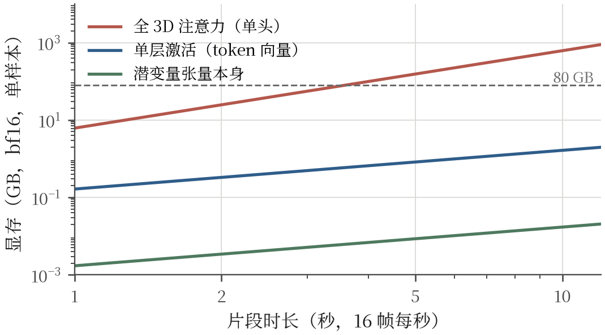
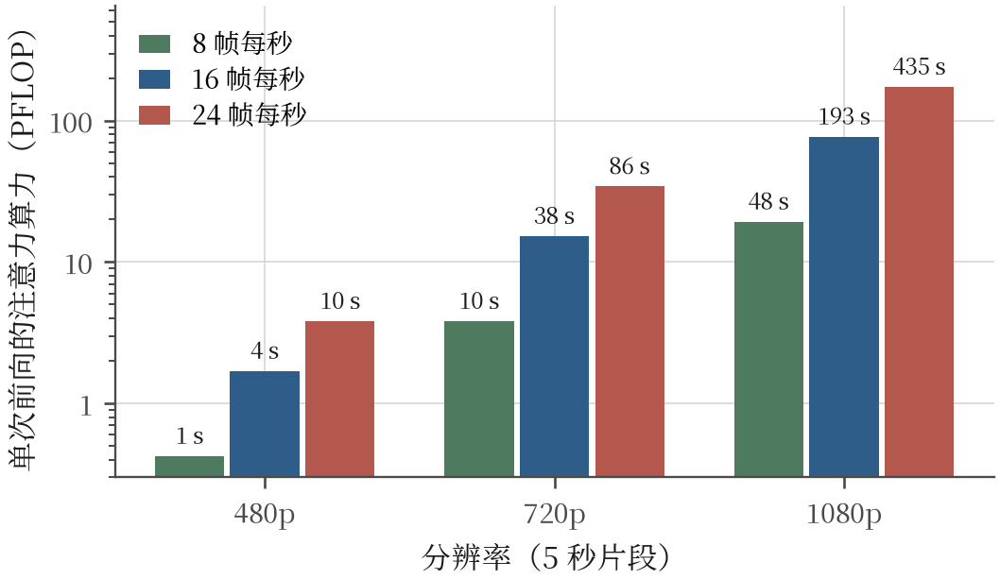
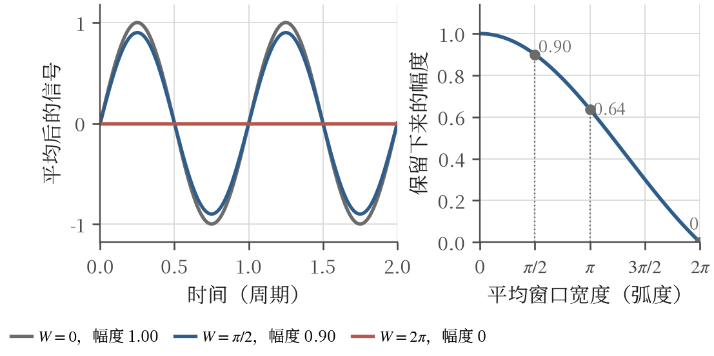
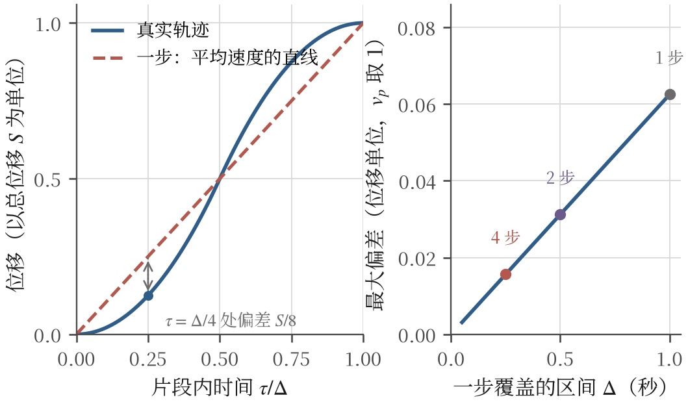

# 视频上的一步生成

前面几章的一步生成，都是在单张图上讨论的。视频把问题变复杂：除了“一次前向能不能出结果”，还要回答“这一前向能不能装下一整段，装不下怎么办，装下了又怎么保证不闪”。

这一章讲视频一步生成的三个额外约束，以及现有的几种应对。

## 约束一：内存

一步生成要把整段视频的张量同时送进网络。以 5 秒、720p、16 帧每秒为例，像素数约为 $80\times3\times720\times1280$，接近两亿个数；即使压到潜空间，仍有千万级的元素。

一张高端显卡放得下短片段，放不下长视频。于是只有两条路：缩短一次生成的时长，或者分块生成再拼接。

分块回到了一致性问题：块与块之间的接缝要处理，否则画面会跳。这也是为什么很多“一步视频”模型只承诺几秒钟。

### 三项开销要对准

说“装得下装不下”之前，先要把“装什么”分清楚。视频模型的显存有三项，量级完全不同。

像素张量 $x\in\mathbb{R}^{F\times 3\times H\times W}$，$F$ 是帧数。它先进视频变分自编码器，压成

$$z\in\mathbb{R}^{C\times \frac{F}{4}\times \frac{H}{8}\times \frac{W}{8}},$$

再展平成 token 序列，长度为

$$s=\frac{F}{4}\cdot\frac{H}{8}\cdot\frac{W}{8}.$$

这里的 $8$ 倍空间、$4$ 倍时间、$C=16$ 是一组常见的取值，不同实现会在这些数上浮动。三项开销分别是潜变量张量本身、每层网络要保存的激活、以及注意力矩阵：

$$M_{\text{lat}}=C\,s\cdot 2\ \text{B},\qquad
M_{\text{act}}=s\,d\cdot 2\ \text{B},\qquad
M_{\text{att}}=s^2\cdot 2\ \text{B}.$$

系数 $2$ 是 bf16 的字节数，$d$ 是网络宽度。三项的指数分别是 $1$、$1$、$2$——差别全在最后一项。

以 $F=80$、720p 为例，$s=20\times90\times160=288{,}000$。潜变量张量只有 $16\times288{,}000\times2\approx9$ MB，可以忽略；取 $d=1536$，单层激活是 $288{,}000\times1536\times2\approx0.88$ GB；注意力矩阵（单头）是 $288{,}000^2\times2\approx166$ GB。

这三个数字说明一件事：**卡在显存上的从来不是潜变量，而是 token 数与注意力**。潜变量小得像一张照片，网络内部却像在处理一本字典。

把不同配置放在一起看更清楚。

| 片段 | 像素数 | 潜变量元素 | token 数 | 单层激活 | 全 3D 注意力（单头） |
|------|--------|------------|----------|----------|----------------------|
| 2 s，480p | 0.30 亿 | 61 万 | 3.8 万 | 0.11 GB | 3 GB |
| 5 s，480p | 0.74 亿 | 154 万 | 9.6 万 | 0.27 GB | 17 GB |
| 5 s，720p | 2.2 亿 | 461 万 | 28.8 万 | 0.82 GB | 154 GB |
| 10 s，720p | 4.4 亿 | 922 万 | 57.6 万 | 1.65 GB | 618 GB |
| 5 s，1080p | 5.0 亿 | 1037 万 | 64.8 万 | 1.85 GB | 782 GB |

表中的数按一项一项乘出来，可用作量级判断。它也解释了为什么分辨率和时长不能同时往上加：两者都进 token 数，而注意力的代价是 token 数的平方。5 秒 720p 到 10 秒 720p，帧数翻倍，注意力涨四倍；5 秒 720p 到 5 秒 1080p，像素数涨 2.25 倍，token 数也涨 2.25 倍，注意力涨五倍多。

### 把假设摊开算一遍

上面的表能逐格对上，是因为背后有一组固定假设。把它们写出来，读者换成自己的配置就能重算：480p 指 $480\times640$，720p 指 $720\times1280$，1080p 指 $1080\times1920$；帧率 16；时间维压 4 倍，两个空间维各压 8 倍；潜通道 $C=16$；网络宽度 $d=1536$；bf16 每元素 2 字节；容量按 $2^{30}$ 字节记 1 GB。

以 5 秒 720p 为例，从像素数走到 token 数只有四次乘除。帧数 $F=5\times16=80$；潜帧数 $80/4=20$；每帧潜网格 $\frac{720}{8}\times\frac{1280}{8}=90\times160=14{,}400$；token 数 $20\times14{,}400=288{,}000$。像素侧是 $80\times3\times720\times1280\approx2.2\times10^8$，压掉的比例约 $2.2\times10^8/288{,}000\approx770$。这个比例随身带着很有用：看到“多少亿像素”的说法，除以 770 就是 token 数；再乘宽度 $d$ 与 2 字节，就是一层激活的量。

帧率是最容易被漏掉的乘数。同一段 5 秒、同一分辨率，帧率从 16 提到 24，潜帧数从 20 到 30，token 数涨 1.5 倍，注意力涨 2.25 倍，从 154 GB 到 347 GB；降到 8 帧每秒则只剩四分之一，39 GB。这也是“先用 8 帧每秒生成、再用插帧补到 24”这类折中的由来：插帧自己会引入抖动，但那是在局部、可以用光流一致性约束掉的抖动，比整段不一致好处理。

### 显存放得下，算力未必放得下

上面的注意力按“把 $s\times s$ 矩阵显式写出来”算。现代实现多用分块注意力，矩阵从不落地，显存降到 $O(s)$ 附近，瓶颈换成算力。每层注意力的浮点运算量约为

$$\text{FLOPs}_{\text{attn}}\approx 4\,s^2d,$$

两个 $2s^2d$ 分别来自 $QK^\top$ 与 $AV$，一次乘加记两次运算。30 层、$s=288{,}000$、$d=1536$ 时合计 $1.5\times10^{16}$，即 15 PFLOP。按峰值 1000 TFLOPS、有效效率四成估算，单条 5 秒 720p 的前向光注意力就要 38 秒（量级估计）；换成 50 步采样，一条片子半小时。省下这半小时正是一步生成在视频上最直接的收益——它省的不是内存，是 49 倍的串行时间。

逐 token 的前馈层反而便宜：每层约 $8d^2$ 次运算，$s=288{,}000$ 时是 $5.4\times10^{12}$，30 层合计 $1.6\times10^{14}$，只有注意力的百分之一。token 一多，开销就整个搬到注意力上，这也解释了视频模型为什么愿意在分解注意力、稀疏注意力上花力气。

### 推理与训练不是一回事

上表算的是“一次前向里同时存在的量”。真正能跑多长，还取决于这些量需要留多久。

推理时不需要梯度，激活可以算完一层丢一层，峰值显存大致是常驻部分（权重、潜变量、输入输出缓冲）加上一层注意力的瞬时占用。一个十亿参数的模型，权重在 bf16 下约 2 GB，加上潜变量与工作区，单卡跑 5 秒 720p 是可能的，前提是注意力不按全 3D 算。

训练时要保存中间激活等着反向传播，$N$ 层就是 $N$ 份单层激活。30 层、每层 0.88 GB，光激活就 26 GB；再加上 Adam 的 fp32 状态与主权重（每个参数约 16 字节，十亿参数约 16 GB），一张 80 GB 的卡很快见底。梯度检查点（checkpointing）用重算换存储，把激活从 $O(N)$ 降到 $O(\sqrt{N})$ 或者一个常数层数，代价是前向多做一遍，训练慢 30% 上下（量级估计）。

蒸馏还有一笔额外开销：如果损失要穿过教师的多步采样，那么学生一次前向的背后是教师 $K$ 次前向，显存与算力都近似乘 $K$。多数实现用“教师只前向不反传”来绕开，代价是训练信号从教师输出端来，梯度到不了教师内部——这对蒸馏没有损失，因为教师本来就不需要更新。

### 省内存的手段都会伤到耦合

单卡放不下时，工程上有三条路。加卡做序列并行，把 token 维切开，注意力用环状通信拼起来，通信量与 $s$ 成正比；用分解注意力，先做帧内空间注意力，再做帧间时间注意力，把 $s^2$ 拆成 $s_{\text{帧}}^2$ 与 $F_{\text{lat}}^2$ 两项；或者干脆把片段切块。

前两条在数学上是近似：分解注意力让每一帧只能通过一个低维的时间瓶颈与别的帧交换信息，全 3D 注意力里那种“任意两帧任意两个位置直接相连”的通路没有了。第三条更直接，块与块之间根本不在同一次前向里。

这就是视频一步生成的第一个结构性矛盾：**省内存的做法，恰好都在削弱帧间耦合**。而下一节要讲的抖动，正是帧间耦合不足的症状。

## 约束二：时间一致性

图像的一步生成，失败的典型表现是模糊。视频的一步生成，失败的典型表现是抖：每一帧单独看还行，连起来帧间有细小的差异。

原因还是条件均值。多步采样在每一步注入随机性，帧与帧的轨迹在中间会互相“看见”；一步把中间步骤折掉之后，这种耦合也一起丢了。

补救的办法有两类。一是在训练时把时间维一起回归，让网络输出的整段视频共享同一套潜变量；二是在推理时加一个轻量的后处理，把相邻帧的特征对齐。

### 抖动可以从输入算起

把“抖”写得具体一点。设整段视频的输出为 $y=(y_1,\dots,y_F)$，输入噪声为 $z$，模型是一个确定映射 $y=g_\theta(z)$。

如果为了省显存，把帧拆成独立样本各跑一次，那么第 $k$ 帧用的是自己的噪声 $z_k$，帧间差是

$$y_{k+1}-y_k=g_\theta(z_{k+1})-g_\theta(z_k).$$

$z_k$ 之间独立，$g_\theta$ 对输入的灵敏度大致是常数 $J$，则帧间差的标准差约为 $\sqrt{2}\,J\sigma$。真实视频里，静止区域的帧间差接近零，只有压缩噪声的那一点；在 8 位像素尺度上通常不到一个灰阶（量级估计）。而帧间跳 2–3 个灰阶，人眼就能看见闪烁。

于是有一条很朴素的要求：$J\sigma$ 要小到肉眼看不出来。噪声的尺度由模型决定，$J$ 由映射的陡峭程度决定。多步采样不需要满足这条，因为中间状态会被邻居反复拉回去；一步没有拉回的机会，误差直接落到输出上。

### 三种抖，来源不同

实际看到的帧间不一致，至少分三类，处理办法不一样。

**逐帧随机。** 上面那种：帧与帧之间共享不了噪声，也共享不了中间状态。表现为整幅画面高频闪烁，纹理像在“沸腾”。

**接缝跳变。** 分块生成时，块内一致、块间断裂。前一块的最后一帧与后一块的第一帧各自独立采样，两张画面都能看，拼在一起就跳。重叠区做羽化融合只能让跳变变缓，无法让两段轨迹对齐——除非块之间传条件。

**长程漂移。** 颜色、亮度、对比度在几秒里缓慢变化。这不是随机噪声，而是每块的全局统计量略有差异，拼接后在直方图上留下的台阶。它比闪烁难查，因为单帧质量指标完全看不出来。

还有一类常被误认为“抖”的现象，来自解码器：视频变分自编码器如果逐帧编码、逐帧解码，潜变量在时间上的相关性很弱，即使潜空间完全静止，解码出来也会有轻微的织物感。这类问题要在 VAE 这一层修，用共享的时间模块和解码缓存，靠后处理解决不了。

### 接缝为什么合不上

重叠区的两段结果，各自都是“在自己那套条件下”的条件均值。把同一块重叠区写成

$$y^{(A)}=y^\star+e_A,\qquad y^{(B)}=y^\star+e_B,$$

$y^\star$ 是两份条件共同指向的内容，$e_A,e_B$ 是各自因为噪声不同、看到的历史不同而剩下的偏差。独立采样意味着两个偏差基本不相关，$\mathbb{E}[e_Ae_B]\approx0$，于是

$$\mathbb{E}\big[(y^{(A)}-y^{(B)})^2\big]=\mathbb{E}[e_A^2]+\mathbb{E}[e_B^2]\approx2\sigma^2,$$

$\sigma^2$ 是单次输出相对 $y^\star$ 的方差，量级上就是条件分布的宽度——也就是图像一步生成里“输出偏软”的那个宽度。它不来自融合做得不好，而来自条件本身没把结果定死。

融合权重 $\alpha$ 从 1 渐变到 0，接缝处 $\alpha=\frac{1}{2}$，所以接缝相对两侧的台阶是

$$\Delta y=\frac{1}{2}\big(y^{(A)}-y^{(B)}\big),\qquad |\Delta y|\sim\frac{\sigma}{\sqrt{2}}.$$

关键在下一步：把台阶摊到 $W_o$ 帧的重叠区上，相邻帧之间的变化是 $\Delta y/W_o$，而不是 $\Delta y$。加长重叠区确实“看起来好了”，因为它把一次跳变摊成了 $W_o$ 帧的缓慢漂移。人眼对“一帧跳三个灰阶”敏感，对“十帧里慢慢移三个灰阶”不敏感。

代价同时出现。这 $W_o$ 帧里的运动被摊平，物体经过接缝时像踩了一脚刹车；$W_o$ 越大，刹车越长。要让台阶真的消失，只能让 $\sigma$ 降下来，也就是让两份结果共享信息：共享噪声、传递条件帧、放进同一次前向。前两条是近似，第三条是根治，代价落在时长上。

### 推理时的后处理能救多少

后处理的办法是相邻帧对齐：估计光流，把前一帧 warp 到当前帧，再与当前帧加权平均；或者在潜空间做时序平滑。它便宜，也不需要重训。

限度在两处。一是平滑本身就是低通滤波，闪烁的频率在上限，动作的高频也在上限，压掉闪烁的同时会压掉动作细节。二是光流在遮挡、快速运镜、透明物体上不可靠，warp 错了反而把小抖动变成大拖影。

所以后处理适合当“兜底”，不适合当主方案。真正稳的做法还是让一次前向覆盖整段，让帧间在注意力里互相看见，再把这份能力蒸馏到少步。

训练侧还有一条容易被忽略的细节：蒸馏时学生与教师要用同一条噪声。若学生每次重采噪声，它学到的是“整段的边缘分布”，帧间关系被平均掉；共享噪声后，学生被迫复现教师对同一条噪声的具体响应，帧间的相关性才传得下来。这一步不改变任何公式，只改变样本的组织方式，代价为零。

## 约束三：运动质量

图像的质量主要看纹理和结构，视频还要看运动。一步模型的运动往往偏“平”：动作幅度小、节奏均匀，缺少加速与停顿。

这与训练目标有关。平均速度是对整段位移的一阶近似，它把区间内的速度变化压成一个等效值，于是匀速与匀加速都能表示，真正丢掉的是节奏——起步、停顿、回摆这些变化本身在变的部分。视频里恰恰充满了节奏。

一种缓解是把时间区间切细，用几步而不是一步；另一种是在训练目标里加入对速度变化的惩罚，让网络不要只学平均。

### 平均有两重

“偏平”背后其实是两重平均叠在一起，分开看才清楚。

**第一重是跨样本平均。** 平方损失下的最优解是条件均值，这一点在图像上是模糊，在视频上是相位被抹掉。同一个提示词对应的样本里，“挥手挥到哪一刻”各不相同：有的刚抬臂，有的正在最高点，有的在下落。把这些样本平均，手臂会停在中间某个位置，来回的幅度被抵消。

这件事可以算。设某个像素的亮度随片段内时间按 $s(\tau)=A\sin(2\pi\tau/P+\phi)$ 变化，相位 $\phi$ 在长度为 $W$ 的区间上近似均匀。条件均值要对 $\phi$ 求期望。把 $\sin(\theta+\phi)$ 展开成 $\sin\theta\cos\phi+\cos\theta\sin\phi$，两项在长度为 $W$ 的区间上平均，都只剩中点 $\bar\phi$ 处的值乘上同一个因子：

$$\mathbb{E}_\phi\big[A\sin(2\pi\tau/P+\phi)\big]=A\,\mathrm{sinc}\!\left(\frac{W}{2}\right)\sin\!\left(2\pi\tau/P+\bar\phi\right),\qquad \mathrm{sinc}(x)=\frac{\sin x}{x}.$$

幅度被乘上了一个只与 $W$ 有关的因子（$\bar\phi$ 是区间的中点，与幅度无关）：$W=0$ 时为 $1$，$W=\pi/2$ 时 $0.90$，$W=\pi$ 时 $0.64$，$W=2\pi$（相位铺满整周期）时为 $0$。第 $m$ 次谐波乘的是 $\mathrm{sinc}(mW/2)$，衰减更快，所以先死的是动作的细节，留下的是缓慢的姿态漂移。

代入一个具体片段：5 秒里挥手 10 个来回，周期 $0.5$ 秒。数据集中“从哪一帧开始挥”近似随机，相位铺满整周期，$W\approx2\pi$，这个频率的分量被乘 $0$。生成的视频里手臂大致停在中间位置，只有肩部和头部的缓慢摆动还在——看上去“动作很平”。

同一段视频，如果提示词写成“手抬到一半，正在往上”，样本的相位被钉在一个窄区间里，$W\approx\pi/2$，幅度还能留九成。这解释了为什么短视频、状态明确的提示词更容易出动作：它们把相位条件收窄了。

**第二重是沿轨迹平均。** 一步采样用的平均速度 $u(z,0,1)$ 只保证端点：从 $z$ 出发，积分 $\int_0^1 v\,dt$ 等于输出减输入。区间内部怎么走，目标里没有任何一项约束。网络完全可以在中间走一条“笔直、匀速”的路，反正端点对得上。

第二重平均有个容易被忽略的细节：匀速和匀加速其实都能被精确表示。取 $z(\tau)=z_r+v_0(\tau-r)+\frac{1}{2}a(\tau-r)^2$，则

$$(t-r)u=\int_r^t v\,d\tau=v_0\Delta+\frac{1}{2}a\Delta^2
\quad\Longrightarrow\quad
u=v_0+\frac{a\Delta}{2}=v\!\left(\frac{r+t}{2}\right),$$

平均速度恰好等于中点的瞬时速度。位移是时间的二次多项式时，平均不损失信息。真正丢掉的是“加速度自己在变”的部分，也就是运动的节奏：起步、停顿、回摆。这些是三次以上的成分，平均之后只剩一个等效的匀速。

把同一套 sinc 结论换个用法：对频率 $\omega$ 的分量，跨度 $\Delta$ 上的平均把幅度乘上 $\mathrm{sinc}(\omega\Delta/2)$。若一个动作的周期 $P$ 与 $\Delta$ 相当，端点位移接近零，一步模型的输出就是“没动”。$\omega\Delta=\pi$ 时还剩 $0.64$，$\omega\Delta=2\pi$ 时归零。

### 一次起步停车的偏差有多大

取一段一秒的动作：速度先线性升到峰值 $v_p$，再线性降回零。抬手、点头、推门，形状大多是这一种。设区间长度 $\Delta$，前半段 $v(\tau)=2v_p\tau/\Delta$，位置

$$x(\tau)=\frac{v_p\tau^2}{\Delta},\qquad x\!\left(\frac{\Delta}{2}\right)=\frac{v_p\Delta}{4},$$

后半段对称，所以总位移 $S=v_p\Delta/2$。一步给出的平均速度 $u=S/\Delta=v_p/2$，恰好等于中点 $\tau=\Delta/2$ 的瞬时速度，与前面“匀加速时平均等于中点”的结论对上。整条轨迹则被换成直线 $\bar x(\tau)=v_p\tau/2$。在 $\tau=\Delta/4$ 处：

$$x\!\left(\frac{\Delta}{4}\right)=\frac{v_p\Delta}{16},\qquad \bar x\!\left(\frac{\Delta}{4}\right)=\frac{v_p\Delta}{8},\qquad x-\bar x=-\frac{v_p\Delta}{16}=-\frac{S}{8}.$$

$\tau=3\Delta/4$ 处同样的量、反号。一次起步停车被拉直之后，中途偏了总位移的 12.5%，最大偏差出现在 $\tau=\Delta/4$ 与 $3\Delta/4$——恰好是“刚起步”和“快停下”这两个最容易被看出来的时刻。视频里动作的起停点比匀速段多得多，所以一步模型的片子里最容易被抓住的是“起步软、刹车长”。

偏差随区间长度的关系可以一眼读出：固定峰值速度，$\max|x-\bar x|=v_p\Delta/16$，与 $\Delta$ 成正比。一步拆成两步，$\Delta$ 减半，偏差减半；拆成四步剩四分之一。这给“多步能救回运动”一个具体倍数，而不是一句笼统的经验。

反过来看快速运动。$v_p$ 大、$\Delta$ 又长，偏差可以接近物体自身的尺寸：物体在一个区间里走过半个身位，直线插值会让它在中途穿过别的东西，观感上是瞬移或拖影。大幅运镜与快速挥手恰好是 $v_p\Delta$ 最大的地方，也就是一步视频模型最先露怯的地方。

### 为什么会卡在“看起来像慢动作”

两重平均叠加之后，生成的视频有两个特征：幅度小、节奏匀。

幅度小来自相位平均，节奏匀来自沿轨迹平均。两者都会让运动偏向低频，于是原本“抬手—停—放下”的动作，变成一次平滑的抬放。观感上像慢动作，也像被抽掉了关键帧的动画。

这也提示了缓解办法的层次。让相位条件更窄（分块变短、提示词更具体、加入片段内时间嵌入）作用于第一重；增加步数、加运动或光流辅助损失作用于第二重。前者便宜但要改数据与条件，后者要付推理与训练成本。

## 现有的几种做法

**分块 + 重叠。** 把长视频切成有重叠的块，每块一步生成，重叠区域做融合。简单，但融合处容易糊。

**整段联合。** 一次生成固定长度的整段（比如 16 帧或 32 帧），所有帧共享同一份噪声与同一个时间条件。效果好，时长受限。

**蒸馏自视频教师。** 先训一个多步的视频模型，再蒸馏到少步。蒸馏时把整段作为样本，而不是逐帧，这样学生能学到帧间关系。

**流式 + 缓存。** 一边生成一边输出，用缓存保存前一段的状态，下一段以它为条件。适合实时应用，实现复杂。

### 四种做法的代价

四种做法听起来是四个工程选项，实际上是四笔不同的账。摆在一起看，各自的代价才看得见。

**分块 + 重叠。** 设片段长 $F$ 帧，块长 $L$，重叠 $o$ 帧，块数为

$$K=\left\lceil\frac{F-L}{L-o}\right\rceil+1 .$$

$F=160$、$L=32$、$o=8$ 时 $K=7$，共算了 $7\times32=224$ 帧份，比 160 帧多出四成算力。重叠越长，接缝越容易融合，账也越贵。

重叠区怎么融合，决定失败长什么样。潜空间线性平均会把两次采样都抹平一点，运动经过接缝时出现一段“减速”；直接取前一块的结果会在后半段丢掉后一块已经对齐好的细节；用光流融合效果最好，但光流本身要算。

**整段联合。** 时长上限由 token 数决定。取 24 帧每秒，32 帧是 1.3 秒，64 帧是 2.7 秒，这与实际模型常见的时间跨度吻合。好处是帧间耦合完整，训练和推理口径一致，抖动最少。坏处是上限写死在架构里，想生成更长的只能靠外层的续接。

**蒸馏自视频教师。** 这笔账最容易被低估。教师每条样本要跑 $K$ 步，$K=50$ 时生成一百万条训练片段就是五千万次前向，而学生每次请求只用一次。只有当推理总量远大于训练量时，这笔预付才收得回来。另一处代价是偏差继承：教师自己运动就偏平，学生会把这份偏平学过去，蒸馏放大不了教师没有的能力。

**流式 + 缓存。** 缓存的是历史帧的注意力键值对。若缓存 5 秒 720p 的全部 token，按每层 $2sd$ 个元素、30 层算，$288{,}000\times1536\times2\times2\times30$ 接近 53 GB——比整段联合还贵。所以实际实现一定要滑动窗口或者摘要向量，只留最近若干帧加一条压缩的历史向量。代价是漂移：越远的历史越模糊，颜色和布局会缓慢跑偏。

| 做法 | 一次覆盖 | 显存 | 帧间一致性 | 主要代价 |
|------|----------|------|------------|----------|
| 分块 + 重叠 | 一块，总长不限 | 一块的峰值 | 中，接缝有痕迹 | 重叠区算力，融合处运动被抹 |
| 整段联合 | 16–64 帧 | 随 $F$ 线性，注意力平方 | 高 | 时长上限写死 |
| 蒸馏自视频教师 | 同教师 | 训练时更高 | 高 | 教师采样与存储，偏差继承 |
| 流式 + 缓存 | 任意长 | 缓存随历史增长 | 中，长程漂移 | 实现复杂，误差累积 |

### 组合起来才实用

实际系统很少只用一种。常见的组合是“整段联合 + 分块续接”：每次生成 32 帧，用前一段的最后几帧作为条件生成下一段，重叠区做潜空间插值。这样单次前向的内存可控，帧间在块内是完整的，只在块边界上依赖条件传递。

另一种组合是“流式缓存 + 少步蒸馏”：学生在 4 步内完成一段，缓存让它在下一段不必从头扩散。这类系统能跑到实时，但要在训练时就把缓存结构放进模型，让推理与训练的路径一致——否则缓存里的分布偏移，会在长序列上积累成可见的退化。

## 与图像一步生成的关系

方法本身是同一套：蒸馏、平均速度、一致性约束。区别在于样本的单位从“一张图”变成了“一段视频”，于是损失函数里多了一个时间维，内存与一致性成了新的瓶颈。

换句话说，视频一步生成没有引入新的数学，它引入的是新的工程约束与新的失败模式。

换一个角度看，这三点差别都在“平均”这个词上放大。图像上，平均导致模糊，人眼对模糊有一定容忍；视频上，平均导致相位被抹，人眼对运动的异常极其敏感——一个幅度只剩六成的挥手，比一张略微发软的图更容易被指出来。

还有一处口径差别：图像一步生成的损失是逐像素的，视频的损失要在时间上求和或平均。若按帧平均，长片段与短片段的损失量级一致，训练更稳；若按整段求和，长片段的梯度会大 $F$ 倍，学习率要跟着调。这一项在实现里常被忽略，症状是长片段训练早期发散。

## 一个判断

看一个“一步视频”模型，先问三件事：一次能生成多长、帧率多少、帧间抖动如何。

这三件事比分辨率更能说明问题。分辨率可以靠超分补，抖动与时长补不了。

再补两问，能筛掉大部分宣传口径。第一问是推理时帧间是否共享噪声、是否整段一次前向；如果是逐帧跑再拼，那么它本质上是图像模型加拼接，不属于这一章讨论的对象。第二问是运动幅度：给同一个提示词生成若干条，量一下光流幅值的分布，与真实视频比。幅度只有一半，说明相位平均没解决；幅度够但节奏平，说明沿轨迹平均还在。

## 这一章的位置

第 12 章会把这一册收一下，谈改进、评测与工程。视频相关的问题会在那里再出现一次：评测指标对运动不敏感，是当前一个明显的短板。

这一章留下的两个口子也指向同一处。一个是“运动质量没有好指标”，另一个是“一致性只能靠肉眼看”。两者都说明视频一步生成的进展，很大程度上取决于能不能把“抖”和“平”变成可以计算的量。
