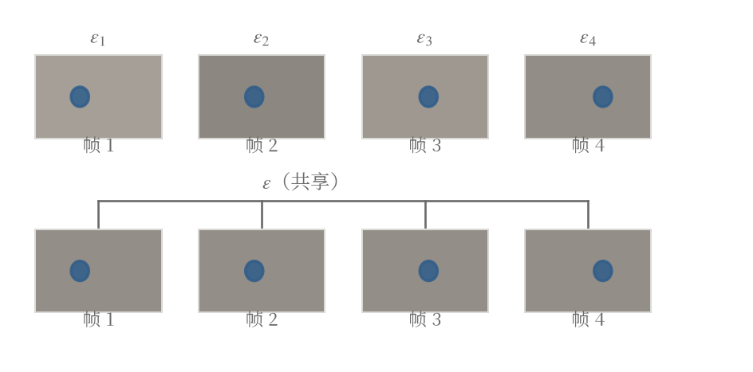

# 视频上的一步生成

前面几章的一步生成，都是在单张图上讨论的。视频把问题变复杂：除了"一次前向能不能出结果"，还要回答"这一前向能不能装下一整段，装不下怎么办，装下了又怎么保证不闪"。

这一章讲视频一步生成的三个额外约束，以及现有的几种应对。

## 约束一：内存

一步生成要把整段视频的张量同时送进网络。以 5 秒、720p、16 帧每秒为例，像素数约为 $80\times3\times720\times1280$，接近两亿个数；即使压到潜空间，仍有千万级的元素。

一张高端显卡放得下短片段，放不下长视频。于是只有两条路：缩短一次生成的时长，或者分块生成再拼接。

分块回到了一致性问题：块与块之间的接缝要处理，否则画面会跳。这也是为什么很多"一步视频"模型只承诺几秒钟。

## 约束二：时间一致性

图像的一步生成，失败的典型表现是模糊。视频的一步生成，失败的典型表现是抖：每一帧单独看还行，连起来帧间有细小的差异。

原因还是条件均值。多步采样在每一步注入随机性，帧与帧的轨迹在中间会互相"看见"；一步把中间步骤折掉之后，这种耦合也一起丢了。

补救的办法有两类。一是在训练时把时间维一起回归，让网络输出的整段视频共享同一套潜变量；二是在推理时加一个轻量的后处理，把相邻帧的特征对齐。

## 约束三：运动质量

图像的质量主要看纹理和结构，视频还要看运动。一步模型的运动往往偏"平"：动作幅度小、节奏均匀，缺少加速与停顿。

这与训练目标有关。平均速度是对整段位移的一阶近似，它对匀速运动拟合得好，对加减速拟合得差。视频里恰恰充满了加减速。

一种缓解是把时间区间切细，用几步而不是一步；另一种是在训练目标里加入对速度变化的惩罚，让网络不要只学平均。

## 现有的几种做法

**分块 + 重叠。** 把长视频切成有重叠的块，每块一步生成，重叠区域做融合。简单，但融合处容易糊。

**整段联合。** 一次生成固定长度的整段（比如 16 帧或 32 帧），所有帧共享同一份噪声与同一个时间条件。效果好，时长受限。

**蒸馏自视频教师。** 先训一个多步的视频模型，再蒸馏到少步。蒸馏时把整段作为样本，而不是逐帧，这样学生能学到帧间关系。

**流式 + 缓存。** 一边生成一边输出，用缓存保存前一段的状态，下一段以它为条件。适合实时应用，实现复杂。

## 与图像一步生成的关系

方法本身是同一套：蒸馏、平均速度、一致性约束。区别在于样本的单位从"一张图"变成了"一段视频"，于是损失函数里多了一个时间维，内存与一致性成了新的瓶颈。

换句话说，视频一步生成没有引入新的数学，它引入的是新的工程约束与新的失败模式。

## 一个判断

看一个"一步视频"模型，先问三件事：一次能生成多长、帧率多少、帧间抖动如何。

这三件事比分辨率更能说明问题。分辨率可以靠超分补，抖动与时长补不了。

## 这一章的位置

第 12 章会把这一册收一下，谈改进、评测与工程。视频相关的问题会在那里再出现一次：评测指标对运动不敏感，是当前一个明显的短板。
