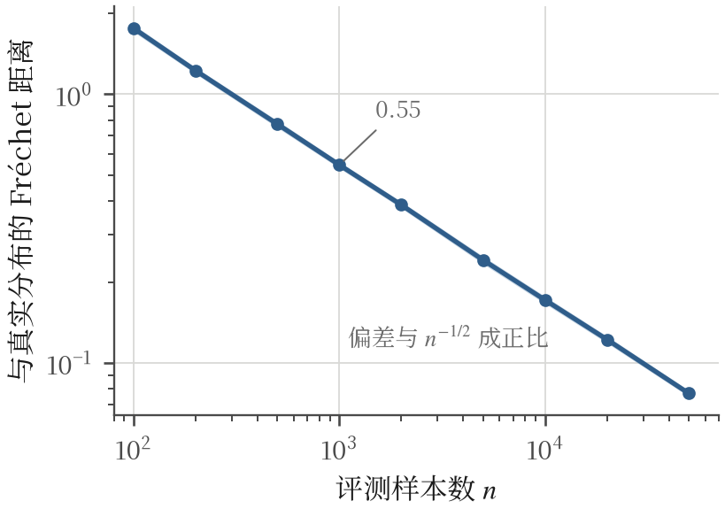

# 之后的路：改进、评测与工程

MeanFlow 之后出现了不少工作，方向集中在三件事：训练更稳、步数更少、以及把方法用到图像以外的模态。这一章挑几条讲，最后谈评测里的几个坑。

## 训练为什么难

MeanFlow 的目标里含有网络自己的导数，这带来两个后果。

一是方差。导数项用雅可比向量积算，单次估计的方差比普通回归大，训练曲线更抖。

二是目标与输出耦合。目标由当前网络算出，网络一变，目标就变。这不像普通的监督学习，更像自举，容易陷入“目标跟着输出跑”的不动点。

改进的思路基本围绕这两点。有的工作改 $r,t$ 的采样分布，让大间隔样本更多，目标更稳定；有的给导数项加权重或做归一化；有的把恒等式拆成两项分别回归。

### 第一个来源：导数项怎么估

恒等式的目标可以写成

$$u_{\text{tgt}}=v_\theta(z_t,t)-(t-r)\big(\partial_t u_\theta+v_\theta\cdot\nabla_z u_\theta\big),$$

后面那个括号是 $u_\theta$ 沿切向量 $w=(v_\theta,0,1)$ 的方向导数，即一个雅可比向量积。它有三种算法，方差与偏差各不相同。

**前向模式自动微分。** 给定切向量，一次前向传播同时算出值和方向导数，结果精确到浮点误差，成本大约是普通前向的两倍（量级估计）。这一条没有随机性，方差只来自批内样本的差异。

**有限差分。** 用

$$\frac{u_\theta(z_t+\epsilon v,t)-u_\theta(z_t,t)}{\epsilon}$$

近似方向导数。它不用改网络结构，但误差由两部分组成：计算精度的噪声 $\delta|u|/\epsilon$，与截断误差 $\frac{\epsilon}{2}|u''||v|$，其中 $\delta$ 是浮点的相对精度。两者在

$$\epsilon^*=\sqrt{\frac{2\delta|u|}{|u''||v|}}$$

处平衡，此时总误差约为 $\sqrt{2\delta|u||u''||v|}$。

代入数字。bf16 的 $\delta$ 约为 $4\times10^{-3}$，取 $|u|=|u''|=|v|=1$，最优步长 $\epsilon^*\approx0.09$，误差仍在 $0.09$ 上下——与目标本身的量级相当，差分法在这种精度下不可用。换成 fp32，$\delta\approx6\times10^{-8}$，$\epsilon^*\approx3.5\times10^{-4}$，误差降到 $3.5\times10^{-4}$，可用。

这组数说明了一件实现上的事：**做 JVP 的那条分支不能待在 bf16 里**。整网 bf16 训练、JVP 分支升到 fp32，是这类方法常见的混精配置。不做这一步，训练会呈现“损失不降但梯度有限”的状态，很像学习率太小。

**随机探针。** 用若干个随机方向估计雅可比的一部分，理论上可以用 $m$ 次前向把方差降 $m$ 倍，代价是偏差（低估范数）随 $m$ 减小。它在参数量极大、只想要一个“大致方向”的场景里有位置，但恒等式要求的是精确方向，探针数不够时训练会更慢。

所以“方差大”这句话要看实现：精确的前向模式微分没有估计方差，训练曲线的抖动全来自批内样本与目标自举；用差分或探针时，估计方差才真正参与进来。两种情况下训练都会抖，但原因与对策不同。

### 第二个来源：目标跟着网络跑

梯度下降的损失是 $\|u_\theta-\mathrm{sg}(u_{\text{tgt}})\|^2$，$\mathrm{sg}$ 表示停止梯度。把某个分量记成标量，残差 $e=u_\theta-u_{\text{tgt}}$，一步梯度下降把输出往目标挪 $\eta e$。

麻烦在于目标也跟着动。设目标对输出的敏感度是 $\kappa=\partial u_{\text{tgt}}/\partial u_\theta$，输出挪动 $\eta e$ 时目标跟着挪 $\kappa\eta e$，于是新的残差

$$e'=e-\eta e+\kappa\eta e=\big(1-\eta(1-\kappa)\big)e .$$

这个式子把自举的稳定性讲清楚了：$\kappa=0$ 时就是普通回归，只要 $\eta<2$ 就收敛；$\kappa$ 越接近 $1$，收敛越慢；$\kappa>1$ 时括号里的绝对值大于 $1$，残差不缩反涨，训练震荡或者发散。

恒等式里的 $u_{\text{tgt}}$ 含 $u_\theta$ 的一阶导数，$\kappa$ 的量级不小——这正是它比普通回归难训的结构性原因，不是调参能绕开的。

工程上的对策有三类，都落在 $\kappa$ 上。

**目标用慢副本。** 维护一份参数 $\bar\theta$，只做指数滑动平均，目标由 $\bar\theta$ 算。目标与当前参数的关系只剩下副本的滞后，$\kappa$ 被压到千分之一量级（$\beta=0.999$ 时）。代价是目标落后于学生，训练末段会有一个稳定的偏差，质量上限略低。

**限制目标里的依赖。** 只让目标用低阶项，或者对 JVP 项单独乘一个小系数，先让 $u_\theta$ 接近 $v_\theta$，再逐步把系数抬到 $1$。这是一条课程，代价是训练步数变多。

**拆成两项。** 把 $v$ 与 JVP 分别回归，各自有独立的头与学习率，耦合只剩在共享的骨干上。代价是两项目标不再严格等价于原来的恒等式，最终精度要重新调。

| 来源 | 症状 | 诊断办法 | 对策 |
|------|------|----------|------|
| JVP 估计（差分/探针） | 损失平台期，梯度小 | 关掉 JVP 项看损失是否下降 | JVP 分支用 fp32，或改前向模式 |
| 目标自举（$\kappa$ 偏大） | 损失震荡，长间隔样本先炸 | 冻结目标看是否恢复 | 慢副本、限制依赖、拆项 |
| 尺度失衡（见下节） | 大 $\Delta$ 样本独占梯度 | 按 $\Delta$ 分桶看损失 | 损失加权、重采样 |

### 第三个来源：两项的量级差

前面两个来源都在“怎么算目标”上做文章，还有一处不在目标内部，而在不同样本之间的权重。

两项的量级可以直接写出来：主项 $u$ 约等于位移除以区间，量级 $D/\Delta$；修正项是 $\Delta\,du/dt$，量级 $\Delta|a|/2$，$a$ 是速度沿轨迹的变化率。$\Delta$ 越大，修正项在目标里的份量越重。均匀地在 $[0,1]$ 上采样 $\Delta$，大间隔样本的残差自然更大，梯度的方向被它们牵着走，小间隔样本几乎不起作用。

走到两个端点都不好。$\Delta\to0$ 时恒等式退化：两边都等于瞬时速度，残差为零，样本白跑；$\Delta$ 接近 $1$ 时残差大但噪声也大，梯度像在拟合曲率。可用的信息集中在中间一段。

对策可以归成四类，各自针对的来源不同。

| 方向 | 具体做法 | 针对 | 代价 |
|------|----------|------|------|
| 采样 $(r,t)$ | 对数均匀的 $\Delta$、两段混合、控制小/大间隔比例 | 梯度被大间隔主导 | 覆盖面变化，比例要重调 |
| 损失加权 | $w(\Delta)\propto1/\Delta^2$ 之类，或按信噪比加权 | 尺度失衡 | 等效学习率随 $\Delta$ 变 |
| 归一化 | 目标范数归一、JVP 走 fp32、梯度裁剪 | 数值与稳定性 | 实现复杂，可能拖慢收敛 |
| 课程 | $\Delta$ 由小到大逐步放开 | 早期不稳 | 训练步数变多 |

四类之间可以叠加，但叠加之后不好归因。读一篇声称“改进了训练稳定性”的工作时，先看它改的是采样、加权、归一化还是课程，再看它在没有别的改动时效果还剩多少。

## 一个有用的视角：平均场与瞬时场

把恒等式看成两个场的关系，会发现它约束的是“平均场沿轨迹怎么变”。轨迹弯得厉害，平均场变化快，恒等式右边的修正项就大，训练更难。

所以凡是能让轨迹变直的技巧，都会间接帮到 MeanFlow。重配对是一个例子：配对确定之后轨迹变直，平均速度接近瞬时速度，修正项变小。

这也解释了为什么在简单分布上 MeanFlow 收敛得快，在复杂数据上要更多技巧。

### 修正项到底多大

把“弯得厉害”量化一下。沿轨迹的速度若在区间内平滑变化，平均速度与端点瞬时速度之差可以展开成

$$v(z_t,t)-u(z_t,r,t)\;\approx\;\frac{\Delta}{2}\,a,\qquad \Delta=t-r,\quad a=\frac{dv}{dt}.$$

$\Delta/2$ 的来源是“平均滞后于当前值半个区间”。轨迹是直线时 $a=0$，修正项为零，恒等式退化成 $u=v$，目标里没有任何导数项，训练与普通流匹配一样轻。轨迹弯的时候 $a\neq0$，修正项与 $\Delta$ 成正比。

再除以主项，得到一个无量纲的比值。若区间内走了位移 $D$，则 $|u|\approx D/\Delta$，

$$\frac{|v-u|}{|u|}\;\approx\;\frac{\Delta^2|a|}{2D}.$$

取 $|a|\sim|u|/\tau$，$\tau$ 是速度变化的时标，比值约为 $\Delta/(2\tau)$。意思是：**区间跨度超过速度变化的时标时，修正项不再是小的修正，而是与主项同量级**。

这条估计带来两个推论。一是 $\Delta$ 不能一味取大，大间隔样本贡献的梯度里有相当一部分在拟合曲率，噪声也大。二是数据本身的运动越复杂（$\tau$ 越小），同一个 $\Delta$ 下修正项越大，这与“复杂数据更难训”的经验对得上。

## 步数与质量的权衡

一步生成的质量通常低于多步，差距主要在细节与多样性。

评估这个差距时，有两个量要分开看。一个是 NFE，也就是网络前向次数；一个是训练成本。有些方法一步推理，但训练要三轮蒸馏；有些方法四步推理，但训练一次到位。这两者在实际部署里的取舍完全不同。

论文里常见的比较方式是固定 NFE，比较 FID；或者固定训练成本，比较达到某个 FID 需要的 NFE。两种比较得出的结论可能相反，读的时候要看清楚。

### 收益曲线为什么是凹的

同一个模型，采样步数从 $1$ 加到 $4$，质量提升往往很明显；从 $32$ 加到 $64$，几乎看不出差别。这条曲线为什么是凹的，可以从求解误差估一下。

把时间归一到 $[0,1]$，轨迹的二阶导数量级记作 $c$。显式 Euler 一步的局部误差约为 $\frac{1}{2}c$；$S$ 步时每步步长 $1/S$，局部误差 $\frac{c}{2S^2}$，累计 $S$ 步约 $c/(2S)$。也就是说，截断误差随步数按 $1/S$ 下降。

$S=1$ 时误差约 $c/2$，$S=4$ 时约 $c/8$，$S=16$ 时约 $c/32$。这就是凹的来源：每多一倍步数，误差只减一半，而算力翻倍。步数收益的对数斜率是常数，绝对收益在早期最大。

蒸馏改变了这条曲线的位置，但没有改变它的形状。学生在 $S=1$ 处的误差不是 $c/2$，而是训练目标允许的最小值——用分布匹配时它可以远小于 $c/2$，因为学生把轨迹的弯曲“记”进了参数，不再需要在采样时积分出来。代价是这份记忆占用容量，在大间隔、多峰的条件上会不够用。

所以在高 NFE 端，多步模型仍然更好；两条曲线在某处交叉。比较时若不说明交叉点在哪，结论就没有意义。

### 三种比较口径

| 口径 | 固定什么 | 通常谁占优 | 适用场景 |
|------|----------|------------|----------|
| 固定 NFE | 推理前向次数 | 一步/少步方法 | 部署成本敏感 |
| 固定训练成本 | 训练总前向 | 多步教师 | 一次性训练、研究比较 |
| 固定质量 | 目标 FID 或人工评分 | 看谁 NFE 最少 | 产品选型 |

三种口径的差别不在数字，而在“谁为谁付账”。固定 NFE 时，一步方法把成本挪到了训练；固定训练成本时，多步方法把成本挪到了推理。两类方法都能在某一种口径下赢，读者要判断的是自己的场景属于哪一类。

一个折中的做法是把两条账都报出来：推理 NFE、训练总前向、以及达到目标质量所需的样本数。三列并排，读者可以自己折算成钱。

### 质量不是一个标量

“一步比多步差”这句话里，“差”至少有三种含义，混在一起讲会失真。

**分布层面。** FID 这类指标衡量生成分布与真实分布的差距。一步模型在这里的损失通常不大，因为蒸馏本来就是按分布对齐训练的。

**样本层面。** 单张图的纹理锐度、结构合理性。这一项一步模型明显吃亏，尤其在文字、手指、细密纹理上。原因是这些细节对应条件分布的高频部分，而回归目标会把它们平均掉。

**多样性层面。** 同一提示词下不同样本的差异。回归蒸馏在这一点上最弱，分布匹配与对抗能补一部分，但补得越多，训练越不稳。

三个层面可以同时变好，也可以互相交换。比如把温度或噪声尺度调大，多样性上来，单样本保真度下降。报告结果时把三项分开，比一个总分更有信息。

## 几个容易踩的坑

**教师不同。** 蒸馏类方法的效果强烈依赖教师。两个方法用不同的底座，比较结果没有意义。

**评测集泄漏。** 有些工作在评测集的提示词上调过超参，报告的数字偏乐观。

**步数定义的差异。** 用了 CFG 的方法，一次采样是两次前向。报告“一步”时如果不说明这一点，会让人误以为与真正的 1-NFE 方法可比。

**随机性。** 一步模型如果保留了噪声输入，同一个提示词多次采样会得到不同结果，FID 会受采样数量的影响。

**视频的指标盲区。** 视频常用 FVD，但它对运动质量并不敏感：一段纹理正确、运动呆板的视频，FVD 可能很好看。评价一步视频模型时，除了指标，还要看帧间抖动与动作幅度。

### 教师这一层的核对

“教师不同”比它听起来更麻烦，因为教师本身有五个可调的地方：底座架构与参数量、变分自编码器、文本编码器、采样步数、CFG 尺度。任何一项不同，学生的上限就不同。

稳妥的报告方式是把教师也当成一个被评测对象：给出教师自己的分数、教师用的步数与 CFG、学生与教师之间的差距。学生的分数若超过教师，通常说明评测有问题，而不是学生真的更强。

还有一种更隐蔽的情况：教师是用同一批评测图选出来的检查点。这样教师的分数偏乐观，学生的相对差距被压缩，看起来“一步追平多步”。

### NFE 该怎么数

把口径写死，能省掉很多误会。

采样步数 $S$ 与网络前向次数不是一回事。带 CFG 的采样每步要算两次（条件与无条件），若实现上把两条分支并成一个 batch，那是一“次”前向但两倍算力。蒸馏把 CFG 折进学生之后，学生一步就是一次前向，等效于教师的两步。

于是“一步模型 1 NFE”与“多步模型 1 步 + CFG 即 2 NFE”根本不在同一个预算上。表格里至少要有两列：$S$ 与 NFE（含 CFG 的倍数）。

训练侧的前向也该单列。一个三步蒸馏，学生一次采样 1 NFE，但训练时每条样本背后有教师 $K$ 步与学生 $3$ 步，累计可能是 $50$ 次以上。这个数不写出来，“一步”这个说法只描述了推理。

### 评测噪声有多大

FID 的估计本身有偏差与波动，样本数越小，偏得越多。这件事可以用一个玩具算清楚：取 $d=32$ 维标准正态作为“真实分布”，从它抽 $n$ 个样本，算经验分布到真实分布的 Fréchet 距离。理论上真值是 $0$，实际算出来永远大于零，因为有限样本的经验协方差总有涨落。

图上每个点取 $60$ 次重复的均值，浅色带是标准差。$n=1000$ 时估计值约 $0.55$，$n=50{,}000$ 时约 $0.077$，在双对数坐标上斜率接近 $-1/2$。样本数降四倍，偏差翻倍。

真实的 FID 用 2048 维的 Inception 特征，常数比这个玩具大得多，但 $1/\sqrt{n}$ 的规律一样。两个模型若用同样大小的样本集、同一个参考集，偏差大部分相互抵消；若一个报 $10{,}000$ 条、另一个报 $50{,}000$ 条，那 $0.3$ 分的差距可能整个来自样本量。

同一条道理也适用于“多次采样取平均”。一步模型的样本之间差异大，单次评测的方差比多步模型大，跑一次就报数的做法对小样本方法不利。

### 视频指标缺什么

FVD 用的是在动作识别数据上预训练的特征，它在时间上做了池化，对“动作是否合理”并不敏感。两段视频只要每帧的纹理与物体对，动作幅度差一半，特征可能仍然接近。

要补的指标至少有三类：帧间差能量（直接量抖动）、光流幅值分布（量动作幅度与节奏）、以及基于 warp 的重建误差（量时序一致性）。这三项都能算，但都没有公认的阈值，也没有与人工评分做过系统对齐（据目前的公开材料看，这类相关性研究还很少）。

所以在视频一步生成的论文里，“FVD 更好”通常不足以支撑“运动更好”的结论。读者需要看作者有没有另外给运动指标，或者至少给几段视频让人自己判断。

## 还没解决的问题

一步生成的多值性问题没有根本解决。现在的方法都在用不同的方式绕：蒸馏用分布匹配补多峰，平均速度用两时间条件把决策折进输入，对抗损失补高频。但没有一个方法能保证“一次前向覆盖所有模式”。

另一个问题是可控性。少步模型对条件变化的响应比多步模型迟钝：改一个词，多步模型会在中间步骤调整布局，一步模型没有这个机会。这一点在编辑任务上尤其明显。

### 一次前向能覆盖几个模式

把多值性写成一个几何问题，会看到一个绕不过去的约束。

一步模型是 $y=g_\theta(z)$，$z$ 取自连通的噪声空间（比如高斯）。连续映射把连通集映成连通集，所以输出分布的质量只能落在一个连通集合上。若真实分布有两个相隔很远的模式——两个完全不同的人脸、两种完全不同的构图——那么 $g_\theta$ 的像里必须存在一条连接它们的“桥”，桥上的点会被赋予非零的概率。

这条桥就是观察到的“混合样本”：两张脸叠在一起、构图半上半下。它在样本里出现的频率，取决于噪声空间里两个模式各自分到的体积比，以及桥对应的那层薄膜有多薄。

高维噪声能让桥变薄。$d_z$ 维输入映到 $d_x$ 维输出，共同的维度越多，映射越能把不同模式的盆地拉开，桥的测度越小。这也是为什么潜空间的维度不能压得太狠：压到远低于数据的内在维度，模式之间就没有余地分开。

训练目标决定盆地怎么分。回归把质量堆在条件均值附近，盆地分配极不均衡；分布匹配会主动均衡；对抗只要求判别器分辨不出，桥可以很细。这些差别在 FID 上看不出来，在样本的多样性上看得很清楚。

一句话：**一步生成不是不能多峰，而是多峰之间必须有桥，训练目标决定桥有多粗**。

### 可控性为什么往回收

多步采样有一个副产品：中间状态。它是一个“半成品”，可以被看、被改、被重新约束。想改构图，把中间状态推一下；想加约束，在中间状态上做投影；想调 CFG，每个时间步都能调。

一步模型只有两端：输入与输出。所有条件必须在输入里编码完，网络一次决定全部。条件本身没有唯一解时（“一只猫”可以是任何猫），输出落在条件均值附近，这就是为什么它对提示词的细微改动反应迟钝。

编辑任务把这个弱点放大。编辑要求“改 A，其他不动”，多步模型可以在中间状态里只改动局部区域，剩下的轨迹照旧；一步模型重新生成整幅，未编辑区域也会变。现在常见的补救是掩码加参考图：把不该变的区域贴回去。副作用是边缘不自然，以及贴回的部分与重新生成的部分光照、噪声水平不匹配。

一个折中的做法是保留 2 到 4 步：比多步便宜得多，又留下一个可操作的中间状态。工业界在少步端点更常选 4 步而不是 1 步，一种解释是编辑与可控需要那个把手，另一种解释是一步的质量还差一截。两种解释都不需要额外的证据就能成立，区分它们要做消融：把 4 步模型的“中间状态截断”去掉，看编辑质量掉多少。

### 训练成本的账要算给谁

一步生成的收益全在推理侧，成本全在训练侧。这笔账能不能平，取决于每个模型被调用多少次。

研究、个人创作、少量定制的场景里，一个模型可能只生成几百张图。这时多花两三倍训练换来的推理加速完全收不回来。反过来，服务每天几百万次请求，一次前向省一半，几周就能抵掉全部训练开销。

端侧是另一个极端。手机、眼镜、车载这类环境里，显存和延迟是硬约束，一步与四步的差别直接决定能不能跑。这类场景对质量的要求反而更宽松，一步生成的短板（细节、多样性）在这里不致命。

所以“一步生成是不是更好”没有统一答案。它更像规模化服务与端侧部署的产物，而不是在所有场景下都更优的默认选择。

### 理论还缺什么

现有结论基本是经验的：重配对之后轨迹变直，于是几步就够；恒等式把平均与瞬时联系起来，于是可以一步。缺的是把“直”和“够”连起来的定量关系。

具体缺三块。一是曲率上界与步数下界的对应：给定轨迹的曲率，需要多少步才能保证误差低于某个阈值，现在只有 $1/S$ 的量级估计，没有紧的界。二是半梯度的收敛性：$\kappa<1$ 时的收敛速度、$\kappa>1$ 时是否一定发散，目前的分析多停在线性化。三是数据复杂度如何进入这些量：为什么同一套方法在简单分布上三步就够，在人脸上要更多技巧。

这三块不解决，方法的改进就只能靠实验筛选。这也是为什么这一领域的工作里，大量篇幅花在“我们试了什么、什么有效”上，而不是“我们能证明什么”。

## 这一册的收束

把这一册压缩成一句话：生成可以看成一条从噪声到数据的路径，路径由速度场决定，采样是解方程，步数取决于路径的弯曲程度。

一步生成的所有努力，都可以归到两件事上：让路径更直，或者让网络一次输出整段位移。前者靠配对与蒸馏，后者靠平均速度与两时间条件。

如果只记一个公式，记 MeanFlow 恒等式。它把“平均”与“瞬时”的关系写成了一条可以训练的约束，这个思路比方法本身更耐用。

最后留一句关于评价的话。这一册里每个方法的收益，最终都要落到“同样的算力下质量如何”这一个问题上。而质量这个词在一步生成里至少有三层含义——分布、样本、多样性——目前的指标只覆盖了第一层的一半。谁能把另外一层半量出来，谁就能看清这一领域的下一步往哪走。
