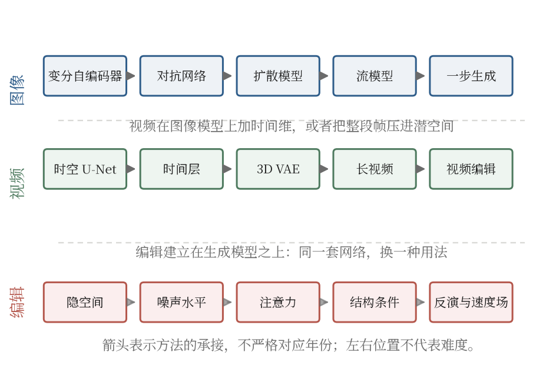

# 全景：图像、视频与编辑

这本书讲三件事：怎么让机器造出一张像样的图，怎么让它造出一段像样的视频，以及怎么在已有的图或视频上按要求改。

三件事共用一个底座。视频是帧的序列，编辑是在生成模型上加约束，所以理解图像生成是理解另外两件的前提。这一章先把全貌铺开，后面的章节再逐个展开。

## 图像生成的三代方法

按时间排，图像生成大致经过了三代。

第一代是变分自编码器与对抗网络。前者把图像压进低维潜空间再解码，用变分下界训练；后者让生成器与判别器互相对抗。两者都只需一次前向，速度快，但一个模糊、一个训练不稳。

第二代是扩散模型。先把图逐步加噪成噪声，再训练网络学会反过来去噪。采样要几十步，慢，但稳定、覆盖好。2020 年之后，高质量生成几乎都走这条路。

第三代是流模型与一步生成。流模型直接学一个速度场，让积分把噪声搬到数据；一步生成想办法把几十步压成一两步。

三代不是替代关系。今天的系统里常常三者并存：扩散或流做主生成，蒸馏压步数，对抗损失补细节。

## 视频：多出来的一个维度

视频不是"会动的图"。多一个时间维，带来三个新问题。

一致性：逐帧独立生成会闪烁，模型必须在帧之间交换信息。

运动：除了"画面里有什么"，还要决定"事情怎么发生"。

长度：短视频可以一次生成，长视频要分块、要自回归、要防止越生成越漂。

对应三条技术路线：把二维网络抬成三维（时空 U-Net）、在图像模型上加时间层、把视频压进潜空间再用 Transformer 生成。三条路线在第 12 到 16 章讲。

## 编辑：在生成模型上加约束

编辑要同时满足三件事：改动到位、别处不动、结果真实。不同的方法，区别在于从哪一层介入。

改潜空间：在隐向量或噪声表示里找一个方向，沿着它移动。

改噪声水平：把图加噪到某个程度，再用新条件去噪，噪声水平就是编辑强度。

改注意力：文本通过 cross-attention 进入网络，改注意力图就能改语义不动布局。

加条件：用边缘图、深度图、姿态、mask 约束生成，解决"在哪里改"。

改速度场：在流模型上，用目标条件与源条件的速度之差作为编辑方向，必要时做平滑。

视频编辑还要多一件事：保证改动在时间上连贯。同一个物体在第一帧改了颜色，第十帧也得是同样的颜色，中间不能跳。这一部分在第 24 章讲。

## 一条主线：把简单分布搬到复杂分布

所有方法都在做同一件事：构造一个从简单分布到数据分布的变换，并且只能通过有限样本来估计它。

变分自编码器用隐变量描述这个变换；对抗网络用判别器提供信号；扩散模型把变换拆成很多小步；流模型直接描述"点怎么移动"。四种描述方式，对应四种训练目标，也对应四种失败模式。

视频没有改变这条主线，只是把"点"换成了"一段帧"。理解了这一点，视频章节里那些新名词——时空注意力、时间层、3D VAE——都只是在回答同一个问题：多出来的那一维怎么处理。

## 这本书怎么读

第 2 章讲图像与视频作为数据的基本事实，第 3 章补数学。这两章不要跳。

第 4 到第 11 章讲图像生成：VAE、GAN、扩散的训练与采样、条件引导、潜空间实现。这一段是全书的主体。

第 12 到第 16 章讲视频：为什么难、时空 U-Net、时间层、3D VAE 与潜空间视频扩散、规模化与长视频。

第 17、18 章换一个角度，把生成写成一条路径，并讨论一步生成。

第 19 到第 24 章讲编辑，从问题形式化讲到最新的视频编辑方法。

第 25 章收尾，给一张对照表和一个选择方法的思路。

## 深浅的约定

这一册是入门，标准是"看懂全貌"，不是"能复现"。推导只到"能跟上思路"为止，遇到复杂的展开会说明这一步在做什么，然后给出结论。

想动手实现的读者，可以按每章提到的论文去找代码；想深入某一类的读者，可以把对应的章节当作索引，顺着参考文献往下读。
