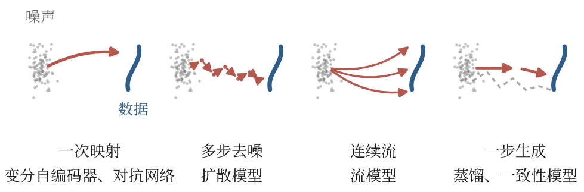

# 全景：图像、视频与编辑

这本书讲三件事：怎么让机器造出一张像样的图，怎么让它造出一段像样的视频，以及怎么在已有的图或视频上按要求改。

三件事共用一个底座。视频是帧的序列，编辑是在生成模型上加约束，所以理解图像生成是理解另外两件的前提。这一章先把全貌铺开，后面的章节再逐个展开。

## 图像生成的三代方法

按时间排，图像生成大致经过了三代。

第一代是变分自编码器与对抗网络。前者把图像压进低维潜空间再解码，用变分下界训练；后者让生成器与判别器互相对抗。两者都只需一次前向，速度快，但一个模糊、一个训练不稳。

在它们之前，主流做法有两类。一类是能量模型，比如受限玻尔兹曼机：给每个图像配置定义一个能量，概率正比于 $e^{-E}$，训练和采样都要跑很长的马尔可夫链，跑几百步换出一个样本是常事。另一类是纹理合成与图像拼接：从样本里抠出小块，按接缝匹配贴到画布上，再重叠混合。前者采样慢到难以实用，后者只在重新排列见过的小块，画不出新的整体结构。变分自编码器把生成压成一次前向，用反向传播训练，这两件事同时被绕开了。

代价出在解码器上。解码器通常输出一个高斯分布的均值，在方差固定的情况下，对数似然化简后就是均方误差，而均方误差的最优解是条件均值。如果给定画面左侧，右侧有两个同样合理的走向，模型会把两条走向平均，得到一片过渡带。训练集里同一处有几种合理的续法，输出就模糊几分。这类失败不表现为画错，而表现为画得犹豫：轮廓还在，边是软的。

对抗网络换掉了似然。它不要求网络给出每个像素的概率，只让判别器分辨真假，生成器朝“骗过判别器”的方向改。省掉求均值这一步，细节就留住了：发丝、砖缝、文字边缘，这些在均方误差下被抹平的东西，在对抗损失下能保留。代价是训练从最小化一个数变成了两个网络互相追赶。判别器太强，真假分得太干净，传给生成器的梯度趋近于零，学不动；判别器太弱，生成器随便输出都能过关，输出开始乱漂。维持这个平衡要靠结构上的约束（谱归一化、梯度惩罚）和大量试错，一旦崩掉，通常只能重训。

另一种常见的坏法是模式坍塌：判别器只看局部纹理，不看整体布局，生成器很快发现“不管输入什么，都输出同一种最像真的纹理”最省力。结果是生成的猫全是同一个姿态、同一个角度，换个提示也只是换毛色。这类模型在演示里很好看，因为挑出来的正是它最擅长的那个模式；用来做数据增广时，能提供的新东西比看上去少得多。

第二代是扩散模型。先把图逐步加噪成噪声，再训练网络学会反过来去噪。采样要几十步，慢，但稳定、覆盖好。2020 年之后，高质量生成几乎都走这条路。

扩散模型把一次映射换成了很多次小修。前向过程把图一步步加噪，直到成为纯噪声，这一步不需要学习；反向过程训练一个网络，在每一步判断“这一点噪声该去掉多少”。单步任务很窄，网络容易学好，训练目标又回到均方误差，但误差只作用在很短的区间上，不会产生“把两条路平均”的模糊，因为每个小步上的分布接近单峰。它换掉的正是对抗训练里那个难调的平衡：不再有两个网络互相博弈。

代价是步数。最初的扩散模型用一千步采样，出一张图要跑一千次网络；确定性采样器把步数压到二十到五十步，质量基本不掉；再往下压，中频结构来不及确定，整体轮廓还在，细节先糊掉。量级可以估一下：一张 $1024\times1024$ 的图，在单张高端显卡上跑一次 U-Net 前向大约 0.1 秒（随模型大小浮动很大，只作量级参考），五十步就是五秒上下。这五秒里绝大部分计算花在重复走同一条路上。

另一件好处是覆盖。每一步都要求“还原这一点噪声”，模型没有偷懒的余地；数据里有几种猫，它就得学会几种。扩散模型也会漏掉稀有模式，但它没有对抗网络那种“用局部纹理蒙混过关”的捷径，漏得少得多。

第三代是流模型与一步生成。流模型直接学一个速度场，让积分把噪声搬到数据；一步生成想办法把几十步压成一两步。

流模型要摆脱的是“必须沿一条事先规定的加噪路径走”这个限制。路径可以自己学，学得直，步子就能迈大，二十步甚至更少就够。代价是训练目标更挑剔：速度场要在整条路径上都对，对时间采样和数值积分的要求都比扩散高。

一步生成要摆脱的是“必须迭代”本身。做法是先训一个多步的教师，再让学生学会从噪声直接跳到结果，或者让学生在不同噪声水平上的输出彼此一致。代价有两层。学生继承教师的所有偏差，教师漏掉的模式学生也漏；学生又只有一次机会，教师走五十步时每一步都能纠一点错，学生没有这个余地，训练分布之外的地方只能靠外推，常见的结果是多样性下降、边缘出现块状伪影。

三代不是替代关系。今天的系统里常常三者并存：扩散或流做主生成，蒸馏压步数，对抗损失补细节。把这些零件拆开看，各自的位置很清楚：潜空间里的扩散或流模型负责主体，几十步采样；蒸馏或一致性把步数压到四步以内，用于交互式场景；对抗损失或感知损失挂在解码器上，补高频；文本编码器与 cross-attention 负责条件。每一代都在，只是站的位置不同。

训练成本也差得很远。变分自编码器与对抗网络在单卡上几小时到几天能跑完一轮；扩散模型要几十万到几百万步，多卡跑几天到几周；蒸馏要在这个基础上再加一轮教师推理与训练。这些是量级估计，随数据量和模型规模浮动很大，但相对大小是稳定的：越靠后的方法，越把成本从采样阶段挪到了训练阶段。

## 视频：多出来的一个维度

视频不是“会动的图”。多一个时间维，带来三个新问题。

一致性：逐帧独立生成会闪烁，模型必须在帧之间交换信息。

运动：除了“画面里有什么”，还要决定“事情怎么发生”。

长度：短视频可以一次生成，长视频要分块、要自回归、要防止越生成越漂。

对应三条技术路线：把二维网络抬成三维（时空 U-Net）、在图像模型上加时间层、把视频压进潜空间再用 Transformer 生成。三条路线在第 12 到 16 章讲。

量级上，一段五秒、每秒 24 帧、$512\times512$ 的彩色视频是 120 帧，接近一亿个数，单精度存下来约 380 MB，还要乘上 batch 与训练时的中间激活。同一段视频按下采样 8 倍、4 个通道压进潜空间，只剩两百万个数、几 MB。视频模型几乎都走潜空间这条路，原因就在这里。

## 编辑：在生成模型上加约束

编辑要同时满足三件事：改动到位、别处不动、结果真实。不同的方法，区别在于从哪一层介入。

改潜空间：在隐向量或噪声表示里找一个方向，沿着它移动。

改噪声水平：把图加噪到某个程度，再用新条件去噪，噪声水平就是编辑强度。

改注意力：文本通过 cross-attention 进入网络，改注意力图就能改语义不动布局。

加条件：用边缘图、深度图、姿态、mask 约束生成，解决“在哪里改”。

改速度场：在流模型上，用目标条件与源条件的速度之差作为编辑方向，必要时做平滑。

视频编辑还要多一件事：保证改动在时间上连贯。同一个物体在第一帧改了颜色，第十帧也得是同样的颜色，中间不能跳。这一部分在第 24 章讲。

编辑的两个要求直接冲突。把整张图重新生成，改动一定到位，但别处一定变了；只在一个小区域重绘，别处不动，边界上却又容易留下接缝和色差。编辑方法的大量设计都在处理这条边界：怎么让改动落在一个有语义的区域里，怎么让交界处看不出来。

## 一条主线：把简单分布搬到复杂分布

所有方法都在做同一件事：构造一个从简单分布到数据分布的变换，并且只能通过有限样本来估计它。

变分自编码器用隐变量描述这个变换；对抗网络用判别器提供信号；扩散模型把变换拆成很多小步；流模型直接描述“点怎么移动”。四种描述方式，对应四种训练目标，也对应四种失败模式。

这四种描述可以画在同一张纸上。图 1.2 的四个小图都从左边的一团噪声出发，终点是右边那条短弧，也就是数据所在的地方。一次映射一步到位，中间发生了什么不给看；多步去噪把这段路切成很多小段，每段的方向由网络决定；连续流给出一族轨迹，从同一点出发可以落到弧上不同的位置，落点由起点和路径共同决定；一步生成把前面那条折线压成一两段，省下的计算用来换中间那些纠错的机会。

一次映射把整个数据分布压进一个函数的输出，函数必须同时记住所有模式；多步的方法每一步只面对一个很窄的条件分布，记忆的负担被摊开在时间上。这条差别在后面会反复出现：凡是“一次到位”的方法，难点都在如何让一个函数覆盖整个分布；凡是“多步”的方法，难点都在如何让每一步的误差不累积。

视频没有改变这条主线，只是把“点”换成了“一段帧”。理解了这一点，视频章节里那些新名词——时空注意力、时间层、3D VAE——都只是在回答同一个问题：多出来的那一维怎么处理。

## 全书的结构

第 2 章讲图像与视频作为数据的基本事实，第 3 章补数学。这两章不要跳。

第 4 到第 11 章讲图像生成：VAE、GAN、扩散的训练与采样、条件引导、潜空间实现。这一段是全书的主体。

第 12 到第 16 章讲视频：为什么难、时空 U-Net、时间层、3D VAE 与潜空间视频扩散、规模化与长视频。

第 17、18 章换一个角度，把生成写成一条路径，并讨论一步生成。

第 19 到第 24 章讲编辑，从问题形式化讲到最新的视频编辑方法。

第 25 章收尾，给一张对照表和一个选择方法的思路。

## 四个刻度

判断一个方法好不好，通常看四件事，每一件都能用日常经验衡量。

真实度是单张图放在眼前能不能当真。人眼对高频最挑剔：手指的数目、眼睛的高光、远处招牌上的字、织物上的纹理，这些地方一糊，整张图就跨了。指标上常用 FID，把生成样本与真实样本都过一遍特征网络，比较两组特征的分布。它对纹理统计敏感、对结构不敏感，所以一个把每根头发都画对、却把耳朵画错的模型，FID 可能比一个整体发虚但结构正确的模型更好。

覆盖度是模型学到的是整类还是几个典型。让它生成一百张“一只橘猫”，如果九十张是同一个姿态、同一个背景，它记住的是一个模板，不是一类东西，这叫模式坍塌。覆盖差的时候单张真实度可以很高，因为模板本来就是数据里最像真的那几个。这类模型在演示里好看，用来做筛选、做数据增广就会出问题：它能产出的东西比看上去少。

可控性是能不能听指令。给“左边一把红椅子，右边一张蓝桌子”，要检查的不只是颜色，还有位置和数量；做编辑时，要检查改动区域改了没有、非改动区域动了多少。可控与真实经常打架：引导强度调高，模型更听提示，但颜色过饱和、构图变僵；调低，图更自然，提示里的一半细节被忽略。

速度是一次生成要跑多少次网络。它等于前向次数乘单次前向的时间，与输入有没有条件关系不大。扩散模型默认几十次，一步生成只要一两次，差两个数量级。速度还决定方案能不能用：交互式修图要求三秒内出结果，离线批量生成要求每小时几千张，这两个门槛对应完全不同的方法。

四项之间没有全局最优。三个具体的拉扯：

真实度与覆盖度。把引导强度往上调，输出更贴近特征网络喜欢的样子，单张看着更利落，但同一个提示下的结果会向少数几种安全构图收缩。反过来，提高采样温度、加一点噪声，多样性回来了，边角开始长出不该有的东西。

真实度与速度。步数减少，扩散模型来不及定下中频结构，结果是“轮廓对、内部糊”。蒸馏能把这块损失压小，代价是多一个训练阶段，还要存教师的输出。

可控性与真实度。条件越强，模型越守规矩，但过度遵守会让画面失去自然感：人物姿态变得像摆拍，光照方向变得生硬。

所以比较两个方法之前要先问在哪个刻度上比。一个三十步的模型和一个一步的模型，比单张真实度是一回事，比“每秒能出多少张能用的图”是另一回事，后者的答案常常和前者相反。

四项里只有速度可以精确测。其余三项都要靠抽一批图去估，样本数、预处理、人评的提问方式都会影响结论，所以跨论文的数字只能看量级，不能逐点比较。

## 三条阅读路线

全书二十五章，不必按顺序读。按目的分三条线。

想动手实现：第 2、3 章打底，弄清数据长什么样、需要哪些数学工具；第 6、7 章把扩散的训练目标从头推一遍；第 9 章讲工程上真正要处理的东西，预条件、噪声日程、损失加权、混合精度；第 8 章讲采样器；第 11 章讲怎么把模型塞进潜空间并接上文本。这条线走完，可以照着伪代码写出一个能在小数据集上训出图的模型。视频部分只读第 13、15 章，够用来改结构。

想理解这个领域在争什么：第 4、5 章看两种老思路各自的失败方式；第 6 到第 8 章看扩散怎么绕开它们；第 10 章看条件怎么进网络；第 17、18 章看“扩散”这个框架后来怎么被改写成流和一步生成。这条线的重点是每次转折的动机：不是为了刷指标，而是前一种做法在某个具体场景下坏了。

想做编辑：第 19 章先把“改动到位、别处不动、结果真实”这三件事讲清楚；第 20 到第 23 章按介入的层次排，潜空间与噪声、注意力、结构条件、速度场；第 24 章讲视频编辑；第 25 章给选型。做编辑的人也要读第 6、7、11 章，不知道去噪过程长什么样，就没法判断“加噪到多少、在哪一步介入”。

三条线有重叠，重叠的部分是第 2、3、6、7 章，它们是共用的地基。第 12 到第 16 章、第 21 到第 24 章按需查，不必通读。

## 全书的记号

后面各章反复出现同一批符号，这里一次列清。少数符号在不同章有细微差别，遇到时以当章定义为准。

| 符号 | 含义 | 主要出现处 |
|---|---|---|
| $x$ | 一张图，展平成向量；$x_0$ 特指干净数据 | 第 2 章起 |
| $x_t$ | 加噪 $t$ 步后的样本；视频里再加帧下标 | 第 6 章起 |
| $z$ | 隐变量；在 VAE 里是编码器输出，在潜空间扩散里是压缩后的特征图 | 第 4、11 章 |
| $\epsilon$ | 标准高斯噪声，$\epsilon\sim\mathcal{N}(0,I)$ | 第 6 章起 |
| $\alpha_t,\ \beta_t$ | 单步保留系数与噪声方差，$\alpha_t=1-\beta_t$ | 第 6 章 |
| $\bar\alpha_t$ | 累积保留系数，$\bar\alpha_t=\prod_{s=1}^{t}\alpha_s$ | 第 6 章 |
| $T$ | 扩散总步数；视频里也表示帧数，靠上下文区分 | 第 6、12 章 |
| $p_\theta$ | 带参数 $\theta$ 的模型分布 | 全书 |
| $q$ | 前向加噪过程，也用作近似后验 | 第 4、6 章 |
| $\epsilon_\theta(x_t,t)$ | 噪声预测网络 | 第 7 章起 |
| $s_\theta=\nabla_x\log p_\theta$ | score，对数密度的梯度 | 第 6、17 章 |
| $v_\theta$ | 速度场；流模型里是 $dx/dt$，扩散里是另一种参数化 | 第 7、17 章 |
| $c$ | 条件：文本嵌入、类别标签或结构图 | 第 10 章 |
| $w$ | 无分类器引导的强度 | 第 10 章 |
| $f$ | 潜空间的下采样倍数，如 $f=8$ | 第 11 章 |
| $\mathrm{NFE}$ | 采样时的网络前向次数 | 第 8、18 章 |

视频相关的是另外几个：$T$ 帧、$H\times W$ 的空间尺寸、$C$ 个通道；压缩之后记作 $T'\times C'\times H'\times W'$，撇号表示压缩后的尺寸，不与原始尺寸混用。

## 深浅的约定

这一册是入门，标准是“看懂全貌”，不是“能复现”。推导只到“能跟上思路”为止，遇到复杂的展开会说明这一步在做什么，然后给出结论。

想动手实现的读者，可以按每章提到的论文去找代码；想深入某一类的读者，可以把对应的章节当作索引，顺着参考文献往下读。
