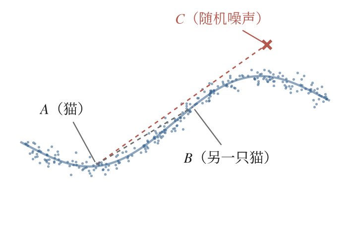
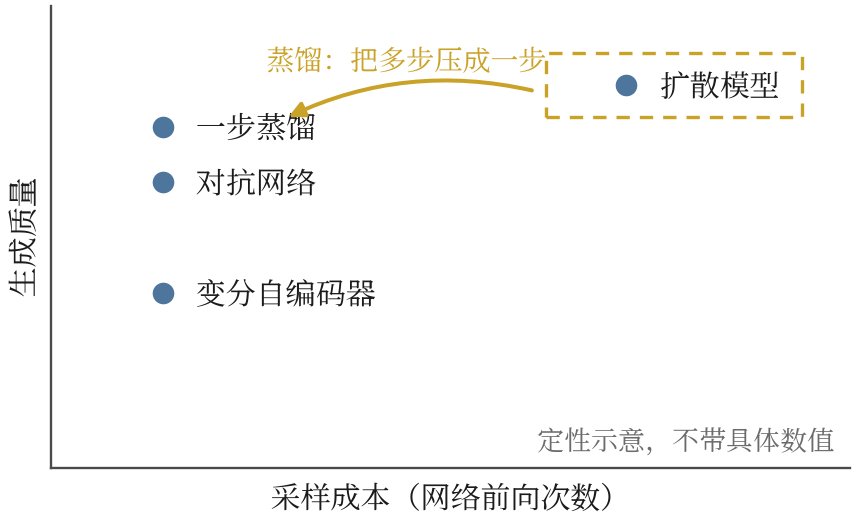

# 从一张图说起

一张 256×256 的彩色图片，在计算机里是一个 256×256×3 的数字阵列。把它按行摊开，就得到一个有 196608 个分量的向量。这个向量里的每个数都在 0 到 255 之间，代表某个像素某个通道的亮度。

生成模型要做的事，是从所有可能的这种向量里，挑出那些看起来像照片的。换句话说，我们想知道这 196608 维空间里哪些点对应真实图像，然后用一个程序把这样的点造出来。

这一章把这件事写成数学，并说明它为什么难。后面所有的模型都是对这个问题的不同回答。

## 图像是一个向量

先看一个具体的例子。图 2.1 左边是一张合成的灰度图，右边是把它按行摊开后得到的向量。图中标出了几个像素在向量里的位置：左上角的亮块对应向量开头的一段，右下角的暗块对应结尾的一段。

这个展开方式有一个后果值得记住：像素之间的空间关系被压成了一条线。卷积网络之所以有效，就是因为它把这个被压平的结构重新利用了起来。而对这一章要讨论的概率模型来说，向量就是向量，排列顺序不携带信息。

严格地说，图像是离散的，每个通道取 0 到 255 的整数。为了使用微积分，通常把它归一化到 [−1, 1] 或 [0, 1]，并且当作连续变量处理。这个近似在讨论分布形状时没有问题，只在讨论精确的似然值时才需要小心，因为连续密度在离散数据上的取值依赖于量化方式。本书后面提到似然时，指的都是连续密度。

## 视频多出来的那一维

视频可以写成一个四维张量 $x\in\mathbb{R}^{T	imes C	imes H	imes W}$，$T$ 是帧数。多出来的这一维不是简单地把数据量乘上 $T$，它还带来了结构。

相邻帧高度相关。固定机位拍一个静物，除了一点点噪声，每一帧几乎一样；即使有运动，大部分区域也在缓慢变化。这意味着视频里有大量冗余，可以压缩，也应该压缩——所有视频模型都靠这一点把计算量降下来。

相关性也意味着"逐帧独立处理"是浪费。既然相邻帧几乎相同，模型就应该在帧之间共享信息，而不是每帧都从头算一遍。后面讲到的时空注意力、时间层、3D VAE，都是在利用这一点。

从分布的角度看，视频的分布比图像更"窄"：给定前几帧，下一帧的可能性并不多。这个性质是视频生成能成立的前提，也是长视频会漂移的原因——一旦前面几帧偏了，后面就沿着错误的方向走下去。

## 要的不是一张图，是一族图

单独一张图没有多少可学的。真正要刻画的是什么样的图会出现、以多大的可能性出现，也就是数据分布 $p_{\text{data}}(x)$。有了它，生成就变成一次采样

$$x \sim p_{\text{data}}(x).$$

采样这个词在这里是字面意思：从分布里随机取一个点。如果 $p_{\text{data}}$ 真的描述了想要的那类图像，那么取出来的点就应该是一张合理的图。

问题在于，手里只有有限个样本 $x^{(1)}, \dots, x^{(n)}$，它们是按 $p_{\text{data}}$ 抽出来的，但 $p_{\text{data}}$ 本身从来没有以公式的形式出现过。所有生成模型都在做同一件事：用这 $n$ 个样本构造一个可以采样、可以计算的近似分布 $p_\theta$，让它的样本看起来和数据一样。

## 为什么不能直接估计密度

最直接的想法是把空间切成小格子，数每个格子里有多少样本，用频率当作概率。一维时这很有效，二维也还行，维度一高就彻底失效。

假设把每一维粗粗地分成 10 个区间。对一张 256×256 的彩色图来说，格子总数是 $10^{196608}$。可观测宇宙的原子数大约是 $10^{80}$，即使每个原子存一个格子，也差了两千多个数量级。绝大多数格子里一个样本也没有，而我们却要说它们的概率是零。这种估计没有任何意义。

维度灾难还有一层更隐蔽的表现。在高维空间里，样本之间的距离会变得几乎一样。取 $n$ 个从标准高斯里抽出的点，任意两点距离的期望随维度 $d$ 增长，而距离的相对波动按 $1/\sqrt{d}$ 缩小。也就是说，在 196608 维里，最近邻和最远邻的距离差别小到可以忽略。任何依赖距离的方法，最近邻、核密度估计、聚类，都会失去分辨力。

所以，任何可行的生成模型都必须对数据加结构假设，把哪些点是可能的这个问题的自由度大幅压缩。不同的模型，压缩方式不同。

## 流形假设

最常用的假设是：自然图像虽然生活在 196608 维空间里，实际上集中在一个低维集合附近。这个集合叫数据流形。它的维度可能只有几十到几百，远小于像素数。

这个假设有直观的理由。一张猫的照片，耳朵位置挪一点，还是猫；背景换个颜色，还是猫；但随机改动一万个像素，得到的几乎一定不是猫。图像的变化不是在各个方向上都能自由发生的，只有少数几个方向上的变化能保持像一张图。

图 2.2 说明了这个假设带来的一个麻烦。在像素空间里，两张不同的猫之间的欧氏距离，可能比一张猫和一张随机噪声的距离还大。最常用的距离度量，和看起来像不像这件事并不一致。可训练时能优化的只有像素空间的损失。这个矛盾贯穿全书：所有模型都在用像素级的误差去逼近一个感知上的目标，而这两者之间的差距，正是生成图像常常模糊、失真的根源之一。

流形假设还有一个直接推论。流形之外的点概率为零，那里的对数密度是负无穷，梯度没有定义。这对直接依赖密度的采样方法是致命的。扩散模型的做法是先往数据里加噪声，把流形抹开，让整个空间都有正密度，再学着把噪声去掉。这个思路在第 6 章展开。

## 生成模型的四种用法

同一个模型，通常可以承担四种任务。分清它们，有助于理解不同论文在比较什么。

第一种是无条件采样：从模型里抽一张图，不给额外信息。这是最纯粹的生成。

第二种是条件采样：给定一句描述、一张草图、一个类别标签，生成符合条件的结果。文本到图像属于这一类，它是现在应用最广的形式。

第三种是密度估计：给定一张图，算出它在模型下的概率。这个能力可以用来做异常检测、压缩，也可以作为其他模型的组件。

第四种是编辑：给定一张已有的图和一个修改要求，输出修改后的图。它比前三种难，因为要同时满足两个互相拉扯的要求，改动要到位，别的地方要不动。本书的重点在生成，编辑只在讨论方法分类时提一句。

四种任务对模型的要求不同。能采样的模型不一定能算密度，对抗网络就是例子；能算密度的模型不一定采样得快，连续归一化流就是例子；能编辑的模型不一定生成质量最高。读论文时先看清它解决的是哪一种，很多看起来矛盾的结论就不矛盾了。

## 什么叫好

评价一个生成模型，通常看四个方面。

真实度，样本看起来像不像真图。常用 FID 这类指标，它比较生成样本和真实样本在某个特征空间里的分布距离。

覆盖度，模型是不是只学会了数据的一部分。一个只会生成同一种猫的模型，真实度可能很高，覆盖度很差。这种现象叫模式坍塌，第 5 章会详细分析。

可控性，能不能按要求生成或修改。文本提示的遵循程度、编辑时非编辑区域的保持程度，都属于这一项。

速度，采样需要多少次网络前向。一步生成和多步生成在这项上差了两个数量级。

这四项互相拉扯。图 2.3 把它们放在一个平面上，横轴是采样成本，纵轴是生成质量。对抗网络在左边，一步出图，质量不错但训练不稳；扩散模型在右上，几十步，质量高但慢；蒸馏要做的，就是把扩散模型的点往左边搬。这张图是定性的，具体方法的实际位置要看评测条件，不能跨数据集比较。

## 四条路线

本书讲四类方法，它们对如何构造 $p_\theta$ 的回答不一样。

变分自编码器引入一个低维隐变量 $z$，先假设 $z$ 服从简单分布，再用一个解码网络 $p_\theta(x|z)$ 把 $z$ 映射成图。边缘分布 $p_\theta(x) = \int p_\theta(x|z)p(z)\,dz$ 算不出来，于是用一个可算的下界去逼近它。这是第 4 章的内容。

对抗网络不写密度，直接用一个生成网络把噪声变成图，再训练一个判别网络区分真假。生成器的目标是骗过判别器，这个目标最终等价于最小化真实分布与生成分布之间的某种散度。这是第 5 章的内容。

扩散模型构造一条从数据到噪声的路径，训练网络学会沿着这条路径往回走。采样时从噪声出发，一步一步走回数据。这条路径可以是离散的马尔可夫链，也可以是连续的随机微分方程。这是第 6 章到第 11 章的内容。

流模型直接学一个速度场，让它的积分把噪声搬到数据。它不需要走加噪这条路，也不需要对抗，采样就是解一个常微分方程。第 17 章会把这套语言介绍一遍，完整的推导不在本书范围内。

四类方法的共同点是：都在构造一个从简单分布到数据分布的变换，并且都只能通过有限样本去估计这个变换。它们的区别在于用什么对象描述变换，以及用什么损失把变换学出来。

## 训练与推理的不对称

最后说一件容易被忽略的事：训练时能看到真图，推理时看不到。

训练时有 $x^{(1)}, \dots, x^{(n)}$，可以直接算模型输出和真图差多少。推理时只有随机噪声和一个训练好的网络，没有任何真图可以参考。所有方法的困难都来自这个不对称，训练信号必须在推理时仍然有效。

扩散模型靠每一步只去一点噪声来缓解这个问题。每一步的任务都很局部，网络在训练时见过大量类似的情形。对抗网络靠判别器把像不像这个判断从训练阶段带到推理阶段，但判别器本身也是从有限样本学来的，会过拟合。流模型靠积分把一步的误差分散到多步，代价是速度。

理解了这一点，就能理解为什么这个领域的方法迭代总是沿着同一个方向：想办法让训练时学到的东西，在推理时更可靠地发挥作用。
