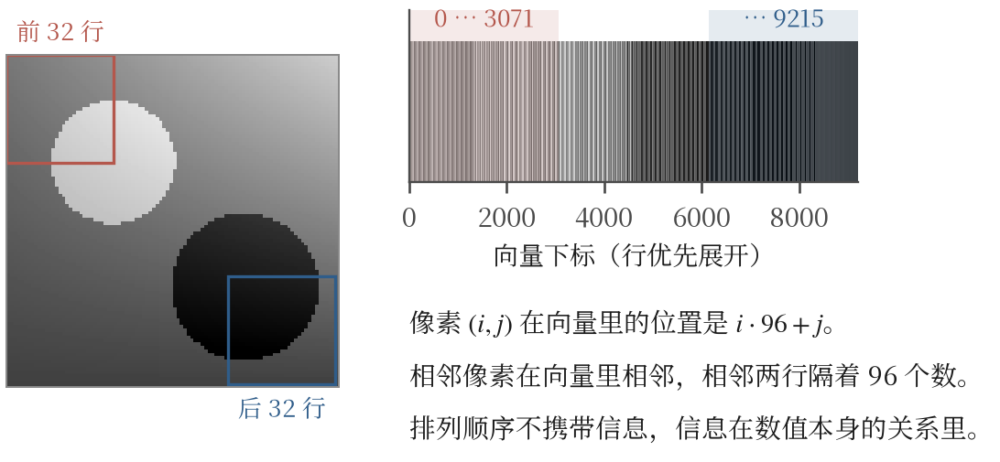
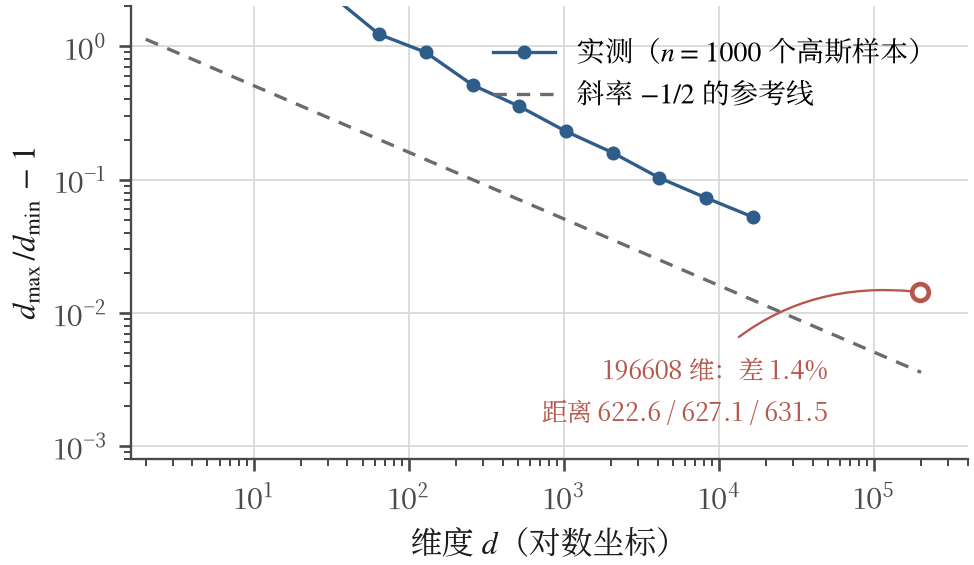

# 从一张图说起

一张 256×256 的彩色图片，在计算机里是一个 256×256×3 的数字阵列。把它按行摊开，就得到一个有 196608 个分量的向量。这个向量里的每个数都在 0 到 255 之间，代表某个像素某个通道的亮度。

生成模型要做的事，是从所有可能的这种向量里，挑出那些看起来像照片的。换句话说，我们想知道这 196608 维空间里哪些点对应真实图像，然后用一个程序把这样的点造出来。

这一章把这件事写成数学，并说明它为什么难。后面所有的模型都是对这个问题的不同回答。

## 图像是一个向量

先看一个具体的例子。图 2.1 左边是一张合成的灰度图，右边是把它按行摊开后得到的向量。图中标出了几个像素在向量里的位置：左上角的亮块对应向量开头的一段，右下角的暗块对应结尾的一段。

这个展开方式有一个后果值得记住：像素之间的空间关系被压成了一条线。卷积网络之所以有效，就是因为它把这个被压平的结构重新利用了起来。而对这一章要讨论的概率模型来说，向量就是向量，排列顺序不携带信息。

严格地说，图像是离散的，每个通道取 0 到 255 的整数。为了使用微积分，通常把它归一化到 [−1, 1] 或 [0, 1]，并且当作连续变量处理。这个近似在讨论分布形状时没有问题，只在讨论精确的似然值时才需要小心，因为连续密度在离散数据上的取值依赖于量化方式。本书后面提到似然时，指的都是连续密度。

### 像素值对应多少光

上面那个阵列里的每个数都是“亮度”，但它和“照到传感器上有多少光”并不成正比。

传感器数的是光子，这个量是线性的：光量翻倍，读数翻倍。图像文件用的却不是线性刻度。为了在有限的位数里把人眼的感知范围铺开，图像在存储前会过一条非线性曲线，最普遍的是 sRGB 标准里的那条：数值低于 0.04045 的部分按 12.92 倍线性放大，高于它的部分按幂次 2.4 拉伸。解码是反函数。

算一个数：8 位文件里的 128 对应 0.5，解码回线性空间后只剩

$$\left(\frac{0.5+0.055}{1.055}\right)^{2.4}\approx 0.214.$$

也就是说，那个“中灰”只代表大约 21% 的光，不是一半。反过来，一张反射率 18% 的灰卡，拍出来在文件里大约是 118 级，而不是 46 级。

这个差别有两处后果。一是算术：两张图取平均，只在同一个空间里才有意义。把两个 sRGB 数值直接平均，等于对编码后的数做平均，结果比在线性空间里平均更暗——0 和 255 两个像素平均成 128，而它们真实光量的平均编码后应该是 188。二是损失：训练时用的均方误差、感知损失、判别器特征，必须约定在同一个空间里。大多数模型沿用 sRGB 编码后的数值，因为特征网络和判别器就是在这种图上训的；换成线性空间，同样的引导强度不再对应同样的视觉效果。

色彩空间还有一层：通道的含义。$(R,G,B)$ 具体是什么颜色，取决于原色坐标与白点，同一组数在 sRGB 与 Rec.2020 里不是同一个颜色。另外两种表示也会碰到：YCbCr 把亮度与色度分开，色度可以大幅降采样而几乎看不出差别，视频压缩就靠这一点；Lab 近似均匀，颜色距离更接近人的感知，调色与部分评价指标用它。

### 量化

每个通道存成 8 位整数，就是 256 个可能值，归一化到 [0,1] 后相邻两个值相差 $1/255\approx 0.0039$；到 [−1,1] 里则是 $2/255\approx 0.0078$。16 位存储把这个间隔缩小 256 倍，量化误差基本可以忽略。

量化对似然的影响是一个常数。离散数据的概率是连续密度在一个小区间上的积分，区间宽度固定时，对数似然就是连续对数似然加上 $\log\Delta$，与模型参数无关。同一种量化方式下比较两个模型，这个常数抵消；比较不同位深的模型时就不行。所以论文里常用每维比特数（bits per dimension，把对数似然除以像素数再取负、换底到 2）而不是原始对数似然，它自己就把像素数量和量化位数归一掉了。

### 为什么归一化到 [−1,1]

把 0 到 255 除以 255 得到 [0,1]，再乘 2 减 1 得到 [−1,1]。这一步不只是为了数值好看。

扩散模型的前向过程默认数据是单位量级：$x_t=\sqrt{\bar\alpha_t}\,x_0+\sqrt{1-\bar\alpha_t}\,\epsilon$，其中 $\epsilon$ 是标准高斯，加噪日程也是按 $x_0$ 的尺度在 1 左右设计的。直接把 0 到 255 的整数喂进去，同一个 $t$ 对应的信噪比会完全变掉——数据项大 255 倍，要淹没它所需的正向步数完全不同，训练出来的模型只在那个错位的尺度上有效。

[0,1] 与 [−1,1] 都能用，区别在对称性。以 0 为中心时，$x_0$ 的均值接近 0，卷积层的偏置与归一化层的统计量更容易稳定；$t$ 接近 $T$ 时 $x_t$ 几乎就是 $\epsilon$，与数据无关，网络不需要额外学一个非零均值。用 [0,1] 也能收敛，只是相当于把噪声项与数据项的配比挪了一点。

潜空间里这件事还要再走一遍。VAE 的输出尺度不一定接近 1，训练扩散模型之前通常乘一个固定常数把潜变量的标准差拉到 1 附近（Stable Diffusion 1.x 系列用的是 0.18215）。这个常数由 VAE 训完后的统计量决定，不是超参数；用错常数，模型会立刻生成灰雾或花屏。

## 一张图占多少内存

在讨论分布之前，先把账算清楚。一个 $B\times C\times H\times W$ 的张量，元素数是 $BCHW$，字节数是元素数乘每个数的字节数：fp32 四个，fp16 两个。按这个公式算一遍，$B=8$：

| 分辨率 | 像素张量（fp16） | 潜空间（$f=8$，4 通道） | 潜张量（fp16） |
|---|---|---|---|
| $256^2$ | 3 MB | $32\times32\times4$ | 64 KB |
| $512^2$ | 12 MB | $64\times64\times4$ | 256 KB |
| $1024^2$ | 48 MB | $128\times128\times4$ | 1 MB |

像素侧：$512^2$ 的一张图是 $3\times512\times512\approx 7.9\times10^5$ 个数，八张 fp16 共 12 MB。潜空间侧把空间尺寸除以 8、通道从 3 变成 4，元素数少 48 倍。

这张表只是输入。显存的大头在中间激活：训练要保存每一层的前向结果用于反传。一个典型的 U-Net 在 $64\times64$ 的潜变量上，第一层就把通道从 4 拉到 320，这一层的输出对 $B=8$ 来说是

$$8\times320\times64\times64\approx 1.05\times10^7$$

个数，fp16 下 21 MB。网络里几十个尺寸相近的张量叠起来，就是几个 GB。

注意力层更贵。$64\times64$ 的潜变量展平成 4096 个 token，注意力矩阵是 $4096\times4096$，一个 batch、一个头算下来是 $1.7\times10^7$ 个数、34 MB；八个头、八个 batch 同时算，这个数再乘 64，接近 2 GB。下采样倍数调小一倍，序列长度变成四倍，注意力矩阵大十六倍——$f=4$ 时这一项根本放不下。

所以估算分三步：输入、最大的那层激活、注意力。输入几乎总是最小的那一项，这也是“张量不大但训练爆显存”这类困难的来源。（以上数字都按公式算得，不含框架的碎片开销，实际占用通常还要多两到三成。）

## 视频多出来的那一维

视频可以写成一个四维张量 $x\in\mathbb{R}^{T\times C\times H\times W}$，$T$ 是帧数。多出来的这一维不是简单地把数据量乘上 $T$，它还带来了结构。

相邻帧高度相关。固定机位拍一个静物，除了一点点噪声，每一帧几乎一样；即使有运动，大部分区域也在缓慢变化。这意味着视频里有大量冗余，可以压缩，也应该压缩——所有视频模型都靠这一点把计算量降下来。

把这件事量化。定义相邻帧的平均绝对差

$$D_t=\frac{1}{CHW}\sum_{c,h,w}\left|x_{t+1}(c,h,w)-x_t(c,h,w)\right|,$$

以灰度级为单位。在一个合成场景上算一遍（$256\times256$，静态纹理背景，一个半径 30 像素的圆每帧向右移 4 像素）：相邻两帧的 $D_t$ 是 0.55，相隔十帧是 5.1，把两帧换成互不相关的噪声则是 85。真实素材的数字取决于镜头运动和传感器噪声，但量级关系一样：每一帧只有很小一部分像素在变。

这解释了两件事。一是压缩：1080p、8 位、每秒 30 帧的原始数据是 187 MB 每秒，十秒就接近 2 GB；用帧间预测的编码器只存第一帧加上运动补偿后的残差，同一段素材可以压到几 Mbit/s，大约 0.6 MB 每秒，压缩比在两三百倍。二是预测：既然每一帧几乎重复上一帧，“下一帧长什么样”在绝大部分区域上几乎无信息可学，模型只需把少量资源留给真正在变的那部分。

相关性也意味着“逐帧独立处理”是浪费。既然相邻帧几乎相同，模型就应该在帧之间共享信息，而不是每帧都从头算一遍。后面讲到的时空注意力、时间层、3D VAE，都是在利用这一点。

从分布的角度看，视频的分布比图像更“窄”：给定前几帧，下一帧的可能性并不多。这个性质是视频生成能成立的前提，也是长视频会漂移的原因——一旦前面几帧偏了，后面就沿着错误的方向走下去。

“保持连贯”也可以写成数：把第 $t$ 帧按光流扭到第 $t+1$ 帧的坐标系，再与真的第 $t+1$ 帧相减，残差越小，一致性越好。逐帧独立生成的视频在这项上很差：每一帧的纹理细节都是独立采样的，扭完之后纹理对不上，看起来就是闪。这也说明闪烁不是后处理能抹掉的，它来自每帧细节互不相关，只能从生成过程上解决。

## 要的不是一张图，是一族图

单独一张图没有多少可学的。真正要刻画的是什么样的图会出现、以多大的可能性出现，也就是数据分布 $p_{\text{data}}(x)$。有了它，生成就变成一次采样

$$x \sim p_{\text{data}}(x).$$

采样这个词在这里是字面意思：从分布里随机取一个点。如果 $p_{\text{data}}$ 真的描述了想要的那类图像，那么取出来的点就应该是一张合理的图。

问题在于，手里只有有限个样本 $x^{(1)}, \dots, x^{(n)}$，它们是按 $p_{\text{data}}$ 抽出来的，但 $p_{\text{data}}$ 本身从来没有以公式的形式出现过。所有生成模型都在做同一件事：用这 $n$ 个样本构造一个可以采样、可以计算的近似分布 $p_\theta$，让它的样本看起来和数据一样。

为什么非得要分布，不能只要一个“代表点”？假设一维数据集中在 $x=-2$ 和 $x=+2$ 两处，各占一半。均值是 0，但 0 附近几乎没有样本；一个只输出均值的模型看起来“误差最小”，给出的却是一个数据里不存在的位置。图像里同样的情形到处都有：一张脸的左右两种朝向、一片天空的两种云形、一扇窗的两种开合。所以目标必须是整个分布，不是一个中心。

## 为什么不能直接估计密度

最直接的想法是把空间切成小格子，数每个格子里有多少样本，用频率当作概率。一维时这很有效，二维也还行，维度一高就彻底失效。

格子数随维度指数增长：每维分 $k$ 段，$d$ 维就是 $k^d$ 个格子。$d=10$、$k=10$ 时是一百亿，已经超过单机能枚举的量级；想让每个格子平均有 10 个样本，就要 $10^{11}$ 个样本。

假设把每一维粗粗地分成 10 个区间。对一张 256×256 的彩色图来说，格子总数是 $10^{196608}$。可观测宇宙的原子数大约是 $10^{80}$，即使每个原子存一个格子，也差了两千多个数量级。绝大多数格子里一个样本也没有，而我们却要说它们的概率是零。这种估计没有任何意义。

维度灾难还有一层更隐蔽的表现。在高维空间里，样本之间的距离会变得几乎一样。取 $n$ 个从标准高斯里抽出的点，任意两点距离的期望随维度 $d$ 增长，而距离的相对波动按 $1/\sqrt{d}$ 缩小。也就是说，在 196608 维里，最近邻和最远邻的距离差别小到可以忽略。任何依赖距离的方法，最近邻、核密度估计、聚类，都会失去分辨力。

这几个说法可以算出来。取两个独立的标准高斯样本 $x,y\in\mathbb{R}^d$，$x_i-y_i$ 是均值 0、方差 2 的高斯，而

$$\|x-y\|^2=\sum_{i=1}^d (x_i-y_i)^2$$

的期望是 $2d$，方差是 $8d$。开根号后，距离的均值约为 $\sqrt{2d}$，标准差约为 1——注意标准差与维度无关。两者一比，相对波动就是 $1/\sqrt{2d}$：维度翻倍，波动只缩到原来的 $1/\sqrt2$。

用 $n=1000$ 个点实测一遍。$d=196608$ 时，两两距离的均值是 627.1，最近的一对是 622.6，最远的一对是 631.5，三者相差不到 1.5%。作为对照，同样 1000 个点放在 $d=8$ 里，最近邻到最远邻相差十几倍。

图 2.2 里那条线的斜率说明下降有多慢：要让距离的差别缩小一个数量级，维度得增大几十到上百倍。换成“最近邻到底比平均近多少”也一样：$n=1000$ 时最近邻比平均距离只近 0.7%。任何依赖距离的方法，最近邻、核密度估计、聚类，在高维里都会发现“所有点一样远”，于是“最近的邻居”和最远的那个差不多。

所以，任何可行的生成模型都必须对数据加结构假设，把哪些点是可能的这个问题的自由度大幅压缩。不同的模型，压缩方式不同。

## 流形假设

最常用的假设是：自然图像虽然生活在 196608 维空间里，实际上集中在一个低维集合附近。这个集合叫数据流形。它的维度可能只有几十到几百，远小于像素数。

这个假设有直观的理由。一张猫的照片，耳朵位置挪一点，还是猫；背景换个颜色，还是猫；但随机改动一万个像素，得到的几乎一定不是猫。图像的变化不是在各个方向上都能自由发生的，只有少数几个方向上的变化能保持像一张图。

维度可以粗估。一张 $64\times64$ 的灰度图有 4096 个数，但一张人脸照片的变化主要由几十个因素决定：头部姿态三个角度、表情几组肌肉、光照方向与强度、肤色、发型、背景。因素数一遍，量级在几十到几百，与 4096 差两个数量级。这个估计很粗，不同类别差异很大，但它说明低维假设不是空话。

压缩也给了旁证。一张 $256\times256$ 的彩色图原始表示是 $256^2\times3\times8\approx 1.57\times10^6$ 比特，存成 JPEG 后通常只有几十 KB，也就是几十万比特。真的要把每个比特都当自由变量，无损压缩做不到这个程度；能做到，是因为像素之间强相关，实际自由度远小于名义维度。

图 2.3 说明了这个假设带来的一个麻烦。在像素空间里，两张不同的猫之间的欧氏距离，可能比一张猫和一张随机噪声的距离还大。最常用的距离度量，和看起来像不像这件事并不一致。可训练时能优化的只有像素空间的损失。这个矛盾贯穿全书：所有模型都在用像素级的误差去逼近一个感知上的目标，而这两者之间的差距，正是生成图像常常模糊、失真的根源之一。

流形假设还有一个直接推论。流形之外的点概率为零，那里的对数密度是负无穷，梯度没有定义。这对直接依赖密度的采样方法是致命的。扩散模型的做法是先往数据里加噪声，把流形抹开，让整个空间都有正密度，再学着把噪声去掉。这个思路在第 6 章展开。

## 生成模型的四种用法

同一个模型，通常可以承担四种任务。分清它们，有助于理解不同论文在比较什么。

第一种是无条件采样：从模型里抽一张图，不给额外信息。这是最纯粹的生成。

第二种是条件采样：给定一句描述、一张草图、一个类别标签，生成符合条件的结果。文本到图像属于这一类，它是现在应用最广的形式。

第三种是密度估计：给定一张图，算出它在模型下的概率。这个能力可以用来做异常检测、压缩，也可以作为其他模型的组件。

第四种是编辑：给定一张已有的图和一个修改要求，输出修改后的图。它比前三种难，因为要同时满足两个互相拉扯的要求，改动要到位，别的地方要不动。本书的重点在生成，编辑只在讨论方法分类时提一句。

四种任务对模型的要求不同。能采样的模型不一定能算密度，对抗网络就是例子；能算密度的模型不一定采样得快，连续归一化流就是例子；能编辑的模型不一定生成质量最高。读论文时先看清它解决的是哪一种，很多看起来矛盾的结论就不矛盾了。

四种任务之间有包含关系。条件采样是把条件当作额外输入的无条件采样；编辑是在条件采样之上再加一条“不要离原图太远”的约束，于是它同时被两组条件拉扯。能做好条件采样的模型不一定能做好编辑，因为后者多一个保真度要求，而训练目标里通常没有这一项。

## 什么叫好

评价一个生成模型，通常看四个方面。

真实度，样本看起来像不像真图。常用 FID 这类指标，它比较生成样本和真实样本在某个特征空间里的分布距离。

覆盖度，模型是不是只学会了数据的一部分。一个只会生成同一种猫的模型，真实度可能很高，覆盖度很差。这种现象叫模式坍塌，第 5 章会详细分析。

可控性，能不能按要求生成或修改。文本提示的遵循程度、编辑时非编辑区域的保持程度，都属于这一项。

速度，采样需要多少次网络前向。一步生成和多步生成在这项上差了两个数量级。

这四项互相拉扯。图 2.4 把它们放在一个平面上，横轴是采样成本，纵轴是生成质量。对抗网络在左边，一步出图，质量不错但训练不稳；扩散模型在右上，几十步，质量高但慢；蒸馏要做的，就是把扩散模型的点往左边搬。这张图是定性的，具体方法的实际位置要看评测条件，不能跨数据集比较。

### FID 怎么算

FID 的流程只有三步。把生成样本与真实样本分别送进同一个图像分类网络（通常是 Inception-v3），取中间某一层的输出当特征，一般用 2048 维的池化层；对两组特征各拟合一个高斯，得到均值 $\mu_r,\mu_g$ 与协方差 $\Sigma_r,\Sigma_g$；用两个高斯之间的 Fréchet 距离作为指标：

$$\mathrm{FID}=\|\mu_r-\mu_g\|^2+\mathrm{tr}\left(\Sigma_r+\Sigma_g-2(\Sigma_r\Sigma_g)^{1/2}\right).$$

第二项里的迹衡量协方差的差别，也就是两个分布在各个方向上“铺开得是否一致”，它比均值项更敏感，也更难估准。

偏差来自三处。特征网络是在分类任务上训的，它关心“能不能分出类别”，不关心“像不像照片”，对纹理敏感、对结构不敏感。协方差是 $2048\times2048$ 的矩阵，样本少时估不准，所以 FID 会随样本数系统性地变化：标准做法用五万个样本，用两千个样本算出的数通常偏高且波动很大。预处理也影响结果：缩放用双线性还是双三次、要不要中心裁剪，都会改变特征分布，差出几个点是常事。三条加在一起，结论是跨论文的 FID 只能看量级。

### CLIP 分数怎么算

把生成的图和它的提示分别送进 CLIP 的图像编码器与文本编码器，得到两个向量，算余弦相似度；对一批图与提示取平均，就是 CLIP 分数。它衡量的是“图和这句话在同一个语义空间里是否靠近”。

它的偏差也很具体。CLIP 在网页图文对上做对比学习，那些文本短、描述粗，于是它对着“图里有没有某样东西”很敏感，对数量、空间关系、否定词几乎不敏感：“三只猫”与“两只猫”的分数可能差不多，“没有狗”的图甚至可能比“有狗”的得分还高，因为画面里确实出现了狗这个概念。它也不惩罚不自然：把提示里的名词逐个画出来、结构却崩掉的图，CLIP 分数可以很高。

两个指标管的事不一样：FID 看整体分布像不像真图，不看条件；CLIP 看单张图与单句提示对不对得上，不管像不像真图。所以论文里常常两个一起报，只报一个都能被绕过去。

两个指标都不能取代人。常用的做法是成对比较：给评价者两张图（一张真一张假，或者两个模型各一张），只问“哪一张更像照片”，统计胜率。成对比较比给绝对分稳定得多，但成本高，而且结论只对参与比较的那批提示成立——把提示集换成另一批题材，排名可能变。

这四项里也只有速度可以精确测。其余三项都要抽一批图去估，样本数、提示集、预处理都会影响结论；同一模型换一套提示也能差出好几个点。

## 四条路线

本书讲四类方法，它们对如何构造 $p_\theta$ 的回答不一样。

变分自编码器引入一个低维隐变量 $z$，先假设 $z$ 服从简单分布，再用一个解码网络 $p_\theta(x|z)$ 把 $z$ 映射成图。边缘分布 $p_\theta(x) = \int p_\theta(x|z)p(z)\,dz$ 算不出来，于是用一个可算的下界去逼近它。这是第 4 章的内容。

对抗网络不写密度，直接用一个生成网络把噪声变成图，再训练一个判别网络区分真假。生成器的目标是骗过判别器，这个目标最终等价于最小化真实分布与生成分布之间的某种散度。这是第 5 章的内容。

扩散模型构造一条从数据到噪声的路径，训练网络学会沿着这条路径往回走。采样时从噪声出发，一步一步走回数据。这条路径可以写成离散的马尔可夫链，也可以写成带随机项的连续方程，两者给出同样的边缘分布；去掉随机项之后得到一个常微分方程，采样就变成确定性的。这是第 6 章到第 11 章的内容。

流模型直接学一个速度场，让它的积分把噪声搬到数据。它不需要走加噪这条路，也不需要对抗，采样就是解一个常微分方程。第 17 章会把这套语言介绍一遍，完整的推导不在本书范围内。它在工程上有一个实际差别：采样步数由积分器决定，与训练时用的步数无关。扩散的步数上限被训练日程固定，流可以事后换更粗或更细的积分器，代价是粗积分会引入离散化误差。

四类方法的共同点是：都在构造一个从简单分布到数据分布的变换，并且都只能通过有限样本去估计这个变换。它们的区别在于用什么对象描述变换，以及用什么损失把变换学出来。

两个问题就能把区别压出来：用什么对象描述变换（隐变量、判别器、噪声水平、速度场），用什么信号训练它（下界、散度、回归、积分匹配）。前者决定推理时怎么采样，后者决定训练时会不会崩。看一个新方法时先回答这两个问题，剩下的细节多半是在处理数值稳定性和计算量。

## 训练与推理的不对称

最后说一件容易被忽略的事：训练时能看到真图，推理时看不到。

训练时有 $x^{(1)}, \dots, x^{(n)}$，可以直接算模型输出和真图差多少。推理时只有随机噪声和一个训练好的网络，没有任何真图可以参考。所有方法的困难都来自这个不对称，训练信号必须在推理时仍然有效。

扩散模型靠每一步只去一点噪声来缓解这个问题。每一步的任务都很局部，网络在训练时见过大量类似的情形。对抗网络靠判别器把像不像这个判断从训练阶段带到推理阶段，但判别器本身也是从有限样本学来的，会过拟合。流模型靠积分把一步的误差分散到多步，代价是速度。

理解了这一点，就能理解为什么这个领域的方法迭代总是沿着同一个方向：想办法让训练时学到的东西，在推理时更可靠地发挥作用。

这个不对称有一个具体名字：曝光偏差。训练时模型每一步看到的输入是“真图加噪”，分布固定；推理时它看到的是自己上一步的输出，一旦偏了一点，下一步就在偏了的基础上继续，偏差会累积。扩散模型用很多小步把这个累积摊薄，每一步的偏移都很小；一步生成没有摊薄的余地，必须一次就给对。视频把这个问题放大：第 $t$ 帧偏了，第 $t+1$ 帧拿到的条件就是错的，错误沿着时间轴滚下去，这就是长视频会漂的根源。
