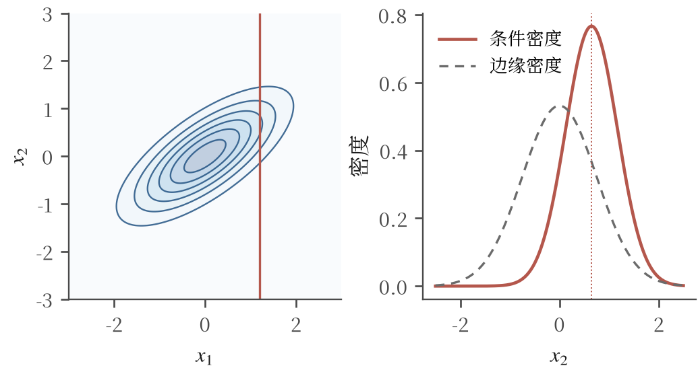
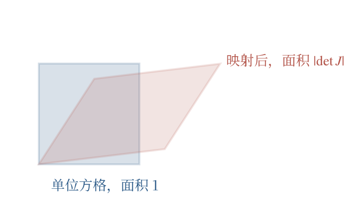
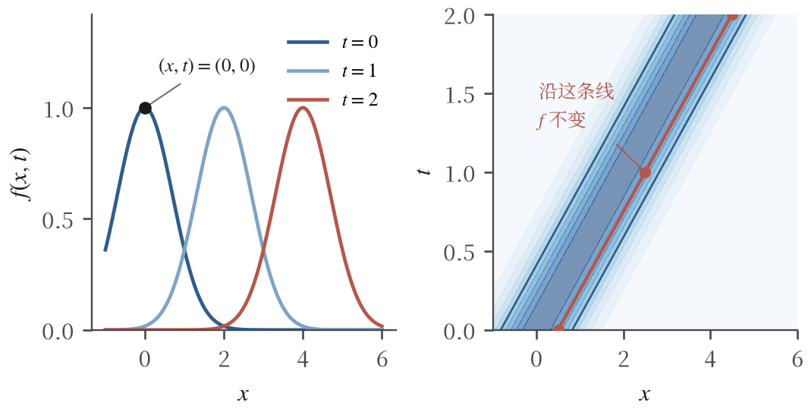

# 需要的数学

这一章把后面反复用到的工具集中讲一遍。它们大多在概率论和微积分课上出现过，只是当时没说清楚能用来干什么。每讲完一个，会指出它在后面哪一章派上用场，读到那里卡住时可以回来查。

已经熟悉这些内容的读者，可以只读每节的最后一段。

## 条件期望与全期望

设 $X$ 和 $Y$ 是两个随机变量，$E[X \mid Y = y]$ 是一个关于 $y$ 的函数。把它写成 $g(y)$，那么 $g(Y)$ 本身又是个随机变量，记作 $E[X \mid Y]$。

全期望公式说的是

$$E[X] = E_Y\big[E[X \mid Y]\big].$$

证明在离散情形下一行就能写完。设 $Y$ 取值为 $y_1, y_2, \dots$，则

$$\begin{aligned}
E_Y\big[E[X|Y]\big] &= \sum_k p(y_k)E[X|Y=y_k] = \sum_k p(y_k)\sum_x x\,p(x|y_k) \\
&= \sum_x x\sum_k p(x,y_k) = \sum_x x\,p(x).
\end{aligned}$$

最后一步用了 $p(x,y) = p(x|y)p(y)$。连续情形把求和换成积分，其余不变。

这个公式看起来平淡，但它是变分下界、扩散模型的损失推导、流匹配的等价性证明共同依赖的第一步。用法通常是：某个量 $E[f(X)]$ 不好算，把它拆成 $E[E[f(X)|Y]]$ 之后，内层期望有闭式解，外层可以用样本估计。

### 全方差公式

同一套思路可以推到方差上，把总波动拆成“组内”与“组间”两块：

$$\mathrm{Var}(X) = E_Y\big[\mathrm{Var}(X\mid Y)\big] + \mathrm{Var}_Y\big(E[X\mid Y]\big).$$

第一项是同一组内部的平均波动，第二项是各组均值之间的差异。等号右边两项都非负，所以条件信息 $Y$ 只可能把方差变小，不可能变大。

算例。设 $Y$ 以 $0.2$ 的概率取 1、以 $0.8$ 的概率取 0；$Y=0$ 时 $X\sim\mathcal N(0,1)$，$Y=1$ 时 $X\sim\mathcal N(3,1)$。那么 $E[X\mid Y]=3Y$，$E[X]=3\times0.2=0.6$。组内方差恒为 1，所以第一项是 1；$3Y$ 的方差是 $9\times0.2\times0.8=1.44$。合起来 $\mathrm{Var}(X)=2.44$。不经公式直接按混合分布核对：两组的二阶矩各为 $0.8\times(1+0)=0.8$ 与 $0.2\times(1+9)=2$，合计 2.8，减去均值平方 0.36，仍是 2.44。

条件生成里，第二项是“条件能解释的那部分变化”，第一项是“解释不了的”。两者之比决定了条件能把生成结果推多远，第 10 章讨论引导强度时会回到这个比值。

### 条件均值是最优的均方预测

全期望还有一个变形，它在生成模型里的地位比公式本身更高：给定 $Y$，所有可测函数 $h(Y)$ 中，使均方误差 $E[(X-h(Y))^2]$ 最小的那个就是 $h(Y)=E[X\mid Y]$。

证明两行。把 $X-E[X\mid Y]$ 记作 $\eta$，则对任意 $h$，

$$E\big[(X-h(Y))^2\big] = E\big[(X-E[X\mid Y])^2\big] + E\big[(E[X\mid Y]-h(Y))^2\big],$$

交叉项 $2E\big[\eta\,(E[X\mid Y]-h(Y))\big]$ 为零。理由是全期望：先固定 $Y$，括号里第二因子只依赖 $Y$，可提出，而 $E[\eta\mid Y]=0$。于是误差分解成“条件本身带来的不可消除部分”与“预测偏离条件均值的部分”，后者非负且仅当 $h=E[X\mid Y]$ 时为零。

这个结论解释了很多现象。任何以均方误差训练的回归器，最优解都是条件均值，而不是“最可能的那个值”。当同一条件下 $X$ 有两个同样可能的取值时，条件均值落在两者中间，输出的就是一个“平均颜色”。第 4 章讲 VAE 图像偏模糊时，根源在这里；扩散模型用均方误差预测噪声而不直接出图，也是因为均方误差只适合预测均值，不适合预测多峰的分布。

## 高斯分布的四件事

高斯出现在本书里的频率高得离谱，因为几乎所有模型都假设某个条件分布是高斯的。有四件事必须记牢：积分怎么算、线性变换后还是高斯、条件化后还是高斯、两个高斯之间的距离怎么量。

### 高斯积分与配方

高斯的归一化常数来自一个积分，而它的算法只有一种：把指数上的二次式配成完全平方。一维的形式是

$$\int_{-\infty}^{\infty} e^{-ax^2/2+bx}\,dx = \sqrt{\frac{2\pi}{a}}\;e^{b^2/(2a)},\qquad a>0.$$

配方那一行是

$$-\frac a2 x^2 + bx = -\frac a2\left(x-\frac ba\right)^2 + \frac{b^2}{2a},$$

展开右边可以看出多出来的常数正好抵消：$-\frac a2 x^2 + bx - \frac{b^2}{2a} + \frac{b^2}{2a}$。代回积分，令 $u=\sqrt a\,(x-b/a)$，则 $dx = du/\sqrt a$，指数变成 $-u^2/2$：

$$\int e^{-ax^2/2+bx}dx = e^{b^2/(2a)}\cdot\frac{1}{\sqrt a}\int e^{-u^2/2}du = \sqrt{\frac{2\pi}{a}}\,e^{b^2/(2a)}.$$

剩下的 $\int e^{-u^2/2}du=\sqrt{2\pi}$ 在直角坐标下没有初等原函数，要等换到极坐标才能算，下一节末尾会把它算出来。

公式的用处有两块。第一块是矩：配上适当的常数项后，取 $b=\mu/\sigma^2+t$ 就得到矩母函数

$$E\big[e^{tX}\big] = e^{\mu t+\sigma^2t^2/2},$$

对 $t$ 求一次导在 $t=0$ 处得 $\mu$，求两次得 $\mu^2+\sigma^2$，方差随之出来。这份推导比“高斯的一阶矩二阶矩分别是……”可靠，因为不需要额外记忆。第二块是多维推广。

### 多维积分与矩阵配方

设 $A$ 对称正定，$b$ 是向量，则

$$\int_{\mathbb R^d} e^{-\frac12 x^\top Ax + b^\top x}\,dx = (2\pi)^{d/2}|A|^{-1/2}\exp\left(\frac12 b^\top A^{-1}b\right).$$

推导用特征分解。写 $A=U\Lambda U^\top$，$U$ 正交、$\Lambda$ 对角且元素为正。换元 $x=U\Lambda^{-1/2}y$，则 $x^\top Ax = y^\top y$，雅可比的绝对值是 $|\det(U\Lambda^{-1/2})| = |\Lambda|^{-1/2}$，线性项变成 $c^\top y$，其中 $c=\Lambda^{-1/2}U^\top b$。指数于是分成了 $d$ 个独立的一元积分，每个用一维公式得 $\sqrt{2\pi}\,e^{c_i^2/2}$，乘起来是

$$(2\pi)^{d/2}\exp\left(\frac12\|c\|^2\right)|\Lambda|^{-1/2}.$$

再用 $\|c\|^2 = b^\top U\Lambda^{-1}U^\top b = b^\top A^{-1}b$ 与 $|\Lambda|^{1/2}=|A|^{1/2}$，就是上面的结果。

配方在矩阵形式下写法一样，只是除法换成了逆：

$$-\frac12 x^\top Ax + b^\top x = -\frac12\big(x-A^{-1}b\big)^\top A\big(x-A^{-1}b\big) + \frac12 b^\top A^{-1}b.$$

展开右端前一项得 $-\frac12x^\top Ax + x^\top b - \frac12b^\top A^{-1}b$，与左边只差那个常数。这告诉你两件事：二次型在 $A^{-1}b$ 处取到最大值；整个积分等于“峰值 $e^{\frac12b^\top A^{-1}b}$ 乘上一个体积因子 $(2\pi)^{d/2}|A|^{-1/2}$”。把 $A=\Sigma^{-1}$、$b=\Sigma^{-1}\mu$ 代进去，峰值在 $\mu$，体积因子是 $(2\pi)^{d/2}|\Sigma|^{1/2}$，正是高斯密度的归一化常数。换句话说，高斯的归一化常数就是它的峰值乘以宽度，记住这一点，写密度时不会丢因子。

### 线性变换

若 $x \sim \mathcal{N}(\mu, \Sigma)$，$A$ 是常数矩阵，则

$$Ax + b \sim \mathcal{N}(A\mu + b,\ A\Sigma A^\top).$$

这条可以从特征函数推，也可以直接用“高斯变量的线性组合仍是高斯”这个性质。它的用处是：只要知道每个样本怎么由高斯噪声线性组合而成，就能立刻写出它的分布。第 6 章的 $x_t = \sqrt{\bar\alpha_t}\,x_0 + \sqrt{1-\bar\alpha_t}\,\epsilon$ 用的就是这一条。

反过来也成立，而且更有用：任意高斯都能写成“标准正态乘一个矩阵再加均值”。任取一个满足 $LL^\top=\Sigma$ 的下三角矩阵（Cholesky 分解），令 $x=\mu+L\epsilon$，$\epsilon\sim\mathcal N(0,I)$，则 $x\sim\mathcal N(\mu,\Sigma)$。这给了一个通用的采样方法：先抽标准正态，再乘 $L$。

算例。$\Sigma=\begin{bmatrix}4 & 1.2\\ 1.2 & 1\end{bmatrix}$，Cholesky 因子是 $L=\begin{bmatrix}2 & 0\\ 0.6 & 0.8\end{bmatrix}$，验证 $LL^\top=\begin{bmatrix}4 & 1.2\\ 1.2 & 0.36+0.64\end{bmatrix}$，对上了。注意 $L$ 的下三角形式本身有含义：第一个坐标只由 $\epsilon_1$ 决定，第二个才用上 $\epsilon_2$，这就是“逐维生成”。

反方向的变换也存在：$\Sigma^{-1/2}(x-\mu)$ 服从标准正态，这一步叫白化。两个方向合起来的意思是，高斯族内部的所有分布只差一个线性变换，所以可以用一个标准正态“跑遍”它们。生成模型里的重参数化、扩散的前向加噪、连续归一化流的端点匹配，都是把随机性固定成标准正态后用线性映射送到目标分布，只是映射从矩阵变成了神经网络。

用 Cholesky 而不用特征分解，理由在成本：两者都是 $O(d^3)$，但前者的常数小一个量级（大致是 $d^3/3$ 对 $10d^3$ 左右），也不需要在有重特征值时处理特征向量的不唯一。代价是要求 $\Sigma$ 正定——在高斯模型里这总是成立，所以没有理由选更贵的那一个。

### 条件分布

设 $(x_1, x_2)$ 联合高斯，均值 $\mu = (\mu_1, \mu_2)$，协方差分块为

$$\Sigma = \begin{bmatrix} \Sigma_{11} & \Sigma_{12} \\ \Sigma_{21} & \Sigma_{22} \end{bmatrix}.$$

则给定 $x_2$ 后，$x_1$ 的分布仍是高斯

$$x_1 \mid x_2 \sim \mathcal{N}\!\left(\mu_1 + \Sigma_{12}\Sigma_{22}^{-1}(x_2-\mu_2),\ \Sigma_{11} - \Sigma_{12}\Sigma_{22}^{-1}\Sigma_{21}\right).$$

这个公式值得亲手推一遍，因为它同时给出了条件化与消去一个变量两种操作。以一维为例：设 $x_1, x_2$ 联合高斯，均值为零，方差为 $\sigma_1^2, \sigma_2^2$，相关系数为 $\rho$。联合密度的指数部分是

$$-\frac{1}{2(1-\rho^2)}\left(\frac{x_1^2}{\sigma_1^2} - 2\rho\frac{x_1x_2}{\sigma_1\sigma_2} + \frac{x_2^2}{\sigma_2^2}\right).$$

把 $x_2$ 当作常数，对 $x_1$ 配方

$$\frac{x_1^2}{\sigma_1^2} - 2\rho\frac{x_1x_2}{\sigma_1\sigma_2} = \frac{1}{\sigma_1^2}\left(x_1 - \rho\frac{\sigma_1}{\sigma_2}x_2\right)^2 - \rho^2\frac{x_2^2}{\sigma_2^2}.$$

于是条件密度正比于 $\exp\!\big(-(x_1 - \rho\sigma_1x_2/\sigma_2)^2 / (2\sigma_1^2(1-\rho^2))\big)$，也就是均值为 $\rho\sigma_1x_2/\sigma_2$、方差为 $\sigma_1^2(1-\rho^2)$ 的高斯。对照上面的分块公式，$\Sigma_{12}\Sigma_{22}^{-1} = \rho\sigma_1\sigma_2/\sigma_2^2 = \rho\sigma_1/\sigma_2$，完全一致。

用图 3.1 那组参数算一遍。$\sigma_1=1$、$\sigma_2=0.75$、$\rho=0.72$，取 $x_2=1.2$：条件均值是 $\rho\sigma_1x_2/\sigma_2=0.72\times1.2/0.75\approx1.15$，条件方差是 $\sigma_1^2(1-\rho^2)\approx0.482$。边缘方差是 1，条件化后少了一半，少掉的那一半就是 $x_2$ 提供的信息。落到曲线上：条件密度的峰值是 $1/\sqrt{2\pi\times0.482}\approx0.575$，边缘密度的峰值是 $1/\sqrt{2\pi\times0.5625}\approx0.532$，方差小了，峰自然变尖。

### 条件分布：矩阵推导

一维的配方可以原样搬到多维，只是配方要写成矩阵形式。用精度矩阵（协方差的逆）推最省事。设均值为零（有均值时先减掉），记 $\Lambda=\Sigma^{-1}$ 并分块为

$$\Lambda = \begin{bmatrix}\Lambda_{11} & \Lambda_{12}\\ \Lambda_{21} & \Lambda_{22}\end{bmatrix},$$

联合密度正比于 $\exp\left(-\frac12 x^\top\Lambda x\right)$，$x=(x_1,x_2)$。乘开，按 $x_1$ 的二次项、交叉项、$x_2$ 的二次项分组：

$$-\frac12\left[x_1^\top\Lambda_{11}x_1 + 2x_1^\top\Lambda_{12}x_2 + x_2^\top\Lambda_{22}x_2\right].$$

交叉项前面是 2，因为 $\Lambda_{12}=\Lambda_{21}^\top$，两个交叉项相等。现在把 $x_2$ 当常数，对 $x_1$ 配方，目标形式是 $-\frac12(x_1-m)^\top\Lambda_{11}(x_1-m)$。展开后一次项是 $-x_1^\top\Lambda_{11}m$，要和 $-x_1^\top\Lambda_{12}x_2$ 对上，只能取

$$m = -\Lambda_{11}^{-1}\Lambda_{12}x_2.$$

配方剩下的余项是 $-\frac12\left[x_2^\top\Lambda_{22}x_2 - x_2^\top\Lambda_{21}\Lambda_{11}^{-1}\Lambda_{12}x_2\right]$，它不含 $x_1$，条件化时就是常数（它决定了 $x_2$ 的边缘密度）。于是

$$x_1\mid x_2 \sim \mathcal N\!\left(-\Lambda_{11}^{-1}\Lambda_{12}x_2,\ \Lambda_{11}^{-1}\right).$$

这已经是可直接用的形式，但还差一步：把精度矩阵的分块换回协方差的分块，才能和前面的公式对照。用 $\Sigma\Lambda=I$ 的左上块与左下块：

$$\Sigma_{11}\Lambda_{11} + \Sigma_{12}\Lambda_{21} = I,\qquad \Sigma_{21}\Lambda_{11}+\Sigma_{22}\Lambda_{21}=0.$$

第二式给 $\Lambda_{21}=-\Sigma_{22}^{-1}\Sigma_{21}\Lambda_{11}$，代进第一式，$\Lambda_{11}$ 在右边提出：

$$\left(\Sigma_{11}-\Sigma_{12}\Sigma_{22}^{-1}\Sigma_{21}\right)\Lambda_{11} = I.$$

括号里的矩阵叫 $\Sigma_{22}$ 在 $\Sigma$ 中的 Schur 补，它可逆（联合协方差正定且 $\Sigma_{22}$ 可逆），于是条件协方差

$$\Lambda_{11}^{-1} = \Sigma_{11}-\Sigma_{12}\Sigma_{22}^{-1}\Sigma_{21}.$$

再由对称性 $\Lambda_{12}=\Lambda_{21}^\top=-\Lambda_{11}\Sigma_{12}\Sigma_{22}^{-1}$，得

$$-\Lambda_{11}^{-1}\Lambda_{12} = \Sigma_{12}\Sigma_{22}^{-1},$$

条件均值就是 $\Sigma_{12}\Sigma_{22}^{-1}x_2$，和分块公式一致。两种写法各有用处：协方差形式直接给出均值和方差，精度矩阵形式在“已知一部分变量”时更接近计算现场，因为条件化就是把不需要的块消掉。

还有一层含义需要点明。条件协方差是 Schur 补，它比 $\Sigma_{11}$ 小，小的量正是 $\Sigma_{12}\Sigma_{22}^{-1}\Sigma_{21}$——被 $x_2$ 解释掉的那部分不确定性。一维时这退化成 $\sigma_1^2(1-\rho^2)$，相关系数越接近 1，条件化后越确定。

系数 $\Sigma_{12}\Sigma_{22}^{-1}$ 扮演的是回归系数的角色：它把 $x_2$ 的变化按协方差方向搬到 $x_1$ 上。条件方差是剩下的部分——按这个系数回归之后的残差方差。一维时系数是 $\rho\sigma_1/\sigma_2$，正是熟悉的一元回归斜率；多维时它变成一个矩阵，每一列对应一个自变量的偏回归系数。这个角度和后面向量微积分一节的最小二乘解是同一件事：线性最小均方误差估计就是在 $x_2$ 的张成空间上做正投影，投影系数完全由协方差决定。

### 两个高斯相乘

两个高斯密度相乘，结果还是高斯（差一个归一化常数）。用精度矩阵写，规律很短：

$$\Lambda=\Lambda_1+\Lambda_2,\qquad \Lambda\mu = \Lambda_1\mu_1+\Lambda_2\mu_2.$$

理由在指数上。把两个二次式乘起来等于把指数相加，二次项系数相加、一次项系数也相加，所以精度相加、精度乘均值相加。一维时就是 $1/\sigma^2 = 1/\sigma_1^2+1/\sigma_2^2$，即“两个独立测量合并，精度相加、方差倒数相加”。

乘出来的东西积分不为 1，所以不是密度，用之前要除归一化常数。这个常数在算后验时常常不需要显式写出，因为它与 $x$ 无关；但要在采样或算 KL 时用，就得补上：由上一小节的体积因子，归一化后两个高斯乘积的方差是 $(\Lambda_1+\Lambda_2)^{-1}$。第 6 章推后验 $q(x_{t-1}\mid x_t,x_0)$ 时用的就是这一条，乘的两个因子分别是 $q(x_t\mid x_{t-1})$ 与 $q(x_{t-1}\mid x_0)$，都在 $x_{t-1}$ 上取高斯。

### 两个高斯之间的 KL 散度

设 $q = \mathcal{N}(\mu_1, \sigma_1^2)$，$p = \mathcal{N}(\mu_2, \sigma_2^2)$，都是一维。KL 散度定义为

$$\mathrm{KL}(q\|p) = \int q(x)\log\frac{q(x)}{p(x)}\,dx = E_q[\log q - \log p].$$

把两个高斯的对数密度代进去

$$\log q(x) = -\tfrac12\log(2\pi\sigma_1^2) - \frac{(x-\mu_1)^2}{2\sigma_1^2},\qquad \log p(x) = -\tfrac12\log(2\pi\sigma_2^2) - \frac{(x-\mu_2)^2}{2\sigma_2^2}.$$

相减，常数项给出 $\frac12\log(\sigma_2^2/\sigma_1^2)$。二次项部分需要 $E_q[(x-\mu_1)^2] = \sigma_1^2$ 与 $E_q[(x-\mu_2)^2] = \sigma_1^2 + (\mu_1-\mu_2)^2$。整理得

$$\mathrm{KL}(q\|p) = \frac12\left[\log\frac{\sigma_2^2}{\sigma_1^2} + \frac{\sigma_1^2+(\mu_1-\mu_2)^2}{\sigma_2^2} - 1\right].$$

取 $p$ 为标准正态，即 $\mu_2 = 0, \sigma_2 = 1$，得到

$$\mathrm{KL}\big(\mathcal{N}(\mu,\sigma^2)\,\|\,\mathcal{N}(0,1)\big) = \frac12\left(\mu^2 + \sigma^2 - \log\sigma^2 - 1\right).$$

三项各有分工。$\mu^2$ 把均值拉向零，$\sigma^2$ 让方差不要太小，$-\log\sigma^2$ 让方差不要太大，两者在 $\sigma = 1$ 处取到最小值零。第 4 章的 VAE 损失里，这一项逐维相加就是正则项。

多维对角高斯的情形，KL 等于各维 KL 之和。原因是联合密度是各维密度之积，对数把乘积变成求和。这一点让 VAE 的实现非常省事。

两项的梯度都很温和：对 $\mu_j$ 就是 $\mu_j$，对 $\log\sigma_j^2$ 是 $\frac12(1-\sigma_j^2)$，在最优解附近都接近零。这意味着 KL 项不会把训练带飞，但它能很快把自己降到很小——这一点在第 4 章会以“后验坍塌”的形式成为麻烦。

这个下界在最优点附近非常平坦，值得算一下。取 $q=\mathcal N(0,s^2)$、$p=\mathcal N(0,1)$：$s^2=1.2$ 时 KL 是 $\frac12(1.2-\log1.2-1)\approx0.009$ nat，$s^2=0.8$ 时约 $0.012$ nat，而均值偏离 0.1 只花 $0.005$ nat。方差差了两三成才花掉百分之一 nat 的量级。KL 项因此在最优解附近几乎拉不住 $q$，但一旦 $\mu$ 跑到几个标准差之外就很决断；这种“中心软、外围硬”的形状，正好对应了它既要容忍真实后验的偏离、又要阻止潜空间失控的双重角色。

### KL 不对称的两个方向

KL 不是距离，调换顺序值就变。把 $q=\mathcal N(0,1)$、$p=\mathcal N(0,4)$ 代入上式：$\mathrm{KL}(q\|p)=\frac12(4-\log4-1)\approx0.807$，$\mathrm{KL}(p\|q)=\frac12(0.25+\log4-1)\approx0.318$，差了一倍多。

数值上的差别只是表面，真正的区别在两者的“惩罚区域”。$\mathrm{KL}(q\|p)=E_q[\log q-\log p]$ 是在 $q$ 放质量的地方看 $p$ 有多小，所以 $q$ 会避开 $p$ 几乎为零的区域，宁愿挑一个峰缩进去。这叫寻模式。反方向的 $\mathrm{KL}(p\|q)=E_p[\log p-\log q]$ 是在 $p$ 有质量的地方看 $q$ 漏了多少，漏掉一整个峰很贵，所以 $q$ 会摊开盖住所有的峰，代价是在谷地放了一堆本来不该有的质量。这叫覆盖模式。

两个方向的失效长得不一样。设想真实数据是一条双峰分布，模型族只能给单峰。覆盖模式会把峰摊平、把谷地填满，输出模糊；寻模式会选定一个峰，输出干净但丢掉一半数据。最大似然（第 4 章的重构项）属于前者，变分推断里对近似后验的 $\mathrm{KL}(q\|p)$ 属于后者，GAN 的 JS 在平衡点上两边各占一半。同一个 KL 符号在两个地方的意思刚好相反，读公式时要看谁在期望里面。

## 变量替换公式

设 $x$ 是随机向量，密度为 $p_X(x)$，$y = g(x)$ 是一个可逆可微的映射。那么 $y$ 的密度是

$$p_Y(y) = p_X\big(g^{-1}(y)\big)\cdot\left|\det\frac{\partial g^{-1}}{\partial y}\right|.$$

一维时它退化成熟悉的形式 $p_Y(y) = p_X(x)\,|dx/dy|$。

雅可比行列式的绝对值可以理解成体积比。取 $x$ 附近一个边长为 $\delta$ 的小方块，体积是 $\delta^d$。映射 $g$ 把它压成一个平行多面体，体积是 $\delta^d|\det J|$，其中 $J$ 是 $g$ 在 $x$ 处的雅可比矩阵。概率质量必须守恒，所以密度要乘上这个体积比。

### 极坐标：雅可比是 $r$

二维的情形可以手算完。取 $x=r\cos\theta$、$y=r\sin\theta$，$r\ge0$，$\theta\in[0,2\pi)$，雅可比矩阵是

$$J = \begin{bmatrix}\partial x/\partial r & \partial x/\partial\theta\\ \partial y/\partial r & \partial y/\partial\theta\end{bmatrix} = \begin{bmatrix}\cos\theta & -r\sin\theta\\ \sin\theta & r\cos\theta\end{bmatrix},$$

行列式 $\cos\theta\cdot r\cos\theta-(-r\sin\theta)\cdot\sin\theta = r(\cos^2\theta+\sin^2\theta)=r$。于是 $dx\,dy = r\,dr\,d\theta$。

多出来的那个 $r$ 有几何解释。半径 $r$ 处、宽度 $dr$ 的环带，周长 $2\pi r$，面积 $2\pi r\,dr$；按角度分成 $d\theta$ 一份，每份就是 $r\,dr\,d\theta$。直角坐标里的小方块处处一样大，极坐标里越往外环带越长，面积元就得乘 $r$。

用它算高斯的归一化常数。把 $x^2+y^2=r^2$ 代进去，角度方向直接积出 $2\pi$：

$$\iint e^{-(x^2+y^2)/2}dx\,dy = 2\pi\int_0^\infty r e^{-r^2/2}dr = 2\pi\Big[-e^{-r^2/2}\Big]_0^\infty = 2\pi.$$

而直角坐标下它是两个一维积分的乘积，每个应为 $\sqrt{2\pi}$，乘起来正好 $2\pi$。这一步给出了 $\sqrt{2\pi}$ 的来历，前面高斯积分一节里欠下的那笔账在这里结清。

顺带得到两个事实。二维标准高斯的半径密度是 $re^{-r^2/2}$（$r\ge0$），比 $r=0$ 处的密度小，期望半径是 $\sqrt{\pi/2}\approx1.25$；维度升高后半径越来越集中在 $\sqrt d$ 附近（第 2 章讲过这个集中现象）。写成一般形式就是 $dx = r^{d-1}dr\,d\Omega$，球坐标下体积元带一个 $r^{d-1}$，这是高维球体积公式里 $(\cdot)^{d}$ 的来源。

反过来用极坐标也能造高斯样本。取 $u_1,u_2$ 独立均匀分布，令

$$r=\sqrt{-2\log u_1},\qquad \theta=2\pi u_2,\qquad x=r\cos\theta,\quad y=r\sin\theta,$$

则 $x$ 与 $y$ 是两个独立标准正态。验算一步：半径的累积分布是 $P(r\le\rho)=1-e^{-\rho^2/2}$，把 $u_1$ 代进去正好得到 $1-u_1$，均匀；角度均匀、半径按 Rayleigh 分布，两者独立相乘得到 $\frac{1}{2\pi}e^{-r^2/2}\cdot r\,dr\,d\theta$，而 $r\,dr\,d\theta$ 就是 $dx\,dy$，于是回到标准二维高斯的密度。这就是 Box–Muller 变换，几乎所有随机数库生成高斯都用它的变体。它在这里的意义是：从均匀分布造高斯靠的正是“极坐标下雅可比是 $r$”这一条，正反两个方向用的是同一个事实。

### 映射多对一时要按分支相加

雅可比公式要求 $g$ 可逆。如果映射是多对一的，$y$ 的一个原像不够，要把所有原像的贡献加起来：

$$p_Y(y) = \sum_{x:\,g(x)=y}\frac{p_X(x)}{|g'(x)|}.$$

例子：$x\sim\mathcal N(0,1)$，$y=x^2$。原像是 $\pm\sqrt y$，$|g'|=2\sqrt y$，两处密度相同，所以

$$p_Y(y) = \frac{2}{2\sqrt y}\cdot\frac{1}{\sqrt{2\pi}}e^{-y/2} = \frac{1}{\sqrt{2\pi y}}e^{-y/2},\qquad y>0.$$

这是自由度为 1 的卡方分布。忘了求和会得到一半的密度，积分只有 $1/2$。图像处理里带对称或折叠的变换不少（取绝对值、分块重排后拼回、$(x-0.5)^2$ 这种），检不检查归一化就能发现这类错误。

这条公式在讲连续归一化流时会再用一次，那里用它把密度怎么随流演化写成微分方程。

## Jensen 不等式与变分下界

设 $f$ 是凸函数，则 $f(E[X]) \le E[f(X)]$。

几何上，凸函数上任意两点连成的弦都位于函数图像上方，取期望相当于在弦上取点，所以函数值不超过期望值。

对数函数是凹的，所以 $-\log$ 是凸的，把 $f$ 取成 $-\log$ 就得到 $\log E[X] \ge E[\log X]$。

第 4 章要用它把 $\log p_\theta(x) = \log\int p_\theta(x|z)p(z)\,dz$ 变成可算的下界。做法是把积分写成对某个分布 $q(z)$ 的期望

$$\begin{aligned}
\log p_\theta(x) &= \log E_q\!\left[\frac{p_\theta(x|z)p(z)}{q(z)}\right] \\
&\ge E_q\!\left[\log\frac{p_\theta(x|z)p(z)}{q(z)}\right].
\end{aligned}$$

右边就是证据下界。这里只需要记住一件事：Jensen 不等式是把对数挪到期望里面的唯一理由。

![图 3.3　Jensen 不等式。凸函数上取两点，连线（期望）在函数图像上方。f(E[X]) 是弦上的点，E[f(X)] 是曲线上对应点的期望，后者更大。](../images/03/fig03_jensen.png)

这个不等式有差距，差距多大可以手算。取 $X$ 以各半概率取 1 与 9：$E[\log X]=\log3\approx1.099$，$\log E[X]=\log5\approx1.609$，差 0.51 nat。把 9 换成 4，差降到 $\log2.5-\frac12\log4\approx0.223$。差距随 $X$ 的分散程度变化，没有固定值，这也提醒一件事：下界有多紧，取决于选定的 $q$ 离真实后验有多远。

取等条件可以直接读出来。Jensen 取等要求对数里面的量几乎必然是常数，即 $p_\theta(x|z)p(z)/q(z)$ 不随 $z$ 变，等价于 $q(z)=p_\theta(z|x)$。换句话说，下界的缝隙不是某种神秘误差，而是近似后验的误差；第 4 章会把它写成一项 KL 散度，并证明缝隙恰好等于它。

## 蒙特卡洛与重要性采样

期望通常算不出来，但可以用样本估

$$E_p[f(x)] \approx \frac1N\sum_{i=1}^N f(x^{(i)}),\qquad x^{(i)}\sim p.$$

这个估计是无偏的，方差是 $\mathrm{Var}(f)/N$。要在高维里把方差压下去，$N$ 往往大得无法接受，所以需要别的手段。

$1/\sqrt N$ 这个速率有多慢，可以用估计圆周率看看。往单位正方形里随机撒点，落在内切圆里的比例是 $\pi/4\approx0.785$，这是一个伯努利试验，方差是 $0.785\times0.215\approx0.169$，所以均值的标准差是 $\sqrt{0.169/N}\approx0.41/\sqrt N$。想拿到小数点后第三位的 $\pi$，需要标准差约 $10^{-3}$，解出 $N\approx1.7\times10^5$；想多要两位，样本要再乘一万。这个例子不涉及任何模型误差，纯的蒙特卡洛就是慢在这个速率上；后面各种降低方差的手段（控制变量、重要性采样、分层抽样），目的都是把分子上那个常数弄小。

慢是相对的。一维积分用 Simpson 公式，误差是 $O(N^{-4})$，比 $1/\sqrt N$ 快得多；但把它张量积地用到 $d$ 维，每个方向只有 $N^{1/d}$ 个点，误差就变成 $O(N^{-4/d})$。$d=8$ 时 $4/d=0.5$，与蒙特卡洛打平；维再高，确定性求积就彻底输给随机采样。这就是“高维靠采样”的算术依据：不是蒙特卡洛快，而是其他方法在高维里跌得太快。

控制变量是最便宜的一种。找一个与 $f$ 相关、而期望已知的 $g$，估计改成

$$\hat\mu_c = \frac1N\sum_i\big[f(x_i)-c\big(g(x_i)-E[g]\big)\big].$$

括号里第二项的期望为零，所以无偏。方差是 $\mathrm{Var}(f)-2c\,\mathrm{Cov}(f,g)+c^2\mathrm{Var}(g)$，对 $c$ 求极值得 $c^\ast=\mathrm{Cov}(f,g)/\mathrm{Var}(g)$，此时方差降到 $\mathrm{Var}(f)(1-\rho^2)$，$\rho$ 是两者的相关系数。只要 $g$ 能解释 $f$ 一半的波动，方差就减半，等效样本数翻倍。$g$ 选得好不好完全取决于两者的相关性，所以实际用法是“把能解析算的部分减掉，再估剩下的残差”。

重要性采样换一个分布去抽

$$E_p[f(x)] = \int f(x)\frac{p(x)}{q(x)}q(x)\,dx = E_q\!\left[f(x)\frac{p(x)}{q(x)}\right].$$

只要 $q$ 在 $p$ 不为零的地方也不为零，这个等式就成立。它的实际价值在于：如果 $p$ 不好采样而 $q$ 好采样，就可以从 $q$ 抽样本再加权重。

代价是方差。权重 $p/q$ 在 $q$ 的尾部比 $p$ 薄的地方会爆炸，几个样本就能主导整个估计。实际使用时要检查权重的分布，有效样本数 $(\sum w_i)^2/\sum w_i^2$ 是一个常用的诊断量。

### 方差的推导

把权重记作 $w(x)=p(x)/q(x)$，估计量 $\hat\mu=\frac1N\sum_i f(x_i)w(x_i)$，$x_i\sim q$。它的期望是

$$E_q[\hat\mu] = E_q[f w] = \int f\frac pq\,q\,dx = \int f\,p\,dx = E_p[f],$$

无偏。方差是单样本方差的 $1/N$：

$$\mathrm{Var}_q(\hat\mu) = \frac1N\left(E_q[f^2w^2] - (E_p f)^2\right) = \frac1N\left(E_p[f^2w] - \mu^2\right),$$

最后一步用了 $E_q[f^2w^2]=\int f^2\frac{p^2}{q^2}q\,dx=\int f^2\frac pq\,p\,dx=E_p[f^2w]$。直接采样 $p$ 的方差是 $\frac1N(E_p[f^2]-\mu^2)$，两式只差一个因子：重要性采样的方差等于把 $f^2$ 先乘上 $w$ 再取期望。所以选 $q$ 的目标不是“和 $p$ 像”，而是“在 $f^2$ 大的地方，$q$ 不要比 $p$ 薄”——$w$ 在这些地方大于 1 就赔，小于 1 就赚。

一个能完整手算的例子。取 $p=\mathcal N(0,1)$、$f\equiv1$、$q=\mathcal N(0,\sigma^2)$。真值是 1，而

$$E_q[w^2] = \int\frac{p^2}{q}dx = \frac{\sigma}{\sqrt{2\pi}}\int e^{-x^2(1-1/(2\sigma^2))}dx = \frac{\sigma}{\sqrt{2-1/\sigma^2}}.$$

$\sigma=1$ 时它等于 1，方差为零；$\sigma=2$（$q$ 比 $p$ 宽）时为 1.51，方差 0.51；$\sigma=0.74$（$q$ 比 $p$ 窄）时为 1.77，方差 0.77；$\sigma=0.72$ 时涨到 2.70。$\sigma$ 再往 $1/\sqrt2\approx0.707$ 靠近，分母趋零，方差发散——此时 $q$ 的尾部比 $p$ 薄得太多，权重在尾部指数增长，一个偶然落到尾部的样本就能把均值拉跑。

![图 3.4　重要性采样的方差代价。左：$p=\mathcal{N}(0,1)$ 与被选作提议分布的 $q=\mathcal{N}(0,0.74^2)$，$q$ 的尾部比 $p$ 薄。右：用 $q=\mathcal{N}(0,\sigma^2)$ 估计 $E_p[1]$ 时单样本方差 $\mathrm{Var}_q[w]$ 随 $\sigma$ 的变化，由解析式算出，在 $\sigma\to1/\sqrt2$ 处发散。](../images/03/fig03_importance.png)

图 3.4 右半的两侧不对称：$q$ 太宽时方差按 $\sigma/\sqrt2$ 缓慢增长，$q$ 太窄时是发散。实用结论是提议分布宁宽勿窄，宽了只是效率降，窄了是无界风险。

### 有效样本数

权重本身的分散程度可以告诉你这批样本值多少。如果 $N$ 个权重完全相等，有效样本就是 $N$；如果只有一个权重非零，有效样本是 1。取

$$\mathrm{ESS} = \frac{\left(\sum_i w_i\right)^2}{\sum_i w_i^2},$$

这两个极端分别给出 $N$ 与 1。它的来历是：$w_i$ 独立同分布，样本多时 $\left(\sum w_i\right)^2\approx N^2(E_qw)^2$，$\sum w_i^2\approx NE_q[w^2]$，相除得

$$\mathrm{ESS}\approx N\frac{(E_qw)^2}{E_q[w^2]} = \frac{N}{1+\mathrm{CV}^2(w)},\qquad \mathrm{CV}^2(w)=\frac{\mathrm{Var}_q(w)}{(E_qw)^2}.$$

因为 $E_qw=1$，$\mathrm{CV}^2(w)=E_q[w^2]-1$，正是上一小节那个量。把前面的数代进去：$\sigma=0.74$ 时 $\mathrm{ESS}\approx0.56N$，$\sigma=0.72$ 时降到 $0.37N$，意味着抽 $10^4$ 个样本只顶得上三四千个。工程上的做法是先抽一小批看 $\mathrm{ESS}/N$，低于 $0.1$ 就换提议分布，或改用自归一化形式 $\hat\mu=\sum w_if_i/\sum w_i$（有偏，但不会被单个极端权重带飞）。

还有一个每天都用得到的小恒等式。若干个量对数级相差很大时，直接取指数再加会溢出，做法是先减掉最大值：

$$\log\sum_i e^{a_i} = a_{\max}+\log\sum_i e^{a_i-a_{\max}}.$$

右边每一项都在 $(0,1]$ 内，不会溢出，结果与左边完全相同。后面的对数似然、重要性权重、各种下界都要用这个写法。溢出不是理论问题：权重的对数相差上百是常事，`exp` 一下就变成 `inf`，整个 batch 的损失随之变成 `NaN`，而且往往只在个别样本上出现，调试时很难定位到源头。

第 7 章的噪声预测目标用的就是这个思路：把一个算不出来的期望，换成一个可以采样、并且最优解不变的期望。区别只在于它们换的是条件分布，不是重要性分布。

## 向量微积分

后面会反复出现几个算子。梯度 $\nabla_x f$ 是标量函数对向量的导数，结果与 $x$ 同维。散度 $\mathrm{div}\,\boldsymbol{f} = \sum_i \partial f_i/\partial x_i$ 是向量场对向量的导数，结果是标量。拉普拉斯算子 $\Delta f = \mathrm{div}\nabla f = \sum_i \partial^2 f/\partial x_i^2$。

雅可比矩阵把这三者统一起来。对向量值函数 $F:\mathbb{R}^d\to\mathbb{R}^m$，$J_{ij} = \partial F_i/\partial x_j$，是一个 $m\times d$ 的矩阵。

雅可比向量积（JVP）指 $Jv$，用雅可比矩阵乘一个向量，结果是 $m$ 维。它的计算成本常常被误解。如果只想要 $Jv$ 而不想要整个 $J$，用前向模式的自动微分，成本与一次前向传播同阶；如果先算出 $J$ 再乘，成本是 $d$ 倍。反过来，向量雅可比积 $u^\top J$ 用反向模式自动微分算，成本与一次反向传播同阶，深度学习里的梯度都是这一种。

几个反复用到的恒等式，逐分量展开就能验：

$$\nabla_x(a^\top x)=a,\qquad \nabla_x(x^\top Ax)=(A+A^\top)x,\qquad \nabla_x\|x\|^2=2x,$$

$$\mathrm{div}(f\boldsymbol v)=\nabla f\cdot\boldsymbol v+f\,\mathrm{div}\,\boldsymbol v.$$

最后一条是乘积法则的向量版，算连续性方程时一步就用到。还有一条关于高斯密度的：若 $p(x)=\mathcal N(\mu,\Sigma)$，则

$$\nabla_x\log p(x)=-\Sigma^{-1}(x-\mu).$$

这个量叫得分，它指向“往哪边走密度变大”。注意它是线性的，而且权重是精度矩阵：方差小的方向，得分变化得快。第 6 章起这个符号会反复出现，扩散模型的整个训练目标就是去拟合它。

还有一个与期望有关的恒等式，后面化简损失时省很多事：若 $x\sim\mathcal N(\mu,\Sigma)$，$A$ 是任意方阵，则

$$E[x^\top Ax] = \mu^\top A\mu + \mathrm{tr}(A\Sigma).$$

推导三行。写 $x=\mu+L\epsilon$（$LL^\top=\Sigma$）并展开二次型：

$$x^\top Ax = \mu^\top A\mu + 2\mu^\top AL\epsilon + \epsilon^\top L^\top AL\epsilon.$$

中间一项期望为零（$E[\epsilon]=0$）。最后一项用 $E[\epsilon^\top M\epsilon]=\mathrm{tr}(M)$（对 $M=L^\top AL$ 逐分量展开即可），再用迹的轮换性 $\mathrm{tr}(L^\top AL)=\mathrm{tr}(ALL^\top)=\mathrm{tr}(A\Sigma)$。均值部分的平方加上方差部分的贡献，就是上式。注意 $A$ 不需要对称，也不需要正定，只要维度对得上。

一个具体用法：二次型的最小值。设 $A$ 是 $m\times d$ 的矩阵，$\|\cdot\|^2$ 是欧氏范数，则

$$\nabla_x\|Ax-b\|^2 = 2A^\top(Ax-b).$$

令梯度为零得正规方程 $A^\top Ax=A^\top b$，$A^\top A$ 可逆时解是 $(A^\top A)^{-1}A^\top b$。如果把 $A^\top A$ 看成精度矩阵、$A^\top b$ 看成“精度乘均值”，这正好是上一节配方里那个最大值点 $A^{-1}b$。所以“线性观测下的高斯后验均值”与“最小二乘解”是同一个东西，只是说法不同。第 6 章推后验时会用到这种写法，图像编辑里把反演误差写成二次型目标时也是同一个式子。

## 随流导数

设 $x_t$ 满足常微分方程 $dx_t/dt = v(x_t,t)$，$f(x,t)$ 是一个标量场。沿着轨迹看，$f$ 的变化率是

$$\frac{d}{dt}f(x_t,t) = \partial_t f(x_t,t) + \nabla_x f(x_t,t)\cdot v(x_t,t).$$

推导只用链式法则：$f$ 同时通过 $t$ 和 $x_t$ 依赖时间，两项相加。第一项是站在原地看场随时间的变化，第二项是被流带着走、穿过空间上不同的场值。

这个导数在流体力学里叫物质导数。一个具体的图像：坐在小船上测水温，温度计读数的变化率，等于水温场本身随时间的变化，加上船划过不同水域带来的变化。

### 一维平流：手算一次

设 $v$ 是常数，$f(x,t)=\varphi(x-vt)$。这个场整体向右平移，形状不变，是最简单的平流。代进上式，$\partial_t f=-v\varphi'(x-vt)$，$\nabla_x f=\varphi'(x-vt)$，两项正好相消：

$$\frac{d}{dt}f(x_t,t) = -v\varphi'(x-vt)+v\varphi'(x-vt)=0.$$

也就是说，沿轨迹 $x_t=x_0+vt$，场值不变。场在动，值不动。

取具体数字。$\varphi(\xi)=e^{-\xi^2/0.98}$（标准差 0.7 的高斯包），$v=2$，看 $(x,t)=(1,0)$ 这一点：$f=e^{-1/0.98}\approx0.36$，$\partial_t f=2(x-2t)f/0.49\approx1.47$，$\partial_x f=-(x-2t)f/0.49\approx-0.74$。两项相加 $1.47+2\times(-0.74)=0$，在舍入误差内为零。

可以用差商核对。走 $\Delta t=0.01$，该点变为 $f(1,0.01)=e^{-0.98}\approx0.375$，差商 $(0.375-0.360)/0.01\approx1.49$，与 $\partial_t f$ 的 1.47 吻合。两者的微小差别就是二阶项，步长越小越接近。

### 密度沿流的变化

把上面的结论用到概率密度上，就得到连续归一化流的核心公式。设 $p_t$ 是时刻 $t$ 的密度，$\boldsymbol v_t$ 是速度场。概率质量守恒写成连续性方程

$$\partial_t p_t+\mathrm{div}(p_t\boldsymbol v_t)=0.$$

用乘积法则展开散度，移项得

$$\partial_t p_t+\boldsymbol v_t\cdot\nabla p_t = -p_t\,\mathrm{div}\,\boldsymbol v_t.$$

左边正是 $p_t$ 沿轨迹的物质导数，两边同除 $p_t$：

$$\frac{d}{dt}\log p_t(x_t) = -\mathrm{div}\,\boldsymbol v_t(x_t).$$

密度沿轨迹的对数变化率等于速度场散度的负值。流在把邻域推开（散度为正）时密度下降，在汇聚时密度上升。第 17 章用它把“流的变换”翻译成“密度的变化”，从而写出精确似然；反方向的采样也是同一式，只是时间倒着走、散度变号。

一个推论值得先记住：若 $\mathrm{div}\,\boldsymbol v\equiv0$（不可压缩流），密度沿轨迹完全不变。保体积的变换不会改变任何东西的密度，图像编辑里那些“只搜位置、不改分布”的操作就属于这一类。

二维旋转流是这类情形最简单的例子。取 $\boldsymbol v(x,y)=(-y,\,x)$，散度是 $\partial(-y)/\partial x+\partial x/\partial y=0$，于是密度沿轨迹不变。轨迹本身是圆周：从 $(0,1)$ 出发逆时针转，四分之一圈后到 $(-1,0)$，半径没变，这正是“旋转保持面积”的微分版。相比之下，径向流 $\boldsymbol v=(x,y)$ 的散度是 2（$d$ 维时等于 $d$），密度沿轨迹按 $e^{-dt}$ 下降，因为空间在向外撑开。

## 一个容易被忽略的陷阱

最后提醒一件事：期望和梯度不能随便交换。

$$\nabla_\theta E_{z\sim q_\theta}[f(z)] \ne E_{z\sim q_\theta}[\nabla_\theta f(z)].$$

右边等于零（如果 $f$ 不显含 $\theta$），左边一般不为零，因为采样分布本身依赖 $\theta$。这正是第 4 章要引入重参数化技巧的原因：把对分布求导改写成对确定性函数求导，让梯度能穿过采样这一步。

### 一个可以手算的反例

拿最小的例子。取 $q_\theta=\mathcal N(\theta,1)$，$f(z)=z$。左边：$E_{q_\theta}[z]=\theta$，对 $\theta$ 求导得 1，任何 $\theta$ 都一样。右边：$f$ 里根本没有 $\theta$，逐样本求导全为零，期望也是零。1 与 0，差得很干净。

差距不是某个固定常数，而是与分布的宽度挂钩。一般情况下

$$\nabla_\theta E_{q_\theta}[f] = \mathrm{Cov}_q\big(f,\ \nabla_\theta\log q_\theta\big),$$

对上例 $\nabla_\theta\log q_\theta = z-\theta$，协方差是 $\mathrm{Var}(z)=1$，正好补上那个 1。方差大的分布，同样的 $f$ 会得到更大的“漏掉的梯度”；方差为零的分布（退化分布）两边的结果相同。

更一般的做法是得分函数估计，它对分布的形式要求更少，代价是方差。

### 得分函数估计的方差

上面的协方差形式直接给了一个估计量：

$$\nabla_\theta E_{q_\theta}[f] = E_{q_\theta}\big[f(z)\,\nabla_\theta\log q_\theta(z)\big].$$

推导一行：$\nabla_\theta q_\theta=q_\theta\nabla_\theta\log q_\theta$，两边乘 $f$ 再积分。它不需要 $q_\theta$ 可重参数化，离散分布也能用，这是它的长处。代价是方差。仍取 $q_\theta=\mathcal N(\theta,1)$、$f(z)=z$，单样本估计量是 $z(z-\theta)$，令 $z=\theta+\epsilon$：

$$\mathrm{Var}\big[z(z-\theta)\big] = E\big[(\theta+\epsilon)^2\epsilon^2\big]-1 = 3+\theta^2-1 = 2+\theta^2,$$

用到标准正态的四阶矩 $E[\epsilon^4]=3$，以及均值平方为 1。$\theta=0$ 时标准差约 1.41，用 100 个样本估计一个数，误差还剩 0.14。而重参数化在这道题上的方差是零，一次采样就精确。

这就是大家在生成模型里偏爱重参数化的原因：不是它更“优雅”，而是它在同样的样本数下误差小几个量级。

### 支撑随参数动时丢的那一项

得分函数公式默认 $q_\theta$ 的支撑不随 $\theta$ 变。一旦变了，就会漏掉一项。例子：$q_\theta=\mathrm{Uniform}(0,\theta)$，$f(z)=z$。真值 $E[z]=\theta/2$，导数 $1/2$。用得分函数算，$\log q_\theta=-\log\theta$，$\nabla_\theta\log q_\theta=-1/\theta$，在固定区间上积分：

$$\int_0^\theta z\left(-\frac1\theta\right)\frac1\theta\,dz = -\frac{1}{\theta^2}\cdot\frac{\theta^2}{2}=-\frac12.$$

差的那项来自上限移动：$\frac{d}{d\theta}\int_0^\theta$ 比 $\int_0^\theta\frac{\partial}{\partial\theta}$ 多一个边界值 $z/\theta\big|_{z=\theta}=1$。$-1/2+1=1/2$，对上了。

重参数化这边不丢项，因为 $z=\theta u$（$u\sim\mathrm{Uniform}(0,1)$）把上限的变化吃进了映射本身：$\nabla_\theta z=u$，$E[u]=1/2$，一次就准。这条经验在图像上很重要：裁剪、截断、量化这类操作都会造出一段“支撑或边界随参数动”的映射，凡是这种地方，得分函数都会少算一项，而重参数化只要映射分段可微就不受影响。
