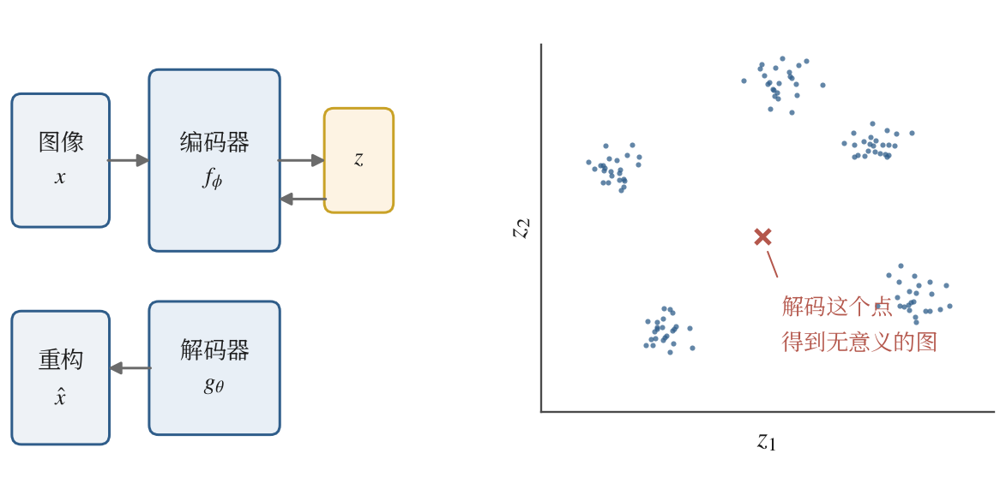
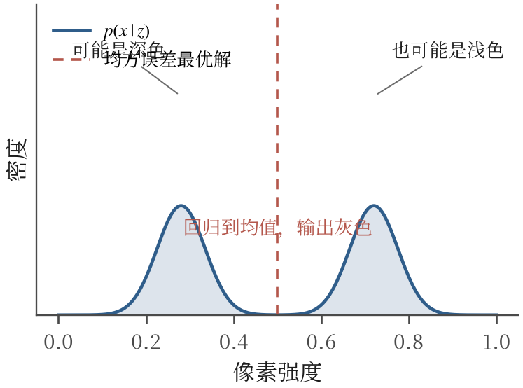

# 自编码器与变分自编码器

把一张图压成几十个数，再把这几十个数还原成原图，这件事本身不难。难的是让这几十个数有结构：随便取一组数，解码出来也应该是一张像样的图。变分自编码器就是为了让潜空间有这种结构而设计的。

这一章从普通自编码器讲起，说明它为什么不能生成，然后用变分推断补上缺失的那一块。推导会细一些，因为后面扩散模型的损失函数，本质上和这里的是同一个东西。

## 自编码器：能压缩，不能生成

自编码器由两个网络组成。编码器 $f_\phi$ 把图像映射成低维向量 $z = f_\phi(x)$，解码器 $g_\theta$ 把 $z$ 映射回图像 $\hat{x} = g_\theta(z)$。训练目标是最小化重构误差

$$L = E_{x\sim p_{\text{data}}}\big[\|x - g_\theta(f_\phi(x))\|^2\big].$$

如果潜空间的维度远小于像素数，网络就被迫只保留最重要的信息。这在压缩、去噪、特征提取上都很有用。

但它不能生成。原因很直接：训练目标只约束了数据点对应的那些 $z$，没有对潜空间的其他位置作任何要求。

图 4.1 右边画的是二维潜空间。真实数据的编码落在几块不相连的区域里，区域之间是空白。从空白处取一个 $z$ 丢给解码器，输出可能是几张图叠在一起，也可能是噪声。训练时从来没有约束过这些点，网络在那里怎么表现都是允许的。

要让潜空间可用，需要两件事：给 $z$ 一个先验分布，比如标准正态；让编码器输出的分布覆盖整个先验，而不是几个孤立的点。这就是 VAE 做的事。

## 隐变量模型与算不出的积分

VAE 把生成过程写成两步：先从先验抽一个隐变量 $z \sim p(z)$，再根据 $z$ 生成图像 $x \sim p_\theta(x|z)$。图像的边缘分布是

$$p_\theta(x) = \int p_\theta(x|z)\,p(z)\,dz.$$

训练目标是最大化 $\log p_\theta(x)$ 在数据上的期望，也就是最大似然。问题在于这个积分算不出来：$p_\theta(x|z)$ 是一个神经网络，积分没有闭式解；用蒙特卡洛估计，单个样本的方差又太大，因为高维空间里绝大多数 $z$ 对应的 $p_\theta(x|z)$ 都接近零。

换个角度看，真正想要的是后验 $p_\theta(z|x)$，它告诉我们给定这张图、哪些 $z$ 可能生成它。由贝叶斯公式

$$p_\theta(z|x) = \frac{p_\theta(x|z)p(z)}{p_\theta(x)},$$

分母又是那个算不出来的积分。分子好算，分母难算，这是贝叶斯推断里最常见的困境。

变分推断的办法是：找一个简单的分布 $q_\phi(z|x)$ 去逼近真实后验，通常是高斯，均值和方差由编码器输出；然后优化它们之间的差距。差距用 KL 散度衡量，而 KL 又通过一个可以计算的下界与似然联系起来。

## 变分下界

从恒等式出发。对任意分布 $q(z)$，这里省略它对 $x$ 的依赖，

$$\log p_\theta(x) = \log p_\theta(x)\int q(z)\,dz = \int q(z)\log p_\theta(x)\,dz.$$

把 $p_\theta(x) = p_\theta(x,z)/p_\theta(z|x)$ 代进去，再在 log 里乘一个 $q(z)$ 除一个 $q(z)$

$$\log p_\theta(x) = \int q(z)\log\frac{p_\theta(x,z)}{q(z)}\,dz + \int q(z)\log\frac{q(z)}{p_\theta(z|x)}\,dz.$$

右边第二项正是 $\mathrm{KL}(q(z)\|p_\theta(z|x))$，非负。于是

$$\log p_\theta(x) \ge \int q(z)\log\frac{p_\theta(x,z)}{q(z)}\,dz = E_q[\log p_\theta(x|z)] - \mathrm{KL}\big(q(z)\|p(z)\big).$$

这就是证据下界。它由两项组成。第一项是重构项，鼓励解码器在 $q$ 抽出的 $z$ 上还原 $x$；第二项是正则项，鼓励近似后验靠近先验。

同一个结果也可以用 Jensen 不等式得到，过程更短。两种推导给出同一个下界，第一种还额外告诉我们差距有多大，正好是 KL 散度。当 $q$ 恰好等于真实后验时，下界取等号。

用 $q_\phi(z|x)$ 替换 $q(z)$，得到要最大化的目标

$$\mathrm{ELBO}(x;\theta,\phi) = E_{q_\phi(z|x)}[\log p_\theta(x|z)] - \mathrm{KL}\big(q_\phi(z|x)\|p(z)\big).$$

两项在拉扯。重构项希望 $q$ 把 $z$ 集中到能重建 $x$ 的位置，KL 项希望 $q$ 靠近标准正态。前者让潜空间记住数据，后者让潜空间规整。

## 重参数化

要优化上面的目标，需要对 $\phi$ 求梯度，而期望是对 $q_\phi$ 取的，采样这一步挡在中间。第 3 章末尾说过，$\nabla_\phi E_{q_\phi}[f] \ne E_{q_\phi}[\nabla_\phi f]$。

重参数化技巧把随机性从参数里剥离出来。设 $q_\phi(z|x) = \mathcal{N}\big(\mu_\phi(x), \mathrm{diag}(\sigma_\phi^2(x))\big)$，则不直接从该分布采样，而是先抽一个与 $\phi$ 无关的 $\epsilon \sim \mathcal{N}(0,I)$，再令

$$z = \mu_\phi(x) + \sigma_\phi(x)\odot\epsilon.$$

这样 $z$ 仍然服从 $q_\phi$，但它对 $\phi$ 的依赖变成了确定性的函数关系，梯度可以直接穿过采样

$$\nabla_\phi E_{q_\phi}[f(z)] = E_{\epsilon}\big[\nabla_\phi f(\mu_\phi + \sigma_\phi\odot\epsilon)\big].$$

右边可以用一批 $\epsilon$ 估计，方差比得分函数估计小得多。

这个技巧有一个前提：$q_\phi$ 必须能把随机性写成参数加固定噪声的形式。高斯、拉普拉斯、均匀分布都可以，离散分布不行，这也是后来 VQ-VAE 要另想办法的原因。

## 损失函数的每一项

把下界写成可以写进代码的形式。假设先验是标准正态，近似后验是对角高斯，两个高斯之间的 KL 有闭式，第 3 章已经推过

$$\mathrm{KL}\big(q_\phi(z|x)\|\mathcal{N}(0,I)\big) = \frac12\sum_{j=1}^k\left(\mu_j^2 + \sigma_j^2 - \log\sigma_j^2 - 1\right).$$

重构项取决于解码器的形式。如果假设 $p_\theta(x|z) = \mathcal{N}(g_\theta(z), \tau^2I)$，那么

$$\log p_\theta(x|z) = -\frac{1}{2\tau^2}\|x-g_\theta(z)\|^2 - \frac d2\log(2\pi\tau^2),$$

对 $\theta$ 求最大化等价于最小化均方误差。于是总损失是

$$L = E_x\left[\frac{\|x-g_\theta(z)\|^2}{2\tau^2} + \frac12\sum_j\left(\mu_j^2+\sigma_j^2-\log\sigma_j^2-1\right)\right].$$

$\tau^2$ 决定了重构项和 KL 项的相对权重。实际实现里常常把 $\tau^2$ 固定成 1，或者给 KL 项乘一个系数 $\beta$，这就是 $\beta$-VAE 的由来。

图 4.2 解释了 VAE 生成结果偏模糊的根源。高斯解码器只能表达单峰分布，面对这个位置可能是黑色也可能是白色的情形，它的最优策略是输出灰色。这不是训练不充分，而是模型假设决定的。后来的做法有两类：换更强的解码器，用对抗损失补高频，也就是 VQGAN 的思路；或者把重构从像素空间搬到感知空间，也就是第 11 章的潜空间扩散。

## 采样与先验空洞

训练好之后，生成一张图的流程是：从 $\mathcal{N}(0,I)$ 抽 $z$，解码。

这里有一个容易忽略的问题。训练时喂给解码器的 $z$ 来自 $q_\phi(z|x)$，它们的集合叫聚合后验。这个分布和标准正态并不完全一样，它可能只占据了先验的一部分区域，也可能有几个峰。采样时从标准正态抽，落在这两个分布不重合的地方，解码器就没见过，输出质量会下降。

这个现象叫先验空洞。缓解办法包括用更灵活的近似后验、在损失里加一项让聚合后验靠近先验，或者干脆放弃从先验采样。工程上更常见的做法是接受这个缺陷，把 VAE 只当作编码器用，生成交给扩散模型，这正是潜空间扩散的思路。

## 后验坍塌

训练 VAE 时经常遇到另一种失败：KL 项很快把 $q_\phi(z|x)$ 压成标准正态，于是 $z$ 不再携带任何关于 $x$ 的信息，解码器只能忽略 $z$，靠记住训练集的平均图来降低重构误差。这叫后验坍塌。

成因可以从损失的两项看出来。训练初期解码器还很弱，重构项下降得慢；而 KL 项只要把 $\mu$ 压到零、$\sigma$ 压到一，就能立刻降到零。优化器会优先走这条容易的路。

几种常见的对策。给 KL 项乘一个小于 1 的系数，或者让它随训练步数从 0 慢慢升到 1。给每一维的 KL 设一个下限，只要这一维的 KL 还没超过下限就不计算它的梯度，强迫模型至少用掉几个 bit 的信息。换更强的解码器，让重构项在早期就能给出有用的梯度。

判断是否发生了坍塌，可以看每一维 KL 的分布。如果绝大多数维度都接近零，只有少数几维在动，说明潜空间没有被充分利用。

## 与扩散模型的接口

VAE 只有一个隐变量层。如果把层数加到 $T$ 层，每一层的编码是往上一层的输出里加一点噪声，解码是去掉一点噪声，得到的模型就是扩散模型。

这个类比不是修辞。第 7 章会证明，扩散模型的训练目标也是一个人为构造的下界，形式和上面的 ELBO 一模一样：一项是从 $x_t$ 还原 $x_{t-1}$ 的对数似然，一项是近似后验与前向过程后验的 KL。区别只在于 VAE 的隐变量是学出来的、维度低，而扩散的隐变量就是加噪后的图像本身、维度与数据相同。

理解了这一点，后面再看到扩散模型的损失函数，就不会觉得它是凭空冒出来的。
