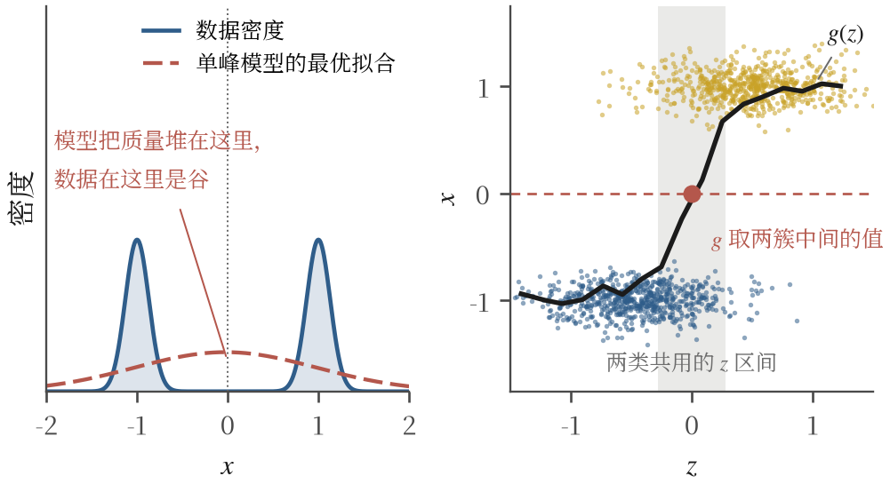

# 自编码器与变分自编码器

把一张图压成几十个数，再把这几十个数还原成原图，这件事本身不难。难的是让这几十个数有结构：随便取一组数，解码出来也应该是一张像样的图。变分自编码器就是为了让潜空间有这种结构而设计的。

这一章从普通自编码器讲起，说明它为什么不能生成，然后用变分推断补上缺失的那一块。推导会细一些，因为后面扩散模型的损失函数，本质上和这里的是同一个东西。

## 自编码器：能压缩，不能生成

自编码器由两个网络组成。编码器 $f_\phi$ 把图像映射成低维向量 $z = f_\phi(x)$，解码器 $g_\theta$ 把 $z$ 映射回图像 $\hat{x} = g_\theta(z)$。训练目标是最小化重构误差

$$L = E_{x\sim p_{\text{data}}}\big[\|x - g_\theta(f_\phi(x))\|^2\big].$$

如果潜空间的维度远小于像素数，网络就被迫只保留最重要的信息。这在压缩、去噪、特征提取上都很有用。

但它不能生成。原因很直接：训练目标只约束了数据点对应的那些 $z$，没有对潜空间的其他位置作任何要求。


图 4.1 右边画的是二维潜空间。真实数据的编码落在几块不相连的区域里，区域之间是空白。从空白处取一个 $z$ 丢给解码器，输出可能是几张图叠在一起，也可能是噪声。训练时从来没有约束过这些点，网络在那里怎么表现都是允许的。

要让潜空间可用，需要两件事：给 $z$ 一个先验分布，比如标准正态；让编码器输出的分布覆盖整个先验，而不是几个孤立的点。这就是 VAE 做的事。

## 从自编码器到变分自编码器

“不能生成”这四个字背后有一条完整的因果链，每一步都需要单独补上一个东西。把链条拆开看，比直接记住结论有用。

### 第一环：潜空间尺度是不确定的

把编码器和解码器同时换一套参数，$f'=2f$、$g'(z)=g(z/2)$，重构误差一点不变。也就是说，训练好的 AE 里“$z=1$”这个位置到底意味着什么，没有绝对含义：只要把整个潜空间抽稀或加密，同一个网络能表示完全一样的数据。

这件事的后果比看上去严重。既然潜空间的尺度是任意的，“从哪个范围采样”就没有答案；换一个随机种子重训，编码点可能落在 $[-1,1]$ 也可能落在 $[-30,30]$，同一组采样值解码出的东西完全不同。要有生成能力，必须先有一个与数据无关的、固定的参照分布，这就是先验。

### 第二环：编码点只是零散的点

即使尺度定下来，编码器给出的仍然是一堆点。假设潜空间 32 维、训练集 5 万张，这些点占据的体积相对整个潜空间小得可以忽略。高维里“点与点之间的空隙”很难凭直觉判断：随机取一个点，它到最近的编码点的距离，与任意两个编码点之间的典型距离是同一个量级，也就是说随机点相比于任何一个编码点并不更“远”。这意味着不存在“离数据近的空白区”可以安全地插值。

解码器的行为在这些空白处完全不受约束。它可能输出一片噪声，可能把两张图叠在一起，也可能输出一张训练集里没有但还算合理的图——三种都可能，取决于网络初始化。这种不确定性不是训练不充分，而是目标函数没有发言。

### 第三环：需要先验，也就需要积分

把“从哪采样”固定成先验 $p(z)$、把“给定 $z$ 生成什么”交给解码器 $p_\theta(x|z)$，模型就完整了。它的边缘分布是 $\int p_\theta(x|z)p(z)dz$，训练目标自然就是最大化这个边缘分布的对数似然。这一步把一个无约束的表示学习问题变成了一个有明确目标的最大似然问题，代价是积分。

积分算不出来，于是需要第四个东西：一个可以计算的下界。下界由一个额外的分布 $q_\phi(z|x)$ 引入，它近似真实后验，由编码器输出。这个 $q_\phi$ 还有另一个作用：它把“哪个 $z$ 能生成这张图”变成一个概率分布而不是一个点，潜空间里的空隙就被填上了。

三步连起来就是：尺度不定 → 引入先验；点太稀疏 → 把点换成分布；目标变成最大似然 → 积分算不出 → 再补一个可算的下界。每一步都在 VAE 的公式里留下一个痕迹，后面推导时可以对照着看。

## 隐变量模型与算不出的积分

VAE 把生成过程写成两步：先从先验抽一个隐变量 $z \sim p(z)$，再根据 $z$ 生成图像 $x \sim p_\theta(x|z)$。图像的边缘分布是

$$p_\theta(x) = \int p_\theta(x|z)\,p(z)\,dz.$$

训练目标是最大化 $\log p_\theta(x)$ 在数据上的期望，也就是最大似然。问题在于这个积分算不出来：$p_\theta(x|z)$ 是一个神经网络，积分没有闭式解；用蒙特卡洛估计，单个样本的方差又太大，因为高维空间里绝大多数 $z$ 对应的 $p_\theta(x|z)$ 都接近零。

先验选标准正态，图的是几件具体的事：采样便宜，一次矩阵乘就行；在仿射变换下仍然是高斯，前向加噪与重参数化都靠这个性质；“居中、各向同性、尺度为一”本身又是一个明确的约定，把潜空间的尺度定下来。代价是它可能与真实的后验形状差得很远，这个代价后面会以先验空洞的形式露出来。

积分不可枚举到什么程度，算一下就有体感。假设潜空间 32 维，每维只取 10 个格点做数值积分，格点总数是 $10^{32}$。即使每秒能算 $10^9$ 个点，也要 $10^{23}$ 秒，也就是上亿亿年。维度再高一点，“枚举”这个词就彻底失去意义。蒙特卡洛把指数代价换成了 $1/\sqrt N$ 的误差，但如第 3 章算过的，它的收敛很慢，而且这里 $p_\theta(x|z)$ 对绝大多数 $z$ 都接近零，抽中的样本几乎全是废的，方差大得不能用。

换个角度看，真正想要的是后验 $p_\theta(z|x)$，它告诉我们给定这张图、哪些 $z$ 可能生成它。由贝叶斯公式

$$p_\theta(z|x) = \frac{p_\theta(x|z)p(z)}{p_\theta(x)},$$

分母又是那个算不出来的积分。分子好算，分母难算，这是贝叶斯推断里最常见的困境。

变分推断的办法是：找一个简单的分布 $q_\phi(z|x)$ 去逼近真实后验，通常是高斯，均值和方差由编码器输出；然后优化它们之间的差距。差距用 KL 散度衡量，而 KL 又通过一个可以计算的下界与似然联系起来。

这里有个容易混淆的地方。最大似然要最大化的量含一个不可算的积分，而变分推断绕开它的方式是“只在一个局部区域内积分”——$q_\phi(z|x)$ 把质量集中在真正可能生成这张图的 $z$ 上，区域外的点几乎不参与。代价是它只能给一个下界：区域内积分得好，下界就紧；区域选错了，下界就松，而且松多少看不出来。训练只能保证“在选定的 $q$ 上最优”，不能保证“在真实似然上最优”。

## 变分下界

从恒等式出发。对任意分布 $q(z)$，这里省略它对 $x$ 的依赖，

$$\log p_\theta(x) = \log p_\theta(x)\int q(z)\,dz = \int q(z)\log p_\theta(x)\,dz.$$

把 $p_\theta(x) = p_\theta(x,z)/p_\theta(z|x)$ 代进去，再在 log 里乘一个 $q(z)$ 除一个 $q(z)$

$$\log p_\theta(x) = \int q(z)\log\frac{p_\theta(x,z)}{q(z)}\,dz + \int q(z)\log\frac{q(z)}{p_\theta(z|x)}\,dz.$$

右边第二项正是 $\mathrm{KL}(q(z)\|p_\theta(z|x))$，非负。于是

$$\log p_\theta(x) \ge \int q(z)\log\frac{p_\theta(x,z)}{q(z)}\,dz = E_q[\log p_\theta(x|z)] - \mathrm{KL}\big(q(z)\|p(z)\big).$$

这就是证据下界。它由两项组成。第一项是重构项，鼓励解码器在 $q$ 抽出的 $z$ 上还原 $x$；第二项是正则项，鼓励近似后验靠近先验。

同一个结果也可以用 Jensen 不等式得到，过程更短。两种推导给出同一个下界，第一种还额外告诉我们差距有多大，正好是 KL 散度。当 $q$ 恰好等于真实后验时，下界取等号。

用 $q_\phi(z|x)$ 替换 $q(z)$，得到要最大化的目标

$$\mathrm{ELBO}(x;\theta,\phi) = E_{q_\phi(z|x)}[\log p_\theta(x|z)] - \mathrm{KL}\big(q_\phi(z|x)\|p(z)\big).$$

两项在拉扯。重构项希望 $q$ 把 $z$ 集中到能重建 $x$ 的位置，KL 项希望 $q$ 靠近标准正态。前者让潜空间记住数据，后者让潜空间规整。

### 拆开下界的两项

上面一步用了 $p_\theta(x,z)/p_\theta(z|x)=p_\theta(x)$，把两个交叉的比值拆开。拆的细节如下，每一步都在换一种写法而已：

$$\begin{aligned}
\int q(z)\log\frac{p_\theta(x,z)}{q(z)}dz
&= \int q(z)\log\frac{p_\theta(x|z)p(z)}{q(z)}dz \\
&= \int q(z)\log p_\theta(x|z)dz + \int q(z)\log\frac{p(z)}{q(z)}dz \\
&= E_q[\log p_\theta(x|z)] - \mathrm{KL}\big(q(z)\|p(z)\big).
\end{aligned}$$

第一行把联合分布拆成似然乘先验，第二行把对数里的乘积拆成两项之和，第三行认出后一项就是 $q$ 到先验的 KL——因为 $\mathrm{KL}(q\|p)=\int q\log(q/p)=-\int q\log(p/q)$。所以两个写法是同一个东西：一个用联合分布写，一个用“重构减 KL”写。代码里用后者，因为 KL 有闭式；推导时用前者，因为它直接把缝隙写成了一项 KL。

缝隙的大小也能直接读出来：

$$\log p_\theta(x) - \mathrm{ELBO} = \mathrm{KL}\big(q_\phi(z|x)\|p_\theta(z|x)\big)\ge 0.$$

这意味着训练分两步在跑：$\phi$ 把 $q$ 拉向真实后验，$\theta$ 把似然抬高。两者耦合在一起，所以 VAE 的优化目标既不是单纯的似然也不是单纯的近似误差，而是两者的和。

### 用 Jensen 再推一遍

把边缘似然写成对 $q$ 的期望，然后直接用 $\log E[X]\ge E[\log X]$：

$$\begin{aligned}
\log p_\theta(x) &= \log\int p_\theta(x|z)p(z)dz
= \log\int q(z)\frac{p_\theta(x|z)p(z)}{q(z)}dz \\
&= \log E_q\!\left[\frac{p_\theta(x|z)p(z)}{q(z)}\right]
\ge E_q\!\left[\log\frac{p_\theta(x|z)p(z)}{q(z)}\right].
\end{aligned}$$

取等条件是括号里的比值关于 $q$ 几乎必然是常数，又正好是 $q=p_\theta(z|x)$。两条路线得到的下界一样，但第一种形式多给了一条信息：缝隙恰好是一个 KL，而非“某种非负误差”。第 3 章说过 Jensen 的缝隙取决于分布的分散程度，在这里就具体化为后验近似的误差。

### 和重要性采样的关系

把 $w(z)=p_\theta(x,z)/q_\phi(z|x)$ 看成重要性权重，边缘似然就是它的期望 $p_\theta(x)=E_q[w]$，而 ELBO 是对这个期望取对数后再用 Jensen。第 3 章讨论过重要性采样的方差，这里也能用：高维下单个权重的方差很大，$\log E_q[w]$ 与 $E_q[\log w]$ 就差得很远，下界因而不紧。这不只是一个理论遗憾，它直接决定重构质量：下界与真实似然差得多，模型就可能一边把下界推得很高、一边把真实似然放得很低。把单个样本换成 $K$ 个样本的平均再取对数（$\log\frac1K\sum_k w_k$），得到的下界比 ELBO 更紧，训练也更贵；这种写法叫重要性加权下界。

实现上，一遍前向传播算的是逐样本的下界，batch 内取平均。重构项对像素求和、KL 对维度求和，两者都是“对一张图”的量，不做 batch 内平均不会改变最优解，只会把学习率等效地乘上 batch 大小。这一点在改代码时容易搞错，梯度尺度差几十倍就可能让训练直接崩。

## 重参数化

要优化上面的目标，需要对 $\phi$ 求梯度，而期望是对 $q_\phi$ 取的，采样这一步挡在中间。第 3 章末尾说过，$\nabla_\phi E_{q_\phi}[f] \ne E_{q_\phi}[\nabla_\phi f]$。

重参数化技巧把随机性从参数里剥离出来。设 $q_\phi(z|x) = \mathcal{N}\big(\mu_\phi(x), \mathrm{diag}(\sigma_\phi^2(x))\big)$，则不直接从该分布采样，而是先抽一个与 $\phi$ 无关的 $\epsilon \sim \mathcal{N}(0,I)$，再令

$$z = \mu_\phi(x) + \sigma_\phi(x)\odot\epsilon.$$

这样 $z$ 仍然服从 $q_\phi$，但它对 $\phi$ 的依赖变成了确定性的函数关系，梯度可以直接穿过采样

$$\nabla_\phi E_{q_\phi}[f(z)] = E_{\epsilon}\big[\nabla_\phi f(\mu_\phi + \sigma_\phi\odot\epsilon)\big].$$

右边可以用一批 $\epsilon$ 估计，方差比得分函数估计小得多。

把梯度写开看得很清楚。$z=\mu+\sigma\odot\epsilon$ 对两个参数分别是 $\partial z/\partial\mu=I$、$\partial z/\partial\sigma=\mathrm{diag}(\epsilon)$，于是

$$\nabla_\mu E[f(z)] = E_\epsilon\big[\nabla_z f(z)\big],\qquad \nabla_\sigma E[f(z)] = E_\epsilon\big[\epsilon\odot\nabla_z f(z)\big].$$

均值的梯度就是“把 $z$ 往能降损失的方向推”；方差的梯度是同一个方向再乘上这次的噪声：抽到的 $\epsilon$ 大，这个样本对 $\sigma$ 的梯度就大，抽到的 $\epsilon$ 小则几乎不动。两者共用一份 $\nabla_z f$，这也是重参数化便宜的原因：不管有多少个参数，中间量只算一次。

把 $f=\log p_\theta(x|z)$、$p_\theta(x|z)=\mathcal N(g_\theta(z),\tau^2I)$ 代入，记残差 $r=x-g_\theta(z)$、解码器的雅可比 $J_g=\partial g_\theta/\partial z$，则

$$\nabla_z\log p_\theta(x|z) = \frac{1}{\tau^2}J_g^\top r,$$

方向就是“使重构误差变小的那个 $z$ 方向”。于是

$$\nabla_\mu \log p_\theta(x|z) = \frac{1}{\tau^2}J_g^\top r,\qquad \nabla_\sigma\log p_\theta(x|z) = \frac{1}{\tau^2}\epsilon\odot J_g^\top r.$$

两个式子里都有 $J_g^\top r$。当解码器已经能把重构做得很好（$r\approx0$），或者解码器对 $z$ 不敏感（$J_g$ 局部近零）时，两边的信号一起消失，训练就停在那里；后验坍塌正好落在后一种情况。

实现上有两个细节。一是网络不直接输出 $\sigma$，而是输出 $\log\sigma^2$，再取 $\sigma=\exp(\frac12\log\sigma^2)$。好处是不要额外的正性约束，也不会在 $\sigma\to0$ 时除法溢出；坏处是早期容易把 $\log\sigma^2$ 估到很小的值，导致 $\sigma$ 被压成零、采样变成确定性。二是 KL 项不需要重参数化，它有闭式，直接算就行；只有重构项需要对采样求导。框架里用 `rsample` 而不是 `sample` 就是在做这件事：前者保留梯度路径，后者把采样当常数。

这个技巧有一个前提：$q_\phi$ 必须能把随机性写成参数加固定噪声的形式。高斯、拉普拉斯、均匀分布都可以，离散分布不行，这也是后来 VQ-VAE 要另想办法的原因。

## 损失函数的每一项

把下界写成可以写进代码的形式。假设先验是标准正态，近似后验是对角高斯，两个高斯之间的 KL 有闭式，第 3 章已经推过

$$\mathrm{KL}\big(q_\phi(z|x)\|\mathcal{N}(0,I)\big) = \frac12\sum_{j=1}^k\left(\mu_j^2 + \sigma_j^2 - \log\sigma_j^2 - 1\right).$$

重构项取决于解码器的形式。如果假设 $p_\theta(x|z) = \mathcal{N}(g_\theta(z), \tau^2I)$，那么

$$\log p_\theta(x|z) = -\frac{1}{2\tau^2}\|x-g_\theta(z)\|^2 - \frac d2\log(2\pi\tau^2),$$

对 $\theta$ 求最大化等价于最小化均方误差。于是总损失是

$$L = E_x\left[\frac{\|x-g_\theta(z)\|^2}{2\tau^2} + \frac12\sum_j\left(\mu_j^2+\sigma_j^2-\log\sigma_j^2-1\right)\right].$$

$\tau^2$ 决定了重构项和 KL 项的相对权重。实际实现里常常把 $\tau^2$ 固定成 1，或者给 KL 项乘一个系数 $\beta$，这就是 $\beta$-VAE 的由来。

### 常数项与 bits/dim

上面那个对数似然里的 $-\frac d2\log(2\pi\tau^2)$ 不含参数，对 $\theta$ 求梯度时直接消失，所以损失函数里干脆不写。但它不是零，忽略它会让绝对值失真。

算一下量级。$256\times256$ 的彩色图 $d=3\times65536=196608$，取 $\tau^2=1$，常数项是 $\frac d2\log(2\pi)\approx1.8\times10^5$ nat。报告“每维多少个 bit”时，这一项必须加回去。它折算成 bit 是 $0.5\log_2(2\pi)\approx1.33$ bit/维；再加上误差项在 $\tau^2$ 等于平方误差时的 $0.5$ nat，合计 $0.5\log_2(2\pi e)\approx2.05$ bit/维，正是方差为 1 的高斯在每维上的熵。换个说法：固定 $\tau=1$ 的高斯解码器天生带一个 1.33 bit/维 的底数，即使重构完美，报出来的 bits/dim 也在 2 附近。这个量常常报到小数点后两三位，所以两个人用不同的 $\tau^2$（或者一个用均方误差、一个用交叉熵）时，数字直接不可比。

### $\tau^2$ 到底在调什么

把总损失乘上 $2\tau^2$ 不改变最优解：

$$E\big[\|x-g_\theta(z)\|^2\big] + 2\tau^2\,\mathrm{KL}.$$

所以真正起作用的不是 $\tau^2$ 本身，而是 $\beta_{\text{eff}}=2\tau^2$ 这个比值。$\tau$ 小，等于假设解码器很准，重构项强势，模型愿意把一切细节都塞进 $z$；$\tau$ 大，等于假设解码器本身就很吵，KL 相对变强，$z$ 被推向先验，后验坍塌的风险升高。许多实现里“把重构损失乘一个系数”（例如乘 0.1 或 1000）改的就是这个量。

$\tau^2$ 也可以学。固定 $\theta$，对 $-\log p_\theta(x|z)$ 关于 $\tau^2$ 求导并令其为零：

$$-\frac{d}{2\tau^2}+\frac{\|x-g_\theta(z)\|^2}{2\tau^4}=0\quad\Longrightarrow\quad \tau^2=\frac1d\|x-g_\theta(z)\|^2.$$

最优 $\tau^2$ 就是当前的平均每维平方误差，此时重构项恰好等于常数 $\frac d2$。这听上去很像“模型自己决定该相信多少像素”，但它把两个本应分开的量绑在了一起：重构一变好，$\tau^2$ 跟着变小，等效 $\beta=2\tau^2$ 也跟着变小，KL 的约束越来越弱，训练后期先验几乎不起作用，先验空洞随之加重。再加上 $\tau^2$ 在早期估不稳（残差大时 $\tau^2$ 大、重构梯度被压小，残差小时梯度又会被 $1/\tau^2$ 放大），多数实现宁可把它固定成常数。

### 换解码器：伯努利与交叉熵

高斯不是唯一选择。对归一化到 $[0,1]$ 的像素，常假设每个像素服从伯努利分布，$p_\theta(x|z)=\prod_i q_i^{x_i}(1-q_i)^{1-x_i}$，$q=g_\theta(z)$。它的对数似然是

$$\log p_\theta(x|z)=\sum_i\big[x_i\log q_i+(1-x_i)\log(1-q_i)\big],$$

加上负号就是二元交叉熵。两种解码器的差别不只是损失函数的形式。均方误差的梯度是残差本身，误差大时梯度可以很大，一次更新就可能把权重推得很远；交叉熵的梯度是 $x_i-q_i$，被限制在 $[-1,1]$，预测错得再离奇也不会爆。这一点在 0/1 像素上很重要：一张几乎全黑的图上出现一块白，均方误差会给出很大的梯度，交叉熵的反应则温和得多。另一层差别在噪声模型：均方误差假设每个像素的噪声方差相同，交叉熵假设方差随均值变（伯努利的方差是 $q(1-q)$，中间灰最大、黑白两端最小），后者更贴近像素在两端聚集的行为。生成彩色图像时两者都有人用，选哪个更多取决于归一化方式与数值稳定性。


图 4.2 解释了 VAE 生成结果偏模糊的根源。高斯解码器只能表达单峰分布，面对这个位置可能是黑色也可能是白色的情形，它的最优策略是输出灰色。这不是训练不充分，而是模型假设决定的。后来的做法有两类：换更强的解码器，用对抗损失补高频，也就是 VQGAN 的思路；或者把重构从像素空间搬到感知空间，也就是第 11 章的潜空间扩散。



同一个道理在一维里看得更直接。把数据换成一维的两个尖峰（比如 $x=-1$ 与 $x=+1$ 各一半），模型只允许用一个高斯或一条回归曲线去拟合。左图里单峰拟合的均值和方差由矩匹配决定，曲线在 $x=0$ 处最高，而那正是数据最稀的地方，生成的样本于是大量落在两峰之间。

右图从编码器的角度看同一件事。把编码器想象成一条把 $x$ 映到 $z$ 的映射，它的输出带噪声，两簇数据的 $z$ 区间就会重叠；解码器要在重叠区给出一个值，但它看不到“这次是哪一簇”，只能给出条件均值，也就是 0。两簇越接近，重叠越大，输出越向中间靠。要消除这种模糊，模型需要知道“当前是哪个模式”，而一个高斯隐变量的后验无法携带这个信息；扩散模型靠把 $z$ 换成与数据同维的 $x_t$ 绕开了这一点，那里的条件分布可以是多峰的，只是我们只用它预测均值、不直接采样。

重叠多少才致命，可以作个粗估。若两簇编码的均值相距 $\delta$、每簇编码的标准差是 $\sigma_z$，那么 $\delta/\sigma_z$ 到四左右时两边已经几乎不重叠，解码器在各自的区间里可以给出正确值；这个比值降到两左右，重叠区就占了可观的质量，落在重叠区的样本只能得到中间值。这里的数字是量级估计，不是精确阈值。真实图像里这种“同一个 $z$ 对应多种可能”的情况远比一维玩具多，这就是为什么潜空间很小的时候模糊几乎不可避免。

## 采样与先验空洞

训练好之后，生成一张图的流程是：从 $\mathcal{N}(0,I)$ 抽 $z$，解码。

这里有一个容易忽略的问题。训练时喂给解码器的 $z$ 来自 $q_\phi(z|x)$，它们的集合叫聚合后验。这个分布和标准正态并不完全一样，它可能只占据了先验的一部分区域，也可能有几个峰。采样时从标准正态抽，落在这两个分布不重合的地方，解码器就没见过，输出质量会下降。

把聚合后验写出来更清楚。它对数据取平均：

$$q_\mathrm{agg}(z) = \frac1N\sum_{n=1}^N q_\phi(z\mid x_n).$$

若每张图的后验都很窄，这个平均就是把 $N$ 个子高斯摆在一起，形状完全取决于数据有多少种、编码器把它们分得多开。数据只有几百张、每张的 $\mu$ 又彼此相距很远时，$q_\mathrm{agg}$ 就是几百个孤立的尖峰串在一起，而标准正态是单峰且铺满整个空间的。两者耦合得很差，生成效果自然差。

诊断的办法很直接：从先验抽 1000 个 $z$，算它们在 $q_\mathrm{agg}$ 下的对数密度，再拿训练集的编码点做对比。先验样本的平均对数密度明显更低（相差几个 nat 以上），说明它们落在聚合后验的稀疏区域——也就是“空洞”里。这个检查不需要额外训练，训练完做一次就行。

这个现象叫先验空洞。缓解办法包括用更灵活的近似后验、在损失里加一项让聚合后验靠近先验，或者干脆放弃从先验采样。工程上更常见的做法是接受这个缺陷，把 VAE 只当作编码器用，生成交给扩散模型，这正是潜空间扩散的思路。

## 后验坍塌

训练 VAE 时经常遇到另一种失败：KL 项很快把 $q_\phi(z|x)$ 压成标准正态，于是 $z$ 不再携带任何关于 $x$ 的信息，解码器只能忽略 $z$，靠记住训练集的平均图来降低重构误差。这叫后验坍塌。

成因可以从损失的两项看出来。训练初期解码器还很弱，重构项下降得慢；而 KL 项只要把 $\mu$ 压到零、$\sigma$ 压到一，就能立刻降到零。优化器会优先走这条容易的路。

### 从梯度看这个不动点

把两项的梯度写开会更清楚。KL 项对 $\mu_j$ 的梯度是 $\mu_j$，对 $\log\sigma_j^2$ 的梯度是 $\frac12(1-\sigma_j^2)$。在 $\mu_j=0$、$\sigma_j=1$ 处两个梯度都是零，这是个不动点：一旦到达，除非重构项把它推开，否则再也出不来。

重构项对 $\mu_j$ 的梯度要经过解码器的雅可比传回来（上一节写过的 $\frac{1}{\tau^2}J_g^\top r$），量级与 $\|J_g\|$ 成正比。训练初期解码器权重很小，$\|J_g\|$ 也很小，于是两边的力量对比是“KL 立刻能降，重构迟迟不动”，优化器自然选前者。这个失衡在两种情况下更严重：解码器容量很大时，它发现“不看 $z$ 也能把训练集记住”，重构对 $z$ 的梯度就彻底消失；$\tau^2$ 固定得很大时，重构项整体被压小，KL 占上风。反过来，解码器弱到连重构都做不好时，$z$ 里放不放信息也无关紧要，KL 仍然会赢。

几种常见的对策。给 KL 项乘一个小于 1 的系数，或者让它随训练步数从 0 慢慢升到 1。给每一维的 KL 设一个下限，只要这一维的 KL 还没超过下限就不计算它的梯度，强迫模型至少用掉几个 bit 的信息。换更强的解码器，让重构项在早期就能给出有用的梯度。

一旦彻底坍塌，想靠继续训练救回来几乎做不到。原因是 $\mu_j$ 与 $\log\sigma_j^2$ 已经在不动点上，重构项对这些参数的梯度经过解码器传回来时，路径上每一层的权重都已经学会了“不看 $z$”，梯度一次次被乘成零。可行的做法是重启，并改变初始条件：从 $\beta=0$ 开始预热、先把解码器的最后一层重初始化，或者干脆给每一维加一个固定的信息下限。

### 诊断的四个检查

只看总损失是看不出坍塌的，因为坍塌后损失也一直在降。可行的检查有四个。

逐维 KL 曲线：把每一维的 KL 单独记录、画成 $k$ 条随步数变化的曲线。健康的情形是少数维先升后稳、其余接近零；坍塌的情形是所有维在很短的步数内一起跌到 $10^{-3}$ 以下。

活跃维计数：对每一维算 $\mu_j$ 在数据集上的方差，低于阈值（常见量级是 $10^{-2}$）的算作不活跃。不活跃维占绝大多数时，潜空间就只在少数几维上工作。

敏感性测试：固定一张图，把某一维的 $z_j$ 从 $\mu_j$ 加减 $\sigma_j$，看解码输出变多少。变化小于像素噪声，这一维就没被用上。与上一条相比，它直接测“解码器是不是真的读这一维”，而不只是测编码器输出了什么。

重构基线对照：另外训一个小模型，强制 $z\equiv0$，得到重构损失 $L_0$。如果当前模型的重构损失与 $L_0$ 只差百分之几，说明 $z$ 几乎没帮上忙。这个基线很便宜，也是最不容易自欺的一个。

顺带区分两个容易混的现象。后验坍塌是“KL 太小，$z$ 里没有信息”；先验空洞是“KL 不小，但聚合后验与先验错位”。前者的表现是重构也不准、生成多样性差；后者是重构很好、但直接从先验采样时质量崩。两者可以同时发生，也可以各自单独发生。

判断是否发生了坍塌，可以看每一维 KL 的分布。如果绝大多数维度都接近零，只有少数几维在动，说明潜空间没有被充分利用。

## 正则项的两个旋钮

### $\beta$-VAE

把 KL 项乘上一个系数，直接在完整目标上动刀：

$$\mathcal L_\beta = -E_{q_\phi(z|x)}\big[\log p_\theta(x|z)\big] + \beta\,\mathrm{KL}\big(q_\phi(z|x)\|p(z)\big).$$

$\beta>1$ 把 KL 的权重提得很高（常见的取法是 4 到 10）。原始动机是解耦：每一维能携带的信息被压得更少，模型就不得不让不同的维负责不同的因素。代价是重构变差，而且 $\beta$ 太大时直接坍塌——为了解耦而加的正则也会把潜变量压死。$\beta<1$ 是反方向：先验约束变弱，重构变好，但聚合后验离先验更远，先验空洞更严重。所以 $\beta$ 不是越大越好或越小越好，它只是在“重构质量”与“潜空间可用”之间挑一个点。

把 $\beta$ 与 $\tau^2$ 放在一起看，会得到一个有用的尺度感。若 $k$ 维、每维 KL 恰好 0.5，总 KL 是 $0.5k$ nat；32 维对应 16 nat，约 23 bit。潜变量整体携带的信息就是几十 bit 的量级，而一张 8 位 $64\times64$ 灰度图的原始描述长度是 32768 bit。潜空间不存图，它存的是被压到极致的概要，后验坍塌就是把这个概要压到几 bit 甚至零。

### free bits

逐维设下限，惩罚只在超过下限后才生效：

$$\mathcal L = -E_q\big[\log p_\theta(x|z)\big] + \sum_{j=1}^k \max\big(\lambda,\ \mathrm{KL}_j\big).$$

某一维的 KL 低于 $\lambda$ 时，这一项是常数，梯度为零，模型得不到“继续压它”的好处；超过 $\lambda$ 之后才正常惩罚。取 $\lambda=0.5$ nat、$k=32$，潜空间至少保留 16 nat（约 23 bit），不会全塌。

$\lambda$ 的取值有讲究。太小（0.01）等于没设；太大（比如 5）会把每一维都强行撑开，退化成不许压缩，重构质量跟着下降。常见的取值在 0.1 到 1 nat 之间。它比 $\beta$ 好在不区分维：有信息可装的维可以超过下限，没信息可装的维停在下限，不需要人去猜“应该用几维”。

### KL 预热

第三种做法不给下限，而是让系数随时间变化：

$$\beta_t = \min\big(1,\ t/T_w\big).$$

训练初期 $\beta\approx0$，只有重构项在动，解码器先学会“怎么用 $z$”；等 $J_g$ 有足够大的信号之后，再把 KL 项加进来。$T_w$ 取得太小等于直接设 $\beta=1$，取得太大（比如一半的训练步数）会让 KL 与重构长期不同步：KL 项在后期突然加码，训练损失出现一次跳变，有时直接把已经学好的潜向量打回原形。实践中常取总步数的百分之几到十分之一；按 epoch 而非按步数升 $\beta$ 的版本在不同数据集间更好搬迁。

## 一次训练步骤里发生了什么

把前面所有式子拼成一段循环，形状写清楚，实现时基本不会错。

```text
x:        (B, C, H, W)          图像 batch
mu, lv = encoder(x)              (B, k), (B, k)     lv 是 log sigma^2
eps    = randn_like(mu)          (B, k)
z      = mu + exp(0.5 * lv) * eps
recon  = decoder(z)              (B, C, H, W)
rec    = sum((x - recon) ** 2, axis=[1,2,3])       逐样本求和
kl     = 0.5 * sum(mu**2 + exp(lv) - lv - 1, axis=1)  逐维求和
loss   = mean(rec / (2 * tau2) + beta_t * kl)
loss.backward()
```

三个求和轴的选择是新手最容易搞错的。重构项对通道、高、宽求和，得到“一张图的误差”；KL 项对潜变量维求和，得到“一张图用了多少 nat”。两边都不对 batch 求和，最后统一取平均。如果重构项用了 `mean` 而 KL 用了 `sum`，两项的相对权重会错一个因子 $CHW$——在 $256^2$ 的图上就是十几万倍，训练会直接失效。

$\beta_t$ 就是上一节的预热系数。日志里建议把 `rec` 与 `kl` 分开记录，只看 `loss` 是看不出坍塌的：两者一个升一个降时，总和可能看起来很平稳，而实际上潜变量已经死了。

还有一个容易忽略的细节：`exp(0.5 * lv)` 在 `lv` 很大时会溢出。工程上直接把它截断在 $[-10, 10]$ 范围内，代价是梯度在极端处失真，但比起一个 NaN 要好得多。同理，均值也建议加一个范数上限，防止早期某个 batch 把编码器推到很远的地方。

## 与扩散模型的接口

VAE 只有一个隐变量层。如果把层数加到 $T$ 层，每一层的编码是往上一层的输出里加一点噪声，解码是去掉一点噪声，得到的模型就是扩散模型。

不过这个类比有个明显的缺口。层数一多，后验 $p(z_{1:T}|x)$ 依然算不出来，而“用编码器直接回归一个高斯”的做法也不可行：中间的每一层都是同样维度的图像，让一个网络一次性输出 $T$ 个高斯意味着输出量是原图的 $T$ 倍，而且 $T$ 大时相邻层的后验彼此高度相关，学出来的方差会把这种相关性完全忽略。

实际的做法是每层只考虑“给定上一层往下一步”的一小段。因为每一步只加了一点点噪声，逆过程近似为高斯是合理的；于是整个问题的难点从“一个巨大的后验”变成了 $T$ 个“几乎同一形状的小后验”。这就是为什么扩散模型能用同一个网络在所有时间步上复用，也是为什么它要求 $T$ 足够大（上千步）：步长越大，“每步都是高斯”这个近似越可疑。

这个类比不是修辞。第 7 章会证明，扩散模型的训练目标也是一个人为构造的下界，形式和上面的 ELBO 一模一样：一项是从 $x_t$ 还原 $x_{t-1}$ 的对数似然，一项是近似后验与前向过程后验的 KL。区别只在于 VAE 的隐变量是学出来的、维度低，而扩散的隐变量就是加噪后的图像本身、维度与数据相同。

理解了这一点，后面再看到扩散模型的损失函数，就不会觉得它是凭空冒出来的。
