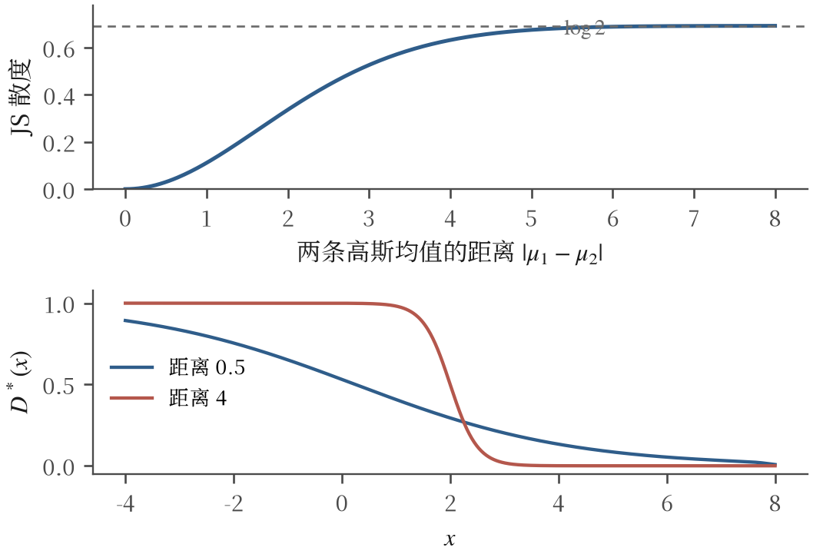
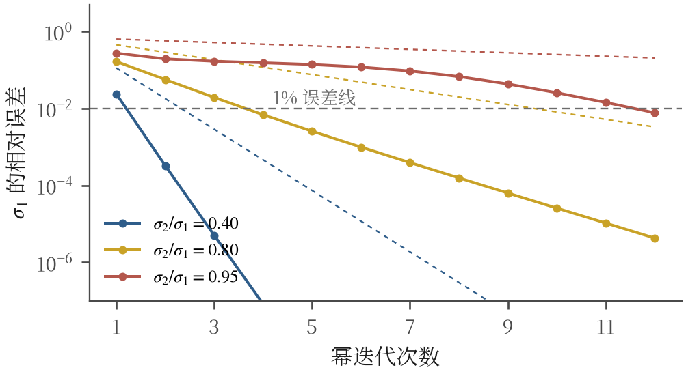
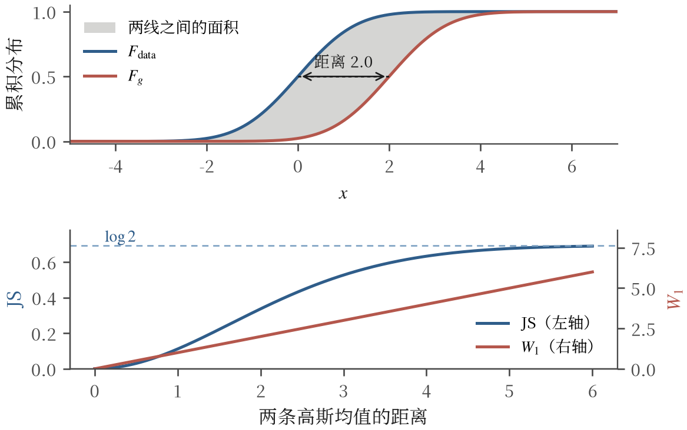

# 生成对抗网络

变分自编码器要写出密度的近似，还要假设隐变量和条件分布的形状。生成对抗网络换了一条完全不同的路：不写密度，只训练一个评委，让生成器去讨好它。

这条路在 2014 年提出时效果并不好，直到 2015 年的 DCGAN 才稳定下来。它的优点是采样只需一次前向，缺点是训练极不稳定。理解它为什么不稳定，是理解后来扩散模型为什么流行的前提。

## 动机：只需要能判断真假

假设有人给你一张图，问你像不像照片。你不需要知道照片的分布，只需要一个判断。GAN 把这件事交给一个判别网络 $D$，让它给出这张图来自真实数据的概率。

这个判断比写出密度便宜得多。一张 $256\times256$ 的彩色图有 $256\times256\times3\approx 2\times10^{5}$ 个数，每个数落在 256 个取值上，所有可能的图有 $256^{2\times10^{5}}$ 种。写密度要求这些概率加起来正好等于 1，也就是要算一个归一化常数；这个常数既没有闭式，也没法用采样估准。判断真假只需要一个标量输出，它不必归一化，甚至不必是合法的概率——把实数过一遍 sigmoid 就够了。

生成器 $G$ 把噪声 $z$ 映射成图，判别器 $D$ 判断真假。两者交替训练：$D$ 要学会区分，$G$ 要学会骗过 $D$。训练结束后丢掉 $D$，只留 $G$ 采样。

与 VAE 放一起比，能看到两者在“什么叫像”上的分歧。VAE 的解码器用均方误差或高斯似然训练，模型不确定时最安全的做法是输出均值，而很多细节的均值就是一片模糊。一张人脸的眼睛，如果模型不知道应该睁还是闭，它会输出半睁半闭的平均值，看上去就是糊的。GAN 没有均值可退：判别器只要看到一点糊的痕迹就说假，所以生成器必须把某一个具体的样子完整地画出来。同样的数据，VAE 的样本偏模糊，GAN 的偏锐利，原因就在这里——一个是拟合均值，一个是拟合“能被当成真的某个样本”。

这套设定绕开了似然。我们不需要 $p_\theta(x)$ 的表达式，只需要能采样、能比较。代价是训练目标变成了两个网络的博弈，没有单一的损失曲线可以看。

判别器实际上在干一件很特殊的事：把一个模糊的标准翻译成一个可监督的任务。人说的“像照片”没有定义，但一旦把它拆成“能区分这批真图和这批假图”，就有了标签、有了损失、有了反向传播。生成器拿到的不是一个像素级的正确答案，而是一个方向：“这些地方被看出来了”。这种间接监督是 GAN 的本钱，也是它的病根：信号的质量完全取决于判别器当下能看出多少。

省掉密度的代价具体落在哪里，值得先说清楚。VAE 有一条能画出来的曲线，它是负 ELBO 的均值，下降说明拟合在变好。GAN 有两条曲线，判别器那条在升，生成器那条在降，两条曲线都不告诉你图长什么样。判断一个 GAN 训到了哪一步，实际做法是每隔几百步存一批样本去看。这也是它后来在工程上让人头疼的原因之一：能自动化的监控手段少了。

## 博弈的形式

记真实分布为 $p_{\text{data}}$，生成分布为 $p_g$（$z\sim p(z)$，$x = G(z)$）。GAN 的目标是

$$\min_G\max_D V(D,G) = E_{x\sim p_{\text{data}}}[\log D(x)] + E_{z\sim p(z)}[\log(1-D(G(z)))].$$

判别器想把这个值做大：真实样本上 $D(x)$ 越接近 1 越好，生成样本上 $D$ 越接近 0 越好。生成器想把第二项做大，也就是让 $D(G(z))$ 接近 1。

$p_g$ 是一个推前分布（push-forward）：把 $p(z)$ 沿 $G$ 推过去。$z$ 的维数通常远小于 $x$，所以 $p_g$ 没有通常意义上的密度，它的质量集中在 $G$ 的像上，是一个低维流形。式子里并不需要 $p_g$ 的密度：第一个期望对真实样本求，第二个对 $z$ 求，都能用采样近似。这是 GAN 能绕开似然的技术原因。

两个 $\min$ 与 $\max$ 的顺序不能交换。$\max_D\min_G V$ 与 $\min_G\max_D V$ 一般不等，后者总是不小于前者。GAN 用的是后者：先固定 $D$ 让 $G$ 动，再固定 $G$ 让 $D$ 动，交替进行。交替梯度下降找的是这个博弈的局部均衡点，而不是某个标量函数的极小点。因此“训练收敛”在 GAN 里没有定义良好的判据：两条曲线可以都不动，样本却在变差；也可以一直抖，样本反而在变好。

## 最优判别器

先固定 $G$，求最优的 $D$。把期望写成积分

$$V = \int p_{\text{data}}(x)\log D(x)\,dx + \int p_g(x)\log(1-D(x))\,dx.$$

被积函数在每个 $x$ 上独立，可以逐点最大化。设 $a = p_{\text{data}}(x)$，$b = p_g(x)$，$y = D(x)$，要最大化 $a\log y + b\log(1-y)$。对 $y$ 求导令其为零

$$\frac{a}{y} - \frac{b}{1-y} = 0 \quad\Longrightarrow\quad y = \frac{a}{a+b},$$

于是

$$D^*(x) = \frac{p_{\text{data}}(x)}{p_{\text{data}}(x)+p_g(x)}.$$

这个结果很直观。如果某个位置上真实数据的密度大，判别器就说真；如果生成分布在那里更密，就说假；两者相等时输出 $1/2$，也就是完全分不清。

为什么可以把最大化搬到积分号里面，值得补一句。$V$ 是函数 $D(\cdot)$ 的泛函，但它对 $D$ 的依赖是逐点的：被积函数里既没有 $D$ 的导数，也没有把不同位置上的 $D$ 值耦合起来的项。于是每个 $x$ 上的 $D(x)$ 可以各自调到最优，积分就跟着最大。

二阶条件也不难验。对 $y$ 求两次导，

$$\frac{d^2}{dy^2}\big(a\log y+b\log(1-y)\big) = -\frac{a}{y^2}-\frac{b}{(1-y)^2},$$

在 $(0,1)$ 上恒为负（只要 $a,b$ 不同时为零），所以驻点唯一且是极大点。若某个位置上 $p_{\text{data}}$ 与 $p_g$ 同时为零，被积函数恒为零，$D$ 取什么值都一样；若只有 $a=0$，最优是 $y=0$；只有 $b=0$，最优是 $y=1$。

把 $D^*$ 写成对数几率，会看到它真正是什么

$$\log\frac{D^*(x)}{1-D^*(x)}=\log p_{\text{data}}(x)-\log p_g(x).$$

判别器学到的是两个密度的对数比。这一点后来被反复利用：只要能训出一个好的判别器，就等于免费拿到了密度比的估计，而密度比可以用来做重要性加权、似然比检验、以及别的散度的变分下界。

举个两点的例子。$p_{\text{data}}=(0.8,0.2)$，$p_g=(0.3,0.7)$，两处的最优判别器分别是

$$D^*(1)=\frac{0.8}{0.8+0.3}=0.727,\qquad D^*(2)=\frac{0.2}{0.2+0.7}=0.222.$$

对数几率是 $\log(0.8/0.3)=0.98$ 与 $\log(0.2/0.7)=-1.25$，正好等于两处密度比的对数。位置 1 被判定为真，位置 2 被判定为假，而两处的“真假程度”并不相同：位置 2 的生成概率高出真实概率三倍多，判别器在这里更自信。

注意 $D^*$ 里含着 $p_g$，也就含着 $G$ 的参数。把 $D^*$ 代回，得到的是 $G$ 的函数 $C(G)=\max_D V(D,G)$，理想训练是外层对 $C(G)$ 求极小。实际训练里内层只走几步梯度，$D$ 永远不是最优的，$C(G)$ 只是被近似。这个近似的好坏，后面讲不稳定时会再碰到：判别器太强，近似的是 $\max$；太弱，梯度的方向就不对。

实现上还有一个变通值得提。判别器的最后一层通常不接 sigmoid，直接输出实数 $a(x)$，损失用两个恒等式改写：$\log\sigma(a)=-\mathrm{softplus}(-a)$，$\log(1-\sigma(a))=-\mathrm{softplus}(a)$。这样最大化的两项都变成对 $\mathrm{softplus}$ 取负，永远不会碰到 $\log 0$，实现上与上面的推导完全等价。

## 代回：目标等于 JS 散度

把 $D^*$ 代回目标函数

$$V(D^*,G) = \int p_{\text{data}}\log\frac{p_{\text{data}}}{p_{\text{data}}+p_g}\,dx + \int p_g\log\frac{p_g}{p_{\text{data}}+p_g}\,dx.$$

两边各加一个 $\log 2$ 再减掉，凑成 KL 的形式。记 $m=(p_{\text{data}}+p_g)/2$，第一项拆成

$$\int p_{\text{data}}\log\frac{p_{\text{data}}}{m}dx=\int p_{\text{data}}\log\frac{2p_{\text{data}}}{m}dx-\log 2=\mathrm{KL}\big(p_{\text{data}}\,\big\|\,m\big)-\log 2,$$

第二项同理是 $\mathrm{KL}(p_g\|m)-\log 2$。两式相加，两个 $-\log 2$ 合起来是 $-\log 4$，即

$$V = -\log 4 + \mathrm{KL}\!\left(p_{\text{data}}\,\Big\|\,\frac{p_{\text{data}}+p_g}{2}\right) + \mathrm{KL}\!\left(p_g\,\Big\|\,\frac{p_{\text{data}}+p_g}{2}\right).$$

后面两项正是 Jensen–Shannon 散度，所以

$$V(D^*,G) = 2\,\mathrm{JS}(p_{\text{data}}\|p_g) - 2\log 2.$$

生成器最小化 $V$，等价于最小化两个分布之间的 JS 散度。当 $p_g = p_{\text{data}}$ 时 JS 为零，$D^*\equiv 1/2$，目标取最小值。

JS 有三条性质可以用：它关于两个变量对称；取值落在 $[0,\log 2]$ 之间，等于零当且仅当两个分布相同；它的平方根满足三角不等式，是一个真正的度量。但上界是一个常数，这一条把 $V$ 的取值也钉在了 $[-2\log 2,0]$ 里：两个分布差得再远，$V$ 也只能升到 $0$，不能更大。后面讲饱和时，这个上界就是问题的根。

拿前一段的两点分布验算一下。$p_{\text{data}}=(0.8,0.2)$，$p_g=(0.3,0.7)$，$m=(0.55,0.45)$，直接算得

$$\mathrm{JS}=\tfrac12(0.138)+\tfrac12(0.128)=0.133,$$

而 $2\times0.133-2\log 2=-1.121$。把前面算出的 $D^*=(0.727,0.222)$ 直接代回目标函数，四个对数项分别是 $-0.255$、$-0.301$、$-0.389$、$-0.176$，加起来也是 $-1.121$。两条路得到同一个数，说明“最优判别器代回 = $2\mathrm{JS}-2\log2$”不是近似而是恒等式。

这也解释了一个常见的现象。训练到后面，判别器的输出会在 0.5 附近徘徊，看起来什么都没学到。它其实是学到了最优解。

## JS 饱和

JS 散度有一个致命的问题：当两个分布的支撑几乎不重叠时，它等于常数 $\log 2$，梯度为零。

训练初期，$p_g$ 的支撑通常是一小块低维流形，生成器只能产生有限种类的图，$p_{\text{data}}$ 的支撑是另一块，两者几乎不重叠。此时判别器可以完美区分，$D^*$ 在真实数据上接近 1，在生成样本上接近 0，两个对数项都饱和，梯度消失，生成器学不到东西。

支撑完全不重叠时 JS 恰好等于 $\log 2$，这一点可以直接算。若在 $p_g$ 有质量的地方 $p_{\text{data}}=0$，在 $p_{\text{data}}$ 有质量的地方 $p_g=0$，则 $D^*$ 在这两块上分别取 $0$ 和 $1$，两边代入 $V=0$。而 $V=2\mathrm{JS}-2\log 2$，于是 $\mathrm{JS}=\log 2$。生成器输出的是 $m$ 维流形上的点，真实图也在另一张流形上，两张流形交集的测度为零；用有限个样本代替时，经验支撑只是有限个点，几乎不可能重合。所以训练初期的支撑分离不是“几乎”不重叠，而是字面意义上的不重叠。



图 5.1 用一维高斯算出了这个现象。横轴是两条分布的距离，纵轴是 JS。距离稍大，JS 就贴到 $\log 2$；对应的最优判别器在中间变成陡峭的阶跃，生成器那一侧的梯度几乎为零。

把数字列出来看得更清楚。两条单位方差的高斯，均值距离为 $d$，用数值积分算出的 JS 与它对 $d$ 的导数如下。

| 距离 $d$ | JS | $\mathrm{d}\,\mathrm{JS}/\mathrm{d}d$ |
| --- | --- | --- |
| 0.5 | 0.030 | 0.118 |
| 1.0 | 0.111 | 0.199 |
| 2.0 | 0.337 | 0.225 |
| 3.0 | 0.527 | 0.148 |
| 4.0 | 0.633 | 0.069 |
| 6.0 | 0.689 | 0.006 |

导数的峰值在 $d$ 略小于两倍标准差的地方，然后按指数下降。差开四个标准差时斜率只剩峰值的十分之三，差开六个标准差只剩峰值的三十分之一。斜率小，意味着生成器把分布往真实分布挪一点，JS 几乎不变，也就几乎没有下降方向可用。

同一个现象也可以从生成器的梯度上看。记 $u=\nabla_x D(x)$ 取在 $x=G(z)$ 处，$g=\nabla_\theta G(z)$，链式法则给出

$$\nabla_\theta\log\big(1-D(G(z))\big)=-\frac{u\cdot g}{1-D(G(z))},\qquad \nabla_\theta\big(-\log D(G(z))\big)=-\frac{u\cdot g}{D(G(z))}.$$

两个更新的方向一样，都是让 $D(G(z))$ 变大，只差一个系数：前者是 $1/(1-D)$，后者是 $1/D$。生成器很差时 $D(G(z))\approx0.01$，前者的系数约等于 1，后者是 100。两个数量级的差别，就是原版 GAN 训不动的直接原因，也是非饱和损失在实践里几乎全面替代原版损失的理由。

解决办法有两个方向。换损失，让梯度不依赖判别器的饱和区；或者换距离，用即使在支撑不重叠时也有意义的度量。后者引出 Wasserstein 距离。

## 训练技巧

在换距离之前，先看几个让原始 GAN 能跑起来的工程手段。

非饱和损失。生成器的目标从 $\log(1-D(G(z)))$ 改成 $-\log D(G(z))$。两者在理论上的最优解相同，但梯度行为不同：前者在 $D$ 很小时饱和，后者在 $D$ 很小时梯度很大。实践中几乎都用后者。

标签平滑。把真实样本的标签从 1 改成 0.9，是一个便宜而且普遍有效的稳定手段。它的作用可以从最优判别器上看：若真实标签是 $1-\delta$、假标签是 $0$，最优解变成

$$D^*(x)=\frac{(1-\delta)p_{\text{data}}(x)}{(1-\delta)p_{\text{data}}(x)+p_g(x)},$$

在 $p_g=p_{\text{data}}$ 时取 $(1-\delta)/(2-\delta)$，而不是 $1/2$。判别器不再能把真假推到极端，权重就不会因为追无限大的 logit 而发散。代价是目标不再是严格的 JS，生成器会在“更像真”和“更像假”之间留下一点缝隙，换来的是训练不会在半路炸掉。

交替比例。判别器通常比生成器训练得快，所以常见做法是每训一次生成器，训 $k$ 次判别器，$k$ 取 1 到 5。$k$ 太大，判别器过强，生成器没有梯度；$k$ 太小，判别器太弱，提供的信号没有意义。

这个比例背后是一个没法自动调的天平。内层的 $\max_D$ 是理想化的，梯度下降只能走几步，所以 $k$ 决定了“内层离最优有多近”。$k$ 大，外层拿到的梯度更接近 $\min_G C(G)$ 的真梯度；但判别器一旦在生成样本上饱和，外层梯度反而消失。两者没有同时满足的办法，只能靠试验。同样因为这个原因，判别器的学习率通常取得比生成器小，且动量系数偏小（常见取 0.5），目的是不让它跑得太快。

DCGAN 的结构经验。用步长卷积代替池化，用批归一化，去掉全连接层，生成器用 ReLU 加输出层的 tanh。这些做法在 2015 年让 GAN 第一次稳定地生成 64×64 的人脸。背后的道理是：卷积的平移等变性符合图像的统计特性，批归一化让两个网络的尺度匹配。

批归一化在判别器里却有一个陷阱。如果把真实样本和生成样本放在同一个 batch 里算均值和方差，判别器就能靠“这个 batch 的统计量与纯真实 batch 不同”来分辨真假，而不去学内容上的区别。这相当于给判别器开了一条后门，它会把注意力放在批统计上，一旦生成器把整体亮度调对，判别器就失效。后来的做法是判别器里不用 BN，或者把真假两半分开做归一化，或者改用对单样本独立的归一化。

生成器这侧还有一个反复出现的坑：棋盘格伪影。用步长大于 1 的转置卷积做上采样时，如果卷积核尺寸不能被步长整除，重叠部分的贡献就不均匀，输出上会出现周期性的方格。改成最近邻上采样接一次普通卷积，或者把核尺寸取成步长的整数倍，就能避开。这类问题在损失曲线上完全看不出来，只能靠看样本发现。

谱归一化。把每一层的权重除以它的最大奇异值，使整个网络的 Lipschitz 常数不超过 1。最大奇异值可以用幂迭代估计，反复做 $v \leftarrow W^\top u/\|W^\top u\|$、$u \leftarrow Wv/\|Wv\|$，几次就能收敛。这样判别器的输出不会对输入过于敏感，梯度更稳定。

把它写成三行就是

```text
v <- W^T u / ||W^T u||
u <- W v / ||W v||
sigma <- u^T W v
```

$u$ 与 $v$ 按层保存，随机初始化，每次前向时接着上一轮的值做一次，不做完整求解。$u^\top Wv$ 就是 $\sigma_1$ 的估计，$W/\hat\sigma_1$ 是归一化后的权重。

收敛速度由第二大奇异值与最大奇异值的比值决定：估计误差每轮乘 $(\sigma_2/\sigma_1)^2$。图 5.2 是这个比值的三个例子。比值 0.4 时四步就降到 1% 以下，0.8 要八步，0.95 要十二步才勉强到 1%。日常训练的矩阵谱往往没有严重退化，所以每层做一次、三层之内就够用。

要知道它给的是一个上界而不是等式。每层的谱范数被归一化到 1，整个网络是这些层的复合，Lipschitz 常数因此不超过 1；实际值通常远小于 1，除非每层恰好都把某个方向放大满。这个差异不影响它的作用——需要的本来就是一个上界。



代价方面，每层多两次 $C_{\text{in}}\times C_{\text{out}}$ 的矩阵向量乘。一个 $3\times3$ 卷积层在 $64\times64$ 特征图上要 $9C_{\text{in}}C_{\text{out}}\cdot 4096$ 次乘加，比幂迭代高出三到四个数量级（量级估计），因此这部分开销在整体里可以忽略。真正的好处在于：它把 Lipschitz 常数变成了一个可以在训练中监控的量，而不是一个靠猜的超参。

## 模式坍塌

即使训练稳定，GAN 还有一个结构性问题：生成器可能只学会数据的一部分。

原因还是在目标函数。生成器只要让 $p_g$ 在判别器眼里够真就行，不需要覆盖所有模式。如果数据是十个高斯峰的混合，生成器只在一个峰上放概率，判别器仍可能被欺骗，因为那个峰附近的样本确实是真的。

把这句话写成式子会更清楚。设 $S$ 是某个被忽略的模式所在的区域，$p_g$ 在 $S$ 上恒为零。则 $m=(p_{\text{data}}+p_g)/2$ 在 $S$ 上等于 $p_{\text{data}}/2$，于是

$$\mathrm{KL}(p_{\text{data}}\|m)=\int_S p_{\text{data}}\log 2\,dx+\int_{S^c}p_{\text{data}}\log\frac{2p_{\text{data}}}{p_{\text{data}}+p_g}dx=\log 2\cdot p_{\text{data}}(S)+\cdots$$

第一项是一个常数：它不含 $G$ 的任何参数。生成器在 $S$ 上怎么动，都不改变这一项。第二项只涉及 $p_g$ 有质量的区域，对 $S$ 里发生的事一无所知。缺掉一个模式所付出的代价，就是一次性的 $\log 2\cdot p_{\text{data}}(S)$，之外再没有任何梯度把生成器往那里推。

如果生成器给 $S$ 分了一点质量 $\epsilon$，损失会降一些。降幅可以估：$\mathrm{KL}(p_g\|m)$ 多出 $\epsilon\log 2$ 的量级，$\mathrm{KL}(p_{\text{data}}\|m)$ 在 $S$ 上从 $\log 2\cdot p_{\text{data}}(S)$ 变成 $\int_S p_{\text{data}}\log\frac{2p_{\text{data}}}{p_{\text{data}}+\epsilon}$，少掉约 $\epsilon\log(1/\epsilon)$。合起来，收益是 $O(\epsilon\log(1/\epsilon))$ 量级：不为零，但 $\epsilon=10^{-4}$ 时也只有千分之一的量级。这条路要跨过一道很难的坡：生成器得先自发地把质量分到一个目前概率为零的地方。

还有一层实际的原因。判别器只在有样本的地方被训练。$S$ 上没有生成样本，判别器在 $S$ 里的取值靠插值和外推得到，几乎没有约束。真实样本会把那里的 $D$ 往 1 拉，于是 $S$ 上 $D\approx1$，$\log(1-D)\approx0$，生成器就算把质量搬过去，也看不到损失的变化。这就是图 5.3 里“生成器的梯度足以维持现状”的具体含义。


图 5.3 画的是一维三峰的例子。生成器把全部概率放在中间那个峰上，JS 散度不算大，梯度也不大，训练就停在这里了。判别器如果能记住左边和右边也应该是真的，本可以给出更强的信号，但它看到的所有生成样本都在中间，也就慢慢忘了另外两个峰。

这里有一个与距离有关的细节，对比两种散度就能看出来。假设缺掉的质量是 $\epsilon$，它在离已有模式 $d$ 远的地方。从对偶形式取 $f$ 为到 $S$ 的距离函数（截断使其 1-Lipschitz），可以得到 $W_1$ 至少有 $\epsilon d$ 的量级。也就是说，漏掉的模式越远、质量越大，Wasserstein 的代价越大，而且这个代价能一直提供梯度。JS 那一侧没有这个性质：只要支撑不重叠，漏掉的质量离得多远与损失无关。**JS 不知道距离，$W_1$ 知道。**这句话是后面换距离的根本理由。

模式坍塌有两种程度。彻底的那种，生成样本全部落在少数几类上，看样本就能发现。部分坍塌更难察觉：样本单看都对，但类别分布偏了，比如只生成三四种鸟而不是三十种。检查的办法是拿生成样本去覆盖真实数据的簇：用预训练特征把真实样本聚成若干簇，数一数有多少簇被生成样本碰到。碰不到的簇越多，坍塌越重。这类“覆盖”指标后来在评测里被单独拿出来，和保真度分开统计，因为一个模型的 FID 可以很好而覆盖面很窄。

针对坍塌的手段有几类。让判别器一次看一批样本而不是一张，惩罚批内样本过于相似，从结构上堵住“只生成一种”的路。或者反过来，让生成器在更新时考虑判别器接下来的几步，使“躲在一个峰上”不再是局部最优。换掉散度，把距离计进代价，也是一类。这几类都只能缓解，没有一类从原理上保证覆盖。

这是用散度做目标的结构性问题。Wasserstein 距离缓解了一部分，它衡量的是把一个分布搬到另一个分布的总代价，覆盖不全时代价仍然很大，但没有根除。后来的扩散模型用另一种方式回避：它不学一个从噪声到数据的映射，而是学每一步的去噪，多步采样天然地覆盖了多种模式。

## Wasserstein 距离

推土机距离的定义是：把一堆土搬到另一堆土所需的最小代价，代价是搬运量乘以距离。

一维时有闭式解

$$W_1(p,q) = \int |F_p(x)-F_q(x)|\,dx,$$

其中 $F$ 是累积分布函数。这个式子的意思是：在每个位置上，两个累积分布差多少，就有多少质量需要跨过这个位置搬过去。

一维的搬运方案是唯一的：把 $p$ 的质量按大小排队，按分位数一一对应地搬到 $q$ 的过程（单调耦合）。在位置 $x$ 的左边，$p$ 已经搬过的质量是 $F_p(x)$，$q$ 已经接收的质量是 $F_q(x)$，差额的大小就是要跨过这个位置搬运的质量，正负号告诉方向。把每个位置的搬运量沿 $x$ 积分，就是总运费。

用对偶也能得到同一个结果，这一步能同时看清对偶形式怎么工作。取 $f$ 使 $f'(x)=-\mathrm{sign}\big(F_p(x)-F_q(x)\big)$，它的斜率只能是 $\pm1$ 或 $0$，所以是 1-Lipschitz 的，在可行集里。设 $G=F_p-F_q$，则 $G'=p-q$，分部积分（边界项在两端趋于零）

$$\int f\,(p-q)\,dx=\int f\,G'\,dx=-\int f'G\,dx=\int|F_p-F_q|\,dx.$$

一条可行曲线就能达到这个值，而所有可行曲线都不可能超过它，所以上确界就是这块面积。一维情形下对偶形式与“搬土”是同一件事的两种写法。

两条方差相同、均值相差 $d$ 的高斯，$W_1$ 恰好等于 $d$：把一条分布整体平移 $d$ 就是最优方案，面积也正好算出来是 $d$。图 5.4 上图画了这两条累积分布和它们之间的面积，下图把 $W_1$ 与 JS 放在一起对比：$W_1$ 随距离一直线性增长，JS 很快就贴住 $\log 2$。



高维时用 Kantorovich 对偶

$$W_1(p,q) = \sup_{\|f\|_L\le 1}\Big(E_p[f(x)] - E_q[f(x)]\Big),$$

上确界取遍所有 Lipschitz 常数不超过 1 的函数 $f$。这个形式可以直接用神经网络实现：把 $f$ 参数化成 $f_w$，最大化 $E_{p_{\text{data}}}[f_w] - E_{p_g}[f_w]$，同时约束 $f_w$ 的 Lipschitz 常数。

可以把 $f$ 想成一张报价单，它对每个样本报一个价。critic 想在真实样本上报高价、在生成样本上报低价，差额就是它的收益。没有约束时它可以把价差拉到无穷大，所以必须限制它变化得不能太快，Lipschitz 常数不超过 1 就是这个意思。在这个限制下，最大的价差恰好等于搬运这批质量的最小代价。

关键的性质是：即使两个分布的支撑不重叠，$W_1$ 仍然随它们的距离连续变化，梯度不会消失。这正是 GAN 需要的。图 5.4 下图那两条曲线的对比，就是这一条：横轴往右走，JS 停在 $\log 2$，$W_1$ 还在往上爬。

## WGAN 与梯度惩罚

WGAN 直接把对偶形式当作训练目标，判别器改叫 critic，输出的不再是概率，而是一个实数分数。约束 Lipschitz 常数有两种做法。

原始 WGAN 用权重裁剪，每次更新后把 $w$ 裁到 $[-c,c]$。这保证了 Lipschitz 常数有界，但把权重压到了边界上，容量被浪费。

裁剪的毛病可以从权重分布上看出。critic 想把价差做大，代价是权重越大越好，于是一轮轮的裁剪会把大量权重推到 $\pm c$ 上，中间的值很少。网络于是变成了一个近似二值的权重矩阵，表达力被压扁，给出的信号也跟着变粗。$c$ 取小了，critic 太笨；取大了，Lipschitz 约束形同虚设。这个超参很敏感。

WGAN-GP 改成惩罚梯度

$$L = E_{p_{\text{data}}}[f_w(x)] - E_z[f_w(G(z))] + \lambda E_{\hat{x}}\big[(\|\nabla_{\hat{x}}f_w(\hat{x})\|-1)^2\big],$$

其中 $\hat{x}$ 在真实样本与生成样本的连线上随机取。惩罚梯度范数偏离 1，而不是惩罚梯度过大，理论依据是最优的 $W_1$ 势函数在支撑之间梯度范数恰为 1。

具体采样是：取一个真实样本 $x$ 和一个生成样本 $\tilde x$，抽 $\epsilon\sim U(0,1)$，令 $\hat x=\epsilon x+(1-\epsilon)\tilde x$。连线上取点，而不是在整个空间取点，是因为最优势函数只需要在“质量要经过的地方”满足 $|\nabla f|=1$，而两堆质量之间的连线是这些地方的廉价近似。全空间取点会让计算量随维度爆炸，而且在远离数据的地方本来就没有约束的意义。

一维时可以把最优势函数的形状直接写出来：在 $p$ 与 $q$ 之间那一段，$f$ 是一条斜率 $\pm1$ 的直线；在两侧它取常数。惩罚项做的事，就是逼 critic 在这段上保持斜率 1，不软也不硬。

用一组具体的数把两种代价并在一起看。真实分布在位置 0 与 10 各放 0.5 的质量，生成器只在位置 0 放全部质量。搬土方案是显然的：把 0.5 的质量从 0 搬到 10，所以 $W_1=0.5\times10=5$。JS 那边直接算得 $m=(0.75,0.25)$，$\mathrm{JS}=0.216$。现在把 10 换成 100：$W_1$ 变成 50，JS 仍然是 0.216，一位小数都不变。距离从 10 拉到 100，JS 一点感觉也没有，这就是“JS 不知道距离”的具体样子。

罚 $\big(\|\nabla f\|-1\big)^2$ 而不是单侧的形式 $\big(\|\nabla f\|-1\big)_+$，是因为理论最优是恰好等于 1，两侧的偏离都要罚。只用单侧的话，范数会往小的方向漂，critic 变平，梯度信号变弱。

$\lambda$ 常见取 10，这是实验约定而不是推导结果。量级上可以这样想：$W$ 那一项是两个期望之差，随训练推进会变小；惩罚项在最优附近约为 0，偏离时才增长，乘 10 之后与主项同量级，不会一边完全压倒另一边。

梯度惩罚还跟批归一化冲突。BN 让一个样本的输出依赖同批其他样本，$\nabla_{\hat x}f$ 不再是只关于 $\hat x$ 的量，惩罚项的含义就变了。实际做法是在 critic 里换成 layer norm，或者干脆不做归一化。

这个改动让训练稳定了很多，也让 WGAN 成为 2017 到 2020 年间高质量生成的常用方案，直到扩散模型出现。它还有一个附带的好处：损失值本身是一个有意义的量。普通 GAN 的生成器损失在 0.2 和 2 之间跳，与样本质量没有对应关系；W 估计值下降时，样本通常真的在变好，虽然也只能看趋势而不能当绝对指标。

## StyleGAN 与潜空间

GAN 的另一个贡献是它给出了一个可以操作的潜空间，这对图像编辑很重要。

StyleGAN 把生成器拆成两部分：一个映射网络把 $z$ 变成 $w$，一个合成网络从 $w$ 逐层生成图像，每一层还注入一点噪声控制细节。$w$ 所在的空间叫 $W$，逐层使用不同的 $w_i$ 得到 $W^+$。

这样做的动机是解耦。$z$ 是高斯，各个维度混在一起；映射网络把高斯卷成一个更规整的形状，使得 $W$ 中的方向更容易对应到语义属性，比如性别、年龄、发色。这一点在图像编辑里很有用，在潜空间里沿某个方向移动，就能改变对应的属性。

合成网络的结构也值得看一眼。它从一块可学的常量张量出发，不输入位置编码，图像的空间结构全靠卷积的平移等变性和逐层上采样长出来。$w$ 通过自适应方式调制每层的归一化参数（先归一化，再用 $w$ 算出缩放和偏移），层数越靠前控制越粗的属性（姿态、脸型），越靠后控制越细的（发丝、皮肤纹理）。每一层还注入一点逐像素的高斯噪声，只影响细节，不影响大结构。

截断技巧是这套结构的一个副产品。先把大量 $z$ 映射成 $w$，算它们的均值 $\bar w$；采样时把 $w$ 往均值拉一点，$w'=\bar w+\psi(w-\bar w)$，$\psi<1$。$\psi$ 小，样本更“典型”、瑕疵更少，重复度却上去了；$\psi$ 大，多样性回来，瑕疵也回来。这条曲线就是保真度与覆盖的取舍，被一个标量控制，所以常被拿来当演示。

$W$ 比 $Z$ 好用的一个统计解释是：$Z$ 是各向同性的高斯，它的坐标轴与数据的语义方向没有任何关系；映射网络把 $Z$ 卷成一个形状由数据决定的分布，这个分布的坐标轴更容易与变化方向对齐。对齐了，沿一个方向走就能只改一个属性。$W^+$ 进一步放宽了限制，允许每层用不同的 $w_i$，解耦变差一些，但能表达的编辑更多。

## 与扩散的取舍

GAN 一步出图，推理成本极低；扩散要几十步，但训练稳定、覆盖好。这个取舍在 2020 年之后被反复讨论，结论逐渐清晰：在质量上扩散胜出，在速度上 GAN 胜出，而既快又好要靠蒸馏把两者结合起来。

把成本摊开看更清楚。设两者的网络规模相当，GAN 生成一张图是一次前向；扩散用 50 步采样就是 50 次前向，慢两个数量级（约 50 倍，量级估计）。训练端的账相反：GAN 要对一个博弈做交替优化，需要仔细调学习率、判别器步数、归一化方式、裁剪或惩罚系数；扩散只最小化一个回归损失，超参少得多，几乎不会训崩。一边是推理便宜训练贵，一边是训练便宜推理贵。

这个格局在近几年被两件事推动。一是采样器把步数从 1000 压到 20 到 50（第 8 章），差距从三个数量级缩到一个半；二是蒸馏，把一个已经训好的多步模型当老师，把去噪轨迹压进一次前向，学生网络就能一步出图。

近几年的一步生成模型，本质上都在回答同一个问题：能不能把多步采样的效果压进一次前向。它们要面对的困难，正是这一章里 GAN 曾经面对的那些：训练不稳定、模式坍塌、梯度消失。
