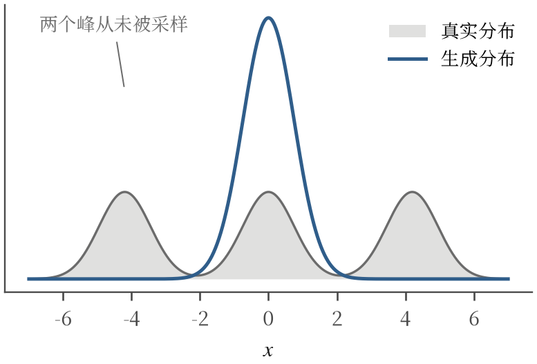

# 生成对抗网络

变分自编码器要写出密度的近似，还要假设隐变量和条件分布的形状。生成对抗网络换了一条完全不同的路：不写密度，只训练一个评委，让生成器去讨好它。

这条路在 2014 年提出时效果并不好，直到 2015 年的 DCGAN 才稳定下来。它的优点是采样只需一次前向，缺点是训练极不稳定。理解它为什么不稳定，是理解后来扩散模型为什么流行的前提。

## 动机：只需要能判断真假

假设有人给你一张图，问你像不像照片。你不需要知道照片的分布，只需要一个判断。GAN 把这件事交给一个判别网络 $D$，让它给出这张图来自真实数据的概率。

生成器 $G$ 把噪声 $z$ 映射成图，判别器 $D$ 判断真假。两者交替训练：$D$ 要学会区分，$G$ 要学会骗过 $D$。训练结束后丢掉 $D$，只留 $G$ 采样。

这套设定绕开了似然。我们不需要 $p_\theta(x)$ 的表达式，只需要能采样、能比较。代价是训练目标变成了两个网络的博弈，没有单一的损失曲线可以看。

## 博弈的形式

记真实分布为 $p_{\text{data}}$，生成分布为 $p_g$（$z\sim p(z)$，$x = G(z)$）。GAN 的目标是

$$\min_G\max_D V(D,G) = E_{x\sim p_{\text{data}}}[\log D(x)] + E_{z\sim p(z)}[\log(1-D(G(z)))].$$

判别器想把这个值做大：真实样本上 $D(x)$ 越接近 1 越好，生成样本上 $D$ 越接近 0 越好。生成器想把第二项做大，也就是让 $D(G(z))$ 接近 1。

## 最优判别器

先固定 $G$，求最优的 $D$。把期望写成积分

$$V = \int p_{\text{data}}(x)\log D(x)\,dx + \int p_g(x)\log(1-D(x))\,dx.$$

被积函数在每个 $x$ 上独立，可以逐点最大化。设 $a = p_{\text{data}}(x)$，$b = p_g(x)$，$y = D(x)$，要最大化 $a\log y + b\log(1-y)$。对 $y$ 求导令其为零

$$\frac{a}{y} - \frac{b}{1-y} = 0 \quad\Longrightarrow\quad y = \frac{a}{a+b},$$

于是

$$D^*(x) = \frac{p_{\text{data}}(x)}{p_{\text{data}}(x)+p_g(x)}.$$

这个结果很直观。如果某个位置上真实数据的密度大，判别器就说真；如果生成分布在那里更密，就说假；两者相等时输出 $1/2$，也就是完全分不清。

## 代回：目标等于 JS 散度

把 $D^*$ 代回目标函数

$$V(D^*,G) = \int p_{\text{data}}\log\frac{p_{\text{data}}}{p_{\text{data}}+p_g}\,dx + \int p_g\log\frac{p_g}{p_{\text{data}}+p_g}\,dx.$$

两边各加一个 $\log 2$ 再减掉，凑成 KL 的形式

$$V = -\log 4 + \mathrm{KL}\!\left(p_{\text{data}}\,\Big\|\,\frac{p_{\text{data}}+p_g}{2}\right) + \mathrm{KL}\!\left(p_g\,\Big\|\,\frac{p_{\text{data}}+p_g}{2}\right).$$

后面两项正是 Jensen–Shannon 散度，所以

$$V(D^*,G) = 2\,\mathrm{JS}(p_{\text{data}}\|p_g) - 2\log 2.$$

生成器最小化 $V$，等价于最小化两个分布之间的 JS 散度。当 $p_g = p_{\text{data}}$ 时 JS 为零，$D^*\equiv 1/2$，目标取最小值。

这也解释了一个常见的现象。训练到后面，判别器的输出会在 0.5 附近徘徊，看起来什么都没学到。它其实是学到了最优解。

## JS 饱和

JS 散度有一个致命的问题：当两个分布的支撑几乎不重叠时，它等于常数 $\log 2$，梯度为零。

训练初期，$p_g$ 的支撑通常是一小块低维流形，生成器只能产生有限种类的图，$p_{\text{data}}$ 的支撑是另一块，两者几乎不重叠。此时判别器可以完美区分，$D^*$ 在真实数据上接近 1，在生成样本上接近 0，两个对数项都饱和，梯度消失，生成器学不到东西。

图 5.1 用一维高斯算出了这个现象。横轴是两条分布的距离，纵轴是 JS。距离稍大，JS 就贴到 $\log 2$；对应的最优判别器在中间变成陡峭的阶跃，生成器那一侧的梯度几乎为零。

解决办法有两个方向。换损失，让梯度不依赖判别器的饱和区；或者换距离，用即使在支撑不重叠时也有意义的度量。后者引出 Wasserstein 距离。

## 训练技巧

在换距离之前，先看几个让原始 GAN 能跑起来的工程手段。

非饱和损失。生成器的目标从 $\log(1-D(G(z)))$ 改成 $-\log D(G(z))$。两者在理论上的最优解相同，但梯度行为不同：前者在 $D$ 很小时饱和，后者在 $D$ 很小时梯度很大。实践中几乎都用后者。

交替比例。判别器通常比生成器训练得快，所以常见做法是每训一次生成器，训 $k$ 次判别器，$k$ 取 1 到 5。$k$ 太大，判别器过强，生成器没有梯度；$k$ 太小，判别器太弱，提供的信号没有意义。

DCGAN 的结构经验。用步长卷积代替池化，用批归一化，去掉全连接层，生成器用 ReLU 加输出层的 tanh。这些做法在 2015 年让 GAN 第一次稳定地生成 64×64 的人脸。背后的道理是：卷积的平移等变性符合图像的统计特性，批归一化让两个网络的尺度匹配。

谱归一化。把每一层的权重除以它的最大奇异值，使整个网络的 Lipschitz 常数不超过 1。最大奇异值可以用幂迭代估计，反复做 $v \leftarrow W^\top u/\|W^\top u\|$、$u \leftarrow Wv/\|Wv\|$，几次就能收敛。这样判别器的输出不会对输入过于敏感，梯度更稳定。

## 模式坍塌

即使训练稳定，GAN 还有一个结构性问题：生成器可能只学会数据的一部分。

原因还是在目标函数。生成器只要让 $p_g$ 在判别器眼里够真就行，不需要覆盖所有模式。如果数据是十个高斯峰的混合，生成器只在一个峰上放概率，判别器仍可能被欺骗，因为那个峰附近的样本确实是真的。

图 5.2 画的是一维三峰的例子。生成器把全部概率放在中间那个峰上，JS 散度不算大，梯度也不大，训练就停在这里了。判别器如果能记住左边和右边也应该是真的，本可以给出更强的信号，但它看到的所有生成样本都在中间，也就慢慢忘了另外两个峰。

这是用散度做目标的结构性问题。Wasserstein 距离缓解了一部分，它衡量的是把一个分布搬到另一个分布的总代价，覆盖不全时代价仍然很大，但没有根除。后来的扩散模型用另一种方式回避：它不学一个从噪声到数据的映射，而是学每一步的去噪，多步采样天然地覆盖了多种模式。

## Wasserstein 距离

推土机距离的定义是：把一堆土搬到另一堆土所需的最小代价，代价是搬运量乘以距离。

一维时有闭式解

$$W_1(p,q) = \int |F_p(x)-F_q(x)|\,dx,$$

其中 $F$ 是累积分布函数。这个式子的意思是：在每个位置上，两个累积分布差多少，就有多少质量需要跨过这个位置搬过去。

高维时用 Kantorovich 对偶

$$W_1(p,q) = \sup_{\|f\|_L\le 1}\Big(E_p[f(x)] - E_q[f(x)]\Big),$$

上确界取遍所有 Lipschitz 常数不超过 1 的函数 $f$。这个形式可以直接用神经网络实现：把 $f$ 参数化成 $f_w$，最大化 $E_{p_{\text{data}}}[f_w] - E_{p_g}[f_w]$，同时约束 $f_w$ 的 Lipschitz 常数。

关键的性质是：即使两个分布的支撑不重叠，$W_1$ 仍然随它们的距离连续变化，梯度不会消失。这正是 GAN 需要的。

## WGAN 与梯度惩罚

WGAN 直接把对偶形式当作训练目标，判别器改叫 critic，输出的不再是概率，而是一个实数分数。约束 Lipschitz 常数有两种做法。

原始 WGAN 用权重裁剪，每次更新后把 $w$ 裁到 $[-c,c]$。这保证了 Lipschitz 常数有界，但把权重压到了边界上，容量被浪费。

WGAN-GP 改成惩罚梯度

$$L = E_{p_{\text{data}}}[f_w(x)] - E_z[f_w(G(z))] + \lambda E_{\hat{x}}\big[(\|\nabla_{\hat{x}}f_w(\hat{x})\|-1)^2\big],$$

其中 $\hat{x}$ 在真实样本与生成样本的连线上随机取。惩罚梯度范数偏离 1，而不是惩罚梯度过大，理论依据是最优的 $W_1$ 势函数在支撑之间梯度范数恰为 1。

这个改动让训练稳定了很多，也让 WGAN 成为 2017 到 2020 年间高质量生成的常用方案，直到扩散模型出现。

## StyleGAN 与潜空间

GAN 的另一个贡献是它给出了一个可以操作的潜空间，这对图像编辑很重要。

StyleGAN 把生成器拆成两部分：一个映射网络把 $z$ 变成 $w$，一个合成网络从 $w$ 逐层生成图像，每一层还注入一点噪声控制细节。$w$ 所在的空间叫 $W$，逐层使用不同的 $w_i$ 得到 $W^+$。

这样做的动机是解耦。$z$ 是高斯，各个维度混在一起；映射网络把高斯卷成一个更规整的形状，使得 $W$ 中的方向更容易对应到语义属性，比如性别、年龄、发色。这一点在图像编辑里很有用，在潜空间里沿某个方向移动，就能改变对应的属性。

## 与扩散的取舍

GAN 一步出图，推理成本极低；扩散要几十步，但训练稳定、覆盖好。这个取舍在 2020 年之后被反复讨论，结论逐渐清晰：在质量上扩散胜出，在速度上 GAN 胜出，而既快又好要靠蒸馏把两者结合起来。

近几年的一步生成模型，本质上都在回答同一个问题：能不能把多步采样的效果压进一次前向。它们要面对的困难，正是这一章里 GAN 曾经面对的那些：训练不稳定、模式坍塌、梯度消失。
