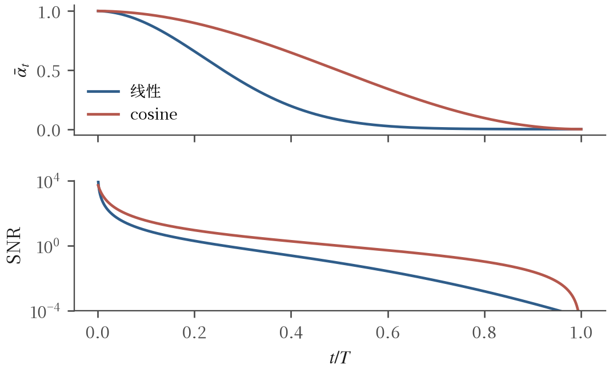
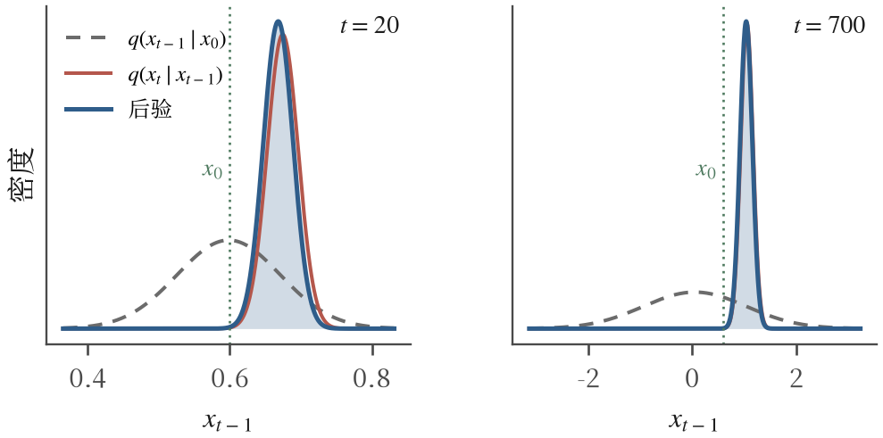

# 扩散的思想：从加噪到去噪

扩散模型的想法可以用一句话说完：先把图一步步加噪，直到它变成纯噪声；再训练一个网络把这个过程反过来。这一章只讲前半段，也就是加噪，以及为什么加噪之后的分布容易处理。后半段的反向过程在下一章。

先约定记号。第 6 章到第 11 章用 $t = 1,\dots,T$ 表示加噪步，$x_0$ 是干净图，$x_T$ 近似标准高斯，采样时 $t$ 递减。本册统一沿用这套记号。

## 为什么先加噪

第 2 章说过，自然图像集中在低维流形上，流形之外密度为零。这对直接学一个从噪声到数据的映射是灾难：两端的支撑几乎不重叠，中间没有可用的梯度信号。

### 支撑错位

先把“支撑不重叠”具体化。数据分布 $p_{\text{data}}$ 的质量全在流形上，噪声样本则是铺满整个空间的。第 2 章算过，$196608$ 维里 $1000$ 个标准高斯点两两距离都在 $627$ 附近，波动不到 $1.5\%$；一个噪声样本到最近的真实图像也是这个量级的距离，而同一张图加了轻微扰动之后移动的距离要小得多。两者不在同一个尺度上。

一维情形可以手算。两团高斯，中心在 $\pm1.5$，标准差 $0.3$，中间 $x=0$ 处的密度是

$$\frac{1}{\sqrt{2\pi}\cdot0.3}\exp\left(-\frac{1.5^2}{2\cdot0.3^2}\right)\approx5\times10^{-6}.$$

对数密度 $-12$，用有限样本已经很难估准。把标准差收到 $0.12$，指数变成 $e^{-78}$，双精度浮点直接下溢成零。噪声只要比数据的固有尺度小两三倍，两团之间就掉到了单精度能表达的下界附近。

在真空里 $p_{\text{data}}=0$，$\log p_{\text{data}}=-\infty$，$\nabla\log p_{\text{data}}$ 没有定义。想从噪声出发沿某条路径走到数据，路径的大半段都落在真空里：出发点的密度是零，终点的密度是零，中间也没有可用的方向。第 5 章遇到的是同一个困难的另一副面孔——支撑分离时 JS 散度退化成常数 $\log2$，判别器一眼分开，生成器拿到的梯度是零。

扩散模型的做法不是硬碰硬地在两个不相交的支撑之间架桥，而是把噪声的幅度变成一个可以调节的旋钮：先从数据出发，慢慢把支撑撑开，让两端的分布在同一族分布里连起来，再从撑开的那一端走回来。

加噪改变了这个局面。把数据和一个标准差为 $\sigma$ 的高斯卷积，得到的分布支撑覆盖整个空间，密度处处为正。$\sigma$ 越大，分布越接近高斯；越小，越接近原始数据。扩散模型构造的不是一个分布，而是一族用 $t$ 参数化的分布 $p_t$，从尖锐的数据分布连续过渡到高斯。


有了这一族分布，生成就可以拆成很多小步：从 $p_T$ 出发，一步步走到 $p_0$。每一小步只需要把噪声去掉一点点，这是一个远比从噪声直接造图容易的问题。

### 每一档噪声上的回归

第二个理由更技术一些：加噪把 score 从“接近奇异”变成“可以用回归估出来”。

与标准差为 $\sigma$ 的高斯卷积之后，密度可以写成以每个数据点为中心的高斯核的加权和

$$q_\sigma(x)=\int \mathcal{N}\left(x;\ x_0,\ \sigma^2 I\right)p_{\text{data}}(x_0)\,dx_0 .$$

只要 $\sigma>0$，每一项在每个 $x$ 上都是正的，加权和也是正的，梯度处处有定义。整个空间的密度被抹成一张光滑的曲面，流形被撑成一条有厚度的管道，管道内部任何一个点都能算出密度，也都能顺着密度往上走。

在这张曲面上，score 有一个只用去噪就能算出来的表达式。对上式求梯度

$$\nabla_x\log q_\sigma(x)=\frac{\mathbb{E}[x_0\mid x]-x}{\sigma^2}.$$

右边出现的 $\mathbb{E}[x_0\mid x]$ 是给定含噪样本时干净样本的条件均值，也就是平方误差意义下最优的去噪器：任何别的函数 $\hat x(x)$ 的误差 $\mathbb{E}\|\hat x(x)-x_0\|^2$ 都比它大。一个看起来要算整张密度曲面的对象，等价于一个回归问题的解，而回归可以拿样本直接做——这是扩散模型能训练的根源。

难易由 $\sigma$ 决定。图 6.2 左是一维两峰数据的最优去噪器在三个噪声水平下的形状：噪声小时它几乎是阶跃函数，输入稍微一动，输出就从 $-1.5$ 跳到 $+1.5$；噪声大时它变成一条平缓的 $S$ 形曲线。

![图 6.2　最优去噪器 $\mathbb{E}[x_0\mid x_\sigma]$ 随噪声水平的变化。左：三个 $\sigma$ 下的形状，噪声越小越接近阶跃。右：函数的最大斜率，按 $1/(\sigma_0^2+\sigma^2)$ 下降，$\sigma_0$ 是数据的固有尺度；斜率就是 score 的量级。](../images/06/fig06_denoise.png)

右图把这件事量化了：最大斜率随噪声下降按 $1/(\sigma_0^2+\sigma^2)$ 增长。$\sigma\to0$ 时斜率趋于 $1/\sigma_0^2$，函数本身趋于不连续，而斜率就是 score。用有限样本估一个接近不连续的函数做不到：输入正好落在阶跃点上，输出该取哪个值没有稳定答案。

$\sigma$ 太大也不行。$\sigma\gg\sigma_0$ 时去噪器的输出几乎与输入无关，都趋近于零，回归问题变得平凡，却也学不到结构。可用的区间夹在中间：既要函数足够陡以携带信息，又要足够光滑以便从有限样本里估出来。

扩散日程的作用就是把这个区间切成 $T$ 段，每段给一个不同的噪声水平，让同一个网络共享参数地在所有档上学。训练时每个样本随机选一个 $t$，相当于每次换一道难度不同的题；采样时再按从难到易的顺序把这些答案串起来。

### 破坏是有顺序的

加噪不是均匀地把图弄糊。自然图像的功率谱大致按 $1/f^2$ 衰减，低频成分振幅大，高频成分振幅小。一份标准差为 $\sigma$ 的噪声能淹没某个成分，靠的是它的振幅与 $\sigma$ 可比：振幅小的先被淹，所以细纹理最先消失，然后是中尺度结构，整体色调与大块布局留到最后。

按这个思路可以估一下尺度（量级估计）：图像归一化到 $[-1,1]$，$\sigma=0.05$ 时画面还很清楚，只是平区浮着一层颗粒；$\sigma=0.3$ 时细纹已经化为匀色，只剩轮廓；$\sigma=1$ 以上连轮廓都保不住。这与图 6.1 的三峰变一峰是同一件事的两种画法：峰变宽是密度层面的语言，细节先丢是图像层面的语言。

顺序性还解释了一件事：高噪声端的网络不需要重建细节，它只需要决定“这一块大概是什么颜色”。这比低噪声端的任务粗得多，也容易得多，所以后半段的去噪步往往能走大步（第 8 章的跳步采样器就靠这一点）。

## 前向过程

每一步加一点高斯噪声

$$q(x_t\mid x_{t-1}) = \mathcal{N}\left(\sqrt{\alpha_t}\,x_{t-1},\ \beta_t I\right),\qquad \alpha_t = 1-\beta_t.$$

均值乘了 $\sqrt{\alpha_t}$ 而不是 $1-\beta_t$，是为了让方差保持稳定。如果只用 $x_{t-1}+\sqrt{\beta_t}\,\epsilon$，方差会随步数线性增长，最后数值爆掉；乘 $\sqrt{\alpha_t}$ 之后，若 $\mathrm{Var}(x_{t-1}) = 1$，则 $\mathrm{Var}(x_t) = \alpha_t + \beta_t = 1$。

整个链是马尔可夫的，$q(x_{1:T}\mid x_0) = \prod_{t=1}^T q(x_t\mid x_{t-1})$。

### 系数从哪里来

转移核里两个系数分工：$\sqrt{\alpha_t}$ 决定保留多少旧信号，$\sqrt{\beta_t}$ 决定注入多少新噪声。噪声前的系数为什么带根号——要控制的是方差，而方差是标准差的平方：$\sqrt{\beta_t}\,\epsilon$ 的方差是 $\beta_t$，写成 $\beta_t\epsilon$ 就只有 $\beta_t^2$。线性日程下 $\sum_t\beta_t^2\approx0.13$，一千步加起来只相当于标准差 $0.36$ 的扰动，图几乎不变。

$\beta_t$ 给出的是名义上的噪声预算：$\sum_t\beta_t\approx10$，远大于淹掉方差为 $1$ 的数据所需的那一份。之所以没淹过头，是因为每一步都同时把信号乘了 $\sqrt{\alpha_t}$，早先注入的方差又被打折，最终的总量正好是 $1-\bar\alpha_T\approx1$（下一小节把它算清楚）。

$\alpha_t$ 要小于 $1$，但不能接近 $0$。$\alpha_t\to0$ 意味着一步就把信号全部丢掉，那一步的逆映射是多对一的，无从学起；$\alpha_t=1$ 意味着这一步什么都没做，白走。线性日程的 $\beta_t$ 最大只有 $0.02$，对应 $\alpha_T=0.98$，每步只动一点点，这就是“小步”二字的来源。

再给几个具体数字。$\beta_1=10^{-4}$ 时第一步注入的噪声标准差是 $\sqrt{10^{-4}}=0.01$，即信号尺度的 $1\%$，而信号本身只缩了 $\sqrt{1-10^{-4}}-1\approx-5\times10^{-5}$；最后一步 $\beta_T=0.02$，注入的标准差是 $14\%$。整条链的节奏是从“几乎不动”到“动得多”。

### 为什么不一步加到位

如果只加一次噪声，$x_1=\sqrt{\bar\alpha}\,x_0+\sqrt{1-\bar\alpha}\,\epsilon$ 并直接取 $\bar\alpha=0$，那就退回到“从纯噪声猜图”这个原始问题：条件均值 $\mathbb{E}[x_0\mid x]$ 在任何输入上都是同一张平均脸，回归的解没有信息量。中间过程之所以有用，是因为它把一个大问题拆成一串小问题，每个小问题的答案都比“平均脸”具体得多。

拆分还带来一个结构上的好处：链是马尔可夫的，逆向一步只需要看当前这一步，不需要记住整段历史。这让采样可以逐步推进，每一步的张量大小与步数无关。

### 另一种写法

前向过程不一定非得是“缩信号 + 加噪”。也可以只加噪、不缩放

$$x_t=x_0+\sigma_t\,\epsilon,\qquad \sigma_1<\sigma_2<\cdots<\sigma_T,$$

$\sigma$ 从数据尺度降到噪声尺度，常见做法是在 $0.002$ 到 $80$ 之间几何取点。两种写法能逐点换算：只加噪的版本里信号方差是 $1$、噪声方差是 $\sigma_t^2$，把它除回去凑成方差保持的形状

$$\frac{x_t}{\sqrt{1+\sigma_t^2}}=\frac{x_0}{\sqrt{1+\sigma_t^2}}+\frac{\sigma_t}{\sqrt{1+\sigma_t^2}}\,\epsilon,$$

对照 $x_t=\sqrt{\bar\alpha_t}\,x_0+\sqrt{1-\bar\alpha_t}\,\epsilon$ 就能读出 $\bar\alpha_t=1/(1+\sigma_t^2)$，反过来 $\sigma_t^2=(1-\bar\alpha_t)/\bar\alpha_t$——正是上一节定义的 $1/\mathrm{SNR}$。

两种写法描述同一族分布，差别在于时间怎么参数化、数值尺度怎么归一。缩放版本把每一步的总方差摁在 $1$，网络看到的输入量级恒定；不缩放的版本让方差随 $t$ 增长，网络必须自己适应这个尺度。哪一头更好取决于预条件怎么设计，那是后面几章的内容；本章推出来的闭式边缘与后验对两种写法都成立，只需换个记号。

### 前向链没有参数

这条链在训练里扮演什么角色，值得单独说。它是固定的：$T$ 步的 $q(x_t\mid x_{t-1})$ 全由日程表决定，没有一个可学的参数。所以扩散模型只有一半要训——把 $x_t$ 映回 $x_{t-1}$ 的那一半。VAE 里编码器与解码器都要学，两者一强一弱就会后验坍塌（第 4 章）；扩散的“编码器”是一张日程表，没有变弱的机会。

代价在存储与步数上。隐变量有 $T$ 层，每层维数与数据相同；若按 VAE 的写法把每层都当潜变量存下来，一张 $512^2$ 的图需要 $3$ GB 量级的缓存（$512^2\times3\approx7.9\times10^5$ 个数，乘 $1000$ 层，乘 $4$ 字节）。闭式边缘把这件事绕开了：训练时只抽一个 $t$，用 $x_t=\sqrt{\bar\alpha_t}\,x_0+\sqrt{1-\bar\alpha_t}\,\epsilon$ 现算一份，缓存里永远只有干净图和一份噪声。

### 为什么用高斯噪声

破坏数据的方式有很多：模糊、下采样、随机遮挡，都能构造一条从数据到“什么都没有”的路径。高斯噪声在其中特殊，原因是它让整条推导都停留高斯族里：两个高斯的和是高斯，所以边缘有闭式；高斯乘高斯还是高斯，所以后验有闭式；条件期望是线性的，所以最优去噪器可以写成 $x_0$ 与 $\epsilon$ 的线性组合。

换成模糊或遮挡，这三条全断：边缘不再是高斯，后验也不再是高斯，$x_0$ 的最优估计变成一个非线性问题，闭式解消失。那类做法仍然可用，但要放弃这些解析工具，把一切都交给网络去学。

高斯还有一个好处是尺度可控。噪声各维独立、方差相同，“加了多少噪声”可以用一个标量 $\sigma_t$ 描述，日程就是一条一维曲线；换成任何有结构的破坏，日程就变成多维的，不同档之间的难度再也无法用一个数比较。

## 闭式边缘分布

我们并不需要一步一步采样才能得到 $x_t$。把两步展开

$$x_t = \sqrt{\alpha_t}\,x_{t-1} + \sqrt{\beta_t}\,\epsilon_1 = \sqrt{\alpha_t\alpha_{t-1}}\,x_{t-2} + \sqrt{\alpha_t\beta_{t-1}}\,\epsilon_2 + \sqrt{\beta_t}\,\epsilon_1.$$

两个独立高斯的和仍是高斯，方差相加

$$\alpha_t\beta_{t-1} + \beta_t = \alpha_t(1-\alpha_{t-1}) + (1-\alpha_t) = 1 - \alpha_t\alpha_{t-1}.$$

归纳下去，得到

$$q(x_t\mid x_0) = \mathcal{N}\left(\sqrt{\bar\alpha_t}\,x_0,\ (1-\bar\alpha_t)I\right),\qquad \bar\alpha_t = \prod_{s=1}^t\alpha_s.$$

等价地

$$x_t = \sqrt{\bar\alpha_t}\,x_0 + \sqrt{1-\bar\alpha_t}\,\epsilon,\qquad \epsilon\sim\mathcal{N}(0,I).$$

这个式子是后面所有推导的出发点。它说明任意时刻的含噪样本都可以由干净样本和一份噪声直接算出，训练时不需要跑完整的链。这一点让扩散模型的训练成本与步数 $T$ 无关。

### 归纳法

把上一段的“归纳下去”写全。

命题：对每个 $t\ge1$，$q(x_t\mid x_0)=\mathcal{N}\left(\sqrt{\bar\alpha_t}\,x_0,\ (1-\bar\alpha_t)I\right)$。

$t=1$ 时 $\bar\alpha_1=\alpha_1$，与转移核的定义一致。设命题对 $t-1$ 成立，即 $x_{t-1}=\sqrt{\bar\alpha_{t-1}}\,x_0+\sqrt{1-\bar\alpha_{t-1}}\,\epsilon'$，其中 $\epsilon'\sim\mathcal{N}(0,I)$ 与第 $t$ 步的噪声独立。代入转移核

$$x_t=\sqrt{\alpha_t}\left(\sqrt{\bar\alpha_{t-1}}\,x_0+\sqrt{1-\bar\alpha_{t-1}}\,\epsilon'\right)+\sqrt{\beta_t}\,\epsilon_t .$$

确定性的均值项直接相乘：$\sqrt{\alpha_t\bar\alpha_{t-1}}\,x_0=\sqrt{\bar\alpha_t}\,x_0$。随机项是两个独立零均值高斯的和，方差相加，得 $\alpha_t(1-\bar\alpha_{t-1})+\beta_t$。化简只用到一个恒等式，把 $\beta_t=1-\alpha_t$ 代进去

$$\alpha_t(1-\bar\alpha_{t-1})+1-\alpha_t=\alpha_t-\alpha_t\bar\alpha_{t-1}+1-\alpha_t=1-\alpha_t\bar\alpha_{t-1}=1-\bar\alpha_t .$$

独立高斯的和仍是高斯，所以 $q(x_t\mid x_0)$ 是均值 $\sqrt{\bar\alpha_t}\,x_0$、方差 $(1-\bar\alpha_t)I$ 的高斯，命题对 $t$ 也成立。

整个证明没有用到卷积，只用两件事：线性变换下高斯仍是高斯，独立高斯的方差相加。这也是为什么 $x_t$ 可以写成“干净样本加一份合成噪声”：$t$ 步各自的噪声在这一步合并成了一份，不需要留底。

协方差是标量乘 $I$，靠的是每一步的噪声各维独立、方差相同；若噪声是各向异性的，边缘仍是高斯，但协方差要换成矩阵连乘，后面的配方就要改写。实际模型几乎都选各向同性，就是为了保住这个 $I$。

手算一遍。取 $\beta=(0.1,0.2,0.3)$，则 $\alpha=(0.9,0.8,0.7)$，$\bar\alpha=(0.9,0.72,0.504)$。公式给 $1-\bar\alpha_3=0.496$；按递推走，$t=2$ 后方差 $1-0.72=0.28$，$t=3$ 时 $0.7\times0.28+0.3=0.196+0.3=0.496$。两条路一致。

### 每一步的份额

方差不是一次加进去的。把 $\beta_s$ 换算成 $\bar\alpha$ 的差，可以得到每一份的份额

$$1-\bar\alpha_t=\sum_{s=1}^{t}\beta_s\frac{\bar\alpha_t}{\bar\alpha_s}.$$

验证只需注意 $\bar\alpha_0=1$，以及

$$\frac{1}{\bar\alpha_s}-\frac{1}{\bar\alpha_{s-1}}=\frac{\bar\alpha_{s-1}-\bar\alpha_s}{\bar\alpha_s\bar\alpha_{s-1}}=\frac{\beta_s}{\bar\alpha_s},$$

左边对 $s$ 求和是望远镜级数，得 $1/\bar\alpha_t-1$，两边乘 $\bar\alpha_t$ 就是上式。用刚才那组数检验：$t=3$ 的三项是 $0.1\times0.504/0.9=0.056$、$0.2\times0.504/0.72=0.14$、$0.3\times0.504/0.504=0.30$，合计 $0.496$。

和式的含义是：第 $s$ 步注入的方差 $\beta_s$，被后面每一步的 $\alpha$ 按比例压小，压到第 $t$ 步只剩 $\bar\alpha_t/\bar\alpha_s$ 倍。前段注入的噪声到后段已经被压得可以忽略，最终的总量由后段决定。这解释了为什么两种形状差很多的日程，在中段的 $\bar\alpha_t$ 上看着差不多，画成每步份额却差得很远。

同样的分解还可以反过来用：训练时如果想把训练预算只花在某一段 SNR 上，直接按上面的份额权重重算一个 $\bar\alpha$ 表就行；采样时想把步数堆在细节上，也是拿这条式子反解该留哪些 $t$。

由此可以定义一个描述还剩多少信号的量

$$\mathrm{SNR}(t) = \frac{\bar\alpha_t}{1-\bar\alpha_t}.$$

$t$ 小的时候 SNR 很大，图基本清晰；$t$ 接近 $T$ 时 SNR 接近零，图基本是噪声。

### SNR 与 $\bar\alpha$ 的换算

“信噪比”里的“比”指信号与噪声的方差比。闭式解里信号的系数是 $\sqrt{\bar\alpha_t}$，噪声的系数是 $\sqrt{1-\bar\alpha_t}$，两者的平方比就是 $\mathrm{SNR}(t)=\bar\alpha_t/(1-\bar\alpha_t)$，反解得 $\bar\alpha_t=\mathrm{SNR}/(1+\mathrm{SNR})$。这个换算常用来指定噪声水平：想让信号与噪声等强，取 $\mathrm{SNR}=1$，即 $\bar\alpha=0.5$；想让噪声是信号的三倍强，取 $\mathrm{SNR}=0.1$，即 $\bar\alpha\approx0.091$。

另一种写法把噪声折成标准差

$$\sigma_t=\sqrt{\frac{1-\bar\alpha_t}{\bar\alpha_t}}=\frac{1}{\sqrt{\mathrm{SNR}(t)}},\qquad \frac{x_t}{\sqrt{\bar\alpha_t}}=x_0+\sigma_t\,\epsilon .$$

把 $x_t$ 除以 $\sqrt{\bar\alpha_t}$，扩散链就换成了“干净图加一份标准差为 $\sigma_t$ 的噪声”这个更熟悉的形状。讨论“第几档噪声”时 $\sigma_t$ 最好用：$\sigma_t=1$ 就是 $\mathrm{SNR}=1$，而线性日程下 $t=500$ 对应 $\sigma_t=3.4$。

cosine 日程还能给一个闭式反解。$\bar\alpha_t=\cos^2\theta_t$ 时 $1-\bar\alpha_t=\sin^2\theta_t$，于是 $\mathrm{SNR}=\cot^2\theta_t$，

$$\theta_t=\arctan\frac{1}{\sqrt{\mathrm{SNR}}},\qquad t=T\left(\frac{2(1+s)}{\pi}\theta_t-s\right).$$

需要按 SNR 等距布点的时候，这个式子直接给出每个采样点的 $t$，不必查表。取 $\mathrm{SNR}=1$ 得 $t=496$，正好在中点附近。

线性日程的几个读数：$t=1$ 时 $\mathrm{SNR}\approx10^4$，$t=259$ 时 $\bar\alpha=0.5$，$t=500$ 时 $\mathrm{SNR}=0.085$，$t=900$ 时 $0.0003$。跨了八个数量级，所以画日程时纵轴多半用对数。

### 终点为什么可以取标准高斯

闭式边缘给出 $q(x_T\mid x_0)=\mathcal{N}(\sqrt{\bar\alpha_T}\,x_0,(1-\bar\alpha_T)I)$，而采样时直接从 $\mathcal{N}(0,I)$ 出发，这需要理由。

$\bar\alpha_T\to0$ 时均值项消失、协方差趋于 $I$，分布与 $x_0$ 无关，确实就是标准高斯。$\bar\alpha_T$ 只到 $10^{-5}$ 量级时，均值的标准差是 $\sqrt{\bar\alpha_T}\approx0.006$：对归一化到 $[-1,1]$ 的图，这个偏差折算到像素上不到千分之几，看不出差别。线性日程的残留正是这个量级，后果不严重。

真正会出问题的是 $\bar\alpha_T$ 停在 $0.05$ 这样的量级（$\sqrt{\bar\alpha_T}\approx0.22$）。这时起点带着一批共同的残余结构，所有样本都偏同一个方向；从同一个 $x_T$ 出发采样，生成图的色调与构图也会跟着偏。终点不清零的日程在少步数时尤其明显，因为那些残余结构没有足够多的步数被重新分配。cosine 日程末端严格归零，顺便把这个隐患也去掉了。

## 噪声日程

$\beta_t$ 怎么取，直接决定了每个时刻的噪声水平。

最早的 DDPM 用线性日程，$\beta_1 = 10^{-4}$ 线性增加到 $\beta_T = 0.02$。它在两处不理想。末端 $\bar\alpha_T\approx4\times10^{-5}$，信号的标准差还剩 $0.6\%$，与“$x_T$ 是纯高斯”的假设差着一截；这点残留在采样时表现为起点不够随机，后果不严重。更要紧的是中段：$\bar\alpha_t$ 在 $t=259$ 就掉到 $0.5$，到 $t=500$ 只剩 $0.079$。步数走了一半，信号已经毁了 $92\%$，剩下的五百步只在 $0.085$ 到 $4\times10^{-5}$ 这段 SNR 上打转——那里无论怎么走，图看上去都是噪点。

反过来，最要紧的低噪声端被压在开头十几步里：$t$ 从 $1$ 到 $10$，SNR 就从 $10^4$ 掉到 $5\times10^2$，九步跨过一个多数量级。纹理与边缘正好活在这段 SNR 上，分给它的步数却最少。均匀抽样又把预算平均分给全部 $T$ 个 $t$，于是被优化得最多的是“图已经是噪点”的那一段。

cosine 日程换了一个思路，直接规定 $\bar\alpha_t$ 的形状

$$\bar\alpha_t = \cos^2\left(\frac{t/T+s}{1+s}\cdot\frac{\pi}{2}\right),$$

其中 $s$ 是一个小的偏移，通常取 0.008，用来避免 $t=0$ 附近变化太快。这样 $\bar\alpha_T$ 严格为零，末端不再残留信号。

两种日程在同一批 $t$ 上的读数差得很开：

| $t$ | 线性 $\bar\alpha_t$ | 线性 $\log\mathrm{SNR}$ | cosine $\bar\alpha_t$ | cosine $\log\mathrm{SNR}$ |
|---|---|---|---|---|
| 10 | 0.998 | 6.3 | 0.999 | 7.2 |
| 100 | 0.897 | 2.2 | 0.972 | 3.6 |
| 500 | 0.079 | $-2.5$ | 0.494 | $-0.02$ |
| 900 | 0.0003 | $-8.2$ | 0.024 | $-3.7$ |

线性日程在 $t=500$ 时 SNR 已经掉到 $0.085$（噪声比信号强十几倍），cosine 在同一个位置还在 $\mathrm{SNR}\approx1$ 附近。到 $t=900$，两者差 $4.5$ 个对数单位，约 $90$ 倍。同样的 $t$，一个已经把图抹完，另一个还在中途。



从图 6.3 可以看到差别的来源：真正影响训练的不是曲线多陡，而是 SNR 的哪些区间占了大多数步数。线性日程在 $t=259$ 就把 SNR 拉到 $1$，剩下的七百多步全花在 SNR 已经小于 $1$ 的区间；cosine 把 $\mathrm{SNR}\approx1$ 落在 $t=496$，前后各占一半，中段每步的变化也更小。这影响的是训练时各步的重要性，如果某一步几乎什么都没改变，网络在那一步上也学不到东西。

### 从 $\bar\alpha$ 反推 $\beta$

cosine 日程是先规定 $\bar\alpha_t$ 的形状，再回头算 $\beta_t$。令 $f(t)=\cos^2\theta_t$，$\theta_t=\frac{\pi}{2}\cdot\frac{t/T+s}{1+s}$，归一化后

$$\bar\alpha_t=\frac{f(t)}{f(0)},\qquad \theta_0=\frac{\pi}{2}\cdot\frac{s}{1+s}.$$

原文的公式省掉了 $f(0)$。$s=0.008$ 时 $\cos^2\theta_0\approx0.99985$，差在 $10^{-4}$ 量级；写成带 $f(0)$ 的形式可以让 $\bar\alpha_0=1$ 严格成立，实现时不必对 $t=0$ 特判。

$\beta_t$ 由定义反解

$$\beta_t=1-\frac{\bar\alpha_t}{\bar\alpha_{t-1}}=1-\frac{\cos^2\theta_t}{\cos^2\theta_{t-1}} .$$

相邻两步的角度差是常数 $\Delta=\frac{\pi}{2T(1+s)}$，把 $\theta_t=\theta_{t-1}+\Delta$ 代进去，用 $\cos^2a-\cos^2b=-\sin(a+b)\sin(a-b)$

$$\beta_t=\frac{\cos^2\theta_{t-1}-\cos^2(\theta_{t-1}+\Delta)}{\cos^2\theta_{t-1}}=\frac{\sin(2\theta_{t-1}+\Delta)\sin\Delta}{\cos^2\theta_{t-1}} .$$

这个式子把日程的两端都看清了。$\theta$ 小时分子随 $\theta$ 线性增长、分母接近 $1$，$\beta_t$ 缓慢起步；$\theta\to\pi/2$ 时分母趋于零，$\beta_t$ 发散，$t=T$ 恰好取到 $1$。

代入 $T=1000$、$s=0.008$：$\beta_1=4.1\times10^{-5}$，$\beta_{990}=0.17$，$\beta_{995}=0.31$，$\beta_{998}=0.56$，$\beta_{999}=0.75$，$\beta_{1000}=1$。线性日程的对应读数是 $\beta_1=10^{-4}$、$\beta_T=0.02$：cosine 在起点更温柔，每步只加 $0.64\%$ 的标准差；在末端更狠，最后十步的 $\beta$ 从 $0.17$ 涨到 $1$。

$\beta_T=1$ 在公式里是不能直接用的。$\alpha_T=0$ 会让采样第一步的 $1/\sqrt{\alpha_T}$ 发散，实现里普遍把 $\beta_t$ 截断到 $0.999$：此时 $\alpha_T=10^{-3}$，放大倍数是 $1/\sqrt{10^{-3}}\approx32$，还在数值能承受的范围里。“零终端 SNR”之所以要单独处理（第 9 章），就是因为末端这几步的系数尺度与中段差着两个数量级。

### 参数 $s$ 在做什么

$s$ 的用处从上面的式子里直接读得出来：它把日程的起点从 $\theta=0$ 挪开了一点。

没有 $s$ 时 $\theta_1=\Delta$，$\beta_1=1-\cos^2\Delta\approx\Delta^2$。$T=1000$ 时 $\Delta\approx1.57\times10^{-3}$，$\beta_1\approx2.5\times10^{-6}$，第一步注入的噪声标准差只有 $0.16\%$。前几十步的 $\beta_t$ 都在这个量级，几乎是空转：$t$ 在变，图却没怎么变。

$s=0.008$ 把起点挪到 $\theta_0\approx0.0125$，$\beta_1$ 抬到 $4.1\times10^{-5}$，是原来的十六倍多。数值仍然很小，但它让“半余弦”这条曲线避开了顶点处导数为零的平坦段，从第一步起就以可用的速率加噪。

副作用也要交代。$\theta_T$ 仍然是 $\pi/2$，所以 $s$ 只影响前段，不影响末端；但 $s$ 越大，$\bar\alpha_1$ 越低，第一步破得越多，中段也被压缩。$0.008$ 是在“起点别太陡”和“步数够用”之间取的折中，取到 $0.02$ 时前十步就已经把不少细节磨掉了。

## 反向过程与后验

反向过程要的是 $q(x_{t-1}\mid x_t)$。这个分布依赖数据，我们不知道。但如果额外给定 $x_0$，后验就有闭式解。

用贝叶斯公式和马尔可夫性

$$q(x_{t-1}\mid x_t,x_0) = \frac{q(x_t\mid x_{t-1})\,q(x_{t-1}\mid x_0)}{q(x_t\mid x_0)}.$$

分子是两个高斯的乘积，分母是一个与 $x_{t-1}$ 无关的常数。所以后验是高斯的，只需要把指数部分对 $x_{t-1}$ 配方。

### 配方

记 $x=x_{t-1}$，$\bar\alpha'=\bar\alpha_{t-1}$。把三个高斯的指数项写出来，忽略与 $x_{t-1}$ 无关的项

$$-\frac{1}{2\beta_t}\|x_t-\sqrt{\alpha_t}\,x_{t-1}\|^2 - \frac{1}{2(1-\bar\alpha_{t-1})}\|x_{t-1}-\sqrt{\bar\alpha_{t-1}}\,x_0\|^2.$$

两个平方各自展开，得到

$$-\frac{1}{2}\left[\left(\frac{\alpha_t}{\beta_t}+\frac{1}{1-\bar\alpha'}\right)\|x\|^2-2\left(\frac{\sqrt{\alpha_t}}{\beta_t}x_t+\frac{\sqrt{\bar\alpha'}}{1-\bar\alpha'}x_0\right)^{\top}x+C\right],$$

其中 $C$ 只含 $x_t$ 与 $x_0$，与 $x$ 无关。写成 $A\|x\|^2-2B^{\top}x+C$ 之后，配方是恒等式

$$-\frac12\left(A\|x\|^2-2B^{\top}x\right)=-\frac12A\left\|x-A^{-1}B\right\|^2+\text{常数},$$

所以后验的均值是 $A^{-1}B$，协方差是 $A^{-1}I$。接下来只剩两步：先算 $A$，再把 $A^{-1}$ 乘到 $B$ 的两项上。

二次项的系数是

$$\frac{\alpha_t}{\beta_t} + \frac{1}{1-\bar\alpha_{t-1}} = \frac{\alpha_t(1-\bar\alpha_{t-1})+\beta_t}{\beta_t(1-\bar\alpha_{t-1})} = \frac{1-\bar\alpha_t}{\beta_t(1-\bar\alpha_{t-1})},$$

分子那一步用的是与上面完全相同的恒等式：$\alpha_t(1-\bar\alpha_{t-1})+\beta_t=1-\alpha_t\bar\alpha_{t-1}=1-\bar\alpha_t$。也就是说，前向边缘的方差合并与后验的二次项系数，化简时用的是同一行代数。

后验的方差是它的倒数

$$\tilde\beta_t = \frac{\beta_t(1-\bar\alpha_{t-1})}{1-\bar\alpha_t}.$$

一次项给出均值。把 $x_{t-1}$ 的系数整理后得到

$$\tilde\mu_t(x_t,x_0) = \frac{\sqrt{\bar\alpha_{t-1}}\,\beta_t}{1-\bar\alpha_t}\,x_0 + \frac{\sqrt{\alpha_t}(1-\bar\alpha_{t-1})}{1-\bar\alpha_t}\,x_t.$$

两个系数怎么合并出来的，可以验一遍。$A^{-1}$ 乘到 $B$ 的 $x_t$ 项上：

$$\frac{\beta_t(1-\bar\alpha')}{1-\bar\alpha_t}\cdot\frac{\sqrt{\alpha_t}}{\beta_t}=\frac{\sqrt{\alpha_t}(1-\bar\alpha')}{1-\bar\alpha_t},$$

$\beta_t$ 上下约掉。乘到 $x_0$ 项上：

$$\frac{\beta_t(1-\bar\alpha')}{1-\bar\alpha_t}\cdot\frac{\sqrt{\bar\alpha'}}{1-\bar\alpha'}=\frac{\sqrt{\bar\alpha'}\beta_t}{1-\bar\alpha_t},$$

$1-\bar\alpha'$ 上下约掉。两处都是“分母里的一个因子正好在另一项的分母里”，所以合并之后形式很简单，两个系数的分母统一成了 $1-\bar\alpha_t$。

这两个系数并不是严格的加权平均。把它们加起来

$$\frac{\sqrt{\bar\alpha'}\beta_t+\sqrt{\alpha_t}(1-\bar\alpha')}{1-\bar\alpha_t}.$$

记 $a=\sqrt{\alpha_t}$，$b=\sqrt{\bar\alpha'}$，分子是 $b(1-a^2)+a(1-b^2)=(a+b)(1-ab)$，分母是 $1-a^2b^2=(1-ab)(1+ab)$，约掉 $1-ab$

$$\frac{\sqrt{\alpha_t}+\sqrt{\bar\alpha_{t-1}}}{1+\sqrt{\bar\alpha_t}}.$$

这个比值略小于 $1$：$t=10$ 时是 $1.0000$，$t=500$ 时是 $0.997$，$t=900$ 时是 $0.991$。少掉的那部分是向零的收缩。数据均值为零，噪声大时后验均值只能往原点收，越不确定收得越多。

$t$ 越靠近 $T$，$x_t$ 的权重越大：$t=900$ 时 $x_t$ 的系数是 $0.991$、$x_0$ 的系数是 $0.0003$，几乎完全靠 $x_t$ 反推；$t=10$ 时 $x_0$ 的系数还有 $0.147$，分量很实在。这与直觉一致：高噪声端 $x_t$ 里几乎没有 $x_0$ 的痕迹，能用的只有“当前这个点落在哪里”。



后验的几何形状在图 6.4 里。左图 $t=20$，先验还有形状，似然很窄，后验夹在两者之间：位置由似然定，宽度由先验约束。右图 $t=700$，先验几乎是一条平线，后验完全贴着似然。两图的横轴尺度差了一个数量级（$0.4$ 到 $0.8$ 对 $-2$ 到 $2$），这个差别本身就是信息：噪声越高，后验越宽、越不确定。

$\tilde\beta_t$ 有两个用得上的性质。它总不超过 $\beta_t$：

$$\tilde\beta_t=\beta_t\frac{1-\bar\alpha_{t-1}}{1-\bar\alpha_t}\le\beta_t,$$

因为分母比分子多出的正好是 $\beta_t\bar\alpha_{t-1}$。$t=1$ 时 $\bar\alpha_0=1$，$\tilde\beta_1=0$，后验退化成一个点：从 $x_1$ 到 $x_0$ 没有随机性，采样到最后一步不该注噪。

上式还有一个等价写法，把 $x_0$ 用 $x_t$ 和 $\epsilon$ 表示。由前向的闭式解反解

$$x_0 = \frac{x_t-\sqrt{1-\bar\alpha_t}\,\epsilon}{\sqrt{\bar\alpha_t}},$$

代进去整理得

$$\tilde\mu_t = \frac{1}{\sqrt{\alpha_t}}\left(x_t - \frac{\beta_t}{\sqrt{1-\bar\alpha_t}}\,\epsilon\right).$$

这个形式更常用，因为它把从 $x_t$ 预测 $x_0$ 换成了从 $x_t$ 预测 $\epsilon$，而预测噪声在高噪声区间数值上更稳定，下一章会解释原因。

中间那一步不妨写开。先算 $x_0$ 那一项的贡献，代入 $x_0$ 的表达式

$$c_1x_0=\frac{\sqrt{\bar\alpha'}\beta_t}{1-\bar\alpha_t}\cdot\frac{x_t-\sqrt{1-\bar\alpha_t}\,\epsilon}{\sqrt{\bar\alpha_t}}=\frac{\beta_t}{\sqrt{\alpha_t}(1-\bar\alpha_t)}\left(x_t-\sqrt{1-\bar\alpha_t}\,\epsilon\right),$$

第二步用了 $\sqrt{\bar\alpha_t}=\sqrt{\alpha_t}\sqrt{\bar\alpha'}$。代回 $\tilde\mu_t=c_1x_0+c_2x_t$，$x_t$ 的系数并起来是

$$\frac{\beta_t}{\sqrt{\alpha_t}(1-\bar\alpha_t)}+\frac{\sqrt{\alpha_t}(1-\bar\alpha')}{1-\bar\alpha_t}=\frac{\beta_t+\alpha_t(1-\bar\alpha')}{\sqrt{\alpha_t}(1-\bar\alpha_t)}=\frac{1-\bar\alpha_t}{\sqrt{\alpha_t}(1-\bar\alpha_t)}=\frac{1}{\sqrt{\alpha_t}},$$

中间用同一恒等式 $1-\alpha_t\bar\alpha'=1-\bar\alpha_t$ 化简分子。$\epsilon$ 的系数是 $\beta_t\sqrt{1-\bar\alpha_t}/(\sqrt{\alpha_t}(1-\bar\alpha_t))=\beta_t/(\sqrt{\alpha_t}\sqrt{1-\bar\alpha_t})$。合起来就是上一行。

为什么要条件在 $x_0$ 上，可以说得更清楚一点。把 $x_0$ 积掉就是真正的边缘 $q(x_{t-1}\mid x_t)$：

$$q(x_{t-1}\mid x_t)=\int q(x_{t-1}\mid x_t,x_0)\,q(x_0\mid x_t)\,dx_0,$$

也就是把一堆高斯按 $q(x_0\mid x_t)$ 加权混合，混合的中心由“当前含噪样本可能对应的那些干净图”决定。我们训练的 $p_\theta$ 学的就是这个混合，而训练时手上只有一个具体的 $x_0$，于是拿单点后验的均值作为目标——两者差在“平均哪一张干净图”，而这正是网络要估的东西。

这个形式还顺便说清了各步之间的耦合。每一步的 $\epsilon$ 都是针对当时那张 $x_t$ 算的，没有“一次算完”的余地：$x_{t-1}$ 一变，下一步该预测的噪声就跟着变。这是采样必须逐步循环、不能把 $T$ 步折成一次前向的根本原因。

## 采样算法

如果网络能准确预测 $\epsilon$，就可以按下面的流程从噪声生成图像。

```text
输入：训练好的 eps_theta，步数 T
x_T ~ N(0, I)
for t = T, T-1, ..., 1:
    z ~ N(0, I)  若 t > 1，否则 z = 0
    x_{t-1} = (1/sqrt(alpha_t)) * (x_t - beta_t/sqrt(1-abar_t) * eps_theta(x_t, t)) + sqrt(beta_tilde_t) * z
返回 x_0
```

这里加了 $\sqrt{\tilde\beta_t}\,z$ 的噪声，是因为后验本身有方差。不加噪声得到的是后验均值，采样会退化成一种确定性的过程，第 8 章的 DDIM 就是从这里出发的。

把循环体看成一次仿射映射可以看清楚它的作用：

$$x_{t-1}=\underbrace{\frac{1}{\sqrt{\alpha_t}}}_{1\sim32}\,x_t-\underbrace{\frac{\beta_t}{\sqrt{\alpha_t}\sqrt{1-\bar\alpha_t}}}_{0.006\sim0.02}\,\hat\epsilon+\underbrace{\sqrt{\tilde\beta_t}}_{0\sim0.14}\,z .$$

三个系数各自扮演一个角色：第一项几乎原样搬运当前样本（放大倍数不超过 $32$），第二项沿着噪声方向拉回一点，第三项再添回这一步特有的随机性。两个系数量级都很小，所以 $x_{t-1}$ 与 $x_t$ 相差无几——每一步都只改动一点点，这也是为什么一千步走下来不会把图“走飞”。

### 一步在张量上做什么

整个循环里只有三个同形状的张量在动，日程表是几个长度 $T$ 的数组。

```text
x          [B, C, H, W]  当前样本，float32
eps_hat    [B, C, H, W]  网络输出
z          [B, C, H, W]  本次抽的噪声，t = 1 时全零
alpha[t]   abar[t]   beta[t]   beta_tilde[t]     标量，索引后广播到 [B,1,1,1]
```

$B=8$、$C=3$、$H=W=512$ 时，一个张量是 $8\times3\times512^2\times4$ 字节，约 $25$ MB，三个共 $75$ MB。这个量级远小于 U-Net 的中间激活，所以采样时的显存瓶颈不在缓存，而在单次前向的激活与注意力开销。$t$ 是整批共用的一个整数，同一批样本的步进节奏完全一致，不存在“这张图停下来等那张图”的情况。

### 完美预测时的轨迹

把 $x_t=\sqrt{\bar\alpha_t}\,x_0+\sqrt{1-\bar\alpha_t}\,\epsilon$ 里的 $x_0$ 与 $\epsilon$ 固定住，取 $x_0=1$、$\epsilon=0.5$，能得到一串可以手算的数值。

| $t$ | $\sqrt{\bar\alpha_t}$ | $\sqrt{1-\bar\alpha_t}$ | $x_t$ |
|---|---|---|---|
| 1000 | 0.0064 | 1.0000 | 0.5063 |
| 900 | 0.0166 | 0.9999 | 0.5165 |
| 500 | 0.2803 | 0.9599 | 0.7603 |
| 100 | 0.9471 | 0.3209 | 1.1076 |
| 10 | 0.9991 | 0.0435 | 1.0208 |
| 1 | 1.0000 | 0.0100 | 1.0049 |

这张表里 $x_t$ 的数值只由两个系数决定，而两个系数是一对互补的坐标：平方和恒为 $1$。也就是说，整条轨迹在 $(\sqrt{\bar\alpha_t},\sqrt{1-\bar\alpha_t})$ 这个平面上是一条从 $(0,1)$ 到 $(1,0)$ 的四分之一圆，而在 $x$ 轴上，它从 $0.5$ 附近出发，先爬到 $1.1$ 出头，再收回 $x_0$ 附近；中间那次越过 $x_0$，是噪声分量逐渐退出的结果。

如果网络每一步都预测得准，后验均值就恰好落在下一行上：$t=500$ 的一步用 $x_t=0.7603$ 换成 $x_{499}$，得到的正是表里 $t=499$ 那个数。误差就从“这一行与下一行差多少”变成“预测的 $\epsilon$ 偏了多少”：偏 $0.01$，$x_{t-1}$ 就差 $0.01\times\beta_t/(\sqrt{\alpha_t}\sqrt{1-\bar\alpha_t})$。这个系数在 $t=500$ 处是 $0.0105$，在 $t=900$ 处是 $0.018$，在 $t=10$ 处是 $0.0064$，量级都在百分之一：一份噪声方向的误差，到像素值上就被压小了两个数量级。

拿 $t=500$ 手算一步。设 $x_0=1$、$\epsilon=0.5$，则 $x_t=0.7603$。用两个系数算后验均值

$$\tilde\mu=0.0031\times1+0.9941\times0.7603=0.0031+0.7558=0.7589 .$$

换成 $\epsilon$ 形式验算：$\beta_t/\sqrt{1-\bar\alpha_t}=0.01004/0.9599=0.01046$，于是

$$\tilde\mu=\frac{0.7603-0.01046\times0.5}{0.9950}=\frac{0.7551}{0.9950}=0.7589 .$$

两条路给出同一个数，到第五位小数才看出舍入。再抽一份噪声乘上 $\sqrt{\tilde\beta_t}=0.1002$ 加回去，得到 $x_{499}$。整步只有三次乘法、一次减法、一次加法，单元素开销可以忽略；采样成本全部在 $\epsilon_\theta$ 的那一次前向上。

### 数值上的坑

日程表一律用 `float32` 算并缓存。用 `cumprod` 把 $1000$ 个 $\alpha_t$ 连乘时，`float16` 的舍入误差会累到百分之一的量级（量级估计），`float32` 只在 $10^{-6}$ 以下。同一张图用两套精度算出的 $\bar\alpha_T$ 可能差几倍，而采样第一步恰好用到 $1/\sqrt{\alpha_T}$，误差就被这个因子放大了。

几个系数的放大倍数差得很远。$1/\sqrt{\alpha_t}$ 最大只有 $32$（$\beta$ 截断到 $0.999$ 时），$1/\sqrt{1-\bar\alpha_t}$ 最大 $100$（$t=1$ 时 $1-\bar\alpha_1=10^{-4}$），而 $1/\bar\alpha_t$ 在 $t=T$ 处到 $2.5\times10^4$。前两个只放大一到两个数量级，后一个放大四个半数量级。这就是“直接预 $x_0$”在高噪声端不划算的原因：它要把预测值乘回 $1/\bar\alpha_t$，误差随之放大。反过来，预测 $\epsilon$ 那一步的系数 $\beta_t/(\sqrt{\alpha_t}\sqrt{1-\bar\alpha_t})$ 全程都在 $0.01$ 到 $0.02$ 之间，既不放大误差，也不随日程变化——这是下一章选参数化的一个具体依据。

还有一个实现上的惯例：把预测出的 $\hat x_0$ 截到 $[-1,1]$ 后重算 $\hat\epsilon$，再走下一步。这不是数学上的要求（后验是对高斯的精确积分，不需要截断），而是因为训练数据真的在 $[-1,1]$ 里，截断等于把一个已知约束塞回去，在少步数采样时能看出差别。

## 为什么这样做有效

把一件事拆成 $T$ 件小事，每件都很容易，这是扩散模型有效的一个解释。但这还不够，因为误差会累积。

更准确的说法是，不同的噪声水平对应不同的尺度。$t$ 大时，图像只剩下粗结构，网络学的是这块区域大概是什么颜色；$t$ 小时，细节逐渐显现，网络学的是这个像素的纹理应该往哪个方向偏一点。这些子问题之间有关联，但每一个都比从零生成简单得多。

### 误差怎么累积

反向一步的真实分布是 $q(x_{t-1}\mid x_t)$，我们用 $p_\theta$ 近似它。两者的差距可以用 KL 度量，而这个 KL 在 $\beta_t$ 小时是二阶小量：两个高斯的均值与方差都只差一点，指数里的二次型变化很小，化简之后它正比于 $\|\epsilon-\hat\epsilon\|^2$，系数是 $\beta_t^2$ 的量级（下一章会算出确切形式）。

整条路径上的分布差异不超过各步 KL 之和，这是 KL 的链式法则加三角不等式给出的；连续时间极限下，同一个陈述就是 Girsanov 定理。这条界说明“步数多”不是坏事：同样的总噪声量，切成 $T$ 份比一步走过去误差更小，因为每份误差是二阶的，总量随 $1/T$ 下降。换句话说，$T$ 越大单步越准，而训练成本不变。

### 为什么是一千步

$T$ 两头都有代价。取小，比如 $50$，同样的 $\bar\alpha$ 跳度摊到五十步上，每步的 $\beta_t$ 就要到 $0.2$ 量级，单步 KL 变大，“逆向一步是高斯”这个近似变糙，而且后验方差大到每一步都像重新加噪；取大，每一步几乎不改变样本，$t$ 与 $t+1$ 的输入在数值上难以区分，网络学不到差异化，采样成本还线性增长。

一千这个数让每步注入的噪声落在 $1\%$ 到 $14\%$ 之间（线性日程），既小到后验能用高斯近似，又大到相邻两步能被区分。它是两头权衡的结果，不是优化出来的最优值；换日程、换参数化、换采样器时，这个数都会跟着动。

另一个角度来自分数。加噪后的分布处处有正密度，它的梯度有定义；而这个梯度可以用去噪来估计。扩散模型的训练目标，本质上就是在学这个梯度场。这条线索在第 17 章还会再提一次。

三个角度最后落在同一处。几何上，加噪把低维流形撑成有厚度的管道，两端的支撑才连得上；统计上，每一档噪声都给出一个可回归的去噪问题，回归的解就是 score；代数上，链是线性高斯的叠加，边缘与后验都有闭式。三者缺一不可：没有闭式，训练时算不出 $x_t$；没有可回归的目标，网络无从学起；没有支撑重叠，从噪声出发的路径根本不存在。
