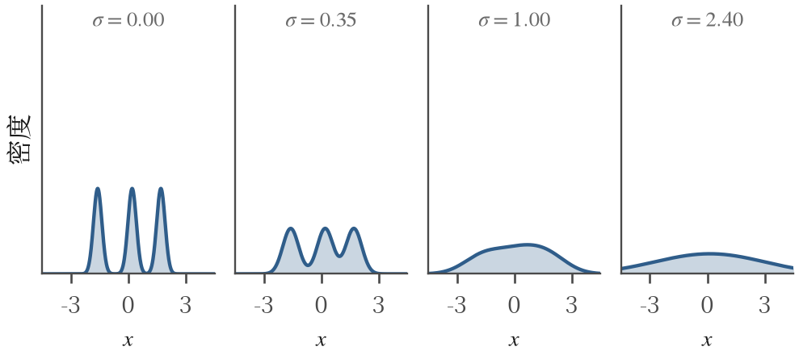

# 扩散的思想：从加噪到去噪

扩散模型的想法可以用一句话说完：先把图一步步加噪，直到它变成纯噪声；再训练一个网络把这个过程反过来。这一章只讲前半段，也就是加噪，以及为什么加噪之后的分布容易处理。后半段的反向过程在下一章。

先约定记号。第 6 章到第 11 章用 $t = 1,\dots,T$ 表示加噪步，$x_0$ 是干净图，$x_T$ 近似标准高斯，采样时 $t$ 递减。本册统一沿用这套记号。

## 为什么先加噪

第 2 章说过，自然图像集中在低维流形上，流形之外密度为零。这对直接学一个从噪声到数据的映射是灾难：两端的支撑几乎不重叠，中间没有可用的梯度信号。

加噪改变了这个局面。把数据和一个标准差为 $\sigma$ 的高斯卷积，得到的分布支撑覆盖整个空间，密度处处为正。$\sigma$ 越大，分布越接近高斯；越小，越接近原始数据。扩散模型构造的不是一个分布，而是一族用 $t$ 参数化的分布 $p_t$，从尖锐的数据分布连续过渡到高斯。



有了这一族分布，生成就可以拆成很多小步：从 $p_T$ 出发，一步步走到 $p_0$。每一小步只需要把噪声去掉一点点，这是一个远比从噪声直接造图容易的问题。

## 前向过程

每一步加一点高斯噪声

$$q(x_t\mid x_{t-1}) = \mathcal{N}\left(\sqrt{\alpha_t}\,x_{t-1},\ \beta_t I\right),\qquad \alpha_t = 1-\beta_t.$$

均值乘了 $\sqrt{\alpha_t}$ 而不是 $1-\beta_t$，是为了让方差保持稳定。如果只用 $x_{t-1}+\sqrt{\beta_t}\,\epsilon$，方差会随步数线性增长，最后数值爆掉；乘 $\sqrt{\alpha_t}$ 之后，若 $\mathrm{Var}(x_{t-1}) = 1$，则 $\mathrm{Var}(x_t) = \alpha_t + \beta_t = 1$。

整个链是马尔可夫的，$q(x_{1:T}\mid x_0) = \prod_{t=1}^T q(x_t\mid x_{t-1})$。

## 闭式边缘分布

我们并不需要一步一步采样才能得到 $x_t$。把两步展开

$$x_t = \sqrt{\alpha_t}\,x_{t-1} + \sqrt{\beta_t}\,\epsilon_1 = \sqrt{\alpha_t\alpha_{t-1}}\,x_{t-2} + \sqrt{\alpha_t\beta_{t-1}}\,\epsilon_2 + \sqrt{\beta_t}\,\epsilon_1.$$

两个独立高斯的和仍是高斯，方差相加

$$\alpha_t\beta_{t-1} + \beta_t = \alpha_t(1-\alpha_{t-1}) + (1-\alpha_t) = 1 - \alpha_t\alpha_{t-1}.$$

归纳下去，得到

$$q(x_t\mid x_0) = \mathcal{N}\left(\sqrt{\bar\alpha_t}\,x_0,\ (1-\bar\alpha_t)I\right),\qquad \bar\alpha_t = \prod_{s=1}^t\alpha_s.$$

等价地

$$x_t = \sqrt{\bar\alpha_t}\,x_0 + \sqrt{1-\bar\alpha_t}\,\epsilon,\qquad \epsilon\sim\mathcal{N}(0,I).$$

这个式子是后面所有推导的出发点。它说明任意时刻的含噪样本都可以由干净样本和一份噪声直接算出，训练时不需要跑完整的链。这一点让扩散模型的训练成本与步数 $T$ 无关。

由此可以定义一个描述还剩多少信号的量

$$\mathrm{SNR}(t) = \frac{\bar\alpha_t}{1-\bar\alpha_t}.$$

$t$ 小的时候 SNR 很大，图基本清晰；$t$ 接近 $T$ 时 SNR 接近零，图基本是噪声。

## 噪声日程

$\beta_t$ 怎么取，直接决定了每个时刻的噪声水平。

最早的 DDPM 用线性日程，$\beta_1 = 10^{-4}$ 线性增加到 $\beta_T = 0.02$。它的问题在末端：$\bar\alpha_T$ 还有 0.004 左右，意味着最后一步的图里仍残留一点点信号，和从纯高斯出发的假设不符。

cosine 日程换了一个思路，直接规定 $\bar\alpha_t$ 的形状

$$\bar\alpha_t = \cos^2\left(\frac{t/T+s}{1+s}\cdot\frac{\pi}{2}\right),$$

其中 $s$ 是一个小的偏移，通常取 0.008，用来避免 $t=0$ 附近变化太快。这样 $\bar\alpha_T$ 严格为零，末端不再残留信号。


从图 6.2 可以看到，线性日程的 SNR 在中段急剧下降，大部分破坏发生在很窄的一段步数里；cosine 日程的下降更均匀。这影响的是训练时各步的重要性，如果某一步几乎什么都没改变，网络在那一步上学不到东西。

## 反向过程与后验

反向过程要的是 $q(x_{t-1}\mid x_t)$。这个分布依赖数据，我们不知道。但如果额外给定 $x_0$，后验就有闭式解。

用贝叶斯公式和马尔可夫性

$$q(x_{t-1}\mid x_t,x_0) = \frac{q(x_t\mid x_{t-1})\,q(x_{t-1}\mid x_0)}{q(x_t\mid x_0)}.$$

分子是两个高斯的乘积，分母是一个与 $x_{t-1}$ 无关的常数。所以后验是高斯的，只需要把指数部分对 $x_{t-1}$ 配方。

把三个高斯的指数项写出来，忽略与 $x_{t-1}$ 无关的项

$$-\frac{1}{2\beta_t}\|x_t-\sqrt{\alpha_t}\,x_{t-1}\|^2 - \frac{1}{2(1-\bar\alpha_{t-1})}\|x_{t-1}-\sqrt{\bar\alpha_{t-1}}\,x_0\|^2.$$

展开，收集 $x_{t-1}$ 的一次项和二次项。二次项的系数是

$$\frac{\alpha_t}{\beta_t} + \frac{1}{1-\bar\alpha_{t-1}} = \frac{\alpha_t(1-\bar\alpha_{t-1})+\beta_t}{\beta_t(1-\bar\alpha_{t-1})} = \frac{1-\bar\alpha_t}{\beta_t(1-\bar\alpha_{t-1})},$$

所以后验的方差是它的倒数

$$\tilde\beta_t = \frac{\beta_t(1-\bar\alpha_{t-1})}{1-\bar\alpha_t}.$$

一次项给出均值。把 $x_{t-1}$ 的系数整理后得到

$$\tilde\mu_t(x_t,x_0) = \frac{\sqrt{\bar\alpha_{t-1}}\,\beta_t}{1-\bar\alpha_t}\,x_0 + \frac{\sqrt{\alpha_t}(1-\bar\alpha_{t-1})}{1-\bar\alpha_t}\,x_t.$$

这两个系数之和为 1，可以看作对 $x_0$ 和 $x_t$ 的一个加权平均。$t$ 越靠近 $T$，$x_t$ 的权重越大，因为此时 $x_0$ 的信息已经被噪声淹没，只能靠 $x_t$ 反推。

上式还有一个等价写法，把 $x_0$ 用 $x_t$ 和 $\epsilon$ 表示。由前向的闭式解反解

$$x_0 = \frac{x_t-\sqrt{1-\bar\alpha_t}\,\epsilon}{\sqrt{\bar\alpha_t}},$$

代进去整理得

$$\tilde\mu_t = \frac{1}{\sqrt{\alpha_t}}\left(x_t - \frac{\beta_t}{\sqrt{1-\bar\alpha_t}}\,\epsilon\right).$$

这个形式更常用，因为它把从 $x_t$ 预测 $x_0$ 换成了从 $x_t$ 预测 $\epsilon$，而预测噪声在高噪声区间数值上更稳定，下一章会解释原因。

## 采样算法

如果网络能准确预测 $\epsilon$，就可以按下面的流程从噪声生成图像。

```text
输入：训练好的 eps_theta，步数 T
x_T ~ N(0, I)
for t = T, T-1, ..., 1:
    z ~ N(0, I)  若 t > 1，否则 z = 0
    x_{t-1} = (1/sqrt(alpha_t)) * (x_t - beta_t/sqrt(1-abar_t) * eps_theta(x_t, t)) + sqrt(beta_tilde_t) * z
返回 x_0
```

这里加了 $\sqrt{\tilde\beta_t}\,z$ 的噪声，是因为后验本身有方差。不加噪声得到的是后验均值，采样会退化成一种确定性的过程，第 8 章的 DDIM 就是从这里出发的。

## 为什么这样做有效

把一件事拆成 $T$ 件小事，每件都很容易，这是扩散模型有效的一个解释。但这还不够，因为误差会累积。

更准确的说法是，不同的噪声水平对应不同的尺度。$t$ 大时，图像只剩下粗结构，网络学的是这块区域大概是什么颜色；$t$ 小时，细节逐渐显现，网络学的是这个像素的纹理应该往哪个方向偏一点。这些子问题之间有关联，但每一个都比从零生成简单得多。

另一个角度来自分数。加噪后的分布处处有正密度，它的梯度有定义；而这个梯度可以用去噪来估计。扩散模型的训练目标，本质上就是在学这个梯度场。这条线索在第 17 章还会再提一次。
