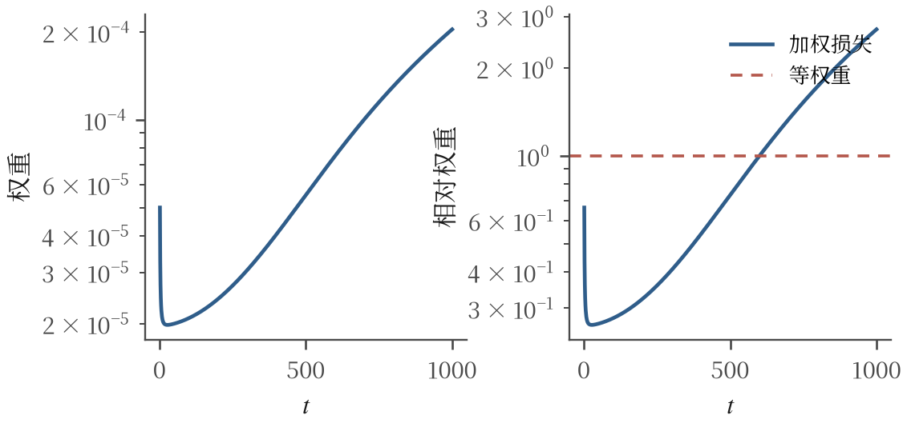
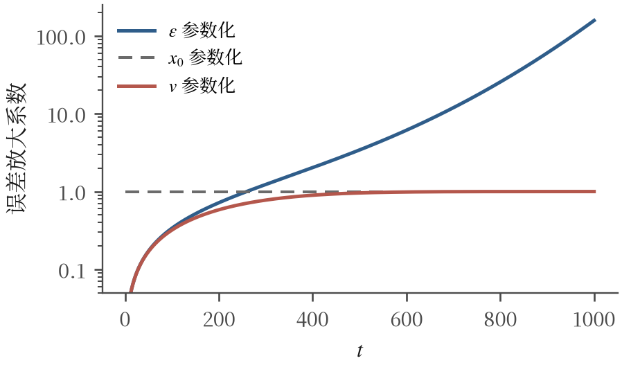

# 从变分下界到噪声预测

上一章构造了加噪的链，这一章要训练一个网络把它反过来。训练目标从哪来？答案和 VAE 一样，是变分下界。把扩散过程看成层数为 $T$ 的隐变量模型，写出它的下界，再逐步化简，最后会得到一个非常简单的形式，也就是预测被加进去的噪声。

推导有些长，但每一步都只用到第 3 章的工具。走完一遍，后面看到各种改进的损失函数就不会觉得神秘。

先看这个模型和 VAE 差在哪里。VAE 用一个网络把图压成隐向量，再用另一个网络解回来，两个网络一起训练。扩散把加噪过程本身当成编码器，它是固定的、没有参数的，只有解码的一半需要学。省掉编码器的收益不只是省参数。VAE 训练时最麻烦的一件事是后验容易偏离先验，网络最后学会忽略隐变量，这就是第 4 章说的后验坍塌；扩散的后验由加噪链完全决定，不存在“学得不像”的问题，只有解码器需要拟合。代价是隐变量的层数从一层变成了一千层，采样要跑一千次网络。

## 把扩散写成隐变量模型

生成过程是：从 $x_T\sim\mathcal{N}(0,I)$ 出发，依次采样

$$p_\theta(x_{t-1}\mid x_t) = \mathcal{N}\big(\mu_\theta(x_t,t),\ \Sigma_\theta(x_t,t)\big).$$

联合分布是 $p_\theta(x_{0:T}) = p(x_T)\prod_{t=1}^T p_\theta(x_{t-1}\mid x_t)$，边缘分布是

$$p_\theta(x_0) = \int p(x_T)\prod_{t=1}^T p_\theta(x_{t-1}\mid x_t)\,dx_{1:T}.$$

这个积分和 VAE 的边缘分布一样算不出来。

把两边的结构并排放，差别看得很清楚。

| | VAE | 扩散 |
| --- | --- | --- |
| 隐变量层数 | 1 | $T$（通常 1000） |
| 编码器 | 可学习的网络 $q_\phi(z\mid x)$ | 固定的加噪链 $q(x_t\mid x_{t-1})$ |
| 近似后验 | 网络输出，与真实后验有差距 | 给定 $x_0$ 有闭式解 |
| 先验 | $\mathcal{N}(0,I)$ | $\mathcal{N}(0,I)$ |
| 需要学的网络 | 编码器与解码器 | 只有解码器，所有步共用一套参数 |

最后一行的“共用一套参数”是这个模型最反直觉的地方。按定义，$T$ 个条件分布 $p_\theta(x_{t-1}\mid x_t)$ 是 $T$ 个不同的分布，理论上该有 $T$ 个网络。实际上只用一个网络，把 $t$ 作为额外输入，靠它区分自己处在哪一层。这样做能成立，是因为所有层的任务形式完全一样：输入一张含噪图，输出去掉一点噪声的方向。不同层之间的差别只在噪声的幅度上，而这个幅度可以由 $t$ 算出来。

$\Sigma_\theta$ 取什么也有讲究。DDPM 试过两种：固定成 $\beta_t I$，或固定成后验方差 $\tilde\beta_t I$，两者都只差一个与 $\theta$ 无关的缩放；也试过让网络学，似然确实变好，但训练不稳定，样本质量没有跟着提升。后面默认按 $\tilde\beta_t$ 固定，这样解码分布的宽度是写死的，网络只需要给出均值。

反向过程每一步也取高斯，这个选择不是随便定的。前向每步只加一点点噪声，$x_{t-1}\to x_t$ 相当于在原来位置上叠一个小扰动，所以给定 $x_t$ 之后 $x_{t-1}$ 的条件分布接近高斯：中心被 $x_t$ 与 $x_0$ 的位置确定，宽度很小。把方差固定成后验方差，等于直接接受这个近似，只把中心交给网络。两头的情形反而好处理：$t$ 很小时 $x_t$ 与 $x_0$ 几乎重合，条件分布接近一个点；$t$ 接近 $T$ 时数据分布的影响被噪声抹平，条件分布又回到各向同性高斯。真正的考验在中间那一段，也恰好是 $\tilde\beta_t$ 最大、$\hat x_0$ 最难估的一段。

每步去掉多少噪声，可以从后验方差的数值读出来。线性日程下 $\tilde\beta_t$ 在 $t=2$ 时是 $5.5\times10^{-5}$，$t=100$ 时是 $2.0\times10^{-3}$，$t=1000$ 时是 $0.02$，对应标准差 $0.14$，相对 $[-1,1]$ 的取值域仍然很小。也就是说没有哪一步需要“一步到位”，每步只是把样本往干净的方向挪一点。这个性质有两个后果。相邻两步的任务高度相关，所以 $T$ 个分布可以共用一套参数；采样时必须老实走完链条，因为每步只走一小段，想少走就得把许多小步合并成一个大步，那是第 8 章的问题。

## 下界

用前向过程 $q(x_{1:T}\mid x_0) = \prod_t q(x_t\mid x_{t-1})$ 作为近似后验。和 VAE 一样，乘以再除以 $q$，用 Jensen 不等式

$$\log p_\theta(x_0) \ge E_q\left[\log\frac{p_\theta(x_{0:T})}{q(x_{1:T}\mid x_0)}\right].$$

把分子分母的乘积展开

$$\log p_\theta(x_0) \ge E_q\left[\log p(x_T) + \sum_{t=1}^T\log p_\theta(x_{t-1}\mid x_t) - \sum_{t=1}^T\log q(x_t\mid x_{t-1})\right].$$

到这一步为止只是把两个乘积拆成了求和。接下来要做的变换是整段推导里最巧的一步：把 $q(x_t\mid x_{t-1})$ 换成以后验为主的写法。

给定 $x_0$ 时，前向链是马尔可夫的，$q(x_t\mid x_{t-1}) = q(x_t\mid x_{t-1},x_0)$，因为此时 $x_{t-1}$ 已经包含了 $x_0$ 的全部信息。对这个条件分布用一次贝叶斯公式

$$q(x_t\mid x_{t-1},x_0) = \frac{q(x_{t-1}\mid x_t,x_0)\,q(x_t\mid x_0)}{q(x_{t-1}\mid x_0)}.$$

取对数代入求和

$$\sum_{t=1}^T\log q(x_t\mid x_{t-1}) = \sum_{t=1}^T\log q(x_{t-1}\mid x_t,x_0) + \sum_{t=1}^T\log q(x_t\mid x_0) - \sum_{t=1}^T\log q(x_{t-1}\mid x_0).$$

后面的两个求和正好抵消。第一个的指标是 $t=1,\dots,T$，第二个是 $t-1=0,\dots,T-1$，从 $1$ 到 $T-1$ 的项一对一相同，剩下的是 $\log q(x_T\mid x_0)$ 与 $-\log q(x_0\mid x_0)$。后者等于 $0$，因为给定 $x_0$ 时 $x_0$ 没有不确定性。

把这一串代回去，下界变成

$$\log p_\theta(x_0) \ge E_q\left[\log p(x_T) - \log q(x_T\mid x_0) + \sum_{t=1}^T\log\frac{p_\theta(x_{t-1}\mid x_t)}{q(x_{t-1}\mid x_t,x_0)}\right].$$

第一组两项是一个 KL 的相反数，求和里的每一项对 $x_{t-1}$ 取条件期望之后也恰好是一个 KL。把负号提出来，得到要最小化的损失

$$\begin{aligned}
L = {}&\underbrace{\mathrm{KL}(q(x_T\mid x_0)\,\|\,p(x_T))}_{L_T} \\[5pt]
&+ \sum_{t=1}^T\underbrace{E_q\big[\mathrm{KL}(q(x_{t-1}\mid x_t,x_0)\,\|\,p_\theta(x_{t-1}\mid x_t))\big]}_{L_{t-1}} \\[5pt]
&- \underbrace{E_q[\log p_\theta(x_0\mid x_1)]}_{L_0}.
\end{aligned}$$

三项的含义是这样的。$L_T$ 衡量最后一步的噪声分布是否与先验一致，因为前向过程的终点是固定的，这一项与 $\theta$ 无关，训练时忽略。$L_{t-1}$ 是每一步的去噪匹配。$L_0$ 是最后从 $x_1$ 解码出 $x_0$ 的似然。

到这里，扩散的训练目标已经清楚了：让 $p_\theta(x_{t-1}\mid x_t)$ 尽量接近真实的后验 $q(x_{t-1}\mid x_t,x_0)$。后者在上一章已经算出来，是高斯。

这一步很关键。如果没有闭式后验，我们就不知道应该预测什么；有了它，$L_{t-1}$ 就是一个可以直接写出来的 KL，而 KL 又可以化成一个回归问题。

$L_T$ 虽然不参与训练，量级值得知道，因为它决定了“似然”这个指标能报出多好看的数字。两个零均值各向同性高斯的 KL 是逐维相加的，每维为

$$\mathrm{KL}\big(\mathcal{N}(0,\bar\alpha_T)\,\|\,\mathcal{N}(0,1)\big) = \frac{1}{2}\big(\bar\alpha_T - 1 - \ln\bar\alpha_T\big).$$

线性日程在 $T=1000$ 时 $\bar\alpha_T\approx4\times10^{-5}$，取对数得 $-10.1$，每维的 KL 约为

$$\frac{1}{2}\big(0.00004 - 1 + 10.1\big) \approx 4.6\ \text{nat} \approx 6.6\ \text{bit}.$$

这是一个常数，梯度下降看不见它，但只要用这套模型报似然，它就一直在那里，等于给每维白送 6.6 个比特的罚分。线性日程末端残留信号越少，这个常数越小；$1-\bar\alpha_T$ 越接近 1，罚分越小。这个观察是 cosine 日程受到青睐的原因之一。

$L_0$ 的算法值得单说一句，因为“每维多少比特”这个常用指标就来自这里。把像素值归一化到 $[-1,1]$ 后切成 256 个等宽的格子，$p_\theta(x_0\mid x_1)$ 是高斯，一个像素落在第 $k$ 格里说成它对那个区间的概率质量，似然就是 256 个质量之积。取负对数、除以维数、再除以 $\ln 2$，就得到 bits per dim。这一步把连续密度换成了真正的概率，避免了密度值大于 1 带来的负比特数。

训练时不用对 $t$ 求和。$t$ 从 $\{1,\dots,T\}$ 均匀抽一个，损失就是对整个求和的无偏估计，差的只是一个常数因子 $T$，吸收进学习率即可。这也是扩散训练成本与 $T$ 无关的原因：不管链条多长，一个样本只贡献一项。

下界与真实对数似然差多少，也能写成一个 KL：

$$\log p_\theta(x_0) - \text{ELBO} = \mathrm{KL}\big(q(x_{1:T}\mid x_0)\,\|\,p_\theta(x_{1:T}\mid x_0)\big).$$

这是近似后验与真实后验之间的距离。它算不出来，因为右边要看到 $x_0$，而 $x_0$ 的分布正是我们在建模的东西。能做的只有把 $q$ 选得好一点。扩散的 $q$ 是固定的加噪链，比一般的变分近似贴得更紧：每一步的扰动足够小，给定 $x_t$ 时 $x_{t-1}$ 的后验接近高斯，而扩散恰好就用高斯族去近似它。这也解释了一个看起来奇怪的选择：为什么要把 $T$ 取到一千这么大。层数多的代价是采样慢，收益是下界更紧、每步任务更简单。

$L_{t-1}$ 能变成监督信号，靠的是上一章那个闭式后验。假如 $\tilde\mu_t$ 没有解析式，我们只知道“应该匹配某个分布”，却不知道该往哪个方向走，只能用采样去估梯度，方差大到不可用。有了闭式解，每一步都有一个能逐元素算出来的目标向量，损失直接可算。

## 化简 KL

设 $p_\theta(x_{t-1}\mid x_t) = \mathcal{N}(\mu_\theta(x_t,t),\tilde\beta_t I)$，方差沿用后验的方差，不学。两个同方差高斯的 KL 需要先推一遍，因为它会在后面反复出现。

取 $p=\mathcal{N}(\mu_1,\sigma^2I)$、$q=\mathcal{N}(\mu_2,\sigma^2I)$，维数 $d$。按定义展开

$$\mathrm{KL}(p\,\|\,q) = E_p\big[\log p(x)\big] - E_p\big[\log q(x)\big].$$

第二项的密度是 $\log q(x) = -\frac{d}{2}\log(2\pi\sigma^2) - \frac{\|x-\mu_2\|^2}{2\sigma^2}$，其中只有末项依赖 $x$。把 $x-\mu_2$ 拆成 $(x-\mu_1)+(\mu_1-\mu_2)$，交叉项的期望为零，于是

$$E_p\big[\|x-\mu_2\|^2\big] = \|\mu_1-\mu_2\|^2 + d\sigma^2.$$

第一项也照同样方式拆开，得 $E_p[\log p] = -\frac{d}{2}\log(2\pi\sigma^2) - \frac{d}{2}$。两式相减，对数项和 $\frac{d\sigma^2}{2\sigma^2} = \frac{d}{2}$ 全部抵消，只剩

$$\mathrm{KL} = \frac{1}{2\sigma^2}\|\mu_1-\mu_2\|^2.$$

维数 $d$ 消失了，这个式子只看均值的差距。

放到我们的情形，$\sigma^2 = \tilde\beta_t$，$\mu_1 = \tilde\mu_t$、$\mu_2 = \mu_\theta$，

$$\mathrm{KL} = \frac{1}{2\tilde\beta_t}\|\tilde\mu_t(x_t,x_0) - \mu_\theta(x_t,t)\|^2.$$

上面相减的时候已经把所有常数项消掉了，这里没有需要再丢的东西。把量级估一下：取 $t=100$，那里 $\tilde\beta_t=2.0\times10^{-3}$，如果两个均值在某个像素上差 $0.01$，这一维的 KL 是 $0.01^2/(2\times2.0\times10^{-3})=2.5\times10^{-5}$；差 $0.1$ 时是 $2.5\times10^{-3}$。KL 对均值差是平方关系，误差翻十倍代价翻一百倍，这使得少数预测得很差的像素能主导一整步的损失。

于是每一步的训练目标就是：让网络的输出靠近后验均值。

接下来把 $\tilde\mu_t$ 用 $x_t$ 和 $\epsilon$ 表示。上一章已经推过

$$\tilde\mu_t = \frac{1}{\sqrt{\alpha_t}}\left(x_t-\frac{\beta_t}{\sqrt{1-\bar\alpha_t}}\,\epsilon\right).$$

自然的选择是让网络输出这个形式

$$\mu_\theta(x_t,t) = \frac{1}{\sqrt{\alpha_t}}\left(x_t-\frac{\beta_t}{\sqrt{1-\bar\alpha_t}}\,\epsilon_\theta(x_t,t)\right).$$

这个代换是整章的技术核心。它没有增加任何自由度：$\mu_\theta$ 与 $\epsilon_\theta$ 是一一对应的，网络只是在换一种坐标输出。选 $\epsilon$ 的坐标，是因为它恰好是分数乘以常数（后面讲“平方误差学到的其实是分数”时推），而且目标的幅度在每个噪声水平上都是 1，网络不用为不同的 $t$ 适配输出尺度。换算成 $\hat x_0$ 时高噪声端会被放大，那个问题留到采样阶段处理，本节后面会给出具体数字。

代回 KL，两个 $x_t$ 抵消，$\frac{1}{\sqrt{\alpha_t}}$ 提出来平方，$\frac{\beta_t}{\sqrt{1-\bar\alpha_t}}$ 也平方，剩下

$$L_{t-1} = E_q\left[\frac{\beta_t^2}{2\tilde\beta_t\alpha_t(1-\bar\alpha_t)}\|\epsilon-\epsilon_\theta(x_t,t)\|^2\right].$$

现在化简系数。把 $1/\tilde\beta_t = (1-\bar\alpha_t)/\big(\beta_t(1-\bar\alpha_{t-1})\big)$ 代进去，分子分母里的 $(1-\bar\alpha_t)$ 约掉一个

$$\frac{\beta_t^2}{2\tilde\beta_t\alpha_t(1-\bar\alpha_t)} = \frac{\beta_t^2}{2\alpha_t(1-\bar\alpha_t)}\cdot\frac{1-\bar\alpha_t}{\beta_t(1-\bar\alpha_{t-1})} = \frac{\beta_t}{2\alpha_t(1-\bar\alpha_{t-1})}.$$

再用 $\beta_t = 1-\alpha_t$，也可以写成 $\frac{1-\alpha_t}{2\alpha_t(1-\bar\alpha_{t-1})}$。两种写法等价，第一种更常见。所以

$$L_{t-1} = E_q\left[\frac{\beta_t}{2\alpha_t(1-\bar\alpha_{t-1})}\|\epsilon-\epsilon_\theta(x_t,t)\|^2\right].$$

这就是 DDPM 论文里的加权损失。

系数有个简单的读法。分母里的 $1-\bar\alpha_{t-1}$ 是到上一步为止累积的噪声方差，分子 $\beta_t$ 是这一步新加的量。权重约等于“新加的噪声除以两倍的已有噪声”。对线性日程，$\beta_t$ 从 $10^{-4}$ 线性长到 $0.02$，而 $1-\bar\alpha_{t-1}$ 从 $10^{-4}$ 指数式地长到接近 1，两边的增长速度不同，权重就先降后升：$t=2$ 时约 $0.60$，$t\approx350$ 时降到最低 $0.005$，$t=1000$ 时回到 $0.010$。

把几档噪声放在一张表里，几个量之间的关系更清楚。

| $t$ | $\bar\alpha_t$ | $\mathrm{SNR}(t)$ | 权重 $w_t$ | 放大系数 $\sigma_t/\alpha_t$ |
| --- | --- | --- | --- | --- |
| 2 | $0.9998$ | $4.5\times10^{3}$ | $0.60$ | $0.01$ |
| 10 | $0.998$ | $5.3\times10^{2}$ | $0.086$ | $0.04$ |
| 100 | $0.897$ | $8.7$ | $0.010$ | $0.34$ |
| 500 | $0.079$ | $0.085$ | $0.0055$ | $3.4$ |
| 900 | $2.8\times10^{-4}$ | $2.8\times10^{-4}$ | $0.0092$ | $60$ |
| 1000 | $4.0\times10^{-5}$ | $4.0\times10^{-5}$ | $0.010$ | $157$ |

后两列是本章后面两处要用的东西：权重决定训练时哪些步被重视，放大系数决定采样时哪些步容易出数值问题。它们的变化方向相反，同一端不会同时“被重视”和“被放大”：低噪声端的权重最大而放大系数最小，中段权重最小，高噪声端的放大系数最大。

用一组具体数字走一遍换算，就能看清 $\epsilon$ 参数化在高噪声端为什么危险。线性日程在 $t=100$ 处 $\bar\alpha_t=0.897$，于是 $\sqrt{\bar\alpha_t}=0.947$、$\sqrt{1-\bar\alpha_t}=0.321$。某个像素上取 $x_t=0.8$、网络给出 $\epsilon_\theta=0.3$，则

$$\hat x_0 = \frac{0.8-0.321\times0.3}{0.947} = 0.743.$$

同一对数字换到 $t=900$（那里 $\bar\alpha_t=2.75\times10^{-4}$，$\sqrt{\bar\alpha_t}=0.0166$、$\sqrt{1-\bar\alpha_t}\approx1.0$），

$$\hat x_0 = \frac{0.8-1.0\times0.3}{0.0166}\approx30.$$

同一个 $\epsilon_\theta$，只是换了噪声水平，$\hat x_0$ 从 $0.74$ 变成 $30$，越出 $[-1,1]$ 十几倍。这不是极端情形，是高噪声端的常态：$x_t$ 里几乎没有信号，$\hat x_0$ 相当于把 $x_t$ 除以一个接近零的数。

$t=1$ 这一步要单独处理。那里 $1-\bar\alpha_0 = 0$，系数发散，因为后验 $q(x_0\mid x_1)$ 在高斯假设下退化成一个点，KL 变成无穷大。DDPM 的做法是把 $t=1$ 换成 $L_0$，也就是上一节说的离散解码器，用一个正常的高斯去覆盖 $x_0$ 的取值。实现时常见的处理是把求和从 $t=1$ 挪到 $t=2$，第一步不计入损失；这不会带来可见的差别，因为 $x_1$ 上的噪声本来就极小，网络在那一步的输出几乎不影响结果。

## 简化损失与它的代价

上面的系数在不同 $t$ 上差别很大。$t$ 很小时 $1-\bar\alpha_{t-1}$ 只有 $10^{-4}$ 量级，系数被抬到 $0.6$；中段降到 $0.005$；$t$ 接近 $T$ 时 $1-\bar\alpha_{t-1}$ 已经饱和在 1 附近，系数只剩 $\beta_t/2\alpha_t\approx0.01$。这意味着低噪声步的误差被放大，优化器会更关注这些步。

用信噪比写出来，这条曲线的形状更好理解。由 $1-\bar\alpha_{t-1} = 1/(1+\mathrm{SNR}(t-1))$ 得

$$\frac{\beta_t}{2\alpha_t(1-\bar\alpha_{t-1})} = \frac{\beta_t}{2\alpha_t}\big(1+\mathrm{SNR}(t-1)\big).$$

权重正比于 $1+\mathrm{SNR}(t-1)$。低噪声端 SNR 很大，权重随它线性增长，这就是 $t=2$ 处的 $0.6$；高噪声端 SNR 趋零，权重停在 $\beta_t/2\alpha_t\approx0.01$，不再下降。第 9 章的 min-SNR 加权就是在这条曲线上做了个截断，把 $\mathrm{SNR}$ 换成 $\min(\mathrm{SNR},\gamma)$，正是因为这段线性增长的区间太占优势。



Ho 等人发现，直接把这个系数丢掉、用等权重的

$$L_{\text{simple}} = E_{t,x_0,\epsilon}\big[\|\epsilon-\epsilon_\theta(x_t,t)\|^2\big]$$

训练，效果反而更好。原因是低噪声步本来就很容学，几乎不用改，高噪声步才是难点；按系数加权会让优化器把精力花在容易的地方。

把它换算成“对下界权重的相对改动”，这件事更清楚。图 7.1 的右图把权重除以自己的均值，等权重对应一条高度为 1 的水平线。低噪声端曲线高出这条线六十倍左右，中段低到 0.5，高噪声端几乎贴着 1。也就是说，丢掉系数的主要后果是把低噪声端的权重压下去大约六十倍，把中段的权重抬上来一倍。用等权重训练，相当于宣布“每个噪声水平的错误一样重要”，而按似然来算，最噪的那一段其实只值低噪声端的六十分之一。

代价是，简化损失不再是严格的似然下界，所以用它训练出来的模型在似然这个指标上会差一些，样本质量却更好。这在生成模型里是一个反复出现的现象：优化似然和优化感知质量不是一回事。

不一致的原因可以说得更具体。像素空间上的平方误差，最优解是条件均值 $E[x_0\mid x_t]$。噪声大的时候，给定 $x_t$ 之后 $x_0$ 的条件分布是宽的多峰分布，均值落在峰与峰之间，画出来是一片糊。似然并不讨厌这种糊：把概率质量铺在均值附近，覆盖到真实值的概率并不低。而人眼和 FID 这类指标讨厌糊，它们看的是纹理是否落在正确的位置上。训练目标的度量决定了模型往哪边偏，换成 $L_1$ 会得到更靠近中位数的解，边缘更硬一些，但根本的矛盾还在。

换损失还带来两个工程后果。整体尺度变了：下界权重的均值约 $0.01$，去掉系数等于把损失放大约一百倍，同一套超参搬过去会直接发散，学习率要按比例缩。损失也不再依赖日程表的具体形状：加权损失里的系数含 $\bar\alpha_t$，换日程就得整条重算，简单损失不用。

后来的一些做法是在这两个极端之间找折中。min-SNR 加权把权重截断在 $\min(\mathrm{SNR},\gamma)$ 上，让低噪声端的权重不要爆掉、高噪声端也不至于完全没有；有的实现把 $t$ 很小的若干步直接剔除；还有的按 SNR 采样 $t$ 而不是均匀采样。这些都只是改动同一个系数曲线的形状，骨架没变。第 9 章会把这些做法放到一起比较。

中间过渡还有一个写法，在两个极端之间插一个标量 $\lambda$：

$$L_\lambda = L_{\text{simple}} + \lambda\,L_{\text{vlb}},$$

$\lambda=0$ 是纯简单损失，$\lambda=1$ 是纯下界，中间值可以调。$\lambda$ 很小时似然指标改善有限，样本质量几乎不受影响；$\lambda$ 取到 1 时似然最好，样本质量却掉下来。DDPM 把它当成一个超参来试，选的是一个较小的值，等于“以下界的形状为主、只借用一点它的权重”。

## 平方误差学到的其实是分数

这一节把回归目标和上一章提到的“分数”接上。这件事值得单独拿出来讲，因为它是整套方法能连着采样器、连到后面的流模型的原因。

先把最优解写出来。固定一个 $x$ 和一个 $t$，平方误差对 $\epsilon_\theta$ 的最小化解是条件期望

$$\epsilon_\theta^*(x,t) = E[\epsilon\mid x_t=x].$$

这一步是配方：$E\|\epsilon-a\|^2 = E\|\epsilon-E\epsilon\|^2+\|E\epsilon-a\|^2$，第二项在 $a=E\epsilon$ 时为零。

再看这个条件期望等不等于分数的函数。含噪分布的密度是 $p_t(x)=\int p_0(x_0)\,\mathcal{N}(x;\alpha x_0,\sigma^2)\,dx_0$，对 $x$ 求梯度，高斯的那一项对 $x$ 的导数是 $-\frac{x-\alpha x_0}{\sigma^2}$ 乘回密度，于是

$$\nabla_x p_t(x) = -\frac{1}{\sigma^2}\int p_0(x_0)\,(x-\alpha x_0)\,\mathcal{N}(x;\alpha x_0,\sigma^2)\,dx_0.$$

两边除以 $p_t(x)$，积分就变成了对后验的期望

$$\nabla_x\log p_t(x) = -\frac{1}{\sigma^2}\big(x-\alpha\,E[x_0\mid x_t=x]\big).$$

而 $\epsilon = (x-\alpha x_0)/\sigma$，把它代入上式右边

$$-\sigma\,\nabla_x\log p_t(x) = E\Big[\frac{x-\alpha x_0}{\sigma}\ \Big|\ x_t=x\Big] = E[\epsilon\mid x_t=x].$$

两式合起来，$\epsilon_\theta^*(x,t) = -\sigma_t\nabla_x\log p_t(x)$。训练好的网络就是一个分数估计器，只差一个与 $t$ 有关的常数因子。

这里有一处容易误会的地方值得分清。网络学的是“给定 $x_t$ 时噪声的条件期望”，不是“当初加进去的那一份噪声”。后者是一个具体的随机向量，给定 $x_t$ 之后仍然不确定（不确定性写在 $\tilde\beta_t$ 里），任何网络都不可能复现它。条件期望是它在均方意义下的最优估计，这个估计恰好就是分数。所以采样时把 $\epsilon_\theta$ 代回公式，得到的是后验均值而不是真实轨迹；后验方差那一部分靠额外的随机噪声补，这就是第 6 章采样步骤里那个 $z$ 的来历。

这个结论带来两个推论。其一，三种参数化不是三个不同的任务，而是同一个函数在三个坐标下的名字，它们的最优解可以通过换算表互相导出。其二，损失加上什么权重不影响最优解，只影响在有限参数、有限步数下哪一段拟合得好。所以简单损失与下界损失学的是同一个目标函数，区别只在于两者的误差在各噪声水平上的分配。这句话把前面“简化损失不是下界却更好用”的矛盾解释清楚了：丢掉系数并没改变答案，只是把优化预算从低噪声端挤到了中高噪声端。

有了分数这个身份，采样就不必局限于第 6 章那个祖先采样。分数确定了一个连续的向量场，场上每一点的切向都固定，于是有确定性的轨迹（概率流 ODE），也可以加入不同量的随机扰动（不同扩散系数的 SDE），两者给出相同的边缘分布。第 8 章的 DDIM 与后面流模型的那一套，都是在这句话上做文章。

## 三种参数化

网络可以直接预测 $\epsilon$，也可以预测 $x_0$，或者预测两者的线性组合 $v$。三者可以互相换算。

由 $x_t = \sqrt{\bar\alpha_t}x_0+\sqrt{1-\bar\alpha_t}\epsilon$，若已知 $\epsilon_\theta$，则

$$\hat{x}_0 = \frac{x_t-\sqrt{1-\bar\alpha_t}\,\epsilon_\theta}{\sqrt{\bar\alpha_t}}.$$

若已知 $\hat{x}_0$，则

$$\hat\epsilon = \frac{x_t-\sqrt{\bar\alpha_t}\,\hat{x}_0}{\sqrt{1-\bar\alpha_t}}.$$

$v$ 参数化定义为

$$v = \sqrt{\bar\alpha_t}\,\epsilon - \sqrt{1-\bar\alpha_t}\,x_0.$$

它的好处是无论 $t$ 取何值，$v$ 的尺度都在常数附近：数据与噪声都是单位方差时，$v$ 的方差恒为 $\bar\alpha_t+(1-\bar\alpha_t)=1$，而且把它换算回 $\hat x_0$ 时误差不会被放大（下面会给系数）。$\epsilon$ 参数化在高噪声端的换算会放大一百多倍，$x_0$ 参数化在高噪声端则要直接输出一个几乎无法确定的量。

把三种换算写全，才能看出它们的关系。记 $\alpha=\sqrt{\bar\alpha_t}$、$\sigma=\sqrt{1-\bar\alpha_t}$，由 $x_t = \alpha x_0+\sigma\epsilon$，三组量两两之间都是线性关系。

| 已知 | 求 $x_0$ | 求 $\epsilon$ | 求 $v$ |
| --- | --- | --- | --- |
| $x_0$ | — | $(x_t-\alpha x_0)/\sigma$ | $(\alpha x_t - x_0)/\sigma$ |
| $\epsilon$ | $(x_t-\sigma\epsilon)/\alpha$ | — | $(\epsilon-\sigma x_t)/\alpha$ |
| $v$ | $\alpha x_t-\sigma v$ | $\sigma x_t+\alpha v$ | — |

表里每个格子都是把 $x_t=\alpha x_0+\sigma\epsilon$ 代进定义式整理出来的，没有新的假设。

拿上一节的数字验一遍。$t=100$ 时 $\alpha=0.947$、$\sigma=0.321$，$x_t=0.8$、$\epsilon=0.3$ 给出 $\hat x_0=0.743$。按第三列的公式算 $v$：$(\epsilon-\sigma x_t)/\alpha=(0.3-0.257)/0.947=0.045$；按定义 $\alpha\epsilon-\sigma x_0=0.284-0.239=0.045$，两条路对上了。这种检验很便宜，实现一套新参数化时先拿它对一遍，比看损失曲线快。

$v$ 的两条反解值得单独看一眼：它们的形式和正解完全对称，$v = \alpha\epsilon-\sigma x_0$ 与 $x_0 = \alpha x_t-\sigma v$ 只差一个符号位置。原因写在矩阵里就明白了

$$\begin{pmatrix}x_t\\ v\end{pmatrix} = \begin{pmatrix}\alpha & \sigma\\ -\sigma & \alpha\end{pmatrix}\begin{pmatrix}x_0\\ \epsilon\end{pmatrix}.$$

这是一个旋转矩阵，行列式为 $\alpha^2+\sigma^2=1$。三种参数化其实是同一对量 $(x_0,\epsilon)$ 在不同旋转角下的两个坐标：$\epsilon$ 参数化让网络输出第二行对应的那个方向，$x_0$ 参数化输出第一列，$v$ 参数化输出旋转之后的第二行。旋转不改变信息量，所以三者的表达能力完全一样，区别只在数值条件。

数值条件可以用一个量说清楚：预测出现偏差时，换算回 $\hat x_0$ 会被放大多少倍。固定 $x_t$ 与另一个量不变，对换算公式求偏导，三种参数化给出的系数是

$$\epsilon\text{ 参数化：}\ \frac{\sigma}{\alpha},\qquad x_0\text{ 参数化：}\ 1,\qquad v\text{ 参数化：}\ \sigma.$$



三种参数化的目标方差在数据与噪声都取单位方差时都等于 1，正好可以放在同一把尺子上比。做单位方差的假设之后，$v$ 的方差是 $\bar\alpha_t+(1-\bar\alpha_t)=1$，$\epsilon$ 和 $x_0$ 的方差也是 1，网络在三种坐标下面对的回归难度（按目标幅度衡量）相同。那么同样一份相对误差，传回 $\hat x_0$ 时：$\epsilon$ 参数化在 $t=1000$ 处放大 $1/\sqrt{4\times10^{-5}}\approx160$ 倍，在 $t=100$ 处缩小到 $0.34$；$v$ 参数化两端都不超过 1。高噪声端的 $160$ 倍不是耸人听闻，它意味着 $\hat x_0$ 的误差可以有上百个单位的量级，远超图像本身的范围 $[-1,1]$。

| 参数化 | 网络输出 | 数值特点 |
| --- | --- | --- |
| $\epsilon$ | $\epsilon_\theta$ | 目标尺度恒为 1；把预测误差传回 $\hat x_0$ 的放大系数为 $\sigma/\alpha$，高噪声端可达上百倍 |
| $x_0$ | $\hat x_0$ | 放大系数为 1；高噪声时 $\hat x_0$ 由近乎纯噪声反推，取值容易越界 |
| $v$ | $v_\theta$ | 放大系数为 $\sigma\le1$，两端都有限 |

这张表在后面还会用到。第 9 章的 EDM 用 $x_0$ 参数化加一套预条件系数解决了数值问题；MeanFlow 则用 $v$ 参数化的思路定义平均速度，本书不展开。

放大系数只影响“从预测到 $\hat x_0$ 的换算”，它本身不改变训练梯度，因为损失定义在预测的坐标里。真正被改变的是两件事。采样时，$\hat x_0$ 越界的程度不同，$x_0$ 参数化要显式裁剪才能稳定，$\epsilon$ 参数化在大部分步上不用管，只在最噪的几步要小心。训练时，同一个 $\epsilon$ 误差在不同 $t$ 上对应的似然代价不同，这正是本章前面那条权重曲线在做的事。$v$ 参数化把放大系数压平，等于让“误差→$\hat x_0$”这一步在所有噪声水平上尺度一致，采样器的步长也就可以按同一个尺度来选。

实际使用时，参数化是跟着权重走的。拿到的预训练网络如果是 $\epsilon$ 参数化，采样公式就只能按 $\epsilon$ 那两行换算；想改用期望 $x_0$ 的采样器，要先把网络输出换过去，而不是把公式里的一项改个名字。近年的一些模型改成直接回归速度场，本质上也是换坐标，换算关系与 $v$ 参数化同源，第 17 章会从另一个方向推到这里。

$x_0$ 参数化还有一处操作上的差别。预测出的 $\hat x_0$ 要裁到 $[-1,1]$ 才能用，裁完之后必须把 $\hat x_0$ 重新换成 $\epsilon$ 或 $v$ 再往下走，否则 $x_t=\alpha\hat x_0+\sigma\epsilon$ 这个三角关系被破坏，后面每一步都基于一个不自洽的状态在算。$\epsilon$ 参数化采样时也可以先把 $\hat x_0$ 裁一下、再换回 $\epsilon$，这相当于把超出范围的预测拉回来。裁剪会引入偏差，但在步数很少、轨迹容易冲出去的场合，这点偏差比发散划算。

换成 $v$ 参数化之后，网络的输出要按 $v = \alpha\epsilon_\theta-\sigma x_0$ 的目标训练，采样时再按 $\hat x_0 = \alpha x_t-\sigma v_\theta$ 和 $\hat\epsilon = \sigma x_t+\alpha v_\theta$ 换回去。这两步换算都是逐元素乘法，开销可以忽略。

## 训练与采样

训练循环只有四步。

```text
输入：网络 eps_theta(x, t)，日程表 abar[1..T]
重复：
    x0  <- 取一个 batch 的图，归一化到 [-1, 1]        # [B, C, H, W]
    t   <- 从 1..T 均匀抽 B 个整数                     # [B]
    eps <- 标准正态，形状同 x0                          # [B, C, H, W]
    xt  <- sqrt(abar[t]) * x0 + sqrt(1 - abar[t]) * eps  # 按样本广播
    pred <- eps_theta(xt, t)                            # [B, C, H, W]
    loss <- mean_B( sum_{C,H,W} (eps - pred)^2 / (C*H*W) )
    梯度下降一步；每 k 步更新一份参数的滑动平均
```

注意 $t$ 是均匀采样的。这意味着每个噪声水平被优化的次数相同。有些工作改成按 SNR 加权采样，让训练更集中于中间的噪声水平，效果更好，第 9 章会讲。

均匀抽 $t$ 之所以够用，是因为下界求和里每一项的 KL 本身已经很小，梯度的方差主要来自 $x_0$ 与 $\epsilon$ 的抽样，而不是 $t$。要再压低 $t$ 这一层带来的方差，可以按与 $w_t$ 成比例的分布非均匀地抽 $t$，再除以抽中的概率，这就是重要性采样。它在专门优化下界的训练里有帮助；在简单损失上收益不明显，因为那里每一项权重相同，均匀抽样本来就把优化的预算分得均匀。

损失里的归一化方式值得说一句。用 `sum_{C,H,W}` 再除以样本数，等价于每个样本贡献一个“平均每像素误差”；用 `mean` 全平掉，会让损失随分辨率变小，学习率要跟着调。两种都在用，关键是在一组实验里保持一致，否则比较的是两个不同的目标。混合精度训练时，$\epsilon$ 的取值在 $[-4,4]$ 之外的情况很少，平方之后不会溢出；容易出问题的是 $\bar\alpha_t$ 在 $t$ 接近 $T$ 时非常小，$1/\sqrt{\bar\alpha_t}$ 这种量在采样阶段会放大误差，用 float16 算会有明显偏差，采样一般还是用 float32。

标签要传到网络的写法有两种：一种是每层调制归一化的缩放与偏移，另一种是拼接到特征上。时间嵌入的取值本身与 $\bar\alpha_t$ 无关，所以换日程不需要改网络，但换了日程必须重训，因为同一个 $t$ 对应的噪声水平变了。

数据增强在扩散里用得比分类任务克制。水平翻转、随机裁剪这类不改变分布的变换可以加，因为对称性与平移不变性在自然图像里成立；颜色抖动、模糊、压缩噪声这类会改变像素统计的增强会直接与训练目标打架——网络本来要学“这个噪声水平下像素该是什么”，你把像素改了，它学到的就是另一个分布。需要更多数据时，通常的做法是扩大数据集而不是加强增强。

采样时按上一章的算法，从 $x_T$ 逐步走到 $x_0$。

```text
输入：训练好的 eps_theta，日程表 abar、beta、beta_tilde
x <- 标准正态，形状 [1, C, H, W]
for t = T down to 1:
    eps  <- eps_theta(x, t)
    mean <- (x - beta[t]/sqrt(1 - abar[t]) * eps) / sqrt(alpha[t])
    if t > 1:
        x <- mean + sqrt(beta_tilde[t]) * 标准正态
    else:
        x <- mean
返回 x
```

采样过程的几何含义值得画出来想一遍。每一步只做两件事：先用 $\epsilon_\theta$ 把当前的 $x_t$ 换算成一个 $\hat x_0$，再从 $\hat x_0$ 出发往 $x_t$ 的方向退一小段，退到下一个噪声水平。用 DDIM 的写法看得最清楚：$x_{t-1}=\alpha_{t-1}\hat x_0+\sqrt{1-\bar\alpha_{t-1}}\,\hat\epsilon$，相当于把 $\hat x_0$ 重新加噪到第 $t-1$ 步。整条轨迹就是若干段直线的拼接，每段都指向当时估计的那个 $x_0$。

这个图像解释了两件事。段数越多，每段越短，$\hat x_0$ 在段内变化越小，“沿直线走”这个假设越成立，结果越准。步数压到只剩几段时，误差的主要来源不再是数值积分，而是段内 $\hat x_0$ 变了而公式仍当它没变。这也意味着低噪声端的步长不能随便拉大：那里的 $\hat x_0$ 变化很快，而公式里分子分母都在变，误差会集中到细节和颜色上。

步数固定为 $T$ 时计算量很大。一张 $512\times512$ 的图，一次 U-Net 前向在消费级显卡上是几十毫秒的量级（视模型大小与精度而定，这里是量级估计），一千步就是半分钟到一分钟一张。第 8 章会讲怎么把步数压下来，但无论怎么压，采样阶段每一步都要把 $\hat x_0$ 或 $\epsilon$ 换出来一次，换算表里的那几行代码始终在最内层循环里。

训练与采样之间有三处必须对齐，错一处就会得到雪花或糊图，而且报错信息很少，只能靠现象定位。

- 日程：训练用的 $\bar\alpha_t$ 与采样用的必须是同一张表，包括 $T$ 的取值。训练用 cosine、采样用 linear 是最常见的错误。
- 参数化：网络输出的是 $\epsilon$、$x_0$ 还是 $v$，采样公式必须按对应的那行换算，混用等于让网络输出被当成另一个量。
- 缩放：图像的归一化范围要与训练一致。训练用 $[-1,1]$、采样后按 $[0,1]$ 处理，画面会整片发灰，因为均值偏了。

三处都对齐之后，剩下的是调试。训练损失降不下去，或者降下去但采样出雪花，先看损失在各档 $t$ 上的分布，而不是只看总数。把 $t$ 分成十档统计损失，正常情况下这条曲线从低噪声端（残差接近 1）一路降到高噪声端（残差接近零）：高噪声时 $\epsilon$ 几乎就等于 $x_t$ 本身，网络很容易猜中；低噪声时噪声是被埋在信号里的一点点扰动，方向最难定。如果某一档明显跳起来，多半是那一档的 $\bar\alpha_t$ 与网络输入的时间编码对不上，或者那一档的数值精度不够。

采样出问题的诊断要分开看两头。从纯噪声开始的几步里，把 $\hat x_0$ 的越界比例打出来，高噪声端大面积越界说明 $\epsilon$ 预测在那一档没学好，可以看看是否漏了归一化。图像结构正确但细节发脆、颜色偏移，通常是步数或最后一步的实现问题：最后一步的方差必须为零、不能注噪，否则整张图会多一层白噪。

训练与采样对 $T$ 的依赖并不对称。训练成本与 $T$ 无关，一个样本只算一项；推理成本与步数成正比。所以把 $T$ 定大一些几乎不要钱，这也是为什么一千步成为默认值而不是经过优化的结果。

把 $T$ 继续加大、同时把每步的 $\beta_t$ 按比例缩小，就得到连续时间的极限。那个极限里求和变成积分，$t$ 不再是离散的步，而是一个实数时间，网络变成一个以连续时间为输入的函数。这么做不改变模型，但把“步数”和“训练”真正分开了：训练在连续时间上定义，采样时想用多少步就用多少步。实际实现里仍然用离散的 $t$ 编码，只是日程表可以插值得比训练时更密。

算力与参数量可以给个量级感。常见的图像 U-Net 在几亿参数的量级；单卡 batch 常在个位数到几十之间，分辨率 $512^2$ 时显存大部分被激活值占掉；训练总步数在 $10^5$ 到 $10^6$ 之间，常见卡上跑几天到几周。这些数字随实现、精度和硬件摆动很大，只能当量级参考。采样侧的成本则与参数化无关：不管参数化与损失怎么选，一张图就是“前向次数 × 单次前向耗时”。

## 这一步在做什么

把整章压缩成一句话：扩散模型的训练，是让网络在每一个噪声水平上估计这份噪声是什么，而这一步的数学依据是后验的闭式解。

如果只记两个结论，记后验均值的参数化与加权系数。前者告诉你网络应该输出什么，后者告诉你每一档噪声的误差该乘多大的权重。后面所有的改进，换日程、换参数化、换权重、换采样器，改的都是这两处的细节，骨架没有变。
