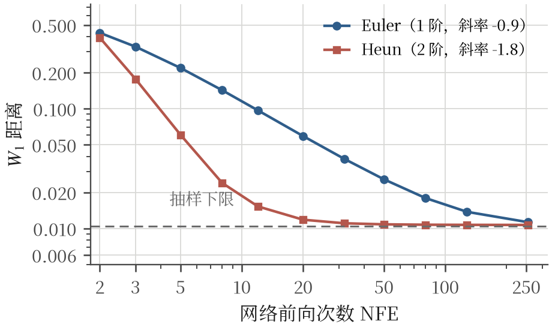
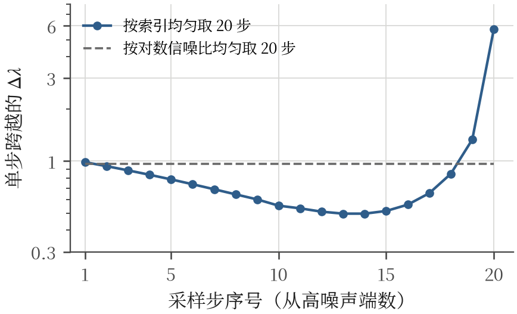

# 采样器：从一千步到二十步

第 6 章给出的采样算法要跑 $T$ 步，通常 $T=1000$。生成一张图要一千次网络前向，这个成本很难接受。这一章讲怎么把步数压下来，同时尽量不损失质量。

需要区分三件事：训练时用了多少步 $T$、推理时实际走多少步 $N$、以及每一步用什么公式。这三者可以不一样，但噪声日程必须一致，否则每一步的噪声水平对不上，网络会收到它没见过的输入。

一千步之所以让人难受，是因为采样没有捷径可走：模型本身只描述“从 $x_t$ 到 $x_{t-1}$ 的一小段”，一步走多大完全由外部算法决定。训练阶段花在每一步上的计算在采样阶段要被重新付一次，而且是一次不落地付。所以采样器的改进不涉及重新训练，纯粹是算术上的事，这也是它性价比高的原因：同样一个权重，换个采样器就能从 1000 次前向降到 20 次，快五十倍。

## 误差从哪里来

采样的总误差有三个来源。

网络近似误差，$\epsilon_\theta$ 不是真值，它在每个点上都有偏差。这部分误差无法通过改采样器消除，只能靠更好的模型。

离散化误差，把连续的 ODE 或 SDE 用有限步近似，每一步都有局部截断误差。

随机性带来的方差，随机采样器每步注入噪声，同一个初值会得到不同的结果。这不是错误，但会让结果偏离确定性轨迹。

改采样器只能处理后两项。

三者里最容易低估的是第一项。第 7 章算过，$\epsilon$ 参数化下把预测误差换算回 $\hat x_0$ 时，高噪声端会放大上百倍。采样器把许多步串起来，误差也会沿轨迹累积，只是每一步都会被网络的重新评估拉回来一部分。所以在步数压到很低时，真正的瓶颈往往不是数值积分，而是模型的误差被放大的那一段落在哪个噪声水平上。

一个常见的失败形态对得上这个分析：步数从 50 降到 10 时，构图与主色往往还对，但细节开始糊；再往下降，构图也散了。细节对应低噪声端的几步，那里每一步都要很精确；构图对应高噪声端的几步，那里预测误差被放大得最多。两类失败落在两个不同的端，修一头顾不了另一头。

离散化误差的量级可以写清楚。记单步步长为 $h$，局部误差是“一步之内丢掉的高阶项”，对一阶方法它是 $O(h^2)$；$N$ 步累积，全局误差是 $O(h^2)\cdot N = O(h)$。二阶方法的局部误差是 $O(h^3)$，全局 $O(h^2)$。$h$ 与 $N$ 成反比，所以双对数坐标下，一阶方法的误差曲线斜率是 $-1$，二阶是 $-2$。这个斜率是判断实现对不对的第一手证据，比看图像有没有糊要靠谱。

误差的常数因子与轨迹的形状有关。轨迹弯曲得厉害的地方，用直线去近似就丢得多；轨迹接近直线时，一阶方法也够。这句话在最后会变得很重要：如果训练时让轨迹尽量直，一个 Euler 步就够，这正是流模型那条线的动机。

三项随步数的变化方向不同，这一点决定了什么时候该换手段。离散化误差随 $N$ 下降，一阶按 $1/N$、二阶按 $1/N^2$；网络误差与 $N$ 无关，它是一个不会消失的下限；随机性那一项只在 $N$ 远小于 $T$、方差公式不再匹配时才会变成主要矛盾。所以步数很多时，总误差由网络误差与离散化误差里较大的那个决定；步数减到中等，离散化误差开始显形；再往下减，被放大的网络误差变成主导，此时换更高级的求解器收益会突然变小——这个现象在实验里很容易误读成“求解器失效”。

随机性那一项要单独理解。祖先采样每一步从 $p_\theta(x_{t-1}\mid x_t)$ 里抽一个样本，注入的方差是 $\tilde\beta_t$。线性日程下 $\tilde\beta_t$ 在 $t=1000$ 附近是 $0.02$，标准差 $0.14$。$T=1000$ 步加起来，注入的总方差大致与信号本身的方差相当，这是前向链设计好的平衡。步数一变，这个平衡就破了，因为 $\tilde\beta_t$ 是按 $T=1000$ 那张表算出来的。这是下一节要处理的核心矛盾。

## DDPM 的祖先采样

第 6 章的算法是祖先采样，每一步从 $p_\theta(x_{t-1}\mid x_t)$ 抽一个样本。它的步数必须等于训练时的 $T$，因为方差 $\tilde\beta_t$ 是按那套日程算出来的。步数一变，注入的噪声量就不对。

具体错在哪里，可以算。假设在 $x_t$ 处直接跳到 $x_{t-k}$，也就是用 $\bar\alpha_{t-k}$ 代替 $\bar\alpha_{t-1}$ 去算均值和方差。均值的形式还能凑，但方差 $\tilde\beta$ 的公式里 $1-\bar\alpha_{t-k}$ 与 $1-\bar\alpha_t$ 之间隔了 $k$ 步，两者相差很大；而这一步注入的噪声要补的正是“被一次抹掉的 $k$ 步的噪声”。补少了，结果偏平、细节缺失；补多了，画面出现颗粒。这两种失败在低步数下都能直接看到。

这是 DDIM 要解决的问题。

## DDIM：换一条前向路径

DDIM 的观察是，训练目标只依赖边缘分布 $q(x_t\mid x_0)$，而不依赖具体的马尔可夫链。只要构造一条新的前向过程，使它的边缘分布与原来相同，就可以用同一个网络，但换一种采样方式。

这个观察值得说得更实一点。第 7 章的下界里，网络只通过 $L_{t-1}$ 里那个 KL 出现，而那个 KL 的两边分别是 $q(x_{t-1}\mid x_t,x_0)$ 和 $p_\theta(x_{t-1}\mid x_t)$。前者的形式由前向过程决定，但只要边缘 $q(x_t\mid x_0)$ 不变，$q(x_{t-1}\mid x_t,x_0)$ 就完全被贝叶斯公式定死，与链条怎么连无关。换句话说，训练只关心“每个噪声水平上的含噪图长什么样”，不关心这些图是怎么一步步变噪的。这个自由度就是采样器改进的全部空间。

具体地，定义

$$q_\sigma(x_{t-1}\mid x_t,x_0) = \mathcal{N}\left(\sqrt{\bar\alpha_{t-1}}\,x_0 + \sqrt{1-\bar\alpha_{t-1}-\sigma_t^2}\cdot\frac{x_t-\sqrt{\bar\alpha_t}\,x_0}{\sqrt{1-\bar\alpha_t}},\ \sigma_t^2 I\right).$$

这个式子括号很多，含义其实简单，它只是用 $x_0$ 和 $x_t$ 拼出一个 $x_{t-1}$，再留出 $\sigma_t^2$ 的噪声预算。$\sigma_t$ 是一个新的自由度，一族分布由此展开；$\sigma_t=0$ 时方差消失，$\sigma_t$ 取到上界 $\sqrt{1-\bar\alpha_{t-1}}$ 时，$\sqrt{1-\bar\alpha_{t-1}-\sigma_t^2}$ 变成零，均值里只剩 $x_0$ 那一项。

这一族分布之所以叫“非马尔可夫”，是因为整条链的联合分布不能写成逐项条件相乘的样子。原来的前向是 $q(x_{1:T}\mid x_0)=\prod_t q(x_t\mid x_{t-1})$，每一步只看前一项；新的一族定义成

$$q_\sigma(x_{1:T}\mid x_0)=q(x_T\mid x_0)\prod_{t=2}^{T}q_\sigma(x_{t-1}\mid x_t,x_0),$$

每一步都要回头看 $x_0$。链条仍然有方向，但每一步的条件都依赖起点，所以它不是马尔可夫的。这一点不构成障碍：训练目标只用到边缘，而边缘与原来完全相同。

### 边缘不变

这个定义要成立，得验证它的边缘确实是 $q(x_{t-1}\mid x_0)$，也就是 $\mathcal{N}(\sqrt{\bar\alpha_{t-1}}x_0,(1-\bar\alpha_{t-1})I)$。验证只有两行。

把 $x_t=\sqrt{\bar\alpha_t}x_0+\sqrt{1-\bar\alpha_t}\,\epsilon_t$ 代进去，中间那个分式

$$\frac{x_t-\sqrt{\bar\alpha_t}x_0}{\sqrt{1-\bar\alpha_t}} = \epsilon_t$$

正好是第 $t$ 步加进去的那份噪声。于是

$$x_{t-1} = \sqrt{\bar\alpha_{t-1}}x_0 + \sqrt{1-\bar\alpha_{t-1}-\sigma_t^2}\;\epsilon_t + \sigma_t\,\epsilon,$$

其中 $\epsilon$ 是这一步新抽的标准正态，与 $\epsilon_t$ 独立。两个独立高斯相加，方差直接相加

$$\big(1-\bar\alpha_{t-1}-\sigma_t^2\big) + \sigma_t^2 = 1-\bar\alpha_{t-1},$$

均值还是 $\sqrt{\bar\alpha_{t-1}}x_0$。所以 $q_\sigma(x_{t-1}\mid x_0)$ 与原来的前向边缘一模一样。每一步都保持边缘，整条链归纳下去，任意时刻的边缘都不变，训练目标因此完全兼容。

顺带得到一个约束：$\sigma_t^2\le 1-\bar\alpha_{t-1}$，否则根号里是负数。这个上界不是形式上的限制，它决定了随机性最多能加多少。

另一个有意思的取值是 $\sigma_t^2=\tilde\beta_t$。把 $1-\bar\alpha_t-\beta_t=\alpha_t(1-\bar\alpha_{t-1})$ 代入，可以算出

$$\sqrt{1-\bar\alpha_{t-1}-\tilde\beta_t} = \frac{\sqrt{\alpha_t}\,(1-\bar\alpha_{t-1})}{\sqrt{1-\bar\alpha_t}},$$

代回定义式整理之后，均值变成 $\frac{\sqrt{\bar\alpha_{t-1}}\beta_t}{1-\bar\alpha_t}x_0+\frac{\sqrt{\alpha_t}(1-\bar\alpha_{t-1})}{1-\bar\alpha_t}x_t$，正是第 6 章那个后验均值。所以 $\sigma_t^2=\tilde\beta_t$ 时这一族退化成 DDPM，方差也一致。这一族的两端一个是祖先采样，一个是完全确定的过程，中间是一个连续谱。

### 采样公式与 η

把 $x_0$ 换成网络预测的 $\hat{x}_0$，得到采样公式

$$x_{t-1} = \sqrt{\bar\alpha_{t-1}}\,\hat{x}_0 + \sqrt{1-\bar\alpha_{t-1}-\sigma_t^2}\,\epsilon_\theta + \sigma_t\epsilon.$$

$\sigma_t$ 是一个可以自由选的参数。取 $\sigma_t$ 为后验标准差时，它退化成 DDPM；取 $\sigma_t = 0$ 时，过程完全确定。

实践中常用一个参数 $\eta$ 来插值，$\sigma_t = \eta\sqrt{\tilde\beta_t}$。$\eta=1$ 是 DDPM，$\eta=0$ 是 DDIM。

两端的行为可以直接读出来。$\eta=0$ 时最后一项消失，$x_{t-1}$ 是 $x_t$ 的确定函数，给定初值就能算出唯一的轨迹，重复运行结果完全一样；$\eta=1$ 时每一步都重新抽噪声，两次运行的差异就是随机性累积的结果，$\eta$ 越大，同一提示词出的图越分散。

中间的 $\eta$ 有一个不太直观的性质：它并不对应“多少比例的 DDPM”。$\sigma_t$ 与 $\sqrt{\tilde\beta_t}$ 是线性关系，而方差是平方关系，所以 $\eta=0.5$ 时注入的方差只有 DDPM 的四分之一，剩下的四分之三留在 $\sqrt{1-\bar\alpha_{t-1}-\sigma_t^2}$ 里，被当作“已知的噪声”重新加回去。这也解释了为什么 $\eta$ 稍微调大一点，图像的变化就很明显：方差对 $\eta$ 是二次的。

$\eta$ 还有一层含义：它把采样器从一条 ODE 推到一族微分方程上。$\eta=0$ 时走的是概率流 ODE，每一步都确定；$\eta>0$ 时每一步带一个随机项，对应的是一个反向 SDE，$\eta=1$ 就是第 6 章那个前向链的逆。两者的边缘分布相同，轨迹不同：ODE 的轨迹是唯一的一条线，SDE 的轨迹是一束。这是“同一个分布可以用不同动力学实现”的具体例子，也是第 17 章讲流模型的出发点。

$\eta$ 的实际影响随步数变化。步数多的时候每步的 $\tilde\beta_t$ 很小，注入的随机性微不足道，$\eta$ 取多少几乎看不出差别；步数少的时候每步跨得远，$\tilde\beta_t$ 的公式已经不再对应“一步的距离”，注入的方差会偏小，随机性的纠正作用也就打了折扣。这就是为什么常见的配置是“低步数配小 $\eta$ 或者干脆确定性”，而不是“低步数配 $\eta=1$”。

### 跳步

真正让步数能压下来的，是下面这个操作。既然只要求边缘不变，采样时可以不按 $1,2,\dots,T$ 走，而是取一个递增的子序列

$$\tau = (\tau_0,\tau_1,\dots,\tau_N),\qquad 0=\tau_0<\tau_1<\dots<\tau_N\le T,$$

从 $x_{\tau_N}$ 直接走到 $x_{\tau_{N-1}}$，一步跨过 $\tau_N-\tau_{N-1}$ 个原来的步。公式里所有的 $t-1$ 换成 $\tau_{i-1}$，$\bar\alpha_{t-1}$ 换成 $\bar\alpha_{\tau_{i-1}}$：

$$x_{\tau_{i-1}} = \sqrt{\bar\alpha_{\tau_{i-1}}}\,\hat{x}_0 + \sqrt{1-\bar\alpha_{\tau_{i-1}}-\sigma^2}\,\epsilon_\theta + \sigma\epsilon.$$

这样做的合法性来自上面的边缘验证：那两行推导只用到 $q(x_t\mid x_0)$ 的形式，没有用到“相邻两步”这个假设。所以从任意一步跳到任意更早的一步，边缘都对。代价是 $\hat x_0$ 的估计精度：一步跨得越远，网络在区间内被评估的次数越少，$\hat x_0$ 在区间内实际会变化而公式当它不变，这个近似误差就是离散化误差。

$\sigma$ 在跳步时要重算。原来的 $\eta\sqrt{\tilde\beta_t}$ 里，$\tilde\beta_t$ 是按相邻两步算出的后验方差；跳步之后，后验变成 $q(x_{\tau_{i-1}}\mid x_{\tau_i},x_0)$，它对应的方差要把 $\beta_t$ 换成 $\bar\beta_i=1-\bar\alpha_{\tau_i}/\bar\alpha_{\tau_{i-1}}$

$$\tilde\beta_i=\frac{(1-\bar\alpha_{\tau_{i-1}})\,\bar\beta_i}{1-\bar\alpha_{\tau_i}},\qquad \sigma_i=\eta\sqrt{\tilde\beta_i}.$$

把 $\bar\beta_i$ 展开，$\sigma_i$ 可以写成只含 $\bar\alpha$ 的形式

$$\sigma_i = \eta\sqrt{\frac{1-\bar\alpha_{\tau_{i-1}}}{1-\bar\alpha_{\tau_i}}}\sqrt{1-\frac{\bar\alpha_{\tau_i}}{\bar\alpha_{\tau_{i-1}}}}.$$

$N=T$ 时 $\bar\beta_i=\beta_t$，它就退回成 $\eta\sqrt{\tilde\beta_t}$，所以这个式子可以当成统一写法。$\eta=0$ 时为零，$\eta=1$ 时回到 DDPM 的后验标准差（只是$\tau$ 变了），两者之间的插值含义与全步数时一致。$\eta$ 的上限由根号下的非负性给出，大约是 $\sqrt{(1-\bar\alpha_{\tau_{i-1}})/\tilde\beta_i}$，可以比 1 大不少；大 $\eta$ 意味着注入的方差比 DDPM 的后验还大，代价是偏离轨迹更远。

具体数字能把“最后一步很粗”这件事说清楚。$T=1000$、$N=20$ 时，等索引取点得到的子序列是 $1000,950,\dots,101,51,1$，最后一步从 $t=51$ 跳到 $t=1$。那一步要把 $1-\bar\alpha$ 从 $0.029$ 压到 $10^{-4}$，噪声方差在一步之内降了近三百倍。均值公式要把这么大的变化一次算完，而区间内的 $\hat x_0$ 是不得而知的，只能当作常数。这就是低步数下细节丢失的主要位置，也是很多实现把最后一个间隔取得比前面小的原因。

## 为什么确定性采样能跳步

$\eta=0$ 时，$x_{t-1}$ 完全由 $x_t$ 决定，整条轨迹是一条 ODE 的解。既然是 ODE，就可以用任意步长离散化，不必与训练步数一致。

把这条 ODE 写出来，后面讨论求解器就方便了。概率流 ODE 是

$$\frac{dx}{dt} = -\frac{1}{2}\beta(t)\Big[x + \nabla_x\log p_t(x)\Big] = -\frac{\beta(t)}{2}x + \frac{\beta(t)}{2\sqrt{1-\bar\alpha_t}}\,\epsilon_\theta(x,t),$$

第二等式用了第 7 章的关系 $\nabla\log p_t = -\epsilon_\theta/\sqrt{1-\bar\alpha_t}$。这里 $t$ 是“噪声增加”的方向，采样要把它反着积，所以实际积分时 $dt<0$。

DDIM 的更新与这条 ODE 的显式 Euler 步是一回事。把 Euler 步 $x_{t'}=x_t+(t'-t)f(x_t,t)$ 按 $\Delta t$ 展开到一阶，$x$ 的系数是 $1+\Delta t\,\dot\alpha/\alpha$，与 DDIM 里的 $\alpha_{t'}/\alpha_t$ 一致到一阶；$\epsilon$ 的系数是 $\Delta t\,\beta/(2\sigma)$，用 $\beta=-2\dot\alpha/\alpha$ 与 $\dot\sigma=-\alpha\dot\alpha/\sigma$ 化简，正好等于 DDIM 里的 $\sigma_{t'}-\frac{\alpha_{t'}}{\alpha_t}\sigma_t$ 的一阶项。两边逐项对上，说明 DDIM（$\eta=0$）就是这条 ODE 的一阶离散。

反过来看，DDIM 的每一步有一个更直观的写法：先用 $\hat x_0$ 定住终点，再按新的噪声水平把噪声加回去

$$x_{\tau_{i-1}} = \alpha_{\tau_{i-1}}\hat x_0 + \sigma_{\tau_{i-1}}\hat\epsilon,$$

其中 $\alpha=\sqrt{\bar\alpha}$、$\sigma=\sqrt{1-\bar\alpha}$。轨迹因此是若干条直线段的拼接，每段都从当前点指向当前的 $\hat x_0$ 估计。段数越多，每段越短，$\hat x_0$ 在段内漂移越小，“沿直线走”越接近真解。

代价是误差不再被随机性冲淡。步数太少时，离散化误差会明显地表现为画面结构的偏移或颜色偏差。经验上，$\eta=0$ 在 50 步左右质量就很好，20 步开始出现可见的退化。

## 高阶求解器

Euler 是一阶的，局部误差 $O(h^2)$，全局误差 $O(h)$。用二阶方法可以在相同步数下把误差降一个量级。

Heun 方法每步算两次网络

$$\tilde{x}_{t-1} = x_t + \Delta t\,f(x_t,t),\qquad x_{t-1} = x_t + \frac{\Delta t}{2}\big(f(x_t,t) + f(\tilde{x}_{t-1},t-\Delta t)\big).$$

第一步是预测，第二步用预测点的斜率做修正。代价是两次前向，但步数可以减半，总体持平或更好。

把它当成“用梯形面积近似积分”更好理解。Euler 用的是区间左端点的斜率，相当于用矩形面积代替曲线下的面积；Heun 用两端斜率的平均，相当于梯形。区间内斜率变化不大时两者差不多，变化剧烈时梯形的误差小一个量级。误差的阶数就是这么来的：梯形公式的局部误差是 $O(h^3)$，累积之后是 $O(h^2)$。

比较两种方法时，横轴必须是前向次数而不是步数，否则不公平。$N$ 步的 Euler 用 $N$ 次前向，$N$ 步的 Heun 用 $2N$ 次。换到同一横轴上，Heun 在 10 次前向（5 步）处大约相当于 Euler 在 50 次前向处，这才是它真正的收益。

DPM-Solver 走得更远。它注意到概率流 ODE 可以写成

$$\frac{dx}{dt} = a(t)x + b(t)\epsilon_\theta(x,t),$$

其中 $a(t)$ 来自噪声日程，是已知的线性项。线性 ODE 有解析解，于是可以把 $a(t)x$ 这一项精确积掉，只对 $\epsilon_\theta$ 做数值近似。这样每一步的误差只来自噪声预测在区间内变化，而不是整个场的变化，同样的步数下误差小得多。DPM-Solver 在 10 到 20 步就能达到 Euler 几百步的质量。

把这一步做细。作变量替换 $\lambda=\ln(\alpha_t/\sigma_t)$，也就是对数信噪比取反，ODE 化成

$$\frac{dx}{d\lambda} = f(\lambda)x + g(\lambda)\epsilon_\theta,$$

的线性形式，解出来是

$$x_{t} = \frac{\alpha_t}{\alpha_s}x_s - \alpha_t\int_{\lambda_s}^{\lambda_t}e^{-\lambda}\,\hat\epsilon(x_\lambda,\lambda)\,d\lambda .$$

这个式子是精确的，没有做任何近似。原来的 ODE 里含 $x$ 的那一项已经不在积分里了，它被并进了 $\frac{\alpha_t}{\alpha_s}x_s$ 这个因子；剩下的积分只涉及 $\hat\epsilon$。

下一步是决定用什么近似 $\hat\epsilon$。假设它在区间内是常数，积分算出来是

$$\int_{\lambda_s}^{\lambda_t}e^{-\lambda}d\lambda = e^{-\lambda_s}-e^{-\lambda_t},$$

代回去整理，得到 $x_t=\frac{\alpha_t}{\alpha_s}x_s+\big(\sigma_t-\frac{\alpha_t}{\alpha_s}\sigma_s\big)\epsilon_s$。这正是 $\eta=0$ 的 DDIM。所以 DDIM 在这套语言里叫一阶指数积分器，它的近似是“区间内噪声预测不变”。

二阶的把 $\hat\epsilon$ 在 $\lambda_s$ 处展开到一阶，$\hat\epsilon_\lambda\approx\epsilon_s+\epsilon'_s(\lambda-\lambda_s)$，两个积分都有闭式

$$\int_{\lambda_s}^{\lambda_t}(\lambda-\lambda_s)e^{-\lambda}d\lambda = e^{-\lambda_s}\big[1-(1+h)e^{-h}\big],\qquad h=\lambda_t-\lambda_s,$$

其中 $h<0$，因为采样时 $\lambda$ 在减小。$h$ 很小时中括号约等于 $h^2/2$，所以修正项是 $O(h^2)$ 的量级，正好补上了常数近似丢掉的那部分。$\epsilon'_s$ 用一次额外的前向估出来（单步版，每步 2 次前向），或者用上一步的差分（多步版，每步 1 次前向，启动时需要一次热身）。

这套办法在扩散采样上特别有效，原因是 $\epsilon$ 作为 $\lambda$ 的函数比作为 $t$ 的函数平滑得多。$\lambda$ 是信噪比的对数，噪声水平在这个坐标下的变化是均匀的，$\epsilon$ 在这个坐标下接近线性；而 $t$ 坐标下的日程往往前段密、后段疏，同一个多项式在 $t$ 上的误差就大得多。选对坐标比提高阶数更划算。

后来在这条线上还有若干变体：把网络输出换成 $x_0$ 再算（数据预测版的 DPM-Solver++），以及把多种求解器的系数按步长加权组合（UniPC）。它们改的都是同一个积分式的近似方式，公式会更长一点，误差阶数不会超过二阶。

二阶方法还有一项额外的好处：稳定性。显式 Euler 的稳定域有限，步长一大，误差会被逐步放大而不是被吸收，表现为画面里出现不自然的色块或纹样。梯形方法（Heun 属于这一类）的稳定域比 Euler 大，容许的步长更大一些。这是为何在同等阶数下，人们愿意多付一次前向来换取更少的发散。稳定域大不代表无条件稳定，低步数下出现异常色块时，除了换求解器，更直接的办法是检查日程与步长是否匹配。

把本章涉及的采样器摆到一张表里，选择就清楚了。

| 采样器 | 阶数 | 每步前向 | 随机性 | 典型步数 |
| --- | --- | --- | --- | --- |
| 祖先采样（DDPM） | — | 1 | 有，方差固定 | $T$ |
| DDIM，$\eta=1$ | 1 | 1 | 有，方差可调 | 100 上下 |
| DDIM，$\eta=0$ | 1 | 1 | 无 | $50\sim100$ |
| Heun | 2 | 2 | 无 | $10\sim25$ |
| DPM-Solver-2 | 2 | 1 或 2 | 无 | $10\sim20$ |

表里的“典型步数”是量级，随模型、分辨率、日程与对质量的要求摆动。前向次数这一列才是可比的口径：Heun 的 10 步等于 20 次前向，与 DPM-Solver-2 的单步版 20 步相当。

## 误差曲线



图 8.1 是一个可以自己复现的实验。数据取一维两峰高斯混合，分数有解析式，用 VP 日程从噪声积分回数据，比较不同求解器在不同步数下的 $W_1$ 距离。双对数坐标下，Euler 的斜率接近 $-1$，Heun 接近 $-2$，与理论阶数吻合。Heun 在同样的前向次数下误差更小，但每次前向的收益随步数增加而递减。

实验的设置值得写清楚，因为这个实验只有几行有效代码，任何一步设错都会让曲线失去意义。

- 数据：$0.5\mathcal{N}(-1.5,0.55^2)+0.5\mathcal{N}(1.5,0.55^2)$，两峰分得很开，采样好坏一眼能看出来。分数的解析式是两分量后验加权，权重用高斯密度算，不需要训练。
- 日程：$\bar\alpha(t)=e^{-3t}$，$t\in[0,1]$，这是 VP 日程的连续时间写法，$\beta=3$。用连续时间是为了让“步长”有意义，$N$ 步就是 $h=1/N$。
- 初值：从 $p_1$ 精确抽样，也就是把数据的每个模态按 $\sqrt{\bar\alpha(1)}$ 缩放、再加方差 $1-\bar\alpha(1)$ 的噪声。如果用标准正态作初值，测到的是“初值不匹配”的误差，与求解器的阶数无关，曲线在低步数段会被这个误差压平。
- 度量：$W_1$ 距离。一维情况下按分位数逐点算差再取平均即可，20000 个样本对 200000 个参考样本，用同一组分位点。
- 读数：在双对数坐标上对曲线做线性拟合，斜率就是收敛阶。拟合窗口要落在抽样下限之上、又不进入“前几个点被大误差主导”的区域，图中标注的斜率是在 $3\le\mathrm{NFE}\le64$ 与 $3\le\mathrm{NFE}\le12$ 两段分别拟合的。

流程本身不长，写成伪代码大概是这样。

```text
基准分布：从数据抽 200000 个样本，排序后存成分位数表
for N in 求解器列表:
    for seed in 1..3:
        x <- 从 p_1 抽 20000 个初值
        for i in 1..N:                       # 从 t = 1 走到 0
            用 Euler 或 Heun 走一步
        把输出排序，在固定分位点上与基准求差，取均值  # 这就是 W1
    对 3 个 seed 取平均，记下 NFE = N（Heun 为 2N）
在双对数坐标上拟合斜率
```

几个容易弄错的地方：$W_1$ 要两边用同一组分位点，不能各排各的；Heun 的 NFE 要按 $2N$ 计，否则对比会偏袒它；基准样本量要比待测样本大一个量级以上，否则测到的多半是基准本身的噪声。

抽样下限是读数时最容易被忽略的东西。用 20000 个样本估一条分布，即使采样器完全正确，$W_1$ 也不会是零，而是停在 $1/\sqrt{n}$ 的量级。这个实验里，两次独立抽样之间的 $W_1$ 平均约 $0.011$，图上的虚线就是这个值。Heun 在 20 次前向之后就贴在这条线上了，此后的误差不再下降，不是方法失效，而是测不出来。反过来，如果不知道这条线，很容易把“曲线变平”读成“收敛变慢”，或者把下限噪声当成振荡。

实测的斜率是 $-0.9$ 与 $-1.8$，比理论值略小。原因有两处：拟合区间离下限还不够远，以及初值虽然精确、但积分到最后一步时误差已经在轨迹上累积。把样本量加到五倍可以把下限压低到原来的二分之一左右，斜率会更接近 $-1$ 和 $-2$。这说明读斜率这件事本身也有分辨率，样本量不够时看到的是一种平均后的斜率。

这个实验的局限也要说清楚。它用的是一维数据与精确分数，所以测到的只有离散化误差，不包含网络误差与高维的几何效应。换到图像上，同样的求解器在同样的步数下表现会更差，因为 (a) 网络有误差，(b) 高维下轨迹的弯曲程度不同，(c) 人眼对某些类型的误差特别敏感。所以这条曲线能用来比较求解器之间的相对优劣，不能直接换算成“图像上 20 步够不够”。

## 实践中的取舍

步数与质量不是线性的。20 步到 30 步之间的提升很小，10 步以下退化很快。多数模型在 20 到 50 步之间工作。

随机采样器在低步数下更稳，因为它能纠正误差；确定性采样器在高步数下更精确，而且可以反演，图像编辑里的反演方法会用到这一点。

步数压低之后，还有一个容易被忽视的问题：采样点怎么选。多数实现直接对 $\{1,\dots,T\}$ 等间隔取 $N$ 个点，这在索引上是均匀的，在对数信噪比上极不均匀。



图 8.2 把这件事量化了。总共要跨过的 $\lambda$ 范围是 $19.3$，均匀取点每步该跨 $0.97$。按索引等间隔取点时，中段的步只跨 $0.5$，而最后一步跨了 $5.7$。也就是说步数预算被中段吃掉了，最需要细走的那一段反而跨得最粗。低步数下画面发灰、细节丢失，很多时候是这个不均匀造成的，而不是求解器的阶数不够。

修正的办法是换网格：按 $\lambda$ 均匀取点，或者用一个幂次把点往低噪声端挤。训练日程不变，只改采样点，网络仍然收到它熟悉的噪声水平，只是这些水平被选得更合理。这类改动不需要重训，也不需要改公式，是性价比最高的调参之一。

如果模型的训练日程与推理日程不一致，比如训练用 cosine、推理用 linear，采样会失败。这不是采样器的问题，是噪声水平对不上。改动日程时，$\bar\alpha_t$ 与 $\sigma_t$ 必须一起改。

步数与图像难度的关系也值得知道。同一套采样器，分辨率翻倍时需要的步数并不翻倍，但画面的结构更复杂，低步数下的退化更明显；模型容量大的时候，低步数下的误差更接近离散化误差而不是网络误差，所以多给几步的收益更明显。换句话说，“多少步够”不是一个模型的固定属性，它随分辨率、模型新旧、引导强度一起变。引导强度的影响在第 10 章会再提，那里的现象是同一个：条件被推得更强时，轨迹的弯曲程度上升，等价于需要更细的步长。

另一个实践上的细节是最后一步。无论用哪种求解器，最后一步都不该跳得太远：$x_1$ 到 $x_0$ 之间如果跨了几百个训练步，$\hat x_0$ 在那个区间内的变化会被完全忽略，而这一段恰好对应细节与颜色。这也是图 8.2 里那个 $5.7$ 的尖峰最危险的原因。

比采样器本身更容易出错的，是比较方法。两个采样器要放在同一个模型、同一个随机种子、同一组提示词上比，并且对齐前向次数而不是步数。如果用不同的种子，确定性采样与随机采样的差异会被误认为质量差异；如果不对齐前向次数，二阶方法看起来总是占便宜。更极端的做法是用同一初值同时跑两条轨迹，比较它们在中途的距离，这样可以单独看离散化误差，而不用被“这张图好不好看”干扰。

可复现性也值得说一句。$\eta=0$ 时，结果完全由初值决定，几何形状与布局会随种子大幅变化，但同一初值的重复运行一模一样，适合做需要对齐的实验；$\eta=1$ 时同一初值也会因注入的随机噪声而不同，批内多样性强，但调试时更难定位问题。很多实现用“固定种子 + $\eta=0$”来做消融，用默认配置出图。

最后一个工程上的取舍与步数有关也与显存有关。采样时每一步都要保存整条轨迹吗？确定性采样不需要，只要当前这一个张量；祖先采样也不需要，因为反向链是逐层跑的。真正吃显存的是批大小：同样 20 步，一次出 8 张和一次出 1 张，峰值显存差不多线性增长。所以“用更多步还是用更大批”的取舍里头，前者换质量，后者换吞吐，两者不能互相替代。

## 与流模型的关系

这一章的推导全部在扩散模型的记号下完成，但结论对流模型同样成立：采样就是解 ODE，步数由求解器决定，误差由阶数和轨迹弯曲程度决定。

如果轨迹足够直，一步 Euler 就够。这句话也是流模型的起点。

把这句话拆开看，它包含两个可以分别改进的因素。轨迹的弯曲程度由训练决定：如果训练目标让速度场在整条路径上尽量一致，弯曲就小，少步数也能准。求解器的精度由推理决定：如果轨迹弯，就用高阶方法或者更聪明的网格去追。两条路可以叠加，实际系统的选择往往是“轨迹尽量直 + 二阶求解器 + 非均匀网格”，每一部分各贡献一段步数上的节省。

确定性采样还有一个性质后面会反复用到：它可以倒着跑。$\eta=0$ 的每一步都是可逆的，把一张真图从 $x_0$ 沿同一组公式正向跑到 $x_T$，就得到与它对应的噪声；再从这团噪声开始采样，能回到原图附近。这是图像编辑里反演方法的几何基础（本书后面讲编辑时会回到这一点）。随机采样器做不到这件事：每一步注入的噪声不可知，倒着跑得到的不是原图。所以“能不能反演”不是实现细节，而是采样器选型时要提前想清楚的约束。
