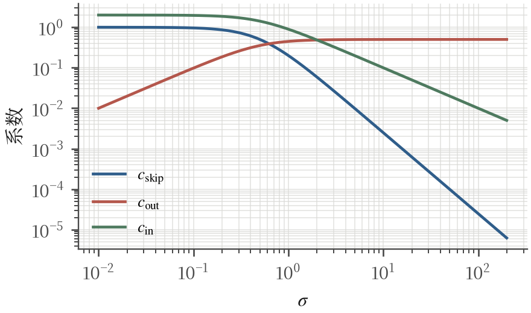

# 训练实践与 EDM 的一次整理

前几章给出了扩散模型的骨架：前向加噪、反向去噪、预测噪声、解 ODE 采样。骨架之外，还有一批工程参数决定了模型实际能不能训好，比如网络怎么设计、损失怎么加权、噪声日程怎么取。

这一章先讲这些参数背后的动机，再介绍 Karras 等人在 2022 年做的一次系统整理，也就是 EDM。那篇论文的贡献不是提出新模型，而是把散落在各处的选择放到同一个框架下比较，找出一组更好的默认值。

## U-Net 的每个部件

扩散模型的网络要输入 $x_t$ 和时间 $t$，输出与 $x_t$ 同形状的预测。主流结构是 U-Net。

卷积层负责局部模式。$3\times 3$ 的卷积核只能看到相邻像素，但堆叠几层之后感受野变大。图像的统计特性是局部平稳的，卷积的平移等变性正好匹配。

下采样负责多尺度。分辨率减半、通道加倍，网络在粗尺度上处理全局结构。扩散在不同噪声水平上处理不同尺度，高噪声时只剩粗结构，低噪声时才需要细节，U-Net 的多尺度结构与这个需求吻合。

跳跃连接负责保留细节。下采样的过程会丢失高频信息，跳跃连接把编码器的特征直接送到对应分辨率的解码器，让细节不必从低分辨率重建。

GroupNorm 负责稳定。扩散训练常用较小的批大小，BatchNorm 的统计量不稳，GroupNorm 不依赖批维度，更合适。

自注意力负责长程依赖。在低分辨率层加自注意力，让相距很远的区域交换信息，这对左右对称、整体构图这类约束有用。高分辨率层加注意力太贵，通常不加。

时间嵌入负责告诉网络现在是第几步。做法是把 $t$ 映射成一组正弦函数，再过两层 MLP，得到与通道数相同的向量，然后用它调制每一层的特征。

正弦嵌入的理由值得说一句。如果把 $t$ 直接作为一个标量输入，网络在 $t$ 相近时输出也相近，难以区分相邻步；正弦编码把 $t$ 展开到多个频率上，不同 $t$ 在高频分量上差别很大，网络更容易分辨。

## 损失加权

第 7 章推出过每一步的权重，它在低噪声端很大。直接用这个权重训练，优化器会把大部分精力放在几乎不用改的步上。

Ho 等人丢掉权重，用等权的简单损失，效果更好。后续工作又发现，等权也不是最优，中间噪声水平的步最难，应该给更多权重。

min-SNR 加权是一个折中的做法

$$w_t = \min\big(\mathrm{SNR}(t),\ \gamma\big),$$

其中 $\gamma$ 通常取 5。SNR 很大的步，权重被截断在 $\gamma$；SNR 很小的步，权重随 SNR 下降。这样既不会让低噪声步主导，也不会完全忽略它们。

另一种做法是按 SNR 采样 $t$，让训练样本在难度上分布更均匀。这类改动看起来琐碎，但对最终质量的影响常常大于换网络结构。

## EDM 的重新参数化

Karras 等人把扩散写成加噪的形式

$$x = x_0 + \sigma\epsilon,\qquad \epsilon\sim\mathcal{N}(0,I),$$

$\sigma$ 是噪声的标准差，从 $\sigma_{\min}$ 到 $\sigma_{\max}$ 取值。这个写法去掉了 $\alpha_t$ 与 $\beta_t$ 的纠缠，让噪声水平变成一个直接的量。

网络不直接预测 $\epsilon$，而是先做一套缩放

$$D(x;\sigma) = c_{\text{skip}}(\sigma)\,x + c_{\text{out}}(\sigma)\,F_\theta\big(c_{\text{in}}(\sigma)\,x;\ c_{\text{noise}}(\sigma)\big),$$

其中

$$c_{\text{skip}} = \frac{\sigma_d^2}{\sigma^2+\sigma_d^2},\qquad c_{\text{out}} = \frac{\sigma\sigma_d}{\sqrt{\sigma^2+\sigma_d^2}},\qquad c_{\text{in}} = \frac{1}{\sqrt{\sigma^2+\sigma_d^2}}.$$

这三个系数的来源是让输入输出的方差都归一化。假设数据 $x_0$ 的每个分量方差为 $\sigma_d^2$，则 $x$ 的方差是 $\sigma_d^2+\sigma^2$。乘上 $c_{\text{in}}$ 之后，输入方差变成

$$\frac{\sigma_d^2}{\sigma_d^2+\sigma^2} + \frac{\sigma^2}{\sigma_d^2+\sigma^2} = 1,$$

与 $\sigma$ 无关。输出端，如果希望 $D$ 的方差也接近 $\sigma_d^2$，就需要 $c_{\text{out}}$ 把 $F_\theta$ 的输出放大到合适的尺度。$c_{\text{skip}}$ 则负责在噪声很大时直接抄输入，此时 $c_{\text{skip}}\to 1$，网络只需要学一个小的修正。

这套系数的好处是训练目标 $\|D(x;\sigma)-x_0\|^2$ 在不同 $\sigma$ 上的量级一致，不需要额外的损失加权。$\sigma$ 本身用 $c_{\text{noise}} = \log(\sigma)/4$ 输入网络，因为对数尺度上不同 $\sigma$ 的跨度更均匀。

## Karras 噪声日程

采样时，$\sigma$ 从大到小取一系列值

$$\sigma_i = \left(\sigma_{\max}^{1/\rho} + \frac{i}{N-1}\left(\sigma_{\min}^{1/\rho}-\sigma_{\max}^{1/\rho}\right)\right)^{\rho},\qquad i=0,\dots,N-1,$$

$\rho=7$ 是经验值。这个日程在低噪声端密集、高噪声端稀疏。

ho=7$，$N=18$）与线性日程的采样点分布。Karras 在 $\sigma<1$ 的区域布了很多点，因为那里的感知变化最剧烈。](../images/09/fig09_karras.png)

理由与感知有关。$\sigma$ 从 80 降到 40，画面几乎没变化；从 0.5 降到 0.2，细节变化很大。所以采样点应该在小 $\sigma$ 处更密。$\rho$ 控制疏密的程度，$\rho$ 越大，低噪声端越密。

## Heun 与随机性

EDM 的采样器是二阶 Heun 加 churn。每步先把 $x$ 加一点噪声，提高噪声水平，再用 Heun 走两步，预测、修正。加噪声的目的是让采样器有机会纠正前面累积的误差，代价是引入随机性。

churn 的强度由 $S_{\text{churn}}$ 控制，通常取 10 到 80。$S_{\text{churn}}=0$ 时退化为确定性 Heun。

## 零终端 SNR

最后一个常被忽略的细节。如果训练时最后一步的 $\bar\alpha_T$ 不为零，意味着 $x_T$ 里还残留一点信号。但采样时从纯高斯出发，两者不一致，结果就是生成图像的亮度整体偏移。

Lin 等人的做法是把 $\sqrt{\bar\alpha_t}$ 与 $\sqrt{1-\bar\alpha_t}$ 重新缩放，使最后一步的 SNR 严格为零

$$\sqrt{\bar\alpha_t} \leftarrow \frac{\sqrt{\bar\alpha_t}}{\sqrt{\bar\alpha_t}+\sqrt{1-\bar\alpha_t}},\qquad \sqrt{1-\bar\alpha_t} \leftarrow \frac{\sqrt{1-\bar\alpha_t}}{\sqrt{\bar\alpha_t}+\sqrt{1-\bar\alpha_t}}.$$

这个变换不改变前向过程的形状，只改变终点。改完之后，从纯噪声出发的采样才与训练一致。

## 训练稳定性

几个常规手段。EMA，维护一份参数的滑动平均，采样时用平均后的参数，结果更平滑。混合精度，前向用 fp16 或 bf16，损失缩放防止梯度下溢。梯度裁剪，把梯度的范数截断在 1 附近，防止偶发的爆炸。

这些手段不改变算法，但决定了能不能训到收敛。看到论文里训练不稳定的描述时，先检查这几项是否做对。

## 这一章的结论

EDM 的价值在于它把哪个选择重要这件事量化了。它发现，噪声日程与预条件系数的影响大于网络结构的微调；采样器的阶数比步数更重要；训练时的损失加权与采样时的噪声日程必须匹配。

这些结论对流模型同样适用，那里处理时间采样与损失尺度的方式，和这里是一个思路。
