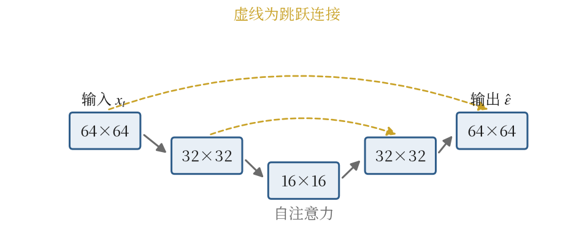
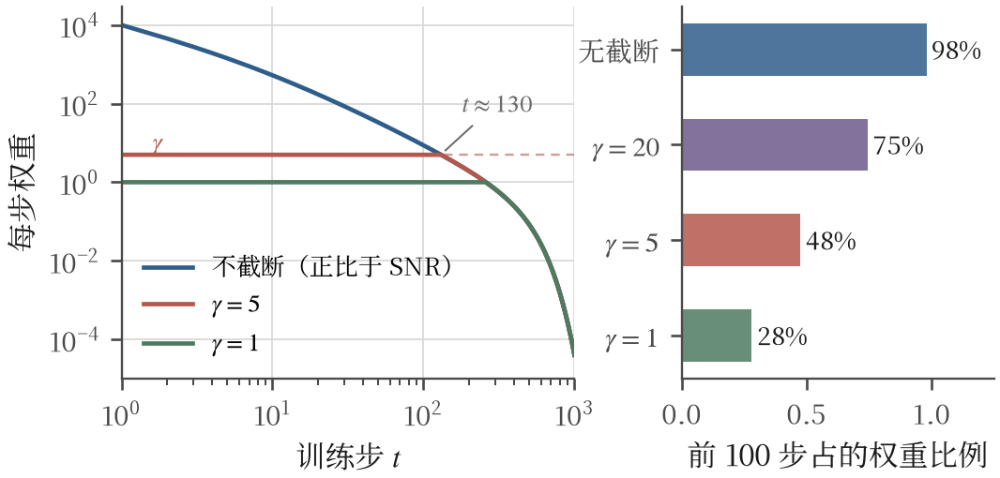
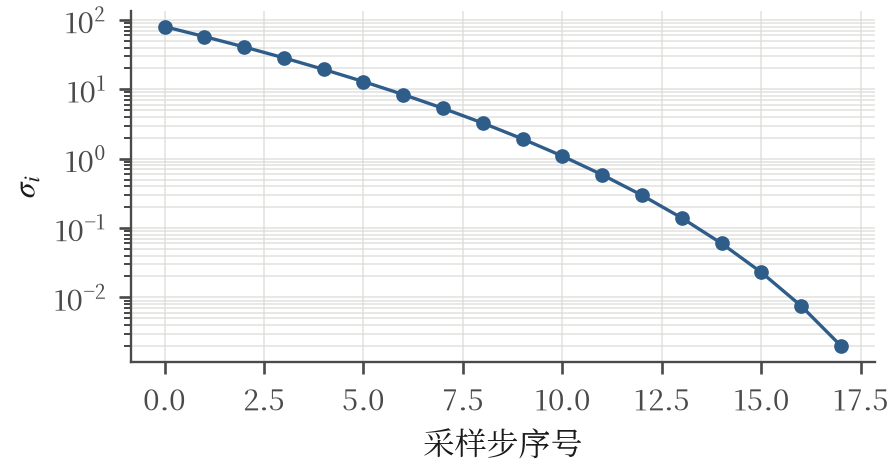
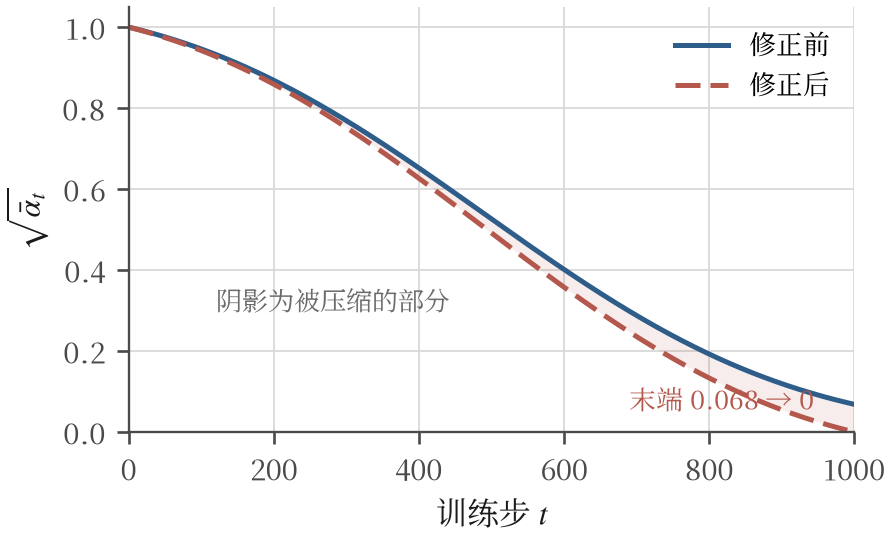

# 训练实践与 EDM 的一次整理

前几章给出了扩散模型的骨架：前向加噪、反向去噪、预测噪声、解 ODE 采样。骨架之外，还有一批工程参数决定了模型实际能不能训好，比如网络怎么设计、损失怎么加权、噪声日程怎么取。

这一章先讲这些参数背后的动机，再介绍 Karras 等人在 2022 年做的一次系统整理，也就是 EDM。那篇论文的贡献不是提出新模型，而是把散落在各处的选择放到同一个框架下比较，找出一组更好的默认值。

## U-Net 的每个部件

扩散模型的网络要输入 $x_t$ 和时间 $t$，输出与 $x_t$ 同形状的预测。主流结构是 U-Net。

卷积层负责局部模式。$3\times 3$ 的卷积核只能看到相邻像素，但堆叠几层之后感受野变大。图像的统计特性是局部平稳的，卷积的平移等变性正好匹配。

下采样负责多尺度。分辨率减半、通道加倍，网络在粗尺度上处理全局结构。扩散在不同噪声水平上处理不同尺度，高噪声时只剩粗结构，低噪声时才需要细节，U-Net 的多尺度结构与这个需求吻合。分辨率降到 $1/8$ 时，一个像素对应原图的 $8\times8$ 区域，这一层的感受野已经能包住整幅图的相当一部分，全局构图在那里被决定。

跳跃连接负责保留细节。下采样的过程会丢失高频信息，跳跃连接把编码器的特征直接送到对应分辨率的解码器，让细节不必从低分辨率重建。

GroupNorm 负责稳定。扩散训练常用较小的批大小，BatchNorm 的统计量不稳，GroupNorm 不依赖批维度，更合适。

自注意力负责长程依赖。在低分辨率层加自注意力，让相距很远的区域交换信息，这对左右对称、整体构图这类约束有用。高分辨率层加注意力太贵，通常不加。

时间嵌入负责告诉网络现在是第几步。做法是把 $t$ 映射成一组正弦函数，再过两层 MLP，得到与通道数相同的向量，然后用它调制每一层的特征。调制的方式是给每个通道一对缩放与平移系数，接在归一化之后：先 GroupNorm，再乘 $(1+\gamma_t)$ 加 $\beta_t$。这样时间信息不占额外的特征图，只改变归一化的参数，代价几乎为零，也不会扰动空间结构。

正弦嵌入的理由值得说一句。如果把 $t$ 直接作为一个标量输入，网络在 $t$ 相近时输出也相近，难以区分相邻步；正弦编码把 $t$ 展开到多个频率上，不同 $t$ 在高频分量上差别很大，网络更容易分辨。用对数尺度还是线性尺度取决于日程：扩散的 $t$ 在 $\bar\alpha$ 上是非线性的，同一个 $\Delta t$ 在不同段的噪声变化量差很多，所以编码前往往先做一次变换，或者直接对 $\sigma$ 取对数（见后面的 $c_{\text{noise}}$）。

规模上给一个量级。以 320 为基准通道、通道倍数 $(1,2,4,4)$、四个分辨率层级的 U-Net 为例，参数量在 8 亿量级。权重按 fp16 存放约 1.6 GB，Adam 的一阶二阶矩按 fp32 存放再加 6.4 GB，主权重副本再加 3.4 GB，加上激活与梯度的峰值，单卡训练的实际占用在十几 GB 到二十几 GB（估算，随批大小与梯度检查点设置变化很大）。

### 拿掉一个部件会怎样

判断一个部件是否必要，最直接的办法是看它缺席时的表现。下面这几种症状在结构消融里反复出现，配合机制看，能在实现时帮着定位问题。

把卷积换成全连接。整幅图展平后接 MLP，参数量随像素数平方增长：$256\times256$ 的图展平是 65536 维，接一个同宽的隐层就是 $4\times10^9$ 量级的参数，比卷积版本大两三个数量级。平移等变性也没了，模型得从数据里学“猫在左上角和右下角是同一件事”，等效样本量随之下降。

去掉下采样。全程保持原分辨率，显存与计算量按像素数增长；更要紧的是感受野，$3\times3$ 卷积堆 $L$ 层，感受野是 $2L+1$ 像素（有效感受野还要窄一些），堆 10 层也只有 21 像素，看不到全局构图。生成结果的典型症状是局部纹理都对、整体结构错位。

去掉跳跃连接。细节只能从最粗的那层重建，而 $1/8$ 分辨率下高频已经丢了。表现是轮廓和构图基本正确，纹理一片模糊，五官位置对但边缘不成形。

不做归一化。不同 $t$ 下 $x_t$ 的方差相差很大，$\sigma$ 从 80 到 0.002 跨了四个多数量级，激活的尺度也跟着漂移，深层的数值范围在训练中一直变，优化器很难挑一个对所有权重都合适的步长。换成 BatchNorm 则在小批大小下统计量噪声大，训练抖动。

去掉自注意力。左右对称、重复纹理、大范围一致的光照这些约束会变差，卷积的感受野再大也是局部的。反过来，把注意力加到高分辨率层，代价是平方级的：$64\times64$ 的特征图有 4096 个位置，注意力矩阵是 $1.7\times10^7$ 个元素；$256\times256$ 是 $4.3\times10^9$ 个，差了 256 倍。

去掉时间嵌入。网络不知道当前噪声水平，只能对所有 $t$ 学一个折中输出，高噪声步去噪不足、低噪声步过度平滑。诊断办法是把 $t$ 分箱统计损失，健康的模型应该给出一条相对平坦的曲线，两端翘起说明时间条件没有被用上。



## 损失加权

第 7 章推出过每一步的权重，它在低噪声端很大。直接用这个权重训练，优化器会把大部分精力放在几乎不用改的步上。

Ho 等人丢掉权重，用等权的简单损失，效果更好。后续工作又发现，等权也不是最优，噪声水平居中、既要去结构又要补纹理的那些步最难，应该给更多权重。

要理解这件事，得把权重和参数化放在一起看。同一个目标写成 $x_0$ 误差或 $\epsilon$ 误差，差一个因子：

$$\|x_0-\hat x_0\|^2 = \frac{1-\bar\alpha_t}{\bar\alpha_t}\|\epsilon-\hat\epsilon\|^2 = \frac{1}{\mathrm{SNR}(t)}\|\epsilon-\hat\epsilon\|^2 .$$

第 7 章那套权重作用在 $x_0$ 误差上，正比于 $\mathrm{SNR}(t)$；换到 $\epsilon$ 误差上它就变成等权。所以“用什么参数化”和“用什么权重”不是两个独立开关，改一个等于改另一个，论文里说“丢掉权重”时，说的往往是这一层换算。

似然偏向低噪声端有它的道理：对数似然关心每个像素的概率密度，而低噪声步几乎能精确重建，这一项在总和里占掉绝大部分。可感知质量不是这些步决定的，纹理、边缘、结构都在中高噪声段被定下来。按似然训练，模型会把容量花在把已经很清楚的地方再清楚一点点上，画面反而发闷。

min-SNR 加权是一个折中的做法

$$w_t = \min\big(\mathrm{SNR}(t),\ \gamma\big),$$

其中 $\gamma$ 通常取 5。SNR 很大的步，权重被截断在 $\gamma$；SNR 很小的步，权重随 SNR 下降。这样既不会让低噪声步主导，也不会完全忽略它们。

三种参数化在同一个 ELBO 下的权重可以排成一张表，反差很大。

| 参数化 | 目标 | 权重（正比于） | 低噪声端 |
|---|---|---|---|
| $x_0$ | $x_0$ | $\mathrm{SNR}$ | $\to\infty$ |
| $\epsilon$ | $\epsilon$ | $1$ | 恒定 |
| $v$ | $v$ | $\mathrm{SNR}/(1+\mathrm{SNR})$ | $\to1$ |

第三行值得多看一眼。$v=\sqrt{\bar\alpha}\,\epsilon-\sqrt{1-\bar\alpha}\,x_0$ 是两个量的插值，它的权重在高 SNR 端饱和在 1，在低 SNR 端降到 $\mathrm{SNR}$，正好是前两种的两头折中。这也是 $v$ 参数化在实践里数值上比较稳的原因：不管在哪一档噪声，目标与输入的尺度都相当，没有哪个端点会突然把梯度放大。

$\gamma$ 的影响可以量化。取 $\beta_t$ 从 $10^{-4}$ 线性到 $0.02$、$T=1000$ 的日程，$\mathrm{SNR}(t)$ 从第一步的 $10^4$ 量级降到末步的 $4\times10^{-5}$，跨了八个数量级。把权重归一化后看质量分布：不加截断时前 100 步吃掉 98% 的总权重，$t>500$ 的部分几乎为零；$\gamma=5$ 时前 100 步降到 48%，$\gamma=1$ 时降到 28%。$\gamma$ 越大越接近原始的似然权重，越小越接近等权，5 落在两者中间。同一套日程里 $\mathrm{SNR}(t)=5$ 的交叉点在 $t\approx130$，之后权重随 SNR 一起衰减。



$\gamma$ 的合适取值与数据空间有关。像素空间上报告的最优值在 5 附近，潜空间上偏向 15，两者差别的来源是潜变量的尺度不同，同一档“看起来差不多糟”的噪声在两个空间里对应的 SNR 数值不一样。有实现把权重乘在 $x_0$ 误差上，有实现乘在 $\epsilon$ 误差上，两者差一个 $1/\mathrm{SNR}$ 因子。看到某个实现的 min-SNR 好像没起作用，先确认它挂在哪一个量上。

另一种做法是按 SNR 采样 $t$。均匀采 $t$ 时，$\mathrm{SNR}$ 在前 100 步里就跨了三个数量级，绝大多数样本落在低 SNR 端；改成在 $\log\mathrm{SNR}$ 上均匀采，每个数量级分到相同的样本数，梯度在各噪声水平上更均衡。这类改动看起来琐碎，但对最终质量的影响常常大于换网络结构。

## EDM 的重新参数化

Karras 等人把扩散写成加噪的形式

$$x = x_0 + \sigma\epsilon,\qquad \epsilon\sim\mathcal{N}(0,I),$$

$\sigma$ 是噪声的标准差，从 $\sigma_{\min}$ 到 $\sigma_{\max}$ 取值。这个写法去掉了 $\alpha_t$ 与 $\beta_t$ 的纠缠，让噪声水平变成一个直接的量。

前几章的写法里，同一个噪声水平要拆成 $\sqrt{\bar\alpha_t}$ 与 $\sqrt{1-\bar\alpha_t}$ 两个系数，日程一换两边都要重算；而且“噪声大不大”这件事被藏在一串累乘里，看不出结论。换成 $x=x_0+\sigma\epsilon$ 之后，信号系数恒为 1，噪声系数就是 $\sigma$，SNR 直接是 $1/\sigma^2$。原来那套 VP 写法与这里的差别只在于是否把信号系数归一到 1：乘以 $\sqrt{\bar\alpha_t}$ 就把前者变后者，两边的模型可以互相换算。真正影响训练的是 $\sigma$ 的分布（前面那个对数正态），而不是用哪套记号。

网络不直接预测 $\epsilon$，而是先做一套缩放

$$D(x;\sigma) = c_{\text{skip}}(\sigma)\,x + c_{\text{out}}(\sigma)\,F_\theta\big(c_{\text{in}}(\sigma)\,x;\ c_{\text{noise}}(\sigma)\big),$$

其中

$$c_{\text{skip}} = \frac{\sigma_d^2}{\sigma^2+\sigma_d^2},\qquad c_{\text{out}} = \frac{\sigma\sigma_d}{\sqrt{\sigma^2+\sigma_d^2}},\qquad c_{\text{in}} = \frac{1}{\sqrt{\sigma^2+\sigma_d^2}}.$$

系数的来源可以一步一步拆开。先约定 $x_0$ 的每个分量方差为 $\sigma_d^2$，噪声分量方差为 $\sigma^2$，两者独立，则 $x$ 的方差是 $\sigma_d^2+\sigma^2$。乘上 $c_{\text{in}}$ 之后，输入方差变成

$$\frac{\sigma_d^2}{\sigma_d^2+\sigma^2} + \frac{\sigma^2}{\sigma_d^2+\sigma^2} = 1,$$

与 $\sigma$ 无关。这一步只用到两个独立随机变量的方差相加。

$c_{\text{skip}}$ 与 $c_{\text{out}}$ 要一起看。先问一个更基本的问题：不看网络，只用一个线性倍率 $c$ 去估 $x_0$，最优的 $c$ 是多少？最小化

$$\mathbb{E}\|x_0-c\,x\|^2 = \sigma_d^2 - 2c\,\mathrm{Cov}(x_0,x) + c^2\big(\sigma_d^2+\sigma^2\big),$$

其中 $\mathrm{Cov}(x_0,x)=\sigma_d^2$。对 $c$ 求导置零，得 $c=\sigma_d^2/(\sigma_d^2+\sigma^2)$，正是表里的 $c_{\text{skip}}$。它的含义是：信噪比高（$\sigma\ll\sigma_d$）时直接抄输入就够了，$c_{\text{skip}}\to1$；噪声淹没信号（$\sigma\gg\sigma_d$）时抄也没用，$c_{\text{skip}}\to0$，全部交给网络。

抄完之后还剩多少误差？把最优的 $c$ 代回去，

$$\mathrm{Var}\big(x_0-c_{\text{skip}}x\big) = \sigma_d^2 - \frac{\sigma_d^4}{\sigma_d^2+\sigma^2} = \frac{\sigma_d^2\sigma^2}{\sigma_d^2+\sigma^2},$$

开根号就是 $c_{\text{out}}$。它定义网络要拟合的目标

$$F^\star = \frac{x_0-c_{\text{skip}}x}{c_{\text{out}}},$$

按上面的计算，$F^\star$ 的每个分量方差恰好是 1，与 $\sigma$ 无关。网络无论在哪一档噪声下，看到的输入是单位方差，要预测的目标也是单位方差，输出的尺度自然好定。反过来看，$c_{\text{out}}$ 就是残差的标准差，两个极限也对得上：$\sigma\ll\sigma_d$ 时 $c_{\text{out}}\approx\sigma$，残差与噪声同量级；$\sigma\gg\sigma_d$ 时 $c_{\text{out}}\to\sigma_d$，残差就是数据本身的尺度。

到这里就能解释“不需要额外损失加权”这句话。取 $\lambda(\sigma)=1/c_{\text{out}}^2=(\sigma^2+\sigma_d^2)/(\sigma^2\sigma_d^2)$，则

$$\lambda(\sigma)\|D(x;\sigma)-x_0\|^2 = \frac{\|D-x_0\|^2}{c_{\text{out}}^2} = \|F_\theta-F^\star\|^2 ,$$

就是一个量级恒定的平方误差。不加 $\lambda$ 时相当于给 $F$ 的误差乘 $c_{\text{out}}^2$，低噪声端 $c_{\text{out}}^2\approx\sigma^2$ 很小，这些步的梯度被自动压下去，隐含的权重仍然偏向高噪声段。

取 $\sigma_d=0.5$，几个代表点上的系数如下。

| $\sigma$ | $c_{\text{skip}}$ | $c_{\text{out}}$ | $c_{\text{in}}$ |
|---|---|---|---|
| 0.05 | 0.990 | 0.050 | 1.99 |
| 0.5 | 0.500 | 0.354 | 1.41 |
| 2 | 0.059 | 0.485 | 0.485 |
| 20 | 0.0006 | 0.500 | 0.050 |


这张表说明网络在不同 $\sigma$ 下接的工作量完全不同：$\sigma=0.05$ 时它只需要在抄来的输入上修正千分之几，$\sigma=20$ 时必须从零开始拟合整个信号。预条件系数把这两种情况放到同一个数值尺度上，训练时才不会出现“某些 $\sigma$ 上的梯度比其他大几百倍”的局面。

$\sigma_d$ 不是自由参数，它由数据定。先算训练集每个通道的均值与标准差，把数据归一化到零均值、单位方差，则 $\sigma_d=1$。如果只除以 $255$ 缩到 $[0,1]$ 再平移到 $[-1,1]$，$\sigma_d$ 就不是 1 了，自然图像大致在 $0.3$ 到 $0.5$ 之间（量级估计，取决于图像内容的对比度）。潜空间里常把每个通道标准化到单位方差，$\sigma_d\approx1$ 就是一个合理的默认。这个数字填错不会让训练垮掉，但会让预条件系数的过渡点错位：本该在噪声与信号持平时转换，结果提前或推后了。

这套系数把每一档噪声上的输入与目标都拉到同一量级，配合 $\lambda(\sigma)=1/c_{\text{out}}^2$ 之后损失在各 $\sigma$ 上的数值范围一致，不需要再额外设计加权。$\sigma$ 本身用 $c_{\text{noise}} = \log(\sigma)/4$ 输入网络，因为对数尺度上不同 $\sigma$ 的跨度更均匀：线性地把 $\sigma$ 送进去，80 与 40 只差一点，0.02 与 0.01 差得也不多，但对画面的影响差得很远。

训练时怎么抽 $\sigma$ 也是一项选择。均匀抽不行，因为 $\sigma$ 的有效范围跨了四个多数量级，均匀抽会有近一半样本落在 $\sigma>40$ 这一段，而那一段里数据几乎被噪声淹没，学到的信息很少。EDM 用对数正态分布

$$\ln\sigma\sim\mathcal{N}(P_{\text{mean}},\ P_{\text{std}}^2),\qquad P_{\text{mean}}=-1.2,\ P_{\text{std}}=1.2,$$

中位数在 $e^{-1.2}\approx0.30$，正负一个标准差的范围是 $0.091$ 到 $1.0$，也就是绝大多数样本落在“结构还在、细节待补”的那一段。这个选择等于把“哪种噪声水平重要”写进了采样分布，效果与在损失里做加权是一回事：一个是动分布，一个是动权重。两种做法也可以叠：分布管“哪些 $\sigma$ 被看到”，权重管“看到之后给多少梯度”。

这两件事不可互替。按 SNR 采样改的是覆盖范围，截断权重改的是同一个样本的梯度大小。前者能让很少被抽到的高噪区多出一些样本，后者只能在已经抽到的样本上重新分配注意力。调参时如果发现某一档噪声几乎没被训练到，改动采样分布比调权重直接。

去噪器与 score 之间有一个换算，下一章要在它上面做文章。对 $x=x_0+\sigma\epsilon$，后验均值满足

$$\mathbb{E}[x_0\mid x] = x + \sigma^2\nabla_x\log p(x;\sigma),$$

而 $D(x;\sigma)$ 估的正是这个后验均值，于是

$$\nabla_x\log p(x;\sigma) = \frac{D(x;\sigma)-x}{\sigma^2}.$$

分子是“预测的干净图减输入”，除以 $\sigma^2$ 就把一个长度量的差变成 score。$\sigma$ 很大时这个除法把微小的预测误差放大得厉害，所以高噪端的 score 估计最不可靠，这也解释了为什么高噪端的引导要特别小心。

把整套配方写成循环，大概是这个样子。

```text
for x0 in loader:                      # 形状 (B, C, H, W)
    sigma = exp(N(-1.2, 1.2^2), size=B)       # 每个样本一个噪声水平
    n = randn_like(x0)
    x = x0 + sigma * n                        # 逐样本广播到 (B,1,1,1)
    c_in, c_skip, c_out = coeffs(sigma)       # 形状 (B,1,1,1)
    F = net(c_in * x, log(sigma) / 4)         # 时间条件用 log sigma
    D = c_skip * x + c_out * F
    loss = mean_over_batch( w(sigma) * (D - x0)**2 )
    loss.backward(); opt.step()
```

三个细节容易错。$\sigma$ 是逐样本的，三个系数必须按样本广播，不能当一个标量用，否则同一个 batch 里不同噪声水平的样本会互相干扰。$c_{\text{noise}}$ 输入的是 $\log\sigma$ 而不是 $\sigma$。$w(\sigma)$ 用 $\lambda=1/c_{\text{out}}^2$ 时，损失里不需要再加别的归一化，但 EMA、梯度裁剪这些步骤仍然要保留。

## Karras 噪声日程

采样时，$\sigma$ 从大到小取一系列值

$$\sigma_i = \left(\sigma_{\max}^{1/\rho} + \frac{i}{N-1}\left(\sigma_{\min}^{1/\rho}-\sigma_{\max}^{1/\rho}\right)\right)^{\rho},\qquad i=0,\dots,N-1,$$

$\rho=7$ 是经验值。这个日程在低噪声端密集、高噪声端稀疏。

把公式改写一下能看清它的间距规律。令 $\sigma=u^\rho$，则 $u$ 从 $\sigma_{\max}^{1/\rho}$ 线性降到 $\sigma_{\min}^{1/\rho}$，相邻两点的间距是

$$\Delta\sigma \approx \rho\,u^{\rho-1}\Delta u \propto \sigma^{1-1/\rho}.$$

$\rho=1$ 时 $\Delta\sigma$ 是常数，日程退化成线性；$\rho\to\infty$ 时 $\Delta\sigma\propto\sigma$，也就是等比日程。$\rho=7$ 落在两者之间，步长随 $\sigma$ 缓慢收缩，但顶部比等比日程更粗一些。



取 $\sigma_{\max}=80$、$\sigma_{\min}=0.002$、$N=18$，采样点从 $80$ 开始，前四步跨过 $80\to57.6\to40.8\to28.4$，第 18 个点落在 $0.002$。$18$ 个点里有 $7$ 个在 $\sigma<1$ 的区间，最后四个是 $0.0599,\ 0.0229,\ 0.0075,\ 0.002$，相邻比值为 $0.38,\ 0.33,\ 0.27$；而在顶端相邻比值是 $0.72$。也就是说越往小 $\sigma$ 走，每一步跨过的相对幅度越大，但绝对幅度越小。

理由与感知有关。$\sigma$ 从 80 降到 40，画面几乎没变化；从 0.5 降到 0.2，细节变化很大。所以采样点应该在小 $\sigma$ 处更密。$\rho$ 控制疏密的程度，$\rho$ 越大，低噪声端越密。

采样跑到 $\sigma_{\min}$ 结束，但目标不是 $x$ 而是 $x_0$。EDM 的做法是在最后直接用 $D(x;\sigma_{\min})$ 作为输出，不再走一步到零，因为 $\sigma$ 从 $0.002$ 到零这一步的欧拉步长太短，除了引入舍入误差什么也不做。

两套日程之间可以互相换算。由 $\mathrm{SNR}(t)=1/\sigma^2$ 与 $\mathrm{SNR}=\bar\alpha/(1-\bar\alpha)$ 得

$$\sigma = \sqrt{\frac{1-\bar\alpha_t}{\bar\alpha_t}},\qquad \bar\alpha_t = \frac{1}{1+\sigma^2}.$$

把 EDM 的 $\sigma\in[0.002,80]$ 代进去，它覆盖的 SNR 从 $2.5\times10^5$ 降到 $1.6\times10^{-4}$，比前面那个 $T=1000$ 的日程（$10^4$ 到 $4\times10^{-5}$）两端都宽一截。宽出来的部分不是为了训练，而是为了采样：EDM 从 $\sigma=80$ 出发，相当于从一个信号成分比 DDPM 初期更少的分布开始，这样初值处的残留信号更不容易影响结果。

## Heun 与随机性

EDM 的采样器是二阶 Heun 加 churn。每步先把 $x$ 加一点噪声，提高噪声水平，再用 Heun 走两步，预测、修正。加噪声的目的是让采样器有机会纠正前面累积的误差，代价是引入随机性。

把一步写出来。记去噪器在 $\sigma$ 处的输出为 $D(x;\sigma)$，ODE 的方向场是

$$d(x;\sigma)=\frac{x-D(x;\sigma)}{\sigma}.$$

欧拉步就是 $x_{i+1}=x_i+(\sigma_{i+1}-\sigma_i)\,d(x_i;\sigma_i)$，只评估一次网络。Heun 多算一个点：先用欧拉步走到 $x_{i+1}$，在那里再算一次方向场，取两步的平均

$$x_{i+1}=x_i+(\sigma_{i+1}-\sigma_i)\,\frac{d(x_i;\sigma_i)+d(x_{i+1};\sigma_{i+1})}{2}.$$

一次二阶步两次前向，所以 $N$ 个区间大约要 $2N$ 次，比一阶贵一倍。

churn 插在两者之间。先按 $\hat\sigma_i=\sigma_i(1+\gamma_i)$ 把噪声抬高，再从 $\hat\sigma_i$ 走向 $\sigma_{i+1}$，其中增长幅度限制在

$$\gamma_i=\min\!\left(\frac{S_{\text{churn}}}{N},\ \sqrt2-1\right).$$

上界 $\sqrt2-1\approx0.414$ 与 Heun 的稳定性有关：抬升后的 $\hat\sigma_i$ 一旦超过 $\sqrt2\,\sigma_i$，第二步修正项在噪声尺度上的权重就过大，二阶格式在这个区间不再比一阶稳，误差反而被放大。抬高之后要按 $\sqrt{\hat\sigma_i^2-\sigma_i^2}$ 注入噪声，这是为了让 $x$ 的方差从 $\sigma_i^2$ 平滑长到 $\hat\sigma_i^2$。

churn 的强度由 $S_{\text{churn}}$ 控制，通常取 10 到 80。$S_{\text{churn}}=0$ 时退化为确定性 Heun。注意 $\gamma_i$ 里有 $1/N$，步数越多每次注入的噪声越少，同样的 $S_{\text{churn}}$ 在 18 步和 64 步下对应的随机性相差三倍多，调参时要连带改步数。

阶数与步数的差别可以用截断误差的量级看清楚。一段区间宽度为 $\Delta\sigma$ 时，欧拉的单步误差是 $O(\Delta\sigma^2)$，Heun 是 $O(\Delta\sigma^3)$；舍入到整个区间，全局误差分别是 $O(\Delta\sigma)$ 与 $O(\Delta\sigma^2)$，换成步数就是 $O(1/N)$ 与 $O(1/N^2)$。步数从 18 翻到 36，一阶误差减半，二阶误差降到四分之一。但二阶每一步要两次前向，按前向次数算，两者在同样的算力下大致扯平，真正拉开差距的是容错度：二阶方法可以用很大的步长而不会一下子崩掉，所以在 $N$ 很小时优势明显。

随机性带的影响不只是“多了一点变化”。$S_{\text{churn}}=0$ 时采样器是一个确定性的 ODE 求解器，同一个初值必得同一张图，结果可复现，且初值微扰只带来小变化，这对后面要做反演与编辑的场合很重要。开启 churn 之后，每一步都往轨迹里注入噪声，同一种子仍然可复现，但不同种子的结果差异变大，多样性上升。代价是“从相近初值出发得到相近结果”这个性质没了：两张只差很小的图会分得比预期远。

$S_{\text{churn}}$ 与 NFE 一起调。前向次数固定为 36 时，二阶 18 步已经是很小的预算，再加大 churn 会让每次注入的噪声占比很高，轨迹在后期变得像随机游走，细节反而变脏。常见的做法是把 churn 放在中段，两端不开：中段的噪声水平正好是结构未定、需要多次尝试的地方，两端已经有明确的目标。

## 零终端 SNR

最后一个常被忽略的细节。SNR 的定义是 $\mathrm{SNR}(t)=\bar\alpha_t/(1-\bar\alpha_t)$，它随 $t$ 单调下降，但很多日程的最后一步并不落到零。取 $\beta_t$ 从 $0.00085$ 按平方根线性到 $0.012$、$T=1000$ 的一类常见潜空间日程，末步 $\bar\alpha_T\approx0.0047$，对应 $\sqrt{\bar\alpha_T}\approx0.068$，$\mathrm{SNR}(T)\approx0.0047$。于是 $x_T$ 里还留着约 7% 的信号成分。

训练时这个成分存在，网络学到的是“从 $0.068\,x_0+0.998\,\epsilon$ 里去掉 $\epsilon$”。采样却从纯高斯 $\epsilon$ 出发，输入少了那 $0.068\,x_0$。网络不知道这件事，它按训练时的假设往外推，输出的期望就带上一个系统偏差，表现出来是整幅图的亮度或色调偏移，而不是随机的噪声。

Lin 等人的做法是把 $\sqrt{\bar\alpha_t}$ 整体平移再缩放，让终点严格为零、起点保持不变：

$$\sqrt{\bar\alpha_t}\ \leftarrow\ \big(\sqrt{\bar\alpha_t}-\sqrt{\bar\alpha_T}\big)\cdot\frac{\sqrt{\bar\alpha_0}}{\sqrt{\bar\alpha_0}-\sqrt{\bar\alpha_T}} .$$

两端分别检验一下。$t=T$ 时括号为零，得到 $\sqrt{\bar\alpha_T'}=0$，SNR 严格为零；$t=0$ 时括号是 $\sqrt{\bar\alpha_0}-\sqrt{\bar\alpha_T}$，乘上系数后被还原成 $\sqrt{\bar\alpha_0}$，与原来一致。中间各步都被压缩，不是只有终点在变。

同一套日程上，$\sqrt{\bar\alpha_t}$ 的前后对比如下。

| $t$ | 改前 | 改后 |
|---|---|---|
| 0 | 0.9996 | 0.9996 |
| 250 | 0.821 | 0.808 |
| 500 | 0.526 | 0.491 |
| 750 | 0.237 | 0.181 |
| 999 | 0.068 | 0 |

越靠近末端压得越狠。改完之后 $\beta_t$ 要按 $\beta_t=1-\bar\alpha_t/\bar\alpha_{t-1}$ 重算，模型也要重训，因为训练分布变了。



还有一种常见的写法是把两个系数同除它们的和：

$$\sqrt{\bar\alpha_t}\leftarrow\frac{\sqrt{\bar\alpha_t}}{\sqrt{\bar\alpha_t}+\sqrt{1-\bar\alpha_t}},\qquad \sqrt{1-\bar\alpha_t}\leftarrow\frac{\sqrt{1-\bar\alpha_t}}{\sqrt{\bar\alpha_t}+\sqrt{1-\bar\alpha_t}} .$$

它让两个系数之和恒为 1，$x_0$ 单位方差时输入方差严格是 1，做法很干净。但它给分子分母乘的是同一个因子，SNR 一分不变：$\bar\alpha_t'/(1-\bar\alpha_t')=\bar\alpha_t/(1-\bar\alpha_t)$。要消掉终端残留的信号，只能真的把终点挪到零。

零终端 SNR 还有一个副作用。$v$ 参数化定义为 $v=\sqrt{\bar\alpha_t}\,\epsilon-\sqrt{1-\bar\alpha_t}\,x_0$，在 $t=T$ 时它退化为 $-x_0$，尺度由数据决定而不是 1；在 $t=0$ 时又退化为 $0$。两端都失去了“目标与噪声同尺度”这个性质，所以改成零终端之后，$\epsilon$ 或 $x_0$ 参数化通常比 $v$ 参数化好调。

## 训练稳定性

几个常规手段。EMA，维护一份参数的滑动平均，采样时用平均后的参数，结果更平滑。衰减系数取 $0.999$ 时，等效平均窗口在千步量级，与总训练步数要匹配：步数少时衰减要小，否则平均值一直跟不上当前参数。混合精度，前向用 fp16 或 bf16，损失缩放防止梯度下溢；fp16 的最大值是 $65504$，注意力的中间量很容易越界，bf16 的动态范围与 fp32 相同，代价是有效位数少。梯度裁剪，把梯度的范数截断在 1 附近，防止偶发的爆炸。

这些手段不改变算法，但决定了能不能训到收敛。看到论文里训练不稳定的描述时，先检查这几项是否做对。

排查时看几个信号。损失曲线在几千步后突然上升，通常是学习率与梯度裁剪不匹配，或者某批数据里有异常大的激活。损失平稳但采样结果的颜色与训练集差一截，优先怀疑零终端 SNR 与归一化常数（训练集的均值、标准差是否在采样时被正确还原）。同一个 prompt 换 seed 后差异很大，说明模型本身在弱条件上欠拟合，不是采样器的问题。EMA 参数与当前参数生成的图差异明显，说明训练还在快速变化阶段，此时评估的指标不可靠。

两条经验值得记住。一是“先把 EMA 打开再评估”，否则看到的是噪声；二是“先用 $\sigma$ 很大的输入试一下”，把一张真图加噪到 $\sigma\approx80$ 送进网络，输出应该接近零而不是一张图，如果不接近零，说明高噪端的预条件或时间条件出了问题。

## 怎么读消融

EDM 这类整理工作的结论靠的是消融，而消融很容易读错。几个容易出错的点。

一是没对齐算力。比较“二阶采样器 $N=10$”与“一阶采样器 $N=20$”时，前者的前向次数反而更少，结论不能归给阶数。对齐的基准是网络前向次数（NFE），不是步数，因为采样器的步长与阶数都会变。

二是没对齐训练量。换损失加权会改变梯度的方差，收敛速度跟着变，固定步数比较不公平，固定“调参后的最佳结果”又容易把调参功夫算进去。比较稳妥的做法是两组都用各自的学习率与训练步数扫一遍，取包络。

三是忽略了交叉影响。损失加权与采样日程必须匹配：用等权损失训出来的模型，配 Karras 日程采样，未必比配线性日程好；反过来也一样。噪声水平怎么抽、损失怎么加权、采样点怎么布，这三件事各自都会改变“哪些 $\sigma$ 收到更多梯度”，不能分开调。

四是把一次运行当结论。扩散训练的随机性很大，FID 这类指标在同一个配置下重复几次也会有可观的波动（量级取决于模型规模与评估样本数），差 5% 到 10% 的差异很可能只是噪声，值得重复多次再看。

## 这一章的结论

EDM 的价值在于它把哪个选择重要这件事量化了。它发现，噪声日程与预条件系数的影响大于网络结构的微调；采样器的阶数比步数更重要；训练时的损失加权与采样时的噪声日程必须匹配。

这三条结论背后是同一个东西：每一档噪声收到的梯度量级。预条件系数调的是尺度，损失加权调的是权重，噪声日程与采样分布调的是“哪一档被看到多少次”，三者的效果叠加在一起，改一个就必须重新看另两个。这也是为什么把 EDM 的配置拆开用往往不如整套餐：单独换上 Karras 日程，而预条件还停在旧写法上，两边的 $\sigma$ 与 $t$ 对不上。

训练环节的很多经验都可以这样读：先确定噪声参数用什么记号，再确定每一档的尺度怎么归一，最后才是网络结构与采样器。前三项定不下来，后两项的消融结论都不可信。

这些结论对流模型同样适用，那里处理时间采样与损失尺度的方式，和这里是一个思路。
