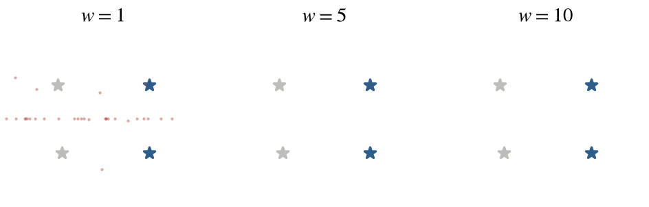

# 条件生成与引导

前面的模型只会生成某种图，不会按描述生成。要让模型听懂一只戴着帽子的猫，需要把条件信息注入进去，并在采样时放大它的作用。

这一章讲条件是怎么写进数学的，以及那个几乎每个使用者都调过的参数，guidance scale，到底在做什么。

## 条件 score 的分解

设 $c$ 是条件，比如文本、类别、深度图，要采样的是 $p(x\mid c)$。由贝叶斯公式

$$\nabla_x\log p(x\mid c) = \nabla_x\log p(x) + \nabla_x\log p(c\mid x).$$

第一项是无条件分布的梯度，第二项是给定图像、条件成立的可能性的梯度。前者已经有模型了，后者需要额外的信息。

这个分解把条件生成拆成两个可以分别处理的部分，是分类器引导与无分类器引导的共同出发点。

## 分类器引导

如果 $c$ 是类别，可以训练一个分类器 $p_\phi(c\mid x)$，在噪声图上也能工作。于是采样时用

$$\tilde\epsilon_\theta(x_t,t) = \epsilon_\theta(x_t,t) - \sqrt{1-\bar\alpha_t}\,s\,\nabla_{x_t}\log p_\phi(c\mid x_t)$$

作为噪声预测，其中 $s$ 是引导强度。

负号来自上面的分解。噪声预测对应 $-\sigma_t\nabla\log p$，加上条件项的梯度，就相当于减去 $\sigma_t$ 乘分类器梯度。

分类器引导的问题是成本高。要为每个条件训一个分类器，分类器还要在含噪图上训练，否则在 $t$ 大时失效。

## 无分类器引导

无分类器引导绕开了分类器。做法是在训练时以一定概率把条件置空，比如 10%，让同一个网络同时学会条件生成与无条件生成。采样时用两个输出的线性组合

$$\tilde\epsilon = \epsilon_{\text{uncond}} + w\big(\epsilon_{\text{cond}} - \epsilon_{\text{uncond}}\big).$$

$w=1$ 时就是普通的条件采样；$w>1$ 时把条件方向放大。

这个式子可以看成隐式的分类器引导。把条件 score 的分解写成

$$\nabla\log p(c\mid x) = \nabla\log p(x\mid c) - \nabla\log p(x),$$

两边乘 $-\sigma_t$，用噪声预测替换 score，得到

$$-\sigma_t\nabla\log p(c\mid x) = \epsilon_{\text{cond}} - \epsilon_{\text{uncond}}.$$

所以 $\epsilon_{\text{cond}}-\epsilon_{\text{uncond}}$ 就是分类器梯度的估计，上面的式子相当于用 $w-1$ 作为引导强度。CFG 的巧妙之处在于，分类器被蒸馏进了生成网络，不需要单独训练。

## 引导强度在做什么

$w>1$ 时，采样被推向条件更明确的方向。代价是偏离数据流形。

图 10.1 用解析的高斯混合做了一个实验。$w$ 增大时，样本先变得更典型，然后开始坍缩到类别均值附近，最后挤成一团。这与实际使用中的观察一致，$w$ 太大时画面过饱和、纹理崩坏、构图僵硬。

原因可以从上面的式子看出来。把噪声预测换成速度或 score，$w$ 的作用是把两个场的差放大。这个差在数据流形附近是有意义的修正方向，离流形越远，它的方向越不可靠，放大后就把样本推到了模型没学过的地方。

## 引导的代价

训练时丢弃条件，会让模型在无条件生成上略差，因为只有 90% 的样本用于条件任务。采样时两次前向，计算量翻倍。

对一步模型来说，这个代价不能接受。一步生成模型通常把引导直接写进训练目标，让网络学引导后的平均速度，这样采样时只需要一次前向。

## 其它条件注入方式

不是所有条件都能写成一句描述。结构条件，比如边缘图、深度、姿态，需要另一种注入方式：把条件图与 $x_t$ 在通道维拼接，或者用额外的编码器提取特征再逐层相加。ControlNet 这类结构条件注入属于后者。

文本条件的注入方式最特殊，它通过 cross-attention 进入网络，下一章会讲。

## 实践中的参数

CFG 的强度与步数耦合。步数少时，每一步的误差大，$w$ 要调低，否则误差被放大；步数多时可以适当提高 $w$。

负向提示是 CFG 的一个变体，把 $\epsilon_{\text{uncond}}$ 换成用负向描述算出的 $\epsilon$，相当于把样本推离那些描述。它在实现上只是换了一个条件，不改变公式。

guidance rescale 是另一个常见技巧。CFG 之后整体方差变大，按标准差重新缩放可以缓解过饱和。做法是把 $\tilde\epsilon$ 的均值与标准差调整回 $\epsilon_{\text{cond}}$ 的水平。
