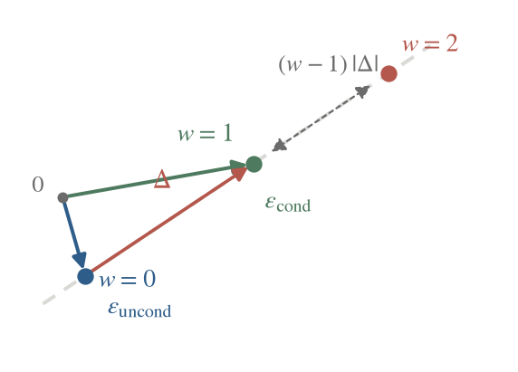
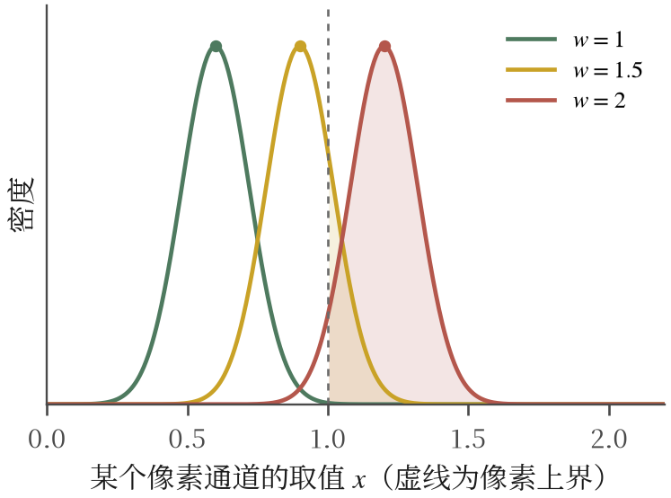

# 条件生成与引导

前面的模型只会生成某种图，不会按描述生成。要让模型听懂一只戴着帽子的猫，需要把条件信息注入进去，并在采样时放大它的作用。

这一章讲条件是怎么写进数学的，以及那个几乎每个使用者都调过的参数，guidance scale，到底在做什么。

先看一个具体场景。训练时只教过模型“图是什么样”，没教过它“猫跟帽子的对应关系”。即便数据集里猫和帽子都很多，条件采样的目标也不是“找一张有猫的图”，而是“在给定这句话的条件下，图的分布长什么样”。差的这一点往往很小：同一句话对应的图有成千上万张，而能体现“戴着帽子”的那一小部分只占其中一端。引导要做的就是在采样时把重心往这一端挪，挪得过头就是另一种失败。

## 条件 score 的分解

设 $c$ 是条件，比如文本、类别、深度图，要采样的是 $p(x\mid c)$。由贝叶斯公式

$$\nabla_x\log p(x\mid c) = \nabla_x\log p(x) + \nabla_x\log p(c\mid x).$$

第一项是无条件分布的梯度，第二项是给定图像、条件成立的可能性的梯度。前者已经有模型了，后者需要额外的信息。这个分解把条件生成拆成两个可以分别处理的部分，是分类器引导与无分类器引导的共同出发点。

把中间步骤写出来。由 $p(x\mid c)=p(c\mid x)p(x)/p(c)$，两边取对数再对 $x$ 求梯度：

$$\nabla_x\log p(x\mid c)=\nabla_x\log p(c\mid x)+\nabla_x\log p(x)-\nabla_x\log p(c),$$

$p(c)$ 是条件的边际概率，与 $x$ 无关，那一项直接消失，剩下上面那条式子。推导只用了一件事：取对数把乘积变加法。它对任何条件都成立，$c$ 是类别、是文本、是一张深度图都一样。

真正麻烦的地方在于条件 score 是在含噪的 $x_t$ 上算的。把带噪版本写出来，

$$p_t(x_t\mid c)=\int p(x_0\mid c)\,q(x_t\mid x_0)\,\mathrm{d}x_0 ,$$

对同一个 $t$ 再做一次贝叶斯，得到

$$\nabla_{x_t}\log p_t(x_t\mid c)=\nabla_{x_t}\log p_t(x_t)+\nabla_{x_t}\log p_t(c\mid x_t).$$

形式上与无噪时一样，但右边第二项不是干净数据上的分类器，而是

$$p_t(c\mid x_t)=\int p(c\mid x_0)\,p(x_0\mid x_t)\,\mathrm{d}x_0 ,$$

也就是“在所有可能生成 $x_t$ 的 $x_0$ 上，对分类器输出取后验平均”。它的行为与干净分类器不同：$t=0$ 时它退化为普通分类器；$t=T$ 时 $x_T$ 几乎不含 $x_0$ 的信息，后验平均等于先验 $p(c)$，梯度为零。引导项必须随噪声增大自动衰减，这是它能工作的前提。

一个在干净图上训好的分类器不知道这件事。你给它一张高噪图，它照样输出一个很自信的分布，梯度方向看着有模有样，实际指向与 $x_0$ 无关的方向。这就是分类器引导必须配套噪声鲁棒分类器的原因，不是工程上的讲究，而是上面那个积分式子要求的。

## 分类器引导

如果 $c$ 是类别，可以训练一个分类器 $p_\phi(c\mid x)$，在噪声图上也能工作。于是采样时用

$$\tilde\epsilon_\theta(x_t,t) = \epsilon_\theta(x_t,t) - \sqrt{1-\bar\alpha_t}\,s\,\nabla_{x_t}\log p_\phi(c\mid x_t)$$

作为噪声预测，其中 $s$ 是引导强度。

负号来自上面的分解。噪声预测对应 $-\sigma_t\nabla\log p$，加上条件项的梯度，就相当于减去 $\sigma_t$ 乘分类器梯度。

分类器引导的问题是成本高。要为每个条件训一个分类器，分类器还要在含噪图上训练，否则在 $t$ 大时失效。

噪声鲁棒分类器的训法是：采样时随机取 $t$、对干净图加噪、把 $(x_t,t)$ 送进分类器预测类别，让它在每个噪声水平上都见过数据。$t$ 可以作为额外输入（比如加一个时间嵌入），也可以不做、只靠数据增强：前者让分类器知道“现在有多模糊”，后者要它自己从图里估。前者更稳，因为 $t$ 很大时图像信息几乎为零，网络自己估不出噪声水平。

公式里的系数值得对一遍。噪声预测与 score 的关系是 $\epsilon_\theta\approx-\sigma_t\nabla\log p_t$，其中 $\sigma_t=\sqrt{1-\bar\alpha_t}$；把分类器项加进 score 之后，换回噪声预测要乘上 $-\sigma_t$，这就是公式里负号与系数的来源。不同实现的 $s$ 口径不一样：有的把 $\sigma_t$ 吸收进 $s$，有的不吸收，还有的把 $s$ 做成随 $t$ 变化的函数。读代码时先确认 $\sigma_t$ 在哪里，否则同一个 $s$ 数值在两份代码里的实际强度能差好几倍。

成本上有两笔。一是每步多一次分类器前向，分类器比生成网络小得多，这一笔不大；二是每换一种条件就要重训一个分类器，条件越多越麻烦，文本这种能任意组合的条件根本无法枚举。

另一个实际问题是引导过度会让分类器自己“钻空子”。分类器只看特征好不好分，不看图是不是真图，采样器把 $s$ 调大之后会找到一批分类器很有把握、人类一看就是噪声的图案。这类伪影在 $s$ 大到某个程度后出现得很突然，不是逐渐变差，而是某一个阈值之后满屏纹理。分类器的置信度越高，这个阈值就越低。

## 无分类器引导

无分类器引导绕开了分类器。做法是在训练时以一定概率把条件置空，比如 10%，让同一个网络同时学会条件生成与无条件生成。它的动机很直接：分类器引导要额外训一个网络、要为每种条件重训、还会被分类器骗，这三件事都不需要存在。采样时用两个输出的线性组合

$$\tilde\epsilon = \epsilon_{\text{uncond}} + w\big(\epsilon_{\text{cond}} - \epsilon_{\text{uncond}}\big).$$

$w=1$ 时就是普通的条件采样；$w>1$ 时把条件方向放大。

这个式子可以看成隐式的分类器引导。把条件 score 的分解写成

$$\nabla\log p(c\mid x) = \nabla\log p(x\mid c) - \nabla\log p(x),$$

两边乘 $-\sigma_t$，用噪声预测替换 score，得到

$$-\sigma_t\nabla\log p(c\mid x) = \epsilon_{\text{cond}} - \epsilon_{\text{uncond}}.$$

所以 $\epsilon_{\text{cond}}-\epsilon_{\text{uncond}}$ 就是分类器梯度的估计，上面的式子相当于用 $w-1$ 作为引导强度。CFG 的巧妙之处在于，分类器被蒸馏进了生成网络，不需要单独训练。

“相当于 $w-1$”这句话要看清基准。把式子改写一下：

$$\tilde\epsilon=\epsilon_{\text{cond}}+(w-1)\big(\epsilon_{\text{cond}}-\epsilon_{\text{uncond}}\big),$$

以条件输出为基准，多出来的部分确实是 $w-1$ 倍的分类器梯度；以无条件输出为基准，系数则是 $w$。两种说法指的是同一个插值位置，只是原点不同。调参时听到的 $w$ 与论文里的引导强度 $s$ 对不上，往往就是这个差别。

得到的“隐式分类器”是 $\log p_t(c\mid x_t)\approx\log p_t(x_t\mid c)-\log p_t(x_t)$，它只在训练见过的 $(x_t,t,c)$ 上准。偏离数据流形之后这个差的含义就淡了：两个网络都在外推，外推方向没有东西校正。

CFG 估出来的方向比显式分类器稳，原因在参数共享。同一个网络、同一组权重，只是条件不同，两个输出走的是几乎相同的前向路径，差别只在条件注入的那几层。两个几乎相同的函数相减，公共部分抵消，剩下的就是条件造成的那一点偏移；如果两条路径完全独立，各自带着互不相关的近似误差，相减之后误差会相加而不是抵消。这一点在低噪声端尤其明显：那里两个输出的量级相当，差却很小，抵消得干净；高噪声端两者都接近零，相减之后剩下的也是噪声，所以高噪端的引导最不可靠。

这也解释了为什么 CFG 的 $w$ 可以比分类器引导的 $s$ 大得多。$s$ 乘的是一个独立网络的梯度，那个网络的误差不被抵消；$w-1$ 乘的是一个抵消过的差，同样的数值下动的东西少得多。

训练时置空条件的比例也有影响。比例太小，无条件分支见到的样本少，$w$ 大时那条支路的误差被放大；比例太大，条件分支的训练样本变少。常取 10% 左右，并且置空用的 token 最好与“空描述”一致：有实现用空串，有实现用一串固定字符，两种混用时无条件分支会学到两个不同的分布。

两条路线摆在一起：

| | 分类器引导 | CFG |
|---|---|---|
| 额外网络 | 需要（噪声鲁棒） | 不需要 |
| 每步前向 | 2（生成 + 分类器） | 2（条件 + 空条件） |
| 条件种类 | 每种一个分类器 | 任意，训练时同步丢弃 |
| 强度量级 | 需按 $\sigma$ 调 | 常数即可 |
| 失效方式 | 分类器被钻空子 | 过饱和、多样性塌缩 |

逐行看。前向次数都是两次，但 CFG 的两次是同一个网络的两个条件，可以合成一个 batch，内存布局与 kernel 都能复用；分类器引导的两次是两个不同网络，调度上没那么灵活。强度的量级差得更远：$s$ 乘的是分类器梯度，那个梯度随 $\sigma$ 变，合适的 $s$ 也跟着变；$w$ 乘的是同一网络在两个条件下的差，尺度已经对齐过，一个常数就能用。最后一行最实用：看到画面过饱和先想 CFG，看到画面里出现奇怪的、有规律的高频图案，先想分类器。

## 引导强度在做什么

$w>1$ 时，采样被推向条件更明确的方向。代价是偏离数据流形。


图 10.1 用解析的高斯混合做了一个实验。$w$ 增大时，样本先变得更典型，然后开始坍缩到类别均值附近，最后挤成一团。这与实际使用中的观察一致，$w$ 太大时画面过饱和、纹理崩坏、构图僵硬。

原因可以从上面的式子看出来。把噪声预测换成速度或 score，$w$ 的作用是把两个场的差放大。这个差在数据流形附近是有意义的修正方向，离流形越远，它的方向越不可靠，放大后就把样本推到了模型没学过的地方。

### 几何图像

把 $\epsilon_{\text{uncond}}$ 与 $\epsilon_{\text{cond}}$ 看成同一个空间里的两个点，CFG 取的 $\tilde\epsilon$ 就在它们连成的直线上。$w=0$ 落在无条件端，$w=1$ 落在条件端，$w>1$ 越过条件端沿着同一个方向继续走，超出的长度是 $(w-1)|\Delta|$。



外推之后方向也变了。两个向量的夹角可以写成

$$\cos\theta=\frac{\langle\tilde\epsilon,\ \epsilon_{\text{cond}}\rangle}{|\tilde\epsilon|\,|\epsilon_{\text{cond}}|},$$

$w$ 越大，$\tilde\epsilon$ 越接近 $\Delta$ 的方向。$\Delta$ 是“条件与无条件的差”，它的含义是“往哪个方向改能让画面更像这个条件”，本身没有“保持原样”的成分。走出去越远，越只剩这一件事，画面其他方面——构图、亮度、纹理统计——就没人管了。

### 温度视角

CFG 还有一个等价说法。引导后的 score 是

$$\tilde s=\nabla\log p_t(x_t)+w\nabla\log p_t(c\mid x_t)=\nabla\log\big[p_t(x_t)\,p_t(c\mid x_t)^{w}\big],$$

也就是说在采样 $p_t(x_t)\,p_t(c\mid x_t)^{w}$。$w>1$ 时后验被锐化，概率质量向“最能说明这个条件”的区域集中。这个分布的温度被调低了，作为生成模型它不再忠实于 $p(x\mid c)$，而是忠实于其中它最像的那一部分。多样性与保真度的权衡就是从这里来的：$w$ 越大，单张名义上越典型，覆盖越窄。

这个视角能算出过饱和。取一维理想情形，$p(x)=\mathcal N(0,\sigma^2)$，$p(x\mid c)=\mathcal N(\mu,\sigma^2)$，两者协方差相同，则 $\nabla\log p(c\mid x)=(\mu-x)/\sigma^2$，引导后的 score 是

$$\tilde s=\frac{-(x-\mu)}{\sigma^2}\,w+\frac{-x}{\sigma^2}(1-w)=\frac{-(x-w\mu)}{\sigma^2},$$

对应的分布是 $\mathcal N(w\mu,\sigma^2)$：均值被放大 $w$ 倍，方差不变。像素有取值范围，均值一旦被推出边界，落在边界外的质量全被截断，画面上就是大片死白或死黑。取 $\mu=0.6$、$\sigma=0.12$、像素范围 $[0,1]$，$w=1$ 时越过上界的质量几乎为零，$w=1.5$ 时均值走到 $0.9$，约有两成质量超过 1，$w=2$ 时均值 $1.2$，超过 1 的比例到了九成五。



真实模型里协方差也会变，类内的多个模式会被合并，方差不是不变而是缩小。上面这个算例只保留了“均值被推出去”一项，已经够解释过饱和的来源：它不是纹理本身变差了，而是大量像素被截在边界上。

两个支路的差在时间上不是均匀的。高噪端 $x_t$ 几乎全是噪声，带条件与不带条件两个输出都以“把这个噪声去掉”为主，它们的差很小；$t$ 减小时两条支路开始分道，差逐渐变大。这解释了一个常见现象：同一个初始噪声、只换描述，两张图的构图往往大体相似，到中后段才真正分开。初始噪声提供的是构图与布局的骨架，条件更多是在其上来回选择，而不是从零开始安排。想大幅改构图，换种子比改描述有效。

## 引导的代价

训练时丢弃条件，会让模型在无条件生成上略差，因为只有 90% 的样本用于条件任务。采样时两次前向，计算量翻倍：$N$ 步就是 $2N$ 次前向，20 步 40 次，50 步 100 次。潜空间模型上单次前向已经不便宜，这两倍常常是延迟里最大的一项。

有一个省时间的做法是把两个条件合成一个批次：把 $x_t$ 复制两份，一份配条件、一份配空条件，在批维拼起来送进网络。前向次数变成一次，代价是显存翻倍、单次前向的计算量也翻倍，在显存不吃紧、延迟敏感的场景里更划算。两者不等价的地方在于批大小变了，归一化的统计与硬件利用率都会变，实测的加速比往往达不到两倍。

对一步模型来说，这个代价不能接受。一步生成模型通常把引导直接写进训练目标，让网络学引导后的平均速度，这样采样时只需要一次前向。

## 其它条件注入方式

不是所有条件都能写成一句描述。结构条件，比如边缘图、深度、姿态，需要另一种注入方式：把条件图与 $x_t$ 在通道维拼接，或者用额外的编码器提取特征再逐层相加。ControlNet 这类结构条件注入属于后者。

三种方式的差别在于条件参与多深。通道拼接最直接，条件图与 $x_t$ 分辨率相同，拼在通道维，网络在第一层就能看到；缺点是条件只能影响入口，深层拿不到，而且修改条件只能靠重新编码整张图。逐层相加让条件进入每一层，代价是要把条件特征对齐到每层的分辨率与通道数，实现上多一层映射。用归一化参数注入（把条件的嵌入变成缩放与平移）最轻，但它只能表达全局属性，对于“这里有一根线”这种带空间的约束力不够。

条件与 $x_t$ 的对齐也影响训练难度。边缘图与图同分辨率，拼接后位置一一对应，网络只需要学“这条边对应什么”；文本是变长序列，没有空间对应关系，必须让网络自己学哪一段对应画面哪一块，这就是注意力要做的事。

文本条件的注入方式最特殊，它通过 cross-attention 进入网络，下一章会讲。

条件的粒度决定了引导能控到多细。一句描述通常只能约束全局语义：有没有主体、什么风格、什么色调。让模型“把左边那只杯子换成蓝色”是局部约束，它需要空间对应关系，而文本通过 cross-attention 进入网络时，哪个 token 对应哪一块像素没有硬对应。引导放大的是语义方向，不是空间选择。想让局部生效，要么把条件换成带空间的（掩码、结构图、参考图），要么去改注意力；没有第三条路。

把常见条件与注入方式排在一起：

| 条件 | 注入位置 | 引导方式 | 典型失败 |
|---|---|---|---|
| 类别 | 嵌入相加或 AdaGN | 分类器引导、CFG | 少数类塌陷 |
| 文本 | cross-attention | CFG | 忽略后半句 |
| 边缘、深度 | 通道拼接、ControlNet | 通常不加引导 | 画面僵硬 |
| 参考图 | 额外编码器 + 交叉注意力 | 双 CFG | 内容被带跑 |
| 重绘掩码 | 通道拼接 | 不加 | 边界接缝 |

表格里最后一列比前两列实用。看到一张图不合描述，先看它属于哪一种失败，比直接去调 $w$ 高效得多：条件被忽略时加 $w$ 只会变成过度饱和，掩码接缝与引导强度毫无关系。

## 实践中的参数

CFG 的强度与步数耦合。步数少时，每一步的误差大，$w$ 要调低，否则误差被放大；步数多时可以适当提高 $w$。机制是：引导把轨迹推离数据流形，推出去多少正比于 $(w-1)$，能把它拉回来的只有后续的步。$N=10$ 时只有 10 次机会，某一处被推歪之后没有几步可以修正；$N=50$ 时有 50 次。换个说法，引导引入的偏移在数值上相当于一个与步长同阶的扰动，步长大的时候它更容易把样本推到流形外。

调参的经验是：默认配置的 $w$ 在 5 到 8 之间，步数压到十几步时往下调一档，用蒸馏出的一步或四步模型时基本不用 CFG——引导的偏差没有时间被修正，那些模型把引导直接训进了目标。

引导在不同步上的作用也不一样。高噪端决定构图与主体位置，中段决定纹理与风格，低噪端决定颜色与细节。同一个 $w$ 从起点加到终点，等于在三段上都用了同样的力度，但高噪端的 score 估计最不可靠（前面第 9 章那个 $(D-x)/\sigma^2$ 把误差放大得最厉害），那里加引导风险最大。有的实现把 $w$ 做成随 $t$ 下降的曲线，高噪端给得小一些，图像更稳；代价是多一个超参数，且换了步数日程就要重新调。

同一个 $w$ 在像素空间与潜空间不具可比性。两边的噪声尺度不同，$\Delta$ 的模也不同，数值上都是 7 不代表强度一样。换模型时最快的办法是从默认值附近重新扫一遍，不要相信别的模型上的最优值。

### 怎么定 $w$

标准做法是固定其他变量扫一个小网格：同一个种子、同一段描述、固定步数，取 4 个 $w$，每个值出 8 到 16 张。读的时候分三件事：与描述的吻合度、画面本身干不干净、多张之间差多少。前两项随 $w$ 上升先好后坏，第三项单调变差。满意的区间在“吻合度还在涨、干净度还没掉”的拐点上，往左取一点更安全，因为过饱和往往在缩小图上看不出来，到了原尺寸才刺眼。

拿单张图比 $w$ 会得出错误结论。$w$ 大时方差小，任何一张单独看都“挺括”，但整体多样性已经没了；只看一张会觉得大 $w$ 更好，看一批才发现都长得一样。因此评估至少要看一整批，且每批的种子集合相同。

$w<1$ 也有用处。$w=0$ 退化为无条件采样，中间的 $w$ 相当于“半个条件”，可以把引导当成一个连续旋钮在“更像描述”与“更多样”之间移动。需要大量候选再筛选的场合（比如生成一堆草图让人工挑）会用到小一点的 $w$，代价是有些候选根本不服从描述。

负向提示是 CFG 的一个变体，把 $\epsilon_{\text{uncond}}$ 换成用负向描述算出的 $\epsilon$：

$$\tilde\epsilon=\epsilon_{\text{neg}}+w\big(\epsilon_{\text{cond}}-\epsilon_{\text{neg}}\big),$$

相当于把样本推离那些描述。它在实现上只是换了一个条件，不改变公式。概率上它采样的是 $p_t(x_t)\big[p_t(x_t\mid c)/p_t(x_t\mid c_{\text{neg}})\big]^{w}$，也就是“更像 $c$、更不像 $c_{\text{neg}}$”。用“模糊、低分辨率、水印”当负向，效果上比只写正向更省事，因为它直接减掉了那几类图的 score 方向。

副作用出在同一个机制上。负向描述是“红色”时，减掉的是红色方向，画面整体会偏青绿；“没有人”这类否定句更难处理，文本编码器不区分肯定与否定，它把“人”编码成一个方向，减掉之后得到的是“少一些像人的东西”，而不是真的没有人。负向提示有效，但它改的是分布的形状，不是一个逻辑开关。

guidance rescale 是另一个常见技巧。CFG 之后整体方差变大，按标准差重新缩放可以缓解过饱和。做法是先算 $\tilde\epsilon$ 与 $\epsilon_{\text{cond}}$ 的标准差（在通道与空间维上统计，每个样本分开算），然后

$$\hat\epsilon=\frac{\sigma_{\text{cond}}}{\sigma_{\tilde\epsilon}}\big(\tilde\epsilon-\mu_{\tilde\epsilon}\big)+\mu_{\tilde\epsilon},$$

有的实现连均值也一起对齐。插值系数 $\phi\in[0,1]$ 控制缩放强度，$\phi=0$ 不缩放，$\phi=1$ 完全对齐。

它修正的是幅值，不是方向。缩放之后对比度回来了，但引导推出去的方向还在，类内多样性不会恢复；同时缩放把引导的幅度也一起压小了，等效于降低 $w$，想保持同样的效果就得把 $w$ 再提一点，两个参数开始互相牵制。用得好的时候画面更耐看，用得不好就是把 $w$ 的作用抵消掉一半，还多一次统计。

rescale 的统计口径也要注意。标准差是在通道与空间维上按样本分别算的，不能跨 batch 算：一张高对比度的图会把整批的标准差拉偏，其余图被压成灰雾。同一批里图的对比度本身就不一样，这个统计本质上是在对齐每一张图的幅值，而不是对齐分布。

条件不止一个时，引导可以分级。假设有两段描述 $c_1$（主体）与 $c_2$（风格），可以取

$$\tilde\epsilon=\epsilon_\varnothing+w_1(\epsilon_{c_1}-\epsilon_\varnothing)+w_2(\epsilon_{c_1,c_2}-\epsilon_{c_1}),$$

每一项都是一个差，各自带自己的强度。代价是三次前向（无条件的、带 $c_1$ 的、带两个描述的），比普通 CFG 又多一倍。实践中更常见的是把描述拼成一句、用一个 $w$，只在需要单独控制某一部分时才拆开——比如保持人物不变、只调风格。

拆开之后要注意各项尺度不同。第二个差是在已有条件下再增加的，量级通常比第一个差小得多，同一个 $w$ 用在两项上，第二项几乎不起作用。想让风格明显，$w_2$ 往往要给到比 $w_1$ 大不少的值。

### 一个带引导的采样循环

把前面的东西拼起来，采样侧大概是这样。

```text
c  = encode(prompt)                 # (1, L, D)
cu = encode("")                     # 空条件，与训练时置空的 token 一致
x  = randn(1, 4, 64, 64) * sigma_max
for t, t_next in zip(sched[:-1], sched[1:]):
    e_u = net(x, t, cu)             # 无条件，只需算一次
    e_c = net(x, t, c)
    e   = e_u + w * (e_c - e_u)     # 与 x 同形状
    x   = step(x, e, t, t_next)
img = decode(x)
```

三个容易出错的地方。空条件必须与训练时置空的写法一字不差，否则无条件分支会跑在它没见过的条件上。$w$ 乘的是差，不是 $\epsilon_{\text{cond}}$，写成 `w * e_c` 就完全不是 CFG 了。负向提示只是把 `cu` 换成 `encode(neg)`，其余不变。

## 引导背后的两个事实

关于引导，有两个容易被忽略的事实，它们决定了这个旋钮能用在哪里、不能用在哪里。

第一个是采样仍然良定义。引导后的 score 能不能对应一个分布？代数上能：

$$\tilde s=\nabla\log\big[p_t(x_t)\,p_t(c\mid x_t)^{w}\big],$$

只要 $w\ge0$，括号里就是一个合法的非负函数，它的 score 就是 $\tilde s$。因此确定性采样器跑出来的，是一个良定义分布的样本，ODE 本身没有任何毛病。问题在于那个分布不是 $p(x\mid c)$：$w=1$ 时它是对的，$w>1$ 时它是被锐化、且质量被抛出数据支持的一个版本。每个点上的分数估计都没错，错的是“想采的分布”与“实际采的分布”不一致。

这个事实给出一个很实用的判断：步数再多、采样器阶数再高，也消不掉引导带来的偏差。它们只能把当前目标的样本采得更准，不会把目标变回去。反过来，把 $w$ 降低到 1，偏差就自动消失，不需要换采样器。

第二个是引导不引入新信息。$\tilde s$ 只是两个已有 score 的线性组合，它不能提升条件编码器的理解力：描述里没被编码到的部分，在 $\epsilon_{\text{cond}}$ 里本来就缺席，$\Delta$ 里也没有，加多大都不会出现。描述写了“左边一只猫、右边一只狗”而模型只画了猫，加 $w$ 的结果是猫变得更像猫，不会多出一只狗。同理，它不能增加覆盖（$w$ 增大时分布变窄），也不能跨过数据集的限制（模型没见过的方向不存在于 score 里，放大一个不存在的东西还是零）。

所以调 $w$ 真正在定的是偏好：在“像描述”与“像真图”之间往哪边偏。能力不足的问题要去改模型与条件，偏好问题才轮到 $w$。把这两类问题分清，能省很多无效调参。

## 引导会怎样坏

几种典型症状与各自的成因，可以对照着定位。

画面过饱和、细节发硬。$w$ 大了，像素被推向上界，对应前面那个 $\mathcal N(w\mu,\sigma^2)$ 的算例。先试 rescale，不行再降 $w$。

构图偏执，同一个 prompt 反复出同一张图。这是温度视角的直接后果，后验被锐化到只剩下一个模式。降 $w$、换 seed、加入更具体的描述都比继续加 $w$ 有用。

加了 $w$ 结果却没更准。说明分类器项的方向本来就弱：给它一些模棱两可的输入，它的置信度本来就低，再乘一个大系数还是指向差不多的地方。这种时候问题在条件编码，不在强度。

换成负向提示之后结果极不稳定。正向与负向的 score 方向有夹角时，$w$ 大了之后两边来回抢，在高噪端表现为构图忽东忽西。降低 $w$ 或把负向换成更宽泛的词可以缓解。

评测上的表现也会变形。引导之后的样本不再来自 $p(x\mid c)$，而是来自更窄的一个分布：与真实分布的覆盖度比对会变差，与文本的相似度反而会变好（这类倾向在 CLIP 分数与 FID 这类指标的搭配上很常见）。拿两个 $w$ 下的结果比指标，先确认比的是同一个目标，否则很容易把“更像描述”读懂成“质量更好”。
