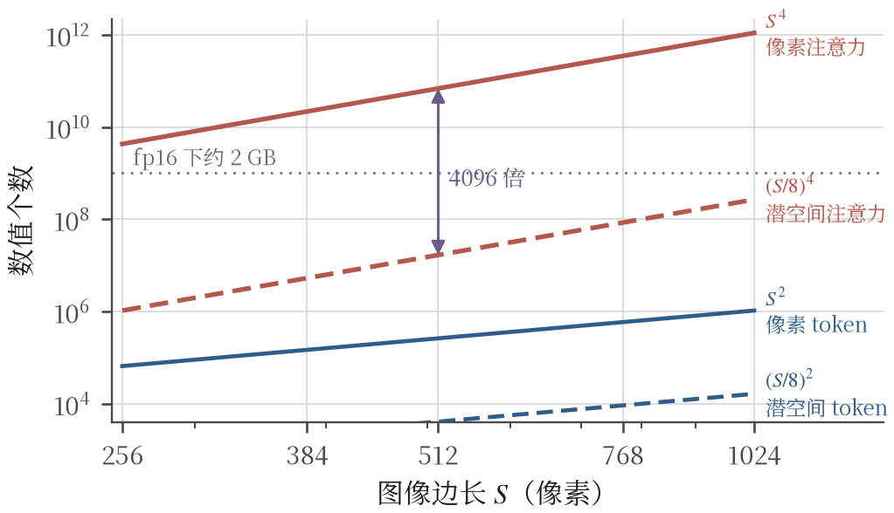
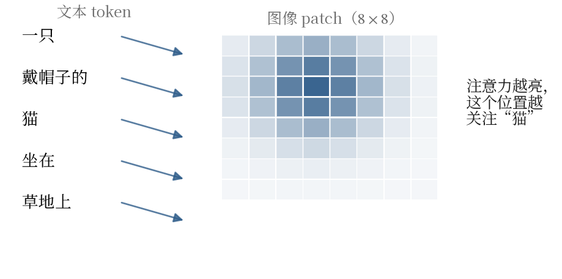
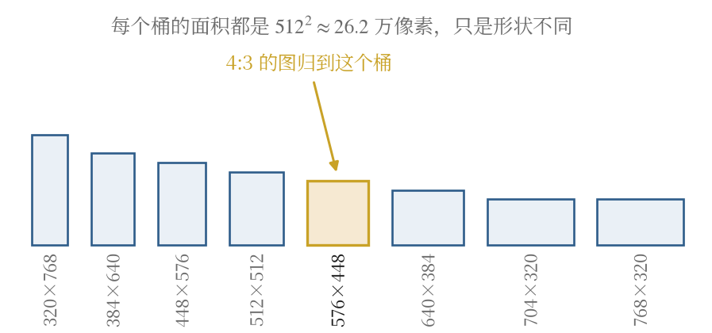

# 潜空间扩散与文本到图像

一张 512×512 的图有 26 万个像素。在像素空间上做扩散，每一步的 $x_t$ 都是这个尺寸，网络要处理这么大的输入，采样 50 步就是 50 次这样的计算。这个成本在 2022 年之前限制了扩散模型的分辨率。

潜空间扩散的想法很直接：先用一个自编码器把图压到小得多的潜空间，在潜空间里做扩散，采样完再解码回来。

## 计算量的现实

自注意力的计算量随 token 数平方增长。在 $512^2 = 262144$ 个 token 上做全局注意力，开销无法承受。即使只用卷积，高分辨率下每层都要处理 26 万个位置，显存和算力都不够。

把图压到 $64\times 64$，下采样 8 倍，token 数变成 4096，计算量降到六十四分之一。这就是潜空间扩散的核心收益。

“六十四分之一”这句话要看是哪种开销。卷积和全连接的开销与 token 数 $N$ 成正比，$N$ 从 262144 降到 4096，确实是 64 倍。自注意力的开销与 $N^2$ 成正比，同一个降采样在注意力上放大成 $64^2=4096$ 倍。像素空间和潜空间之间的差距，主要就藏在这平方里。

把它算到底。512² 的图上做一次全局自注意力，注意力矩阵是 $N\times N$，也就是

$$
262144^2 = 6.87\times 10^{10}
$$

个元素。用 fp16 存，一个矩阵 137 GB，还不算 softmax 的中间量。这个数字已经超过了任何一张卡，所以像素空间扩散从一开始就不能用全局注意力，只能退回到局部窗口或线性注意力，把“注意力能做的事”让掉一部分。换成潜空间的 $64^2$，同一个矩阵是 $4096^2 = 1.68\times 10^{7}$ 个元素，约 34 MB，一层的注意力图可以完整地放在显存里。

算力上的账同样直接。一层宽度 $d=320$ 的自注意力，$QK^\top$ 与 $AV$ 两次矩阵乘合计约 $4N^2d$ 次浮点运算。像素空间：$4\times 6.87\times10^{10}\times 320 \approx 8.8\times 10^{13}$。潜空间：$4\times 1.68\times10^{7}\times 320 \approx 2.1\times 10^{10}$。前者是后者的四千倍，而后者在整个 U-Net 前传里只占百分之几。

整个 U-Net 的量级可以这样估：宽度在 320 到 1280 之间，分辨率从 $64^2$ 逐级降到 $8^2$，每个分辨率上若干组 3×3 卷积与注意力。逐层加起来，单张 512² 图的一次前传在 $10^{11}$ 量级，取 $3\times10^{11}$ 次浮点运算。50 步就是 $1.5\times10^{13}$。消费级显卡在 fp16 下的有效吞吐在 $10^{12}$ 到 $10^{13}$ FLOP/s 之间（峰值乘上百分之几十的利用率），除下来是几秒。这与实际体验对得上：512²、50 步，在单张消费级卡上跑三五秒。换回像素空间的话，光一层注意力就要 $8.8\times10^{13}$，比整套潜空间采样（50 步合计 $1.5\times10^{13}$）还贵出几倍。



按元素数看，收益是 48 倍：$512^2\times 3 = 786432$ 个像素值，压到 $64^2\times 4 = 16384$ 个潜变量。空间上省了 64 倍，通道上多花 4/3 倍（潜变量是 4 通道，不是 3），乘起来是 48。这 4 个通道不是 RGB 或亮度，它们是编码器学出来的基，每个通道都不能单独解释成某种颜色。

解码器的开销要单独算，因为它只做一次（生成 $n$ 张候选图就做 $n$ 次），不随步数增长。$64^2$ 的潜变量上采样回 $512^2$，最后几层在 $256^2$ 与 $512^2$ 上做 3×3 卷积，合计约 $10^{11}$ 次浮点运算，与一步去噪同量级。所以解码不会成为瓶颈，但也省不掉：采样 4 步的快速模型，解码占的时间就相当可观了。

训练时的显存账又是另一套。$512^2$ 的图 fp16 存一份是 1.5 MB，反向传播还要保存每一层的中间激活，整个 U-Net 的激活在几 GB 量级；换成潜变量，单份只要 32 KB。这个差距决定了能不能在单卡上把 batch 开大，而 batch 大小又直接影响训练稳定性。

换个角度看，也可以不压缩，而是先用小分辨率扩散、再上采样放大。级联模型走的就是这条路：第一级出 64²，第二级出 256²，第三级精修到 1024²。代价是三级各自的误差会叠加，第一级把一只猫生成成两只，第二级只会把两只猫都画得更清楚。潜空间扩散只需要一级模型，误差来源少一层，这是它后来居上的原因之一。

## 用什么样的自编码器

不是任何自编码器都行。只用均方误差训练的自编码器，重建结果会偏模糊。第 4 章解释过原因，像素空间的均方误差最优解是条件均值。

潜空间扩散的 VAE 加了两项损失：感知损失，用预训练网络的特征距离；对抗损失，用一个小判别器。前者让重建在感知上更像，后者补高频细节。同时用 KL 正则约束潜空间，使其接近标准正态，避免方差过大。


### 三项损失各管什么

写成一个损失，四项各有分工：

$$
\mathcal{L} = \underbrace{\|x-\hat x\|_2^2}_{\text{重建}} + \lambda_p \underbrace{\|\phi(x)-\phi(\hat x)\|_2^2}_{\text{感知}} + \lambda_a \underbrace{\mathcal{L}_{\text{adv}}}_{\text{对抗}} + \lambda_k \underbrace{D_{\mathrm{KL}}\big(q(z|x)\,\|\,p(z)\big)}_{\text{正则}}.
$$

重建项逐像素比较，管的是低频：大色块、整体亮度、物体轮廓的位置。它的最优解是给定潜变量时像素的条件均值，把所有可能的细节平均掉，所以权重一高就糊。

感知项把两张图送进同一个预训练网络 $\phi$（VGG 或 CLIP 的某一层），比较中间特征。特征层感受野大，对“结构错位”敏感，对“纹理细节是否逐像素相同”不敏感。一张猫的照片，把毛发的方向换掉、把每根毛挪半个像素，像素误差很大，特征误差很小。这种“细节可以有另一种实现”的余地，正是后面两项能补进来的空间。

对抗项用一个小判别器，只在一小块感受野上判断“这块纹理像不像真实图像”。它不给具体的像素值，只给一个“像不像”的梯度。所以加了对抗损失之后，细节是锐利的，但不一定忠实于原图——它长得像真的，而不是像这张图。判别器用 hinge 形式时，生成侧的损失是 $\max(0, 1-D(\hat x))$：只要判别器给的分够高，这一项就是零，梯度也就不再推动细节，这种“够好就停”的性质比交叉熵温和。

KL 项在高斯后验下有闭式。设 $q(z\mid x)=\mathcal{N}(\mu,\sigma^2)$，逐维计算：

$$
D_{\mathrm{KL}} = \frac{1}{2}\sum_{j}\left(\mu_j^2+\sigma_j^2-1-\log\sigma_j^2\right).
$$

它把潜变量的分布拉向标准正态，同时压住 $\mu$ 的模长与 $\sigma$ 的偏离。系数太大时，编码器不敢往潜变量里塞信息，重建变糊——这是 $\beta$-VAE 的经典现象，$\beta$ 大到一定程度，重建退化到几乎只剩均值。系数太小时，潜变量每个通道的方差可以很大、分布出现重尾，扩散网络要覆盖的尺度范围就宽，训练更难收敛。

扩散模型用的 VAE 里，KL 的权重通常非常小（量级 $10^{-6}$，具体值随实现而异），真正在控尺度的是训练后的一步归一化：统计训练集上每个潜通道的均值与标准差，推理时减均值除标准差。这样潜变量是“均值 0、方差 1”，但不严格服从正态。扩散只需要尺度合适，并不要求它真的正态。

把四项放在频段上看，分工就清楚了：

| 损失 | 主要作用的频段 | 权重过大 | 权重过小 |
| --- | --- | --- | --- |
| 重建 | 低频：色块、亮度、轮廓 | 模糊，细节被平均掉 | 颜色漂移、结构错位 |
| 感知 | 中频：边缘、纹理走向 | 结构对但“油画感”，细节被重塑 | 纹理发软 |
| 对抗 | 高频：毛发、颗粒、细线 | 出现虚假纹理、棋盘格 | 细节糊成一片 |
| KL | 潜空间的整体尺度 | 潜变量装不下信息 | 分布重尾，扩散难学 |

### 下采样因子与通道数

下采样因子 $f$ 决定潜空间的空间尺寸，通道数决定每个位置携带多少信息。这两件事常被混在一起说，实际影响的开销不同。$512^2$ 的图，取 4 个潜通道：

| $f$ | 潜空间尺寸 | token 数 | 元素压缩比 | 现象 |
| --- | --- | --- | --- | --- |
| 4 | $128^2\times4$ | 16384 | 12 倍 | 省得不够，注意力仍吃紧 |
| 8 | $64^2\times4$ | 4096 | 48 倍 | 常用折中 |
| 16 | $32^2\times4$ | 1024 | 192 倍 | 小字、发丝、指纹这类细节明显丢失 |
| 32 | $16^2\times4$ | 256 | 768 倍 | 只能承载粗粒度语义 |

注意力贵在 token 数，与通道数无关；线性层与卷积贵在元素数，与两者都有关。所以提高压缩有两条路：加 $f$ 减少 token，加通道数补回信息量。后一条路更划算——把通道从 4 加到 16、$f$ 保持 8，元素数回到 $64^2\times16=65536$（压缩 12 倍），token 数仍是 4096，注意力的账一分没多，只是每层的宽度变大。后来的模型往这个方向走，用 16 通道的 VAE 换更好的重建。

$f$ 的选择有一条硬边界：重建质量决定生成质量的上限。潜变量里没有的信息，扩散模型再强也变不出来。它只能生成“看起来合理的细节”，而不是原图的细节。做编辑时这一点尤其要紧，重建的偏差会被当成编辑的偏差。

### 重建会在哪里失败

$f=8$ 的 VAE 对几类内容特别吃力。图上 8 到 16 像素高的小字，笔画常被拼错，因为一个笔画只有一两个潜变量格子宽。远处的脸，眼睛和嘴挤在几个格子里，解码回来五官位置会轻微错位。细密的重复纹理（栅栏、布纹、指纹）容易出现摩尔纹或局部变形。

解码器本身也有伪影。用转置卷积上采样时，卷积核重叠不均匀，容易出棋盘格；换成“先最近邻放大再卷积”，或者在上采样后接一个模糊核，能压掉大部分。这类伪影在平坦区域（天空、墙面）最容易被看出来，因为那里没有纹理掩蔽。

还有一层不那么显眼的影响：解码器会往外“补”高频。潜变量里没有的高频成分，解码器会按训练分布填一个合理的进去。所以“改潜变量再解码，像素上只该改动一小块”这个假设并不严格成立，整幅图都可能轻微变化。基于潜变量的编辑方法都会碰到这件事。

## 潜空间里的扩散

编码得到 $z_0 = E(x)$ 之后，扩散过程与前面的章节完全一样，只是把 $x$ 换成 $z$。采样得到 $z_0$ 后，用 $D(z_0)$ 解码成图。

需要注意的是，潜空间的尺度与像素空间不同，噪声日程要针对潜空间重新设定。实践中常常对 $z$ 做一个缩放，使其标准差为 1，这样可以沿用为像素空间设计的日程。

“尺度不同”具体指什么？前向过程的 $\bar\alpha_t$ 是按像素值的动态范围定的：$x_0$ 大致落在 $[-1,1]$，$t=T$ 时信号被噪声完全盖住。潜变量是编码器的输出，它的标准差取决于编码器的权重，可能比 1 大好几倍，也可能小得多。同一个 $\bar\alpha_t$ 作用在一个标准差为 3 的张量上，信噪比曲线整体平移：$t$ 较大时早就没有信号，$t$ 较小时噪声还没盖住内容，训练里“有效的那段日程”被压短了。

处理办法很朴素：在训练集上统计潜变量每个通道的标准差，乘一个全局常数把整体方差拉到 1，然后直接搬像素空间那套线性日程。在 SD 1.x 的实现里这个常数是 0.18215，编码后乘上它，解码前除回去。它不是一个需要调的超参，而是把两套坐标对齐的换算系数。

潜空间还有一个容易误解的地方：那 4 个通道没有语义标签。像素空间里可以把某个通道当红通道来改，潜空间不行，每个通道都是所有颜色与纹理的混合投影。想在潜空间里“直接画一个东西”没有对应的操作；同样是改数值，改噪声、改注意力图、改特征残差都有明确的语义，直接改潜变量没有。

潜空间的空间分辨率是原图的 $1/8$，这个倍数会一直在细节上显现。做局部重绘时给的掩码，在潜空间里被量化到 $8\times8$ 像素的格子上，边缘就会有接近一个格子的系统偏差；要求“只改这一块”，也只能在格子粒度上满足。后来的模型多数仍用 $f=8$，转而靠加潜通道补信息：空间粒度没变，但每个格子里装的内容多了，小字与细节的重建会好一些。

## 文本如何进入

文本先经过一个编码器，比如 CLIP 的文本塔或者 T5，得到一串 token 向量 $\tau\in\mathbb{R}^{L\times d}$。然后在 U-Net 的每一层插入 cross-attention

$$Q = W_Q z,\qquad K = W_K\tau,\qquad V = W_V\tau,\qquad \mathrm{Attn}(Q,K,V) = \mathrm{softmax}\!\left(\frac{QK^\top}{\sqrt d}\right)V.$$

查询来自图像特征，键和值来自文本。注意力矩阵 $QK^\top$ 的每一行对应一个图像位置，每一列对应一个文本 token，它的数值表示这个位置有多关注这个词。

### 形状与开销

把 512² 的 SD 1.x 代进去。文本是 $\tau\in\mathbb{R}^{77\times768}$，$W_K$、$W_V$ 把它投到 $d_k=320$，多头切分后每个头 40 维；图像特征展平成 $z\in\mathbb{R}^{4096\times320}$。于是 $Q\in\mathbb{R}^{4096\times320}$，$K,V\in\mathbb{R}^{77\times320}$，注意力矩阵 $A\in\mathbb{R}^{4096\times77}$。

这个尺寸解释了为什么每一层都能插一个 cross-attention。$A$ 只有 $4096\times77\approx3.2\times10^{5}$ 个元素，而同分辨率下的自注意力是 $4096\times4096\approx1.7\times10^{7}$，差了 53 倍。算成计算量，一层跨注意力约 $4\times4096\times77\times320\approx4\times10^{8}$，一层自注意力是 $2.1\times10^{10}$，前者只占后者的百分之二。文本条件在算力上几乎不额外花钱，贵的是模型本身。

多头是必要的。8 个头各自学一种对应：有的头对齐颜色词，有的头对齐形状与材质，有的头只看位置词。把 8 个头的注意力图叠在一起看，会发现它们在图上点亮的位置不一样，这也是后面做分层编辑的前提。

### 为什么除以 $\sqrt d$

设 $q$、$k$ 各分量独立、均值 0、方差 1，则内积 $q\cdot k=\sum_{i=1}^{d_k}q_ik_i$ 的方差是 $d_k$，标准差是 $\sqrt{d_k}$。不缩放的话，softmax 输入的幅度随维度增长：$d_k=512$ 时标准差约 23，多数位置之间的 logit 差出几十，softmax 直接饱和到一个位置，梯度跟着消失。除以 $\sqrt{d_k}$ 把方差拉回 1，softmax 处在可用的温度上。

在 SD 里每个头只有 40 维，这个效应不剧烈，但仍然是必要的：不除的话 logit 的标准差约 6.3，注意力已经很尖，相当于把温度调低了一档，想要软一点的注意力图就拿不到。有些实现干脆学一个可训练的 logit 缩放系数，把温度也交给训练决定。

### 注意力图的三层含义

这个矩阵有空间含义。说猫的时候，注意力会集中在猫所在的位置。编辑方法 Prompt-to-Prompt 正是利用这一点。

第一层，行方向是竞争。一行的 77 个值经过 softmax，和为 1。词越多，每个词分到的份额越小，于是提示词里堆一大串同义词，单个词的效应反而变弱。反过来说，给某个词乘一个大于 1 的系数再 softmax（提示语法里的词权重），做的是重新分配份额。

第二层，列方向是面积。把一列沿所有图像位置求和，$\sum_i A_{ij}$，得到的量近似是第 $j$ 个词在图上占据的比重。归一化之后，它就是“这个词有多大一块地盘”。定位类编辑建在这个量上：要找“猫”在哪，看“猫”那一列的分布就够了。

第三层，分辨率是粒度。cross-attention 插在多个尺度上，64²、32²、16²，最低那一级只有 $16\times16=256$ 个格子，一个格子对应原图 $32\times32$ 像素。注意力图给的是区域级的软掩码，不是像素级的硬掩码。拿 16² 的图去抠边界，误差在十几到几十像素很正常，量级由这一层的分辨率决定，与算法好坏无关。

实践中还有一个稳定的倾向：浅层（分辨率高）的注意力偏向颜色、纹理、局部部件，深层（分辨率低）的注意力偏向整体对象与语义关系。所以换颜色这类编辑改浅层就够，换对象这类编辑得改深层。这是经验总结，不同模型上要自己先验证一遍。



### 另一条路：池化向量

SD 除了用 cross-attention 逐 token 注入文本，还把 CLIP 的最后层输出池化成一个 768 维向量，与时间步嵌入相加，通过每个 block 的调制层（scale、shift、gate）作用于整个特征图。两路分工不同：池化向量是全局的，影响整幅图的色调、风格、光照；cross-attention 是局部的，管哪个词对应哪块区域。

这个分工在实践中会露出痕迹。只改提示词里的风格词，画面结构几乎不变，色调全变，那是池化分支在起作用；只改某个名词，局部区域变了，整体色调没动，那是 cross-attention 在起作用。想把两张图的风格混起来，调池化分支比调 cross-attention 有效。

## 文本编码器的局限

文本只提供语义方向，不提供精确的空间布局。左边一只猫、右边一只狗这样的描述，模型经常弄错左右。原因是文本编码器把句子压成一串 token 向量，空间关系只以很弱的方式保留。

这也解释了后来为什么要引入布局条件，比如框、分割图、深度图。文本本身不足以控制空间。

### CLIP 与 T5 的差别

“文本编码器”不是一件事，选哪个决定了模型能听懂什么。常见的三种：

| 编码器 | 宽度 | 序列长度 | 训练目标 | 强项 | 弱项 |
| --- | --- | --- | --- | --- | --- |
| CLIP 文本塔 ViT-L | 768 | 77 | 图文对比 | 概念、风格、材质 | 词序、计数、否定 |
| OpenCLIP ViT-H | 1024 | 77 | 图文对比 | 同上，容量更大 | 同上 |
| T5-XXL | 4096 | 512 | 文本去噪 | 长句、句法、多物体关系 | 显存与计算开销 |

CLIP 的训练目标是把一整句压成一个向量，与对应的图对齐。逐 token 的表示是这个目标的副产品：网络只需要把句子的“要点”编码进池化向量，细节可以丢。所以它对“这张图在讲什么”很敏感，对“哪个词修饰哪个词”不敏感。

T5 是纯文本模型，在大量文本上去噪训练，逐 token 的表示保留了句法结构。长描述、多物体、介词短语这些内容它编码得清楚，把句子拆成“谁、在哪、干什么”也更稳定。后来的模型把 T5 加进文本塔，图的就是这一点。

代价在序列长度上。$L$ 从 77 涨到 512，跨注意力的矩阵从 $4096\times77$ 变成 $4096\times512$，贵 6.6 倍；$K,V$ 的投影参数也按比例变大。带 T5 的模型权重多出好几 GB，推理时文本编码本身也要占时间。所以有的发布版本同时提供不带 T5 的权重，用来换显存。

### 77 个 token 的墙

CLIP 的位置编码只有 77 个位置，超出的部分被截断。这个数字对英文大致够用：二十个词的描述加上两个特殊符号，落在二十多个 token，还有余量。中文麻烦得多，CLIP 的词表以英文文本为主，一个汉字常常被切成两三个甚至更多 token，具体取决于字。于是 77 个 token 大概只装得下二十多个到三十几个汉字，量级如此，随用词浮动。

被截掉的是句子的后半部分。把风格词、构图词写在末尾，往往正好落在截断之外，看起来就像“写了不管用”。有些实现把长文本切块分别编码再拼接，代价是块与块之间的关系丢了，而且每块都要从头重新算一遍。

### 计数、否定、左右

三类错误反复出现，原因各不相同。

计数错，是因为图文对比的统计里，“两只猫”与“一只猫”对应的图差别远小于“猫”与“狗”的差别，池化向量几乎不动，模型没有动力去数。否定错，是因为“没有帽子”的句子里依然有“帽子”这个 token，对比目标里没有哪一项奖励模型去区分肯定与否定。左右错，是因为同一句描述配的图里东西左右都有，文本本身也没有“像素坐标”这个自由度，映射在统计上就不成立。

这三类的共同点是：它们需要的是“组合”而不是“概念”。文本编码器把句子压成一串向量，概念很清楚，组合关系很糊。想靠提示词修这些东西，能调的空间很小；真正的解法是加一个能表达位置与计数的条件通道。

## 分辨率与长宽比

训练时把所有图缩放到同一分辨率会破坏构图。常用的做法是 bucketing，把图按长宽比分成若干桶，比如 512×512、448×576、576×448，每个桶内分辨率相同，训练时按桶采样。这样既保持了分辨率，又不扭曲构图。

具体做法分三步。预处理阶段，对每张训练图算长宽比，找面积最接近目标像素数的那个桶（桶的面积全部相等，只形状不同），把图缩放并中心裁剪到桶的尺寸，记下桶编号。训练阶段，每一步随机选一个桶，从这个桶的样本里取一个 batch。桶内尺寸一致，张量能直接拼。



桶的面积相等有一个好处：每一步的计算量恒定，显存分配不用变。桶的数量是权衡：桶越多，每张图被裁掉的部分越少；但样本被摊薄，小桶上的 batch 统计噪声大，那些桶里的模型更新就不稳。

副作用也得知道。裁剪会丢内容，构图偏边缘的主体可能被裁掉一半；折中的办法是裁剪时偏向主体（按人脸或显著性图选中心），但训练时未必知道主体在哪。桶的长宽比是离散的，21:9 这种极端比例会落到最近的桶，要么补边要么裁切。另一种更隐蔽的副作用出现在推理时：用训练里没出现过的分辨率，画面容易出现重复纹理或双头，因为位置编码与卷积的尺度对不上，模型没见过那个尺度下的空间关系。多长宽比微调与位置编码插值能缓解，但不能完全消除。

另一条路是把不同尺寸的图 pad 到同一 batch 的最大尺寸，用掩码屏蔽 padding。好处是不用裁剪，坏处是计算量按最大尺寸算，padding 部分全是浪费，长宽比差异大的 batch 浪费得很厉害。

## 从 SD 到 DiT

Stable Diffusion 1.x 用 U-Net 加 cross-attention，参数量约 860M。SDXL 换成两个文本编码器、更大的 U-Net、更高的分辨率。SD3 与 Flux 换成了 Transformer，把图像 patch 与文本 token 放进同一个注意力里，去掉了 U-Net 的下采样结构。

架构变化的动机是 scaling。Transformer 在参数量增加时表现更可预测，而 U-Net 的归纳偏置，局部性、多尺度，在超大规模下反而成了限制。

两种结构的差别可以数出来。U-Net 的 token 数逐层下降：$64^2$、$32^2$、$16^2$、$8^2$，大部分算力花在低分辨率层，那里通道最宽。Transformer 把 $64^2$ 切成 patch 之后大部分 block 保持同一个 token 数，注意力一直贵，但每一层的表示宽度一致，容量分配更均匀。同样的参数预算，U-Net 要给每一级分辨率分配宽度，选择空间小；Transformer 只需要定宽度与深度两个数。

文本融合的方式也变了。U-Net 用 cross-attention，图像查询、文本作键值，文本表示在整个过程里不动。后来的 Transformer 把文本 token 与图像 token 拼成一个序列做联合注意力，图像信息会反过来修改文本表示，每个 block 都在重算两边的对应关系。时间步与池化文本这些全局条件则通过调制的 scale、shift、gate 进入每一层。

参数量从 0.86B 到 2.6B（SDXL），再到 2B 到 12B 这一档的 Transformer，增长的部分主要在 token 混合的层数上。更大的模型对数据的胃口也更大，收益体现在两件旧模型做不好的事上：长描述里多个约束同时成立，以及图里写清楚的文字。

## 实践参数

CFG scale 通常取 5 到 9。太低，提示词不起作用；太高，画面过饱和、细节崩坏。

步数取 20 到 30，配合 DPM-Solver 一类的高阶求解器。步数更多收益很小。

负向提示里写模糊、低质量、多余的手指这类词，本质是修改无条件分支的条件，把样本推离这些特征。

seed 决定初始噪声。同一个 seed 下改 prompt，画面结构会很相似。这一点是许多编辑方法的基础，既然改 prompt 只改动一部分，就可以用改 prompt 再采样的方式来做编辑。

把整个采样过程写下来，参数量就都有位置了：

```text
z ~ N(0, I)                        # [4, 64, 64]
c = encode(prompt)                  # [77, 768]
c0 = encode(negative)               # 空串或负向提示
for t in schedule:                  # T ... 0
    e  = unet(z, t, c)
    e0 = unet(z, t, c0)
    e  = e0 + w * (e - e0)          # w 就是 CFG scale
    z  = solver_step(z, e, t)       # 一阶或二阶更新
x = decode(z / 0.18215)             # [3, 512, 512]
```

### 一组可用配置

下面的数字是经验值，换模型要重调，但它们之间的关系是稳的：

| 用途 | 分辨率 | CFG | 步数 | 求解器 | 备注 |
| --- | --- | --- | --- | --- | --- |
| 快速预览 | 512² | 6 | 12 | DPM++ 2M | 看构图够用 |
| 常规出图 | 512²–768² | 7 | 25 | DPM++ 2M Karras | 默认搭配 |
| 编辑与反演 | 512² | 5–7 | 30–50 | DDIM | 要能反演回去 |
| 高分辨率 | 1024² | 5–6 | 30 | 二阶求解器 | CFG 要降 |

### 参数之间的牵连

步数与算力不是一对一。一阶求解器每步一次前传，二阶每步两次。20 步二阶与 40 步一阶的算力差不多，但误差分布不同：二阶在相同的前传次数下误差更小，因为它多算了一次导数。说“步数”时先问清是几步几张图的前传（NFE），否则两个数没法比。

CFG 与步数一起变。高 CFG 下每一步的更新幅度更大，步数少就容易过冲，表现为高光烧白、边缘出现硬边。CFG 调高时，同时把步数加上去或者换成二阶求解器，画面会干净得多。

CFG 与分辨率之间也有牵连。同样一个 CFG，分辨率越高越容易出现重复的结构：一排窗户变十排、一丛草变一片网格。高 CFG 把样本往训练分布的少数模式上推，而高分辨率下这些模式的局部重复变得明显。512² 上 CFG=8 看着没问题，搬到 1024² 上就要降到 5 到 6。

负向提示只在 $w>1$ 时有效。它作用在无条件分支上，$w=1$ 时两条分支相互抵消，写什么都一样。这也解释了为什么负向提示可以当“减词”用：把“模糊”写在负向，等于把“模糊”方向从结果里减掉，与在正向写“清晰”不是同一件事。

### seed 到底固定了什么

固定的是 $z_T$ 这个随机张量。要真复现，模型权重、分辨率、步数、求解器、CFG、文本编码器版本必须完全一致。换任何一个，$z_T$ 的语义就变了，同一个 seed 出来的图也会大不一样。

反过来说，“同 seed 结构相似”只在配置不变时成立，它是个很强的经验规律，不是数学性质。编辑方法拿它当基础，是因为它们在同一模型、同一日程上比较不同 prompt，恰好落在这个规律里。

到这里，图像生成的主线走完了：从噪声出发，一步一步走到数据。下一章转向视频——把同一套模型搬到帧序列上，会多出哪些问题，又该怎么处理。
