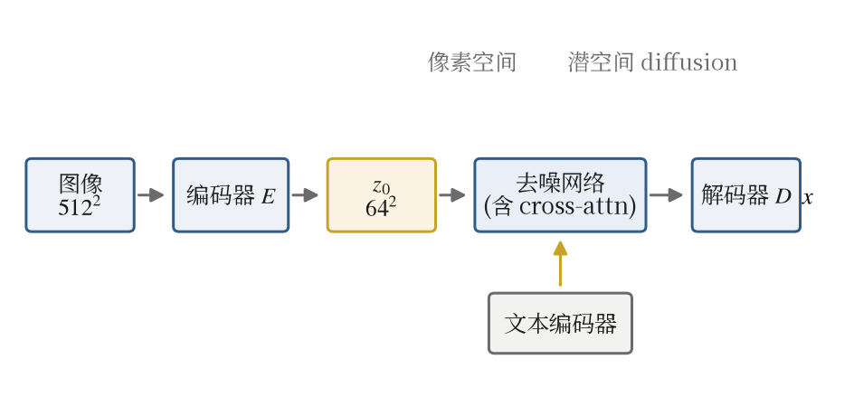

# 潜空间扩散与文本到图像

一张 512×512 的图有 26 万个像素。在像素空间上做扩散，每一步的 $x_t$ 都是这个尺寸，网络要处理这么大的输入，采样 50 步就是 50 次这样的计算。这个成本在 2022 年之前限制了扩散模型的分辨率。

潜空间扩散的想法很直接：先用一个自编码器把图压到小得多的潜空间，在潜空间里做扩散，采样完再解码回来。

## 计算量的现实

自注意力的计算量随 token 数平方增长。在 $512^2 = 262144$ 个 token 上做全局注意力，开销无法承受。即使只用卷积，高分辨率下每层都要处理 26 万个位置，显存和算力都不够。

把图压到 $64\times 64$，下采样 8 倍，token 数变成 4096，计算量降到六十四分之一。这就是潜空间扩散的核心收益。

## 用什么样的自编码器

不是任何自编码器都行。只用均方误差训练的自编码器，重建结果会偏模糊。第 4 章解释过原因，像素空间的均方误差最优解是条件均值。

潜空间扩散的 VAE 加了两项损失：感知损失，用预训练网络的特征距离；对抗损失，用一个小判别器。前者让重建在感知上更像，后者补高频细节。同时用 KL 正则约束潜空间，使其接近标准正态，避免方差过大。

下采样因子 $f$ 是一个超参数。$f=8$ 是常用的折中，$f$ 太大，细节丢失严重，扩散模型再强也补不回来；$f$ 太小，计算量降不下来。

## 潜空间里的扩散

编码得到 $z_0 = E(x)$ 之后，扩散过程与前面的章节完全一样，只是把 $x$ 换成 $z$。采样得到 $z_0$ 后，用 $D(z_0)$ 解码成图。

需要注意的是，潜空间的尺度与像素空间不同，噪声日程要针对潜空间重新设定。实践中常常对 $z$ 做一个缩放，使其标准差为 1，这样可以沿用为像素空间设计的日程。

## 文本如何进入

文本先经过一个编码器，比如 CLIP 的文本塔或者 T5，得到一串 token 向量 $\tau\in\mathbb{R}^{L\times d}$。然后在 U-Net 的每一层插入 cross-attention

$$Q = W_Q z,\qquad K = W_K\tau,\qquad V = W_V\tau,\qquad \mathrm{Attn}(Q,K,V) = \mathrm{softmax}\!\left(\frac{QK^\top}{\sqrt d}\right)V.$$

查询来自图像特征，键和值来自文本。注意力矩阵 $QK^\top$ 的每一行对应一个图像位置，每一列对应一个文本 token，它的数值表示这个位置有多关注这个词。

这个矩阵有空间含义。说猫的时候，注意力会集中在猫所在的位置。编辑方法 Prompt-to-Prompt 正是利用这一点。

## 文本编码器的局限

文本只提供语义方向，不提供精确的空间布局。左边一只猫、右边一只狗这样的描述，模型经常弄错左右。原因是文本编码器把句子压成一串 token 向量，空间关系只以很弱的方式保留。

这也解释了后来为什么要引入布局条件，比如框、分割图、深度图。文本本身不足以控制空间。

## 分辨率与长宽比

训练时把所有图缩放到同一分辨率会破坏构图。常用的做法是 bucketing，把图按长宽比分成若干桶，比如 512×512、448×640、640×448，每个桶内分辨率相同，训练时按桶采样。这样既保持了分辨率，又不扭曲构图。

## 从 SD 到 DiT

Stable Diffusion 1.x 用 U-Net 加 cross-attention，参数量约 860M。SDXL 换成两个文本编码器、更大的 U-Net、更高的分辨率。SD3 与 Flux 换成了 Transformer，把图像 patch 与文本 token 放进同一个注意力里，去掉了 U-Net 的下采样结构。

架构变化的动机是 scaling。Transformer 在参数量增加时表现更可预测，而 U-Net 的归纳偏置，局部性、多尺度，在超大规模下反而成了限制。

## 实践参数

CFG scale 通常取 5 到 9。太低，提示词不起作用；太高，画面过饱和、细节崩坏。

步数取 20 到 30，配合 DPM-Solver 一类的高阶求解器。步数更多收益很小。

负向提示里写模糊、低质量、多余的手指这类词，本质是修改无条件分支的条件，把样本推离这些特征。

seed 决定初始噪声。同一个 seed 下改 prompt，画面结构会很相似。这一点是许多编辑方法的基础，既然改 prompt 只改动一部分，就可以用改 prompt 再采样的方式来做编辑。

到这里，图像生成的主线走完了：从噪声出发，一步一步走到数据。下一章转向视频——把同一套模型搬到帧序列上，会多出哪些问题，又该怎么处理。
