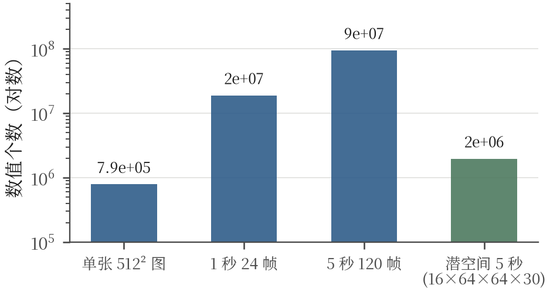
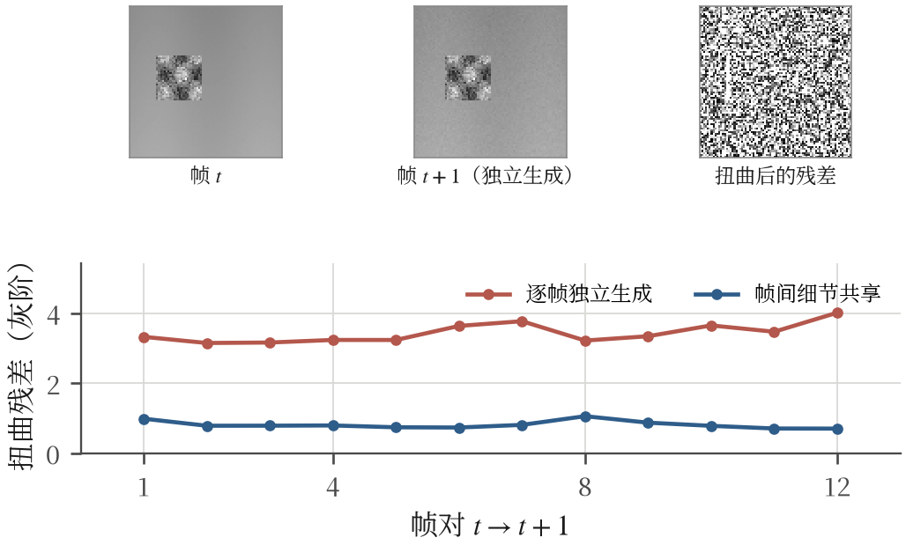
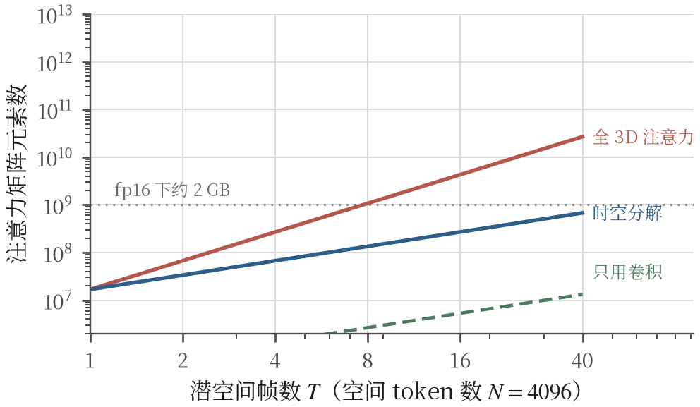

# 视频为什么难

图像模型成熟之后，最自然的下一步是视频：把一张图变成一串图。这一步看似只是多了一个时间维，实际难度高了不止一个量级。这一章说明难在哪里，后面四章再讲各条路线怎么应对。

## 先把数字算清楚

第 2 章已经说过，视频是一个四维张量，$T$ 是帧数。这里把账算细一点。

以 512×512、24 帧每秒、5 秒为例，$T=120$，张量里有 $120\times3\times512\times512$ 个数，约九千四百万。同样分辨率的单张图只有七十八万。

这个数字带来三个直接后果：存储与读取的成本、训练时显存的开销、以及采样时每一步的计算量。后面所有的工程技巧，大多是在和这个数字较劲。

### 存储那一头

一帧 512² 的图存成 JPEG，在常见质量下是六七十 KB，五秒一百二十帧就是七八 MB；换成 PNG 无损，一帧三百 KB 上下，五秒就是三四十 MB。看着不算大，但训练集是十几万段量级的，按五秒一段算，压缩后的总字节落在几十 TB。读取的时候还要解码回张量，一段 $120\times3\times512^2$ 的 uint8 就是 94 MB，小一万段就有近 1 TB，全靠数据管道每秒吐几十段出来。IO 常常是第一个卡住的地方，比显卡先到顶。

### token 那一头

如果 3D 自编码器在空间上压 8 倍、时间上压 4 倍，120 帧变成 30 帧潜变量，每帧 $64^2=4096$ 个位置，合起来就是 $30\times4096=122880$ 个 token。单张图是 4096 个，相差三十倍。这个倍数一进注意力就变成平方：$122880^2\approx1.5\times10^{10}$ 个元素。

### 显存那一头

一份潜变量本身并不大：$30\times16\times64^2=2.0\times10^{6}$ 个元素，fp16 是 4 MB。占显存的不是它，而是三样别的东西：每层反传要留的中间激活、注意力矩阵、以及参数与优化器状态。

算一笔 1B 参数模型的训练账。混合精度下要放：fp16 权重 2 GB、fp32 主权重 4 GB、Adam 的一阶二阶动量 8 GB，合起来 14 GB。一张 24 GB 的卡只剩 10 GB 留给激活与临时缓冲。而激活随 token 数线性长：一层宽度 1024、长度 122880，单个张量 $122880\times1024\times2\approx2.5\times10^{8}$ 字节，250 MB；三十层都留着就是 7.5 GB。这就是为什么视频训练普遍一个 batch 只放一段，还得开梯度检查点。

### 计算那一头

前传的浮点运算大约 $2PN$（$P$ 是参数量，$N$ 是 token 数）。1B 参数、122880 token，就是 $2.4\times10^{14}$。取 $10^{14}$ FLOP/s 的有效吞吐，一步两秒多，三十步就要一分多钟。实际模型把大部分层放在更低的分辨率上，真实值比 $2PN$ 小，但量级是对的：一段五秒视频的采样成本是几十秒。同样这 1B 参数放到单张图上，token 数 4096，前传只有 $8\times10^{12}$，差了三十倍。视频贵不是因为模型大，是因为 token 多。

四种成本里，只有存储可以靠预处理与并行读取解决，其余三种都直接压在模型设计上。这是视频模型比图像模型贵得多的根本原因。

## 三个新问题

**时间一致性。** 逐帧独立生成，画面会闪烁：同一块背景在两帧里颜色略有差别，物体的边缘在抖动。人眼对这种事极其敏感，哪怕差异很小，也会觉得“假”。

要一致，模型必须在帧之间交换信息。交换得越多，一致性越好，计算量也越大。这是视频生成里最基本的一对矛盾。

**运动。** 文本说“一个人走过来”，模型要同时决定：人往哪个方向走、走多快、镜头跟不跟。图像模型只需要决定“画面里有什么”，视频模型还要决定“事情怎么发生”。

运动还带来一个新的失败模式：物体在运动过程中变形、消失、或者分裂成两个。这类错误在单帧上看不出来，连续看就非常明显。

**长度。** 短视频可以一次生成，长视频不行：显存放不下，模型也没见过那么长的序列。于是要分块、要自回归、要用某种方式把前一块的信息传给下一块。传得不好，就会出现“越到后面越漂”。

三件事并不是各自独立的。长度一长，一致性问题就放大：每一帧都要和前一百帧保持一致，误差有更多机会累积。运动一快，一致性更难：需要作对齐的区域大，遮挡多，帧间差异大。所以后面所有的结构设计，本质上都在回答“把帧间交换放在哪里、花多少算力”这一个问题。

## 时间一致性到底是什么

“闪烁”是个描述，不是个指标。要判断一个模型好不好、好多少，得把它变成可算的数。常用的有三个：帧差、光流扭曲误差、时序频谱。

### 帧差

最直接的一个，相邻两帧逐像素相减取绝对值的平均：

$$
D_t=\frac{1}{3HW}\sum_{c,i,j}\left|I_{t+1}(c,i,j)-I_t(c,i,j)\right|.
$$

静止机位拍静止场景，它接近 0；一旦有运动，这个数主要来自运动本身。所以它衡量的是“变化量”，不是“不一致”。它的用处在于筛选：把画面里完全没有东西通过的背景区域拿出来，看那里的帧差，就能直接看出闪烁，因为按理说那里应该是不变的。采访、风景、产品展示这类素材上，这个指标很好用。

### 光流扭曲误差

闪烁的本质是“同一个物理点在两帧里长得不一样”。要把它单独拿出来，先得把运动抵消掉。做法是估一个光流场 $F_{t\to t+1}$，把上一帧按光流扭到下一帧的坐标上，再相减：

$$
E_t=\frac{1}{|\Omega_t|}\sum_{(i,j)\in\Omega_t}\left|I_{t+1}(i,j)-\mathcal{W}\big(I_t,F_{t\to t+1}\big)(i,j)\right|.
$$

$\mathcal{W}$ 是双线性采样，$\Omega_t$ 是有效像素集，要排除流出画面、被遮挡、以及光流估不准的位置。运动被抵消之后，剩下的只有“长得不一样”的部分：背景亮度跳动、纹理重采样漂移、物体形状变化，都会落进残差。这正是想要的那个量。

这个指标有两个坑。光流估不准时残差被高估，所以要用双向一致性检查（正着扭一遍、反着扭一遍，对不上的像素丢掉）把不可靠区域筛掉。另一个坑相反：生成视频如果整体模糊，光流反而容易估准，残差可以很低，指标好看而画面糊。所以它必须和质量指标一起看，不能单独作结论。

门槛在哪个量级，可以算一下。8 位图像上，一个灰阶的差是 $1/255\approx0.4\%$。平坦背景上人眼能察觉的亮度对比大概在百分之一量级（Weber 阈值），折算成灰阶是两三个。所以几个灰阶的抖动就已经越过可见阈值了，而运动本身带来的残差通常是十几到几十。指标之所以要有一定分辨率，就是这个原因。

### 时序频谱

把每个像素的亮度看成一条时间序列，做一次傅里叶变换，真实的运动能量集中在低频，闪烁则集中在帧率一半附近的高频（Nyquist 频率）。看高频段的能量占总能量的比例，就能把闪烁和运动分开。这个方法不需要光流，代价是要求一段足够长的稳定镜头，而且它不看空间位置，定位不到哪里在闪。

### 合成序列的读数

用一个合成序列把这几件事看实。画面里一个带纹理的方块每帧右移 2 像素，序列有两版：一版帧间共享细节，每帧只加 0.15% 的传感器噪声；另一版逐帧独立加噪，噪声幅度 1%。用已知的位移做补偿（相当于光流完全准确），逐帧算残差。结果在图上：共享细节的一直在 1 个灰阶以下，逐帧独立的那一版稳定在 3 到 4 个灰阶。位移补对了，噪声也补不掉——因为它根本不是运动。

这个算例同时说明一件事：一致性不是一个“有没有”的问题，而是一个幅度问题。几百个像素里差两三个灰阶，单看某一帧完全正常，连起来就跳。所以逐帧独立的采样方式即使每帧都“对”，合起来也不成立，必须让帧之间共享信息。

### 独立采样的一致性下限

逐帧独立采样为什么会闪，可以算出一个下界。把每个像素看成从同一个条件分布里抽两次，若分布近似高斯 $\mathcal{N}(\mu,\sigma^2)$，两帧之差 $d=x_1-x_2$ 服从 $\mathcal{N}(0,2\sigma^2)$，于是帧差（也是扭曲残差，因为两者本来就没有可补偿的共同成分）的期望是

$$
\mathbb{E}|d|=\sqrt{\frac{2}{\pi}}\cdot\sqrt{2}\sigma=\frac{2\sigma}{\sqrt{\pi}}\approx1.13\,\sigma.
$$

$\sigma=3$ 个灰阶，差就是 3.4 个灰阶，已经越过前面算的可见阈值。$\sigma$ 不是常数，它等于模型在该位置的“拿不准程度”：平坦的天空拿不准度低，闪烁就轻；密集的窗格、草叶、毛发、边缘拿不准度高，闪得就重。这解释了一个经验现象：闪烁不是均匀分布的，它总集中在细节上。

这个式子也说明，降低闪烁最直接的办法不是“把每帧画得更好”，而是削减帧与帧之间的独立性：共享初始噪声、用前一帧做条件、或者让帧之间直接交换特征。三种做法的代价依次递增，效果也依次递增。

### 一致性的退化解

上面几个指标都有一个共同的退化解：画面完全不变。把时间层加重到极端，模型会输出一张图重复 $T$ 次，扭曲残差为 0，帧差为 0，而观感最差。所以一致性必须和运动量成对地看：评测里常用帧差或平均光流幅度作为“动了多少”的量，两个数并列报告。只看一致性，一个静止的视频就能拿满分；只看运动，噪声也能拿高分。两个指标一夹，退化解就无处可藏。

这条也适用于调参。时间层权重调大，一致性上升、运动幅度下降，两边同时变好才叫改进，一边好一边坏往往只是换了个平衡点。

## 运动

“运动”这个词里面装着好几件不同的事，它们的难点和失败样子都不一样：

| 运动类型 | 难在哪里 | 典型失败 |
| --- | --- | --- |
| 刚体平移与旋转 | 需要跨帧一致地重采样纹理 | 纹理游动，物体像在“抖” |
| 非刚体形变 | 关节与拓扑自由度大 | 肢体粘连、多出一只手、四肢消失 |
| 相机运动 | 全局运动与物体运动要分开 | 背景绕着物体转，透视崩坏 |
| 遮挡与新暴露区域 | 新区域没有任何历史信息 | 边缘被拉扯，物体穿过遮挡物 |
| 多物体交互 | 需要隐式的物理与因果 | 相互穿透、凭空消失 |
| 高频细运动 | 帧间变化大且不连续 | 水面“凝固”、火焰闪烁集中处 |

### 潜空间里的运动幅度

把位移换成潜空间的单位，很多现象突然能解释了。24 帧每秒、物体一秒横穿 512 像素的画面，每帧要移动 $512/24\approx21$ 像素，在 $1/8$ 的潜空间里是 2.7 个格子；这在模型的输出范围之内，跟得上。如果物体每帧只动 0.2 像素，潜空间里就是 0.025 个格子，四十帧才走过一格。模型看到的是“没动”，直到某一帧突然跳一格。慢速运动之所以要么冻结、要么一顿一顿，根源在这里。

同理，快速运动在潜空间里是每帧好几个格子，网络要在很短的序列里表达大位移，容易出现“滑移”：物体位置对了，但表面纹理每帧重新洗牌一次。

### 遮挡是最难的一类

画面上每出现一块新区域（人走过去之后露出的背景，转动的物体露出的侧面），都没有历史像素可以参照，只能靠先验去补。补得不对，就有了“边缘拉扯”与“穿模”：手从身体前面经过，边缘被拉成一丝；杯子落下，从桌面中间穿过去。

潜空间的空间粒度是 8 像素，遮挡边界在潜变量里被量化到格子，边界两侧的潜变量天然混杂。所以基于潜变量的视频生成，物体边缘的误差普遍比内部大，这不是训练不足，而是表示粒度决定的。

### 相机运动

全局运动与物体运动耦合的时候，模型可能学到“画面在变”这个笼统的规律，而没学到“相机在动，物体没动”。结果就是背景绕物体旋转、或者物体不动而世界在滑。这类错误看着不像闪烁，更像眩晕。检查办法很直接：把背景区域的光流和前景区域的光流分别求平均，两者方向一致时才是相机运动。

变焦更麻烦。放大意味着纹理要被拉伸，模型得知道“同一块纹理放大后应该是什么样”，而不只是“换个位置”。缩小时新像素从哪来，同样没有答案。

### 高频细运动

水面、火焰、烟雾、发丝、树叶属于另一类：每个像素都在变，但变化不连续、不可追踪，光流在那个区域本来就估不准。模型的两种倾向都不对。它要么把这些细节冻住，于是水像镜面、火像剪纸；要么每帧重新掷骰子，于是整片区域满频闪烁。

这类错误在扭曲残差图里最显眼：其他区域残差是 1 到 2 个灰阶，这几块区域能到十几个。做评测时把残差图按区域统计分位数，比看全图均值有用得多，因为比例很小的区域会把均值拉平。

### 一个检查习惯

拿四帧排成一列横着看，比逐帧顺序看更容易发现问题：物体在三帧里的轮廓是不是同一个，高光在四帧里是不是同一个位置，背景里的直线有没有变斜。顺序看的时候大脑会自动补全运动，横向对比时补不上了。

## 长度与显存

长度卡在三处：模型见过的最大长度、显存、以及注意力的平方。前两个是硬约束，第三个是软约束——可以用时空分解绕开。

先把 token 数列出来。空间压缩 8 倍、时间压缩 4 倍，空间 token 数 $N=4096$：

| 时长 | 帧数 | 潜空间帧数 | 总 token 数 | 全 3D 注意力元素数 |
| --- | --- | --- | --- | --- |
| 1 秒 | 24 | 7 | 2.9 万 | $8\times10^{8}$ |
| 3 秒 | 72 | 19 | 7.8 万 | $6\times10^{9}$ |
| 5 秒 | 120 | 31 | 12.7 万 | $1.6\times10^{10}$ |
| 10 秒 | 240 | 61 | 25 万 | $6.3\times10^{10}$ |
| 30 秒 | 720 | 181 | 74 万 | $5.5\times10^{11}$ |

最后一列是“把所有帧与所有位置放进同一个注意力”的元素数。以 fp16 下 2 GB（约 $10^9$ 个元素）为门槛，1 秒就已经越线，5 秒超出一个数量级。全 3D 注意力在视频上从一开始就不成立，这才是视频模型必须改结构的根本原因，比参数多、显存大都要紧。

时空分解的算法是：每帧内部做一次空间注意力（$N^2$ 个元素，共 $T$ 帧），每个空间位置沿时间做一次注意力（$T^2$ 个元素，共 $N$ 处），合起来是 $N^2T+NT^2$。在 5 秒、$N=4096$、$T=31$ 上，前者是 $5.2\times10^{8}$，后者只有 $3.9\times10^{6}$，由空间那一项主导。这已经落在可行区间，代价是两种注意力各自看不到另一种方向上的全局关系。

显存那边还有一条独立的天花板。前面算过，1B 参数、5 秒 512² 的配置下，参数与优化器占 14 GB，激活 7.5 GB 量级，24 GB 的卡只够 batch 1。想过 720p 或者更长的时长，要么开梯度检查点（重算激活，时间多出三成左右），要么把空间切块（切块处要补上下文，否则拼缝处闪烁），要么把序列切段做自回归。

这三条路都只解决“放不放得下”，不解决“模型见过没”。训练数据里的视频片段通常只有几秒，原因是采集与标注的成本，也因为再长就放不下。推理时想生成三十秒，模型面对的是它从没见过的长度，漂移从第一块之后就开始了。

长度的另一面是时间分辨率。潜空间在时间上压了四倍，意味着一个潜帧对应四帧像素，一段三十秒的视频只有 181 个潜帧。模型能表达的运动速度上限由这个数字定，所以想要更快的动作，就得减少时间压缩，token 数随之上涨。省下来的一直是同一笔钱。

## 与图像方法的关系

视频模型不是从零发明的。主流的做法都是先在图像上训练，再想办法把时间维加进去。

先在图像上训，不只是因为图像数据多。两边的参数空间大部分重叠，图像训练把“长什么样”学完，视频阶段只需要学“怎么变”，要的数据少一个量级。另一个好处是时间层可以在冻结空间层的情况下单独训，可训练参数从十亿降到几亿，显存与数据需求跟着降。

加法的位置有几种：在网络里加时间层，在数据上加帧维，在潜空间里加时间压缩，或者干脆把多帧拼成一张大图当成图像处理。

这四种加法换的东西不一样。加时间层的参数最省，算力增加有限，代价是时间层只看相邻帧，长程一致性靠层层传递，传着传着就淡了。时空联合注意力的一致性最强，代价是 $(NT)^2$ 的复杂度，超过几秒就不可行。在潜空间里压时间直接砍 token 数，最划算，代价是时间压缩倍数就是运动粒度的上限，压得越狠，快动作越糊。把多帧拼成一张大图实现最简单，等价于把时间当成空间的另一维，但尺寸上限很快撞到显存，而且帧间一致性要模型自己去发现。

这几条路对应后面四章：第 13 章讲时空 U-Net，第 14 章讲时间层，第 15 章讲 3D VAE 与潜空间视频扩散，第 16 章讲规模化与长视频。

## 怎么评

图像的 FID 比较的是单帧分布。视频还要看帧间的一致性，于是有了 FVD 一类的指标：把视频送进一个预训练的视频特征网络，比较特征分布。

流程拆开是五步。准备两组视频，生成的 $N$ 段、真实的 $N$ 段，分辨率、帧数、帧率必须一致；把每段送进 I3D，一个在 Kinetics 上预训练的三维卷积网络，它的卷积核跨帧，所以特征里已经含了运动；取全局池化后的特征（I3D 是 1024 维），沿时间平均，得到每段视频一个向量；两组向量各拟合一个高斯 $\mathcal{N}(\mu,\Sigma)$；最后算两个高斯之间的距离：

$$
\mathrm{FVD}=\|\mu_r-\mu_g\|^2+\mathrm{Tr}\left(\Sigma_r+\Sigma_g-2\left(\Sigma_r\Sigma_g\right)^{1/2}\right).
$$

第一项比均值，第二项比散布。两项都小时，两组特征在整体位置与展宽上都像。

它对运动确实敏感，因为特征网络看的是帧序列而不是单帧。但它也是二阶统计，只看均值与协方差，对“少数样本特别差”几乎无感：一百段里两段穿模，对均值的拉动可以忽略。

估计噪声也不能忽视。$d=1024$ 的高斯，协方差有 $1024\times1025/2\approx5.2\times10^5$ 个自由参数，$N=2048$ 个样本只提供 $2.1\times10^6$ 个数，勉强够拟合，特征值估计的噪声仍然很大。同一个模型两次独立采样，FVD 差出几十是常见的（量级估计），所以两个模型差个十几二十，通常不能算有差别。

盲区可以列成一串。跨设置不可比：分辨率、帧数、帧率、真实视频的选取，任何一项不同，数值就不能横向比，跨论文比 FVD 往往没有意义。特征网络是在人类日常视频上训的，动画、游戏渲染、显微与医学视频属于分布外，特征未必抓住关键。文本对齐完全不看：一段与提示词无关但画质好、运动自然的视频，FVD 可以很好看。画质与一致性糅在同一个数里，出了问题无法归因。

指标之外，人眼看的还有几件事：运动是否自然、物体是否保持同一身份、物理是否说得通（杯子掉下去会不会穿桌）、文本描述的动作是否真的发生了。

文本对齐有自己的一套近似指标。把视频抽几帧，用 CLIP 一类模型算图与文本的相似度，取平均或取最小，得到一个“题目与画面的契合度”。它能抓住“说的是狗却画了猫”这种错，但抓不住“静止的一只猫”与“走过的一只猫”的区别——文本里的动词在静态帧上表现不出来。要补这个缺口，得拿视频特征而不是图像特征去对文本，或者先把动作从文本里抽出来再比对，两样都不够成熟。

这几件事目前都没有可靠的自动指标，所以论文里通常给一堆样张，让人自己看。看的时候把问题问具体一点会比总体打分有用：同一个物体的斑纹在前后帧是否一致、边缘有没有呼吸、动作的起止点对不对。不同模型在不同维度上的强弱不一样，一个笼统的“哪个更好”经常问不出东西。

## 一个判断

如果一段视频单帧看都很好，连起来却觉得假，问题在时间一致性，不在画质。

如果单帧就有问题，先按图像模型的办法解决；视频部分的技巧帮不上忙。

这个判断能省下很多时间：视频的很多“质量问题”其实是图像问题，只是被时间维放大了。

把它变成一个可以照着走的顺序。先抽第 1、8、16、24 帧，按看单张图的标准逐张看，糊、脏、结构错都是图像问题。单帧过关之后看运动：物体在四帧里还是同一个东西吗，边缘有没有呼吸，背景有没有自己滑。最后算一遍扭曲残差曲线：残差在细节区域高而在平坦区域低，是闪烁；残差整体随时间上升，是条件衰减；残差不高但画面仍然不对，是运动或物理的问题，指标看不见那一层。

三种归因对应三种改法。闪烁改帧间交互：加时间层、共享初始噪声、做联合注意力。漂移改条件传递：用关键帧锚定、让分块之间重叠。运动错改运动先验：给轨迹、给相机参数、或者直接用光流做中间监督。改错了方向会很徒劳，给一段闪烁的视频加运动条件，它还是闪。
