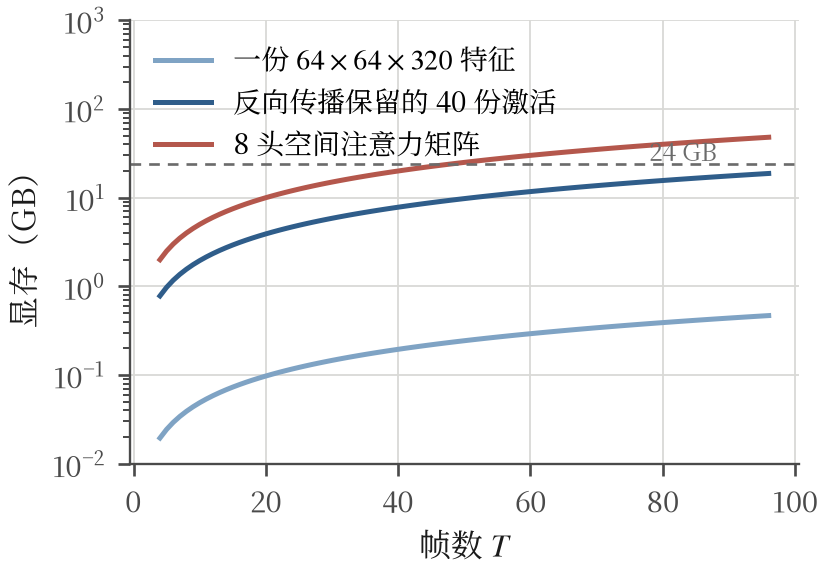
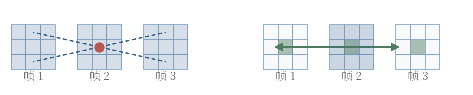
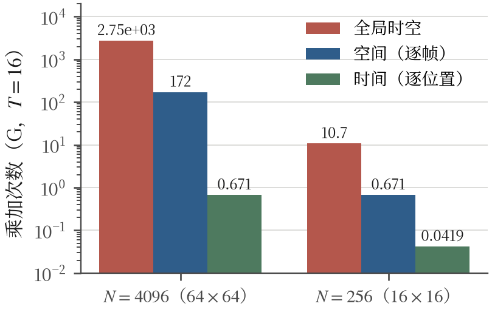

# 时空 U-Net：把图像模型抬到 3D

最早的一批视频扩散模型，思路很直接：把图像的二维 U-Net 换成三维，让卷积和注意力同时覆盖空间与时间。

这条路线在 2022 年成型，三个工作几乎同时出现：Video Diffusion Models、Make-A-Video、Imagen Video。它们的共同点是“把时间当成第三个空间维”。

先看清楚不做这件事会得到什么。拿一个训练好的文生图模型，为每一帧独立采样：提示词相同，初始噪声的分布相同，各帧的构图确实接近，细节却各说各话——叶子的朝向、墙上的纹理、人物眼角的褶皱，每一帧都在换。把这些帧连起来放，得到的是沸腾一样的抖动，也就是闪烁。

闪烁的难受程度和数值指标不成比例。相邻两帧的峰值信噪比可能很高，因为整体结构确实一致，跳动的只是细节；而人眼对细节的时间跳变极为敏感，一两像素的抖动就足以让人看出“这是拼出来的”。反过来，两段完全不同的纹理只要各自稳定，看着并不难受。所以时间一致性要求的不是“每帧都对”，而是“帧与帧之间的变化要合理”。

三维 U-Net 的回答最直接：既然问题出在“每一帧看不见别的帧”，那就把帧变成另一个空间轴，让卷积核、注意力、池化全部升维。这样“帧与帧之间怎么变”就和“像素与像素之间怎么变”成了同一类问题，不需要额外发明机制，只需要把已有的部件搬过去。

搬过去之后要算三笔账：参数、算力、显存。这三笔账在后面会反复出现，算完会发现一个不对称：时间维和空间维的地位并不相等。空间维上有平移等变和局部性这两个强先验，所以三乘三的小核已经够用；时间维上的运动是长程的、依赖内容的，小的时间核看不到因果，全局的时间注意力又付不起。三维 U-Net 里那些看起来零碎的设计——哪一层放注意力、哪一层用因子化卷积、帧数取多少——本质上都是在“哪里用卷积、哪里用注意力”之间做预算分配。

## 三维卷积与时空注意力

图像 U-Net 里的卷积核是 $3\times3$，在视频里换成 $3\times3\times3$：既看相邻像素，也看相邻帧。

### 三维核的参数与计算量

一层卷积的参数量只取决于通道数和核的体积。二维 $K\times K$ 核有 $C_{\text{in}}C_{\text{out}}K^2$ 个权重加 $C_{\text{out}}$ 个偏置，三维 $K\times K\times K$ 核是 $C_{\text{in}}C_{\text{out}}K^3$ 个。两者之比

$$\frac{C_{\text{in}}C_{\text{out}}K^3+C_{\text{out}}}{C_{\text{in}}C_{\text{out}}K^2+C_{\text{out}}},$$

在通道数不太小的时候非常接近 $K$，也就是三倍。

代一组数进去。取 $C_{\text{in}}=C_{\text{out}}=320$：二维核是 $320\times320\times9=921\,600$ 个权重，三维核是 $320\times320\times27=2\,764\,800$ 个，一层多出 184 万个参数。

这个增量放在整个网络里看并不吓人。一个八亿参数级别的图像 U-Net，把其中二十来层 $3\times3$ 换成 $3\times3\times3$，多出来的是三千万量级，占总数的百分之几。所以“参数量”不是这条路线的瓶颈。

涨得厉害的是另外两项。计算量按乘加次数算：二维卷积在 $T$ 帧上各做一次，需要 $9C_{\text{in}}C_{\text{out}}THW$ 次乘加；三维卷积一次覆盖三帧，需要 $27C_{\text{in}}C_{\text{out}}THW$ 次，正好三倍。这一项和参数量同比例，也不算灾难。

真正致命的是激活显存。三维卷积的输出有 $T$ 帧，训练时要保留每一层的输入做反向传播，显存随 $T$ 线性增长，而图像模型里这个基数本来就不小。取 $T=16$、$H=W=64$、$C=320$，一层特征有

$$16\times64\times64\times320\approx2.1\times10^{7}$$

个数，float32 存一份是 84 MB。同一分辨率上通常堆着十几层，加上跳跃连接要留的中间结果，按四十份估就是 3.4 GB；batch 取 2，接近 7 GB。这还只是一个分辨率的账，解码器对称，再翻一倍。

图 13.1 把三项显存开销画在一起。一份特征本身随帧数线性长，四十份激活是同一条线平移两个数量级，而注意力矩阵的斜率更陡——它在 $64\times64$ 上一条就顶得上一整套卷积激活。24 GB 那道线是当时常见加速卡的上限，注意力矩阵在四十多帧时就单独撞上去，而四十份卷积激活要到一百帧以后才追上。

所以早期视频模型把分辨率压在 $64\times64$ 甚至更低，不是审美选择，是显存算出来的结果。至于为什么是十几帧而不是上百帧，答案在注意力那一项上。

### 因子化的三维核

三维核的参数和算力都是二维的三倍，一个直接的想法是把它拆成两步：先做空间卷积 $1\times3\times3$，再做时间卷积 $3\times1\times1$。这叫因子化卷积，也叫伪三维卷积。

算一下参数量。空间部分 $9C_{\text{in}}C_{\text{out}}$；时间部分取中间通道等于输出通道，是 $3C_{\text{out}}^2$。假定输入输出通道都是 $C$，合计 $12C^2$，而完整的三维核是 $27C^2$，少了六成，算力按同比例下降。

更值钱的好处是初始化。空间核的形状和图像模型里的一模一样，可以把预训练权重原样搬过来；时间核从零学，学的是“相邻帧同一位置怎么变”——这个量在静物上接近零，只在运动区域的边界上有内容。这个“空间拿现成的、时间新学”的分工，就是第 14 章那条路线的雏形。

代价是表达能力。$3\times3\times3$ 能表达斜着扫过的三维模式：像素往右移的同时时间往前走。因子化的两步做不出这种耦合，它只能表达“先空间、后时间”的乘积型模式。对缓慢的镜头运动，这个限制看不出来；对快速斜向运动，轨迹会被抹成台阶状。

和卷积核同样重要的还有一个设计：时间维上的下采样。空间下采样把 $H\times W$ 减半，时间下采样把 $T$ 减半，两者在 U-Net 的每个 stage 都会发生。时间下采样省下的显存很可观——$T$ 从 16 减到 4，激活省四倍——但它有一个几何后果：下采样后的一个位置代表原来两帧的内容，运动速度在这个尺度上翻了一倍。位移超过半个采样间隔就会混叠，快速运动的物体在低分辨率层上分裂成两个模糊的重影，网络看到的是“有两个物体”，而不是“一个物体在动”。所以时间下采样通常做得比空间保守，步长取 2 而不是 4，或者只在前几个 stage 做。

### 全时空注意力为什么不可行

注意力也一样。图像里的自注意力在一帧内部做，视频里可以让所有帧的所有位置互相看见，这就是时空注意力。

机制上不难：把 $T$ 帧的 $N=HW$ 个位置拼成 $NT$ 个 token，每个 token 是 $d$ 维向量，做一次标准的自注意力。计算量是 $2(NT)^2d$ 次乘加，其中 $QK^\top$ 与 $AV$ 各占 $(NT)^2d$。麻烦就出在平方项里的 $NT$。

一帧 $64\times64$ 的特征有 4096 个位置，16 帧就是 65536 个 token。注意力矩阵有 $65536^2\approx4.3\times10^9$ 个元素，float32 存下来是 17 GB——一个头，一个样本。多头注意力每个头各有一份矩阵，8 个头就是 137 GB。到这一步已经不是慢的问题，是根本放不进显存。

把分辨率压到 $32\times32$（$N=1024$），16 帧是 16384 个 token，矩阵 $2.7\times10^8$ 个元素，一个头 1 GB，8 个头 8.6 GB，还要乘 batch。仍然不现实。

算力同样顶不住。按 $d=320$ 计，$2\times4.3\times10^9\times320\approx2.7\times10^{12}$ 次乘加，只是一层。而整个图像 U-Net 一次前向大约在 $10^{11}$ 到 $10^{12}$ 量级。一层全局时空注意力就能吃掉整网几倍的预算。

### 分离注意力

实际做法是拆开：先做空间注意力，每帧内部算；再做时间注意力，同一位置跨帧算。设每帧有 $N$ 个位置、共 $T$ 帧，两步的开销分别是 $O(N^2T)$ 与 $O(T^2N)$，相比全局的 $O((NT)^2)$ 小得多。

省下的倍数可以直接算出来：

$$\frac{(NT)^2}{N^2T+T^2N}=\frac{N^2T^2}{NT(N+T)}=\frac{NT}{N+T}.$$

这个式子是 $N$ 与 $T$ 的并联，量级上接近两者中较小的那个。$N=4096$、$T=16$ 时是 $65536/4112\approx16$ 倍；$N$ 降到 256 时是 $4096/272\approx15$ 倍。只有当 $N$ 和 $T$ 势均力敌时省得最少，$N=T$ 时比值是 $N/2$。

图 13.3 按两组具体配置把三种组织的乘加次数算了一遍。$64\times64$ 的 16 帧，全局时空注意力要 $2.7\times10^3$ G 次乘加，拆成空间注意力后降到 172 G，时间注意力本身只要 0.67 G——时间注意力便宜三个数量级，因为 $T=16$ 的帧轴上一个 $16\times16$ 的矩阵实在太小。到 $16\times16$ 的特征上，全局注意力也只有 10.7 G，勉强算得动，但它仍然比“空间加时间”贵十六倍。

拆分能成立，靠的是对相关结构的一个假设：空间相关主要在帧内，时间相关主要在同一位置的时间序列上，两者的交叉项——位置 $n$ 在第 $i$ 帧与位置 $m$ 在第 $j$ 帧的相互作用——可以忽略。

这个假设在真实视频里只近似成立，而偏离的地方正是运动本身：第 $i$ 帧的车轮和第 $i+1$ 帧的车轮不在同一个位置，它们的关系是一个交叉项。分离注意力看不到这种关系，只能指望空间层自己把形状对上。所以它在快速运动、大幅度位移上会损失精度，而且这个损失是结构性的，加数据、加训练步数都补不回来。

### 时间层放在哪里

每个分辨率都放时间注意力的纯三维网络，显存撑不住。常见的折中是分级处理：高分辨率层用三维卷积或因子化卷积，只做局部的时间混合；到低分辨率层（$16\times16$ 甚至 $8\times8$）才插入时间注意力。

账在 $N^2T$ 那一项上。$16\times16$ 时 $N=256$，一张注意力图有 $256^2=65536$ 个元素，16 帧一起放是 100 万个，4 MB 量级；同样 16 帧放到 $64\times64$ 上就是 1 GB。差 256 倍，正好是位置数的平方。

这个安排在信息上也是合理的。运动是低频的：人从画面左边走到右边，这个事在 $8\times8$ 的特征图上还看得见整体走势，到 $256\times256$ 上就散成逐像素的位移，反而不再需要全局注意力去捕捉。高分辨率层要的是纹理在时间上的连续，局部的时间卷积就够；如果在那里放全局注意力，大概率是在花算力去记住每一帧的纹理细节，而不是学运动。

时间注意力还有一个容易漏掉的配件：位置编码。它本身对帧的顺序是置换不变的——把 16 帧打乱顺序输入，输出的每一帧只跟着打乱，注意力权重一模一样。要区分“向前走”和“向后走”，必须额外给出顺序信息，做法和 Transformer 里一样：一组长度等于最大帧数的向量，按帧号加到每个 token 上。缺了它，模型仍能生成有运动的视频，但方向是随机的，同一段提示词跑两次，一次向左摇，一次向右摇。

## Video Diffusion Models

这篇工作把图像扩散的 U-Net 扩成三维，用时空注意力替换部分空间注意力，并在图像与视频上联合训练。

### 联合训练怎么组织

联合训练的做法比名字听上去细。视频张量是 $T\times C\times H\times W$，图像可以看成 $T=1$ 的特例，同一个网络两种形状都能吃。要让这件事成立，时间注意力得能处理长度为 1 的帧轴：此时 softmax 只有一个元素，权重为 1，输出退化成对当前帧做一次线性变换，没有跳帧混合。实现上不需要特殊分支，形状对得上就行。

训练时按一定比例混合两类样本。比例是超参，公开工作里没有统一数字，量级上让图像占到相当份额（三到五成是个常见的估计值）。混得好有明确的好处：图像的样本量比视频大两三个数量级，覆盖的物体、场景、视角远非视频数据能比，模型的外观与文本对齐能力基本来自这一部分；视频则提供运动。

混得不好也有明确的坏处。图像数据是“精选出来的好照片”，视频帧则常常带运动模糊、压缩块、曝光跳变。两类样本的干净程度不同，混在一起训练，模型学到的是一个折中的外观：单帧看比纯视频训练的清晰，比纯图像训练的糊。这是一个真实存在的权衡，不是实现瑕疵。

还有一个副作用需要留意。图像样本上时间维度没有信息，时间层的梯度在这些样本上接近于零，于是时间层实际上只在视频样本上被更新。如果视频样本在 batch 里占比太小，时间层收敛会很慢；这也是实践中混合比例不能一边倒的原因。

### 条件帧预测与重建引导

这篇工作还展示了两件事：无条件视频生成，以及“给定前几帧，预测后续帧”的视频预测。后者说明模型确实学到了运动，而不只是记住了几段视频。

条件帧预测值得把式子写出来，因为它用到一个后面反复出现的手法。设已知前 $k$ 帧 $x^{0}_{1:k}$，想从条件分布 $p(x_t\mid x^{0}_{1:k})$ 采样。用贝叶斯公式拆开：

$$p(x_t\mid x^{0})\propto p(x_t)\,q(x^{0}\mid x_t).$$

第一项是模型本身给的先验，第二项是“给定当前噪声状态，已知帧有多大概率是那些值”。麻烦在后一项：扩散模型学的是 $q(x_t\mid x^0)$，方向是反的。

但方向反过来以后，形式是现成的。前向过程给出 $q(x_t\mid x^0)=\mathcal{N}(\sqrt{\bar\alpha_t}x^0,(1-\bar\alpha_t)I)$。把它当作 $x^0$ 的函数看，均值是 $x^0$ 的线性函数，于是同一对变量在反方向上也近似是高斯，中心在模型预测的 $\hat x_0(x_t)$，方差由两条式子比对得出：

$$x_t=\sqrt{\bar\alpha_t}x^0+\sqrt{1-\bar\alpha_t}\,\epsilon\ \Longrightarrow\ x^0=\frac{x_t-\sqrt{1-\bar\alpha_t}\,\epsilon}{\sqrt{\bar\alpha_t}},$$

误差 $\epsilon$ 的系数被放大成 $\sqrt{1-\bar\alpha_t}/\sqrt{\bar\alpha_t}$，所以

$$q(x^0\mid x_t)\approx\mathcal{N}\Big(\hat x_0(x_t),\ \sigma_t^2 I\Big),\qquad \sigma_t^2=\frac{1-\bar\alpha_t}{\bar\alpha_t}.$$

取对数再对 $x_t$ 求梯度，注意链式法则会把 $x^0-\hat x_0$ 前面的负号反转一次，得到引导项

$$\nabla_{x_t}\log q(x^0\mid x_t)\approx\frac{1}{\sigma_t^2}\big(x^0-\hat x_0(x_t)\big)^{\!\top}\frac{\partial \hat x_0}{\partial x_t},$$

采样时把它按权重加到原来的 score 上，就得到“既要像视频、又要和前几帧接上”的轨迹。这就是重建引导，和分类器引导的形式相同，只是“分类器”换成了一项重建误差。

$\sigma_t^2$ 的形状解释了这套做法的脾气：$t$ 大时 $\bar\alpha_t$ 小，$\sigma_t^2$ 大，引导被自动压弱——噪声大，观测本来就不该被信；$t$ 小时 $\sigma_t^2$ 小，引导很强，最后几步会紧紧贴住已知帧。权重不用手工调度，时间表自己完成了这件事。

这套机制还顺带解决了时长问题。一次生成十几帧，然后拿末尾几帧当条件，再生成下一段，就能往外接。误差会在接缝处积累，但至少不必把整段视频塞进显存。

## Make-A-Video

它的做法不同：先有一个强大的文本到图像模型，再在它上面加时间层，用无标签的视频继续训练。

这样做的动机是数据。带文本描述的图像有几十亿张，带文本描述的视频少得多。先用图像学会“文到图”，再用视频学会“图到动”，两段式训练回避了文本视频配对稀缺的问题。

这个数量差值得具体一点。公开的图文数据集在十亿对量级，而常用的视频文本数据集是千万个片段的量级，差两个数量级。直接训视频模型的后果不是“训得慢”，而是“训不动”：八亿参数级别的模型配千万级样本，过拟合会先到来。

两段式的具体安排比“先图后视频”更细，分三步走。

第一步是时间层预热。把图像模型的空间权重全部冻住，只训新插入的时间层，数据全部是视频。这一步的目的是让时间层先学会“帧间应该怎么变”，同时不破坏空间特征。顺序反过来会很糟：时间层是随机初始化的，如果一开始就联合训练，它输出的噪声会顺着残差通路污染空间层，损失曲线先冲高再慢慢降，等价于把预训练白做了一遍。

第二步是时空联合微调。解冻空间层，用很小的学习率一起训。这一步让空间层适应“输入不再是单帧”这件事——时间注意力改变了每层的输入分布，只靠冻结的空间层处理会有系统性偏差。学习率小是为了不把预训练的外观能力冲掉。

第三步是帧率。基础模型出来的是低帧率视频，再由一个单独训练的插帧网络补中间帧。插帧网络不是扩散模型，它是一个普通的视频插值网络，训练目标是两帧之间的像素，成本远低于扩散采样。把帧率独立出来处理，是这一代工作共同的做法：分辨率和帧率是两件不同的事，混在一个模型里训会互相拖累。

空间超分与时空超分的分工也值得说一句。空间超分只处理单帧，输入输出都是 $1\times C\times h\times w$，可以直接复用图像的超分模型；时空超分处理整段，输入是低帧率，输出是高帧率，要解决的问题是“中间那一帧长什么样”，本质上是插帧。把它做成扩散模型而不是普通插值网络，好处是能生成真实的新细节，坏处是成本高、运动边界上容易出现重影。这里的选择直接体现在出片速度上：用轻量的插值网络，一次生成几秒片段只要几十秒；用扩散式的时空超分，同样的片段要几分钟。

时间层本身有两种形态，这篇工作两种都用。一种是沿帧轴的注意力，负责长程的帧间关系，比如整段视频的构图不要漂；另一种是伪三维卷积，把 $3\times3$ 换成 $1\times3\times3$ 加 $3\times1\times1$，负责局部的时间平滑。只用注意力时，高频的时间噪声还在——每帧的纹理各自微微抖动；卷积的局部平均把这种抖动压下去。两者缺一，出来的片子要么漂，要么闪。

## Imagen Video

它走的是级联路线：先用一个基础模型生成低分辨率、低帧率的视频，再用几个超分模型逐步提高分辨率与帧率。

级联的配置有讲究。常见安排是一个基础模型、三个空间超分、三个时间超分，共七个扩散模型；每一级空间超分把边长放大一倍，每一级时间超分把帧率放大一倍。级数不是固定的，取决于算力预算——每多一级，就多一个要单独训练、单独采样的模型。

级联的好处是每一级只做一件事，容易训。基础模型不需要学高频细节，它只要把构图、运动、场景摆对；超分模型不需要考虑文本对齐，它只要把给定的低分辨率视频变清晰。任务窄了，模型容量可以用在刀刃上，训练也更稳。另一个实际的好处是引导强度可以分级调：基础模型的引导决定“像不像提示词”，超分级的引导决定“清不清晰”，两者的最优值通常不一样，合在一个模型里就没法分开调。

坏处是误差会逐级放大，而且整条流水线很重。误差放大可以用一个极简的模型看清楚。设第 $i$ 级对输入的已有伪影乘上一个增益 $g_i$，本级再添一点新伪影 $e_i$，那么 $k$ 级之后残留的伪影是

$$\sum_{i=1}^{k}\Big(\prod_{j>i}g_j\Big)e_i .$$

若各级增益相同且大于 1，前级的误差权重最大，因为它在后面被乘了最多次。取 $g=1.2$、$k=3$，总放大是 $1.44\times1.2\approx1.73$；取 $g=1.5$，同样的三级就是 3.4。这是个简化的量级估计，真实增益依赖内容和伪影类型，但它说明了方向：级数越多，基础模型的质量越关键——前级的一点点脏，后面几级会一起帮你放大。

超分模型为什么会放大误差，有具体原因。它被训练成“把低分辨率的模糊解释成某种高频细节”，这个映射是确定性的、逐块的。输入里如果有结构性的伪影——棋盘格、块边界、色带——模型会照样把它解释成细节，甚至因为局部统计和训练时的模糊不一样而解释得更夸张。

缓解办法在这一代里就出现了。训练超分时给低分辨率条件加一点噪声，叫条件增强，目的是让模型见过“脏”的输入，不至于把一点点伪影当成信号。另一个办法是每一级单独调引导强度，把超分级的引导压低一点，减少过锐。这些手段能压住一部分，但压不住全部：级联的误差上界是乘法累积的，只要有一级的增益大于 1，链条就一直往上走。

代价还有推理。七个模型串起来，每一步采样都要走完全部级数，实际延迟是各级之和。为了能出片，每一级的采样步数都得压到很低，这又反过来损害质量，形成另一个权衡。

训练侧的成本也不同。七个模型要分别训，每个都带自己的条件、自己的损失权重、自己的引导设置；级联中后级的训练数据还要用前级的输出构造，前级一改，后级就得重做。这让级联路线的调优比单模型麻烦得多——实验周期是相加的，不是取最大值。

这三个工作确立了几件事：时间维要用注意力或卷积显式建模；图像预训练很有用；分辨率与帧率可以分开提升。后面所有的视频模型都建立在这些认识上。

## 这一代的局限

时长很短。受显存限制，多数工作只能生成十几到几十帧。

这个限制可以直接算。前面那笔账里，$64\times64$、$C=320$、16 帧的一份特征占 84 MB，四十份激活 3.4 GB；帧数翻到 64，同样的配置变成 13.4 GB，还没算注意力。而在 $64\times64$ 上，八头空间注意力矩阵在 16 帧时就有 8.6 GB，batch 取 2 就是 17 GB，再多几帧连一个样本都放不下。两条限制里先撞上的是注意力，所以真正的解法不是省激活，而是把注意力挪到低分辨率去，或者干脆不算全分辨率注意力——这正是后面几章要做的事。

分辨率不高。直接把三维 U-Net 推到高分辨率，计算量承受不了。

这里的困难是双重的。卷积的算力随像素数线性涨，注意力的算力随位置数平方涨，所以分辨率每翻一倍，卷积的开销乘四，注意力的开销乘十六。级联把这个问题绕开了——高分辨率只用超分模型，超分模型可以做得比生成模型轻——但它把误差放大引了进来。

运动有限。模型学到的多是缓慢的镜头运动或简单物体运动，复杂动作容易崩。

具体崩的样子有几种。人物走路时腿会在两三帧之间互换位置，因为分离注意力看不到跨位置的对应关系；快速横摇的镜头会让背景纹理被抹成拖影，因为时间卷积的核长只有三帧，跟不上位移；物体相互遮挡时，被挡住的部分不会消失也不会正确露出，而是糊成一团——遮挡需要判断“谁在前”，这是空间与时间同时参与的推理。这些都不是数据量能直接解决的问题，它们和网络结构里“空间与时间被拆开”有关。

评测在这方面帮不上太多。FVD 用三维卷积网络的特征，比较生成视频与真实视频在特征空间的分布距离；它衡量的是“特征分布像不像”，不直接检查两帧之间有没有动，所以一段几乎静止的视频也可能拿到不难看的分数，只要画面在特征空间里离真实视频不远。运动能力因此长期没有可靠的数字指标，多数早期工作的运动质量是靠人眼看片段判断的。

这些限制指向两个方向：把计算搬到潜空间（第 15 章），把架构换成更容易扩展的 Transformer（第 16 章）。

潜空间的思路是把视频先压到一个更小的张量上再做扩散，$64\times64$ 的 16 帧压成 $16\times16$ 的 4 帧之后，token 数少了六十四倍，全局注意力矩阵小四千倍，同样的显存就能放更长的片段。Transformer 的思路是把“哪里用卷积、哪里用注意力”这个手工分配换成统一的自注意力，让模型自己决定看多远。两条路都在这一代的限制上做减法，而不是在三维 U-Net 上继续加层。

## 与图像章节的对应

如果你读过前面的扩散章节，可以把这一章看成“把 $x_t$ 从 $C\times H\times W$ 换成 $T\times C\times H\times W$”，其余不变：前向加噪、噪声预测、采样，全都照旧。

这个对应不是修辞，它有实用价值。前向过程的闭式边缘 $q(x_t\mid x^0)$ 是逐元素的，与张量形状无关；噪声预测的损失是逐元素的均方误差，也与形状无关；采样器的推导只用到“噪声是高斯的、模型给的是 score”，仍然与形状无关。所以图像那边学到的每一件工具都能原样搬过来：DDIM 的确定性采样、二阶求解器、无分类器引导、零终端信噪比的参数化，一行都不用改。

变的只有网络结构：多了一个维度要处理，于是多了时空注意力的设计问题。

把这句话说得更准一点：变的是归纳偏置。图像 U-Net 里“局部性”和“平移等变”这两个先验，在时间维上只部分成立——局部性成立（相邻帧确实最相关），平移等变不成立（物体移动会被遮挡、会变形，位移不是内容无关的）。所以三维 U-Net 不能照抄二维的设计：卷积可以照抄，注意力不行，后者必须重新决定“看多远、在哪一层看”。

还有一处容易忽略的差别在归一化上。视频张量的统计量该沿哪些轴求，需要显式决定：把时间维也并进去，运动剧烈的片段与几乎静止的片段会得到差得很远的归一化尺度，同一段视频不同位置的对比度会被拉得不一致；只在每帧的 $(C,H,W)$ 上求，等于承认每帧是一张独立的图，时间一致性就完全丢给时间层。三维 U-Net 多选后者，代价是时间层要额外负责让各帧的亮度、对比度对齐，否则会出现整体的呼吸式明暗变化——画面像有人在慢慢拧亮度旋钮。
