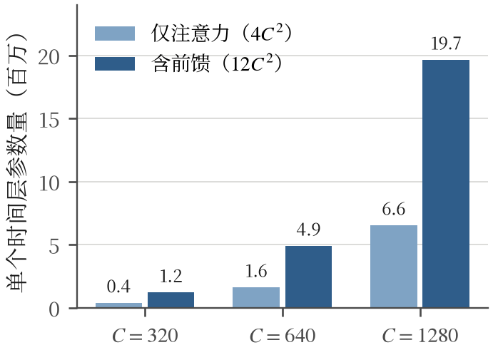
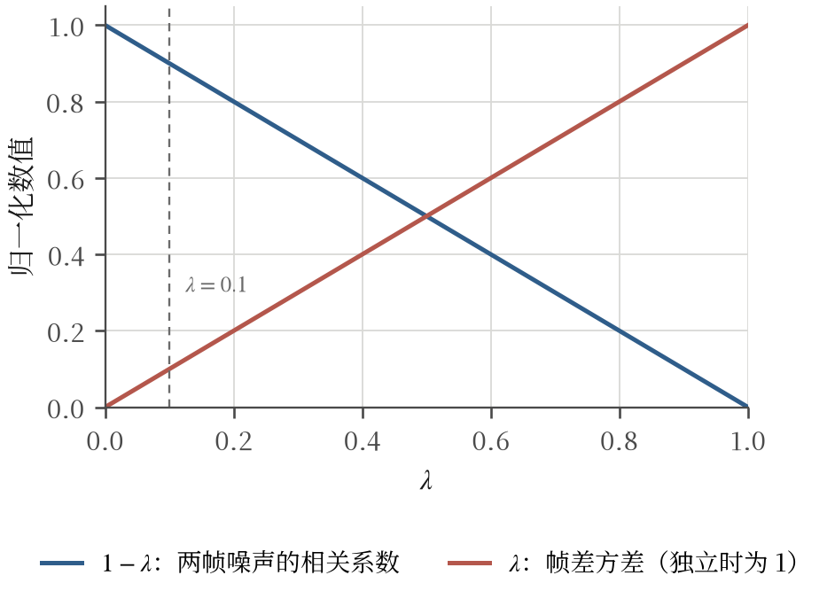

# 时间层与运动先验

三维 U-Net 要重训整个模型，代价高。另一条路是保留现成的图像模型，只在它上面加一层“管时间”的模块。

这条路在 2023 年流行起来，代表是 AnimateDiff 与 Text2Video-Zero。它们解决了同一个问题：怎样用有限的视频数据，借到强大的图像先验。

之所以要“借”，是因为两边的成本不对称。训练一个图像模型要几亿张图和上千张加速卡跑几周；训练一个视频模型，数据量少两个数量级，算力需求却更大，因为每个样本多了时间维。在这种情况下，从零训视频模型的性价比很低，而手里那张“什么图看起来像照片”的网络已经非常值钱——它知道皮肤的高光怎么落、树叶的边界怎么碎、玻璃后面应该透出什么。这些知识跟运动无关，却被埋在一个按帧独立工作的结构里。

加的这层模块要解决的只有一件事：让相邻帧的取值互相约束。约束的方式有两种思路，一种是把参数插进网络里学出来（AnimateDiff），一种是在采样时改改输入和注意力，压根不学（Text2Video-Zero）。

两条路都不约而同地选择“沿帧维做注意力”这个部件，原因在代价上：沿帧维的长度是 $T$，通常是十几到二十几，做一个 $T\times T$ 的注意力矩阵非常便宜；而沿空间维的长度是几千到上万，在那里做注意力才是贵的。时间信息便宜、空间信息昂贵，这个不对称决定了所有“轻量加时间”的设计。

## 冻结图像模型，只训时间层

AnimateDiff 的做法是：拿一个训练好的文本到图像模型，把它的权重冻住；在每一层插入一个时间注意力模块；只训练这些新加的参数。

时间注意力的计算对象是“同一空间位置在不同帧上的取值”。对特征图 $z\in\mathbb{R}^{T\times C\times H\times W}$，把 $H,W$ 展平，对每个位置取它 $T$ 个时刻的向量，做一次长度为 $T$ 的注意力。

### 时间注意力的形状

把式子写出来会更清楚这层东西到底做了什么。先把 $z$ 重排成 $z'\in\mathbb{R}^{(HW)\times T\times C}$：第 $n$ 个位置对应一条长度为 $T$、宽度为 $C$ 的时间序列。对第 $n$ 个位置，用三组投影得到

$$q_n=z'_nW_Q,\qquad k_n=z'_nW_K,\qquad v_n=z'_nW_V,\qquad q_n,k_n,v_n\in\mathbb{R}^{T\times d},$$

其中 $W_Q,W_K,W_V$ 都是 $C\times C$，单头时 $d=C$。再做一次标准的缩放点积注意力：

$$A_n=\operatorname{softmax}\!\Big(\frac{q_nk_n^\top}{\sqrt{d}}\Big)\in\mathbb{R}^{T\times T},\qquad o_n=A_nv_n .$$

$A_n$ 的第 $(i,j)$ 个元素是“第 $i$ 帧在第 $n$ 个位置上，从第 $j$ 帧的同一位置取了多少信息”。整层共有 $HW$ 个这样的矩阵，它们共享同一组投影权重。

这个结构里有两个刻意的选择。一个是“只沿帧维”：$A_n$ 只在时间上混合，不碰空间，空间混合由上一步的空间注意力负责。如果让时间层也做空间混合，它会和空间层抢活，注意力矩阵也会从 $T\times T$ 变成 $(NT)\times(NT)$。另一个是“权重共享”：所有位置用同一组 $W_Q,W_K,W_V$，参数量与 $H,W$ 无关，只有 $d$ 和 $C$ 决定它有多大。

和全局时空注意力比一下成本。全局是 $(NT)^2d$，这里是 $HWT^2d$，比值

$$\frac{(NT)^2}{HWT^2}=\frac{(HW)^2T^2}{HWT^2}=HW=N .$$

也就是说，换成时间注意力，成本便宜了“每帧位置数”那么多倍。$64\times64$ 的特征上便宜四千倍，这正是它能在每个分辨率上都插一份的原因。

还有一个小配件不能漏：时间位置编码。注意力本身对帧的顺序是置换不变的，把帧打乱输入，输出只是跟着打乱。要让它知道“第 3 帧在第 5 帧之前”，得给每条序列加上一组按帧号索引的向量，做法和 Transformer 里一样。缺了它，视频里会出现“运动方向随机”的现象。

### 参数量有多大

按一个标准的时间 transformer 块算：注意力部分有 $Q,K,V$ 和输出四个 $C\times C$ 投影，共 $4C^2$；前馈部分两层，隐层宽度取 $4C$，是 $8C^2$。合计

$$4C^2+8C^2=12C^2 .$$

代进实际通道数。图像 U-Net 的通道在四个分辨率上大约是 320、640、1280、1280，每个分辨率后插一个时间块：

$$12\times320^2\approx1.2\text{M},\quad 12\times640^2\approx4.9\text{M},\quad 12\times1280^2\approx19.7\text{M}\ (\text{两个}).$$

全部加起来约 45 M，也就是四千五百万。图 14.2 把单个块的量画了出来：通道数翻一倍，参数量翻四倍，$1280$ 那一档一个块就顶得上 $320$ 那一档的十六个。

把这个数字和整网比。图像 U-Net 本体八亿参数级别，时间层四千五百万，占 5% 上下。若插入得更密（每个空间 transformer 块后都插一个），数量乘二到四，仍在两成以内。

参数量小带来的直接好处在优化器状态上。用 Adam 训练，每个可训练参数要存四份 float32：参数本身、梯度、一阶矩、二阶矩，共 16 字节。四千五百万参数是 0.7 GB；如果解冻整网，八亿六千万参数就是 13.8 GB。差二十倍——这个差额往往就是“能不能在一张卡上训”的分界线。

### 数据需求

参数量小，数据需求也跟着小。这里的估算只能给量级：从头训一个八亿参数的图像模型，公开的做法是用十亿量级的图文对；只训四千五百万参数、且任务很窄（学帧间关系）的模块，百万到千万量级的视频片段应该够用。常用的公开视频文本数据集是千万片段的量级（WebVid-10M 这类），正好落在需要的范围里。

几万个片段是一个下限：足以让模型学会最基本的帧间一致——物体边缘不抖、纹理不跳。要覆盖多种运动类型并且稳定收敛，实际训练用的量通常要大两三个数量级，落到百万到千万区间。两件事不矛盾，一个说的是能不能看出效果，一个说的是能不能直接拿去用。

数据这边还有一个容易被忽略的成本：读视频比读图贵得多。一张图解码是一次操作，一段 16 帧的片段要解 16 次，还要做缩放、裁剪、抽帧对齐；如果数据存在机械盘上，加载会成为瓶颈，加速卡大量时间在等 I/O。实践中的做法是把片段预先解码成低分辨率的帧序列存起来，用空间换时间。

片段长度也受限制。时间注意力的长度就是训练时的 $T$，而 $T$ 由显存决定。16 帧按每秒 8 帧算只有两秒，模型学到的是两秒内的运动；更长的时间结构（比如一个人先走进画面、再坐下）它没见过。这一点在生成时表现为“越到后面越没有目的性”。

### 训练时的实际配置

冻住的不只是 U-Net。文本编码器和 VAE 通常也一起冻。理由在于它们各自的角色：文本编码器把句子翻译成一组条件向量，VAE 把像素翻译成潜变量，两者都是“翻译器”；数据量不够的时候动它们，翻译会跑偏，而且跑偏之后很难察觉——损失看起来正常，输出的语义却漂了。要学的东西只有一件：运动在特征空间里长什么样。其它东西不动，训练目标就窄，收敛就快。

新模块的初始化也有做法上的讲究。时间块的输出投影常被初始化成零，或者接到一条带可学习缩放的残差上。这样第一步训练时整个模块是恒等映射，网络的行为和原图像模型一模一样；随着训练，输出逐渐偏离零，时间混合慢慢加进来。少了这一手，随机的初始权重会在第一个 step 就把干净的空间特征搞浑，损失先冲高，预训练的细节被冲掉一部分。

帧数也有约束。训练时 $T$ 是固定的（由显存决定），推理时可以改，因为注意力对长度没有硬要求；但改得比训练时长很多时，位置编码进入没见过的区间，效果会退化。所以“能不能生 32 帧”和“能不能生好 32 帧”是两个问题。

### 冻结省下的是什么

这样训练的参数量很小，数据需求也小：几万个短视频片段就够。冻结的部分保留了图像模型的外观能力，新加的部分只学“帧与帧之间怎么变”。

冻结省下的不只是算力，还有“不忘事”。解冻整网在视频数据上微调，模型会迅速向视频数据里常见的那几类场景收敛——室内、人物、缓慢镜头——原本在图像数据里学到的多样性会退化。这是灾难性遗忘的典型场景：新任务的梯度把所有参数都往一个方向推，旧任务的解随之被覆盖。冻结把这个风险按结构切断了，因为被冻结的那些参数根本不接收梯度。

代价要说得具体。时间层的信息通路有一个先天瓶颈：它只能看到“同一位置的时间序列”，看不到“位置之间的对应”。物体从左边走到右边，位置 $n$ 在第 3 帧是车的挡风玻璃，在第 5 帧是背景的树，时间注意力看到的是颜色和纹理的突变，它没有机制说“这是同一个物体移走了，那片背景现在应该露出来”。空间层本来可以补上这件事——但它是冻结的，每帧独立判断“这里是什么”，也不提供跨帧的对应关系。

所以这类模型能把“一致”做得很好，把“变化”做得一般。一致性只需要让同一位置的值平滑过渡，这正好是时间注意力擅长的；而变化要求“位置 $n$ 在第 5 帧应该变成背景”，这需要跨位置的信息，恰好是它看不到的。

这也是后来模型转向全量训练的机制性原因之一，不只是数据变多了。

## 不训练的做法

Text2Video-Zero 连时间层都不训。它用两个技巧让现成的图像模型生成视频。

第一，给每一帧的初始噪声加上相关性：先抽一份噪声，再让所有帧共享大部分，只留少量差异。这样去噪之后，各帧的构图接近。

### 共享噪声的公式

把它写成式子。令 $\epsilon^{(1)}$ 是给第一帧抽的噪声，$\epsilon^{(i)}$ 是给第 $i$ 帧的独立噪声，取

$$x_T^{(i)}=\sqrt{1-\lambda}\,x_T^{(1)}+\sqrt{\lambda}\,\epsilon^{(i)},\qquad \epsilon^{(i)}\sim\mathcal{N}(0,I),\quad \lambda\in(0,1).$$

这个构造有一个刚好用上的性质：两项独立，均值为零，方差相加正好是 $(1-\lambda)+\lambda=1$，所以 $x_T^{(i)}$ 的边缘分布仍然是标准正态。图像模型的采样起点分布没有变，不需要重训，也不需要修改任何一行推理代码。

帧与帧之间的相关性由 $\lambda$ 一个数控制。两帧的相关系数是

$$\rho=\frac{1-\lambda}{1}=1-\lambda,$$

帧差的方差是

$$\operatorname{Var}\big(x_T^{(i)}-x_T^{(j)}\big)=2\lambda,$$

也就是独立情形（方差 $2$）的 $\lambda$ 倍。图 14.3 把这两条线画在一起：$\lambda\to0$ 时相关系数趋近 1，帧差趋于零，各帧的起点完全一样，生成出来几乎是同一张图在重复，没有运动；$\lambda\to1$ 时相关系数趋零，退回逐帧独立采样，闪烁回来了。两端都不可用，能用的区间在中间，实践中取 $\lambda$ 在 0.1 这个量级——相关性仍然很高，但留出了足够的差异让各帧长得不一样。

光靠噪声相关还不够，因为噪声只决定“起点相近”，不决定“往哪里走”。所以还要叠加一个运动：把第一帧的潜变量按一个给定的全局位移场平移，再拿去混合。位移量由用户指定——向右 20 像素、向上 5 像素——生成出来的片段就是这个方向的平移。

这一步的适用范围很窄。全局位移场假设“整幅画面一起动”，对固定机位拍一个运动物体的场景就不对：物体应该动，背景应该不动，而全局平移会把背景也推走，看上去像镜头在滑。Text2Video-Zero 用光流去修正一部分（对第一帧估计光流，把背景区域按零位移处理），但光流本身在遮挡边界上不准，误差会一路传到生成结果里。

### 跨帧注意力

第二，在注意力里做跨帧交互：把当前帧的查询与第一帧的键值放一起算，让每一帧都“看着”第一帧，从而保持内容一致。

公式很短。标准自注意力用当前帧自己的键值：

$$O^{(i)}=\operatorname{softmax}\!\Big(\frac{Q^{(i)}K^{(i)\top}}{\sqrt{d}}\Big)V^{(i)},$$

跨帧注意力换掉后两项：

$$O^{(i)}=\operatorname{softmax}\!\Big(\frac{Q^{(i)}K^{(1)\top}}{\sqrt{d}}\Big)V^{(1)} .$$

查询来自第 $i$ 帧，键和值来自第 1 帧。含义是：第 $i$ 帧的每个位置，都去第一帧里找“最像自己”的位置，把那里的特征取过来。

成本上这是最省的方案。$K^{(1)},V^{(1)}$ 只算一次，每帧的注意力矩阵仍然是 $N\times N$，总共 $TN^2$；如果让所有帧互相看，是 $T^2N^2$，多了 $T$ 倍，而且要缓存所有帧的键值。

副作用也很清楚。因为值固定来自第一帧，随着帧数增加，所有帧都在向第一帧的特征收敛：第一帧的纹理被复制到后面每一帧。物体转身、遮挡解除这类“新内容出现”的情况没有信息来源，只能由冻结的空间层按单帧的统计去补，补出来的东西通常模糊，或者和周围的纹理重复。人物转头时后脑勺糊成一片，多半就是这个原因。

改进的方向有两个，都不难想到：把参考帧改成最近几帧（滑动窗口），让新内容有机会被带进来；或者把参考帧的键值取成所有帧的平均，牺牲一点一致性换取更平滑的过渡。两者的成本都比“只看第一帧”高，前者要高一个数量级的缓存。

### 它为什么能成立

这两个技巧不需要训练，效果在简单场景上不错，复杂运动就不行了。它说明了一件事：一致性的本质是“帧之间共享信息”，共享的方式可以很轻。

把这句话拆开看，它其实指出了两件事在起作用。一是输入层面：共享噪声让各帧的去噪轨迹从接近的位置出发，而扩散的轨迹对起点是敏感的，起点接近，走出来的路径也接近。二是特征层面：跨帧注意力强行把各帧的中间特征对齐到同一个参照，等于在每一层都做了一次“校准”。

两件事叠加，模型的行为就像一个画师先画好一张定稿，然后照着这张定稿描后面几帧。描得准不准取决于两帧的差别有多大：差别小的时候，空间层自己就能处理，跨帧注意力的对齐是锦上添花；差别大的时候（大幅位移、遮挡、新物体进入），需要“凭空画出新内容”，而模型没有任何机制知道该画什么。

## 运动先验

除了结构上的技巧，还有一类做法是先学运动、再套到内容上。

常见的形式是“运动桶”：先在一个小规模的运动数据上训练一个模块，让它学会一组典型的运动模式（平移、推拉、旋转）；生成时选一个桶，把它的运动应用到新的内容上。

这样做的优点是可控：用户可以通过选桶来指定大致的镜头运动。缺点同样明显：运动是模板化的，不能任意组合。

### 运动桶的形式

把它写成加性的形式最容易看清。设时间层的前向映射为 $f$，加了桶之后变成

$$f(h)=f_0(h)+\sum_{b=1}^{B}w_b\,\Delta_b(h),\qquad \sum_b w_b=1,$$

而整层输出是 $h+f(h)$。其中 $f_0$ 是与运动无关的共享部分，$\Delta_b$ 是第 $b$ 个桶的增量，$w_b$ 是选择权重。训练时把视频片段按运动类型分到 $B$ 个桶里（用光流聚类，或者用相机运动的估计结果），每个桶只在自己那部分数据上训练 $\Delta_b$；生成时给一组 $w$，或者干脆只激活一个桶。

增量通常做成低秩的，形状和 LoRA 一样：$\Delta_b(h)=hA_bB_b$，$A_b$ 是 $C\times r$，$B_b$ 是 $r\times C$，$r\ll C$。这样每个桶只有 $2Cr$ 个参数，几十个桶加起来也远小于时间层本身。用低秩的理由不只是省参数：运动模式本来就是少数几个自由度的变化，把它塞进一个低维子空间，反而比让它自由发挥更稳。

好处是明确的。可控：用户选桶就是指定运动，不用在提示词里描述“镜头缓慢向右平移”——文本对这类描述的理解一向很差。可解释：桶是从数据里聚出来的，能对应到具体的运动类型。数据需求小：一个桶只需要几百到几千个片段。

### 局限

模板化是第一层。桶的数量有限，几个到几十个，运动是一个离散集合。真实视频里镜头可以从静止连续加速到快速横摇，中间有无穷多种速度；桶只能给你“慢”“中”“快”三档。权重插值能补一点，但插出来的运动是参数空间里的混合，不对应几何上的中间速度。

可加性是第二层，也是更本质的。$\Delta_b$ 相加之所以看起来成立，是因为网络是高度非线性的，加性假设本身并不成立。几何上，“向右平移”加“顺时针旋转”是一个复合变换，它不等于两个变换的线性组合；在网络参数空间里，两个桶的增量相加会产生一段既不像平移也不像旋转的轨迹。实践中把两个桶的权重都设成 0.5，得到的往往是一段抖动，而不是“边转边移”。

幅度是第三层。桶里编码的是训练数据中的平均运动幅度，想快一点、慢一点没有直接旋钮。调 $w_b$ 能放大增量，但同时会放大这个增量里的所有成分，包括它带的伪影。

与内容的耦合是第四层。$\Delta_b$ 是在特定内容上学出来的：如果“快速横摇”这个桶的训练片段多数是街景，那么换到室内场景时，这个桶会把街景的痕迹带进来——背景的模糊方向、边缘的拖影长度都会像街景。运动本该与内容无关，但学出来的运动表示很难做到这一点。

相机运动与物体运动混在一起是第五层。真实视频里两者同时存在：镜头推近的同时人物向左走。一个桶装不下这种组合，要分开建模就得两套桶，而组合问题又回到第二层。

## 与三维 U-Net 的对比

| 维度 | 三维 U-Net | 冻结 + 时间层 |
| --- | --- | --- |
| 训练成本 | 高，全量重训 | 低，只训时间层 |
| 数据需求 | 大 | 小 |
| 运动能力 | 强 | 有限 |
| 外观质量 | 取决于训练数据 | 继承图像模型 |

两条路不是替代关系。三维 U-Net 适合有大规模视频数据、追求运动能力的场合；时间层适合快速把图像模型变成视频模型，尤其是在数据有限的时候。

中间还有一条混合路线：先按时间层的方式训到收敛，再解冻全量用视频继续训。这样做的理由是起点更好——时间层已经学会了帧间关系，联合训练时不需要再从随机初始化开始破坏空间特征，损失曲线平稳得多。代价是总训练时间更长，而且第二步仍然会带来遗忘，只是程度轻一些。

选哪条，可以看三个量。手里有多少视频数据：百万片段以下，时间层是唯一现实的选择。能接受多长的训练周期：全量训练以周计，时间层以天计。目标运动有多复杂：缓慢镜头、简单主体运动，时间层够用；多人交互、复杂动作，得上全量。

## 这一代留下的东西

第一，时间维可以被单独建模。不必把整个网络换成三维，只要在关键位置加时间交互。

这个结论比它听上去更有力。它意味着“空间”和“时间”这两个因素可以在架构上分开处理，各自用最合适的部件：空间用卷积和空间注意力，时间用长度为 $T$ 的注意力。分开之后，两部分的训练信号也不再混在一起，可以分别调。

第二，图像先验极其有用。冻结图像模型再学时间，比从零训视频模型省得多。

省下来的不只是算力。图像模型里那些难以言说的细节——皮肤的半透明感、布料的褶皱走向、逆光下的边缘光——是靠几亿张图堆出来的，视频数据永远堆不到那个规模。把时间层挂在它上面，等于免费继承了这些细节。

第三，一致性来自信息共享。无论是时间注意力、跨帧注意力，还是共享噪声，本质都是让相邻帧看到彼此。

这句话有一个推论值得记住：一致性的强度和生成内容的丰富度是一对矛盾。共享得越多，帧越像，新内容越出不来；共享得越少，帧越自由，闪烁越明显。所有这类方法都在调这个比例——$\lambda$ 是它的一个显式旋钮，时间注意力的强度是它的一个隐式旋钮。

这些认识直接支撑了后面两章：把视频压到潜空间（第 15 章），以及把架构换成 Transformer 以便扩展（第 16 章）。

## 一个限制

时间层的方法有一个隐含假设：视频可以被看成“一张图加上运动”。对短镜头、单一主体的视频，这个假设成立；对多镜头切换、复杂交互的视频，它就不够用了。

多镜头切换失败得很明显。时间层看到的是同一位置的亮度序列，切镜头时这个序列是不连续的：位置 $n$ 在切点前是室内墙面，切点后是室外天空。时间注意力会试图把这个跳变抹平，于是转场处出现一段拖影，前一镜头的纹理渗进后一镜头。人眼看剪辑时能瞬间接受这种跳变，因为它理解“这是另一个镜头”；模型没有这个概念，它只有一条连续的时间序列。

复杂交互失败得更隐蔽。两个人握手、一个人从另一个人身后走过，这些场景里“谁挡住谁”在每一帧都不同，而判断遮挡需要把空间位置和时间对应关系放在一起看。时间层只给了一半的信息，空间层给的又是逐帧独立的判断，两半接不起来。

这也解释了为什么后来的模型又回到了全量训练：当数据量和算力足够时，让模型自己学时空结构，比人为拆成“空间 + 时间”更有效。

回到那个假设本身。它的适用范围可以描述得相当准确：单镜头、连续拍摄、主体少、运动幅度中等。超出这个范围，性能下降不是渐进的，而是断崖式的——因为失效的机制不是“精度不够”，而是“信息通路里缺了一条”。这类失效加数据、加参数都补不上，只能换结构。
