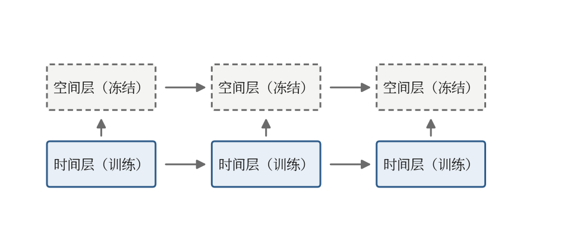

# 时间层与运动先验

三维 U-Net 要重训整个模型，代价高。另一条路是保留现成的图像模型，只在它上面加一层"管时间"的模块。

这条路在 2023 年流行起来，代表是 AnimateDiff 与 Text2Video-Zero。它们解决了同一个问题：怎样用有限的视频数据，借到强大的图像先验。

## 冻结图像模型，只训时间层

AnimateDiff 的做法是：拿一个训练好的文本到图像模型，把它的权重冻住；在每一层插入一个时间注意力模块；只训练这些新加的参数。

时间注意力的计算对象是"同一空间位置在不同帧上的取值"。对特征图 $z\in\mathbb{R}^{T\times C\times H\times W}$，把 $H,W$ 展平，对每个位置取它 $T$ 个时刻的向量，做一次长度为 $T$ 的注意力。

这样训练的参数量很小，数据需求也小：几万个短视频片段就够。冻结的部分保留了图像模型的外观能力，新加的部分只学"帧与帧之间怎么变"。

代价是运动能力有限。时间层只学了低秩的运动模式，复杂的、大幅度的动作学不会。这也是后来模型转向全量训练的原因之一。

## 不训练的做法

Text2Video-Zero 连时间层都不训。它用两个技巧让现成的图像模型生成视频。

第一，给每一帧的初始噪声加上相关性：先抽一份噪声，再让所有帧共享大部分，只留少量差异。这样去噪之后，各帧的构图接近。

第二，在注意力里做跨帧交互：把当前帧的查询与第一帧的键值放一起算，让每一帧都"看着"第一帧，从而保持内容一致。

这两个技巧不需要训练，效果在简单场景上不错，复杂运动就不行了。它说明了一件事：一致性的本质是"帧之间共享信息"，共享的方式可以很轻。

## 运动先验

除了结构上的技巧，还有一类做法是先学运动、再套到内容上。

常见的形式是"运动桶"：先在一个小规模的运动数据上训练一个模块，让它学会一组典型的运动模式（平移、推拉、旋转）；生成时选一个桶，把它的运动应用到新的内容上。

这样做的优点是可控：用户可以通过选桶来指定大致的镜头运动。缺点同样明显：运动是模板化的，不能任意组合。

## 与三维 U-Net 的对比

| 维度 | 三维 U-Net | 冻结 + 时间层 |
| --- | --- | --- |
| 训练成本 | 高，全量重训 | 低，只训时间层 |
| 数据需求 | 大 | 小 |
| 运动能力 | 强 | 有限 |
| 外观质量 | 取决于训练数据 | 继承图像模型 |

两条路不是替代关系。三维 U-Net 适合有大规模视频数据、追求运动能力的场合；时间层适合快速把图像模型变成视频模型，尤其是在数据有限的时候。

## 这一代留下的东西

第一，时间维可以被单独建模。不必把整个网络换成三维，只要在关键位置加时间交互。

第二，图像先验极其有用。冻结图像模型再学时间，比从零训视频模型省得多。

第三，一致性来自信息共享。无论是时间注意力、跨帧注意力，还是共享噪声，本质都是让相邻帧看到彼此。

这些认识直接支撑了后面两章：把视频压到潜空间（第 15 章），以及把架构换成 Transformer 以便扩展（第 16 章）。

## 一个限制

时间层的方法有一个隐含假设：视频可以被看成"一张图加上运动"。对短镜头、单一主体的视频，这个假设成立；对多镜头切换、复杂交互的视频，它就不够用了。

这也解释了为什么后来的模型又回到了全量训练：当数据量和算力足够时，让模型自己学时空结构，比人为拆成"空间 + 时间"更有效。
