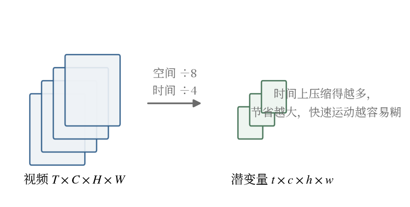

# 3D VAE 与视频潜空间扩散

像素空间的视频太贵：一段 512×512、120 帧的视频有九千多万个数，任何扩散模型都扛不住。图像的办法是压到潜空间，视频也一样，只是要多压一个时间维。

## 视频自编码器

图像的自编码器把 $C\times H\times W$ 压到 $c\times h\times w$，$h=H/8$、$w=W/8$，通道数从 3 变成 16 或 32。

视频的自编码器再加一个时间维：把 $T\times C\times H\times W$ 压到 $t\times c\times h\times w$，$t=T/4$ 左右。

以 5 秒、24 帧、512×512 为例：原视频约 9400 万个数；压完之后 $t=30$，$h=w=64$，$c=16$，约 200 万个数。差了两个数量级。

时间方向的压缩要小心。压得太狠，快速运动会被抹平；压得太松，省不下多少。多数模型取 4 倍，快速运动的镜头仍然会糊。

## 因果与非因果

视频自编码器有两种设计。

非因果：压缩时同时看前后帧，解码时也用整段信息。质量好，但不能流式生成，因为要等整段视频都拿到。

因果：每一帧只依赖当前与之前的帧。质量略差，但支持边生成边解码，适合长视频与实时应用。近年的开源模型多用因果版本。

这个选择会一路影响到采样：用非因果 VAE，必须一次生成整段；用因果 VAE，可以一块一块地生成。

## 潜空间里的视频扩散

把视频压到潜空间之后，扩散过程与图像完全一样，只是 $x_t$ 多了一个时间维。

Video LDM 的做法是先训图像 LDM，再在潜空间上加时间层、用视频微调。这样既省了从头训练的成本，又保留了图像模型的外观能力。

Stable Video Diffusion 走的是另一条：从图像模型初始化，再在精选的视频数据上训练，重点放在数据筛选上。它的报告里有一个常被引用的观察：视频数据的质量差异极大，筛选比堆量更重要。

CogVideoX 把主干换成 Transformer，用三维因果 VAE 压缩，再用"专家"结构的 Transformer 处理文本与视频。Latte 则把视频切成时空 patch，用一串 Transformer 块处理，空间与时间各有一组注意力。

## 为什么潜空间对视频尤其重要

图像模型在像素空间也能跑，只是慢。视频在像素空间基本跑不起来：显存与计算量都超出一个数量级。

还有一个不那么明显的好处：潜空间把"外观"和"运动"分开了。VAE 负责外观，扩散模型负责在潜空间里安排运动。这样换 VAE 就能换画质，换扩散模型就能换运动能力，两者可以独立升级。

代价是误差叠加。VAE 重建不好的细节，扩散模型补不回来；VAE 压缩掉的快速运动，后面也恢复不了。所以视频 VAE 的质量，往往决定了整个系统的上限。

## 与图像章节的接口

如果你已经理解了图像的潜空间扩散，这一章只是把 $z$ 从 $c\times h\times w$ 换成 $t\times c\times h\times w$，其余照旧。

真正的新问题是时间压缩比与因果性：它们决定了能不能流式生成、能生成多长、以及快速运动会糊到什么程度。

## 一个判断

看到一个新视频模型，先看它的 VAE：压缩比多少、是否因果、重建质量如何。

这三项基本决定了它的能力边界：能不能长、能不能实时、细节能到什么程度。主干网络再花哨，也突破不了 VAE 给的上限。
