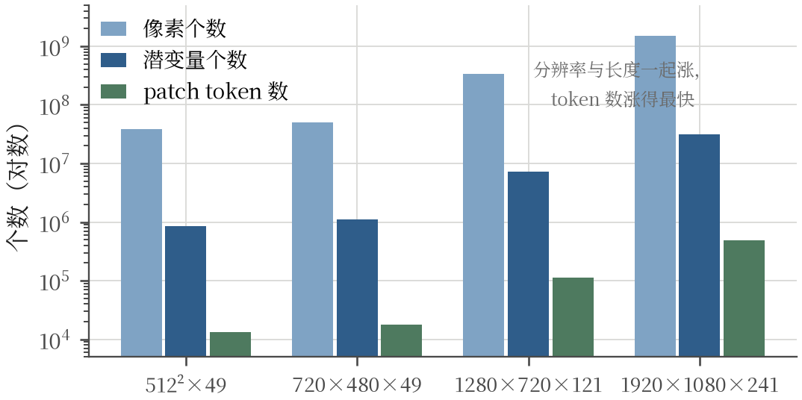
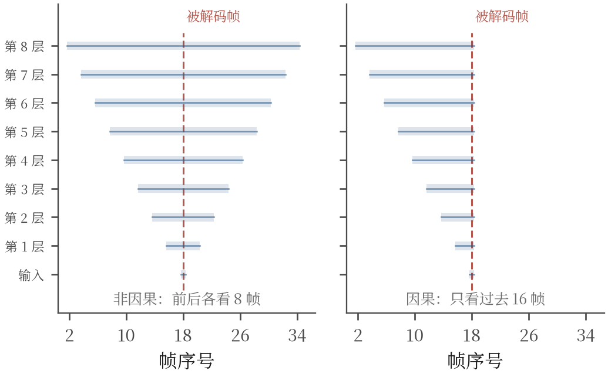

# 3D VAE 与视频潜空间扩散

像素空间的视频太贵：一段 512×512、120 帧的视频有九千多万个数，任何扩散模型都扛不住。图像的办法是压到潜空间，视频也一样，只是要多压一个时间维。

把“贵”落到具体的账上会更清楚。扩散采样要跑几十步，每一步都把所有位置过一遍神经网络。若每个位置就是一个像素，120 帧的视频就是 $120\times3\times512\times512\approx9.4\times10^7$ 个位置，而自注意力的乘加数随位置数的平方增长，单层就落在 $10^{15}$ 量级。这不是“慢一点”的问题，是无论怎么切 batch 都放不下。潜空间把同一段视频压到两百万个数，与一批图像的规模相当，几十步采样才重新变成一件可以执行的事。

## 视频自编码器

图像的自编码器把 $C\times H\times W$ 压到 $c\times h\times w$，$h=H/8$、$w=W/8$，通道数从 3 变成 16 或 32。

视频的自编码器再加一个时间维：把 $T\times C\times H\times W$ 压到 $t\times c\times h\times w$，$t=T/4$ 左右。

为什么不干脆逐帧压？“省算力”这个目的确实能达到，但会丢掉两样东西。一是时间冗余：固定机位下相邻帧的差很小，逐帧编码把同一块背景存了 120 遍；二是帧间一致性：每帧的量化噪声互不相关，解码后静止区域会轻微地一起一伏，也就是闪烁。多一个时间维之后，编码器能把“这块在动”与“这块没动”分开表达，静止部分只存一次，噪声也沿时间相关地产生。

以 5 秒、每秒 24 帧、512×512 为例：原视频约 9400 万个数；压完之后 $t=30$，$h=w=64$，$c=16$，约 200 万个数。差了两个数量级。

时间方向的压缩要小心。压得太狠，快速运动会被抹平；压得太松，省不下多少。多数模型取 4 倍，快速运动的镜头仍然会糊。

### 编码器长什么样

编码器是若干个下采样阶段的堆叠，每个阶段里有几组卷积与归一化，阶段之间把空间尺寸减半、通道数翻倍。图像 VAE 通常从 3 通道起，经过 $64,128,256,512$ 四级，最后投影到 16 维的均值与方差。视频 VAE 在这条骨架上插两样东西：把 2D 卷积换成核长 $(3,3,3)$ 的 3D 卷积，以及在其中一两个阶段加时间下采样。

时间下采样放在哪个阶段是有讲究的。放在最浅的阶段，感受野太窄，下采样前只有两三帧的信息，容易把运动折叠成闪烁；放在最深的阶段，前面的层要在原始帧率上跑，显存吃不消。常见做法是放在中间偏后的阶段，每次只压 2 倍，压两次凑够 4 倍。

通道数取 16 还是 32 也有取舍。16 通道时潜变量的信息带宽窄，运动细节会被迫挤在少数通道里，重建的纹理偏软；32 通道时带宽够了，但扩散模型的输入通道翻倍，第一层卷积的参数量与后续注意力的投影都随之变大。开源视频模型多取 16，是一个在质量与成本之间偏保守的位置。

归一化用 GroupNorm 而不是 BatchNorm。视频的张量很大，一个 batch 里往往只能放一两条样本，BatchNorm 的统计量在这么小的 batch 上噪声大，训练会不稳。GroupNorm 不跨样本统计，代价是推理时要固定分组数，权重不能随意改通道。

### 压缩率的三笔账

第一笔账是压缩倍数，把通道、宽、高、时间四项的比值乘在一起：

$$\text{压缩比}=\frac{C}{c}\cdot\frac{W}{w}\cdot\frac{H}{h}\cdot\frac{T}{t}.$$

图像 VAE 取 $C/c=3/16$、空间 8 倍下采样，压缩比是 $\frac{3}{16}\times8\times8=12$。视频再乘时间维的 4 倍，理论值 48。实际值略低，因为因果 VAE 的长度要凑成 $1+4k$：$T=120$ 帧压成 30 个潜帧是 4 倍，$T=49$ 帧压成 13 个潜帧只有 3.77 倍，差的那部分来自每段开头必须单独保留的第一帧。

同样是 48 倍左右，视频与图像的感受完全不同。图像压 12 倍后，潜变量 16×64×64 已经不小；视频再压 4 倍，潜变量却有 $30\times16\times64\times64\approx1.97\times10^6$ 个，仍然比一张图像的潜变量大三十倍。所以视频 VAE 的“压完”只是回到了可接受的起点，不是回到了图像的水平。

几组常见配置算下来是这样的：

| 输入 | 像素个数 | 潜变量尺寸 | 潜变量个数 | 压缩比 |
|---|---|---|---|---|
| 512²，49 帧 | $3.85\times10^7$ | $13\times16\times64\times64$ | $8.5\times10^5$ | 45 |
| 720×480，49 帧 | $5.08\times10^7$ | $13\times16\times90\times60$ | $1.12\times10^6$ | 45 |
| 1280×720，121 帧 | $3.35\times10^8$ | $31\times16\times160\times90$ | $7.1\times10^6$ | 47 |
| 1920×1080，241 帧 | $1.50\times10^9$ | $61\times16\times240\times135$ | $3.2\times10^7$ | 47 |

压缩比几乎不随分辨率变，这是设计使然：四维的比值固定，倍数就固定。变化的是绝对量，而绝对量取决于像素总数。1080p 的 241 帧已经是原视频的 15 亿个数，压完还剩 3200 万，比 512² 的 49 帧大了 37 倍。

第二笔账是 token 数。扩散主干并不直接在潜变量上工作：Transformer 先把潜变量切成 patch，比如 $1\times2\times2$ 的立方体，再把通道折进特征维。切完之后每个 token 覆盖 $2\times2$ 的空间与 1 帧时间，token 数为

$$N=\frac{t}{p_t}\cdot\frac{h}{p_h}\cdot\frac{w}{p_w}.$$

取 $p=2$，上表四组分别得到 $13\,312$、$17\,550$、$1.12\times10^5$、$4.9\times10^5$ 个 token。第一组与第四组之间 token 数差 37 倍，注意力对数差 1300 倍。这就解释了一个常见现象：同一套架构在 480p 上能跑，换到 1080p 就报显存不足，而且不是加几张卡能解决的——注意力对数是二次增长，卡的数量是线性增加。

第三笔账不太像账，但决定了时间压缩比该取多少：时间维压 4 倍，等价于把帧率降到原来的四分之一。24fps 的视频压完是每秒 6 个潜帧，能表达的往复运动频率上限约 3Hz。挥手、走路、镜头摇移都在这个范围内，问题不大；球拍击球、雨滴、爆炸碎片这类高频运动就落在采样极限之外，重建出来是若干帧的平均。这也是为什么快速运动的镜头即便分辨率很高，看起来仍然“糊”——不是空间分辨率不够，是时间分辨率不够。

也有模型只取 2 倍时间压缩，为了保住动作的清晰度。代价是 token 数翻倍，按平方算注意力开销涨四倍，通常要配更激进的窗口注意力才跑得动。时间压缩比因此不是纯质量问题，而是质量与“能跑多长”的一笔交换。

### 连续还是离散

潜变量可以是连续的（输出均值与方差），也可以是离散的（用码本量化，类似 VQ-VAE）。

图像的早期工作两种都试过，最后连续潜变量占了主流，原因是扩散模型天然建模连续分布，离散码本还需要额外处理“码字被丢弃”的问题。视频上这个倾向更强：量化会把相近的运动状态映射到同一个码字，解码出来就是时间上“卡住”的重复帧，而连续潜变量至少能表示中间状态。

离散潜变量在自回归模型里仍有位置——token 序列可以直接接一个语言模型式的采样器。扩散这条线上，连续是默认选择。

## 因果与非因果

视频自编码器有两种设计。

非因果：压缩时同时看前后帧，解码时也用整段信息。质量好，但不能流式生成，因为要等整段视频都拿到。

因果：每一帧只依赖当前与之前的帧。质量略差，但支持边生成边解码，适合长视频与实时应用。近年的开源模型多用因果版本。

这个选择会一路影响到采样：用非因果 VAE，必须一次生成整段；用因果 VAE，可以一块一块地生成。

### 结构上的差别

两种设计的分歧集中在一个地方：时间卷积往哪边补零。

非因果版本对时间维做对称补零，卷积核在 $t$ 处同时看 $t-1$ 与 $t+1$。这样训练与推理完全一致，整段视频一次前向，GPU 能吃满，实现也简单。代价是每一层的特征都依赖未来帧，解码第 3 帧时必须等到第 120 帧也算完。

因果版本只在左侧补零，第 $t$ 帧的特征只看 $1\ldots t$。层叠之后，一帧的感受野是一段向过去延伸的窗口：每层时间卷积核长 3，感受野按 $1+2n$ 增长，8 层之后是 17 帧。非因果同样是 17 帧，但以当前帧为中心前后各 8 帧。

因果设计带来一个具体的实现约束：4 倍时间下采样要求输入长度满足 $T=1+4k$。第一帧没有上文，没法与后面三帧组成一个完整的 4 帧组，所以要单独保留。49 帧、121 帧、241 帧都符合这个形式，这也是为什么公开模型喜欢用 49 帧而不是 48 帧。数据里长度不满足时，常见做法是把首帧复制一份补到 $1+4k$，解码后再丢掉。

### 流式的真实代价

“支持流式”经常被说成因果 VAE 的主要卖点，值得把这句话拆开。

结构上，因果 VAE 确实可以逐块解码：每层缓存最近 16 帧的特征，新来 4 帧、算完各层、吐出 1 个潜帧。缓存大小与模型深度成正比，与视频总长无关，这是它比非因果版本省内存的地方（非因果要保留整段的中间激活）。

延迟上却没那么乐观。4 帧在 24fps 下是 167 毫秒，这是 VAE 侧的最小粒度；真正的延迟由扩散模型决定——它必须先采出这 4 帧对应的潜帧，而一次采样要几十步。所以端到端的首帧延迟在秒级，与“实时”还有距离。因果 VAE 解决的是“能不能不等全片就开工”，不是“能不能实时”。

误差上，因果版本有两个容易忽略的坑。第一是开头几帧的重建质量偏低：第一帧没有上文，感受野里只有自己。第二是缓存对齐，如果把补零帧当成真实帧缓存下来，块与块的交界处会出现亮度或色调的跳变，肉眼看上去像闪了一下。这两种现象在短片段测试里都不明显，只有把生成结果拼成长视频才会暴露。

画质上的差距不算大。非因果版本在重建指标上通常略高，公开实现的经验差异在 1 dB 以内（量级估计），肉眼要看并排对比才分得出。真正决定选择的是用途：要做分钟级、要边生成边播，只能选因果；只做几秒的短片段，非因果更省事。

| | 非因果 | 因果 |
|---|---|---|
| 时间卷积 | 双向补零 | 单向补零 |
| 单帧感受野 | 前后各 8 帧 | 只向过去 16 帧 |
| 训练 | 整段并行 | 整段并行（靠掩码屏蔽未来） |
| 解码 | 必须等整段 | 可逐块，缓存 16 帧 |
| 长度约束 | 任意 | $1+4k$ |
| 典型用途 | 短片段、最高画质 | 长视频、流式 |

## 潜空间里的视频扩散

把视频压到潜空间之后，扩散过程与图像完全一样，只是 $x_t$ 多了一个时间维。

Video LDM 的做法是先训图像 LDM，再在潜空间上加时间层、用视频微调。这样既省了从头训练的成本，又保留了图像模型的外观能力。

Stable Video Diffusion 走的是另一条：从图像模型初始化，再在精选的视频数据上训练，重点放在数据筛选上。它的报告里有一个常被引用的观察：视频数据的质量差异极大，筛选比堆量更重要。

CogVideoX 把主干换成 Transformer，用三维因果 VAE 压缩，再用“专家”结构的 Transformer 处理文本与视频。Latte 则把视频切成时空 patch，用一串 Transformer 块处理，空间与时间各有一组注意力。

### Video LDM：把图像模型摊到时间上

Video LDM 的改动可以精确到层：保留图像 VAE 与全部空间层（参数从图像模型继承），在每个空间 ResBlock 之后插一个时间层。时间层由两部分组成，一个沿时间维的一维卷积（核长 3，形状 $1\times3\times3$），一个沿时间维的注意力。

时间注意力的张量排布需要一次重排：输入是 $(B,C,T,H,W)$，先转成 $(B\cdot H\cdot W,\,T,\,C)$，让 $T$ 成为序列维、每个空间位置独占一条序列，做完注意力再转回来。这样注意力只建模“同一位置在不同帧上的关系”，不建模跨位置的关系，参数与计算量都只有全时空注意力的 $1/(HW)$。

条件是这么给的：从 $T$ 帧里取前 $n$ 帧作为干净的条件帧，只对其余帧加噪。训练时 $n$ 随机取，推理时给 1 帧就是图生视频，给首尾两帧就是插值。这一条让同一个模型同时覆盖两种任务，代价是模型必须学会“条件多的时候少编、条件少的时候多编”，容量被摊薄。

级联放在潜空间做：一个 2 倍空间超分模型，一个 2 倍时间插帧模型，都吃前一级的潜变量。级联能把分辨率推上去，误差也一级一级放大——第一级生成的错误结构，后两级只能照着加细节。

省成本的地方在参数量：新增的时间层大致是主干参数的百分之几（估计），用几百小时视频微调就能出可用结果。弱的地方也在参数量：时间层太小，遇到大幅度运动、长镜头、多主体交互就撑不住，这也是后来放弃“冻结空间层”路线的原因。

### Stable Video Diffusion：把力气花在数据上

SVD 从图像模型 SD 2.1 的权重初始化，训练分三段：图像预训练（学会画东西）、低分辨率视频预训练（海量数据，学会动）、高分辨率视频精调（小规模高质量数据，学会好看）。三段的比例逐级收窄，数据质量逐级提高。

真正的工程量在第二段的筛选上。公开描述里用到的过滤器有：用图像-文本相似度剔除语义混乱的片段；用光流统计运动量，剔掉几乎静止的（学不到运动）与剧烈抖动的（多为手持拍摄）；按相机运动类型分桶，左移、右移、推近、拉远各一桶，训练时按桶采样，保证各种运动都被看到；裁掉画面里的水印、字幕、台标，否则模型会把它们当成内容生成出来。

公开配置生成 14 帧、576×1024，采样约 25 步。14 帧在 24fps 下不到 0.6 秒，这决定了它只能做“一个镜头内的短动作”，讲不了事。模型没有文本条件通路，内容由首帧指定：文本理解留在图像模型里，视频模型只负责让这张图动起来。这样省掉了一个跨模态对齐的问题，也把“用文字控制运动”的能力让了出去。

### CogVideoX：因果 VAE 加专家 Transformer

CogVideoX 的三处改动都与视频的长度有关。

VAE 换成 3D 因果版本，时间 4 倍、空间 8 倍、16 通道，49 帧压成 13 个潜帧。因果结构让模型可以续写：给末尾若干帧，就能接着生成下一段。

主干换成 Transformer，文本 token 与视频 token 进同一个网络，但用两组“专家”参数分别做 LayerNorm 的调制。这样做的动机是两种模态的统计差异大：文本 embedding 的尺度与视频潜变量的尺度不在一个量级，共用一套归一化参数会让其中一方被压制。

注意力是 3D 全注意力，时间与空间一起算。位置编码按时间、行、列三段分配频率，让模型能区分“同一帧内相邻的 patch”与“相邻帧的同一个 patch”。文本上限 226 个 token，超长 prompt 被截断，多主体、多动作的长描述会丢掉后半段——这是使用这类模型时经常踩的坑，写 prompt 要短，把关键信息放前面。

显存账要算清楚：720×480 的 49 帧，潜变量 $13\times60\times90=70\,200$ 个，切 2×2 的 patch 后剩 17 550 个 token。全注意力一次要处理 $3.1\times10^8$ 个位置对，只能靠分块注意力、激活重计算、VAE 分块解码这几样一起上。这也是为什么同一份权重在不同框架上的显存占用能差一倍多，实现细节的影响和模型规模一样大。

### Latte：时间不压缩，用 patch 换 token

Latte 的选择与前面三家都不同：沿用图像的 2D VAE，时间维一点都不压。

好处是运动信息没有损失，坏处是 token 多。16 帧、512×512 的视频，潜变量 $16\times4\times32\times32$，切 $1\times2\times2$ 的 patch 后是 $16\times16\times16=4096$ 个 token，其中时间维贡献 16 倍。若把时间也压 4 倍，token 会降到 1024，但快速运动会被抹平。

注意力的组织方式是分离的：空间注意力在一帧之内做，复杂度 $O(T\cdot(HW)^2)$；时间注意力在同一空间位置跨帧做，复杂度 $O(HW\cdot T^2)$；两者交替堆叠。相比全注意力的 $O((THW)^2)$，这个量级小得多，代价是跨帧的“位置到位置”对应关系要经过多层间接传递，细节一致性不如全注意力。

这套结构的实用价值在于长度可变：训练用 16 帧，推理时可以给 8 帧或 24 帧，只要位置编码能外推。长度灵活的模型更容易拿来做长视频的底座，因为不必为每个长度重训一遍。

四家的差别可以用一张表看完：

| 模型 | VAE | 主干 | 时空建模 | 条件 | 公开配置的帧数 |
|---|---|---|---|---|---|
| Video LDM | 图像 VAE + 时间层 | U-Net | 时间层 + 3D 卷积 | 文本、条件帧 | 数十帧 |
| SVD | 图像 VAE | U-Net | 时间层 | 首帧 | 14 帧 |
| CogVideoX | 3D 因果 VAE | Transformer | 3D 全注意力 | 文本 | 49 帧 |
| Latte | 图像 VAE（时间不压） | Transformer | 分离时空注意力 | 文本 | 16 帧 |

## VAE 的训练目标

一个能用的视频 VAE 要同时满足三件事：重建得像、潜空间适合扩散、时间上不闪。这三件事对应四项损失：

$$\mathcal{L}=\mathcal{L}_{\text{rec}}+\lambda_p\,\mathcal{L}_{\text{perc}}+\lambda_a\,\mathcal{L}_{\text{adv}}+\lambda_k\,\mathcal{L}_{\text{KL}}.$$

重建项用 L1 而不是 L2。L2 对离群值敏感，解码器为了压低少数大误差，会把整体推向均值，边缘变糊；L1 的梯度是常数，不会因为某一处误差大就牺牲其他区域。视频上常见的做法是在 RGB 与梯度图上各算一次，梯度项专门管边缘。

感知项是 LPIPS，把重建结果与真值送进同一个预训练网络，比较中间特征的 L1 距离。它惩罚的是“看起来不对”，比如纹理的位置错了但平均值是对的——这种情况 L1 几乎看不出来，感知项能抓。系数取 0.5 到 1 之间。

对抗项用一个 3D patch 判别器，核在时间方向也展开，判“这一小块时空立方体是真是假”。用 hinge 损失，权重自适应：

$$\lambda_a=\frac{\|\nabla_{\theta}\mathcal{L}_{\text{rec}}\|}{\|\nabla_{\theta}\mathcal{L}_{\text{adv}}\|+\delta}.$$

这个式子的意思是让两项对解码器参数的梯度量级相当，避免手工调系数。判别器必须是 3D 的，只看单帧的判别器分不出“纹理对但一直在抖”和“纹理对且稳定”，VAE 会输出时间上抖动的细节，而扩散模型会把这种抖动学进去，最后表现为整片闪烁。

KL 项上是视频 VAE 与图像 VAE 分歧最大的地方。图像 VAE 的 $\lambda_k$ 常在 $10^{-6}$ 量级，视频上更小，有些实现干脆去掉 KL、改成在潜变量上加固定方差的高斯噪声。原因是运动细节占的方差大，而 KL 项对大方差维度的惩罚更重，正则会先把这些维度压成先验，重建出来运动就“化”了。代价是潜空间分布偏离标准正态，各通道尺度不一，送进扩散模型之前要做逐通道缩放：

$$z'=\frac{z-\mu_i}{s_i},\qquad s_i=\sqrt{\mathrm{Var}(z_i)}.$$

统计量在训练集上算一次就固定。图像模型常用一个全局常数（例如 0.18215），视频上按通道算更常见，因为不同通道承载的时间频率不同，方差差别比图像大。

四项损失的配比与各自的失效模式可以列成这样：

| 损失 | 典型系数（估计） | 主管 | 系数过大的后果 |
|---|---|---|---|
| 重建 L1 | 1 | 颜色、结构 | 局部模糊、纹理平滑 |
| LPIPS | 0.5–1 | 语义相似 | 纹理结块、无关细节被强化 |
| 对抗（自适应） | 0.5–1 | 高频细节 | 过锐、棋盘格、色斑 |
| KL | $10^{-6}$–$10^{-4}$ | 潜空间规整 | 运动被压平、细节丢失 |

训练顺序有讲究。先只用重建加感知训若干步，让解码器有基本形状，再开对抗。反过来做，判别器一开始就能轻易分辨“真帧”与“糊帧”，梯度把解码器推向过锐，之后再想拉回来很难。判别器的学习率通常比生成侧低，更新间隔也更长。

诊断后验坍塌有一个直接的办法：看 $\log\sigma^2$ 的均值。如果它随着训练持续下降、接近一个很负的常数，说明编码器在忽略输入、直接输出先验；同时去看潜变量的时间差分，若相邻潜帧几乎相同，说明运动信息根本没进潜空间。表现在生成端是视频“静”了，只剩缓慢变化的背景。

还有一项可选损失专门管闪烁：用估计的光流把前一帧的解码结果扭曲到当前帧，再与真值比较：

$$\mathcal{L}_{\text{warp}}=\big\|\,w(F_{t\to t+1},\hat{x}_t)-\hat{x}_{t+1}\,\big\|_1 .$$

它能压低静止区域的抖动，但光流本身在遮挡区不准，权重过大时会在物体边缘拉出拖影。常见做法是系数取很小，或者在训练后期才开启。

## 为什么潜空间对视频尤其重要

图像模型在像素空间也能跑，只是慢。视频在像素空间基本跑不起来：显存与计算量都超出一个数量级。

把两个量级并排放：120 帧 512² 是 3100 万个位置，切 2×2 的 patch 后也有 786 万个 token；同样的视频进潜空间再切 patch 只剩 3 万个，token 数差 256 倍，注意力对数差 6.5 万倍。前一个数字是“要几百张卡”，后一个是“一张卡勉强能跑”，差别就在这里。

换个角度算摊销。VAE 的编码与解码各只做一次，扩散采样要跑几十步，每步一个完整的主干前向。单次 VAE 前向的成本与单步主干相当，摊到 50 步里占百分之几。所以“VAE 很贵”这件事在推理阶段几乎感觉不到；它真正的成本在训练——潜变量的统计特性一旦定得不好，后面所有训练都要为它买单。

还有一个不那么明显的好处：潜空间把“外观”和“运动”分开了。VAE 负责外观，扩散模型负责在潜空间里安排运动。这样换 VAE 就能换画质，换扩散模型就能换运动能力，两者可以独立升级。

代价是误差叠加。VAE 重建不好的细节，扩散模型补不回来；VAE 压缩掉的快速运动，后面也恢复不了。所以视频 VAE 的质量，往往决定了整个系统的上限。

这个“上限”是可以估的。VAE 重建的 PSNR 在 30 dB 左右时，解码出来的画面已经有可见的纹理损失；扩散模型在潜空间里再怎么生成，也生成不出被 VAE 丢弃的那部分高频。所以看到“生成的视频细节糊”，先怀疑 VAE，再怀疑采样步数，最后才怀疑主干容量。

## 与图像章节的接口

如果你已经理解了图像的潜空间扩散，这一章只是把 $z$ 从 $c\times h\times w$ 换成 $t\times c\times h\times w$，其余照旧。

记号上只有三处不同：前向过程对每个潜帧独立加噪（噪声在时间维上是独立的，这一点很重要，共享噪声就是另一种做法了）；损失对 $t\times h\times w$ 个位置求平均；条件的注入方式多了一种——除文本之外还可能有条件帧，它走的是“拼接通道”而不是“交叉注意力”。

真正的新问题是时间压缩比与因果性：它们决定了能不能流式生成、能生成多长、以及快速运动会糊到什么程度。

还有一点值得提前知道：潜变量的通道没有语义。图像潜空间里，单独放大某个通道得到的不是“更蓝”或“更亮”，而是一片看似噪声的结构变化。这也是为什么编辑方法都在噪声、注意力或速度场上做文章，而没人在潜变量的某个通道上加减。

## 潜空间的失效模式

压缩是有损的，损失会以几种固定形态出现在解码结果里。知道这几种形态，看样张时就能把问题归到 VAE 还是主干上。

**边界帧。** 时间维的卷积在首尾各有一处没有上下文的位置。非因果版本靠反射补零缓解，因果版本的首帧则完全无上文。结果是成片的头尾几帧亮度偏、细节少，在循环播放时看得出来。补救办法是训练时对首尾帧单独加权，或者生成时多生成几帧再剪掉。

**快速运动。** 4 倍时间压缩把帧率降到 6Hz，周期短于 0.33 秒的运动落到采样极限之外。表现不是简单的糊，而是“拖影方向错”——两帧之间物体位移超过半个物体宽度时，解码器会把两个位置平均成一个中间位置，看起来像物体在自己分裂。

**细密纹理与文字。** 空间 8 倍下采样后，一个潜变量像素对应 $8\times8$ 的像素块。这个尺度上的高频，比如织物纹理、树叶、小字，会在编码时被平滑掉，解码时由模型“猜”一个相似但不相同的图案。静态图上只是不够锐，视频里就变成纹理在帧间游走，即所谓“沸腾”。这类失效扩散模型补不回来，因为信息在编码那一步就没了。

**色偏被放大。** VAE 的重建颜色与原始颜色可能有几个色阶的偏移，单帧看不出来。扩散模型以潜变量为目标训练，会把这个偏移当成“正确”的一部分，再在几十步采样中一致地放大。几秒之后表现为整片偏绿或偏品红。

**分块解码的接缝。** 高分辨率视频的 VAE 解码常按时间分块做（每次解 8 到 16 帧），否则显存放不下。块与块之间如果没有重叠、或者重叠区的加权不是互补的，接缝处会出现一条横向的亮度带或颜色跳变。这种问题在最容易忽略的地方：它不影响指标，只影响观感。

## 一个判断

看到一个新视频模型，先看它的 VAE：压缩比多少、是否因果、重建质量如何。

这三项基本决定了它的能力边界：能不能长、能不能实时、细节能到什么程度。主干网络再花哨，也突破不了 VAE 给的上限。

具体怎么问，可以落成四个数：时间压缩几倍（决定运动频率的上限）、空间压缩几倍（决定细节上限）、潜变量通道数（决定信息带宽）、长度是否满足 $1+4k$（决定能不能续写）。四个数问完，再去看它的 token 数和注意力实现，就能大致判断它跑在什么卡上、能生成多长。这些比“支持 1080p”之类的宣传语有用得多。
