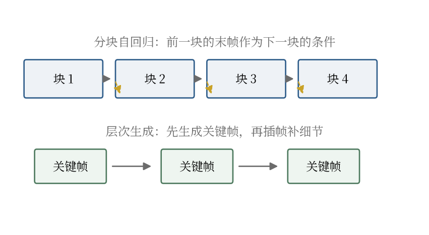

# 规模化与长视频

前面几章解决了"能不能生成视频"，这一章讲"能生成多长、多好"。

2024 年之后，视频模型进入规模化阶段：参数从十亿级升到百亿级，时长从几秒升到十几秒甚至更长，架构统一到 Transformer。这一章把这些进展归拢一下，重点讲长视频的几种做法。

## 规模带来的变化

三个数字同时增长：参数量、训练数据量、生成长度。

参数量上去之后，early 那套"冻结图像模型 + 时间层"的做法不再适用，因为时间层容量太小，撑不住复杂运动。全量训练成为主流，主干统一为 Transformer。

数据量上去之后，模型见过了更多运动模式，简单动作不再需要靠运动桶来指定。

长度上去之后，新的问题出现了：显存、一致性、叙事。

## 长视频的四种做法

**分块自回归。** 把长视频切成长度固定的块，逐块生成；生成下一块时，把前一块的最后几帧作为条件。Phenaki 用这种做法生成了分钟级的视频，代价是误差会沿着块累积。

**层次生成。** 先生成低帧率、低分辨率的"骨架"，再逐级补帧、补细节。NUWA-XL 用"扩散之上的扩散"做这件事：关键帧先出来，中间帧再插进去。层次结构能压住漂移，因为每一级都对齐到上一级。

**噪声重排。** 不改变模型，只在采样时重新安排噪声：让相邻块共享一部分噪声，使它们的内容自然衔接。FreeNoise 属于这一类，不需要额外训练。

**长上下文与流式。** 直接把上下文窗口拉长，或者用滑动窗口加缓存，让模型"记住"前面发生过什么。MAGI-1 与 SkyReels-V2 都在这条路上，目标是任意长度。

## 一致性与漂移

长视频最麻烦的不是算力，是漂移：生成到后面，人物的衣服变了颜色，背景的楼换了一栋，或者镜头莫名其妙地转了个方向。

漂移的来源是条件信息在传递中衰减。分块时，前一块的末帧作为条件，信息量有限；自回归时，每一步的小误差会累积。

几种缓解办法：把第一帧一直作为条件（不只依赖上一块）；用关键帧锚定；在块之间做重叠与融合；或者干脆用层次结构，让每一级都重新对齐到全局的关键帧。

## 音视频联合

2024 年之后，视频模型开始处理音频：生成画面时同时生成对应的音效或对白。Movie Gen 的报告里，视频、音频、配音是分开的模型，联合使用。

这件事对"真实感"的提升比分辨率更大。人眼对画质有容忍度，对音画不同步几乎没有容忍度。

## 评测的困难

短视频可以用 FVD 与人评。长视频不行：指标算不了那么长，人评也看不完。

实践中常用的替代方案是抽查：随机截取若干片段，分别评一致性、运动自然度、文本遵循。这样能发现明显的问题，但覆盖不到叙事层面。

物理合理性目前基本靠人看：杯子有没有穿模、影子跟不跟光、物体有没有凭空出现。这些在短片段里也可能出现，只是长视频里更容易暴露。

## 这一章的判断

看一个视频模型，除了看样张，还要看三件事：最长能生成多少秒、漂移在什么长度开始明显、以及是否支持流式。

这三件事决定了它能用在什么场景：广告短片、社交内容、还是长片辅助。分辨率与画质反而排在后面，因为它们更容易靠超分补。

## 与前后章节的衔接

第 12 到 16 章讲的是"生成视频"这条线。接下来第 17、18 章换一个角度：把生成写成一条路径，用速度场描述它。这个视角对视频同样成立，只是张量多了一个时间维。

第 19 章之后讲编辑，视频编辑的难点会回到这一章提到的两个词：一致性与漂移。
