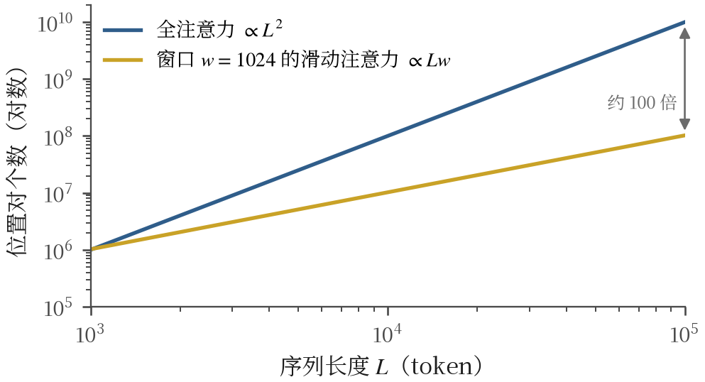
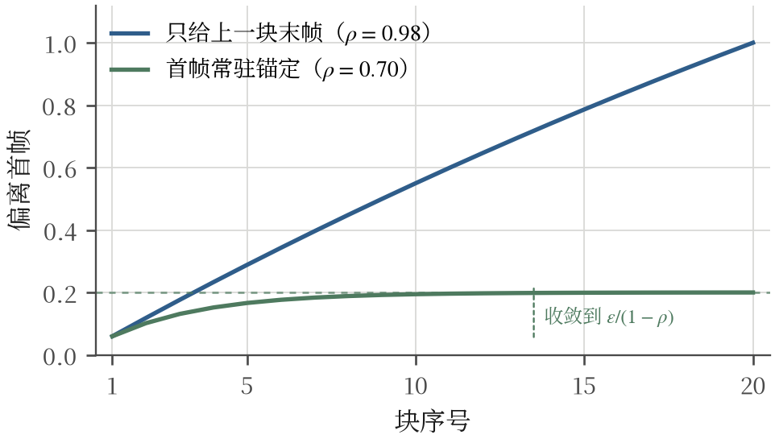

# 规模化与长视频

前面几章解决了“能不能生成视频”，这一章讲“能生成多长、多好”。

2024 年之后，视频模型进入规模化阶段：参数从十亿级升到百亿级，时长从几秒升到十几秒甚至更长，架构统一到 Transformer。这一章把这些进展归拢一下，重点讲长视频的几种做法。

## 规模带来的变化

三个数字同时增长：参数量、训练数据量、生成长度。

参数量上去之后，early 那套“冻结图像模型 + 时间层”的做法不再适用，因为时间层容量太小，撑不住复杂运动。全量训练成为主流，主干统一为 Transformer。

数据量上去之后，模型见过了更多运动模式，简单动作不再需要靠运动桶来指定。

长度上去之后，新的问题出现了：显存、一致性、叙事。

数字上是这样：公开的视频模型参数从二十亿到三百亿，训练数据从数千万个片段涨到上亿量级，成片长度从 4 秒推到 10 秒上下，分段生成能做到几十秒。

“冻结空间层”为什么撑不住，可以算一笔账。时间层只占主干参数的百分之几，它能表示的运动自由度有限；数据少的时候模型欠拟合，瓶颈在数据，冻结不冻结看不出来；数据多了以后瓶颈转到容量，此时冻结空间层等于把外观也锁死在图像模型的分辨率与纹理先验上，模型想表现“远处的雪在飘”或者“逆光下的水花”，只能靠时间层在既有特征上做位移，做不出来。

全量训练的代价在算力。一个百亿参数的模型在 720p 上跑一遍前向，激活就要几十 GB，一步训练的时间随参数量与像素总数增长，整轮训练落在数万 GPU·天（量级估计）。这也解释了为什么这一阶段的进展集中在少数团队：门槛不在想法，在卡。

架构统一到 Transformer 不只是风尚。U-Net 的多尺度结构把分辨率写死在下采样层数里，换分辨率、变帧数都要改结构；Transformer 把视频切成 token，长度可变，同一份权重能吃不同分辨率与不同帧数。长视频要求模型能处理变长序列，这一点上 Transformer 省事得多。

数据量的增长也不等于可用数据的增长。公开报告里常见的做法是先用自动过滤器粗筛（清晰度、运动量、文本区域、水印），再抽少量样本人工校准阈值。过滤器放宽一点，数据量翻倍，代价是模型会在某个特定瑕疵上反复出错；这个交换在数据少的时候划算，在数据多的时候不划算。

## 长视频的四种做法

**分块自回归。** 把长视频切成长度固定的块，逐块生成；生成下一块时，把前一块的最后几帧作为条件。Phenaki 用这种做法生成了分钟级的视频，代价是误差会沿着块累积。

**层次生成。** 先生成低帧率、低分辨率的“骨架”，再逐级补帧、补细节。NUWA-XL 用“扩散之上的扩散”做这件事：关键帧先出来，中间帧再插进去。层次结构能压住漂移，因为每一级都对齐到上一级。

**噪声重排。** 不改变模型，只在采样时重新安排噪声：让相邻块共享一部分噪声，使它们的内容自然衔接。FreeNoise 属于这一类，不需要额外训练。

**长上下文与流式。** 直接把上下文窗口拉长，或者用滑动窗口加缓存，让模型“记住”前面发生过什么。MAGI-1 与 SkyReels-V2 都在这条路上，目标是任意长度。

四种做法常常混用，但它们的机理不同：前两种在时间轴上切一刀，代价是一次生成的东西变少；后两种不动结构，代价是要么牺牲运动幅度，要么吃掉显存。四种做法的实现细节与代价差别很大。

### 分块自回归：条件怎么给，误差怎么长

块长通常取 16 到 32 帧，块与块之间留 2 到 4 帧重叠。条件可以是上一块的末帧，也可以是末几帧；条件帧越多，衔接越稳，可自由生成的帧越少。

有一个容易踩的坑叫暴露偏差。训练时，块首的条件帧来自真实视频；推理时，它来自上一块自己的生成结果。两者分布不同——真实帧更锐、更干净，生成帧带一点采样噪声与偏色。模型若没在训练时见过“带噪声的条件帧”，就会把这点差异当成内容，逐块放大。对策是训练时给条件帧也加噪声，或者把模型自己采样的结果当条件（自条件）。

误差的量级可以用一个递推估：设每块引入的偏差为 $\epsilon$，条件带来的“拉回”系数为 $\rho$，则

$$d_{k+1}=\rho\,d_k+\epsilon_k,\qquad d_k=\epsilon\,\frac{1-\rho^{k}}{1-\rho}.$$

$\rho<1$ 时偏差收敛到 $\epsilon/(1-\rho)$，漂移停在一个水平上；$\rho\to1$ 时退化成无阻尼累积。这时要看 $\epsilon_k$ 的性质：零均值的随机扰动按 $\sqrt{k}$ 累积标准差，带系统性的成分（比如每块都往同一个方向偏色）按 $k$ 线性累积。$\rho$ 由条件强度决定：只给一帧，$\rho$ 接近 1；给四帧再叠加首帧锚定，$\rho$ 会明显小于 1。

推理成本随长度线性增长：$k$ 个块就要 $k$ 次完整采样，每次几十步。显存倒是可控，只保留上一块的潜变量与 KV cache。

接缝处有一处容易忽略的细节：块的首帧若直接复用上一块的末帧，画面会“停一拍”——同一帧在成片里出现两次。常见做法是复用但把它标为条件帧，时间轴上不占新位置，或者让重叠区由两块各生成一半再加权。

### 层次生成：先定骨架，再补细节

以三级为例：第一级生成 8 个关键帧，分辨率取最终的八分之一；第二级在两个关键帧之间插三帧，变成 32 帧；第三级做空间超分与时间精修。

每一级都是一个扩散模型，条件来自上一级的输出。训练时要模拟上一级的误差：给条件加噪，或者直接用上一级模型生成的样本当条件，而不是真值下采样。少了这一步，第二级会把第一级的轻微模糊当成真实内容去“锐化”，结果是把模糊变成锐利的假纹理。

稳定性来自对齐方式：第二级的每一帧都能看到前后两个关键帧，第三级又能看到第二级的全部帧。误差只在相邻两级之间出现，不沿时间累积，这是它与分块自回归最关键的区别。

代价有两处。一是采样次数：三级各跑满步数，总前向次数是单级的 2 到 3 倍，好在前两级的分辨率低，实际算力未必翻倍。二是改不动：关键帧错了整段就错，想改中间某一秒得重跑整条链，做编辑时不友好。

### 噪声重排：不改模型，只改采样

这类做法针对的是“训练用短片段、推理要长片段”的错配：噪声调度与注意力统计都是在固定帧数下学到的，直接拉长会崩。

FreeNoise 在噪声层面动手：把潜空间的噪声张量按帧切分，对每一帧的噪声在相邻窗口内做加权平均，使相邻帧共享一部分噪声；再把整个长序列的噪声顺序重排，让任意局部窗口的噪声统计与训练时一致。内容之所以连续，是因为共享噪声等于共享一部分初始结构。

它不需要训练，套在已有的短视频模型上就能用，这是最大的好处。代价是运动被压低：共享噪声相当于给相邻帧一个共同目标，模型倾向于少动。想把运动找回来，只能靠文本或条件帧施压，效果有限。长度倍数也受限，通常拉到原长的 2 到 4 倍，再长就明显“凝滞”，画面在动但物体不怎么位移。

### 长上下文与流式

这条路线不改采样技巧，改的是模型能吃多长：把训练序列拉到几百帧，推理时用滑动窗口加 KV cache。

要处理的是位置编码。时间位置若用可学习的绝对编码，超过训练长度就没有定义；用 RoPE 这类相对编码，超出训练范围的相对距离也没被约束过。应对有两种：把每个窗口的时间索引重新编号（都从 0 开始），任何长度就都落在训练分布内；或者压缩时间频率，让长距离的相对位置落回见过的范围。前者简单，代价是跨窗口的相对位置信息丢失。

显存是主要约束。全注意力的显存随序列长度平方增长，$L=10^5$ 时就不可行；窗口为 $w$ 的滑动注意力是 $L\cdot w$，$w=1024$ 时省两个数量级。

KV cache 本身也要算进去：$$\text{cache}=2\times\text{层数}\times w\times d\times2\ \text{字节}.$$ 以 30 层、窗口 4096、特征维 2048、半精度为例，约 $2\times30\times4096\times2048\times2\approx1$ GB，单卡还放得下；窗口拉到 32768 就是 8 GB，开始与模型权重抢显存。这是“长上下文”在工程上真正的天花板。

流式的要求更严：每生成一块就要立刻可用。这要求扩散采样也按块做——噪声只加在当前块内，历史块的潜变量作为干净条件。块与块之间的噪声独立，接缝处的一致性全靠条件帧保证，所以这套做法通常与分块自回归合起来用。

代价在记忆与遗忘的平衡。上下文越长，模型越容易被早段的错误带偏，一个错误的物体能在后面几十秒里持续存在；分块注意力又丢掉了跨窗口的直接对应，长距离的一致性只能靠多层间接传递。

四种做法并排看：

| 做法 | 训练成本 | 推理成本 | 长度 | 主要失效 |
|---|---|---|---|---|
| 分块自回归 | 中 | 随块数线性 | 任意 | 漂移、接缝跳变 |
| 层次生成 | 高（多级模型） | 单级的 2–3 倍 | 数十秒 | 关键帧错误被放大 |
| 噪声重排 | 零 | 同原模型 | 原长的 2–4 倍 | 运动变弱、画面凝滞 |
| 长上下文 | 高（长序列） | 窗口内线性 | 很长 | 记忆混乱、外推失效 |

## 一致性与漂移

长视频最麻烦的不是算力，是漂移：生成到后面，人物的衣服变了颜色，背景的楼换了一栋，或者镜头莫名其妙地转了个方向。

漂移的来源是条件信息在传递中衰减。分块时，前一块的末帧作为条件，信息量有限；自回归时，每一步的小误差会累积。

几种缓解办法：把第一帧一直作为条件（不只依赖上一块）；用关键帧锚定；在块之间做重叠与融合；或者干脆用层次结构，让每一级都重新对齐到全局的关键帧。

### 漂移从哪来

拆开看有三种成因，症状不同，解法也不同。

条件衰减最直接。分块时，条件帧只在块的边界处起作用，块内部没有任何东西把它拉回原样。一个 16 帧的块里，第 1 帧被条件钉住，第 16 帧离条件最远，模型在那里最“自由”，可以自由地改颜色、改光照、改细节。把偏差看成上面的递推，$\rho$ 越小，漂移越早饱和。

误差累积是另一回事，它是暴露偏差在长程上的表现。训练时模型只见过“真实条件加噪声输入”，推理时吃到的是自己生成的条件。一处多余的纹理、一点色偏，在下一块里成了事实，模型据此继续外推。这类漂移的特征是单向：颜色越来越偏、细节越来越糊，很少自己回来。

位置与长度外推的症状最怪：前半段正常，某一刻之后镜头开始莫名地转、景别跳变、人物走出画面又走回来。原因常常是位置编码在训练长度之外没有约束，注意力权重分布变形，模型退回到“按训练时的平均行为”行事。

### 数字上的感受

几个量级（估计）：训练良好的模型，在 3 个块之内与首帧的 PSNR 通常只掉 1 到 2 dB；到 10 个块时掉 4 dB 以上，色调变化已经肉眼可见。色相偏移比亮度偏移更早被察觉，同一个物体偏 5 到 10 度色相，多数观众会指出“这不是同一件衣服”。

人眼对漂移格外敏感，原因是我们看视频时在跟踪物体。形状轻微变化会被当成运动，颜色变化却无处可藏：同一个物体持续存在于画面里，任何缓慢偏移都在积累。

漂移速度与内容强相关。人脸与文字漂得最快：眼距变一两个像素就会被认成“不是同一个人”，笔画多一横就成了另一个字；大面积的自然纹理（天空、草地、水面）漂得慢，人眼本来就分不清具体形态。所以抽样时按“含人脸 / 含文字 / 纯景物”分层，比均匀抽样更容易发现问题。

### 哪些补救真的有用

把首帧一直作为条件，等于给每块一个全局锚点，$\rho$ 从接近 1 降到 0.5 以下，漂移从随机游走变成有界。代价是模型要同时应付两个条件，运动幅度被首帧压制，长镜头的运镜变弱。

关键帧锚定是同一思路的稀疏版本：每 5 到 10 块插入一张由图像模型生成或用户指定的关键帧，条件只在这个范围内传递。可控性最好，代价是关键帧必须与前后内容相容，否则成片里会出现“硬切”——观众看得出这里换了素材。

块间重叠与融合要小心一个陷阱：潜空间的线性混合不等于像素的线性混合。把两块潜变量按权重相加再解码，得到的通常是两个内容的叠影，而非平滑过渡。可行的做法是在噪声或条件层面约束，比如让重叠区的噪声相同，而不是事后混合结果。

层次结构天然抗漂移，因为每一级都要对齐上一级的关键帧，误差不跨级累积；弱点在别处——关键帧本身若不满意，整段作废。

## 音视频联合

2024 年之后，视频模型开始处理音频：生成画面时同时生成对应的音效或对白。Movie Gen 的报告里，视频、音频、配音是分开的模型，联合使用。

这件事对“真实感”的提升比分辨率更大。人眼对画质有容忍度，对音画不同步几乎没有容忍度。

### 三条路线

分开模型加后期对齐，是 Movie Gen 这类系统的做法：视频模型出画面，音频模型按文本与画面生成音效或配乐，再用时间戳拼接。好处是各自能独立升级，音频模型可以换成专门的音乐模型；坏处是同步靠事后对齐，门关上与“砰”的一声之间容易差几帧，而人耳对声音与撞击的错位格外敏感。

联合生成把音频与视频的 token 交错放进同一个序列，一次采样出两个模态。同步关系是学出来的，不需要外部对齐模块。代价是序列更长、训练数据必须严格配对（同一段素材的音轨），而且两个模态的 token 率不同，交错比例要单独设计。

音频驱动是第三条：给定音轨生成口型、表情、头部运动，用在配音与数字人上。它对同步的要求最高，对口型是逐帧对齐；对场景多样性的要求最低，所以通常单独训一个小模型，再与视频模型拼接。

### 对齐的算术

视频 24fps、VAE 时间压 4 倍，得到每秒 6 个潜帧；音频若用 40 毫秒一帧的 mel 谱，是每秒 25 帧。两者相差约 4 倍，一个视频潜帧对应 4 个音频帧。音频若取 10 毫秒一帧，比例变成 8 倍。

这个比例决定序列怎么拼：按 1:4 交错，一个视频 token 组配四个音频 token；也可以先把音频压到与视频同量级的潜空间，再逐帧配对。前一种实现简单，后一种序列短，各有取舍。无论哪种，音频的时序分辨率都比画面细，这是联合建模时经常被忽略的一处不对称。

### 同步的容限

广电行业沿用的一组经验阈值是：声音比画面早约 45 毫秒，或者晚约 125 毫秒，观众开始觉得不同步。超出这个范围，评价会迅速变差。生成系统通常要求把误差压到 100 毫秒以内，口型场景要求更高，几十毫秒。

音画联合的成本主要在数据：同一段素材必须有配对音轨，且音轨要干净（无背景音乐、无解说）。这类数据的采集与清洗成本，往往超过模型本身的开销。

同步的评测也有自己的难题。音画是否对齐得靠专门的判别模型（在一段音视频上预训练，输出两者的时间偏移），而这类模型自身的误差就在几十毫秒量级，与要测的容限同阶。实际做法是“机器初筛加人耳复听”：机器挑出可疑片段，人确认，因为人对“门声晚了一瞬”的判断比任何指标都准。

## 评测的困难

短视频可以用 FVD 与人评。长视频不行：指标算不了那么长，人评也看不完。

实践中常用的替代方案是抽查：随机截取若干片段，分别评一致性、运动自然度、文本遵循。这样能发现明显的问题，但覆盖不到叙事层面。

物理合理性目前基本靠人看：杯子有没有穿模、影子跟不跟光、物体有没有凭空出现。这些在短片段里也可能出现，只是长视频里更容易暴露。

### FVD 为什么看不出来漂移

FVD 把视频切成固定长度的片段，用 I3D 提取特征，比较生成集与真实集的特征分布。片段长度通常十几到几十帧，与长视频的时间尺度差一到两个数量级。

两个问题随之而来。片段数少了，估计方差大，同一模型两次评测能差出几个点；片段数多了，漂移被平均掉——前半段的好片段与后半段的坏片段混在一起，均值看不出问题。所以 FVD 对“整体风格”敏感，对“越到后面越差”几乎无感。评价一个长视频系统，只报 FVD 是不够的。

### 抽查方案

抽查的设计决定了结论可信不可信。

时间分层是底线：把成片按时间轴等分成 5 段，每段随机取一个 3 秒窗口，首段与末段必须包含。只在开头抽样，等于只评了最容易的部分，而漂移几乎总是出现在后半段。

评分按项目分开：主体身份、背景与光照、运动自然度、文本遵循、物理合理性，各打 0 到 4 分。分开评的理由是它们的漂移速度不同：身份漂移慢，光照与色调漂移快，混成一个总分就看不见差异。

报告要报曲线，不报平均分。把各时间段的得分画成“分数-时间”曲线，斜率才说明漂移。一个总分 3.8 的模型可能全程稳定，也可能前 3 秒满分、之后崩掉，两者的用途完全不同。

自动指标能做几项替代：身份保持用同一段内两帧的人脸特征余弦相似度；闪烁用相邻帧的光流扭曲误差；文本遵循用视觉语言模型打分，适合看趋势，不适合下结论。这些都只是代理，不能代替人看。

比较两个模型时，抽样方案必须一致：同样的时间段划分、同样的窗口长度、同一批评分人。方案不同的两份报告，分数差可以轻易超过模型之间的真实差距。

人评至少三人，一致性用 Krippendorff's $\alpha$ 或组内相关系数衡量。$\alpha$ 低于 0.6 说明评分标准没对齐，此时先讨论标准再重评，不要拿这批评分做结论。

### 局限

抽查有三个盲区：看不到叙事连贯与节奏，这两项只能整段看；片段少时会漏掉局部崩坏，比如手部、画面上的小字、快速掠过的物体；分数不可跨数据集比较，不同论文的抽样方案不同，数字不能直接对。

物理错误的暴露与长度有关。长视频要求同一组物理属性在一分钟内保持不变：一个杯子在前 10 秒的材质、透明度、与桌面的接触关系，后面每一帧都要对得上。短片段靠“局部看起来合理”就能过关，长视频不给它这个机会——连续性把单帧的偶然正确变成了必须的长期一致。

## 这一章的判断

看一个视频模型，除了看样张，还要看三件事：最长能生成多少秒、漂移在什么长度开始明显、以及是否支持流式。

这三件事决定了它能用在什么场景：广告短片、社交内容、还是长片辅助。分辨率与画质反而排在后面，因为它们更容易靠超分补。

还有一笔账值得算：生成长度的成本不是线性的。分块做法下，60 秒的成本约是 6 秒的十倍，可用率却随长度下降——十段里可能只有三段能直接发。把“可用长度乘以可用率”当指标，比单看最长时长更接近实际使用。

## 与前后章节的衔接

第 12 到 16 章讲的是“生成视频”这条线。接下来第 17、18 章换一个角度：把生成写成一条路径，用速度场描述它。这个视角对视频同样成立，只是张量多了一个时间维。

第 19 章之后讲编辑，视频编辑的难点会回到这一章提到的两个词：一致性与漂移。
