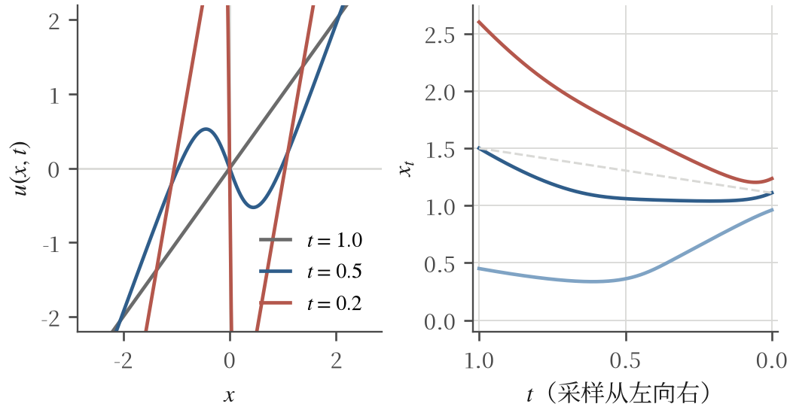
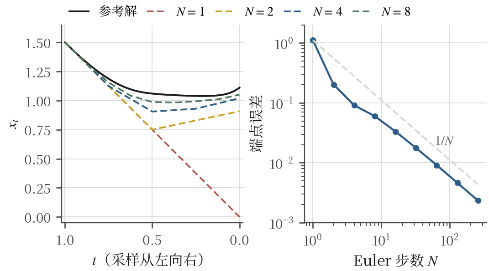

# 从扩散到流：速度场的语言

到这里，扩散模型的主线已经走完。这一章换一个角度重新看它。

前面一直在说噪声预测、后验、采样步数。如果把这些放在一边，只看采样时那个反复迭代的过程，会发现它其实是在解一条常微分方程。一旦这么看，扩散模型就变成了一个特例，背后是一类更一般的模型。

## 概率流 ODE

第 6 章的后验均值给出了一个确定性更新

$$x_{t-1} = \frac{1}{\sqrt{\alpha_t}}\left(x_t - \frac{\beta_t}{\sqrt{1-\bar\alpha_t}}\epsilon_\theta(x_t,t)\right).$$

把步长取小，写成连续时间的形式，得到

$$\frac{dx}{dt} = f(x,t) - \frac12 g(t)^2\nabla_x\log p_t(x).$$

这里有一个容易滑过去的细节：直接拿后验均值连同它注入的噪声一起取极限，得到的是反向 SDE；把噪声去掉、分数项取一半，才是这条确定性 ODE。两者的差别在下一小节按步长展开时看得最清楚。

这条 ODE 叫概率流 ODE。它的边缘分布与扩散的前向过程相同，但轨迹是确定的：给定初值，终值唯一。采样就是从 $t=T$ 积分到 $t=0$。

这里的 $\nabla\log p_t$ 就是分数，它可以由噪声预测换算出来，$\nabla\log p_t = -\epsilon_\theta/\sqrt{1-\bar\alpha_t}$。所以网络学的虽然是噪声，用起来却是一个向量场。

### 从迭代公式到微分方程

上面那句“把步长取小”值得展开，因为系数不是猜出来的，它在展开过程中自己长出来。

先把更新式换成不显含 $x_0$ 的写法。记 $a_t=\bar\alpha_t$，一个时间步的长度是 $\Delta$，第 8 章的 DDIM 写的是

$$x_{t-\Delta}=\sqrt{a_{t-\Delta}}\,\hat x_0+\sqrt{1-a_{t-\Delta}}\,\epsilon_\theta,\qquad \hat x_0=\frac{x_t-\sqrt{1-a_t}\,\epsilon_\theta}{\sqrt{a_t}}.$$

两式合并，把 $\hat x_0$ 消掉

$$x_{t-\Delta}=\sqrt{\frac{a_{t-\Delta}}{a_t}}\,x_t+\left(\sqrt{1-a_{t-\Delta}}-\sqrt{\frac{a_{t-\Delta}}{a_t}}\sqrt{1-a_t}\right)\epsilon_\theta.$$

现在让 $\Delta\to0$。连续时间里 $a_t$ 由 $\beta(t)$ 决定，$\mathrm{d}\ln a_t/\mathrm{d}t=-\beta(t)$。往回走一小步时 $a$ 变大，两条近似各取一阶

$$\sqrt{\frac{a_{t-\Delta}}{a_t}}\approx1+\frac{\beta\Delta}{2},\qquad \sqrt{1-a_{t-\Delta}}\approx\sqrt{1-a_t}-\frac{\beta a_t\Delta}{2\sqrt{1-a_t}}.$$

第二条来自链式法则：$\frac{\mathrm{d}}{\mathrm{d}t}\sqrt{1-a_t}=\frac{\beta a_t}{2\sqrt{1-a_t}}$，往回走是减。

把两条代进 $\epsilon_\theta$ 的系数，中间两项相消

$$-\frac{\beta a_t\Delta}{2\sqrt{1-a_t}}-\frac{\beta\Delta}{2}\sqrt{1-a_t}=-\frac{\beta\Delta}{2\sqrt{1-a_t}}\Big(a_t+(1-a_t)\Big)=-\frac{\beta\Delta}{2\sqrt{1-a_t}}.$$

提取的是公因子 $\frac{\beta\Delta}{2\sqrt{1-a_t}}$，提出来之后括号里正好是 $a_t$ 与 $1-a_t$ 的和。这一步是整段推导里唯一需要“凑”的地方：两项的系数不同，只有借 $a_t+(1-a_t)=1$ 才能合并成一个。于是

$$x_{t-\Delta}-x_t=\frac{\beta\Delta}{2}x_t-\frac{\beta\Delta}{2\sqrt{1-a_t}}\,\epsilon_\theta.$$

左边除以 $-\Delta$ 就是 $\mathrm{d}x/\mathrm{d}t$。再把分数换成噪声预测（$\nabla\log p_t=-\epsilon_\theta/\sqrt{1-a_t}$），得到

$$\frac{\mathrm{d}x}{\mathrm{d}t}=-\frac{\beta}{2}\left(x+\nabla\log p_t\right).$$

取 $f(x,t)=-\frac12\beta(t)x$、$g(t)=\sqrt{\beta(t)}$，就是本节开头那条式子的特例。

这条推导里藏着一个可以对照的细节。如果不用 DDIM 的更新，而用第 6 章的后验均值，并把 $\tilde\beta_t$ 对应的噪声也加回去，同样的展开会得到

$$\mathrm{d}x=\left[-\frac{\beta}{2}x-\beta\nabla\log p_t\right]\mathrm{d}t+\sqrt{\beta}\,\mathrm{d}w,$$

也就是反向 SDE。两个漂移相差 $\frac12\beta\nabla\log p_t=\frac12g^2\nabla\log p_t$，正好是被注入的噪声在平均意义上推走的那一份位移。确定性 ODE 把它扣掉了，所以它和 SDE 走出同样的边缘分布，只是少了随机抖动。

两种离散化的系数差一倍，乍看像矛盾。把 $\epsilon$ 前的系数按 $\Delta$ 展开就能对上：DDIM 给的是 $-\frac{\beta\Delta}{2\sqrt{1-a_t}}$，后验均值给的是 $-\frac{\beta\Delta}{\sqrt{1-a_t}}$。差的那个 2 是 SDE 与 ODE 的差别，不是推导错误。

### 一组具体数值

取 $\beta=0.1$ 为常数、$t$ 从 $1$ 积到 $0$。这条日程很浅，$t=1$ 处 $a_1=e^{-0.1}=0.9048$、$\sqrt{a_1}=0.9512$、$\sqrt{1-a_1}=0.3086$，整段都在低噪声区间，正好用来看两项如何抵消。设某处 $x=0.5$，网络给出 $\epsilon_\theta=0.3$。先把它换成干净图

$$\hat x_0=\frac{0.5-0.3086\times0.3}{0.9512}=0.4284,$$

再换成分数 $\nabla\log p_t=-0.3/0.3086=-0.972$。漂移是

$$\frac{\mathrm{d}x}{\mathrm{d}t}=-\frac{0.1}{2}\left(0.5-0.972\right)=0.0236.$$

注意量级。两项分别是 $-0.05\times0.5=-0.025$ 和 $+0.0486$，各自都比结果大，相减后只剩 $0.024$。在低噪声端，$x$ 项与分数项接近抵消，速度本身很小，对 $x$ 和 $\epsilon_\theta$ 的误差都敏感。用速度参数化的模型在这段区间更容易放大网络误差，这个观察在后面讨论损失权重时会再出现一次。

### 确定性带来什么

轨迹唯一这件事有几个直接后果，它们决定了后面几章为什么可以那样做。

一是可逆。给定 $x_T$ 能积出 $x_0$；反过来，给定一张图，从 $t=0$ 正向积分就能找到它对应的那条噪声。编辑方法大量依赖这个反向操作，第 22 章会专门讲它，那里真正的麻烦是离散化误差：用有限步走回去再走回来，图不会回到原样，回来的是一张“差不多”的图，差值被拿去当编辑方向用。

二是似然可算。连续时间的变量替换给出

$$\frac{\mathrm{d}}{\mathrm{d}t}\log p_t(x_t)=-\nabla\cdot u(x_t,t),$$

沿轨迹积分就得到两个时刻对数密度之差。这比第 4 章的 ELBO 干净，代价是每算一次都要估一次散度；在图像维度上只能用 Hutchinson 估计，方差不小。实际训练很少用它，但“扩散模型有精确似然”这句话的依据就在这里。

三是 ODE 不唯一。同一条边缘路径可以由不同的 $g(t)$ 实现，也可以由不同的噪声与数据配对实现，它们给出不同形状的轨迹，终点分布却相同。这个自由度正是下一节要利用的东西：既然轨迹可以选，就选一条好走的。

### 条件场是几项加起来的

到这里说的都是无条件分布。要生成指定的图，得换一个场。由贝叶斯公式

$$\nabla\log p_t(x\mid y)=\nabla\log p_t(x)+\nabla\log p_t(y\mid x),$$

第一项是模型本来就在学的，第二项描述“这张图有多像 $y$”。第 10 章的分类器引导直接给第二项加一个权重；无分类器引导不知道第二项，用两个场之差去近似它，再乘上引导强度 $w$。

放到 ODE 的语言里，引导是给速度场加了一个与 $x$ 有关的偏移。偏移把轨迹往条件倾向的方向推，也让场变得更陡：$w$ 越大，$x$ 与 $y$ 不匹配的地方速度越大，步长的要求随之变紧。调高引导后常见的副作用是色彩过饱和与生硬的轮廓，其中一部分可以用这个说法解释：同样的步数分摊到一条更弯、更陡的轨迹上。

## 把场直接学出来

既然采样只依赖这个向量场，能不能跳过噪声、后验、变分下界，直接回归一个场？

可以。做法是构造一条从数据到噪声的路径

$$x_t = \alpha_t x_0 + \sigma_t x_1,\qquad x_0\sim p_{\text{data}},\quad x_1\sim\mathcal{N}(0,I),$$

然后让网络去拟合这条路径上的速度 $v_t = \dot\alpha_t x_0 + \dot\sigma_t x_1$。训练目标就是

$$L = E_{t,x_0,x_1}\big\|v_\theta(x_t,t) - (\dot\alpha_t x_0 + \dot\sigma_t x_1)\big\|^2.$$

采样时从噪声出发，沿 $-v_\theta$ 积分回数据。


这套做法叫流匹配。它与扩散的关系是：扩散的速度场由分数定义，流匹配的速度场由回归学出来，两者在数学上可以互相换算。第 3 章的条件期望公式在这里又用了一次，只是这次换了一个分布去抽。

### 回归目标算出来的是什么场

先回答一个容易含糊的问题：网络拟合的到底是哪一条轨迹的速度？

一次训练抽到的是三元组 $(t,x_0,x_1)$，$x_t$ 由它们确定。同一个位置 $x$ 会被很多组不同的 $(x_0,x_1)$ 经过，它们的速度 $v_t$ 一般互不相同。平方损失对每个 $x$ 独立地做最小化，把平方展开

$$\|v_\theta(x,t)-v_t\|^2=\|v_\theta\|^2-2v_\theta\cdot v_t+\|v_t\|^2,$$

对 $v_\theta$ 求梯度得 $2v_\theta-2E[v_t\mid x_t=x]$，令其为零

$$v_\theta(x,t)=E[v_t\mid x_t=x].$$

所以学到的不是某一条路径的速度，而是经过该点的所有路径速度的加权平均，权重是后验 $p(x_0,x_1\mid x_t=x)$。单条轨迹可以很乱，只要它们在每个位置的平均是光滑的，网络就学得动。这也是为什么训练数据里那些“看着不像一条轨迹”的配对不会毁掉模型：模型根本没打算记住它们。

再补一步，说明这个平均值恰好是能让边缘分布按原路径演化的那个场。设 $p_t$ 是 $x_t$ 的分布，由 $x_t$ 的定义，对任意测试函数 $\varphi$

$$\frac{\mathrm{d}}{\mathrm{d}t}E[\varphi(x_t)]=E[\nabla\varphi(x_t)\cdot v_t]=E\big[\nabla\varphi(x_t)\cdot E[v_t\mid x_t]\big],$$

中间一步用全期望把内层条件期望换成外层。左边也写成密度形式 $\int\varphi\,\partial_tp_t$，右边分部积分一次得 $-\int\varphi\,\nabla\cdot(p_t\,E[v_t\mid x_t])$。$\varphi$ 任意，于是

$$\partial_tp_t+\nabla\cdot\big(p_t\,E[v_t\mid x_t]\big)=0.$$

这是连续性方程，它说的是：$E[v_t\mid x_t]$ 就是搬运密度 $p_t$ 的那个速度场。采样时积分这个场，边缘分布在每个时刻都对。

### 速度、噪声、分数是一回事

从同一个边缘路径出发，网络可以预测三样东西：噪声、干净图、速度。三者在数学上互相确定，差别只在数值稳定性和损失权重上，所以不同论文的选择不是不同的模型，而是同一模型的不同坐标。

设路径 $x_t=\alpha_tx_0+\sigma_tx_1$，$x_1\sim\mathcal{N}(0,I)$。给定 $x_0$，$x_t$ 是均值 $\alpha_tx_0$、协方差 $\sigma_t^2I$ 的高斯，所以

$$\nabla\log p_t(x)=-\frac{x-\alpha_t\,\hat x_0}{\sigma_t^2},\qquad \hat x_0=E[x_0\mid x_t=x].$$

反解出 $\hat x_0=(x+\sigma_t^2\nabla\log p_t)/\alpha_t$。代回速度的条件期望

$$v(x,t)=E[v_t\mid x_t=x]=\dot\alpha_t\hat x_0+\dot\sigma_t\,\frac{x-\alpha_t\hat x_0}{\sigma_t},$$

后一项用的是 $x_1=(x-\alpha_tx_0)/\sigma_t$。把 $\hat x_0$ 展开，含 $\sigma_t^2$ 的两项合并成一项，整理得

$$v(x,t)=\frac{\dot\alpha_t}{\alpha_t}x+\sigma_t\left(\frac{\dot\alpha_t\sigma_t}{\alpha_t}-\dot\sigma_t\right)\nabla\log p_t(x).$$

这个式子把两件事连起来：速度场等于“沿当前位置的缩放”加上“沿分数的修正”，后者把概率质量往数据所在的地方推。

对 VP 路径，$\alpha_t=e^{-\frac12\int_0^t\beta}$、$\sigma_t^2=1-\alpha_t^2$。代入 $\dot\alpha_t/\alpha_t=-\beta/2$ 与 $\dot\sigma_t=-\alpha_t\dot\alpha_t/\sigma_t=\alpha_t\beta/(2\sigma_t)$，方括号里的系数变成

$$\sigma_t\left(-\frac{\beta\sigma_t}{2}-\frac{\alpha_t\beta}{2\sigma_t}\right)=-\frac{\beta}{2}\left(\sigma_t^2+\alpha_t^2\right)=-\frac{\beta}{2},$$

于是 $v=-\frac{\beta}{2}(x+\nabla\log p_t)$，与上一节从 DDIM 推出来的漂移一字不差。换成噪声预测 $\epsilon=-\sigma_t\nabla\log p_t$

$$v=-\frac{\beta}{2}x+\frac{\beta}{2\sigma_t}\epsilon.$$

拿上一节的数验证：$-\frac{0.1}{2}\times0.5+\frac{0.1}{2\times0.3086}\times0.3=-0.025+0.0486=0.0236$，和用分数算的结果相同。

三种坐标的换算列在下面。表里那个系数 $\dot\sigma_t-\sigma_t\dot\alpha_t/\alpha_t$ 决定噪声一项的份量：对线性路径它是 $1/(1-t)$，对 VP 路径是 $\beta/(2\sigma_t)$。两者在低噪声端都发散，所以拿速度去表示噪声预测时，$\sigma_t$ 越小越不能直接除。

| 网络预测 | 分数 | 速度（一般路径） |
| --- | --- | --- |
| 噪声 $\hat\epsilon$ | $-\hat\epsilon/\sigma_t$ | $\frac{\dot\alpha_t}{\alpha_t}x+\left(\dot\sigma_t-\sigma_t\frac{\dot\alpha_t}{\alpha_t}\right)\hat\epsilon$ |
| 干净图 $\hat x_0$ | $(\alpha_t\hat x_0-x)/\sigma_t^2$ | $\frac{\dot\alpha_t}{\alpha_t}x+\left(\dot\sigma_t-\sigma_t\frac{\dot\alpha_t}{\alpha_t}\right)\frac{x-\alpha_t\hat x_0}{\sigma_t}$ |
| 速度 $\hat v$ | 把第一行的式子反解 | 直接用 |

三种参数化在同一条路径上只差一个与 $x_0,x_1$ 无关的因子，所以它们的损失只差权重。以线性路径 $\alpha_t=1-t$、$\sigma_t=t$ 为例，

$$v-v_\theta=\left(\dot\sigma_t-\sigma_t\frac{\dot\alpha_t}{\alpha_t}\right)(\epsilon-\epsilon_\theta)=\frac{1}{1-t}(\epsilon-\epsilon_\theta),$$

于是

$$\|v-v_\theta\|^2=\frac{1}{(1-t)^2}\|\epsilon-\epsilon_\theta\|^2.$$

换句话说，速度损失等价于把噪声损失按 $1/(1-t)^2$ 加权。$t$ 小（低噪声）时权重接近 1，$t\to1$ 时权重发散。训练时如果对 $t$ 均匀采样，速度参数化会自动把注意力压向低噪声端，细节学得细，全局结构学得慢；改成 logit-normal 之类往中间挤的采样密度，就是在补这一点。这个换算也能反着用：想让某种参数化的有效权重呈某个形状，按同样的因子去调 $t$ 的采样密度即可，两者只能选一个地方改，同时改会重复计数。

训练循环本身很短，形状上的坑比公式多。

```text
x_0 ~ 数据，batch 形状 [B, C, H, W]
t ~ p(t)，形状 [B]，t 取 (0, 1)
eps ~ N(0, I)，形状 [B, C, H, W]
x_t = alpha[t] * x_0 + sigma[t] * eps      # alpha, sigma 按 batch 取
loss = mean(w[t] * ||v_theta(x_t, t) - (dalpha[t]*x_0 + dsigma[t]*eps)||^2)
```

`alpha`、`sigma` 必须按样本取，不能取 batch 内的平均；把 $t$ 广播成 `[B,1,1,1]` 再乘，否则低噪声和高噪声的样本会被混在同一个噪声水平上，训练出来的是一个不存在的路径。另一个坑在 $t$ 很小时：$\sigma_t$ 接近零，BN 或 LayerNorm 里的方差估计会抖，通常把 $t$ 的下界截到千分之一量级。

采样循环与训练逐行对应，只有符号容易写错

```text
x = 噪声
ts = 从 T 递减到 0 的网格
for i in range(len(ts) - 1):
    v = v_theta(x, ts[i])
    x = x - (ts[i] - ts[i+1]) * v
```

速度定义为 $\mathrm{d}x/\mathrm{d}t$，反向积分时步长带负号，两者相消，所以代码里写减号。网格最后一个点最好刚好是 0：若停在 0.02 之类的位置，图里会留下一层没去干净的噪声，看起来是细碎的彩色颗粒。

与噪声预测的写法相比，这里不需要推后验、不需要推 $\bar\alpha_t$，只要一个日程表 $\alpha_t,\sigma_t$ 和一个场。这也是流匹配在工程上更受欢迎的原因之一：变体（改路径、改配对、改权重）都只改动几行。

### 直线配对不等于直线轨迹

“直线路径的模型，边际轨迹更直”这句话需要一处澄清，否则判断步数时会算错。

“直线”指的是配对：一对 $(x_0,x_1)$ 之间的插值是一条线段。采样走的是边缘速度场，只有当给定 $x_t$ 时后验退化成一点，配对直线才等于轨迹直线。真实数据的后验不是一个点，两者就不一致。

一个反例足够说明。取数据为 $\mathcal{N}(0,I)$、噪声也是 $\mathcal{N}(0,I)$，路径 $\alpha_t=1-t$、$\sigma_t=t$。这时 $p_t=\mathcal{N}(0,((1-t)^2+t^2)I)$，分数是 $-x/((1-t)^2+t^2)$，代入换算式

$$v(x,t)=\left[-\frac{1}{1-t}+\frac{t}{(1-t)\big((1-t)^2+t^2\big)}\right]x=\frac{2t-1}{(1-t)^2+t^2}\,x .$$

场是线性的，而且 $c(t)=\frac{2t-1}{(1-t)^2+t^2}=\frac12\frac{\mathrm{d}}{\mathrm{d}t}\ln\big((1-t)^2+t^2\big)$，所以轨迹有闭式解

$$x_t=z\sqrt{(1-t)^2+t^2}.$$

在 $t=0.5$ 处根号里是 $0.5$，模长缩到起点的 $1/\sqrt2\approx0.71$ 倍；到 $t=0$ 又回到原值。轨迹先收再放，是一段弧。配对完全线性，轨迹照样弯，而且弯的幅度可以精确算出来。

要让轨迹严格变直，得让后验变成点质量：每个噪声只对应一个数据点。极端情形是数据只有一个点 $c$，此时 $\hat x_0\equiv c$、$v=(x-c)/t$，轨迹是 $x_t=(1-t)c+tx_1$，一条直线，一步 Euler 就精确。真实数据介于两者之间——多峰、有宽度——后验是若干峰的组合，轨迹的弯曲就来自这些峰在积分过程中此消彼长。重配对（reflow）想把弯的压掉，做的事正是让新的配对更接近“一个噪声对一个数据点”。

### 配对是可以选的

路径的形状由两件事决定：$\alpha_t,\sigma_t$ 的日程，和 $x_0$ 与 $x_1$ 怎么配。第一件决定噪声如何注入，第二件决定轨迹往哪儿弯。日程在扩散里已经研究得很透（第 6 章、第 9 章），配对则是流匹配额外多出来的一个旋钮。

最省事的配对是独立抽取：batch 里每个 $x_0$ 与每个 $x_1$ 都不相干。它实现简单，代价是配上的往往是一对毫无关系的东西，轨迹在中间要拐一个大弯。

一个改进是在 batch 内做最优传输：算出 $B\times B$ 的代价矩阵，按最小总距离重新配对。$B=64$ 时矩阵是 4096 个数，计算可以忽略；代价是配对随 batch 变化，同一张图在不同 batch 里配到的噪声不同，场的方差大一些。有些实现把这个配对只当作训练的辅助，推理仍用独立噪声。

还有一个方向是重配对：先用训好的场把每张图送到它对应的噪声，得到一批“确定配对”的样本，再用这批样本重训一次。这一步把多峰的耦合压成近似单峰，轨迹变直，步数下降。代价是每轮重配对都要跑一遍全量数据的 ODE，反复执行还会损失多样性，因为每次重配对都在“记住”上一轮的配对习惯。

## 为什么关心轨迹直不直

采样步数取决于轨迹的弯曲程度。Euler 方法走一步，误差与曲率成正比。轨迹越直，能用的步长越大。

扩散的轨迹通常是弯的，因为不同的数据点被不同的噪声配对，路径在中间交叉，平均之后方向就偏了。直线路径的模型想解决这个问题，办法是让配对尽量合理，或者用重配对把轨迹拉直。

这个问题值得单独研究。这里先记住一个结论：一步生成的关键，是让从噪声到数据的映射尽量接近一条直线。

### 误差从哪里来

一步 Euler 是 $x_{t-\Delta}=x_t-\Delta\,u(x_t,t)$。把真解在 $t$ 处展开

$$x_{t-\Delta}=x_t-\Delta\,u+\frac{\Delta^2}{2}\frac{\mathrm{d}u}{\mathrm{d}t}+O(\Delta^3),$$

总导数 $\frac{\mathrm{d}u}{\mathrm{d}t}=\partial_tu+(\nabla u)\,u$，后一项是场把轨迹带离原地时速度自己发生的变化。局部误差是 $\frac{\Delta^2}{2}|\dot u|$，走 $N=T/\Delta$ 步后全局误差是 $O(\Delta)=O(1/N)$。二阶方法把局部误差做到 $O(\Delta^3)$，全局 $O(1/N^2)$。

$\dot u$ 就是“弯曲”的定量说法：速度沿轨迹变化越快，每步少算的那一截越多。轨迹是直线时 $\dot u=0$，任何步长都精确。这也说明步数不能靠调步长“感觉”出来，它与场沿轨迹的变化率直接挂钩，同一个模型在简单样本上几步就够、在复杂样本上要多走，是有原因的。

有一条不用真值就能做的检查：拿同一个噪声，分别跑 $N$ 步和 $4N$ 步，比两个结果。差得很少，说明剩下的误差已经小于肉眼能分辨的程度；差得很明显，尤其是主体结构都变了，说明轨迹在那段步长里转了弯，继续加步数或换高阶求解器才有意义。这比看损失曲线有用，因为损失衡量的是场与回归目标的距离，它无法告诉你积分出来的轨迹是不是早就跑偏了。

### 一个能对着算的例子

用两个高斯（均值 $\pm1$、标准差 $0.1$）作数据，路径取 $\alpha_t=1-t$、$\sigma_t=t$。$t=1$ 时后验与 $x$ 无关，$\hat x_0$ 等于数据的均值 $0$，场是 $u(x,1)=x$；$t=0.5$ 时两个模式在 $\pm0.5$，场在中间有一小段接近水平，向外变陡。



左图的形状要记一下。$t$ 越小，场在两个模式之间越陡，因为 $\hat x_0$ 在那里几乎是阶跃：稍稍越过中点，后验就整体倒向另一个模式。陡的地方正是 Euler 最容易出错的地方，它用一步的斜率外推，斜率在步内变了它看不见。

右图是从 $0.45$、$1.5$、$2.6$ 出发的三条轨迹。从 $1.5$ 出发的那条，在 $t=0.5$ 时已经落到 $1.06$，在 $t\approx0.25$ 处贴到 $1.04$，末端回到 $1.11$；而起点到终点的直线在 $t=0.5$ 处应在 $1.30$ 附近。位移不大，路径不短，弯就弯在前半段。从 $0.45$ 出发的那条更明显：先降到 $0.357$，再一路上升到 $0.96$，中间穿过两个模式之间的平缓区。

同一个初值 $z=1.5$ 下，Euler 的落点如下。

| Euler 步数 $N$ | 端点 $x_0$ | 端点误差 |
| --- | --- | --- |
| 1 | 0.000 | 1.111 |
| 2 | 0.908 | 0.203 |
| 4 | 1.020 | 0.091 |
| 8 | 1.051 | 0.060 |
| 16 | 1.078 | 0.033 |
| 32 | 1.093 | 0.018 |
| 64 | 1.102 | 0.009 |

$N=1$ 那一行值得停一下：落点正好是 $0$，两个模式的中间。这不是巧合。$t=1$ 时后验与 $x$ 无关，$u(x,1)=x-\hat x_0=x$，一步 Euler 在 $\Delta=1$ 时给出的就是 $\hat x_0$，也就是数据的均值。一步 Euler 的输出等于条件均值，这句话在下一章会以“一步生成输出模糊图”的形式再出现一次。

$N=2$ 到 $N=4$ 误差掉得快，因为第一步跨得太大，之后才是平稳的一阶收敛。要看趋势得看右半段：$N$ 每翻一倍误差减半，$N=64$ 时约 $0.009$。



右图把误差画在对数坐标上，趋势是一条斜率 $-1$ 的直线，与 $1/N$ 参考线平行。要把误差压到 $0.001$ 这个量级，按这个斜率得几百步。真实模型的场比这里光滑，同样的精度用几十步就够，但关系不变：误差与步数成反比，靠调步长换不到“一步”。

### 步长不必均匀

$u$ 沿轨迹的变化率不是常数，误差也就不均匀地分布在 $t$ 轴上。还是从 $1.5$ 出发的那条轨迹：$t$ 从 $1$ 到 $0.3$ 这一段走了约 $0.46$ 的路程，$t$ 从 $0.3$ 到 $0$ 只走了 $0.07$。均匀网格把步数平均分给两段，等于把一半的算力花在几乎不动的后半段。

常见的做法是按对数信噪比 $\lambda=\log(\alpha_t/\sigma_t)$ 均匀取点，或按 $\sigma$ 的幂次排布、让低噪声端密一些（第 9 章的 Karras 日程）。同样的 $N$ 下，网格与场匹配时误差能降好几倍，但网格一旦不匹配，误差会集中到稀疏的那一段，表现是某个噪声水平上的细节糊掉，而其他尺度看着正常。

这也解释了为什么“同样 20 步”的两个采样器结果差很多：它们不只是公式不同，取点的位置也不同，一个在弯处放得多，一个放得少。

### 场学坏了长什么样

三类失败长得不一样，分开认更容易定位。

一是某段 $t$ 上的场不准。典型原因是 $t$ 的采样密度太低，那一段的样本少，总损失看着在降，但生成结果在对应的尺度上出现固定伪影，比如纹理重复、边缘发毛。诊断办法是按 $t$ 分桶统计损失，哪个桶明显偏高就是哪一段紧缺。

二是模式之间的场不光滑。数据多峰时后验在模式间切换，$E[v_t\mid x_t]$ 本身连续，但它在两峰之间的斜率很大；容量不够的网会学出一个“台阶”，轨迹走到台阶上就被弹向一侧。表现是同一提示词下生成的样本总偏向某一类，覆盖率比真实数据窄。

三是低噪声端数值不稳。$\sigma_t\to0$ 时把速度换成噪声要除以 $\sigma_t$（表里第二行），一处小的网络误差被放大成很大的 $\epsilon$ 误差，轨迹在最后几步抖。把 $t$ 的下界截住、改用干净图参数化，都能缓解，代价是最后那一小段的信息损失掉，细节略微发软。

## 一步生成的三条路

如果轨迹真的直，一步就够。但在真实数据上做不到严格直，于是有几种折中。

第一种是把多步折进网络的参数，用蒸馏把教师模型的行为压缩到学生模型里。一致性模型、分布匹配蒸馏都属于这一类。

第二种是把多步折进网络的输入，让网络直接输出整段位移的平均速度。MeanFlow 走的是这条路，它用一个从定义推出的恒等式来训练，不需要教师。

第三种是换采样器，用高阶方法在同样的步数下把误差压下去。DPM-Solver 属于这一类，它没有减少步数的下界，只是让每一步更准。

三条路的代价不同。蒸馏要教师，平均速度要算雅可比向量积，高阶求解器要更多的单步计算。

把三种代价放到同一把尺子上，会看得更清楚。

蒸馏的代价在数据上。学生要覆盖教师的分布，训练时得不断从教师那里采样，一个 batch 里既有学生的输出又有教师的输出，显存和时间都比直接训练一个同规模的模型贵。它换来的是推理阶段一次前向，代价从推理搬到了训练。

平均速度的代价在导数上。那个恒等式里有一项对时间的全导数，训练时要算雅可比向量积（JVP），一次 JVP 的成本大约相当于再一次前向，反向传播还要再穿一遍。它换来的是不需要教师，也就不需要先训一个多步模型。

高阶求解器的代价在每步。两步法一次迭代要两次网络评估，三阶更多。它换来的是同样的步数下误差小一到两个数量级，但到了步数很低的区间，误差的主要成分不再是离散误差，而是“场在这个尺度上本来就不准”，高阶方法就没什么空间可发挥。

三条路面对的是同一个东西：单值函数装不下一条弯曲轨迹的全部信息。蒸馏用教师的信息去填这个缺口，平均速度用一个恒等式把整段积分提前算好，高阶求解器把每步的截断误差压到很小。换个说法，它们都在用不同的资源换“路径可以一步跨过”这个假定的成立程度，而没有一条真正把路径变直。真正把路径变直的办法在上一节：改配对。

这也解释了为什么工程上三者经常同时出现：重配对把轨迹拉直，蒸馏把剩下的弯折进参数，高阶求解器负责最后一段的精度。它们作用于路径的不同环节，叠加起来才降到个位数步数。

## 这一章的位置

把这一册的内容压缩成一句话：扩散模型学会了在每一个噪声水平上去掉一点噪声，把这些小步连起来，就成了一条从噪声到数据的路径。

换个角度看，这条路径是一条常微分方程的解，网络学的那个量其实是一个向量场。一旦接受这个说法，前面几章的零散结论就串起来了：采样器的差别是解方程的方法不同，步数的瓶颈是轨迹的弯曲程度，条件引导是对场做了外推。

顺着这条路再往前，自然会问一个问题：这条路径能不能不走，或者只走一步。要回答它，得先把路径本身当成研究对象。下一章讲的就是这件事：把几十步压成一两步的几种做法，以及它们各自在拿什么换速度。
