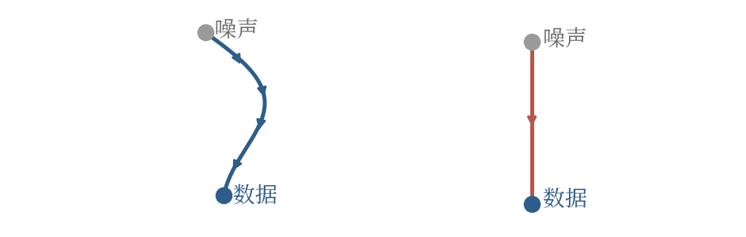

# 从扩散到流：速度场的语言

到这里，扩散模型的主线已经走完。这一章换一个角度重新看它。

前面一直在说噪声预测、后验、采样步数。如果把这些放在一边，只看采样时那个反复迭代的过程，会发现它其实是在解一条常微分方程。一旦这么看，扩散模型就变成了一个特例，背后是一类更一般的模型。

## 概率流 ODE

第 6 章的后验均值给出了一个确定性更新

$$x_{t-1} = \frac{1}{\sqrt{\alpha_t}}\left(x_t - \frac{\beta_t}{\sqrt{1-\bar\alpha_t}}\epsilon_\theta(x_t,t)\right).$$

把步长取小，写成连续时间的形式，得到

$$\frac{dx}{dt} = f(x,t) - \frac12 g(t)^2\nabla_x\log p_t(x).$$

这条 ODE 叫概率流 ODE。它的边缘分布与扩散的前向过程相同，但轨迹是确定的：给定初值，终值唯一。采样就是从 $t=T$ 积分到 $t=0$。

这里的 $\nabla\log p_t$ 就是分数，它可以由噪声预测换算出来，$\nabla\log p_t = -\epsilon_\theta/\sqrt{1-\bar\alpha_t}$。所以网络学的虽然是噪声，用起来却是一个向量场。

## 把场直接学出来

既然采样只依赖这个向量场，能不能跳过噪声、后验、变分下界，直接回归一个场？

可以。做法是构造一条从数据到噪声的路径

$$x_t = \alpha_t x_0 + \sigma_t x_1,\qquad x_0\sim p_{\text{data}},\quad x_1\sim\mathcal{N}(0,I),$$

然后让网络去拟合这条路径上的速度 $v_t = \dot\alpha_t x_0 + \dot\sigma_t x_1$。训练目标就是

$$L = E_{t,x_0,x_1}\big\|v_\theta(x_t,t) - (\dot\alpha_t x_0 + \dot\sigma_t x_1)\big\|^2.$$

采样时从噪声出发，沿 $-v_\theta$ 积分回数据。

这套做法叫流匹配。它与扩散的关系是：扩散的速度场由分数定义，流匹配的速度场由回归学出来，两者在数学上可以互相换算。第 3 章的条件期望公式在这里又用了一次，只是这次换了一个分布去抽。

## 为什么关心轨迹直不直

采样步数取决于轨迹的弯曲程度。Euler 方法走一步，误差与曲率成正比。轨迹越直，能用的步长越大。

扩散的轨迹通常是弯的，因为不同的数据点被不同的噪声配对，路径在中间交叉，平均之后方向就偏了。直线路径的模型想解决这个问题，办法是让配对尽量合理，或者用重配对把轨迹拉直。

这个问题值得单独研究。这里先记住一个结论：一步生成的关键，是让从噪声到数据的映射尽量接近一条直线。

## 一步生成的三条路

如果轨迹真的直，一步就够。但在真实数据上做不到严格直，于是有几种折中。

第一种是把多步折进网络的参数，用蒸馏把教师模型的行为压缩到学生模型里。一致性模型、分布匹配蒸馏都属于这一类。

第二种是把多步折进网络的输入，让网络直接输出整段位移的平均速度。MeanFlow 走的是这条路，它用一个从定义推出的恒等式来训练，不需要教师。

第三种是换采样器，用高阶方法在同样的步数下把误差压下去。DPM-Solver 属于这一类，它没有减少步数的下界，只是让每一步更准。

三条路的代价不同。蒸馏要教师，平均速度要算雅可比向量积，高阶求解器要更多的单步计算。

## 这一章的位置

把这一册的内容压缩成一句话：扩散模型学会了在每一个噪声水平上去掉一点噪声，把这些小步连起来，就成了一条从噪声到数据的路径。

换个角度看，这条路径是一条常微分方程的解，网络学的那个量其实是一个向量场。一旦接受这个说法，前面几章的零散结论就串起来了：采样器的差别是解方程的方法不同，步数的瓶颈是轨迹的弯曲程度，条件引导是对场做了外推。

顺着这条路再往前，自然会问一个问题：这条路径能不能不走，或者只走一步。要回答它，得先把路径本身当成研究对象。下一章讲的就是这件事：把几十步压成一两步的几种做法，以及它们各自在拿什么换速度。
