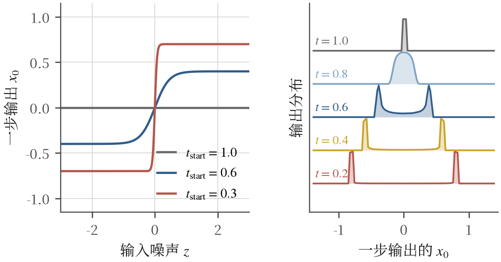

# 一步生成：把积分折起来

扩散与流模型的采样都要迭代几十次。部署时这是主要成本，所以过去几年最热闹的方向之一，就是把步数压到一两步。

这一章把几条路线过一遍，只说清它们在用什么换速度。推导放在需要的地方，不让公式挡住路。

## 为什么一步很难

从噪声到数据的映射是多值的：同一个噪声，可能对应许多张合理的图。多步采样在每一步注入随机性，相当于在多个可能之间做选择；一步模型只有一次机会。

在平方损失下，一次机会的最优解是条件均值，也就是多个可能结果的平均。平均出来就是一张模糊的图。

所以，一步生成要解决的不是“网络不够大”，而是“一次前向装不下多次选择”。

### 多值性属于配对，不属于数据

“映射是多值的”这句话要说得准一点，否则容易和概率流 ODE 的确定性冲突——上一章刚说过，给定初值，终值唯一。

冲突是表面的。多值性不在 ODE 里，在前向过程里。前向把 $x_0$ 送到 $x_t$ 的映射

$$x_t=\alpha_tx_0+\sigma_tx_1,\qquad x_1\sim\mathcal{N}(0,I)$$

是多对一的：只要 $\sigma_t>0$，任意一个 $x_t$ 都可能来自任何一个 $x_0$，只是权重不同。所以它的“逆”不是一个函数，而是一个条件分布 $p(x_0\mid x_t)$。一步模型要学的是一个函数 $G:z\mapsto x_0$，函数的像是一个点，它必须从这个分布在 $z$ 处的多个峰里挑一个。

$t=1$ 的情形最能说明问题。线性路径下 $\alpha_1=0$、$\sigma_1=1$，于是 $x_1$ 与 $x_0$ 独立，后验退化成先验

$$p(x_0\mid x_1)=p_{\text{data}}(x_0),$$

它与 $x_1$ 的取值无关。既然与输入无关，单值函数能给出的最好答案只有一个：$p_{\text{data}}$ 的均值，一个常数。所以“从纯噪声一步到数据”这件事，在配对是独立抽取的前提下，数学上就没有非平凡的解。

起步时刻往后挪，情况才有变化。$t$ 越小，$\sigma_t$ 越小，后验越尖，一步映射越能分辨模式。用两个高斯（均值 $\pm1$、标准差 $0.1$）作数据算一遍：从 $t=1$ 起跳，输出恒为 $0$；从 $t=0.6$ 起跳，输出在 $\pm0.4$ 附近分成两支，中间有一段过渡；从 $t=0.3$ 起跳，两支已经分开到 $\pm0.7$，符号全对。

注意 $t=0.3$ 那一支的平台高度是 $0.7$，不是 $1$。这是这条路径上的解析结果：一步走完 $z\mapsto z-t\,u(z,t)$，在线性路径上恰好等于 $\hat x_0=(1-t)\cdot\text{sign}(z)$。幅度被压成了 $1-t$ 倍。真实的一步模型用训练去补偿这个压缩，但补偿本身要靠另一个约束（分布匹配或对抗）来监督，光靠回归补不回来——回归的最优解就是这个压缩过的值。

这条结论比它看起来更有用：它说明“一步”能不能成，取决于从哪个 $t$ 起跳、以及 $x_0$ 与 $z$ 是怎么配的，而不取决于网络多大。后来所有能跑的一步模型，改的都是这两件事中的一件。

### 条件均值是最优的单值答案

把“最优解是条件均值”这句话推一遍，用的是一个配方：加一项减一项。

记 $m(z)=E[x\mid z]$，$\|\cdot\|$ 是欧氏范数。对任意函数 $G$

$$\|G(z)-x\|^2=\|G(z)-m(z)\|^2+2\big(G(z)-m(z)\big)\cdot\big(m(z)-x\big)+\|m(z)-x\|^2.$$

中间那一项取期望后是零：

$$E\Big[\big(G(z)-m(z)\big)\cdot\big(m(z)-x\big)\Big]=E\Big[\big(G(z)-m(z)\big)\cdot\underbrace{E[m(z)-x\mid z]}_{=0}\Big]=0,$$

内层为零是因为 $m(z)$ 就是条件期望。剩下两项，第二项与 $G$ 无关，第一项对每个 $z$ 单独取下界，取 $G(z)=m(z)$ 时为零。于是

$$E\|G(z)-x\|^2=E\|x-m(z)\|^2+\underbrace{E\|G(z)-m(z)\|^2}_{\ge0},$$

下界在 $G=m$ 处取到，且与 $G$ 属于哪个函数类无关——只要能取到，就是最优。

拿两个等权点 $\{-1,+1\}$ 算一下，$m(z)=0$。三种策略的均方误差：恒输出 $0$，误差是 $1$；恒输出 $+1$，误差是 $\frac12\cdot0+\frac12\cdot4=2$；以一半概率押对，误差仍是 $\frac12\cdot0+\frac12\cdot4=1$。中间那张模糊的图和“清晰但一半概率错得离谱”的图，在平方误差下得分一样。

这就是问题的根。平方损失对这四种情况给不出区别：它把“在两种可能之间摇摆”与“确实就是这样”当成同一件事。多步采样之所以不模糊，不是因为它的每一步更准，而是因为它在中间步骤用注入的噪声做了选择，每一步只承担一次局部的、方差更小的决定，最后落在某个模式上。

把上面的下界看成一个数：在两个等权点的例子里，条件方差恒为 $1$，于是 $E\|x-m(z)\|^2=1$，等于数据本身的方差。换句话说，从 $t=1$ 起跳的一步回归，理论上限就是把全部方差原封不动地留在残差里，模型再好也只能得到数据的均值。这个下限与网络无关，与训练多久也无关。

从这个角度，蒸馏要有第二项损失就顺理成章了。平方回归必然指向均值，想要模式，就得让损失里的权重依赖 $x$：加权后的最优解是

$$G(z)=\frac{E[w(z,x)\,x]}{E[w(z,x)]},$$

只要 $w$ 在某个模式附近偏大，这个比值就被拉到那个模式上。各种蒸馏方法的差别，很大程度上就是 $w$ 怎么来的。

### 换更大的网络不解决问题

一个常见的直觉是：模糊是因为网络没学到，参数量上去就好了。

这条直觉在这里失效，因为最优解由损失决定，不由函数类决定。把网络加宽，只是让它更接近 $G=m(z)$ 这个解，得到的图更“干净地模糊”，而不是更清晰。容量解决的是表达能力，这里缺的是信息——给定 $z$，数据里本来就有多种可能，任何一个单值函数只能报一个数。

要跳出这个局面，得改三件事之一：允许输出多值（额外输入、离散选择、多候选），换损失（加权、分布匹配、对抗），或者改配对（让后验近似单峰）。三条路线正好对应这三条出路。

## 路线一：蒸馏

先有一个好的多步模型当教师，再训练一个学生，让它一次前向复现教师的结果。

只做回归不行，学生学到的还是条件均值，仍然模糊。所以要在回归之外加一项：分布匹配，让学生生成的分布贴近真实分布；或者对抗损失，用判别器补高频细节。

一致性模型属于这一类的另一支：它不要求学生的输出接近教师的某一次采样，而要求同一条轨迹上的不同点映射到同一个终点。这个约束更松，训练也更难，早期工作需要 curriculum 才能稳定。

蒸馏的共同前提是要有教师，训练成本高，但推理确实是一步。

### 三种损失把质量推到模式上

回归加权的做法可以写成一个加权最小二乘，权重依赖教师。设学生在 $z$ 处输出 $G(z)$，教师在同一个 $z$ 处的采样是 $x^{\text{tea}}$，取

$$L=E\Big[w(z)\,\big\|G(z)-x^{\text{tea}}\big\|^2\Big].$$

最优解是 $E[w\,x^{\text{tea}}]/E[w]$。若 $w$ 在样本与数据流形偏离大的地方取大值，解就被推离均值。分布匹配蒸馏一类方法用教师与学生在同一点的分数差来构造这个权重：分数差指向“往哪儿挪才更像数据”，于是挪动之后的位置成了回归目标，而权重由差的大小给出。这个做法不需要判别器，但每次更新要估两个分数，还要对样本求导。

一致性约束走的是另一条路。它不比较某一次采样，而比较同一条轨迹上的两个时刻

$$L=E_{t,\Delta}\Big\|f_\theta(z_t,t)-f_\theta\big(z_{t-\Delta},t-\Delta\big)\Big\|^2,\qquad f_\theta(z_0,0)=z_0.$$

边界条件保证终点不动，相邻点相等保证一步等于多步。这个约束在连续极限下等价于要求 $f$ 沿轨迹不变，即 $f$ 是轨迹终点的函数。它的好处是不需要教师的对齐，坏处是约束本身是“点对点”的，容易塌到一个平凡解（所有点映到同一个终点），实际训练要靠噪声注入或离散化的随机性来防止。

跨度 $\Delta$ 取多大，直接决定它离回归有多近。$\Delta$ 很小时约束只要求相邻两步的结果差不多，几乎不提供额外信息；$\Delta$ 取到整段时，约束变成“一步的结果等于多步的结果”，而那正是平方回归那个模糊的目标。中间那一段才好用，但哪一段合适取决于网络已经学到什么，所以早期工作要靠 curriculum 把 $\Delta$ 从小往大放。

对抗项最直接：判别器只看整图，它把“平均出来的图偏软”这件事识别出来，逼学生补上高频。代价是训练不稳，需要平衡判别器与学生的更新节奏。

### 蒸馏的代价

三笔账要分开算。

教师采样的账最容易被低估。学生的训练样本要从教师那里现采，一个 batch 就是一次完整的教师采样。按教师 50 步、batch 取 32 粗算，一次迭代要 1600 次前向（量级估计），是直接训练同一规模模型的几十倍。这也是为什么蒸馏通常在教师已经训好、且不再改动的前提下做。

覆盖的账隐蔽一些。每次蒸馏都会丢一点多样性：分布匹配与对抗都只看“像不像”，对“少了哪一类”不敏感。单次蒸馏丢一点还能接受，把学生当教师再蒸一次，误差会累积，两三轮之后常见的现象是同一提示词下只有一种构图。

结构错配的账在低步数端显形。学生没有时间维度上的迭代，它在低噪声端要一次补齐所有细节，而教师在那一段是几十次小修正。学生的容量与感受野要重新设计，直接照搬教师结构再砍掉时间条件，往往在纹理上先崩。

## 路线二：把步数折进输入

不蒸馏，直接改网络的条件：让它知道“要从哪个时刻走到哪个时刻”。

MeanFlow 是代表。它定义一个平均速度

$$u(z,r,t) = \frac{1}{t-r}\int_r^t v(z_\tau,\tau)\,d\tau,$$

也就是“整段位移除以时间”。采样时一步走完：$z_r = z_t - (t-r)u(z_t,r,t)$。

难点是这个量没有现成的标签。MeanFlow 从定义推出一个恒等式，用恒等式右边作为回归目标，训练时用雅可比向量积算导数。它不需要教师，但对训练细节敏感。

### 平均速度的恒等式

恒等式来自对定义式求导，一步就够。

把定义写成不含分式的形式

$$(t-r)\,u(z_t,r,t)=\int_r^t v(z_\tau,\tau)\,\mathrm{d}\tau .$$

两边沿轨迹对 $t$ 求全导数。左边用乘积法则，右边用微积分基本定理（上限是 $t$，被积函数在 $t$ 处取值）

$$u+(t-r)\frac{\mathrm{d}u}{\mathrm{d}t}=v(z_t,t).$$

移项得到两条等价的用法

$$v(z_t,t)=u+(t-r)\frac{\mathrm{d}u}{\mathrm{d}t},\qquad u(z_t,r,t)=v(z_t,t)-(t-r)\frac{\mathrm{d}u}{\mathrm{d}t}.$$

第一条说明瞬时速度与平均速度差一个“平均速度自己还在变”的修正项；第二条把 $u$ 写成了可回归的目标——右端的 $v$ 是已知的（它就是路径上的 $\dot\alpha_tx_0+\dot\sigma_tx_1$ 在 $z_t$ 处的值），而 $\mathrm{d}u/\mathrm{d}t$ 是网络自己的一阶变化率，用雅可比向量积算：

$$\frac{\mathrm{d}u}{\mathrm{d}t}=\partial_zu\cdot\dot z+\partial_tu,\qquad \dot z=v(z_t,t).$$

方向取 $(\dot z,1)$，一次前向带一次 JVP 就能同时拿到两项。实现里 $\dot z$ 常用网络自己的输出代替并断开梯度，否则目标里出现二阶导，训练会不稳。

检查两个极限，能确认恒等式没写错。$r\to t$ 时 $(t-r)\to0$，右端退化成 $v$，与定义一致：平均区间退成一点，平均速度就是瞬时速度。$r=0,t=1$ 时 $u$ 是整段的平均，一步采样正好用这个值。这两端的差别，也解释了为什么训练时 $t-r$ 的采样必须覆盖整个区间：如果样本都集中在 $t-r$ 很小的地方，网络只学会了“小区间平均”，而推理时要的是“整段平均”，两者差得最远。

### 不用教师，但训练更脆

这条路省掉了教师，代价挪到了训练的稳定性上，问题出在自举。

目标里的 $\dot z$ 与 $u$ 用的是同一个网络，等于让网络用自己的输出监督自己。恒等式本身是精确的，但网络在训练早期并不满足它：$u$ 与 $v$ 彼此不自洽时，修正项会把误差放大而不是抵消。常见的补救是给 $\dot z$ 加 stop-gradient、把 $t-r$ 的分布偏向小值做 warmup、并且只在 $u$ 已经能大致复现 $v$ 之后才放开大区间。

一次 JVP 的成本大约相当于再一次前向，反向传播还要穿一遍，所以单步训练成本大约是普通流匹配的两到三倍（量级估计）。换来的是推理阶段 1 NFE，并且 $r$ 可以取任意时刻——这一点与上一节的结论对得上：从半噪声起跳比从纯噪声起跳容易得多，而在纯噪声端，一步模型无论如何都要面对“后验与输入无关”这个数学事实。

## 路线三：把每一步做得更准

不减少步数，而是用高阶求解器在同样的步数下把误差压下去。DPM-Solver 一类的做法属于这一种。

它没有绕开多值性，只是让积分更精确。所以步数能降，但降不到一。

### 二阶换来的步数

最朴素的二阶方法是中点法：用一次 Euler 试探出一个中点，再用中点处的场走完整一步

$$\tilde x=x_t-\frac{\Delta}{2}u(x_t,t),\qquad x_{t-\Delta}=x_t-\Delta\,u\Big(\tilde x,\ t-\frac{\Delta}{2}\Big).$$

每步两次网络评估，局部误差从 $O(\Delta^2)$ 降到 $O(\Delta^3)$，全局从 $O(1/N)$ 到 $O(1/N^2)$。

按阶数推，步数应该能砍掉一大半。实测往往没那么好。还是上一章那个双峰例子，从 $z=1.5$ 出发，参考终点 $1.111$：

| 求解器 | 步数 | 网络评估次数 | 端点误差 |
| --- | --- | --- | --- |
| Euler | 4 | 4 | 0.091 |
| Euler | 8 | 8 | 0.060 |
| 中点法 | 2 | 4 | 0.239 |
| 中点法 | 4 | 8 | 0.064 |
| 中点法 | 8 | 16 | 0.015 |
| 中点法 | 16 | 32 | 0.004 |

同样的 8 次评估，中点法（4 步）的误差是 $0.064$，Euler（8 步）是 $0.060$，基本打平；到 16 次评估，$0.015$ 对 $0.033$，好两倍多。阶数差提示的是平方关系，这里只兑现了两倍左右。原因有两层。一是单价：二阶每步两次评估，省下的步数被加倍的单价吃掉一半。二是那份剩下的优势与评估次数成正比，评估次数越低越看不出来。

还有一处不稳。中点法在 2 步时的误差是 $0.239$，比 1 步的 $0.361$ 好不了多少，而 4 步一下子降到 $0.064$。原因是步长太大时，试探点会越过轨迹的弯折处，落点被甩到另一侧。步长小到能分辨弯折，二阶才开始发挥。

### 步数有下限

把误差分成三份，能看清为什么降不到一。

第一份是截断误差，取决于求解器的阶数与步长，高阶方法压的就是它。第二份是场的模型误差，网络学到的 $u_\theta$ 与真实的 $u$ 之间的差，它与步数无关，只与训练有关。第三份是多值性带来的平均误差，也就是条件均值与真实样本的差，它与求解器完全无关。

步数从几十降到十，第一份是主导，换高阶很划算；降到三四步，第一份已经小于第二份，再升阶没有意义；降到一步，第三份成了唯一剩下的东西，而它根本不是积分误差。这就是“步数能降，但降不到一”的具体含义。

DPM-Solver 的做法值得单独看一眼，因为它解释了为什么二阶方法在扩散上比通用求解器更划算。扩散的 ODE 是半线性的

$$\frac{\mathrm{d}x}{\mathrm{d}t}=a(t)x+b(t)\,\epsilon_\theta(x,t),$$

$a,b$ 由日程给定，与 $x$ 无关。这类方程有一个解析的积分因子，解可以写成

$$x(t)=e^{\int_s^ta(\tau)\mathrm{d}\tau}x(s)+\int_s^te^{\int_\tau^ta(r)\mathrm{d}r}\,b(\tau)\,\epsilon_\theta\big(x(\tau),\tau\big)\,\mathrm{d}\tau .$$

前一项是纯代数，后一项里只有 $\epsilon_\theta$ 的积分需要近似。把 $\epsilon_\theta$ 在区间上按一阶或二阶展开，就得到 DPM-Solver 的一阶、二阶公式：指数因子精确算，剩下的用少量评估。这比通用 Runge-Kutta 省评估次数，因为方程的线性部分没有浪费近似。

## 视频上的一步生成

视频的少步比图像更难。三个原因叠加在一起。

一是内存。一步生成要把整段视频的张量同时放进显存，长视频放不下，只能分块，分块又回到一致性问题。

二是时间一致性。蒸馏时如果逐帧独立压步数，帧间的细小差异会被保留下来，看起来就是闪烁。所以视频的蒸馏通常在整段上做，或者显式加一项时间一致性损失。

三是质量分布。视频的质量差异更多体现在运动上，而 FVD 一类的指标对运动并不敏感。一个一步模型可能在指标上接近多步，看起来却在抖。

目前的做法与图像类似：先用扩散或流模型生成，再蒸馏到少步；差别在于蒸馏的目标要包含时间维，缓存与分块策略也要重新设计。

### 内存的两笔账

推理侧的显存并不比多步模型更高：一步只做一次前向，激活与多步里的单步相同，省下来的正是重复的那几十次。真正吃紧的是整段联合处理的需求：蒸馏损失要在整段上算，教师的分数、判别器的判断、分布匹配的统计量，都要求同一批样本在时间维上完整，批量因此被压到一两个，梯度噪声大，收敛慢。

具体数字能说明为什么“整段”这么贵。取 5 秒、24 帧每秒、512×512，3D VAE 在空间上压 8 倍、时间上压 4 倍、通道 16，潜变量形状是 $31\times64\times64\times16$，约 $2.0\times10^6$ 个值，bf16 下大约 4 MB——存储不是问题。问题在注意力：把时空拉平后 token 数是 $31\times64\times64\approx1.3\times10^5$，注意力矩阵有 $1.6\times10^{10}$ 个元素，单层就要几十 GB（量级估计）。所以即便是“一步”，也不是一口气算完整段，而是靠空间与时间分解的注意力，把矩阵拆成几块。

分块在推理阶段还有一个多步模型没有的麻烦。多步模型切块生成时可以让相邻块重叠，后面几步会顺带把接缝抹平；一步模型生成完就结束了，接缝原样留在画面里，表现为一条竖直的亮度断层或者运动的突然断裂。

### 时间一致性的定量说法

把每一帧拆成内容加误差：$x_t=s_t+\xi_t$，$s_t$ 是理想内容，$\xi_t$ 是这一步引入的误差，帧与帧之间近似独立，方差都是 $\sigma_\xi^2$。帧间差是

$$x_{t+1}-x_t=(s_{t+1}-s_t)+(\xi_{t+1}-\xi_t),$$

它的方差比理想情况多出 $2\sigma_\xi^2$。差分图里因此多了一份与运动无关的随机纹理：运动大的地方看不出，平坦区域一眼就能看到颗粒在跳，这就是闪烁。

这个式子也说明逐帧独立压步数为什么特别糟。独立处理让每帧的误差互相独立，$2\sigma_\xi^2$ 这一项直接加上去；而整段联合处理时，相邻帧共享同一份噪声与同一次前向，误差在时间上是相关的，差分时大部分抵消。同样的单帧质量，前者闪，后者不闪。

补救的办法有三种：整段蒸馏（让时间维参与学生的一次前向）、显式加一致性损失（对生成结果的帧间差与真实帧间差做匹配）、共享噪声（同一段视频的所有帧用相关的初始噪声）。三种都有限制——整段蒸馏受显存约束，一致性损失只在有配对的样本上有效，共享噪声会让独立运动受限。

### 指标看不见的部分

FVD 用一个在视频上预训练的特征网络比较两批视频的特征分布，它对整体外观与运动统计敏感，但对高频的随机纹理不敏感。上面那个 $\sqrt{2}\sigma_\xi$ 量级的抖动，正好落在它不敏感的那一段。

所以看到一个一步视频模型的 FVD 只比多步差一点，不能直接下结论说观感也一样。可靠的补充是光流扭曲误差（用相邻帧估计光流，把一帧扭到下一帧，看残差）与人眼抽查固定机位、平坦背景的片段——闪烁在那类片段里最明显，也最容易被指标放过。

## 三条路的对比

| 路线 | 用什么换速度 | 要教师吗 | 典型问题 |
| --- | --- | --- | --- |
| 蒸馏 | 教师的多次采样 | 要 | 细节偏模糊，训练复杂 |
| 折进输入 | 两时间条件与恒等式 | 不要 | 训练不稳，调参敏感 |
| 高阶求解 | 更贵的单步计算 | 不要 | 步数降不到一 |

三条路可以叠加。工程上常见的组合是：流模型做主生成，蒸馏压到四步，再用一步模型做交互式预览。

叠加时要注意代价会相乘，不是相加。教师 50 步蒸到 4 步，再蒸到 1 步，两轮蒸馏各要一次完整的教师采样，训练总成本接近单轮的两倍（量级估计）；而推理侧的收益从 50 降到 4 再降到 1，边际收益逐轮递减。所以常见做法是只蒸一轮到四步，把最后那一步的活儿留给缓存或预览分支，而不是把主模型一直压到 1 NFE。

## 怎么判断一个“一步”模型

看三件事。

第一，NFE。真正的 1-NFE 只做一次网络前向。用了引导的方法，一次采样可能是两次前向，要说明。

第二，训练成本。有的模型一步推理，但训练要三轮蒸馏；有的四步推理，训练一次到位。两者的取舍不同。

第三，细节与多样性。一步模型的差距主要在细节与多峰覆盖上，看样张时要注意这两点，而不是只看分辨率。

### NFE 怎么数

口径统一才好比较。约定：一次 batch 前向、对 batch 内每个样本算 1 NFE。

按这个约定，几种常见配置的账如下。

| 配置 | 迭代步数 | 每步评估 | 引导路数 | 有效 NFE |
| --- | --- | --- | --- | --- |
| Euler + 无分类器引导 | 20 | 1 | 2 | 40 |
| 中点法 + 无分类器引导 | 10 | 2 | 2 | 40 |
| 蒸馏 4 步 + 无分类器引导 | 4 | 1 | 2 | 8 |
| 一步 + 无分类器引导 | 1 | 1 | 2 | 2 |
| 一步、不用引导 | 1 | 1 | 1 | 1 |

两处容易含混的地方。一是引导：无分类器引导每次评估要跑条件与无条件两路，NFE 翻倍，报数时不说明，1-NFE 与 2-NFE 会被混为一谈。二是蒸馏与缓存的额外前向：训练时的一致性约束要两次前向，有些实现把 batch 折成两半、用一次前向同时算两个时刻，推理时还可能复用缓存。这些都要在方法描述里写清，不加说明的“一步”到底是 1 NFE 还是 2 NFE，外人无法判断。

### 怎么比较才算公平

固定 batch 为 1、分辨率、精度（bf16 与 fp16 的算子效率不同）、硬件与软件栈，先跑几十次热身再计时。然后分两栏报：NFE 与墙钟延迟。

两栏经常不一致。同样 8 NFE，一个模型可能因为算子融合差而慢一倍；反过来，同样延迟下 NFE 不同的两个模型，说明其中一个的单次前向更重（更大的主干、更长的 token）。只报 NFE 会掩盖主干规模的差别，只报延迟会让“单次前向特别便宜但步数多”的方案显得更好。

质量侧要分开报细节与多样性。细节看纹理、边缘、小结构；多样性看同一提示词下多次采样的构图差异，以及偏离训练集常见类别的提示词是否还能出图。一步模型通常在这两项上各丢一点，只报一张精选图看不出这些。

## 这一章的位置

这一章只给出路线图。具体的方法在后面的编辑章节里会再遇到：很多编辑方法要在一两步内完成，用的正是这里的思路。

如果对某条路线感兴趣，可以按章末提到的论文去找原文。三条路线的推导都不短，入门阶段知道它们在换什么就够了。
