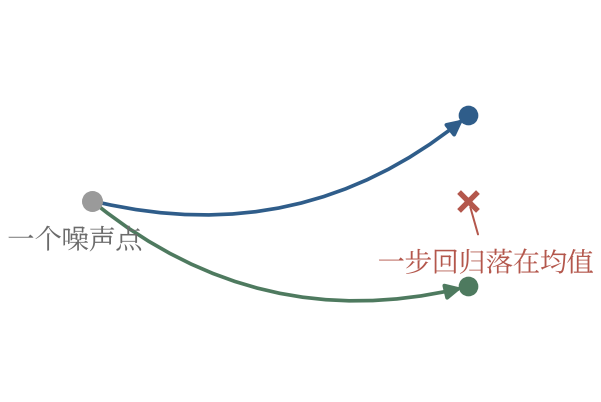

# 一步生成：把积分折起来

扩散与流模型的采样都要迭代几十次。部署时这是主要成本，所以过去几年最热闹的方向之一，就是把步数压到一两步。

这一章把几条路线过一遍，不推公式，只说清它们在用什么换速度。

## 为什么一步很难

从噪声到数据的映射是多值的：同一个噪声，可能对应许多张合理的图。多步采样在每一步注入随机性，相当于在多个可能之间做选择；一步模型只有一次机会。

在平方损失下，一次机会的最优解是条件均值，也就是多个可能结果的平均。平均出来就是一张模糊的图。

所以，一步生成要解决的不是"网络不够大"，而是"一次前向装不下多次选择"。

## 路线一：蒸馏

先有一个好的多步模型当教师，再训练一个学生，让它一次前向复现教师的结果。

只做回归不行，学生学到的还是条件均值，仍然模糊。所以要在回归之外加一项：分布匹配，让学生生成的分布贴近真实分布；或者对抗损失，用判别器补高频细节。

一致性模型属于这一类的另一支：它不要求学生的输出接近教师的某一次采样，而要求同一条轨迹上的不同点映射到同一个终点。这个约束更松，训练也更难，早期工作需要 curriculum 才能稳定。

蒸馏的共同前提是要有教师，训练成本高，但推理确实是一步。

## 路线二：把步数折进输入

不蒸馏，直接改网络的条件：让它知道"要从哪个时刻走到哪个时刻"。

MeanFlow 是代表。它定义一个平均速度

$$u(z,r,t) = \frac{1}{t-r}\int_r^t v(z_\tau,\tau)\,d\tau,$$

也就是"整段位移除以时间"。采样时一步走完：$z_r = z_t - (t-r)u(z_t,r,t)$。

难点是这个量没有现成的标签。MeanFlow 从定义推出一个恒等式，用恒等式右边作为回归目标，训练时用雅可比向量积算导数。它不需要教师，但对训练细节敏感。

## 路线三：把每一步做得更准

不减少步数，而是用高阶求解器在同样的步数下把误差压下去。DPM-Solver 一类的做法属于这一种。

它没有绕开多值性，只是让积分更精确。所以步数能降，但降不到一。

## 视频上的一步生成

视频的少步比图像更难。三个原因叠加在一起。

一是内存。一步生成要把整段视频的张量同时放进显存，长视频放不下，只能分块，分块又回到一致性问题。

二是时间一致性。蒸馏时如果逐帧独立压步数，帧间的细小差异会被保留下来，看起来就是闪烁。所以视频的蒸馏通常在整段上做，或者显式加一项时间一致性损失。

三是质量分布。视频的质量差异更多体现在运动上，而 FVD 一类的指标对运动并不敏感。一个一步模型可能在指标上接近多步，看起来却在抖。

目前的做法与图像类似：先用扩散或流模型生成，再蒸馏到少步；差别在于蒸馏的目标要包含时间维，缓存与分块策略也要重新设计。

## 三条路的对比

| 路线 | 用什么换速度 | 要教师吗 | 典型问题 |
| --- | --- | --- | --- |
| 蒸馏 | 教师的多次采样 | 要 | 细节偏模糊，训练复杂 |
| 折进输入 | 两时间条件与恒等式 | 不要 | 训练不稳，调参敏感 |
| 高阶求解 | 更贵的单步计算 | 不要 | 步数降不到一 |

三条路可以叠加。工程上常见的组合是：流模型做主生成，蒸馏压到四步，再用一步模型做交互式预览。

## 怎么判断一个"一步"模型

看三件事。

第一，NFE。真正的 1-NFE 只做一次网络前向。用了引导的方法，一次采样可能是两次前向，要说明。

第二，训练成本。有的模型一步推理，但训练要三轮蒸馏；有的四步推理，训练一次到位。两者的取舍不同。

第三，细节与多样性。一步模型的差距主要在细节与多峰覆盖上，看样张时要注意这两点，而不是只看分辨率。

## 这一章的位置

这一章只给出路线图。具体的方法在后面的编辑章节里会再遇到：很多编辑方法要在一两步内完成，用的正是这里的思路。

如果对某条路线感兴趣，可以按章末提到的论文去找原文。三条路线的推导都不短，入门阶段知道它们在换什么就够了。
