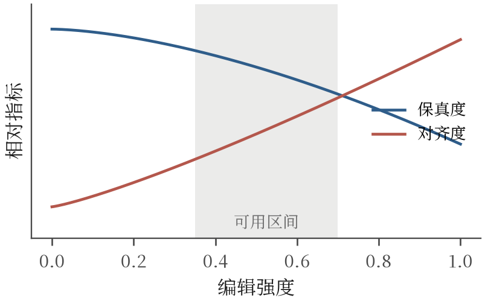

# 编辑的全貌

从这一章开始讲编辑：给定一张已有的图和一个修改要求，怎么让模型改得对，又改得少。

生成要求自由，编辑要求克制。两者用的是同一批模型，难点却完全不同：生成的难点在质量与覆盖，编辑的难点在定位与保真。

## 三个要求

输入是源图 $x_{\text{src}}$、源描述 $c_{\text{src}}$、目标描述 $c_{\text{tar}}$，输出 $x_{\text{tar}}$。要求有三条。

保真：非编辑区域与源图接近。背景、未提及的物体不该变化。

对齐：结果整体符合目标描述，该改的地方必须真的改了。

真实：结果看起来像照片，不是拼贴。

三条要求互相拉扯。改动越大，越容易破坏结构；完全不改，又是恒等映射。

## 编辑的几种类型

属性编辑，比如颜色、材质、季节：改动局部，结构几乎不变。这类最容易。

对象编辑，比如增加、删除、替换：需要新内容，还要与环境协调，涉及光照、遮挡、透视。这类最难。

风格编辑：全局改变，结构保留。

结构编辑，比如姿态、布局：改动最大，通常需要额外的结构条件。

不同类型的难度差别很大。看论文时先看它做的是哪一类，再比较指标，否则容易得出错误结论。

## 怎么评

自动指标分两类。背景保真用 PSNR、SSIM、LPIPS，在非编辑区域计算；语义对齐用 CLIP 相似度，整图与编辑区域分别算。

两者经常矛盾。PSNR 很高，可能意味着几乎没改；CLIP 很高，可能意味着改得过头、背景崩坏。所以论文里通常两个都报，再配人工评价。

常用的基准是 PIE-bench：700 张图，10 类编辑，每张带 mask 与源/目标描述。它的价值在于把编辑区域标出来，可以只在该区域算指标。

## 反演：编辑的第一道坎

要在模型的坐标系里表示一张真实图像，需要反演。

对扩散模型，坐标是噪声：找一个 $x_T$，使得从它出发、以源描述为条件采样，能回到原图。对流模型，坐标也是噪声，但路径确定。对 GAN，坐标是隐向量。

反演误差会直接变成重建误差。重建都不像，编辑就无从谈起。所以所有基于反演的方法，第一件事都是把重建做准。

## 方法地图

后面几章按"从哪一层介入"来分。

第 20 章：潜空间与噪声水平。GAN 的隐向量方向、SDEdit 的加噪去噪。这类方法最老，也最直观。

第 21 章：注意力。文本通过 cross-attention 进入网络，注意力图有空间含义，改它就改语义而不动布局。

第 22 章：结构与反演。ControlNet 一类的条件注入解决"在哪里改"，EDICT 一类的精确反演解决"怎么回得去"。

第 23 章：流模型上的编辑与一步编辑。RF-Inversion 用控制修反演，FlowEdit 干脆不做反演，ChordEdit 把编辑压到一步。

第 24 章：视频编辑。前面几章的方法逐帧套用会闪烁，这一章讲视频特有的困难与三类应对：传播、形变、整体生成。

这四章的顺序不是难度顺序，而是历史顺序：越往后，方法越依赖对模型内部机制的理解，也越少依赖额外的训练。

## 一个贯穿全篇的问题

所有方法都要回答：怎么在改动的同时保住不想改的部分？

答案各不相同：潜空间靠解耦，SDEdit 靠噪声水平，注意力靠替换，ControlNet 靠结构条件，FlowEdit 靠共享噪声相消，ChordEdit 靠低能量平滑。

读后面几章时，可以一直问这个问题。方法的差别，大多在于它们选择在哪一层保住结构。
