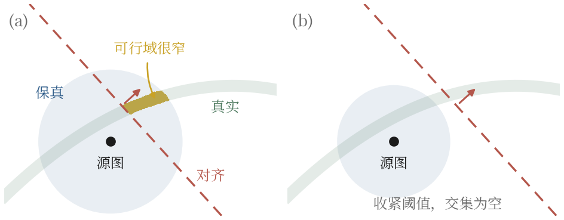
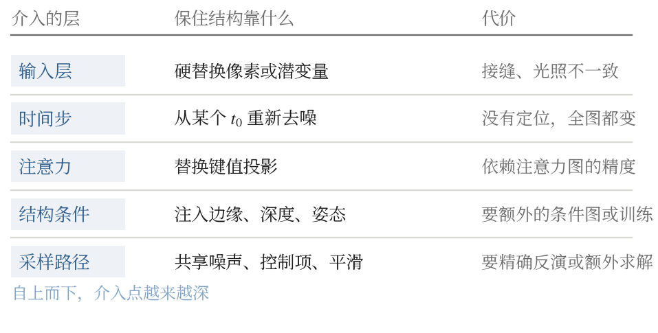

# 编辑的全貌

从这一章开始讲编辑：给定一张已有的图和一个修改要求，怎么让模型改得对，又改得少。

生成要求自由，编辑要求克制。两者用的是同一批模型，难点却完全不同：生成的难点在质量与覆盖，编辑的难点在定位与保真。

一组数字能说明差距。生成时，模型在一张 $1024\times1024$ 的画布上放一顶帽子，帽子落在哪、多大、朝哪边，只要看起来合理就都算对。编辑时，源图里已经有一顶帽子，占了不到三万个像素；要求把它改成蓝色，意味着这不到 $3\%$ 的像素要重画，剩下 $97\%$ 一个像素都不该动。生成模型从来没有被要求过“大部分像素不许变”，把新描述直接喂进去重画一遍，背景、人脸、光照会一起漂。所以编辑的核心不是生成得更好，而是给生成加上约束。

## 三个要求

输入是源图 $x_{\text{src}}$、源描述 $c_{\text{src}}$、目标描述 $c_{\text{tar}}$，输出 $x_{\text{tar}}$。要求有三条。

保真：非编辑区域与源图接近。背景、未提及的物体不该变化。

对齐：结果整体符合目标描述，该改的地方必须真的改了。

真实：结果看起来像照片，不是拼贴。

三条要求互相拉扯。改动越大，越容易破坏结构；完全不改，又是恒等映射。

编辑任务的输入格式也不一样。inpainting 把区域显式给出，$M$ 已知；指令类任务只说“把帽子变蓝”，不告诉方法帽子在哪，需要自己从文本里定位；参考图类任务额外给一张示例图，说明想要的样子。给了 mask 的方法只用在区域内比生成质量，不给 mask 的方法还得先解决“改哪里”，两类方法的指标不能直接比。

### 写成约束

要谈“满足到什么程度”，先得有一块 mask $M$：$M(p)=1$ 表示这个像素允许改。保真写成 mask 之外的平均距离

$$d_{\text{fid}}=\frac{1}{|M^c|}\sum_{p\in M^c}d\big(x_{\text{tar}}(p),\,x_{\text{src}}(p)\big),$$

其中 $M^c$ 是补集，$d$ 可以是逐像素的平方差，也可以是 LPIPS 那样的特征距离。分母用 $|M^c|$ 而不是全图像素数，这一步很要紧：按全图归一的话，mask 画得越大，同样的改动摊到每个像素上越小，保真数字自动变好看。很多对比表里看起来不错的数，差的只是这一步归一化。

对齐是“结果要像目标描述”，常见两种写法：

$$d_{\text{alg}}=\mathbb{E}_{t,\epsilon}\big\|\epsilon-\epsilon_\theta(x_{\text{tar},t},t,c_{\text{tar}})\big\|^2,
\qquad
d_{\text{alg}}'=1-\cos\big(E_{\text{img}}(x_{\text{tar}}),E_{\text{txt}}(c_{\text{tar}})\big).$$

前一个衡量“这个结果在多大程度上像以 $c_{\text{tar}}$ 为条件的样本”，后一个衡量图文嵌入有多近。两个都不完美：噪声预测误差偏爱模糊的平均结果，图文相似度对细节不敏感，一张构图对、纹理错的图也能拿高分。

真实用判别器，或者用另一个生成模型的 score 来量。三项加权，得到最常见的软约束目标

$$\min_{x}\ \lambda_{\text{fid}}d_{\text{fid}}+\lambda_{\text{alg}}d_{\text{alg}}+\lambda_{\text{real}}d_{\text{real}}.$$

三个 $\lambda$ 没有普适取值。换一张图、换一类编辑，合适的比例就变了，这也是软约束最容易出问题的地方：调参经验很难迁移。

硬约束是另一种写法。规定 $M^c$ 上的像素完全不动，只在 $M$ 里做条件生成：

$$x_{\text{tar}}(p)=x_{\text{src}}(p),\quad p\in M^c .$$

这就是 inpainting 的路子。好处是保真不需要调权重，坏处是没有过渡余地：mask 边界如果正好切在光照渐变上，两侧的亮度差会变成一条看得见的线。实践中常把边界羽化几个像素，那等于又把硬约束放松成了软约束。

第三种写法最贴近编辑的本意。它要求结果同时属于两个集合：以 $c_{\text{tar}}$ 为条件的分布，以及在 $M^c$ 上与源图逐点相等的那些函数。

$$x_{\text{tar}}\in\big\{x:\ x(p)=x_{\text{src}}(p),\ p\in M^c\big\}\ \cap\ \operatorname{supp}p(x\mid c_{\text{tar}}).$$

这是条件分布上的约束采样。它比前两种都难：扩散模型会从 $p(x\mid c_{\text{tar}})$ 里采样，但不会从“带硬约束的那一小块”里采样。后面各章的方法，多数是在采样过程内部把这个约束一点点折进去，而不是在外面加一项损失。

横轴的“编辑强度”在每种方法里刻度都不同：SDEdit 用 $t_0$，注意力方法用替换的步数，GAN 用步长 $\alpha$，inpainting 用 mask 面积。这些量之间没有换算关系，所以不同论文画出的权衡曲线不能直接叠在一张图上比较——横坐标看起来相同，实际改动量可能差一倍以上。要横向比，得换一个共同的量，比如区域内真正改变了的像素比例，或者人工标注的改动程度分级。

三条要求的冲突可以画成可行域。保真约束是 $x_{\text{src}}$ 周围的一个球，半径由能容忍的偏差定；对齐约束是“在目标语义方向上的投影超过阈值”的那个半空间；真实约束是数据流形附近的一条带。三者的交集才是可行解。

阈值定得越严，球越小、半空间越远，交集越窄，最后为空。交集为空的意思不是“方法不好”，而是“这三条要求在这一组阈值下没有解”。调试时遇到的“怎么改都不对”，有相当一部分属于这种情况，换方法也解决不了，只能放宽度量或者改 mask。

### 冲突从哪来

冲突分三个层次，混在一起谈容易互相掩盖。

**度量层面**。保真用 PSNR，对齐用 CLIP 相似度，两个数的量纲、动态范围、与人的感受之间的关系都不同。把帽子从红改蓝，区域内 PSNR 可能只有 18 dB 量级，背景 PSNR 在 40 dB 以上；两项一加，背景压倒性地占主导，最优解退化成“什么都不改”。反过来只优化 CLIP，模型会把画面往“最像这段文字”处推，推到极端就是一张与该描述最匹配的典型图，源图的信息所剩无几。

举个能手算的例子。背景占 $97\%$ 的像素，改动后背景 PSNR 是 40 dB，编辑区域只有 20 dB，对应的均方误差分别是 $10^{-4}$ 与 $10^{-2}$。按全图平均，误差是 $0.97\times10^{-4}+0.03\times10^{-2}\approx3.97\times10^{-4}$，折回 PSNR 约 34 dB。单看 34 dB，会以为结果不错；而用户一眼看到的那块区域其实是 20 dB，明显糊了。同一个结果，只在 mask 内算是 20 dB，只在 mask 外算是 40 dB。三个数差 14 dB，说的是同一张图。

**几何层面**。把白墙改成木墙，严格保真意味着墙上的投影、桌上杯子的反射都不许变，结果是墙上贴了一张木纹纸。要真实，这些次级效果必须跟着变，而它们大多在 mask 之外。mask 画大，保真守不住；mask 画小，次级效果管不住。这是 mask 定义本身的冲突，优化技巧无法消除。

**容量层面**。模型对整体风格的表示是全局的：潜空间的隐向量、cross-attention 里的文本键值、U-Net 中间层那张很粗的特征图，都把整张图压进一个短向量或一张低分辨率特征图。改一个词，文本嵌入变了，全局特征跟着变，背景多多少少会漂。加强局部约束能压住一部分，但压不干净，因为共享是表示方式决定的。

这三层对应三种不同的应对：度量层面的问题靠同时报多个指标与人工评价；几何层面的问题靠把 mask 与编辑意图对齐（比如换墙时把整面墙连同投影一起框进去）；容量层面的问题靠介入更深的位置，也就是后面各章讲的注意力与结构条件。

## 编辑的几种类型

属性编辑，比如颜色、材质、季节：改动局部，结构几乎不变。这类最容易。把一顶红帽子改成蓝色，模型要生成的只是同一块毛料的新反照率，形状、褶皱、边缘都由源图给定，条件信息很足。

对象编辑，比如增加、删除、替换：需要新内容，还要与环境协调，涉及光照、遮挡、透视。这类最难。删掉桌上一个杯子，要补出被它挡住的桌面纹理，还要符合桌面上的投影方向；加一把椅子，要让它落在正确的地面高度、被前面的物体遮挡、并且朝向与场景一致。这些关系大多没有写在文本描述里，只能从源图推断。

风格编辑：全局改变，结构保留。风格是一个统计意义上的东西，不需要逐像素指定，通常靠统计量匹配或者风格参考图。难度中等：它不要求精确的位置，但要求在整张图上一致，局部改一处会露馅。

结构编辑，比如姿态、布局：改动最大，通常需要额外的结构条件。人从站到坐，四肢的位置全都变了，源图能提供的只有身份、衣服、背景。这类编辑一般需要骨架、深度或者草图的输入，纯靠文本很难，因为文本无法精确描述每个关节该落在哪个像素上。

类型的差别不只是“改多少”。把四类编辑放在两个维度上看会更清楚：需要新生成的内容占比，以及新内容必须与旧内容对齐的精度。

| 类型 | 改动范围 | 需要的新信息 | 对齐要求 | 典型失败 |
|---|---|---|---|---|
| 属性 | 局部、浅层 | 颜色、纹理 | 低 | 引入色偏 |
| 风格 | 全局、浅层 | 统计特征 | 中 | 纹理糊、局部不一致 |
| 结构 | 局部、几何 | 姿态、深度 | 高 | 解剖错误、比例失真 |
| 对象 | 局部、含遮挡 | 外观 + 空间关系 | 最高 | 投影错、遮挡顺序反 |

对难度影响最大的其实是对齐要求那一列。属性编辑只需要新内容“看起来是那个颜色”，位置差几个像素没人发现；对象编辑里，一个影子的方向错了整张图立刻显得假。这就是为什么属性编辑在 2019 年前后就已经做得不错，而对象级编辑到扩散模型的注意力操作出现之后才算可用。

实际需求还常常是多条一起改：把红帽子换成蓝的，同时把背景从室内换成海边。两条指令作用在不同区域，看起来可以分开处理，但通道、光照、投影把它们连在一起——海边是强逆光，帽子的蓝色必须跟着变暗；背景一换，原来的曝光就不对了。多指令编辑的失败，多数不是某一处没改对，而是各处分别改对之后凑不到一起。处理方式无非两种：把多条指令合成一句完整描述重画，丢掉保真；或者按区域分别改再合成，丢掉一致性。

不同类型的难度差别很大。看论文时先看它做的是哪一类，再比较指标，否则容易得出错误结论。一篇在属性编辑上把背景 LPIPS 压到 0.02 的方法，拿到对象编辑上未必成立，因为后者的 mask 附近本来就有大量合理的变化，同样的阈值会误判。

## 怎么评

自动指标分两类。背景保真用 PSNR、SSIM、LPIPS，在非编辑区域计算；语义对齐用 CLIP 相似度，整图与编辑区域分别算。

两者经常矛盾。PSNR 很高，可能意味着几乎没改；CLIP 很高，可能意味着改得过头、背景崩坏。所以论文里通常两个都报，再配人工评价。

### 三个保真指标

PSNR 是最直接的：

$$\mathrm{PSNR}=10\log_{10}\frac{1}{\frac{1}{|M^c|}\sum_{p\in M^c}\big(x_{\text{tar}}(p)-x_{\text{src}}(p)\big)^2},$$

像素归一到 $[0,1]$。它对整体的亮度偏移、色彩偏移很敏感，对模糊却相当宽容——一张糊掉的背景，只要均值对，PSNR 可能比一张清晰但有轻微位移的背景更高。而人眼最先注意到的恰恰是位移与模糊。

SSIM 在局部窗口里比较亮度、对比度、结构三项，值域 $[0,1]$，越接近 1 越像。它对局部对比度的变化敏感，对颜色的绝对偏差不敏感。用它评保真，会漏掉整张图偏暖或者偏冷这类问题。

LPIPS 把两张图送进一个在 ImageNet 上训练的 VGG 或 AlexNet，比较多层特征的加权距离。它更接近人的判断，但也有自己的偏好：它奖励“看起来自然”的结果。一张重画过的背景，只要语义与纹理合理，LPIPS 可能不高，尽管它已经不是原来的那块背景。

三个指标各缺一块，所以论文里通常一起报。看到只报一个的方法，先想它遮住了什么。

还有一个指标专门管“结构有没有被改掉”，通常叫结构距离。做法是把源图与结果分别送进 DINO 一类的自监督模型，取中间层特征，比较两张特征图上逐点余弦相似度矩阵的差异。它不比像素，也不比纹理，只问“哪块区域和哪块区域相似”这个关系有没有变。布局一改，这个关系先乱；颜色、材质换了，它几乎不动。用它给对齐做补充很合适：CLIP 说“内容对上了”，结构距离说“位置没乱”，两条一起看，才分得清方法是真改了那个物体，还是把整张图重画了一遍。

### 指标怎么互相作弊

指标不是中立的，只要在评测里固定下来，方法就会朝它偏。几个典型的例子。

**什么都不改**。输出恒等于源图，背景 PSNR 是无穷大，SSIM 等于 1，LPIPS 等于 0。文字相似度也不会太差，因为源图与目标描述共享大部分语义——把“一只黑猫坐在沙发上”改成“一只白猫坐在沙发上”，两张图与后一句的 CLIP 相似度差别很小。三项指标里两项满分，一项小跌，平均分很漂亮。

**只改一小块**。在整图上算 CLIP 相似度时，把猫的脸涂成绿的就足以让分数上升，因为 CLIP 看的是全局语义，几个百分点的像素变化就够推动它。人一眼能看出这是涂抹，指标看不出来。修法是在 mask 内单独算一次相似度，并配合人工。

**mask 造假**。报告的 mask 比实际改动区域小，背景指标只在没被改到的地方算。反过来把 mask 画得巨大，则区域内指标好看、背景指标没有样本。mask 由谁给出、误差多大，必须写清楚。

**不需要模型的办法**。把源图与目标图的对应区域做一个颜色映射，或者贴一块纹理，就能拿到不错的背景保真度，因为背景确实没动。这类结果在区域内一眼假，但背景指标完全合格。所以区域内也要算真实度，比如区域内 LPIPS 距离、区域内 FID。

**挑种子**。同一个 prompt 采样 50 次，报 CLIP 最高的那次；背景保真报另一次。两种挑选都合理，合起来就是作弊。规范的对比要固定随机种子集合，或者报均值与方差。

**用同一个编码器**。方法用 CLIP 损失训练，评测又用 CLIP 相似度，天然占优。换一个编码器（BLIP、DINO）重算一次，分数常常掉几个点。

**亚像素平移**。把整张图缩放到 $0.99$ 倍再放大回去，视觉上几乎看不出，PSNR 会掉好几个 dB，因为逐像素对齐被破坏了。这类操作有时是无意的（VAE 的上采样格点没对齐），有时是有意的。

这些例子的共同点是：单一数字总能被优化，而人想看的其实是若干性质的组合。所以编辑方向的论文，自动指标只是入场券。

### 基准与人工

常用的基准是 PIE-bench：700 张图，10 类编辑，每张带 mask 与源/目标描述。它的价值在于把编辑区域标出来，可以只在该区域算指标。它通常报三组数：结构距离（用一个自监督特征算源图与结果的相似度，衡量整体布局有没有变）、背景保真（mask 外的 PSNR、LPIPS、MSE）、文本对齐（CLIP 相似度）。

三组数之间依然会打架。一个方法结构距离很低、背景很干净，往往说明它改得少；CLIP 高而背景差的，往往是改过头。读表的方法是把三组数当成三个坐标，看方法落在哪个角上，而不是把它们平均成一个总分。

人工评价通常是两两比较：给评价者源图、目标描述、两个结果，问哪个更好。这个问法简单，但“更好”里混了保真、对齐、真实三个维度，两个人可能因为关注点不同给出相反的判断。更细的做法是分项打分，比如保真一到五分、对齐一到五分，代价是标注成本翻几倍，一致性也未必提高。比较稳妥的是先做两两比较筛出候选，再对候选做分项打分。

## 反演：编辑的第一道坎

要在模型的坐标系里表示一张真实图像，需要反演。

对扩散模型，坐标是噪声：找一个 $x_T$，使得从它出发、以源描述为条件采样，能回到原图。对流模型，坐标也是噪声，但路径确定。对 GAN，坐标是隐向量。

这三类坐标的求解方式与误差来源都不一样，可以并排看。

| 坐标 | 用在哪种模型 | 怎么找 | 主要误差来源 |
|---|---|---|---|
| 噪声 $x_T$ | 扩散 | DDIM 反演、逐图优化 | 离散化；每步的 $\epsilon$ 在不同点求值 |
| 隐向量 $z$ 或 $w$ | GAN、VAE | 编码器、逐图优化、两者混合 | 编码器的平均化偏差；优化的落点 |
| 速度场 $v$ | 流模型 | 沿 ODE 反向积分 | 积分误差；条件切换后轨迹不再重合 |

**噪声坐标**。给定 $x_{\text{src}}$，找一个 $x_T$，使得从它出发、以 $c_{\text{src}}$ 为条件采样能回到原图。DDIM 的反演是采样公式反过来写：

$$x_{t+1}=\sqrt{\frac{\alpha_{t+1}}{\alpha_t}}\Big(x_t-\sqrt{1-\alpha_t}\,\epsilon_\theta(x_t,t)\Big)+\sqrt{1-\alpha_{t+1}}\,\epsilon_\theta(x_t,t),$$

$\alpha_t$ 是单步的累积系数，$\bar\alpha_t=\prod_{s\le t}\alpha_s$。采样时这一步用的是 $\epsilon_\theta(x_{t+1},t+1)$，反演时手里只有 $x_t$，只能用 $\epsilon_\theta(x_t,t)$。两个预测点的差就是误差源。步数越多，每个点靠得越近，差越小，但不会归零。

误差回到 $x_0$ 时会被放大。由

$$\hat x_0=\frac{x_t-\sqrt{1-\bar\alpha_t}\,\epsilon_\theta(x_t,t)}{\sqrt{\bar\alpha_t}},$$

$\epsilon$ 上的偏差 $\delta$ 传到 $\hat x_0$ 上变成 $\sqrt{(1-\bar\alpha_t)/\bar\alpha_t}\,\delta$。用 $T=1000$ 的线性日程算几个值：

| $t$ | $\bar\alpha_t$ | 放大系数 |
|---|---|---|
| 200 | 0.656 | 0.72 |
| 400 | 0.194 | 2.0 |
| 600 | 0.026 | 6.2 |
| 800 | 0.0015 | 26 |
| 900 | 0.0003 | 58 |

低噪声端的放大系数增长很快，而那一带的 $\epsilon$ 预测恰恰最准；高噪声端相反，预测不准但放大有限。漂移是这两者叠加的结果，不是单调的一头。

还有两个细节。一是随机性：DDIM 在 $\eta=0$ 时是确定性的 ODE，反演才有意义；$\eta>0$ 的采样每步注入新噪声，注入的那部分无法从结果里推回去，反演就退化成“找一条能走到这里的路径”，而不是“找回原来那条路径”。二是求解方式：除了递推反演，也可以把 $x_T$ 当成可优化变量，最小化 $\|x_{\text{src}}-\text{Sample}(x_T,c_{\text{src}})\|$。这种写法对任何采样器都成立，代价是每优化一步就要跑一遍完整采样——50 步采样、100 次迭代就是五千次网络前向，单张图要几分钟（量级估计）。它只在需要极高精度且不计成本时使用。

**隐向量**。GAN 的反演找一个 $z$ 使 $G(z)\approx x$；VAE 的编码器直接给出 $z$。这类反演的误差主要不来自求解，而来自表示能力：生成器只能表示它学到过的那部分图像，输入落在分布之外时，最接近的 $z$ 也只能给出一个近似。VAE 的潜空间还有压缩损失，一张图编码再解码，PSNR 往往只有 25–30 dB 的量级（这个量级随压缩率变化，属于估计）。潜空间编辑的天花板由这个重建上限决定。

重建准与编辑稳常常反向。优化得越准，$z$ 越靠近潜空间的边缘——生成器为了拟合这一张图，会用上不常见的坐标组合；而边缘处的局部映射容易病态，沿语义方向移一小步，图像的变化就很大且不可控。编码器给出的 $z$ 更靠近分布中心，重建差一点，编辑却更稳。

**速度场**。流模型的 ODE 在数值上可逆，反向积分就能回到噪声。麻烦在于条件：反演用 $c_{\text{src}}$ 的速度场，采样用 $c_{\text{tar}}$ 的速度场，两条轨迹在同一个起点出发，却按不同的场走。起点找得再准，终点也不是“源图加目标改动”，而是另一条路径的终点。后面讲流编辑时，所有方法都在处理这个不一致。

反演误差会直接变成重建误差。重建都不像，编辑就无从谈起。所以所有基于反演的方法，第一件事都是把重建做准。

实践里有个经验门槛：重建 PSNR 在 30 dB 以上、LPIPS 在 0.1 以下，才算“回得去”。达不到这个门槛，用户看到的差异里有相当部分来自重建失败，与方法的设计无关；这时候横向比较指标的差别，比的是重建精度，不是编辑能力。重建这一关过了，编辑才有意义。

## 方法地图

后面几章按“从哪一层介入”来分。

第 20 章：潜空间与噪声水平。GAN 的隐向量方向、SDEdit 的加噪去噪。这类方法最老，也最直观。它们不碰模型内部，只改输入或起始时刻，所以代价小、通用性好，定位能力也最弱。

第 21 章：注意力。文本通过 cross-attention 进入网络，注意力图有空间含义，改它就改语义而不动布局。这类方法开始依赖对内部机制的观察：哪一层、哪个头对应哪个词，需要看图确定。

第 22 章：结构与反演。ControlNet 一类的条件注入解决“在哪里改”，EDICT 一类的精确反演解决“怎么回得去”。前者需要额外的条件图与训练，后者需要双倍的采样开销。

第 23 章：流模型上的编辑与一步编辑。RF-Inversion 用控制修反演，FlowEdit 干脆不做反演，ChordEdit 把编辑压到一步。这一层的方法直接改采样路径，代价是必须理解 ODE 的几何。

第 24 章：视频编辑。前面几章的方法逐帧套用会闪烁，这一章讲视频特有的困难与三类应对：传播、形变、整体生成。

这五章的顺序不是难度顺序，而是历史顺序：越往后，方法越依赖对模型内部机制的理解，也越少依赖额外的训练。

## 一个贯穿全篇的问题

所有方法都要回答：怎么在改动的同时保住不想改的部分？

答案各不相同：潜空间靠解耦，SDEdit 靠噪声水平，注意力靠替换，ControlNet 靠结构条件，FlowEdit 靠共享噪声相消，ChordEdit 靠低能量平滑。

把这些答案按介入的层排一下，能得到一张比较清楚的图。

停在最上面一层（直接改像素或潜变量）的方法，保结构靠的是“别的地方不动”，所以接缝、光照不匹配是它的典型失败。往下一层，靠噪声水平控制“改多深”，代价是没有定位，整张图一起变。再往下进入注意力，靠替换某个词的键值来控制“改哪里”，代价是注意力图本身不够精确，词与区域的对应常常是软性的、多对的。再深一层是结构条件，把边缘、深度、姿态显式喂进去，位置准了，但要多一张条件图，多半还要训练。最深的是直接改采样路径，用共享噪声、控制项、低能量约束让两条轨迹尽量重合，这要求反演足够准，或者求解足够快。

读后面几章时，可以一直问这个问题。方法的差别，大多在于它们选择在哪一层保住结构，以及为了这一层付出了什么代价。
